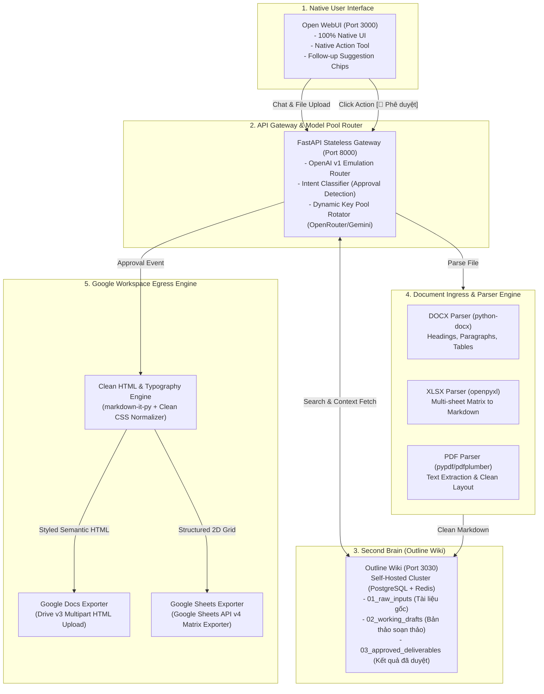

# TÀI LIỆU ĐẶC TẢ YÊU CẦU PHẦN MỀM (SRS) - MINI-HERMES MVP

**Tên dự án:** Mini-Hermes Monorepo (Document-Centric AI Knowledge & Deliverable Assistant)  
**Phiên bản tài liệu:** 2.0.0 (MVP Scope Refined)  
**Ngày cập nhật:** 03/11/2026  
**Trạng thái:** Active / Baseline Specification  

---

## 1. TỔNG QUAN & PHẠM VI DỰ ÁN (SCOPE & OBJECTIVES)

### 1.1. Bối cảnh & Mục tiêu Cốt lõi
**Mini-Hermes** là phiên bản tinh gọn, tập trung chuyên sâu vào xử lý tài liệu của kiến trúc Hermes Orchestrator. Hệ thống đóng vai trò là một trợ lý thông minh hỗ trợ nhân sự và chuyên viên kinh doanh:
1. **Tiếp nhận & đọc hiểu tài liệu đa định dạng (Ingress):** Bóc tách chính xác nội dung từ DOCX, XLSX, PDF thành định dạng Clean Markdown có cấu trúc ngữ nghĩa cao.
2. **Quản trị tri thức trên Outline Wiki (Second Brain):** Sử dụng Outline Wiki làm Single Source of Truth cho toàn bộ tài liệu đầu vào (Raw Inputs), bản thảo đang xử lý (Working Drafts) và kết quả được duyệt (Approved Deliverables) theo cấu trúc đa tenant ngầm.
3. **Tương tác 100% Native trên Open WebUI:** Người dùng tương tác trực tiếp qua giao diện chuẩn của Open WebUI thông qua Native Action Tools và Suggestion Chips, không tiêm mã Javascript DOM tùy biến hay iframe tự chế.
4. **Phê duyệt & Xuất bản (Dual Human-in-the-Loop & Egress):** Cho phép người dùng duyệt bản thảo và kích hoạt xuất bản một chạm sang **Google Docs** (qua Google Drive API v3 Multipart HTML Upload < 1s) hoặc **Google Sheets** với typography chuẩn, sạch rác HTML và căn lề bảng biểu thẩm mỹ.

### 1.2. Giới hạn Phạm vi (Boundary & Non-Scope)
- **Document-Only Sandbox (Bảo mật tuyệt đối):** Mini-Hermes **không** có quyền thực thi lệnh bash/shell trên máy chủ chủ quản, không có quyền sửa đổi file hệ điều hành hay quyền root. Quyền duy nhất là: Đọc/Bóc tách tài liệu người dùng tải lên, Ghi/Đọc Outline Wiki qua REST API và Đẩy tài liệu sang Google Workspace qua OAuth2 Token.
- **Loại bỏ triệt để Scope cũ:**
  - Không triển khai CRM Engine, không lưu trữ pipeline khách hàng.
  - Không sử dụng Vector Database phức tạp (Chroma/FAISS/Milvus) hay kiến trúc Hybrid MarkItDown cồng kềnh; việc tìm kiếm tri thức kế thừa 100% cơ chế Ingress/Search của Hermes gốc trực tiếp qua Outline Search Index.
  - Không sử dụng custom frontend (`packages/web` cũ) hay custom right-drawer script.

---

## 2. KIẾN TRÚC TỔNG THỂ & HỆ THỐNG THÀNH PHẦN



---

## 3. DANH SÁCH ACTORS VÀ ĐẶC TẢ USE CASES

### 3.1. Các Tác nhân (Actors)
1. **User (Nhân viên / Chuyên viên):** Người dùng làm việc trực tiếp trên Open WebUI để tải file tài liệu, đặt câu hỏi, yêu cầu AI soạn thảo và duyệt xuất file.
2. **Mini-Hermes Orchestrator:** Bộ não điều phối kết nối giữa LLM, kho Outline Wiki và dịch vụ bóc tách/xuất bản.
3. **Outline Wiki (Second Brain):** Hệ thống lưu trữ và đồng bộ trạng thái tri thức theo phân cấp đa tenant.
4. **Google Workspace API (Drive/Docs/Sheets):** Nền tảng đích để tạo bản giao nộp (deliverable) phục vụ cộng tác chia sẻ.

### 3.2. Bảng Use Case Tổng thể

| Mã UC | Tên Use Case | Actor Chính | Mô tả Tóm tắt |
| :--- | :--- | :--- | :--- |
| **UC-01** | Bóc tách tài liệu Ingress (DOCX/XLSX/PDF) | User, Ingress Engine | Người dùng đính kèm file trong chat; hệ thống chuẩn hóa nội dung thành Clean Markdown và lưu tự động vào `01_raw_inputs` trên Outline. |
| **UC-02** | Tra cứu ngữ cảnh Second Brain | Mini-Hermes, Outline | Khi người dùng hỏi nghiệp vụ, hệ thống tìm kiếm trong Outline theo tenant để nạp ngữ cảnh vào LLM prompt. |
| **UC-03** | Soạn thảo bản thảo (Working Draft) | User, Mini-Hermes | AI sinh bản thảo hợp đồng, báo giá, báo cáo; lưu phiên bản vào `02_working_drafts` trên Outline và phản hồi Open WebUI. |
| **UC-04** | Duyệt & Đề xuất hành động (Native Chip) | Mini-Hermes, Open WebUI | Sau khi AI trả lời bản thảo, hệ thống tự động sinh chip gợi ý: `[🚀 Phê duyệt & Xuất sang Google Docs]` hoặc `[📊 Xuất bảng tính Google Sheets]`. |
| **UC-05** | Xuất bản Google Docs (Refined HTML) | User, Egress Engine | Người dùng bấm duyệt; hệ thống làm sạch mã HTML, gắn typography doanh nghiệp và đẩy sang Google Docs bằng Drive API v3. |
| **UC-06** | Xuất bản Google Sheets (Grid Data) | User, Egress Engine | Chuyển đổi bảng dữ liệu từ Markdown/XLSX sang trang tính Google Sheets mới hoặc cập nhật sheet hiện có. |
| **UC-07** | Đăng nhập 1-Chạm Outline Wiki | User, Gateway | Cho phép người dùng truy cập Outline Wiki nội bộ lập tức qua endpoint tự sinh session mà không gặp lỗi redirect URI. |

---

## 4. CHI TIẾT LUỒNG XỬ LÝ THEO TỪNG ĐỊNH DẠNG TÀI LIỆU (INGRESS FLOW)

### 4.1. Luồng Bóc tách File DOCX (Microsoft Word)
1. **Nhận diện:** File tải lên có MIME type `application/vnd.openxmlformats-officedocument.wordprocessingml.document` hoặc đuôi `.docx`.
2. **Trích xuất phân đoạn (Paragraph Extraction):**
   - Đọc các cấp độ Heading (`Heading 1`, `Heading 2`, `Heading 3`) $\to$ ánh xạ tương ứng sang `#`, `##`, `###`.
   - Giữ nguyên định dạng in đậm (`**bold**`), in nghiêng (`*italic*`), gạch đầu dòng (`bulleted list`) và đánh số thứ tự (`numbered list`).
3. **Trích xuất Bảng (Table Extraction):**
   - Duyệt qua từng dòng (`row`) và ô (`cell`).
   - Tự động lấy dòng đầu tiên làm Header: `| Cột 1 | Cột 2 |` $\to$ chèn dòng phân cách `| --- | --- |`.
   - Chuẩn hóa ký tự xuống dòng bên trong ô thành khoảng trắng hoặc `<br>` để không làm rách bảng Markdown.
4. **Đầu ra Ingress:** Clean Markdown lưu vào Outline: `business/{tenant_id}/01_raw_inputs/{filename}.md`.

### 4.2. Luồng Bóc tách File XLSX (Microsoft Excel)
1. **Nhận diện:** File có MIME `application/vnd.openxmlformats-officedocument.spreadsheetml.sheet` hoặc đuôi `.xlsx`.
2. **Xử lý Đa Sheet (Multi-Sheet Handling):**
   - Đọc danh sách sheet có dữ liệu (bỏ qua sheet trống).
   - Mỗi sheet được biểu diễn bằng một đề mục cấp 2 (`## Sheet: [Tên Sheet]`).
3. **Rút gọn & Chuẩn hóa Bảng:**
   - Xác định vùng biên dữ liệu thực (`max_row`, `max_column`), loại bỏ các hàng/cột trống ở đuôi.
   - Định dạng số: Giữ nguyên định dạng tiền tệ, phần trăm, số thập phân theo format gốc (không convert lung tung sang scientific notation).
   - Nếu bảng vượt quá 50 hàng: Sinh bảng tóm tắt 20 hàng đầu + metadata tổng số dòng và tổng các cột số (SUM, AVG) để tránh tràn ngữ cảnh LLM.
4. **Đầu ra Ingress:** Markdown chứa bảng dữ liệu chi tiết kèm metadata tổng hợp.

### 4.3. Luồng Bóc tách File PDF (Adobe Acrobat Portable Document)
1. **Nhận diện:** File có đuôi `.pdf` hoặc MIME `application/pdf`.
2. **Trích xuất Text có Cấu trúc (Layout-Aware Text Extraction):**
   - Phân tích vị trí tọa độ font chữ để nhận diện Heading và phân cấp tiêu đề.
   - Xóa bỏ header và footer lặp lại ở các trang (ví dụ số trang `Trang 1/10`, tên tài liệu lặp lại ở đầu trang).
   - Ghép các dòng bị ngắt dòng vô cớ do format PDF về lại đoạn văn (paragraph reflow).
3. **Phát hiện Bảng trong PDF:**
   - Nhận diện các lưới kẻ bảng để chuyển đổi thành bảng Markdown; nếu không có lưới kẻ thì dùng thuật toán nhận diện khoảng cách cột (whitespace alignment).
4. **Đầu ra Ingress:** Markdown sạch, rõ ràng từng phần, không bị lẫn ký tự rác (watermark, page header).

---

## 5. ĐẶC TẢ TỔ CHỨC TRI THỨC TRÊN OUTLINE WIKI (SECOND BRAIN SPEC)

### 5.1. Cấu trúc Cây Thư mục Đa Tenant Ngầm
Để đảm bảo mỗi doanh nghiệp/khách hàng có một không gian dữ liệu độc lập, Outline Wiki được tổ chức theo cấu trúc sau trong Collection mặc định (`Mini-Hermes Business`):

```text
📁 Mini-Hermes Business (Root Collection)
 └── 📁 business/
      └── 📁 {tenant_id}/ (Mặc định: "default_org" hoặc mã định danh khách hàng)
           ├── 📁 01_raw_inputs/
           │    ├── Mau_Hop_Dong_Dich_Vu.docx.md
           │    ├── Bang_Bao_Gia_Chi_Tiet.xlsx.md
           │    └── Bao_Cao_Tai_Chinh_Q3.pdf.md
           ├── 📁 02_working_drafts/
           │    └── Du_Thao_Hop_Dong_Cung_Cap_Weamis.md
           └── 📁 03_approved_deliverables/
                └── Hop_Dong_Chinh_Thuc_Weamis_Signed.md (Chứa link Google Docs đồng bộ)
```

### 5.2. Luồng Vòng đời Tài liệu (Document Lifecycle)
1. **Input:** File tải lên Open WebUI $\to$ Ingress Parser $\to$ Lưu vào `01_raw_inputs`.
2. **Drafting:** Người dùng chat yêu cầu AI $\to$ AI đọc `01_raw_inputs`, tổng hợp $\to$ Tạo hoặc cập nhật tài liệu trong `02_working_drafts`.
3. **Approval:** Người dùng bấm `[🚀 Phê duyệt & Xuất sang Google Docs]` $\to$ Hệ thống:
   - Di chuyển hoặc nhân bản bản thảo sang `03_approved_deliverables`.
   - Kích hoạt Egress Engine để xuất bản sang Google Docs / Sheets.
   - Ghi đè đường link Google Docs/Sheets đã tạo vào phần đầu tài liệu trên Outline.

---

## 6. ĐẶC TẢ TƯƠNG TÁC NATIVE OPEN WEBUI (DUAL HUMAN-IN-THE-LOOP)

### 6.1. Nguyên tắc Bất di bất dịch
- **Không nhúng custom script tiêm DOM (Không drawer, không dock button, không modal viewer tự chế).**
- Toàn bộ trải nghiệm người dùng dựa 100% vào các tính năng có sẵn của Open WebUI:
  1. **Native Suggestion Chips (`follow_ups`):** Hiển thị ngay dưới câu trả lời của AI để người dùng bấm trực tiếp.
  2. **Native Action Tool Plugin (`hermes_sync_action.py`):** Nút bấm tích hợp trong thanh công cụ tin nhắn của Open WebUI.
  3. **FastAPI Approval Intent Classifier:** Tự động phát hiện khi người dùng chat các cụm từ phê duyệt ("đồng ý", "phê duyệt", "chốt", "xuất docs").

### 6.2. Luồng Tương tác Mẫu
```text
[User]: Hãy soạn giúp tôi Hợp đồng Dịch vụ từ tài liệu Báo giá đã tải lên.
[Mini-Hermes]: 
  Dưới đây là Dự thảo Hợp đồng Dịch vụ được tổng hợp từ Báo giá...
  (Hiển thị nội dung Markdown dự thảo)

  ---
  [Suggestion Chips xuất hiện dưới câu trả lời]:
  ┌────────────────────────────────────────────────────────┐
  │  🚀 Phê duyệt & Xuất sang Google Docs                 │
  │  📊 Xuất Bảng giá sang Google Sheets                  │
  │  ✏️ Sửa lại điều khoản thanh toán                       │
  └────────────────────────────────────────────────────────┘

[User bấm chip]: "🚀 Phê duyệt & Xuất sang Google Docs"
[Mini-Hermes]:
  Đang thực hiện xuất bản dự thảo sang Google Docs...
  ✅ ĐÃ XUẤT BẢN THÀNH CÔNG!
  📄 Tên tài liệu: Hop_Dong_Dich_Vu_Weamis
  🔗 Mở Google Docs: https://docs.google.com/document/d/1aBcDeFgHi...
  ⏱️ Thời gian xử lý: 0.65 giây (Drive API v3 Multipart)
```

---

## 7. ĐẶC TẢ CHI TIẾT EGRESS: XUẤT BẢN GOOGLE DOCS & GOOGLE SHEETS

### 7.1. Khắc phục Vấn đề Hiện tại (HTML Rác & Định dạng Xấu)
**Vấn đề hiện tại:**
- Đầu ra Google Docs xuất hiện thẻ HTML lộ thiên (raw tags: `<div>`, `<p>`, `<span>`).
- Bảng biểu bị dính chữ, đường viền mờ hoặc mất căn chỉnh cột.
- Font chữ mặc định không đồng nhất, khoảng cách dòng (line-height) lộn xộn.

**Quy chuẩn Chuẩn hóa HTML mới (Clean HTML Normalizer Pipeline):**
1. **Pipeline Chuyển đổi Markdown $\to$ Semantic HTML:**
   - Dùng `markdown-it-py` với các plugin chuẩn: `tables`, `strikethrough`.
   - **Tuyệt đối không** bọc tài liệu trong các thẻ `<div>` tùy tiện; chỉ dùng semantic tags chuẩn: `<h1>`, `<h2>`, `<h3>`, `<p>`, `<ul>`, `<ol>`, `<li>`, `<table>`, `<thead>`, `<tbody>`, `<tr>`, `<th>`, `<td>`, `<blockquote>`, `<strong>`, `<em>`.
2. **Bộ Thư viện CSS Typography Doanh nghiệp (Inline CSS cho Google Docs):**
   Google Docs hỗ trợ parsing HTML rất tốt nếu các thuộc tính CSS được nhúng trực tiếp dạng chuẩn:
   ```html
   <!DOCTYPE html>
   <html>
   <head>
     <meta charset="utf-8">
     <style>
       body {
         font-family: 'Arial', 'Segoe UI', sans-serif;
         font-size: 11pt;
         line-height: 1.5;
         color: #1a1a1a;
         margin: 0;
         padding: 0;
       }
       h1 {
         font-size: 18pt;
         font-weight: bold;
         color: #0d47a1;
         margin-top: 18pt;
         margin-bottom: 6pt;
         page-break-after: avoid;
       }
       h2 {
         font-size: 14pt;
         font-weight: bold;
         color: #1565c0;
         margin-top: 14pt;
         margin-bottom: 4pt;
         page-break-after: avoid;
       }
       h3 {
         font-size: 12pt;
         font-weight: bold;
         color: #212121;
         margin-top: 10pt;
         margin-bottom: 2pt;
       }
       p {
         margin-top: 0;
         margin-bottom: 6pt;
         text-align: justify;
       }
       table {
         border-collapse: collapse;
         width: 100%;
         margin-top: 8pt;
         margin-bottom: 12pt;
       }
       th {
         background-color: #f1f3f4;
         color: #202124;
         font-weight: bold;
         border: 1px solid #c0c0c0;
         padding: 6pt 8pt;
         text-align: left;
         font-size: 10pt;
       }
       td {
         border: 1px solid #dcdcdc;
         padding: 5pt 8pt;
         vertical-align: top;
         font-size: 10pt;
       }
       blockquote {
         border-left: 3px solid #1a73e8;
         margin-left: 0;
         padding-left: 10pt;
         color: #5f6368;
         font-style: italic;
       }
     </style>
   </head>
   <body>
     <!-- Nội dung semantic sạch -->
   </body>
   </html>
   ```
3. **Cơ chế Upload Google Drive API v3 Multipart:**
   - Request Header: `Content-Type: multipart/related; boundary=foo_bar_baz`
   - Phần 1 (Metadata JSON): `{"name": "Tên_File", "mimeType": "application/vnd.google-apps.document"}`
   - Phần 2 (Payload Content): `Content-Type: text/html; charset=UTF-8` chứa toàn bộ mã HTML đã normalize sạch sẽ.
   - Khi cập nhật tài liệu đã có sẵn: Gọi `PATCH https://www.googleapis.com/upload/drive/v3/files/{file_id}?uploadType=multipart` $\to$ **Giữ nguyên URL của tài liệu cũ**, không sinh link trùng lặp!

### 7.2. Đặc tả Luồng Xuất Google Sheets
1. **Trích xuất Bảng số liệu:**
   - Trích xuất toàn bộ bảng (table) có trong tài liệu phê duyệt hoặc file XLSX gốc.
2. **Gọi Google Sheets API v4:**
   - Tạo file bảng tính mới với MIME `application/vnd.google-apps.spreadsheet`.
   - Sử dụng endpoint `spreadsheets.values.update` với `valueInputOption=USER_ENTERED` để tự động nhận diện kiểu số, ngày tháng và công thức.
   - Định dạng header: Tô màu nền nhẹ (#F1F3F4), in đậm chữ và bật tính năng đóng băng dòng đầu (`frozenRowCount = 1`).

---

## 8. YÊU CẦU PHI CHỨC NĂNG & TIÊU CHUẨN NGHIỆM THU (ACCEPTANCE CRITERIA)

### 8.1. Yêu cầu Phi chức năng (Non-Functional Requirements)
1. **Hiệu năng (Performance):**
   - Tốc độ bóc tách file DOCX / XLSX / PDF $\le 2.0$ giây cho tài liệu dưới 10 trang / 100 hàng.
   - Tốc độ xuất bản sang Google Docs / Google Sheets $\le 1.2$ giây (nhờ Drive v3 Multipart upload).
2. **Tính Ổn định & Độ sẵn sàng (Reliability):**
   - Đảm bảo cơ chế xoay vòng API Keys của OpenRouter và Gemini Flash; khi một key chạm quota, hệ thống tự động fallback sang key dự phòng không gián đoạn người dùng.
3. **Bảo mật & Phân quyền (Security & Privacy):**
   - Tuân thủ Document-Only Sandbox: Tuyệt đối không sinh shell command hay đụng chạm file hệ thống.
   - Phân lập dữ liệu hoàn toàn giữa các tenant trên Outline Wiki theo prefix `business/{tenant_id}/`.
4. **Trải nghiệm Người dùng (User Experience):**
   - 100% Native Open WebUI: Không gây lỗi giật màn hình do script tiêm DOM, giao diện chuẩn mobile & desktop.

### 8.2. Tiêu chuẩn Nghiệm thu (Acceptance Criteria)
- [x] **AC-01:** Thư mục `docs/` cũ đã được xóa bỏ hoàn toàn; toàn bộ tài liệu mô tả chính xác phạm vi MVP Mini-Hermes.
- [ ] **AC-02:** Tải lên file DOCX, XLSX, PDF trên Open WebUI $\to$ Nội dung xuất hiện chính xác trong `01_raw_inputs` trên Outline Wiki dưới dạng Clean Markdown.
- [ ] **AC-03:** AI sinh câu trả lời kèm theo đúng các suggestion chips native (`[🚀 Phê duyệt & Xuất sang Google Docs]`).
- [ ] **AC-04:** Bấm nút duyệt $\to$ Tài liệu được tạo trên Google Docs trong vòng 1 giây, link mở được ngay và **hoàn toàn không có thẻ HTML rác lộ thiên**.
- [ ] **AC-05:** Bảng biểu trong Google Docs có kẻ viền rõ ràng, font chữ Arial 11pt, tiêu đề phân cấp đẹp mắt.
- [ ] **AC-06:** Dữ liệu bảng tính xuất sang Google Sheets đúng cột, đúng dòng, định dạng số chuẩn.

