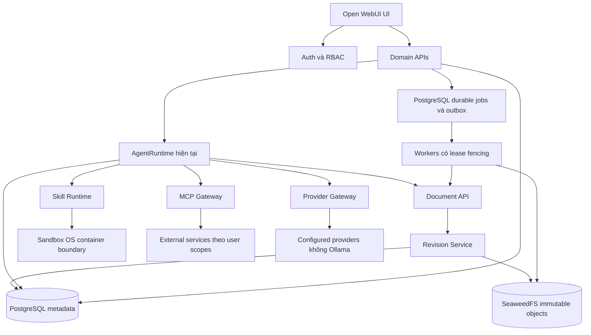
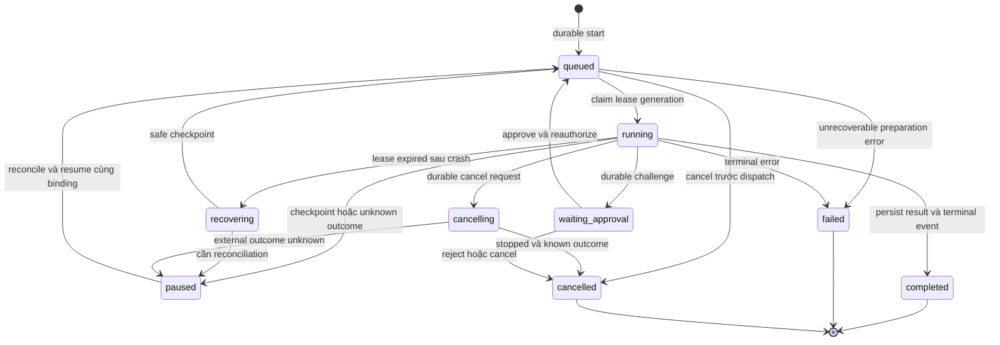
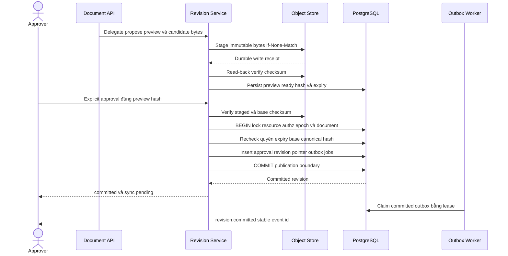
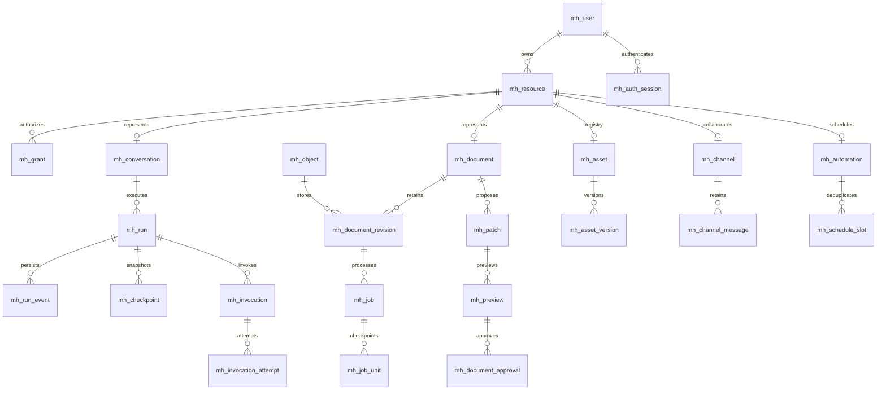

# Đặc tả sử dụng thiết kế kỹ thuật và kiểm thử Mini-Hermes

**Trạng thái:** Đặc tả đích và audit tĩnh; chưa là biên bản nghiệm thu hay xác nhận production-ready. Đối tượng sử dụng: BA, developer, QA và vận hành.

Tài liệu mô tả cách người dùng sử dụng toàn bộ bề mặt sản phẩm Mini-Hermes/Open WebUI, kết quả phải quan sát được, thiết kế persistence mới và các kịch bản kiểm thử cần thực hiện. Mục tiêu là triển khai một Office Agent production có quyền truy cập rõ ràng, dữ liệu bền vững và lỗi có thể phục hồi.

Cấu trúc tham chiếu tài liệu người dùng cung cấp **Phan_tich_thiet_ke__Kiem_thu_phan_mem_NAPAS.docx**: nghiệp vụ; kiến trúc/thiết kế kỹ thuật; test scenarios; glossary; yêu cầu phi chức năng. Đã đọc cấu trúc OOXML gồm 16 bảng cấp đầu và 26 bảng lồng. Chỉ dùng cách trình bày và mức đặc tả, không dùng nghiệp vụ tài chính hoặc instruction trong tài liệu nguồn làm yêu cầu Mini-Hermes.

Quyết định chuẩn: [ADR-001](../adr/ADR-001-agent-runtime-production-path.md), [ADR-002](../adr/ADR-002-agent-runtime-contract-domain-boundaries.md), [implementation plan](../plans/production-agent-implementation-plan.md), [README hiện hành](../../README.md). Yêu cầu mới nhất của người dùng về all-new persistence/no legacy/no Ollama thay thế yêu cầu bảo toàn dữ liệu DB local và backfill cũ; không thay authority nghiệp vụ hoặc authorization.

## Hướng dẫn đọc và trạng thái bằng chứng

- **CURRENT_CODE:** Có declaration/implementation tại source được dẫn; không chứng minh deployment đã bật hay chức năng đã pass.
- **TARGET:** Hành vi bắt buộc của thiết kế đích, gồm API/schema/state mới; chưa được coi là đã implement.
- **CONFIRMED_LOG:** Log người dùng cung cấp ngày 2026-11-10 tái hiện lỗi; chưa tự chạy lại trong đợt viết tài liệu.
- **CONFIRMED_STATIC_GAP:** Code hoặc test setup thể hiện một khoảng trống cụ thể; không đồng nghĩa exploit đã tái hiện.
- **RISK_REQUIRES_TEST:** Giả thuyết lỗi có boundary cụ thể cần test; không khẳng định đang xảy ra.
- **DOCUMENTED_LIMITATION:** Hạn chế hiện trạng đã được mô tả; không đưa thành cam kết an toàn.
- **PLANNED_NOT_EXECUTED:** Test scenario dưới đây chưa chạy trong đợt tài liệu. Mọi payload/output/ID là fixture minh họa.

Chỉ Markdown được thay đổi trong đợt này. Không xóa ORM, reset DB, chạy migration, cài dependency, sửa runtime, start services hoặc production cutover. Khi triển khai riêng, quyền reset chỉ áp dụng DB local được xác minh đúng đích, không áp dụng production.

## Mục lục

1. [Chương 1 Nghiệp vụ và luồng sử dụng](#chapter-1)
2. [Chương 2 Thiết kế kỹ thuật](#chapter-2)
3. [Chương 3 Kịch bản kiểm thử](#chapter-3)
4. [Chương 4 Thuật ngữ](#chapter-4)
5. [Chương 5 Yêu cầu phi chức năng](#chapter-5)
6. [Phụ lục A Audit lỗi](#appendix-a)
7. [Phụ lục B Ma trận truy vết](#appendix-b)
8. [Phụ lục C Inventory giao diện và endpoints](#appendix-c)
9. [Phụ lục D Inventory ORM hiện trạng và schema đích](#appendix-d)
10. [Phụ lục E Evidence và kiểm tra tài liệu](#appendix-e)

## Quyết định baseline

- AgentRuntime hiện tại là execution path production; không mặc định chuyển DeerFlow.
- Open WebUI tiếp tục UI/Auth/RBAC/chat/model management; persistence mới bao phủ cả các chức năng này.
- PostgreSQL và SQLAlchemy async; không giữ ORM/schema/adapter chỉ cho dữ liệu legacy. Giữ chức năng import/export người dùng theo schema mới, không coi đó là backfill legacy.
- Không Ollama trong provider registry, model selector, admin, about/health probes, embedding hoặc pipeline mặc định.
- Preparation tối đa **95.000 ký tự**; final serialized JSON tối đa **100.000 ký tự**, token/byte budgets riêng.
- Original Office/PDF immutable; sửa Office phải preview/approval/Revision Service commit. PDF chưa cam kết chỉnh nội dung.
- Production phục vụ **10–20 users trong rolling 30 ngày**. Không coi số này là concurrent users. Availability 99,9% là mục tiêu nội bộ, chưa là SLA.
- Giữ Open WebUI notices và license/copyright; theo dõi rolling count, không mặc định đổi license/version.

<a id="chapter-1"></a>
## Chương 1 Đặc tả nghiệp vụ và luồng sử dụng

### 1.1 Tác nhân và quyền chung

| Tác nhân | Phạm vi |
|---|---|
| Guest | Login/signup và public snapshot còn hiệu lực; không có quyền private data |
| Người dùng | Tài nguyên chính chủ hoặc resource grants đang có hiệu lực |
| Collaborator | Read/write/manage theo grant; quyền attach một file không tự cấp quyền read/commit |
| Admin | Quản trị theo policy; xem dữ liệu nhạy cảm vẫn có audit và scope, không mặc định decrypt encrypted channels |
| Operator | Deploy/health/restore/reconciliation theo operations scope; không giả identity của user |
| Worker/service principal | Giới hạn vào durable job và delegated user/resource scope; không dùng service token để bỏ ACL |
| External client | OAuth/webhook/SCIM/tool provider được cấu hình; signature/scope/replay validation riêng |

Mỗi use case dưới là TARGET. FR-MH-NN là yêu cầu chức năng của UC-MH-NN. Inventory static source dẫn ở phụ lục C/E; tính khả dụng runtime còn phải kiểm thử.

### 1.2 Danh mục use case

| Mã và yêu cầu | Use case | Domain | Test scenarios |
|---|---|---|---|
| [UC-MH-01](#uc-mh-01) | Khởi tạo tài khoản và xác thực | auth | [TC-MH-01-H](#tc-mh-01-h), [TC-MH-01-N](#tc-mh-01-n), [TC-MH-01-R](#tc-mh-01-r) |
| [UC-MH-02](#uc-mh-02) | Thiết lập MFA và khôi phục quyền truy cập | auth | [TC-MH-02-H](#tc-mh-02-h), [TC-MH-02-N](#tc-mh-02-n), [TC-MH-02-R](#tc-mh-02-r) |
| [UC-MH-03](#uc-mh-03) | Quản lý tài khoản session và API key | auth | [TC-MH-03-H](#tc-mh-03-h), [TC-MH-03-N](#tc-mh-03-n), [TC-MH-03-R](#tc-mh-03-r) |
| [UC-MH-04](#uc-mh-04) | Quản trị users groups và RBAC | admin | [TC-MH-04-H](#tc-mh-04-h), [TC-MH-04-N](#tc-mh-04-n), [TC-MH-04-R](#tc-mh-04-r) |
| [UC-MH-05](#uc-mh-05) | Kết nối provider và xác nhận capability | provider | [TC-MH-05-H](#tc-mh-05-h), [TC-MH-05-N](#tc-mh-05-n), [TC-MH-05-R](#tc-mh-05-r) |
| [UC-MH-06](#uc-mh-06) | Quản lý model profiles quyền và phiên bản | provider | [TC-MH-06-H](#tc-mh-06-h), [TC-MH-06-N](#tc-mh-06-n), [TC-MH-06-R](#tc-mh-06-r) |
| [UC-MH-07](#uc-mh-07) | Gửi chat và nhận kết quả nhiều model | chat | [TC-MH-07-H](#tc-mh-07-h), [TC-MH-07-N](#tc-mh-07-n), [TC-MH-07-R](#tc-mh-07-r) |
| [UC-MH-08](#uc-mh-08) | Sửa message regenerate và chuyển nhánh chat | chat | [TC-MH-08-H](#tc-mh-08-h), [TC-MH-08-N](#tc-mh-08-n), [TC-MH-08-R](#tc-mh-08-r) |
| [UC-MH-09](#uc-mh-09) | Tổ chức tìm kiếm và quản lý sidebar chat | chat | [TC-MH-09-H](#tc-mh-09-h), [TC-MH-09-N](#tc-mh-09-n), [TC-MH-09-R](#tc-mh-09-r) |
| [UC-MH-10](#uc-mh-10) | Chia sẻ chat và xem public link | chat | [TC-MH-10-H](#tc-mh-10-h), [TC-MH-10-N](#tc-mh-10-n), [TC-MH-10-R](#tc-mh-10-r) |
| [UC-MH-11](#uc-mh-11) | Import export archive và xóa dữ liệu chat | chat | [TC-MH-11-H](#tc-mh-11-h), [TC-MH-11-N](#tc-mh-11-n), [TC-MH-11-R](#tc-mh-11-r) |
| [UC-MH-12](#uc-mh-12) | Theo dõi run stream replay và crash recovery | runtime | [TC-MH-12-H](#tc-mh-12-h), [TC-MH-12-N](#tc-mh-12-n), [TC-MH-12-R](#tc-mh-12-r) |
| [UC-MH-13](#uc-mh-13) | Cancel resume và xử lý side effect chưa rõ kết quả | runtime | [TC-MH-13-H](#tc-mh-13-h), [TC-MH-13-N](#tc-mh-13-n), [TC-MH-13-R](#tc-mh-13-r) |
| [UC-MH-14](#uc-mh-14) | Phê duyệt hành động agent | runtime | [TC-MH-14-H](#tc-mh-14-h), [TC-MH-14-N](#tc-mh-14-n), [TC-MH-14-R](#tc-mh-14-r) |
| [UC-MH-15](#uc-mh-15) | Upload file và gắn tài liệu vào chat | document | [TC-MH-15-H](#tc-mh-15-h), [TC-MH-15-N](#tc-mh-15-n), [TC-MH-15-R](#tc-mh-15-r) |
| [UC-MH-16](#uc-mh-16) | Thư viện tài liệu thư mục và chia sẻ quyền | document | [TC-MH-16-H](#tc-mh-16-h), [TC-MH-16-N](#tc-mh-16-n), [TC-MH-16-R](#tc-mh-16-r) |
| [UC-MH-17](#uc-mh-17) | Read inspect search và trả lời có bằng chứng | document | [TC-MH-17-H](#tc-mh-17-h), [TC-MH-17-N](#tc-mh-17-n), [TC-MH-17-R](#tc-mh-17-r) |
| [UC-MH-18](#uc-mh-18) | Phân tích và tóm tắt tài liệu lớn | document | [TC-MH-18-H](#tc-mh-18-h), [TC-MH-18-N](#tc-mh-18-n), [TC-MH-18-R](#tc-mh-18-r) |
| [UC-MH-19](#uc-mh-19) | Sinh mô tả ngắn và metadata tài liệu | document | [TC-MH-19-H](#tc-mh-19-h), [TC-MH-19-N](#tc-mh-19-n), [TC-MH-19-R](#tc-mh-19-r) |
| [UC-MH-20](#uc-mh-20) | Đề xuất chỉnh sửa DOCX | document | [TC-MH-20-H](#tc-mh-20-h), [TC-MH-20-N](#tc-mh-20-n), [TC-MH-20-R](#tc-mh-20-r) |
| [UC-MH-21](#uc-mh-21) | Đề xuất chỉnh sửa XLSX | document | [TC-MH-21-H](#tc-mh-21-h), [TC-MH-21-N](#tc-mh-21-n), [TC-MH-21-R](#tc-mh-21-r) |
| [UC-MH-22](#uc-mh-22) | Đề xuất chỉnh sửa PPTX | document | [TC-MH-22-H](#tc-mh-22-h), [TC-MH-22-N](#tc-mh-22-n), [TC-MH-22-R](#tc-mh-22-r) |
| [UC-MH-23](#uc-mh-23) | Đọc PDF và OCR tài liệu scan | document | [TC-MH-23-H](#tc-mh-23-h), [TC-MH-23-N](#tc-mh-23-n), [TC-MH-23-R](#tc-mh-23-r) |
| [UC-MH-24](#uc-mh-24) | Xem preview diff và xác minh artifact | revision | [TC-MH-24-H](#tc-mh-24-h), [TC-MH-24-N](#tc-mh-24-n), [TC-MH-24-R](#tc-mh-24-r) |
| [UC-MH-25](#uc-mh-25) | Phê duyệt và atomic commit revision | revision | [TC-MH-25-H](#tc-mh-25-h), [TC-MH-25-N](#tc-mh-25-n), [TC-MH-25-R](#tc-mh-25-r) |
| [UC-MH-26](#uc-mh-26) | Lịch sử revision và rollback có phê duyệt | revision | [TC-MH-26-H](#tc-mh-26-h), [TC-MH-26-N](#tc-mh-26-n), [TC-MH-26-R](#tc-mh-26-r) |
| [UC-MH-27](#uc-mh-27) | Export download và quản lý artifacts | document | [TC-MH-27-H](#tc-mh-27-h), [TC-MH-27-N](#tc-mh-27-n), [TC-MH-27-R](#tc-mh-27-r) |
| [UC-MH-28](#uc-mh-28) | Kết nối Google OAuth | integration | [TC-MH-28-H](#tc-mh-28-h), [TC-MH-28-N](#tc-mh-28-n), [TC-MH-28-R](#tc-mh-28-r) |
| [UC-MH-29](#uc-mh-29) | Import tài liệu Google Drive | integration | [TC-MH-29-H](#tc-mh-29-h), [TC-MH-29-N](#tc-mh-29-n), [TC-MH-29-R](#tc-mh-29-r) |
| [UC-MH-30](#uc-mh-30) | Đồng bộ revision đã commit và xử lý conflict Drive | integration | [TC-MH-30-H](#tc-mh-30-h), [TC-MH-30-N](#tc-mh-30-n), [TC-MH-30-R](#tc-mh-30-r) |
| [UC-MH-31](#uc-mh-31) | Quản lý tool registry và phiên bản | tools | [TC-MH-31-H](#tc-mh-31-h), [TC-MH-31-N](#tc-mh-31-n), [TC-MH-31-R](#tc-mh-31-r) |
| [UC-MH-32](#uc-mh-32) | MCP discovery connection và invocation | tools | [TC-MH-32-H](#tc-mh-32-h), [TC-MH-32-N](#tc-mh-32-n), [TC-MH-32-R](#tc-mh-32-r) |
| [UC-MH-33](#uc-mh-33) | Import quản lý và pin phiên bản skills | skills | [TC-MH-33-H](#tc-mh-33-h), [TC-MH-33-N](#tc-mh-33-n), [TC-MH-33-R](#tc-mh-33-r) |
| [UC-MH-34](#uc-mh-34) | Thực thi skill script trong sandbox và publish artifact | skills | [TC-MH-34-H](#tc-mh-34-h), [TC-MH-34-N](#tc-mh-34-n), [TC-MH-34-R](#tc-mh-34-r) |
| [UC-MH-35](#uc-mh-35) | Functions filters pipes và cấu hình valves | tools | [TC-MH-35-H](#tc-mh-35-h), [TC-MH-35-N](#tc-mh-35-n), [TC-MH-35-R](#tc-mh-35-r) |
| [UC-MH-36](#uc-mh-36) | Pipelines và tích hợp dịch vụ bên ngoài | tools | [TC-MH-36-H](#tc-mh-36-h), [TC-MH-36-N](#tc-mh-36-n), [TC-MH-36-R](#tc-mh-36-r) |
| [UC-MH-37](#uc-mh-37) | Terminal file browser và remote desktop | tools | [TC-MH-37-H](#tc-mh-37-h), [TC-MH-37-N](#tc-mh-37-n), [TC-MH-37-R](#tc-mh-37-r) |
| [UC-MH-38](#uc-mh-38) | Knowledge collections và RAG | knowledge | [TC-MH-38-H](#tc-mh-38-h), [TC-MH-38-N](#tc-mh-38-n), [TC-MH-38-R](#tc-mh-38-r) |
| [UC-MH-39](#uc-mh-39) | Prompts templates và biến đầu vào | workspace | [TC-MH-39-H](#tc-mh-39-h), [TC-MH-39-N](#tc-mh-39-n), [TC-MH-39-R](#tc-mh-39-r) |
| [UC-MH-40](#uc-mh-40) | Memory personalization và chỉ dẫn cá nhân | workspace | [TC-MH-40-H](#tc-mh-40-h), [TC-MH-40-N](#tc-mh-40-n), [TC-MH-40-R](#tc-mh-40-r) |
| [UC-MH-41](#uc-mh-41) | Cài đặt cá nhân giao diện và trợ giúp | workspace | [TC-MH-41-H](#tc-mh-41-h), [TC-MH-41-N](#tc-mh-41-n), [TC-MH-41-R](#tc-mh-41-r) |
| [UC-MH-42](#uc-mh-42) | Notes editor chia sẻ và export | workspace | [TC-MH-42-H](#tc-mh-42-h), [TC-MH-42-N](#tc-mh-42-n), [TC-MH-42-R](#tc-mh-42-r) |
| [UC-MH-43](#uc-mh-43) | Channels messages threads và webhooks | collaboration | [TC-MH-43-H](#tc-mh-43-h), [TC-MH-43-N](#tc-mh-43-n), [TC-MH-43-R](#tc-mh-43-r) |
| [UC-MH-44](#uc-mh-44) | Calendar events RSVP và timezone | collaboration | [TC-MH-44-H](#tc-mh-44-h), [TC-MH-44-N](#tc-mh-44-n), [TC-MH-44-R](#tc-mh-44-r) |
| [UC-MH-45](#uc-mh-45) | Automations lịch chạy và lịch sử thực thi | automation | [TC-MH-45-H](#tc-mh-45-h), [TC-MH-45-N](#tc-mh-45-n), [TC-MH-45-R](#tc-mh-45-r) |
| [UC-MH-46](#uc-mh-46) | Notifications inbox và trạng thái realtime | collaboration | [TC-MH-46-H](#tc-mh-46-h), [TC-MH-46-N](#tc-mh-46-n), [TC-MH-46-R](#tc-mh-46-r) |
| [UC-MH-47](#uc-mh-47) | Image playground và tạo ảnh | media | [TC-MH-47-H](#tc-mh-47-h), [TC-MH-47-N](#tc-mh-47-n), [TC-MH-47-R](#tc-mh-47-r) |
| [UC-MH-48](#uc-mh-48) | Audio speech transcription và realtime | media | [TC-MH-48-H](#tc-mh-48-h), [TC-MH-48-N](#tc-mh-48-n), [TC-MH-48-R](#tc-mh-48-r) |
| [UC-MH-49](#uc-mh-49) | Apps manifest kết nối và interactions | tools | [TC-MH-49-H](#tc-mh-49-h), [TC-MH-49-N](#tc-mh-49-n), [TC-MH-49-R](#tc-mh-49-r) |
| [UC-MH-50](#uc-mh-50) | Web search và external knowledge connectors | knowledge | [TC-MH-50-H](#tc-mh-50-h), [TC-MH-50-N](#tc-mh-50-n), [TC-MH-50-R](#tc-mh-50-r) |
| [UC-MH-51](#uc-mh-51) | Quản trị cấu hình feature flags và giao diện | admin | [TC-MH-51-H](#tc-mh-51-h), [TC-MH-51-N](#tc-mh-51-n), [TC-MH-51-R](#tc-mh-51-r) |
| [UC-MH-52](#uc-mh-52) | Analytics usage traces và rolling user count | admin | [TC-MH-52-H](#tc-mh-52-h), [TC-MH-52-N](#tc-mh-52-n), [TC-MH-52-R](#tc-mh-52-r) |
| [UC-MH-53](#uc-mh-53) | Feedback evaluations arena và leaderboard | admin | [TC-MH-53-H](#tc-mh-53-h), [TC-MH-53-N](#tc-mh-53-n), [TC-MH-53-R](#tc-mh-53-r) |
| [UC-MH-54](#uc-mh-54) | Vận hành dữ liệu backup restore và reset local | operations | [TC-MH-54-H](#tc-mh-54-h), [TC-MH-54-N](#tc-mh-54-n), [TC-MH-54-R](#tc-mh-54-r) |
| [UC-MH-55](#uc-mh-55) | Khởi động health worker graceful shutdown và capacity | operations | [TC-MH-55-H](#tc-mh-55-h), [TC-MH-55-N](#tc-mh-55-n), [TC-MH-55-R](#tc-mh-55-r) |
| [UC-MH-56](#uc-mh-56) | Import export cấu hình và quản lý secrets | admin | [TC-MH-56-H](#tc-mh-56-h), [TC-MH-56-N](#tc-mh-56-n), [TC-MH-56-R](#tc-mh-56-r) |
| [UC-MH-57](#uc-mh-57) | Subagents phân công và tổng hợp kết quả | runtime | [TC-MH-57-H](#tc-mh-57-h), [TC-MH-57-N](#tc-mh-57-n), [TC-MH-57-R](#tc-mh-57-r) |
| [UC-MH-58](#uc-mh-58) | Encrypted channels và vòng đời khóa thiết bị | collaboration | [TC-MH-58-H](#tc-mh-58-h), [TC-MH-58-N](#tc-mh-58-n), [TC-MH-58-R](#tc-mh-58-r) |
| [UC-MH-59](#uc-mh-59) | Bình luận anchored threads reactions và mentions | collaboration | [TC-MH-59-H](#tc-mh-59-h), [TC-MH-59-N](#tc-mh-59-n), [TC-MH-59-R](#tc-mh-59-r) |
| [UC-MH-60](#uc-mh-60) | Event subscriptions và outbound webhooks quản trị | integration | [TC-MH-60-H](#tc-mh-60-h), [TC-MH-60-N](#tc-mh-60-n), [TC-MH-60-R](#tc-mh-60-r) |

<a id="uc-mh-01"></a>
### 1.3 UC-MH-01 Khởi tạo tài khoản và xác thực

| Thuộc tính | Đặc tả |
|---|---|
| Yêu cầu | FR-MH-01; TARGET |
| Mục tiêu | Khởi tạo tài khoản và xác thực với kết quả có thể xác minh và trạng thái cuối rõ ràng. |
| Tác nhân | Khách, người dùng, Auth Service |
| Quyền | Signup theo policy; principal hợp lệ sau xác thực |
| Điều kiện khả dụng | Signup, OAuth hoặc LDAP chỉ khả dụng khi auth policy tương ứng bật. |
| Tiền điều kiện | Instance mới; signup được admin bật hoặc có tài khoản/SSO được cấp. |
| Trigger/input | Email, mật khẩu hoặc SSO/LDAP assertion; return URL thuộc allowlist. |
| Source hiện trạng | [auths.py:656](../../packages/backend/open_webui/routers/auths.py#L656), [mfa.py:170](../../packages/backend/open_webui/routers/mfa.py#L170) |

**Luồng sự kiện chính**

```json
[
  {"step": 1, "actor": "Người dùng", "input": "Form hoặc callback SSO", "action": "Gửi yêu cầu đăng ký/đăng nhập", "expected_output": "Nhận challenge hoặc kết quả xác thực", "state_transition": "anonymous → authenticating"},
  {"step": 2, "actor": "Auth Service", "input": "Credentials và auth policy", "action": "Kiểm tra danh tính, trạng thái tài khoản, MFA và chống brute force", "expected_output": "Principal có user_id và role; không tin role do client gửi", "state_transition": "authenticating → authenticated/pending"},
  {"step": 3, "actor": "UI", "input": "Session đã cấp", "action": "Tải cấu hình và trang được cấp quyền", "expected_output": "Hiển thị trang chính hoặc pending approval", "state_transition": "authenticated → active"}
]
```

**Luồng thay thế và ngoại lệ**

```json
[
  {"branch": "AF-1", "from_step": 2, "condition": "Sai mật khẩu hoặc SSO state/issuer không hợp lệ", "actor": "Domain service/Gateway", "action": "Validate và từ chối hoặc chuyển terminal error theo error contract.", "expected_output": "Không tạo session; lỗi không tiết lộ tài khoản có tồn tại."},
  {"branch": "AF-2", "from_step": 3, "condition": "Mất response sau callback; gửi lại cùng state", "actor": "Client/Recovery worker", "action": "Reauthorize, kiểm tra idempotency/version/receipt trước retry hoặc resume.", "expected_output": "Không tạo hai user; state dùng một lần; cho phép đăng nhập lại an toàn."}
]
```

**Expected output theo lớp**

```json
{
  "ui": "Trang chính hoặc màn hình chờ duyệt; lỗi xác thực rõ ràng.",
  "api": "Auth endpoints hiện có; 200 khi thành công, 401 khi sai credentials; callback chỉ redirect allowlist.",
  "runtime": "Không tạo run inference; thao tác có correlation_id.",
  "persistence": "User, credential/identity, auth_session, audit; email/identity có unique constraint.",
  "artifacts": "Không tạo artifact.",
  "side_effects": "SSO/LDAP chỉ gọi khi đã cấu hình."
}
```

**Hậu điều kiện:** User, credential/identity, auth_session, audit; email/identity có unique constraint. Lỗi không được hiển thị như thành công; business changes chưa commit không được expose. Audit/failure records có thể được ghi theo policy.

**Kiểm thử:** [TC-MH-01-H](#tc-mh-01-h), [TC-MH-01-N](#tc-mh-01-n), [TC-MH-01-R](#tc-mh-01-r).

<a id="uc-mh-02"></a>
### 1.4 UC-MH-02 Thiết lập MFA và khôi phục quyền truy cập

| Thuộc tính | Đặc tả |
|---|---|
| Yêu cầu | FR-MH-02; TARGET |
| Mục tiêu | Thiết lập MFA và khôi phục quyền truy cập với kết quả có thể xác minh và trạng thái cuối rõ ràng. |
| Tác nhân | Người dùng, Auth Service |
| Quyền | Chính chủ; step-up xác thực trước thay MFA |
| Điều kiện khả dụng | Đăng nhập; chức năng được bật và principal có quyền. |
| Tiền điều kiện | Tài khoản active; đăng nhập gần đây. |
| Trigger/input | TOTP challenge, recovery code một lần. |
| Source hiện trạng | [auths.py:656](../../packages/backend/open_webui/routers/auths.py#L656), [mfa.py:170](../../packages/backend/open_webui/routers/mfa.py#L170) |

**Luồng sự kiện chính**

```json
[
  {"step": 1, "actor": "Người dùng", "input": "Session và yêu cầu enroll", "action": "Bắt đầu MFA", "expected_output": "Nhận secret tạm và hướng dẫn", "state_transition": "disabled → enrolling"},
  {"step": 2, "actor": "Auth Service", "input": "Mã TOTP", "action": "Xác minh rồi kích hoạt MFA, phát recovery codes", "expected_output": "Secret mã hóa; codes chỉ hiển thị lúc phát", "state_transition": "enrolling → enabled"},
  {"step": 3, "actor": "Người dùng", "input": "Challenge lần đăng nhập sau", "action": "Xác minh TOTP hoặc recovery code", "expected_output": "Session đủ mức xác thực; code phục hồi bị tiêu thụ", "state_transition": "challenged → verified"}
]
```

**Luồng thay thế và ngoại lệ**

```json
[
  {"branch": "AF-1", "from_step": 2, "condition": "TOTP sai hoặc recovery code đã dùng", "actor": "Domain service/Gateway", "action": "Validate và từ chối hoặc chuyển terminal error theo error contract.", "expected_output": "Từ chối; không cấp session và không tắt MFA."},
  {"branch": "AF-2", "from_step": 3, "condition": "Hai request dùng cùng recovery code đồng thời", "actor": "Client/Recovery worker", "action": "Reauthorize, kiểm tra idempotency/version/receipt trước retry hoặc resume.", "expected_output": "Chỉ một request thành công; retry không cấp thêm phiên bằng code đã dùng."}
]
```

**Expected output theo lớp**

```json
{
  "ui": "QR/secret và recovery codes chỉ hiển thị đúng bước; thông báo code hết hiệu lực.",
  "api": "/api/v1/auths/mfa/*; 200 thành công; 401/409 cho challenge không hợp lệ.",
  "runtime": "Không tạo run inference; thao tác có correlation_id.",
  "persistence": "MFA credential mã hóa; hash recovery_code; used_at cập nhật nguyên tử.",
  "artifacts": "Không tạo artifact.",
  "side_effects": "Không có side effect bên ngoài."
}
```

**Hậu điều kiện:** MFA credential mã hóa; hash recovery_code; used_at cập nhật nguyên tử. Lỗi không được hiển thị như thành công; business changes chưa commit không được expose. Audit/failure records có thể được ghi theo policy.

**Kiểm thử:** [TC-MH-02-H](#tc-mh-02-h), [TC-MH-02-N](#tc-mh-02-n), [TC-MH-02-R](#tc-mh-02-r).

<a id="uc-mh-03"></a>
### 1.5 UC-MH-03 Quản lý tài khoản session và API key

| Thuộc tính | Đặc tả |
|---|---|
| Yêu cầu | FR-MH-03; TARGET |
| Mục tiêu | Quản lý tài khoản session và API key với kết quả có thể xác minh và trạng thái cuối rõ ràng. |
| Tác nhân | Người dùng, quản trị viên |
| Quyền | Self-service; admin chỉ thao tác theo policy |
| Điều kiện khả dụng | Đăng nhập; chức năng được bật và principal có quyền. |
| Tiền điều kiện | Session hợp lệ; step-up khi đổi mật khẩu/API key. |
| Trigger/input | Profile, timezone, mật khẩu mới, yêu cầu tạo/revoke key hoặc logout. |
| Source hiện trạng | [auths.py:656](../../packages/backend/open_webui/routers/auths.py#L656), [mfa.py:170](../../packages/backend/open_webui/routers/mfa.py#L170) |

**Luồng sự kiện chính**

```json
[
  {"step": 1, "actor": "Người dùng", "input": "Thay đổi profile hoặc key", "action": "Gửi lệnh có version hiện tại", "expected_output": "Form được kiểm tra; secret không ghi log", "state_transition": "active → updating"},
  {"step": 2, "actor": "Auth Service", "input": "Principal và session_version", "action": "Commit thay đổi; revoke session/key theo policy", "expected_output": "Chỉ key mới được trả plaintext một lần", "state_transition": "updating → committed"},
  {"step": 3, "actor": "UI", "input": "Response và session mới", "action": "Cập nhật profile hoặc về trang đăng nhập", "expected_output": "Session bị revoke không dùng tiếp", "state_transition": "committed → active/signed_out"}
]
```

**Luồng thay thế và ngoại lệ**

```json
[
  {"branch": "AF-1", "from_step": 2, "condition": "Dùng token đã revoke hoặc user_id của người khác", "actor": "Domain service/Gateway", "action": "Validate và từ chối hoặc chuyển terminal error theo error contract.", "expected_output": "401/403; không đọc key hay đổi profile người khác."},
  {"branch": "AF-2", "from_step": 3, "condition": "Mất response khi rotate key/logout", "actor": "Client/Recovery worker", "action": "Reauthorize, kiểm tra idempotency/version/receipt trước retry hoặc resume.", "expected_output": "Logout lặp lại an toàn; key cũ vẫn bị revoke; không tự tạo thêm key khi retry."}
]
```

**Expected output theo lớp**

```json
{
  "ui": "Profile mới, key chỉ hiện một lần; logout kết thúc phiên.",
  "api": "Giữ auth/profile/password/api_key contracts; thao tác revoke idempotent.",
  "runtime": "Không tạo run inference; thao tác có correlation_id.",
  "persistence": "User version, auth_session, api_key digest/scopes, audit; không lưu plaintext key.",
  "artifacts": "Không tạo artifact.",
  "side_effects": "Không có side effect bên ngoài."
}
```

**Hậu điều kiện:** User version, auth_session, api_key digest/scopes, audit; không lưu plaintext key. Lỗi không được hiển thị như thành công; business changes chưa commit không được expose. Audit/failure records có thể được ghi theo policy.

**Kiểm thử:** [TC-MH-03-H](#tc-mh-03-h), [TC-MH-03-N](#tc-mh-03-n), [TC-MH-03-R](#tc-mh-03-r).

<a id="uc-mh-04"></a>
### 1.6 UC-MH-04 Quản trị users groups và RBAC

| Thuộc tính | Đặc tả |
|---|---|
| Yêu cầu | FR-MH-04; TARGET |
| Mục tiêu | Quản trị users groups và RBAC với kết quả có thể xác minh và trạng thái cuối rõ ràng. |
| Tác nhân | Admin, group manager, SCIM client |
| Quyền | admin hoặc delegated group-management scope |
| Điều kiện khả dụng | Admin UI; SCIM/SSO provisioning là tùy chọn có cấu hình. |
| Tiền điều kiện | Admin đã xác thực; không được xóa admin cuối cùng. |
| Trigger/input | User CRUD, role, group hierarchy, membership, grants; SCIM provisioning nếu bật. |
| Source hiện trạng | [library.py:64](../../packages/backend/open_webui/mini_hermes/library.py#L64), [analytics.py:457](../../packages/backend/open_webui/routers/analytics.py#L457), [configs.py:98](../../packages/backend/open_webui/routers/configs.py#L98) |

**Luồng sự kiện chính**

```json
[
  {"step": 1, "actor": "Admin", "input": "Người dùng hoặc group mục tiêu", "action": "Tạo/sửa/khóa tài khoản, group, membership hoặc grant", "expected_output": "Preview phạm vi tác động", "state_transition": "current → validated"},
  {"step": 2, "actor": "Authorization Service", "input": "Principal và expected_version", "action": "Kiểm tra quyền; transaction cập nhật membership/grants và permission_epoch", "expected_output": "Quyền mới có version; không tạo chu trình group", "state_transition": "validated → committed"},
  {"step": 3, "actor": "UI và services", "input": "Permission epoch mới", "action": "Refresh danh sách; reauthorize các thao tác tiếp theo", "expected_output": "User bị khóa không mở run/commit mới", "state_transition": "committed → enforced"}
]
```

**Luồng thay thế và ngoại lệ**

```json
[
  {"branch": "AF-1", "from_step": 2, "condition": "Self-escalation, group cycle hoặc hạ quyền admin cuối", "actor": "Domain service/Gateway", "action": "Validate và từ chối hoặc chuyển terminal error theo error contract.", "expected_output": "403/409; transaction rollback toàn bộ."},
  {"branch": "AF-2", "from_step": 3, "condition": "SCIM gửi trùng hoặc mất response cập nhật grant", "actor": "Client/Recovery worker", "action": "Reauthorize, kiểm tra idempotency/version/receipt trước retry hoặc resume.", "expected_output": "external_id/idempotency key trả cùng resource; permission epoch chỉ tăng cho thay đổi thực."}
]
```

**Expected output theo lớp**

```json
{
  "ui": "Danh sách user/group, inherited members và quyền hiệu lực.",
  "api": "/users, /groups; SCIM chỉ khi cấu hình; 409 khi version stale.",
  "runtime": "Không tạo run inference; thao tác có correlation_id.",
  "persistence": "User, group, membership, resource/grant, authz_epoch; unique membership và cycle validation.",
  "artifacts": "Không tạo artifact.",
  "side_effects": "Không có side effect bên ngoài."
}
```

**Hậu điều kiện:** User, group, membership, resource/grant, authz_epoch; unique membership và cycle validation. Lỗi không được hiển thị như thành công; business changes chưa commit không được expose. Audit/failure records có thể được ghi theo policy.

**Kiểm thử:** [TC-MH-04-H](#tc-mh-04-h), [TC-MH-04-N](#tc-mh-04-n), [TC-MH-04-R](#tc-mh-04-r).

<a id="uc-mh-05"></a>
### 1.7 UC-MH-05 Kết nối provider và xác nhận capability

| Thuộc tính | Đặc tả |
|---|---|
| Yêu cầu | FR-MH-05; TARGET |
| Mục tiêu | Kết nối provider và xác nhận capability với kết quả có thể xác minh và trạng thái cuối rõ ràng. |
| Tác nhân | Admin, người dùng được phép direct connection |
| Quyền | Admin quản lý connection chung; user chỉ connection riêng |
| Điều kiện khả dụng | Đăng nhập; chức năng được bật và principal có quyền. |
| Tiền điều kiện | Có endpoint HTTPS hoặc endpoint dev allowlist; credentials thuộc đúng owner. |
| Trigger/input | Base URL, secret reference, model list, capability profile. |
| Source hiện trạng | [models.py:929](../../packages/backend/open_webui/routers/models.py#L929), [request_budget.py:62](../../packages/backend/open_webui/agent_runtime/request_budget.py#L62) |

**Luồng sự kiện chính**

```json
[
  {"step": 1, "actor": "Admin", "input": "URL và secret", "action": "Verify connection không gửi tài liệu người dùng", "expected_output": "Kết quả model discovery và capability evidence", "state_transition": "draft → verifying"},
  {"step": 2, "actor": "Provider Gateway", "input": "Kết quả verify", "action": "Lưu connection version; khai báo token/output/tool limits", "expected_output": "Không có Ollama trong provider registry", "state_transition": "verifying → enabled"},
  {"step": 3, "actor": "Người dùng", "input": "Model được cấp quyền", "action": "Chọn model và gửi request thử nhỏ", "expected_output": "UI báo khả dụng hoặc lỗi provider có mã", "state_transition": "enabled → available"}
]
```

**Luồng thay thế và ngoại lệ**

```json
[
  {"branch": "AF-1", "from_step": 2, "condition": "URL nội bộ trái allowlist hoặc model không được cấp quyền", "actor": "Domain service/Gateway", "action": "Validate và từ chối hoặc chuyển terminal error theo error contract.", "expected_output": "Chặn SSRF/403 trước network call; không lộ secret."},
  {"branch": "AF-2", "from_step": 3, "condition": "Provider chậm hoặc 429 khi verify", "actor": "Client/Recovery worker", "action": "Reauthorize, kiểm tra idempotency/version/receipt trước retry hoặc resume.", "expected_output": "Timeout hữu hạn; giữ bản cấu hình tốt trước đó; retry có backoff và không nhân connection."}
]
```

**Expected output theo lớp**

```json
{
  "ui": "Model selector chỉ có provider đã bật; không Ollama tab/pull/probe.",
  "api": "Giữ connection/model discovery API; error normalized; credential chỉ ghi bằng secret_ref.",
  "runtime": "Không tạo run inference; thao tác có correlation_id.",
  "persistence": "ProviderConnection, Secret, ModelCapability versioned; không lưu cấu hình Ollama.",
  "artifacts": "Không tạo artifact.",
  "side_effects": "Discovery/verify có timeout, rate limit và audit."
}
```

**Hậu điều kiện:** ProviderConnection, Secret, ModelCapability versioned; không lưu cấu hình Ollama. Lỗi không được hiển thị như thành công; business changes chưa commit không được expose. Audit/failure records có thể được ghi theo policy.

**Kiểm thử:** [TC-MH-05-H](#tc-mh-05-h), [TC-MH-05-N](#tc-mh-05-n), [TC-MH-05-R](#tc-mh-05-r).

<a id="uc-mh-06"></a>
### 1.8 UC-MH-06 Quản lý model profiles quyền và phiên bản

| Thuộc tính | Đặc tả |
|---|---|
| Yêu cầu | FR-MH-06; TARGET |
| Mục tiêu | Quản lý model profiles quyền và phiên bản với kết quả có thể xác minh và trạng thái cuối rõ ràng. |
| Tác nhân | Admin, tác giả profile, người dùng |
| Quyền | Create/update/share theo resource grants |
| Điều kiện khả dụng | Đăng nhập; chức năng được bật và principal có quyền. |
| Tiền điều kiện | Base model tồn tại ở provider đang bật. |
| Trigger/input | Profile prompt, base model, parameters, tools, tags; import/export/version. |
| Source hiện trạng | [models.py:929](../../packages/backend/open_webui/routers/models.py#L929), [request_budget.py:62](../../packages/backend/open_webui/agent_runtime/request_budget.py#L62) |

**Luồng sự kiện chính**

```json
[
  {"step": 1, "actor": "Tác giả", "input": "Profile và base_model_id", "action": "Tạo/sửa/clone hoặc import profile", "expected_output": "Kiểm tra tham số và dependencies", "state_transition": "draft → validated"},
  {"step": 2, "actor": "Model Service", "input": "Version và grants", "action": "Lưu immutable profile version; cập nhật current pointer", "expected_output": "History/diff và quyền đúng owner", "state_transition": "validated → published"},
  {"step": 3, "actor": "Người dùng", "input": "Profile version", "action": "Chọn profile trong chat/playground", "expected_output": "Run pin snapshot model/capability", "state_transition": "published → selected"}
]
```

**Luồng thay thế và ngoại lệ**

```json
[
  {"branch": "AF-1", "from_step": 2, "condition": "Import profile trỏ model bị cấm hoặc stale version", "actor": "Domain service/Gateway", "action": "Validate và từ chối hoặc chuyển terminal error theo error contract.", "expected_output": "422/409; không publish cấu hình một phần."},
  {"branch": "AF-2", "from_step": 3, "condition": "Hai editor sửa profile cùng version", "actor": "Client/Recovery worker", "action": "Reauthorize, kiểm tra idempotency/version/receipt trước retry hoặc resume.", "expected_output": "Một update thắng; người còn lại nhận conflict, không mất bản trước."}
]
```

**Expected output theo lớp**

```json
{
  "ui": "Profile/history/diff/toggle hiển thị trạng thái và quyền.",
  "api": "/api/v1/models/*; 200/201 thành công; 409 optimistic conflict.",
  "runtime": "Không tạo run inference; thao tác có correlation_id.",
  "persistence": "ModelProfile, ModelVersion, grants, capability snapshot; restore tạo version mới.",
  "artifacts": "Export JSON không có provider secrets.",
  "side_effects": "Không có side effect bên ngoài."
}
```

**Hậu điều kiện:** ModelProfile, ModelVersion, grants, capability snapshot; restore tạo version mới. Lỗi không được hiển thị như thành công; business changes chưa commit không được expose. Audit/failure records có thể được ghi theo policy.

**Kiểm thử:** [TC-MH-06-H](#tc-mh-06-h), [TC-MH-06-N](#tc-mh-06-n), [TC-MH-06-R](#tc-mh-06-r).

<a id="uc-mh-07"></a>
### 1.9 UC-MH-07 Gửi chat và nhận kết quả nhiều model

| Thuộc tính | Đặc tả |
|---|---|
| Yêu cầu | FR-MH-07; TARGET |
| Mục tiêu | Gửi chat và nhận kết quả nhiều model với kết quả có thể xác minh và trạng thái cuối rõ ràng. |
| Tác nhân | Người dùng, AgentRuntime, Provider Gateway |
| Quyền | Chat owner hoặc write grant; model được phép |
| Điều kiện khả dụng | Đăng nhập; chức năng được bật và principal có quyền. |
| Tiền điều kiện | Auth còn hiệu lực; attachments upload xong; provider sẵn sàng. |
| Trigger/input | User message, chat_id, parent message, model_ids, file references. |
| Source hiện trạng | [repository.py:144](../../packages/backend/open_webui/agent_runtime/repository.py#L144), [runtime.py:692](../../packages/backend/open_webui/agent_runtime/runtime.py#L692), [main.py:1892](../../packages/backend/open_webui/main.py#L1892) |

**Luồng sự kiện chính**

```json
[
  {"step": 1, "actor": "Người dùng", "input": "Message và model_ids", "action": "Submit một lần với idempotency key cho từng model response", "expected_output": "UI tạo pending bubble gắn client_request_id", "state_transition": "draft → submitting"},
  {"step": 2, "actor": "AgentRuntime", "input": "Principal và payload", "action": "Ghi conversation/run, queued event trong transaction rồi nhận việc", "expected_output": "Response nhận task chứa run_id; không đồng nghĩa hoàn tất", "state_transition": "submitting → queued"},
  {"step": 3, "actor": "Provider Gateway", "input": "Context có budget", "action": "Gọi provider, ghi và stream delta theo run", "expected_output": "UI render đúng message/model; không trộn nhánh", "state_transition": "queued → running"},
  {"step": 4, "actor": "AgentRuntime", "input": "Kết quả hoặc lỗi", "action": "Lưu terminal event và message projection", "expected_output": "UI tắt loading và hiện kết quả/lỗi", "state_transition": "running → completed/failed"}
]
```

**Luồng thay thế và ngoại lệ**

```json
[
  {"branch": "AF-1", "from_step": 2, "condition": "Provider 401 hoặc run creation lỗi FK/DB", "actor": "Domain service/Gateway", "action": "Validate và từ chối hoặc chuyển terminal error theo error contract.", "expected_output": "Không báo completed; trả rejection trước accept hoặc terminal failure có correlation_id sau accept."},
  {"branch": "AF-2", "from_step": 3, "condition": "Double submit/reconnect sau accept", "actor": "Client/Recovery worker", "action": "Reauthorize, kiểm tra idempotency/version/receipt trước retry hoặc resume.", "expected_output": "Cùng key trả cùng run; replay không nhân message hoặc inference khi kết quả đã biết."}
]
```

**Expected output theo lớp**

```json
{
  "ui": "Mỗi model có bubble/trạng thái riêng; lỗi không để spinner vô hạn.",
  "api": "Hiện /api/chat/completions trả 200 async; contract đích thêm run_ids/acceptance; terminal qua stream/status.",
  "runtime": "Run/job có owner, trạng thái terminal và checkpoint khi thực hiện bất đồng bộ; event bền vững trước khi phát.",
  "persistence": "Conversation, Message, Run, RunEvent, provider invocation; không import legacy chat.",
  "artifacts": "Không tạo artifact.",
  "side_effects": "Một provider invocation cho mỗi attempt được ledger cho phép; cost ghi theo run."
}
```

**Hậu điều kiện:** Conversation, Message, Run, RunEvent, provider invocation; không import legacy chat. Lỗi không được hiển thị như thành công; business changes chưa commit không được expose. Audit/failure records có thể được ghi theo policy.

**Kiểm thử:** [TC-MH-07-H](#tc-mh-07-h), [TC-MH-07-N](#tc-mh-07-n), [TC-MH-07-R](#tc-mh-07-r).

<a id="uc-mh-08"></a>
### 1.10 UC-MH-08 Sửa message regenerate và chuyển nhánh chat

| Thuộc tính | Đặc tả |
|---|---|
| Yêu cầu | FR-MH-08; TARGET |
| Mục tiêu | Sửa message regenerate và chuyển nhánh chat với kết quả có thể xác minh và trạng thái cuối rõ ràng. |
| Tác nhân | Người dùng, AgentRuntime |
| Quyền | Write conversation và quyền model hiện tại |
| Điều kiện khả dụng | Đăng nhập; chức năng được bật và principal có quyền. |
| Tiền điều kiện | Conversation đã có message graph. |
| Trigger/input | message_id, parent_id, nội dung sửa; regenerate/model mới. |
| Source hiện trạng | [repository.py:144](../../packages/backend/open_webui/agent_runtime/repository.py#L144), [runtime.py:692](../../packages/backend/open_webui/agent_runtime/runtime.py#L692), [main.py:1892](../../packages/backend/open_webui/main.py#L1892) |

**Luồng sự kiện chính**

```json
[
  {"step": 1, "actor": "Người dùng", "input": "Message được chọn", "action": "Sửa hoặc regenerate thành nhánh mới", "expected_output": "Message gốc giữ nguyên", "state_transition": "selected → branch_draft"},
  {"step": 2, "actor": "Chat Service", "input": "Parent và conversation version", "action": "Validate graph; lưu branch/message mới", "expected_output": "Không tạo cycle hay parent khác conversation", "state_transition": "branch_draft → committed"},
  {"step": 3, "actor": "AgentRuntime", "input": "Branch mới", "action": "Tạo run mới trong engine conversation đã pin", "expected_output": "Kết quả chỉ gắn nhánh được tạo", "state_transition": "committed → running/terminal"}
]
```

**Luồng thay thế và ngoại lệ**

```json
[
  {"branch": "AF-1", "from_step": 2, "condition": "Parent thuộc chat khác hoặc nhánh đã bị xóa", "actor": "Domain service/Gateway", "action": "Validate và từ chối hoặc chuyển terminal error theo error contract.", "expected_output": "404/409; không đọc context chéo chat."},
  {"branch": "AF-2", "from_step": 3, "condition": "Kết quả nhánh cũ đến khi UI chuyển nhánh", "actor": "Client/Recovery worker", "action": "Reauthorize, kiểm tra idempotency/version/receipt trước retry hoặc resume.", "expected_output": "Lưu đúng branch_id; không ghi đè bubble nhánh mới."}
]
```

**Expected output theo lớp**

```json
{
  "ui": "Branch selector và lịch sử gốc còn nguyên.",
  "api": "Chat message/update APIs giữ chức năng; run mới có idempotency key riêng.",
  "runtime": "Run/job có owner, trạng thái terminal và checkpoint khi thực hiện bất đồng bộ; event bền vững trước khi phát.",
  "persistence": "Message immutable nội dung theo version/branch; parent FK cùng conversation.",
  "artifacts": "Không tạo artifact.",
  "side_effects": "Không có side effect bên ngoài."
}
```

**Hậu điều kiện:** Message immutable nội dung theo version/branch; parent FK cùng conversation. Lỗi không được hiển thị như thành công; business changes chưa commit không được expose. Audit/failure records có thể được ghi theo policy.

**Kiểm thử:** [TC-MH-08-H](#tc-mh-08-h), [TC-MH-08-N](#tc-mh-08-n), [TC-MH-08-R](#tc-mh-08-r).

<a id="uc-mh-09"></a>
### 1.11 UC-MH-09 Tổ chức tìm kiếm và quản lý sidebar chat

| Thuộc tính | Đặc tả |
|---|---|
| Yêu cầu | FR-MH-09; TARGET |
| Mục tiêu | Tổ chức tìm kiếm và quản lý sidebar chat với kết quả có thể xác minh và trạng thái cuối rõ ràng. |
| Tác nhân | Người dùng |
| Quyền | Read/write chat/folder theo grant |
| Điều kiện khả dụng | Đăng nhập; chức năng được bật và principal có quyền. |
| Tiền điều kiện | Có chats và folders của user. |
| Trigger/input | Query, tag, pin, folder, move, bulk selection. |
| Source hiện trạng | [repository.py:144](../../packages/backend/open_webui/agent_runtime/repository.py#L144), [runtime.py:692](../../packages/backend/open_webui/agent_runtime/runtime.py#L692), [main.py:1892](../../packages/backend/open_webui/main.py#L1892) |

**Luồng sự kiện chính**

```json
[
  {"step": 1, "actor": "Người dùng", "input": "Query hoặc selected chats", "action": "Tìm kiếm/lọc/pin/đổi tên/chuyển folder", "expected_output": "Danh sách chỉ chứa chat có quyền", "state_transition": "idle → querying"},
  {"step": 2, "actor": "Chat Service", "input": "Query, pagination và grants", "action": "Search theo owner/scope rồi mutate có expected_version", "expected_output": "Cursor ổn định; folder không cycle", "state_transition": "querying → committed"},
  {"step": 3, "actor": "UI", "input": "Response có generation ticket", "action": "Cập nhật sidebar của request hiện hành", "expected_output": "Không áp response cũ lên scope mới", "state_transition": "committed → rendered"}
]
```

**Luồng thay thế và ngoại lệ**

```json
[
  {"branch": "AF-1", "from_step": 2, "condition": "Bulk move gồm chat không có write grant", "actor": "Domain service/Gateway", "action": "Validate và từ chối hoặc chuyển terminal error theo error contract.", "expected_output": "Trả item status cho từng thao tác độc lập; item không có quyền bị từ chối, không báo toàn bộ thành công."},
  {"branch": "AF-2", "from_step": 3, "condition": "Search cũ về sau search mới hoặc move retry", "actor": "Client/Recovery worker", "action": "Reauthorize, kiểm tra idempotency/version/receipt trước retry hoặc resume.", "expected_output": "Bỏ response stale; retry cùng key không nhân folder/tag membership."}
]
```

**Expected output theo lớp**

```json
{
  "ui": "Sidebar/pinned/folders/tags và kết quả có pagination.",
  "api": "/chats, /folders, /search; bulk trả item status; dữ liệu trái quyền không xuất hiện.",
  "runtime": "Run/job có owner, trạng thái terminal và checkpoint khi thực hiện bất đồng bộ; event bền vững trước khi phát.",
  "persistence": "ChatFolder, Tag, membership, conversation metadata; mutation có version.",
  "artifacts": "Không tạo artifact.",
  "side_effects": "Không có side effect bên ngoài."
}
```

**Hậu điều kiện:** ChatFolder, Tag, membership, conversation metadata; mutation có version. Lỗi không được hiển thị như thành công; business changes chưa commit không được expose. Audit/failure records có thể được ghi theo policy.

**Kiểm thử:** [TC-MH-09-H](#tc-mh-09-h), [TC-MH-09-N](#tc-mh-09-n), [TC-MH-09-R](#tc-mh-09-r).

<a id="uc-mh-10"></a>
### 1.12 UC-MH-10 Chia sẻ chat và xem public link

| Thuộc tính | Đặc tả |
|---|---|
| Yêu cầu | FR-MH-10; TARGET |
| Mục tiêu | Chia sẻ chat và xem public link với kết quả có thể xác minh và trạng thái cuối rõ ràng. |
| Tác nhân | Chat owner, người nhận link, guest |
| Quyền | Owner được share; viewer chỉ read snapshot đã publish |
| Điều kiện khả dụng | Đăng nhập; chức năng được bật và principal có quyền. |
| Tiền điều kiện | Sharing policy bật; không tự chia sẻ secrets/tool private metadata. |
| Trigger/input | Chat/branch, phạm vi message, expiry và revoke. |
| Source hiện trạng | [repository.py:144](../../packages/backend/open_webui/agent_runtime/repository.py#L144), [runtime.py:692](../../packages/backend/open_webui/agent_runtime/runtime.py#L692), [main.py:1892](../../packages/backend/open_webui/main.py#L1892) |

**Luồng sự kiện chính**

```json
[
  {"step": 1, "actor": "Owner", "input": "Chat và sharing options", "action": "Publish snapshot/link", "expected_output": "Preview nội dung công khai", "state_transition": "private → sharing"},
  {"step": 2, "actor": "Sharing Service", "input": "Snapshot và policy", "action": "Tạo token digest có expiry, loại bỏ private payload", "expected_output": "Chỉ selected content được publish", "state_transition": "sharing → shared"},
  {"step": 3, "actor": "Guest", "input": "Public URL", "action": "Mở /s/id hoặc /watch", "expected_output": "Chỉ đọc snapshot còn hiệu lực", "state_transition": "shared → viewed"}
]
```

**Luồng thay thế và ngoại lệ**

```json
[
  {"branch": "AF-1", "from_step": 2, "condition": "Token hết hạn/revoke hoặc download file ngoài snapshot", "actor": "Domain service/Gateway", "action": "Validate và từ chối hoặc chuyển terminal error theo error contract.", "expected_output": "404/410; không fallback sang chat private."},
  {"branch": "AF-2", "from_step": 3, "condition": "Revoke trong lúc viewer reconnect", "actor": "Client/Recovery worker", "action": "Reauthorize, kiểm tra idempotency/version/receipt trước retry hoặc resume.", "expected_output": "Kiểm tra quyền/token ở từng fetch; không replay thêm nội dung sau revoke."}
]
```

**Expected output theo lớp**

```json
{
  "ui": "Viewer read-only; owner có revoke và expiry.",
  "api": "Shared-chat endpoints giữ chức năng; public attachment token scope theo snapshot.",
  "runtime": "Run/job có owner, trạng thái terminal và checkpoint khi thực hiện bất đồng bộ; event bền vững trước khi phát.",
  "persistence": "SharedSnapshot, ShareToken digest, resource references; snapshot không chứa credentials.",
  "artifacts": "Chỉ artifact đã duyệt chia sẻ; signed URL ngắn hạn.",
  "side_effects": "Không có side effect bên ngoài."
}
```

**Hậu điều kiện:** SharedSnapshot, ShareToken digest, resource references; snapshot không chứa credentials. Lỗi không được hiển thị như thành công; business changes chưa commit không được expose. Audit/failure records có thể được ghi theo policy.

**Kiểm thử:** [TC-MH-10-H](#tc-mh-10-h), [TC-MH-10-N](#tc-mh-10-n), [TC-MH-10-R](#tc-mh-10-r).

<a id="uc-mh-11"></a>
### 1.13 UC-MH-11 Import export archive và xóa dữ liệu chat

| Thuộc tính | Đặc tả |
|---|---|
| Yêu cầu | FR-MH-11; TARGET |
| Mục tiêu | Import export archive và xóa dữ liệu chat với kết quả có thể xác minh và trạng thái cuối rõ ràng. |
| Tác nhân | Người dùng, admin theo policy |
| Quyền | Owner; export admin phải audit |
| Điều kiện khả dụng | Đăng nhập; chức năng được bật và principal có quyền. |
| Tiền điều kiện | Có chat data; import theo định dạng mới versioned. |
| Trigger/input | JSON export mới, selected chat IDs, archive/delete confirmation. |
| Source hiện trạng | [repository.py:144](../../packages/backend/open_webui/agent_runtime/repository.py#L144), [runtime.py:692](../../packages/backend/open_webui/agent_runtime/runtime.py#L692), [main.py:1892](../../packages/backend/open_webui/main.py#L1892) |

**Luồng sự kiện chính**

```json
[
  {"step": 1, "actor": "Người dùng", "input": "Chọn export/import/archive/delete", "action": "Xem scope và xác nhận thao tác", "expected_output": "UI chỉ rõ dữ liệu tác động", "state_transition": "selected → confirmed"},
  {"step": 2, "actor": "Chat Service", "input": "Scope và format_version", "action": "Validate import hoặc ghi transaction archive/delete", "expected_output": "Import không khôi phục provider secrets/approval thực thi", "state_transition": "confirmed → committed"},
  {"step": 3, "actor": "UI", "input": "Export artifact hoặc kết quả", "action": "Tải file; refresh đúng scope", "expected_output": "Không mở lại chat đã xóa", "state_transition": "committed → terminal"}
]
```

**Luồng thay thế và ngoại lệ**

```json
[
  {"branch": "AF-1", "from_step": 2, "condition": "JSON import sai schema hoặc giả owner/approval", "actor": "Domain service/Gateway", "action": "Validate và từ chối hoặc chuyển terminal error theo error contract.", "expected_output": "422; không tạo run, grant hay approval theo dữ liệu import."},
  {"branch": "AF-2", "from_step": 3, "condition": "Retry delete hoặc crash giữa export job", "actor": "Client/Recovery worker", "action": "Reauthorize, kiểm tra idempotency/version/receipt trước retry hoặc resume.", "expected_output": "Delete idempotent; export resume theo snapshot không lẫn dữ liệu mới."}
]
```

**Expected output theo lớp**

```json
{
  "ui": "Export/download, archive list, delete result có item counts.",
  "api": "/chats import/export/archive/delete; import là chức năng người dùng theo schema mới, không adapter DB legacy.",
  "runtime": "Run/job có owner, trạng thái terminal và checkpoint khi thực hiện bất đồng bộ; event bền vững trước khi phát.",
  "persistence": "Archive/tombstone; attachment refcounts; audit xóa; import tạo IDs mới.",
  "artifacts": "Export JSON có format_version; không secrets hoặc resume checkpoint xuyên engine.",
  "side_effects": "Không có side effect bên ngoài."
}
```

**Hậu điều kiện:** Archive/tombstone; attachment refcounts; audit xóa; import tạo IDs mới. Lỗi không được hiển thị như thành công; business changes chưa commit không được expose. Audit/failure records có thể được ghi theo policy.

**Kiểm thử:** [TC-MH-11-H](#tc-mh-11-h), [TC-MH-11-N](#tc-mh-11-n), [TC-MH-11-R](#tc-mh-11-r).

<a id="uc-mh-12"></a>
### 1.14 UC-MH-12 Theo dõi run stream replay và crash recovery

| Thuộc tính | Đặc tả |
|---|---|
| Yêu cầu | FR-MH-12; TARGET |
| Mục tiêu | Theo dõi run stream replay và crash recovery với kết quả có thể xác minh và trạng thái cuối rõ ràng. |
| Tác nhân | Người dùng, AgentRuntime, worker |
| Quyền | Run owner hoặc grant; binding phải khớp |
| Điều kiện khả dụng | Đăng nhập; chức năng được bật và principal có quyền. |
| Tiền điều kiện | Run đã accept; durable DB hoạt động. |
| Trigger/input | run_id, after_sequence, checkpoint version. |
| Source hiện trạng | [repository.py:144](../../packages/backend/open_webui/agent_runtime/repository.py#L144), [tasks.py:160](../../packages/backend/open_webui/tasks.py#L160), [runtime.py:159](../../packages/backend/open_webui/agent_runtime/runtime.py#L159) |

**Luồng sự kiện chính**

```json
[
  {"step": 1, "actor": "Client", "input": "Cursor cuối đã apply", "action": "Subscribe stream(after_sequence)", "expected_output": "Chỉ event của run được cấp quyền", "state_transition": "disconnected → replaying"},
  {"step": 2, "actor": "Runtime", "input": "Durable event log", "action": "Replay tăng sequence, deduplicate và phát event mới sau persist", "expected_output": "Client không bỏ qua gap", "state_transition": "replaying → live"},
  {"step": 3, "actor": "Recovery worker", "input": "Lease hết hạn và checkpoint", "action": "Claim với fencing generation; kiểm tra ledger", "expected_output": "Một execution owner; worker cũ không ghi được", "state_transition": "recovering → running/paused"},
  {"step": 4, "actor": "Client", "input": "Gap vượt retention", "action": "Lấy status/snapshot có sequence rồi replay phần còn lại", "expected_output": "Snapshot không mất terminal state", "state_transition": "gap → synchronized"}
]
```

**Luồng thay thế và ngoại lệ**

```json
[
  {"branch": "AF-1", "from_step": 2, "condition": "Cursor vượt latest hoặc checkpoint khác engine", "actor": "Domain service/Gateway", "action": "Validate và từ chối hoặc chuyển terminal error theo error contract.", "expected_output": "409/422; không replay sai run hoặc bắt đầu inference mới."},
  {"branch": "AF-2", "from_step": 3, "condition": "Kill worker ngay sau append event nhưng trước publish", "actor": "Client/Recovery worker", "action": "Reauthorize, kiểm tra idempotency/version/receipt trước retry hoặc resume.", "expected_output": "Worker mới replay cùng event_id/sequence; UI áp một lần; không mất terminal event."}
]
```

**Expected output theo lớp**

```json
{
  "ui": "Run status, reconnect banner và lỗi terminal quan sát được.",
  "api": "Contract đích start/stream/cancel/resume/get_status; snapshot sequence luôn từ durable state.",
  "runtime": "Run/job có owner, trạng thái terminal và checkpoint khi thực hiện bất đồng bộ; event bền vững trước khi phát.",
  "persistence": "Conversation binding immutable; Run, Event unique(run_id,sequence), Checkpoint và execution lease.",
  "artifacts": "Không tạo artifact.",
  "side_effects": "Không có side effect bên ngoài."
}
```

**Hậu điều kiện:** Conversation binding immutable; Run, Event unique(run_id,sequence), Checkpoint và execution lease. Lỗi không được hiển thị như thành công; business changes chưa commit không được expose. Audit/failure records có thể được ghi theo policy.

**Kiểm thử:** [TC-MH-12-H](#tc-mh-12-h), [TC-MH-12-N](#tc-mh-12-n), [TC-MH-12-R](#tc-mh-12-r).

<a id="uc-mh-13"></a>
### 1.15 UC-MH-13 Cancel resume và xử lý side effect chưa rõ kết quả

| Thuộc tính | Đặc tả |
|---|---|
| Yêu cầu | FR-MH-13; TARGET |
| Mục tiêu | Cancel resume và xử lý side effect chưa rõ kết quả với kết quả có thể xác minh và trạng thái cuối rõ ràng. |
| Tác nhân | Người dùng, Runtime, operator |
| Quyền | Owner; reconciliation chỉ operator có scope |
| Điều kiện khả dụng | Đăng nhập; chức năng được bật và principal có quyền. |
| Tiền điều kiện | Run queued/running/paused; ledger hiện hành. |
| Trigger/input | run_id, command key, expected checkpoint; reconciliation evidence. |
| Source hiện trạng | [repository.py:144](../../packages/backend/open_webui/agent_runtime/repository.py#L144), [tasks.py:160](../../packages/backend/open_webui/tasks.py#L160), [runtime.py:159](../../packages/backend/open_webui/agent_runtime/runtime.py#L159) |

**Luồng sự kiện chính**

```json
[
  {"step": 1, "actor": "Người dùng", "input": "run_id và cancel key", "action": "Yêu cầu dừng hoặc resume", "expected_output": "Nhận durable command result", "state_transition": "running → cancelling"},
  {"step": 2, "actor": "Runtime", "input": "Cancellation flag và ledger", "action": "Dừng dispatch mới; hủy provider/tool khi có thể", "expected_output": "Không tuyên bố rollback side effect đã xảy ra", "state_transition": "cancelling → cancelled/outcome_unknown"},
  {"step": 3, "actor": "Operator hoặc runtime", "input": "Checkpoint cùng binding và kết quả reconciliation", "action": "Resume khi đủ điều kiện; từ chối unknown chưa giải quyết", "expected_output": "Không lặp side effect mù", "state_transition": "paused → running/blocked"}
]
```

**Luồng thay thế và ngoại lệ**

```json
[
  {"branch": "AF-1", "from_step": 2, "condition": "Resume completed run hoặc unresolved external outcome", "actor": "Domain service/Gateway", "action": "Validate và từ chối hoặc chuyển terminal error theo error contract.", "expected_output": "409 với reason; không thực thi lại tool."},
  {"branch": "AF-2", "from_step": 3, "condition": "Cancel và tool response đến đồng thời", "actor": "Client/Recovery worker", "action": "Reauthorize, kiểm tra idempotency/version/receipt trước retry hoặc resume.", "expected_output": "Ledger lưu kết quả thực; run terminal theo state machine, không nhân invocation."}
]
```

**Expected output theo lớp**

```json
{
  "ui": "Cancel có trạng thái pending rồi terminal; unknown outcome hiển thị cần xử lý.",
  "api": "Cancel/resume idempotent; get_status phân biệt cancel requested và cancellation completed.",
  "runtime": "Run/job có owner, trạng thái terminal và checkpoint khi thực hiện bất đồng bộ; event bền vững trước khi phát.",
  "persistence": "RunCommand, cancel_requested, Invocation ledger, reconciliation audit.",
  "artifacts": "Không tạo artifact.",
  "side_effects": "External call không đảm bảo thu hồi; kết quả unknown phải reconciliation."
}
```

**Hậu điều kiện:** RunCommand, cancel_requested, Invocation ledger, reconciliation audit. Lỗi không được hiển thị như thành công; business changes chưa commit không được expose. Audit/failure records có thể được ghi theo policy.

**Kiểm thử:** [TC-MH-13-H](#tc-mh-13-h), [TC-MH-13-N](#tc-mh-13-n), [TC-MH-13-R](#tc-mh-13-r).

<a id="uc-mh-14"></a>
### 1.16 UC-MH-14 Phê duyệt hành động agent

| Thuộc tính | Đặc tả |
|---|---|
| Yêu cầu | FR-MH-14; TARGET |
| Mục tiêu | Phê duyệt hành động agent với kết quả có thể xác minh và trạng thái cuối rõ ràng. |
| Tác nhân | Người dùng, AgentRuntime, Tool Gateway |
| Quyền | Approver là principal có quyền tool/resource hiện tại |
| Điều kiện khả dụng | Đăng nhập; chức năng được bật và principal có quyền. |
| Tiền điều kiện | Tool yêu cầu approval; invocation chưa chạy. |
| Trigger/input | Approval challenge gắn run, invocation, argument hash, expiry và decision. |
| Source hiện trạng | [repository.py:144](../../packages/backend/open_webui/agent_runtime/repository.py#L144), [tasks.py:160](../../packages/backend/open_webui/tasks.py#L160), [runtime.py:159](../../packages/backend/open_webui/agent_runtime/runtime.py#L159) |

**Luồng sự kiện chính**

```json
[
  {"step": 1, "actor": "Runtime", "input": "Tool call có quyền nhưng cần xác nhận", "action": "Ghi pending challenge và pause run", "expected_output": "UI hiện tool, arguments đã che secret và tác động", "state_transition": "running → waiting_approval"},
  {"step": 2, "actor": "Người dùng", "input": "Challenge còn hiệu lực", "action": "Approve hoặc reject", "expected_output": "Decision gắn identity và argument hash", "state_transition": "waiting_approval → decided"},
  {"step": 3, "actor": "Tool Gateway", "input": "Decision và quyền hiện tại", "action": "Execute đúng invocation hoặc kết thúc rejected", "expected_output": "Approval agent không cấp quyền commit revision", "state_transition": "decided → running/rejected"}
]
```

**Luồng thay thế và ngoại lệ**

```json
[
  {"branch": "AF-1", "from_step": 2, "condition": "Sửa arguments sau approve hoặc user khác duyệt", "actor": "Domain service/Gateway", "action": "Validate và từ chối hoặc chuyển terminal error theo error contract.", "expected_output": "403/409; không thực thi tool."},
  {"branch": "AF-2", "from_step": 3, "condition": "Approve bị gửi hai lần/reconnect sau khi tool đã chạy", "actor": "Client/Recovery worker", "action": "Reauthorize, kiểm tra idempotency/version/receipt trước retry hoặc resume.", "expected_output": "Cùng decision trả cùng status/result; ledger ngăn duplicate call."}
]
```

**Expected output theo lớp**

```json
{
  "ui": "Approval modal, expiry, reject và trạng thái đã xử lý.",
  "api": "Approval command nhận challenge ID/version; LLM text không là approval authority.",
  "runtime": "Run/job có owner, trạng thái terminal và checkpoint khi thực hiện bất đồng bộ; event bền vững trước khi phát.",
  "persistence": "AgentApproval tách RevisionApproval; immutable argument hash, used_at.",
  "artifacts": "Không tạo artifact.",
  "side_effects": "Một invocation đã duyệt; quyền được recheck trước dispatch."
}
```

**Hậu điều kiện:** AgentApproval tách RevisionApproval; immutable argument hash, used_at. Lỗi không được hiển thị như thành công; business changes chưa commit không được expose. Audit/failure records có thể được ghi theo policy.

**Kiểm thử:** [TC-MH-14-H](#tc-mh-14-h), [TC-MH-14-N](#tc-mh-14-n), [TC-MH-14-R](#tc-mh-14-r).

<a id="uc-mh-15"></a>
### 1.17 UC-MH-15 Upload file và gắn tài liệu vào chat

| Thuộc tính | Đặc tả |
|---|---|
| Yêu cầu | FR-MH-15; TARGET |
| Mục tiêu | Upload file và gắn tài liệu vào chat với kết quả có thể xác minh và trạng thái cuối rõ ràng. |
| Tác nhân | Người dùng, Document API, ingestion worker |
| Quyền | Upload permission; chat write và resource read |
| Điều kiện khả dụng | Đăng nhập; chức năng được bật và principal có quyền. |
| Tiền điều kiện | Upload policy bật; storage/DB có quota. |
| Trigger/input | DOCX/XLSX/PPTX/PDF ≤20 MiB; file metadata; chat attachment selection. |
| Source hiện trạng | [worker.py:239](../../packages/backend/open_webui/mini_hermes/worker.py#L239), [context.py:129](../../packages/backend/open_webui/agent_runtime/context.py#L129), [storage.py:27](../../packages/backend/open_webui/mini_hermes/storage.py#L27) |

**Luồng sự kiện chính**

```json
[
  {"step": 1, "actor": "Người dùng", "input": "File hoặc paste/drag/drop", "action": "Chờ normalize/upload xong trước submit chat", "expected_output": "Progress và lỗi từng file", "state_transition": "local → uploading"},
  {"step": 2, "actor": "Document API", "input": "Bytes, extension, MIME và checksum", "action": "Validate định dạng/size, stage immutable object, publish revision đầu", "expected_output": "Không hiện document nếu object chưa sẵn sàng", "state_transition": "uploading → committed"},
  {"step": 3, "actor": "Người dùng", "input": "Document references", "action": "Attach/detach vào chat theo quyền", "expected_output": "Manifest metadata có scope; không gửi full file mặc định", "state_transition": "committed → attached"}
]
```

**Luồng thay thế và ngoại lệ**

```json
[
  {"branch": "AF-1", "from_step": 2, "condition": "File đổi đuôi, ZIP bomb, upload quá hạn hoặc vượt size", "actor": "Domain service/Gateway", "action": "Validate và từ chối hoặc chuyển terminal error theo error contract.", "expected_output": "413/422; không public object dở; không cho submit attachment thất bại như thành công."},
  {"branch": "AF-2", "from_step": 3, "condition": "Crash sau stage trước metadata commit hoặc client upload retry", "actor": "Client/Recovery worker", "action": "Reauthorize, kiểm tra idempotency/version/receipt trước retry hoặc resume.", "expected_output": "Object orphan được dọn sau safety interval; cùng key không tạo hai tài liệu."}
]
```

**Expected output theo lớp**

```json
{
  "ui": "Progress từng file; attachment ready/failed rõ ràng.",
  "api": "Upload hiện có /documents/upload và /files; đích dùng upload key, response document/revision/status.",
  "runtime": "Run/job có owner, trạng thái terminal và checkpoint khi thực hiện bất đồng bộ; event bền vững trước khi phát.",
  "persistence": "Document, Revision(1), ObjectReference, ChatResource; FK parent flush trước child.",
  "artifacts": "Original immutable bytes và sha256; không tự làm mất định dạng.",
  "side_effects": "Không có side effect bên ngoài."
}
```

**Hậu điều kiện:** Document, Revision(1), ObjectReference, ChatResource; FK parent flush trước child. Lỗi không được hiển thị như thành công; business changes chưa commit không được expose. Audit/failure records có thể được ghi theo policy.

**Kiểm thử:** [TC-MH-15-H](#tc-mh-15-h), [TC-MH-15-N](#tc-mh-15-n), [TC-MH-15-R](#tc-mh-15-r).

<a id="uc-mh-16"></a>
### 1.18 UC-MH-16 Thư viện tài liệu thư mục và chia sẻ quyền

| Thuộc tính | Đặc tả |
|---|---|
| Yêu cầu | FR-MH-16; TARGET |
| Mục tiêu | Thư viện tài liệu thư mục và chia sẻ quyền với kết quả có thể xác minh và trạng thái cuối rõ ràng. |
| Tác nhân | Owner, collaborator, admin |
| Quyền | Read/write/manage grant theo resource và folder |
| Điều kiện khả dụng | Đăng nhập; chức năng được bật và principal có quyền. |
| Tiền điều kiện | User có personal root; grants có permission epoch. |
| Trigger/input | Folder/document CRUD, move, ACL và attach scope. |
| Source hiện trạng | [worker.py:239](../../packages/backend/open_webui/mini_hermes/worker.py#L239), [context.py:129](../../packages/backend/open_webui/agent_runtime/context.py#L129), [storage.py:27](../../packages/backend/open_webui/mini_hermes/storage.py#L27) |

**Luồng sự kiện chính**

```json
[
  {"step": 1, "actor": "Người dùng", "input": "Folder/document và thao tác", "action": "Mở list, tạo folder, move hoặc chia sẻ", "expected_output": "UI hiển thị quyền hiệu lực", "state_transition": "browsing → editing"},
  {"step": 2, "actor": "Authorization Service", "input": "Principal, grant version và hierarchy", "action": "Validate cycle/cross-owner policy; commit ACL hoặc move", "expected_output": "Epoch tăng; không mất ownership", "state_transition": "editing → committed"},
  {"step": 3, "actor": "Document API", "input": "Epoch mới", "action": "Reauthorize read/export/propose/commit tiếp theo", "expected_output": "Quyền bị revoke được thực thi", "state_transition": "committed → enforced"}
]
```

**Luồng thay thế và ngoại lệ**

```json
[
  {"branch": "AF-1", "from_step": 2, "condition": "Move tạo folder cycle hoặc collaborator tự cấp manage", "actor": "Domain service/Gateway", "action": "Validate và từ chối hoặc chuyển terminal error theo error contract.", "expected_output": "403/409; không đổi ACL/hierarchy."},
  {"branch": "AF-2", "from_step": 3, "condition": "Revoke quyền khi export/run đang dùng file", "actor": "Client/Recovery worker", "action": "Reauthorize, kiểm tra idempotency/version/receipt trước retry hoặc resume.", "expected_output": "Các bước đọc mới và commit bị chặn; artifact nhạy cảm không còn được cấp URL mới."}
]
```

**Expected output theo lớp**

```json
{
  "ui": "Library, inherited grants và trạng thái move/share.",
  "api": "/personal/files, /folders, /documents/access; không tin attachment ID là quyền.",
  "runtime": "Run/job có owner, trạng thái terminal và checkpoint khi thực hiện bất đồng bộ; event bền vững trước khi phát.",
  "persistence": "Resource, Folder, grants, permission_epoch; reference không tự cấp quyền.",
  "artifacts": "Không tạo artifact.",
  "side_effects": "Không có side effect bên ngoài."
}
```

**Hậu điều kiện:** Resource, Folder, grants, permission_epoch; reference không tự cấp quyền. Lỗi không được hiển thị như thành công; business changes chưa commit không được expose. Audit/failure records có thể được ghi theo policy.

**Kiểm thử:** [TC-MH-16-H](#tc-mh-16-h), [TC-MH-16-N](#tc-mh-16-n), [TC-MH-16-R](#tc-mh-16-r).

<a id="uc-mh-17"></a>
### 1.19 UC-MH-17 Read inspect search và trả lời có bằng chứng

| Thuộc tính | Đặc tả |
|---|---|
| Yêu cầu | FR-MH-17; TARGET |
| Mục tiêu | Read inspect search và trả lời có bằng chứng với kết quả có thể xác minh và trạng thái cuối rõ ràng. |
| Tác nhân | Người dùng, AgentRuntime, Document API |
| Quyền | Read tất cả tài liệu trong scope |
| Điều kiện khả dụng | Đăng nhập; chức năng được bật và principal có quyền. |
| Tiền điều kiện | Document revision đã commit; index ready hoặc direct-read fallback có giới hạn. |
| Trigger/input | Câu hỏi, file scope, sheet/page/slide/line range hoặc search query. |
| Source hiện trạng | [worker.py:239](../../packages/backend/open_webui/mini_hermes/worker.py#L239), [context.py:129](../../packages/backend/open_webui/agent_runtime/context.py#L129), [storage.py:27](../../packages/backend/open_webui/mini_hermes/storage.py#L27) |

**Luồng sự kiện chính**

```json
[
  {"step": 1, "actor": "Runtime", "input": "Query và scope manifest", "action": "Inspect cấu trúc và search có lọc quyền", "expected_output": "Danh sách locators và coverage", "state_transition": "requested → locating"},
  {"step": 2, "actor": "Document API", "input": "Revision và locators", "action": "Đọc range có giới hạn; tạo evidence IDs", "expected_output": "Nội dung có nguồn và checksum/revision", "state_transition": "locating → evidenced"},
  {"step": 3, "actor": "Runtime", "input": "Evidence và model budget", "action": "Trả lời, nêu coverage/thiếu dữ liệu và citations", "expected_output": "Không kết luận vượt evidence đã đọc", "state_transition": "evidenced → completed/partial"}
]
```

**Luồng thay thế và ngoại lệ**

```json
[
  {"branch": "AF-1", "from_step": 2, "condition": "Prompt injection trong file hoặc ID khác scope", "actor": "Domain service/Gateway", "action": "Validate và từ chối hoặc chuyển terminal error theo error contract.", "expected_output": "Coi nội dung là dữ liệu; chặn tool trái quyền, không rò tài liệu ngoài scope."},
  {"branch": "AF-2", "from_step": 3, "condition": "Index của revision cũ hoặc read bị timeout", "actor": "Client/Recovery worker", "action": "Reauthorize, kiểm tra idempotency/version/receipt trước retry hoặc resume.", "expected_output": "Không trộn revisions; reindex/retry bounded hoặc báo partial có nguyên nhân."}
]
```

**Expected output theo lớp**

```json
{
  "ui": "Câu trả lời có citations và phạm vi đã đọc; không giả đã đọc toàn bộ.",
  "api": "read/inspect/search trả bounded content, locator, revision, evidence_id, next_cursor.",
  "runtime": "Run/job có owner, trạng thái terminal và checkpoint khi thực hiện bất đồng bộ; event bền vững trước khi phát.",
  "persistence": "EvidenceReference và retrieval observations gắn run/revision; không chỉ lưu raw prompt.",
  "artifacts": "Excerpt artifacts khi output lớn; reference còn kiểm tra quyền.",
  "side_effects": "Không có side effect bên ngoài."
}
```

**Hậu điều kiện:** EvidenceReference và retrieval observations gắn run/revision; không chỉ lưu raw prompt. Lỗi không được hiển thị như thành công; business changes chưa commit không được expose. Audit/failure records có thể được ghi theo policy.

**Kiểm thử:** [TC-MH-17-H](#tc-mh-17-h), [TC-MH-17-N](#tc-mh-17-n), [TC-MH-17-R](#tc-mh-17-r).

<a id="uc-mh-18"></a>
### 1.20 UC-MH-18 Phân tích và tóm tắt tài liệu lớn

| Thuộc tính | Đặc tả |
|---|---|
| Yêu cầu | FR-MH-18; TARGET |
| Mục tiêu | Phân tích và tóm tắt tài liệu lớn với kết quả có thể xác minh và trạng thái cuối rõ ràng. |
| Tác nhân | Người dùng, Runtime, document worker |
| Quyền | Read resource; quota background jobs |
| Điều kiện khả dụng | Đăng nhập; chức năng được bật và principal có quyền. |
| Tiền điều kiện | Tài liệu lớn có revision cố định; queue bền vững. |
| Trigger/input | Mục tiêu phân tích, phạm vi sheets/pages, giới hạn output và evidence. |
| Source hiện trạng | [worker.py:239](../../packages/backend/open_webui/mini_hermes/worker.py#L239), [context.py:129](../../packages/backend/open_webui/agent_runtime/context.py#L129), [storage.py:27](../../packages/backend/open_webui/mini_hermes/storage.py#L27) |

**Luồng sự kiện chính**

```json
[
  {"step": 1, "actor": "Runtime", "input": "Manifest và yêu cầu", "action": "Chia retrieval units theo cấu trúc, không nhét full file vào request", "expected_output": "Task có total_units và revision", "state_transition": "requested → queued"},
  {"step": 2, "actor": "Worker", "input": "Lease và unit cursor", "action": "Đọc từng unit, gọi model trong budget; lưu checkpoint/evidence", "expected_output": "Progress bền vững và kết quả trung gian có nguồn", "state_transition": "queued → processing"},
  {"step": 3, "actor": "Worker", "input": "Các partial results", "action": "Reduce nhiều tầng với budget; ghi coverage và final artifact", "expected_output": "Không bỏ sheet/page mà vẫn báo complete", "state_transition": "processing → completed/partial"},
  {"step": 4, "actor": "Người dùng", "input": "Task ID", "action": "Xem progress, cancel/resume hoặc tải report", "expected_output": "Trạng thái sau reconnect khớp DB", "state_transition": "disconnected → synchronized"}
]
```

**Luồng thay thế và ngoại lệ**

```json
[
  {"branch": "AF-1", "from_step": 2, "condition": "Một unit hoặc prompt bắt buộc vượt token/request budget", "actor": "Domain service/Gateway", "action": "Validate và từ chối hoặc chuyển terminal error theo error contract.", "expected_output": "Chia nhỏ unit trước call hoặc báo input-too-large; không retry payload nguyên trạng."},
  {"branch": "AF-2", "from_step": 3, "condition": "Kill worker sau unit N rồi resume", "actor": "Client/Recovery worker", "action": "Reauthorize, kiểm tra idempotency/version/receipt trước retry hoặc resume.", "expected_output": "Bắt đầu từ checkpoint đã commit; không mất evidence hoặc nhân side effect."}
]
```

**Expected output theo lớp**

```json
{
  "ui": "Progress đơn vị; summary có coverage, citations và phần chưa xử lý.",
  "api": "/documents/id/tasks, /tasks/id; accept không là completed; result có evidence pagination.",
  "runtime": "Run/job có owner, trạng thái terminal và checkpoint khi thực hiện bất đồng bộ; event bền vững trước khi phát.",
  "persistence": "ResourceTask, TaskUnit, Checkpoint, Artifact; lease fencing và unique(task,unit,stage).",
  "artifacts": "Summary/report immutable, provenance trỏ revision và evidence IDs.",
  "side_effects": "Nhiều provider calls được theo dõi cost và budget; retries có giới hạn."
}
```

**Hậu điều kiện:** ResourceTask, TaskUnit, Checkpoint, Artifact; lease fencing và unique(task,unit,stage). Lỗi không được hiển thị như thành công; business changes chưa commit không được expose. Audit/failure records có thể được ghi theo policy.

**Kiểm thử:** [TC-MH-18-H](#tc-mh-18-h), [TC-MH-18-N](#tc-mh-18-n), [TC-MH-18-R](#tc-mh-18-r).

<a id="uc-mh-19"></a>
### 1.21 UC-MH-19 Sinh mô tả ngắn và metadata tài liệu

| Thuộc tính | Đặc tả |
|---|---|
| Yêu cầu | FR-MH-19; TARGET |
| Mục tiêu | Sinh mô tả ngắn và metadata tài liệu với kết quả có thể xác minh và trạng thái cuối rõ ràng. |
| Tác nhân | Document worker, người dùng |
| Quyền | Worker đọc resource theo job principal; retry user có write |
| Điều kiện khả dụng | Đăng nhập; chức năng được bật và principal có quyền. |
| Tiền điều kiện | Revision đầu đã publish; description model/capability đã cấu hình. |
| Trigger/input | Extracted text được chọn mẫu theo token budget; output tối đa 40 từ. |
| Source hiện trạng | [worker.py:239](../../packages/backend/open_webui/mini_hermes/worker.py#L239), [context.py:129](../../packages/backend/open_webui/agent_runtime/context.py#L129), [storage.py:27](../../packages/backend/open_webui/mini_hermes/storage.py#L27) |

**Luồng sự kiện chính**

```json
[
  {"step": 1, "actor": "Worker", "input": "Revision và mô tả chưa có", "action": "Tạo excerpt theo capability và reserve output", "expected_output": "Payload đủ budget trước provider call", "state_transition": "pending → prepared"},
  {"step": 2, "actor": "Provider Gateway", "input": "Excerpt và system instruction", "action": "Gọi model rồi validate mô tả", "expected_output": "Metadata không thực thi chỉ dẫn trong tài liệu", "state_transition": "prepared → generated"},
  {"step": 3, "actor": "Worker", "input": "Mô tả hoặc classified error", "action": "Commit description/status, retry chỉ lỗi transient", "expected_output": "UI không spinner vô hạn", "state_transition": "generated → complete/failed"}
]
```

**Luồng thay thế và ngoại lệ**

```json
[
  {"branch": "AF-1", "from_step": 2, "condition": "Excerpt vượt input token limit như log 21.047/15.900 tokens", "actor": "Domain service/Gateway", "action": "Validate và từ chối hoặc chuyển terminal error theo error contract.", "expected_output": "Reprepare excerpt hoặc terminal budget error; không gửi provider và không retry cùng payload."},
  {"branch": "AF-2", "from_step": 3, "condition": "Provider 429/timeout rồi worker restart", "actor": "Client/Recovery worker", "action": "Reauthorize, kiểm tra idempotency/version/receipt trước retry hoặc resume.", "expected_output": "Retry theo backoff/attempt limit; không cập nhật mô tả của revision mới bằng kết quả cũ."}
]
```

**Expected output theo lớp**

```json
{
  "ui": "Description complete hoặc failed với retry reason.",
  "api": "/documents/id/description/retry; response status/error class; request budget lỗi cục bộ.",
  "runtime": "Run/job có owner, trạng thái terminal và checkpoint khi thực hiện bất đồng bộ; event bền vững trước khi phát.",
  "persistence": "DescriptionJob keyed(document,revision,model/prompt version); stale-result guard.",
  "artifacts": "Không tạo artifact.",
  "side_effects": "Không có side effect bên ngoài."
}
```

**Hậu điều kiện:** DescriptionJob keyed(document,revision,model/prompt version); stale-result guard. Lỗi không được hiển thị như thành công; business changes chưa commit không được expose. Audit/failure records có thể được ghi theo policy.

**Kiểm thử:** [TC-MH-19-H](#tc-mh-19-h), [TC-MH-19-N](#tc-mh-19-n), [TC-MH-19-R](#tc-mh-19-r).

<a id="uc-mh-20"></a>
### 1.22 UC-MH-20 Đề xuất chỉnh sửa DOCX

| Thuộc tính | Đặc tả |
|---|---|
| Yêu cầu | FR-MH-20; TARGET |
| Mục tiêu | Đề xuất chỉnh sửa DOCX với kết quả có thể xác minh và trạng thái cuối rõ ràng. |
| Tác nhân | Người dùng, Runtime, Document API |
| Quyền | Write document; chưa có quyền commit từ tool |
| Điều kiện khả dụng | Đăng nhập; chức năng được bật và principal có quyền. |
| Tiền điều kiện | DOCX có revision và cấu trúc paragraph/table inspect được. |
| Trigger/input | replace_text, append_paragraph, set_paragraph_style hoặc set_table_cell và base revision. |
| Source hiện trạng | [worker.py:239](../../packages/backend/open_webui/mini_hermes/worker.py#L239), [context.py:129](../../packages/backend/open_webui/agent_runtime/context.py#L129), [storage.py:27](../../packages/backend/open_webui/mini_hermes/storage.py#L27) |

**Luồng sự kiện chính**

```json
[
  {"step": 1, "actor": "Người dùng", "input": "Yêu cầu sửa và tài liệu", "action": "Chỉ rõ nội dung/anchor cần sửa", "expected_output": "Runtime đọc phần liên quan và báo phạm vi", "state_transition": "requested → inspected"},
  {"step": 2, "actor": "Document API", "input": "Operations và base revision", "action": "Delegate Revision Service validate anchors/types và tạo proposal bất biến", "expected_output": "Không ghi đè bản đang dùng", "state_transition": "inspected → proposed"},
  {"step": 3, "actor": "Preview worker", "input": "Original bytes và operations", "action": "Apply vào bản sao; kiểm tra cấu trúc/định dạng và tạo diff", "expected_output": "Preview ready hoặc lỗi cụ thể", "state_transition": "proposed → ready/failed"}
]
```

**Luồng thay thế và ngoại lệ**

```json
[
  {"branch": "AF-1", "from_step": 2, "condition": "Anchor không còn tồn tại hoặc file có thành phần không bảo toàn", "actor": "Domain service/Gateway", "action": "Validate và từ chối hoặc chuyển terminal error theo error contract.", "expected_output": "422/409 hoặc cảnh báo fidelity cần người dùng xem; không tự publish."},
  {"branch": "AF-2", "from_step": 3, "condition": "Preview worker crash giữa apply và lưu output", "actor": "Client/Recovery worker", "action": "Reauthorize, kiểm tra idempotency/version/receipt trước retry hoặc resume.", "expected_output": "Retry cùng proposal tạo cùng logical preview; original checksum không đổi."}
]
```

**Expected output theo lớp**

```json
{
  "ui": "Đề xuất mô tả thay đổi và preview; chưa công bố revision mới.",
  "api": "propose_edit và /documents/id/previews; operations có base_revision.",
  "runtime": "Run/job có owner, trạng thái terminal và checkpoint khi thực hiện bất đồng bộ; event bền vững trước khi phát.",
  "persistence": "Proposal/Patch, PreviewJob, staged Object; original Revision immutable.",
  "artifacts": "DOCX preview mở được; diff text và cảnh báo format loss.",
  "side_effects": "Không có side effect bên ngoài."
}
```

**Hậu điều kiện:** Proposal/Patch, PreviewJob, staged Object; original Revision immutable. Lỗi không được hiển thị như thành công; business changes chưa commit không được expose. Audit/failure records có thể được ghi theo policy.

**Kiểm thử:** [TC-MH-20-H](#tc-mh-20-h), [TC-MH-20-N](#tc-mh-20-n), [TC-MH-20-R](#tc-mh-20-r).

<a id="uc-mh-21"></a>
### 1.23 UC-MH-21 Đề xuất chỉnh sửa XLSX

| Thuộc tính | Đặc tả |
|---|---|
| Yêu cầu | FR-MH-21; TARGET |
| Mục tiêu | Đề xuất chỉnh sửa XLSX với kết quả có thể xác minh và trạng thái cuối rõ ràng. |
| Tác nhân | Người dùng, Runtime, Document API |
| Quyền | Write document; read sheet/cell cần sửa |
| Điều kiện khả dụng | Đăng nhập; chức năng được bật và principal có quyền. |
| Tiền điều kiện | Workbook inspect được sheets, formulas, styles và protected ranges. |
| Trigger/input | set_cell, add_sheet, remove_sheet, append_row; typed cell value và base revision. |
| Source hiện trạng | [worker.py:239](../../packages/backend/open_webui/mini_hermes/worker.py#L239), [context.py:129](../../packages/backend/open_webui/agent_runtime/context.py#L129), [storage.py:27](../../packages/backend/open_webui/mini_hermes/storage.py#L27) |

**Luồng sự kiện chính**

```json
[
  {"step": 1, "actor": "Runtime", "input": "Yêu cầu và workbook structure", "action": "Đọc sheet/range chính xác và xác nhận tác động xóa sheet", "expected_output": "Proposal có tọa độ và kiểu dữ liệu", "state_transition": "requested → inspected"},
  {"step": 2, "actor": "Document API", "input": "Operations và quyền", "action": "Delegate Revision Service validate sheet/cell/formula/protection policy", "expected_output": "Không chuyển literal thành formula ngoài ý muốn", "state_transition": "inspected → proposed"},
  {"step": 3, "actor": "Preview worker", "input": "Workbook snapshot", "action": "Apply trên bản sao; kiểm tra formulas, styles và mở lại workbook", "expected_output": "Preview kèm các cell thay đổi", "state_transition": "proposed → ready/failed"}
]
```

**Luồng thay thế và ngoại lệ**

```json
[
  {"branch": "AF-1", "from_step": 2, "condition": "Sai sheet, xóa sheet tham chiếu formula hoặc formula injection từ literal", "actor": "Domain service/Gateway", "action": "Validate và từ chối hoặc chuyển terminal error theo error contract.", "expected_output": "Chặn/đòi chỉnh proposal; không âm thầm phá reference hoặc chạy macro."},
  {"branch": "AF-2", "from_step": 3, "condition": "Append row retry sau mất response", "actor": "Client/Recovery worker", "action": "Reauthorize, kiểm tra idempotency/version/receipt trước retry hoặc resume.", "expected_output": "Cùng proposal/job không append thêm lần nữa; preview checksum ổn định."}
]
```

**Expected output theo lớp**

```json
{
  "ui": "Diff theo sheet/cell và cảnh báo formula/recalculation; không giả computed values mới.",
  "api": "propose_edit/previews; cell types và formula semantics được validate.",
  "runtime": "Run/job có owner, trạng thái terminal và checkpoint khi thực hiện bất đồng bộ; event bền vững trước khi phát.",
  "persistence": "Patch theo workbook revision; không mutate original workbook.",
  "artifacts": "XLSX preview, changed-cell manifest và fidelity warnings.",
  "side_effects": "Không có side effect bên ngoài."
}
```

**Hậu điều kiện:** Patch theo workbook revision; không mutate original workbook. Lỗi không được hiển thị như thành công; business changes chưa commit không được expose. Audit/failure records có thể được ghi theo policy.

**Kiểm thử:** [TC-MH-21-H](#tc-mh-21-h), [TC-MH-21-N](#tc-mh-21-n), [TC-MH-21-R](#tc-mh-21-r).

<a id="uc-mh-22"></a>
### 1.24 UC-MH-22 Đề xuất chỉnh sửa PPTX

| Thuộc tính | Đặc tả |
|---|---|
| Yêu cầu | FR-MH-22; TARGET |
| Mục tiêu | Đề xuất chỉnh sửa PPTX với kết quả có thể xác minh và trạng thái cuối rõ ràng. |
| Tác nhân | Người dùng, Runtime, Document API |
| Quyền | Write document |
| Điều kiện khả dụng | Đăng nhập; chức năng được bật và principal có quyền. |
| Tiền điều kiện | Presentation có slide/shape IDs inspect được. |
| Trigger/input | replace_text, set_shape_text, set_shape_fill, add_slide; base revision. |
| Source hiện trạng | [worker.py:239](../../packages/backend/open_webui/mini_hermes/worker.py#L239), [context.py:129](../../packages/backend/open_webui/agent_runtime/context.py#L129), [storage.py:27](../../packages/backend/open_webui/mini_hermes/storage.py#L27) |

**Luồng sự kiện chính**

```json
[
  {"step": 1, "actor": "Runtime", "input": "Yêu cầu và slide manifest", "action": "Đọc text/shape/layout liên quan", "expected_output": "Chọn đúng slide/shape", "state_transition": "requested → inspected"},
  {"step": 2, "actor": "Document API", "input": "Operations với IDs", "action": "Delegate Revision Service validate layout, shape type và quyền", "expected_output": "Tạo patch riêng khỏi revision live", "state_transition": "inspected → proposed"},
  {"step": 3, "actor": "Preview worker", "input": "Presentation snapshot", "action": "Apply bản sao; kiểm tra mở file và render preview khi renderer có sẵn", "expected_output": "Diff và cảnh báo overflow/missing font", "state_transition": "proposed → ready/failed"}
]
```

**Luồng thay thế và ngoại lệ**

```json
[
  {"branch": "AF-1", "from_step": 2, "condition": "Shape bị xóa, layout không hỗ trợ hoặc render mất glyph", "actor": "Domain service/Gateway", "action": "Validate và từ chối hoặc chuyển terminal error theo error contract.", "expected_output": "422/409 hoặc preview warning; không coi text diff là đủ bảo đảm hình thức."},
  {"branch": "AF-2", "from_step": 3, "condition": "Retry add_slide sau crash staging", "actor": "Client/Recovery worker", "action": "Reauthorize, kiểm tra idempotency/version/receipt trước retry hoặc resume.", "expected_output": "Một slide mới trong proposal output; không append hai lần."}
]
```

**Expected output theo lớp**

```json
{
  "ui": "Slide/shape diff và visual preview có trạng thái render.",
  "api": "Document propose/preview contract; render unavailable phải được trả rõ.",
  "runtime": "Run/job có owner, trạng thái terminal và checkpoint khi thực hiện bất đồng bộ; event bền vững trước khi phát.",
  "persistence": "Patch và staged artifacts pin base_revision.",
  "artifacts": "PPTX preview và thumbnail khi renderer khả dụng.",
  "side_effects": "Không có side effect bên ngoài."
}
```

**Hậu điều kiện:** Patch và staged artifacts pin base_revision. Lỗi không được hiển thị như thành công; business changes chưa commit không được expose. Audit/failure records có thể được ghi theo policy.

**Kiểm thử:** [TC-MH-22-H](#tc-mh-22-h), [TC-MH-22-N](#tc-mh-22-n), [TC-MH-22-R](#tc-mh-22-r).

<a id="uc-mh-23"></a>
### 1.25 UC-MH-23 Đọc PDF và OCR tài liệu scan

| Thuộc tính | Đặc tả |
|---|---|
| Yêu cầu | FR-MH-23; TARGET |
| Mục tiêu | Đọc PDF và OCR tài liệu scan với kết quả có thể xác minh và trạng thái cuối rõ ràng. |
| Tác nhân | Người dùng, Runtime, document worker |
| Quyền | Read document; OCR quota nếu bật |
| Điều kiện khả dụng | PDF read luôn theo quyền; OCR chỉ khi engine và resource quota khả dụng. |
| Tiền điều kiện | PDF đã kiểm tra size/encryption; OCR engine có cấu hình nếu cần. |
| Trigger/input | Page range, search query, yêu cầu extract text/table hoặc OCR. |
| Source hiện trạng | [worker.py:239](../../packages/backend/open_webui/mini_hermes/worker.py#L239), [context.py:129](../../packages/backend/open_webui/agent_runtime/context.py#L129), [storage.py:27](../../packages/backend/open_webui/mini_hermes/storage.py#L27) |

**Luồng sự kiện chính**

```json
[
  {"step": 1, "actor": "Document API", "input": "PDF và page range", "action": "Inspect text layer/encryption", "expected_output": "Phân biệt text PDF và scan", "state_transition": "requested → inspected"},
  {"step": 2, "actor": "Worker", "input": "Page images được giới hạn", "action": "Extract text hoặc OCR khi không có text layer", "expected_output": "Text có page locator và OCR confidence", "state_transition": "inspected → extracted"},
  {"step": 3, "actor": "Runtime", "input": "Evidence theo trang", "action": "Trả lời và nêu hạn chế OCR/table extraction", "expected_output": "Không tạo edit/commit PDF", "state_transition": "extracted → completed/partial"}
]
```

**Luồng thay thế và ngoại lệ**

```json
[
  {"branch": "AF-1", "from_step": 2, "condition": "PDF mã hóa không có mật khẩu hoặc OCR engine chưa cấu hình", "actor": "Domain service/Gateway", "action": "Validate và từ chối hoặc chuyển terminal error theo error contract.", "expected_output": "Lỗi unsupported/encrypted hoặc OCR unavailable; không trả empty text như đã đọc thành công."},
  {"branch": "AF-2", "from_step": 3, "condition": "OCR timeout tại trang N", "actor": "Client/Recovery worker", "action": "Reauthorize, kiểm tra idempotency/version/receipt trước retry hoặc resume.", "expected_output": "Checkpoint trang đã xong; resume đúng trang, không nhân output."}
]
```

**Expected output theo lớp**

```json
{
  "ui": "Trích xuất có số trang và độ tin cậy; không có nút sửa nội dung PDF.",
  "api": "read/inspect/search/extract; OCR task async khi cần, capability-gated.",
  "runtime": "Run/job có owner, trạng thái terminal và checkpoint khi thực hiện bất đồng bộ; event bền vững trước khi phát.",
  "persistence": "ExtractionJob, PageEvidence, artifact references pin revision.",
  "artifacts": "Text/OCR/table export có provenance; PDF gốc giữ nguyên.",
  "side_effects": "Không có side effect bên ngoài."
}
```

**Hậu điều kiện:** ExtractionJob, PageEvidence, artifact references pin revision. Lỗi không được hiển thị như thành công; business changes chưa commit không được expose. Audit/failure records có thể được ghi theo policy.

**Kiểm thử:** [TC-MH-23-H](#tc-mh-23-h), [TC-MH-23-N](#tc-mh-23-n), [TC-MH-23-R](#tc-mh-23-r).

<a id="uc-mh-24"></a>
### 1.26 UC-MH-24 Xem preview diff và xác minh artifact

| Thuộc tính | Đặc tả |
|---|---|
| Yêu cầu | FR-MH-24; TARGET |
| Mục tiêu | Xem preview diff và xác minh artifact với kết quả có thể xác minh và trạng thái cuối rõ ràng. |
| Tác nhân | Người dùng, Revision Service |
| Quyền | Read preview và document; approve cần write |
| Điều kiện khả dụng | Đăng nhập; chức năng được bật và principal có quyền. |
| Tiền điều kiện | Proposal đã staged; job đã hoàn tất hoặc có error. |
| Trigger/input | preview_id, base revision, diff mode và download request. |
| Source hiện trạng | [revision_service.py:125](../../packages/backend/open_webui/mini_hermes/revision_service.py#L125), [library.py:64](../../packages/backend/open_webui/mini_hermes/library.py#L64), [revision_service.py:313](../../packages/backend/open_webui/mini_hermes/revision_service.py#L313) |

**Luồng sự kiện chính**

```json
[
  {"step": 1, "actor": "Người dùng", "input": "Preview ID", "action": "Mở status/diff/preview bytes", "expected_output": "UI hiển thị đang xử lý, ready hoặc failed", "state_transition": "selected → loading"},
  {"step": 2, "actor": "Revision Service", "input": "Principal và staged object", "action": "Kiểm tra quyền/checksum; trả patch_hash, base_revision và expiry", "expected_output": "Diff gắn đúng artifact người dùng xem", "state_transition": "loading → ready/failed"},
  {"step": 3, "actor": "Người dùng", "input": "Diff và warnings", "action": "Review nội dung, quyết định approve/reject hoặc tạo proposal khác", "expected_output": "Không commit khi preview chưa ready", "state_transition": "ready → reviewed"}
]
```

**Luồng thay thế và ngoại lệ**

```json
[
  {"branch": "AF-1", "from_step": 2, "condition": "Object staged thiếu/mismatch hoặc preview quá hạn", "actor": "Domain service/Gateway", "action": "Validate và từ chối hoặc chuyển terminal error theo error contract.", "expected_output": "Fail closed; disable commit; tạo preview mới thay vì sửa hash để hợp lệ."},
  {"branch": "AF-2", "from_step": 3, "condition": "Preview read reconnect hoặc download bị gián đoạn", "actor": "Client/Recovery worker", "action": "Reauthorize, kiểm tra idempotency/version/receipt trước retry hoặc resume.", "expected_output": "Đọc lại cùng immutable object; hash/revision không đổi, không tạo approval mới."}
]
```

**Expected output theo lớp**

```json
{
  "ui": "Diff có base/current revision, hash, expiry và fidelity warnings.",
  "api": "/previews/id và /content; 409 khi integrity/preconditions fail.",
  "runtime": "Không tạo run inference; thao tác có correlation_id.",
  "persistence": "Không publish revision; read audit có actor và preview hash.",
  "artifacts": "Signed download theo quyền, TTL không vượt policy; không public raw object key.",
  "side_effects": "Không có side effect bên ngoài."
}
```

**Hậu điều kiện:** Không publish revision; read audit có actor và preview hash. Lỗi không được hiển thị như thành công; business changes chưa commit không được expose. Audit/failure records có thể được ghi theo policy.

**Kiểm thử:** [TC-MH-24-H](#tc-mh-24-h), [TC-MH-24-N](#tc-mh-24-n), [TC-MH-24-R](#tc-mh-24-r).

<a id="uc-mh-25"></a>
### 1.27 UC-MH-25 Phê duyệt và atomic commit revision

| Thuộc tính | Đặc tả |
|---|---|
| Yêu cầu | FR-MH-25; TARGET |
| Mục tiêu | Phê duyệt và atomic commit revision với kết quả có thể xác minh và trạng thái cuối rõ ràng. |
| Tác nhân | Approver, Revision Service, object store |
| Quyền | Write hiện tại; principal xác thực; đúng approval binding |
| Điều kiện khả dụng | Đăng nhập; chức năng được bật và principal có quyền. |
| Tiền điều kiện | Preview ready, chưa hết 15 phút từ preview creation; base revision còn current. |
| Trigger/input | preview_id, canonical patch_hash, base revision, artifact hash, idempotency key. |
| Source hiện trạng | [revision_service.py:125](../../packages/backend/open_webui/mini_hermes/revision_service.py#L125), [library.py:64](../../packages/backend/open_webui/mini_hermes/library.py#L64), [revision_service.py:313](../../packages/backend/open_webui/mini_hermes/revision_service.py#L313) |

**Luồng sự kiện chính**

```json
[
  {"step": 1, "actor": "Approver", "input": "Diff/artifact đã xem", "action": "Gửi explicit approval đúng hash", "expected_output": "Request có identity từ Auth Service", "state_transition": "ready → approval_requested"},
  {"step": 2, "actor": "Revision Service", "input": "Approval và stored bytes", "action": "Verify checksum, lock document và authz epoch; recheck quyền/expiry/base/patch", "expected_output": "Chỉ patch được duyệt đủ điều kiện", "state_transition": "approval_requested → validated"},
  {"step": 3, "actor": "Revision Service", "input": "Metadata và approval", "action": "Một transaction consume approval, insert revision/outbox/jobs và đổi current pointer", "expected_output": "Publication nguyên tử; object đã durable", "state_transition": "validated → committed"},
  {"step": 4, "actor": "UI", "input": "Commit response hoặc retry cùng key", "action": "Hiển thị revision mới và sync status riêng", "expected_output": "Retry trả đúng revision cũ", "state_transition": "committed → visible"}
]
```

**Luồng thay thế và ngoại lệ**

```json
[
  {"branch": "AF-1", "from_step": 2, "condition": "Permission revoke, approval expired, patch đổi hoặc concurrent base stale", "actor": "Domain service/Gateway", "action": "Validate và từ chối hoặc chuyển terminal error theo error contract.", "expected_output": "403/409; không consume approval hay đổi current pointer."},
  {"branch": "AF-2", "from_step": 3, "condition": "DB commit thành công nhưng response mất", "actor": "Client/Recovery worker", "action": "Reauthorize, kiểm tra idempotency/version/receipt trước retry hoặc resume.", "expected_output": "Retry cùng key trả cùng revision/outbox/job; không tạo revision thứ hai."}
]
```

**Expected output theo lớp**

```json
{
  "ui": "Revision committed sau publication; sync pending không được hiển thị như synced.",
  "api": "Commit endpoint delegate Revision Service; success trả revision_id/number/hash; 409 conflict; 403 denied.",
  "runtime": "Không tạo run inference; thao tác có correlation_id.",
  "persistence": "Approval, Revision, current pointer, outbox, index/sync jobs cùng transaction; parent flush trước FK child.",
  "artifacts": "Immutable object đã xác minh; revision commit không đổi bytes.",
  "side_effects": "Chỉ outbox sau commit mới dispatch external sync; không gọi Drive trong publication transaction."
}
```

**Hậu điều kiện:** Approval, Revision, current pointer, outbox, index/sync jobs cùng transaction; parent flush trước FK child. Lỗi không được hiển thị như thành công; business changes chưa commit không được expose. Audit/failure records có thể được ghi theo policy.

**Kiểm thử:** [TC-MH-25-H](#tc-mh-25-h), [TC-MH-25-N](#tc-mh-25-n), [TC-MH-25-R](#tc-mh-25-r).

<a id="uc-mh-26"></a>
### 1.28 UC-MH-26 Lịch sử revision và rollback có phê duyệt

| Thuộc tính | Đặc tả |
|---|---|
| Yêu cầu | FR-MH-26; TARGET |
| Mục tiêu | Lịch sử revision và rollback có phê duyệt với kết quả có thể xác minh và trạng thái cuối rõ ràng. |
| Tác nhân | Người dùng, Revision Service |
| Quyền | Read history; write để rollback |
| Điều kiện khả dụng | Đăng nhập; chức năng được bật và principal có quyền. |
| Tiền điều kiện | Có ít nhất hai committed revisions và object nguồn còn nguyên vẹn. |
| Trigger/input | target_revision, expected_current_revision; explicit approval sau preview. |
| Source hiện trạng | [revision_service.py:125](../../packages/backend/open_webui/mini_hermes/revision_service.py#L125), [library.py:64](../../packages/backend/open_webui/mini_hermes/library.py#L64), [revision_service.py:313](../../packages/backend/open_webui/mini_hermes/revision_service.py#L313) |

**Luồng sự kiện chính**

```json
[
  {"step": 1, "actor": "Người dùng", "input": "Revision history", "action": "Chọn bản cũ và yêu cầu rollback preview", "expected_output": "UI nêu sẽ tạo revision bù mới", "state_transition": "current → rollback_requested"},
  {"step": 2, "actor": "Revision Service", "input": "Target bytes và current revision", "action": "Verify cả hai object; tạo patch/preview khôi phục", "expected_output": "Không đổi current pointer", "state_transition": "rollback_requested → ready"},
  {"step": 3, "actor": "Approver", "input": "Rollback preview hash", "action": "Duyệt qua commit flow chung", "expected_output": "Revision mới chứa nội dung target; history không xóa", "state_transition": "ready → committed"}
]
```

**Luồng thay thế và ngoại lệ**

```json
[
  {"branch": "AF-1", "from_step": 2, "condition": "Target object corrupt hoặc current revision đổi sau preview", "actor": "Domain service/Gateway", "action": "Validate và từ chối hoặc chuyển terminal error theo error contract.", "expected_output": "409; không rollback mù hoặc ghi đè concurrent edit."},
  {"branch": "AF-2", "from_step": 3, "condition": "Retry rollback commit sau crash response", "actor": "Client/Recovery worker", "action": "Reauthorize, kiểm tra idempotency/version/receipt trước retry hoặc resume.", "expected_output": "Cùng key trả cùng compensating revision; không tăng number lần nữa."}
]
```

**Expected output theo lớp**

```json
{
  "ui": "History giữ mọi revision và tác nhân; rollback xuất hiện như revision mới.",
  "api": "/revisions, /rollback-preview, /previews/id/commit.",
  "runtime": "Không tạo run inference; thao tác có correlation_id.",
  "persistence": "Compensating revision có target/base references, approval và outbox.",
  "artifacts": "Target bytes được verify; không xóa phiên bản cũ.",
  "side_effects": "Không có side effect bên ngoài."
}
```

**Hậu điều kiện:** Compensating revision có target/base references, approval và outbox. Lỗi không được hiển thị như thành công; business changes chưa commit không được expose. Audit/failure records có thể được ghi theo policy.

**Kiểm thử:** [TC-MH-26-H](#tc-mh-26-h), [TC-MH-26-N](#tc-mh-26-n), [TC-MH-26-R](#tc-mh-26-r).

<a id="uc-mh-27"></a>
### 1.29 UC-MH-27 Export download và quản lý artifacts

| Thuộc tính | Đặc tả |
|---|---|
| Yêu cầu | FR-MH-27; TARGET |
| Mục tiêu | Export download và quản lý artifacts với kết quả có thể xác minh và trạng thái cuối rõ ràng. |
| Tác nhân | Người dùng, Document API, artifact service |
| Quyền | Read resource/artifact và quyền export nếu policy tách |
| Điều kiện khả dụng | Đăng nhập; chức năng được bật và principal có quyền. |
| Tiền điều kiện | Revision committed hoặc artifact task completed; checksum có sẵn. |
| Trigger/input | Format, revision/range, artifact_id; single/bulk selection. |
| Source hiện trạng | [worker.py:239](../../packages/backend/open_webui/mini_hermes/worker.py#L239), [context.py:129](../../packages/backend/open_webui/agent_runtime/context.py#L129), [storage.py:27](../../packages/backend/open_webui/mini_hermes/storage.py#L27) |

**Luồng sự kiện chính**

```json
[
  {"step": 1, "actor": "Người dùng", "input": "Revision/artifact và format", "action": "Yêu cầu tải hoặc export job", "expected_output": "UI chỉ rõ định dạng và snapshot", "state_transition": "selected → preparing"},
  {"step": 2, "actor": "Artifact Service", "input": "Principal, refs và hashes", "action": "Reauthorize; đọc bytes hoặc tạo export immutable", "expected_output": "Filename/MIME đúng; không export staged unapproved như committed", "state_transition": "preparing → ready"},
  {"step": 3, "actor": "Người dùng", "input": "Download response", "action": "Tải, mở file, kiểm tra manifest/checksum", "expected_output": "Kết quả gắn đúng revision", "state_transition": "ready → delivered"}
]
```

**Luồng thay thế và ngoại lệ**

```json
[
  {"branch": "AF-1", "from_step": 2, "condition": "Path traversal, artifact khác owner hoặc signed URL đã hết hạn", "actor": "Domain service/Gateway", "action": "Validate và từ chối hoặc chuyển terminal error theo error contract.", "expected_output": "404/403; không truy cập bucket trực tiếp."},
  {"branch": "AF-2", "from_step": 3, "condition": "Download reconnect hoặc export job crash", "actor": "Client/Recovery worker", "action": "Reauthorize, kiểm tra idempotency/version/receipt trước retry hoặc resume.", "expected_output": "Range/resume theo immutable bytes; retry cùng export key không tạo output khác revision."}
]
```

**Expected output theo lớp**

```json
{
  "ui": "File tải mở được; bulk manifest có kết quả từng item.",
  "api": "Content/export endpoints; Content-Type/Disposition an toàn; bounded ranges.",
  "runtime": "Run/job có owner, trạng thái terminal và checkpoint khi thực hiện bất đồng bộ; event bền vững trước khi phát.",
  "persistence": "Artifact/ObjectReference, owner grants, export job status/provenance.",
  "artifacts": "DOCX/XLSX/PPTX/PDF/JSON/ZIP theo capability; không tuyên bố convert nếu chưa có engine.",
  "side_effects": "Không có side effect bên ngoài."
}
```

**Hậu điều kiện:** Artifact/ObjectReference, owner grants, export job status/provenance. Lỗi không được hiển thị như thành công; business changes chưa commit không được expose. Audit/failure records có thể được ghi theo policy.

**Kiểm thử:** [TC-MH-27-H](#tc-mh-27-h), [TC-MH-27-N](#tc-mh-27-n), [TC-MH-27-R](#tc-mh-27-r).

<a id="uc-mh-28"></a>
### 1.30 UC-MH-28 Kết nối Google OAuth

| Thuộc tính | Đặc tả |
|---|---|
| Yêu cầu | FR-MH-28; TARGET |
| Mục tiêu | Kết nối Google OAuth với kết quả có thể xác minh và trạng thái cuối rõ ràng. |
| Tác nhân | Người dùng, connector, Google |
| Quyền | Self connection; OAuth state bound user/session |
| Điều kiện khả dụng | Chỉ bật khi Google OAuth đã cấu hình; thiếu cấu hình hiện unavailable. |
| Tiền điều kiện | Client ID/redirect URI đã cấu hình. |
| Trigger/input | Connect request, callback code/state, revoke request. |
| Source hiện trạng | [drive.py:33](../../packages/backend/open_webui/mini_hermes/drive.py#L33), [resource_tasks.py:170](../../packages/backend/open_webui/mini_hermes/resource_tasks.py#L170), [main.py:2683](../../packages/backend/open_webui/main.py#L2683) |

**Luồng sự kiện chính**

```json
[
  {"step": 1, "actor": "Người dùng", "input": "Connect Drive", "action": "Mở consent với scopes tối thiểu và state một lần", "expected_output": "Browser tới provider đúng redirect", "state_transition": "disconnected → authorizing"},
  {"step": 2, "actor": "Connector", "input": "Code/state và authenticated session", "action": "Validate state/nonce, exchange tokens; mã hóa refresh token", "expected_output": "Credential gắn đúng user", "state_transition": "authorizing → connected"},
  {"step": 3, "actor": "Người dùng", "input": "Connection status", "action": "Xem scopes hoặc disconnect", "expected_output": "Revoke local access ngay; không lộ token", "state_transition": "connected → disconnected"}
]
```

**Luồng thay thế và ngoại lệ**

```json
[
  {"branch": "AF-1", "from_step": 2, "condition": "Callback state sai, replay hoặc user session khác", "actor": "Domain service/Gateway", "action": "Validate và từ chối hoặc chuyển terminal error theo error contract.", "expected_output": "401/400; không gắn credential cho user khác."},
  {"branch": "AF-2", "from_step": 3, "condition": "Token hết hạn/revoke khi job đang chạy", "actor": "Client/Recovery worker", "action": "Reauthorize, kiểm tra idempotency/version/receipt trước retry hoặc resume.", "expected_output": "Refresh có kiểm soát; invalid_grant chuyển needs_reauth, không loop vô hạn."}
]
```

**Expected output theo lớp**

```json
{
  "ui": "Connected/needs reauth/disconnected và scopes.",
  "api": "/drive/connect, /drive/callback; token không nằm response UI/log.",
  "runtime": "Không tạo run inference; thao tác có correlation_id.",
  "persistence": "Credential ciphertext, key version, state digest/expiry/consumed_at.",
  "artifacts": "Không tạo artifact.",
  "side_effects": "Google OAuth exchange/revoke; correlation và audit không chứa token."
}
```

**Hậu điều kiện:** Credential ciphertext, key version, state digest/expiry/consumed_at. Lỗi không được hiển thị như thành công; business changes chưa commit không được expose. Audit/failure records có thể được ghi theo policy.

**Kiểm thử:** [TC-MH-28-H](#tc-mh-28-h), [TC-MH-28-N](#tc-mh-28-n), [TC-MH-28-R](#tc-mh-28-r).

<a id="uc-mh-29"></a>
### 1.31 UC-MH-29 Import tài liệu Google Drive

| Thuộc tính | Đặc tả |
|---|---|
| Yêu cầu | FR-MH-29; TARGET |
| Mục tiêu | Import tài liệu Google Drive với kết quả có thể xác minh và trạng thái cuối rõ ràng. |
| Tác nhân | Người dùng, Document API, connector |
| Quyền | Google read scope và quyền import vào library |
| Điều kiện khả dụng | Drive OAuth và quyền file từ Google. |
| Tiền điều kiện | OAuth connected; file thuộc phạm vi user được Google cấp. |
| Trigger/input | Drive link/file_id; chọn folder đích. |
| Source hiện trạng | [drive.py:33](../../packages/backend/open_webui/mini_hermes/drive.py#L33), [resource_tasks.py:170](../../packages/backend/open_webui/mini_hermes/resource_tasks.py#L170), [main.py:2683](../../packages/backend/open_webui/main.py#L2683) |

**Luồng sự kiện chính**

```json
[
  {"step": 1, "actor": "Người dùng", "input": "Drive link", "action": "Yêu cầu import, kiểm tra metadata và canEdit", "expected_output": "UI hiển thị tên/format/giới hạn", "state_transition": "requested → inspected"},
  {"step": 2, "actor": "Connector", "input": "Credential user và file metadata", "action": "Download hoặc export Google-native sang Office có giới hạn bytes", "expected_output": "Không dùng token của admin thay user", "state_transition": "inspected → downloaded"},
  {"step": 3, "actor": "Document API", "input": "Download bytes, remote version", "action": "Validate/stage/publish revision đầu qua service chung", "expected_output": "Source provenance và remote version lưu cùng document", "state_transition": "downloaded → committed"}
]
```

**Luồng thay thế và ngoại lệ**

```json
[
  {"branch": "AF-1", "from_step": 2, "condition": "Link ngoài Drive, export Google-native quá giới hạn hoặc Google trả 403", "actor": "Domain service/Gateway", "action": "Validate và từ chối hoặc chuyển terminal error theo error contract.", "expected_output": "Lỗi cụ thể; không document rỗng và không partial import."},
  {"branch": "AF-2", "from_step": 3, "condition": "Import retry sau response mất hoặc remote version đổi lúc download", "actor": "Client/Recovery worker", "action": "Reauthorize, kiểm tra idempotency/version/receipt trước retry hoặc resume.", "expected_output": "Idempotency khóa theo import request; kiểm tra version trước/sau, yêu cầu import lại nếu không ổn định."}
]
```

**Expected output theo lớp**

```json
{
  "ui": "Office snapshot với source Drive ID/version; link gốc giữ riêng.",
  "api": "/documents/import-drive; Google-native export có giới hạn riêng khoảng 10 MB theo cấu hình/Google response.",
  "runtime": "Không tạo run inference; thao tác có correlation_id.",
  "persistence": "DocumentSource, RemoteVersion, Revision, ObjectReference; ownership nội bộ rõ ràng.",
  "artifacts": "DOCX/XLSX/PPTX snapshot từ native; original Google ID không bị thay thế.",
  "side_effects": "Chỉ đọc Google ở import; chưa sync thay đổi."
}
```

**Hậu điều kiện:** DocumentSource, RemoteVersion, Revision, ObjectReference; ownership nội bộ rõ ràng. Lỗi không được hiển thị như thành công; business changes chưa commit không được expose. Audit/failure records có thể được ghi theo policy.

**Kiểm thử:** [TC-MH-29-H](#tc-mh-29-h), [TC-MH-29-N](#tc-mh-29-n), [TC-MH-29-R](#tc-mh-29-r).

<a id="uc-mh-30"></a>
### 1.32 UC-MH-30 Đồng bộ revision đã commit và xử lý conflict Drive

| Thuộc tính | Đặc tả |
|---|---|
| Yêu cầu | FR-MH-30; TARGET |
| Mục tiêu | Đồng bộ revision đã commit và xử lý conflict Drive với kết quả có thể xác minh và trạng thái cuối rõ ràng. |
| Tác nhân | Sync worker, connector, người dùng |
| Quyền | OAuth write; resource write hiện tại; revision đã commit |
| Điều kiện khả dụng | Đăng nhập; chức năng được bật và principal có quyền. |
| Tiền điều kiện | Outbox/sync job đã commit; credential owner còn hiệu lực. |
| Trigger/input | revision_id, remote base_version, operation subset được hỗ trợ. |
| Source hiện trạng | [drive.py:33](../../packages/backend/open_webui/mini_hermes/drive.py#L33), [resource_tasks.py:170](../../packages/backend/open_webui/mini_hermes/resource_tasks.py#L170), [main.py:2683](../../packages/backend/open_webui/main.py#L2683) |

**Luồng sự kiện chính**

```json
[
  {"step": 1, "actor": "Worker", "input": "Durable sync job và lease", "action": "Kiểm tra quyền, token và remote version; ghi attempt trước call", "expected_output": "Chỉ committed revision được dispatch", "state_transition": "pending → processing"},
  {"step": 2, "actor": "Connector", "input": "Frozen payload và preconditions", "action": "Gửi update có remote precondition khi API hỗ trợ", "expected_output": "Ghi response/version hoặc unknown outcome", "state_transition": "processing → synced/conflict/outcome_unknown"},
  {"step": 3, "actor": "Người dùng", "input": "Sync status", "action": "Reauth/reimport/reconcile rồi retry khi hợp lệ", "expected_output": "Local commit không bị xóa nếu sync lỗi", "state_transition": "failed/conflict → reconciled"}
]
```

**Luồng thay thế và ngoại lệ**

```json
[
  {"branch": "AF-1", "from_step": 2, "condition": "Remote editor thay file hoặc Google-native operation không hỗ trợ", "actor": "Domain service/Gateway", "action": "Validate và từ chối hoặc chuyển terminal error theo error contract.", "expected_output": "Conflict/unsupported; không overwrite mù; yêu cầu reimport hoặc export companion rõ ràng."},
  {"branch": "AF-2", "from_step": 3, "condition": "Network mất sau khi remote đã ghi", "actor": "Client/Recovery worker", "action": "Reauthorize, kiểm tra idempotency/version/receipt trước retry hoặc resume.", "expected_output": "Đối chiếu remote version/checksum trước retry; không nhân append row/slide."}
]
```

**Expected output theo lớp**

```json
{
  "ui": "Local revision committed; sync status pending/synced/conflict/needs_reauth/unknown tách biệt.",
  "api": "/documents/id/sync/retry; retry không cam kết exactly-once nếu remote thiếu idempotency.",
  "runtime": "Không tạo run inference; thao tác có correlation_id.",
  "persistence": "SyncJob, Invocation attempt, remote receipt/version; unique revision/target.",
  "artifacts": "Office companion và native original có provenance riêng.",
  "side_effects": "Remote write; Docs/Slides có precondition; Office/Sheets hiện best-effort phải được ghi là hạn chế."
}
```

**Hậu điều kiện:** SyncJob, Invocation attempt, remote receipt/version; unique revision/target. Lỗi không được hiển thị như thành công; business changes chưa commit không được expose. Audit/failure records có thể được ghi theo policy.

**Kiểm thử:** [TC-MH-30-H](#tc-mh-30-h), [TC-MH-30-N](#tc-mh-30-n), [TC-MH-30-R](#tc-mh-30-r).

<a id="uc-mh-31"></a>
### 1.33 UC-MH-31 Quản lý tool registry và phiên bản

| Thuộc tính | Đặc tả |
|---|---|
| Yêu cầu | FR-MH-31; TARGET |
| Mục tiêu | Quản lý tool registry và phiên bản với kết quả có thể xác minh và trạng thái cuối rõ ràng. |
| Tác nhân | Tool author, admin, người dùng |
| Quyền | Create/update/share theo policy; executable code chỉ trusted author |
| Điều kiện khả dụng | Đăng nhập; chức năng được bật và principal có quyền. |
| Tiền điều kiện | Workspace Tools bật; dependencies được kiểm duyệt. |
| Trigger/input | Tool source/schema, import URL, valves, grants, version/clone/export. |
| Source hiện trạng | [tools.py:279](../../packages/backend/open_webui/routers/tools.py#L279), [terminals.py:576](../../packages/backend/open_webui/routers/terminals.py#L576), [functions.py:41](../../packages/backend/open_webui/routers/functions.py#L41), [pipelines.py:193](../../packages/backend/open_webui/routers/pipelines.py#L193) |

**Luồng sự kiện chính**

```json
[
  {"step": 1, "actor": "Tác giả", "input": "Tool code/schema hoặc URL", "action": "Preview import; validate schema/dependency và nguồn", "expected_output": "Chưa execute code khi chỉ preview", "state_transition": "draft → inspected"},
  {"step": 2, "actor": "Registry", "input": "Expected version và principal", "action": "Publish immutable tool version và secret refs riêng", "expected_output": "History/diff/access/toggle đúng scope", "state_transition": "inspected → published"},
  {"step": 3, "actor": "Runtime", "input": "Tool version được phép", "action": "Pin contract snapshot cho run", "expected_output": "Update registry không đổi tool giữa run", "state_transition": "published → pinned"}
]
```

**Luồng thay thế và ngoại lệ**

```json
[
  {"branch": "AF-1", "from_step": 2, "condition": "Import URL SSRF, schema sai hoặc user không có quyền publish code", "actor": "Domain service/Gateway", "action": "Validate và từ chối hoặc chuyển terminal error theo error contract.", "expected_output": "403/422 trước import/execute; không load untrusted code trong API process."},
  {"branch": "AF-2", "from_step": 3, "condition": "Concurrent edit/restore tool version khi run đang chờ approve", "actor": "Client/Recovery worker", "action": "Reauthorize, kiểm tra idempotency/version/receipt trước retry hoặc resume.", "expected_output": "Optimistic conflict; run tiếp tục version đã pin hoặc yêu cầu run mới."}
]
```

**Expected output theo lớp**

```json
{
  "ui": "Tool list/editor/history/clone/export và valve forms không lộ secret.",
  "api": "/tools create/update/access/history/valves/import; target registry tách execution.",
  "runtime": "Run/job có owner, trạng thái terminal và checkpoint khi thực hiện bất đồng bộ; event bền vững trước khi phát.",
  "persistence": "Tool, ToolVersion, Grants, SecretRef, contract hash; restore tạo version mới.",
  "artifacts": "Tool export source/schema theo quyền, không chứa credentials.",
  "side_effects": "Không có side effect bên ngoài."
}
```

**Hậu điều kiện:** Tool, ToolVersion, Grants, SecretRef, contract hash; restore tạo version mới. Lỗi không được hiển thị như thành công; business changes chưa commit không được expose. Audit/failure records có thể được ghi theo policy.

**Kiểm thử:** [TC-MH-31-H](#tc-mh-31-h), [TC-MH-31-N](#tc-mh-31-n), [TC-MH-31-R](#tc-mh-31-r).

<a id="uc-mh-32"></a>
### 1.34 UC-MH-32 MCP discovery connection và invocation

| Thuộc tính | Đặc tả |
|---|---|
| Yêu cầu | FR-MH-32; TARGET |
| Mục tiêu | MCP discovery connection và invocation với kết quả có thể xác minh và trạng thái cuối rõ ràng. |
| Tác nhân | Người dùng, admin, MCP Gateway |
| Quyền | Connection owner/grants; tool scope; OAuth token per principal |
| Điều kiện khả dụng | MCP server có cấu hình; optional server offline không làm hỏng chat không dùng nó. |
| Tiền điều kiện | Server allowlist/capability và TLS policy hợp lệ. |
| Trigger/input | Server URL/transport, OAuth flow, tool name/arguments, invocation key. |
| Source hiện trạng | [tools.py:279](../../packages/backend/open_webui/routers/tools.py#L279), [terminals.py:576](../../packages/backend/open_webui/routers/terminals.py#L576), [functions.py:41](../../packages/backend/open_webui/routers/functions.py#L41), [pipelines.py:193](../../packages/backend/open_webui/routers/pipelines.py#L193) |

**Luồng sự kiện chính**

```json
[
  {"step": 1, "actor": "Người dùng", "input": "Connection và principal", "action": "Connect/verify rồi discovery qua MCP Gateway", "expected_output": "Tool specs được lọc quyền và size", "state_transition": "disconnected → connected"},
  {"step": 2, "actor": "Runtime", "input": "Frozen spec và arguments", "action": "Reauthorize, record invocation intent, xin approval nếu cần", "expected_output": "Không direct call từ LLM", "state_transition": "planned → authorized"},
  {"step": 3, "actor": "MCP Gateway", "input": "Ledger và credential owner", "action": "Invoke có timeout/cancel/rate limit; bound output thành artifact khi lớn", "expected_output": "Result hoặc classified error có invocation_id", "state_transition": "authorized → succeeded/unknown/failed"}
]
```

**Luồng thay thế và ngoại lệ**

```json
[
  {"branch": "AF-1", "from_step": 2, "condition": "Server trả tool schema/output độc hại hoặc credential user khác", "actor": "Domain service/Gateway", "action": "Validate và từ chối hoặc chuyển terminal error theo error contract.", "expected_output": "Reject/sanitize; không cache credential/output chéo user."},
  {"branch": "AF-2", "from_step": 3, "condition": "Server ghi side effect rồi timeout", "actor": "Client/Recovery worker", "action": "Reauthorize, kiểm tra idempotency/version/receipt trước retry hoặc resume.", "expected_output": "Mark outcome_unknown; chỉ retry với provider idempotency hoặc sau reconciliation."}
]
```

**Expected output theo lớp**

```json
{
  "ui": "Connection status, scopes, tool approval và lỗi server cụ thể.",
  "api": "MCP Gateway internal discover/connect/invoke contract; public tools API giữ consumer UI.",
  "runtime": "Run/job có owner, trạng thái terminal và checkpoint khi thực hiện bất đồng bộ; event bền vững trước khi phát.",
  "persistence": "MCPConnection, Credential, tool spec snapshot, Invocation ledger/audit.",
  "artifacts": "Large output immutable có ACL.",
  "side_effects": "External tools; credentials scoped, deadline và concurrency limit."
}
```

**Hậu điều kiện:** MCPConnection, Credential, tool spec snapshot, Invocation ledger/audit. Lỗi không được hiển thị như thành công; business changes chưa commit không được expose. Audit/failure records có thể được ghi theo policy.

**Kiểm thử:** [TC-MH-32-H](#tc-mh-32-h), [TC-MH-32-N](#tc-mh-32-n), [TC-MH-32-R](#tc-mh-32-r).

<a id="uc-mh-33"></a>
### 1.35 UC-MH-33 Import quản lý và pin phiên bản skills

| Thuộc tính | Đặc tả |
|---|---|
| Yêu cầu | FR-MH-33; TARGET |
| Mục tiêu | Import quản lý và pin phiên bản skills với kết quả có thể xác minh và trạng thái cuối rõ ràng. |
| Tác nhân | Skill author, admin, người dùng |
| Quyền | Registry create/read/execute grants |
| Điều kiện khả dụng | Đăng nhập; chức năng được bật và principal có quyền. |
| Tiền điều kiện | Skills UI bật; package manifest và dependency policy có sẵn. |
| Trigger/input | SKILL.md/package/files, import preview, clone, edit, history/diff/version. |
| Source hiện trạng | [sandbox_service.py:29](../../packages/backend/open_webui/mini_hermes/sandbox_service.py#L29), [compose.yaml:107](../../compose.yaml#L107), [skills.py:785](../../packages/backend/open_webui/routers/skills.py#L785) |

**Luồng sự kiện chính**

```json
[
  {"step": 1, "actor": "Tác giả", "input": "Package hoặc URL", "action": "Preview file tree, permissions, dependencies và hash", "expected_output": "Không execute instruction từ import", "state_transition": "draft → inspected"},
  {"step": 2, "actor": "Skill Registry", "input": "Reviewed package và expected version", "action": "Lưu immutable snapshot; set grants/toggle", "expected_output": "History/files/diff trỏ version cụ thể", "state_transition": "inspected → published"},
  {"step": 3, "actor": "Runtime", "input": "Skill selection", "action": "Load chỉ nội dung cần và pin snapshot trong RunBinding", "expected_output": "Không thay skill âm thầm giữa run", "state_transition": "published → pinned"}
]
```

**Luồng thay thế và ngoại lệ**

```json
[
  {"branch": "AF-1", "from_step": 2, "condition": "ZIP traversal/symlink escape hoặc dependency không được phép", "actor": "Domain service/Gateway", "action": "Validate và từ chối hoặc chuyển terminal error theo error contract.", "expected_output": "422/403; không ghi ngoài package store hoặc cài dependency khi preview."},
  {"branch": "AF-2", "from_step": 3, "condition": "Update/delete version skill trong lúc run paused", "actor": "Client/Recovery worker", "action": "Reauthorize, kiểm tra idempotency/version/receipt trước retry hoặc resume.", "expected_output": "Snapshot đã pin còn truy xuất theo retention; resume không đổi version."}
]
```

**Expected output theo lớp**

```json
{
  "ui": "Skill editor/files/import preview/history rõ quyền và dependency.",
  "api": "/skills/import/preview, /import, /id/...; output nêu snapshot version/hash.",
  "runtime": "Run/job có owner, trạng thái terminal và checkpoint khi thực hiện bất đồng bộ; event bền vững trước khi phát.",
  "persistence": "Skill, SkillVersion, SkillFile/ObjectReference, permissions/dependency declarations.",
  "artifacts": "Immutable skill package; exports không secrets.",
  "side_effects": "Không có side effect bên ngoài."
}
```

**Hậu điều kiện:** Skill, SkillVersion, SkillFile/ObjectReference, permissions/dependency declarations. Lỗi không được hiển thị như thành công; business changes chưa commit không được expose. Audit/failure records có thể được ghi theo policy.

**Kiểm thử:** [TC-MH-33-H](#tc-mh-33-h), [TC-MH-33-N](#tc-mh-33-n), [TC-MH-33-R](#tc-mh-33-r).

<a id="uc-mh-34"></a>
### 1.36 UC-MH-34 Thực thi skill script trong sandbox và publish artifact

| Thuộc tính | Đặc tả |
|---|---|
| Yêu cầu | FR-MH-34; TARGET |
| Mục tiêu | Thực thi skill script trong sandbox và publish artifact với kết quả có thể xác minh và trạng thái cuối rõ ràng. |
| Tác nhân | Runtime, Skill Runtime, sandbox, người dùng |
| Quyền | Execute skill; read inputs; proposal permission cho output document |
| Điều kiện khả dụng | Compose sandbox có isolation; local host mode chỉ dev, chưa được coi tương đương production. |
| Tiền điều kiện | Skill snapshot pinned; isolated sandbox có quota. |
| Trigger/input | Code/skill args, input revision refs, workspace scope, execution deadline. |
| Source hiện trạng | [sandbox_service.py:29](../../packages/backend/open_webui/mini_hermes/sandbox_service.py#L29), [compose.yaml:107](../../compose.yaml#L107), [skills.py:785](../../packages/backend/open_webui/routers/skills.py#L785) |

**Luồng sự kiện chính**

```json
[
  {"step": 1, "actor": "Skill Runtime", "input": "Principal, skill snapshot và inputs", "action": "Check grants, ledger và quotas; tạo workspace riêng", "expected_output": "Không lộ env/secrets host", "state_transition": "planned → allocated"},
  {"step": 2, "actor": "Sandbox", "input": "Read-only inputs và code", "action": "Execute với CPU/RAM/PID/time/network limits; capture bounded outputs", "expected_output": "Không ghi trực tiếp document store live", "state_transition": "allocated → running"},
  {"step": 3, "actor": "Artifact Service", "input": "Validated outputs và checksums", "action": "Persist artifacts; nếu sửa document thì tạo preview", "expected_output": "Output chưa là committed revision", "state_transition": "running → staged/failed"}
]
```

**Luồng thay thế và ngoại lệ**

```json
[
  {"branch": "AF-1", "from_step": 2, "condition": "Script đọc path ngoài scope, fork bomb hoặc output quá quota", "actor": "Domain service/Gateway", "action": "Validate và từ chối hoặc chuyển terminal error theo error contract.", "expected_output": "Kill/isolate; lỗi có reason; không ảnh hưởng user khác hoặc publish partial output."},
  {"branch": "AF-2", "from_step": 3, "condition": "API/sandbox mất kết nối sau output save", "actor": "Client/Recovery worker", "action": "Reauthorize, kiểm tra idempotency/version/receipt trước retry hoặc resume.", "expected_output": "Reconcile theo invocation/output hashes; không tự chạy lại script có side effect chưa rõ."}
]
```

**Expected output theo lớp**

```json
{
  "ui": "Execution status/stdout bounded; artifact download hoặc preview approval.",
  "api": "Skill execute/sandbox internal contract trả invocation_id, artifact refs, warnings.",
  "runtime": "Run/job có owner, trạng thái terminal và checkpoint khi thực hiện bất đồng bộ; event bền vững trước khi phát.",
  "persistence": "Workspace lease, Invocation, ArtifactReference; document publication chỉ Revision Service.",
  "artifacts": "≤policy file count/size, MIME/open validation; provenance input/skill/run.",
  "side_effects": "Sandbox external network deny mặc định; egress cần quyền rõ."
}
```

**Hậu điều kiện:** Workspace lease, Invocation, ArtifactReference; document publication chỉ Revision Service. Lỗi không được hiển thị như thành công; business changes chưa commit không được expose. Audit/failure records có thể được ghi theo policy.

**Kiểm thử:** [TC-MH-34-H](#tc-mh-34-h), [TC-MH-34-N](#tc-mh-34-n), [TC-MH-34-R](#tc-mh-34-r).

<a id="uc-mh-35"></a>
### 1.37 UC-MH-35 Functions filters pipes và cấu hình valves

| Thuộc tính | Đặc tả |
|---|---|
| Yêu cầu | FR-MH-35; TARGET |
| Mục tiêu | Functions filters pipes và cấu hình valves với kết quả có thể xác minh và trạng thái cuối rõ ràng. |
| Tác nhân | Admin, trusted author, runtime |
| Quyền | Chỉ author được cấp quyền code; user valves theo schema |
| Điều kiện khả dụng | Đăng nhập; chức năng được bật và principal có quyền. |
| Tiền điều kiện | Function/pipeline feature được bật. |
| Trigger/input | Function source, filter/pipe type, priority, valves, version và model association. |
| Source hiện trạng | [tools.py:279](../../packages/backend/open_webui/routers/tools.py#L279), [terminals.py:576](../../packages/backend/open_webui/routers/terminals.py#L576), [functions.py:41](../../packages/backend/open_webui/routers/functions.py#L41), [pipelines.py:193](../../packages/backend/open_webui/routers/pipelines.py#L193) |

**Luồng sự kiện chính**

```json
[
  {"step": 1, "actor": "Admin", "input": "Source và type", "action": "Review/import code với declared permissions", "expected_output": "Không chạy source trong preview", "state_transition": "draft → inspected"},
  {"step": 2, "actor": "Registry", "input": "Function version và valves", "action": "Publish version, schema-validate config và pin dependencies", "expected_output": "History/diff/rollback version quan sát được", "state_transition": "inspected → published"},
  {"step": 3, "actor": "Runtime", "input": "Request/response đã xác thực", "action": "Chạy filter/pipe tại isolation boundary và gateway chung", "expected_output": "Final JSON vẫn qua budget guard sau transform", "state_transition": "published → executed/failed"}
]
```

**Luồng thay thế và ngoại lệ**

```json
[
  {"branch": "AF-1", "from_step": 2, "condition": "Filter tăng payload vượt 100.000 ký tự hoặc đổi principal", "actor": "Domain service/Gateway", "action": "Validate và từ chối hoặc chuyển terminal error theo error contract.", "expected_output": "Chặn trước provider; principal không lấy từ output plugin."},
  {"branch": "AF-2", "from_step": 3, "condition": "Filter crash hoặc pipe timeout", "actor": "Client/Recovery worker", "action": "Reauthorize, kiểm tra idempotency/version/receipt trước retry hoặc resume.", "expected_output": "Error policy đóng rõ run; không fail-open bypass permission hoặc duplicate tool call."}
]
```

**Expected output theo lớp**

```json
{
  "ui": "Function list/editor/history/toggle và lỗi plugin theo run.",
  "api": "/functions và pipe integration giữ chức năng; target execution dùng contract versioned.",
  "runtime": "Run/job có owner, trạng thái terminal và checkpoint khi thực hiện bất đồng bộ; event bền vững trước khi phát.",
  "persistence": "FunctionVersion, config secret refs, invocation receipts; không lưu executable code legacy cần compat.",
  "artifacts": "Không tạo artifact.",
  "side_effects": "Plugin egress/file access chỉ theo permission và sandbox."
}
```

**Hậu điều kiện:** FunctionVersion, config secret refs, invocation receipts; không lưu executable code legacy cần compat. Lỗi không được hiển thị như thành công; business changes chưa commit không được expose. Audit/failure records có thể được ghi theo policy.

**Kiểm thử:** [TC-MH-35-H](#tc-mh-35-h), [TC-MH-35-N](#tc-mh-35-n), [TC-MH-35-R](#tc-mh-35-r).

<a id="uc-mh-36"></a>
### 1.38 UC-MH-36 Pipelines và tích hợp dịch vụ bên ngoài

| Thuộc tính | Đặc tả |
|---|---|
| Yêu cầu | FR-MH-36; TARGET |
| Mục tiêu | Pipelines và tích hợp dịch vụ bên ngoài với kết quả có thể xác minh và trạng thái cuối rõ ràng. |
| Tác nhân | Admin, integration owner, runtime |
| Quyền | Admin cài connection; user grants dùng integration |
| Điều kiện khả dụng | Chỉ hiện khi integration được admin bật và service khả dụng. |
| Tiền điều kiện | Remote pipeline/endpoint đã verify. |
| Trigger/input | URL, secret, pipeline model/spec, valves và enabled state. |
| Source hiện trạng | [tools.py:279](../../packages/backend/open_webui/routers/tools.py#L279), [terminals.py:576](../../packages/backend/open_webui/routers/terminals.py#L576), [functions.py:41](../../packages/backend/open_webui/routers/functions.py#L41), [pipelines.py:193](../../packages/backend/open_webui/routers/pipelines.py#L193) |

**Luồng sự kiện chính**

```json
[
  {"step": 1, "actor": "Admin", "input": "Pipeline connection", "action": "Verify schema, auth và allowed destination", "expected_output": "Kết quả health không chứa secrets", "state_transition": "draft → verified"},
  {"step": 2, "actor": "Integration Service", "input": "Config version và grants", "action": "Enable/publish pipeline spec snapshot", "expected_output": "Model discovery chỉ cho user có quyền", "state_transition": "verified → enabled"},
  {"step": 3, "actor": "Runtime", "input": "Request đã budget và principal scope", "action": "Invoke qua gateway với deadline/ledger", "expected_output": "Response được normalize, không bỏ request limits", "state_transition": "enabled → terminal"}
]
```

**Luồng thay thế và ngoại lệ**

```json
[
  {"branch": "AF-1", "from_step": 2, "condition": "Remote pipeline trả redirect vào mạng nội bộ hoặc payload sai schema", "actor": "Domain service/Gateway", "action": "Validate và từ chối hoặc chuyển terminal error theo error contract.", "expected_output": "Chặn theo egress policy; error có correlation_id."},
  {"branch": "AF-2", "from_step": 3, "condition": "429/timeout giữa pipeline execution", "actor": "Client/Recovery worker", "action": "Reauthorize, kiểm tra idempotency/version/receipt trước retry hoặc resume.", "expected_output": "Retry chỉ thao tác safe/idempotent; unknown writes cần reconcile."}
]
```

**Expected output theo lớp**

```json
{
  "ui": "Pipelines/integrations status, valves và model availability.",
  "api": "/pipelines và integration config APIs; pipeline vẫn đi gateway chính.",
  "runtime": "Run/job có owner, trạng thái terminal và checkpoint khi thực hiện bất đồng bộ; event bền vững trước khi phát.",
  "persistence": "Connection, immutable config version, Invocation; secret encryption.",
  "artifacts": "Không tạo artifact.",
  "side_effects": "Remote HTTP pipeline có timeout/rate limit/SSRF controls."
}
```

**Hậu điều kiện:** Connection, immutable config version, Invocation; secret encryption. Lỗi không được hiển thị như thành công; business changes chưa commit không được expose. Audit/failure records có thể được ghi theo policy.

**Kiểm thử:** [TC-MH-36-H](#tc-mh-36-h), [TC-MH-36-N](#tc-mh-36-n), [TC-MH-36-R](#tc-mh-36-r).

<a id="uc-mh-37"></a>
### 1.39 UC-MH-37 Terminal file browser và remote desktop

| Thuộc tính | Đặc tả |
|---|---|
| Yêu cầu | FR-MH-37; TARGET |
| Mục tiêu | Terminal file browser và remote desktop với kết quả có thể xác minh và trạng thái cuối rõ ràng. |
| Tác nhân | Người dùng được cấp quyền, terminal gateway |
| Quyền | Server/session ownership; action-specific read/execute/desktop grants |
| Điều kiện khả dụng | Server configured và explicit permission; default user không có execute. |
| Tiền điều kiện | Terminal server verified, transport được auth; feature bật. |
| Trigger/input | Server/session/process ID, commands, file paths, browser/desktop interaction. |
| Source hiện trạng | [tools.py:279](../../packages/backend/open_webui/routers/tools.py#L279), [terminals.py:576](../../packages/backend/open_webui/routers/terminals.py#L576), [functions.py:41](../../packages/backend/open_webui/routers/functions.py#L41), [pipelines.py:193](../../packages/backend/open_webui/routers/pipelines.py#L193) |

**Luồng sự kiện chính**

```json
[
  {"step": 1, "actor": "Người dùng", "input": "Terminal/server được phép", "action": "Open scoped session và file/browser/desktop view", "expected_output": "Ticket ngắn hạn gắn user/session", "state_transition": "selected → connected"},
  {"step": 2, "actor": "Gateway", "input": "Authenticated command hoặc path", "action": "Validate scope, path và execution permission; record invocation", "expected_output": "Không dùng browser-supplied server URL tùy ý", "state_transition": "connected → executing"},
  {"step": 3, "actor": "UI", "input": "Process status và ordered frames/events", "action": "Render bounded stdout/files/view; cancel/close khi yêu cầu", "expected_output": "Stale scope response không ghi lên server khác", "state_transition": "executing → terminal/closed"}
]
```

**Luồng thay thế và ngoại lệ**

```json
[
  {"branch": "AF-1", "from_step": 2, "condition": "Path traversal/symlink, WebSocket ticket replay hoặc process user khác", "actor": "Domain service/Gateway", "action": "Validate và từ chối hoặc chuyển terminal error theo error contract.", "expected_output": "403/404; không đọc file hay attach process ngoài scope."},
  {"branch": "AF-2", "from_step": 3, "condition": "Socket drop sau execute trước receipt", "actor": "Client/Recovery worker", "action": "Reauthorize, kiểm tra idempotency/version/receipt trước retry hoặc resume.", "expected_output": "Reconnect status theo process_id; không gửi lại execute mù."}
]
```

**Expected output theo lớp**

```json
{
  "ui": "Terminal/file selection/browser/desktop giữ đúng server scope và lỗi disconnected.",
  "api": "/terminals WebSockets, signed tickets, process status; output/cursor bounded.",
  "runtime": "Run/job có owner, trạng thái terminal và checkpoint khi thực hiện bất đồng bộ; event bền vững trước khi phát.",
  "persistence": "TerminalSession, execution ledger, ticket digest/expiry; no raw secret URL logs.",
  "artifacts": "File transfers có checksum, owner và path validation.",
  "side_effects": "Shell/desktop actions là side effect; approvals theo policy."
}
```

**Hậu điều kiện:** TerminalSession, execution ledger, ticket digest/expiry; no raw secret URL logs. Lỗi không được hiển thị như thành công; business changes chưa commit không được expose. Audit/failure records có thể được ghi theo policy.

**Kiểm thử:** [TC-MH-37-H](#tc-mh-37-h), [TC-MH-37-N](#tc-mh-37-n), [TC-MH-37-R](#tc-mh-37-r).

<a id="uc-mh-38"></a>
### 1.40 UC-MH-38 Knowledge collections và RAG

| Thuộc tính | Đặc tả |
|---|---|
| Yêu cầu | FR-MH-38; TARGET |
| Mục tiêu | Knowledge collections và RAG với kết quả có thể xác minh và trạng thái cuối rõ ràng. |
| Tác nhân | Người dùng, knowledge service, index worker |
| Quyền | Collection read/write grants; file read |
| Điều kiện khả dụng | Đăng nhập; chức năng được bật và principal có quyền. |
| Tiền điều kiện | Embedding/retrieval provider được cấu hình riêng, không Ollama. |
| Trigger/input | Collection CRUD, files/URLs/text, search query, retrieval options. |
| Source hiện trạng | [retrieval.py:414](../../packages/backend/open_webui/routers/retrieval.py#L414), [context.py:129](../../packages/backend/open_webui/agent_runtime/context.py#L129) |

**Luồng sự kiện chính**

```json
[
  {"step": 1, "actor": "Người dùng", "input": "Collection và sources", "action": "Import/add/update/remove sources theo quyền", "expected_output": "Source status pending/failed/ready", "state_transition": "draft → indexing"},
  {"step": 2, "actor": "Worker", "input": "Source version và embedding capability", "action": "Parse/chunk/embed có quotas; publish index version nguyên tử", "expected_output": "Không trộn index stale", "state_transition": "indexing → ready/failed"},
  {"step": 3, "actor": "Runtime", "input": "Query và authorized collection", "action": "Retrieve bounded evidence rồi trả lời có citation", "expected_output": "Không fallback sang toàn bộ private collection", "state_transition": "ready → answered/partial"}
]
```

**Luồng thay thế và ngoại lệ**

```json
[
  {"branch": "AF-1", "from_step": 2, "condition": "Embedding provider unavailable, untrusted URL SSRF hoặc revoked collection grant", "actor": "Domain service/Gateway", "action": "Validate và từ chối hoặc chuyển terminal error theo error contract.", "expected_output": "Lỗi rõ; không bypass ACL hoặc đánh dấu index ready khi chưa có vectors."},
  {"branch": "AF-2", "from_step": 3, "condition": "Crash giữa reindex/update source", "actor": "Client/Recovery worker", "action": "Reauthorize, kiểm tra idempotency/version/receipt trước retry hoặc resume.", "expected_output": "Index cũ vẫn phục vụ đúng version hoặc báo rebuilding; new version publish khi complete."}
]
```

**Expected output theo lớp**

```json
{
  "ui": "Knowledge list/editor/source progress và citations.",
  "api": "/knowledge, /retrieval; capability-gated embedding/search contracts.",
  "runtime": "Run/job có owner, trạng thái terminal và checkpoint khi thực hiện bất đồng bộ; event bền vững trước khi phát.",
  "persistence": "Collection, SourceVersion, Chunk, IndexJob, grants; vector index theo stack provider đã chọn.",
  "artifacts": "Parsed excerpts/provenance; external index là derived data.",
  "side_effects": "Embedding/search calls quota và credential isolation."
}
```

**Hậu điều kiện:** Collection, SourceVersion, Chunk, IndexJob, grants; vector index theo stack provider đã chọn. Lỗi không được hiển thị như thành công; business changes chưa commit không được expose. Audit/failure records có thể được ghi theo policy.

**Kiểm thử:** [TC-MH-38-H](#tc-mh-38-h), [TC-MH-38-N](#tc-mh-38-n), [TC-MH-38-R](#tc-mh-38-r).

<a id="uc-mh-39"></a>
### 1.41 UC-MH-39 Prompts templates và biến đầu vào

| Thuộc tính | Đặc tả |
|---|---|
| Yêu cầu | FR-MH-39; TARGET |
| Mục tiêu | Prompts templates và biến đầu vào với kết quả có thể xác minh và trạng thái cuối rõ ràng. |
| Tác nhân | Tác giả prompt, người dùng |
| Quyền | Prompt create/update/share/read grants |
| Điều kiện khả dụng | Đăng nhập; chức năng được bật và principal có quyền. |
| Tiền điều kiện | Workspace Prompts bật. |
| Trigger/input | Template text, variables, command, import/export/clone/version. |
| Source hiện trạng | [notes.py:46](../../packages/backend/open_webui/routers/notes.py#L46), [memories.py:30](../../packages/backend/open_webui/routers/memories.py#L30) |

**Luồng sự kiện chính**

```json
[
  {"step": 1, "actor": "Tác giả", "input": "Template và variable definitions", "action": "Tạo/sửa/clone prompt; kiểm tra biến và quyền", "expected_output": "Preview có placeholder rõ ràng", "state_transition": "draft → validated"},
  {"step": 2, "actor": "Registry", "input": "Expected version và principal", "action": "Publish version/history/grants", "expected_output": "Không cho template thay role hoặc principal", "state_transition": "validated → published"},
  {"step": 3, "actor": "Người dùng", "input": "Chọn template và điền biến", "action": "Expand preview rồi gửi qua chat budget guard", "expected_output": "Không gửi khi thiếu biến bắt buộc", "state_transition": "published → expanded/submitted"}
]
```

**Luồng thay thế và ngoại lệ**

```json
[
  {"branch": "AF-1", "from_step": 2, "condition": "Thiếu biến, command trùng hoặc import giả quyền", "actor": "Domain service/Gateway", "action": "Validate và từ chối hoặc chuyển terminal error theo error contract.", "expected_output": "422/409; không silently gửi template chưa expand."},
  {"branch": "AF-2", "from_step": 3, "condition": "Template được sửa khi composer đang mở", "actor": "Client/Recovery worker", "action": "Reauthorize, kiểm tra idempotency/version/receipt trước retry hoặc resume.", "expected_output": "Composer pin version; user được báo chọn reload, không thay nội dung âm thầm."}
]
```

**Expected output theo lớp**

```json
{
  "ui": "Prompt editor/preview, variable form, history và export.",
  "api": "/prompts APIs; expanded text phải qua cùng request budget.",
  "runtime": "Không tạo run inference; thao tác có correlation_id.",
  "persistence": "Prompt, PromptVersion, variable schema, grants; optimistic locking.",
  "artifacts": "Versioned prompt JSON/text export không credential.",
  "side_effects": "Không có side effect bên ngoài."
}
```

**Hậu điều kiện:** Prompt, PromptVersion, variable schema, grants; optimistic locking. Lỗi không được hiển thị như thành công; business changes chưa commit không được expose. Audit/failure records có thể được ghi theo policy.

**Kiểm thử:** [TC-MH-39-H](#tc-mh-39-h), [TC-MH-39-N](#tc-mh-39-n), [TC-MH-39-R](#tc-mh-39-r).

<a id="uc-mh-40"></a>
### 1.42 UC-MH-40 Memory personalization và chỉ dẫn cá nhân

| Thuộc tính | Đặc tả |
|---|---|
| Yêu cầu | FR-MH-40; TARGET |
| Mục tiêu | Memory personalization và chỉ dẫn cá nhân với kết quả có thể xác minh và trạng thái cuối rõ ràng. |
| Tác nhân | Người dùng, memory service, runtime |
| Quyền | Chỉ owner quản lý memory và personalization |
| Điều kiện khả dụng | enable_memories và quyền personalization. |
| Tiền điều kiện | Memory feature bật; retention/consent policy rõ. |
| Trigger/input | Memory CRUD/search/reset, custom instructions, review suggestions. |
| Source hiện trạng | [notes.py:46](../../packages/backend/open_webui/routers/notes.py#L46), [memories.py:30](../../packages/backend/open_webui/routers/memories.py#L30) |

**Luồng sự kiện chính**

```json
[
  {"step": 1, "actor": "Người dùng", "input": "Personalization hoặc memory mới", "action": "Xem/sửa/xóa và xác nhận scope", "expected_output": "UI phân biệt memory với chat history", "state_transition": "current → editing"},
  {"step": 2, "actor": "Memory Service", "input": "Principal và version", "action": "Persist memory/consent; invalidate derived retrieval", "expected_output": "Chỉ owner có thể đọc", "state_transition": "editing → committed"},
  {"step": 3, "actor": "Runtime", "input": "Authorized memory snapshot", "action": "Chọn relevant bounded memory và áp dụng budget", "expected_output": "Không lấy memory của user khác", "state_transition": "committed → applied"}
]
```

**Luồng thay thế và ngoại lệ**

```json
[
  {"branch": "AF-1", "from_step": 2, "condition": "Prompt yêu cầu đọc memory user khác hoặc save secret từ tài liệu", "actor": "Domain service/Gateway", "action": "Validate và từ chối hoặc chuyển terminal error theo error contract.", "expected_output": "Từ chối theo privacy policy; không lộ data chéo user."},
  {"branch": "AF-2", "from_step": 3, "condition": "Xóa memory khi run đang prepare context", "actor": "Client/Recovery worker", "action": "Reauthorize, kiểm tra idempotency/version/receipt trước retry hoặc resume.", "expected_output": "Các request mới không dùng memory đã xóa; snapshot in-flight được audit và không hồi sinh record."}
]
```

**Expected output theo lớp**

```json
{
  "ui": "Memory list/search/delete và custom instruction preview.",
  "api": "/memories, user settings; feature disabled báo unavailable.",
  "runtime": "Không tạo run inference; thao tác có correlation_id.",
  "persistence": "Memory, embedding derived refs, consent/version; delete invalidates index.",
  "artifacts": "Không tạo artifact.",
  "side_effects": "Không có side effect bên ngoài."
}
```

**Hậu điều kiện:** Memory, embedding derived refs, consent/version; delete invalidates index. Lỗi không được hiển thị như thành công; business changes chưa commit không được expose. Audit/failure records có thể được ghi theo policy.

**Kiểm thử:** [TC-MH-40-H](#tc-mh-40-h), [TC-MH-40-N](#tc-mh-40-n), [TC-MH-40-R](#tc-mh-40-r).

<a id="uc-mh-41"></a>
### 1.43 UC-MH-41 Cài đặt cá nhân giao diện và trợ giúp

| Thuộc tính | Đặc tả |
|---|---|
| Yêu cầu | FR-MH-41; TARGET |
| Mục tiêu | Cài đặt cá nhân giao diện và trợ giúp với kết quả có thể xác minh và trạng thái cuối rõ ràng. |
| Tác nhân | Người dùng |
| Quyền | Own settings; admin defaults theo role |
| Điều kiện khả dụng | Đăng nhập; chức năng được bật và principal có quyền. |
| Tiền điều kiện | Session hợp lệ; settings schema version xác định. |
| Trigger/input | Theme, language, accessibility, shortcuts, audio preferences, notifications, usage, about. |
| Source hiện trạng | [notes.py:46](../../packages/backend/open_webui/routers/notes.py#L46), [memories.py:30](../../packages/backend/open_webui/routers/memories.py#L30) |

**Luồng sự kiện chính**

```json
[
  {"step": 1, "actor": "Người dùng", "input": "Settings tab/search", "action": "Đọc effective settings gồm defaults và overrides", "expected_output": "Không hiện control không có capability", "state_transition": "loading → editing"},
  {"step": 2, "actor": "Settings Service", "input": "Changes và expected version", "action": "Validate patch; lưu override theo user", "expected_output": "Không lẫn admin defaults vào private settings", "state_transition": "editing → saved"},
  {"step": 3, "actor": "UI", "input": "Saved version", "action": "Apply settings; shortcuts/help/error page vẫn truy cập được", "expected_output": "Reopen/reload giữ cấu hình hợp lệ", "state_transition": "saved → rendered"}
]
```

**Luồng thay thế và ngoại lệ**

```json
[
  {"branch": "AF-1", "from_step": 2, "condition": "Unknown setting hoặc sửa admin-only config từ user form", "actor": "Domain service/Gateway", "action": "Validate và từ chối hoặc chuyển terminal error theo error contract.", "expected_output": "422/403; không mass assignment."},
  {"branch": "AF-2", "from_step": 3, "condition": "Hai tab browser lưu settings đồng thời", "actor": "Client/Recovery worker", "action": "Reauthorize, kiểm tra idempotency/version/receipt trước retry hoặc resume.", "expected_output": "Version conflict hoặc merge field-level có contract; không mất thay đổi im lặng."}
]
```

**Expected output theo lớp**

```json
{
  "ui": "General/interface/usage/notifications/shortcuts/about; không Ollama version probe.",
  "api": "User settings và config visibility APIs; response không có secret.",
  "runtime": "Không tạo run inference; thao tác có correlation_id.",
  "persistence": "UserPreference schema/version, admin defaults reference; usage aggregate scoped.",
  "artifacts": "Không tạo artifact.",
  "side_effects": "Không có side effect bên ngoài."
}
```

**Hậu điều kiện:** UserPreference schema/version, admin defaults reference; usage aggregate scoped. Lỗi không được hiển thị như thành công; business changes chưa commit không được expose. Audit/failure records có thể được ghi theo policy.

**Kiểm thử:** [TC-MH-41-H](#tc-mh-41-h), [TC-MH-41-N](#tc-mh-41-n), [TC-MH-41-R](#tc-mh-41-r).

<a id="uc-mh-42"></a>
### 1.44 UC-MH-42 Notes editor chia sẻ và export

| Thuộc tính | Đặc tả |
|---|---|
| Yêu cầu | FR-MH-42; TARGET |
| Mục tiêu | Notes editor chia sẻ và export với kết quả có thể xác minh và trạng thái cuối rõ ràng. |
| Tác nhân | Note owner, collaborator |
| Quyền | Read/write/share note grants |
| Điều kiện khả dụng | Đăng nhập; chức năng được bật và principal có quyền. |
| Tiền điều kiện | Notes feature và editor khả dụng. |
| Trigger/input | Create/edit note, attachments, title, folder/tag, share, export/delete. |
| Source hiện trạng | [notes.py:46](../../packages/backend/open_webui/routers/notes.py#L46), [memories.py:30](../../packages/backend/open_webui/routers/memories.py#L30) |

**Luồng sự kiện chính**

```json
[
  {"step": 1, "actor": "Người dùng", "input": "Note content hoặc selected note", "action": "Tạo/mở editor, attach resource theo quyền", "expected_output": "Nội dung và save status", "state_transition": "opened → editing"},
  {"step": 2, "actor": "Note Service", "input": "Content và expected_version", "action": "Sanitize rich text; commit note version/refs", "expected_output": "Autosave không mất cập nhật concurrent", "state_transition": "editing → saved"},
  {"step": 3, "actor": "Người dùng", "input": "Saved note", "action": "Share/export/delete có xác nhận", "expected_output": "Public view chỉ snapshot/grants được cấp", "state_transition": "saved → shared/exported/deleted"}
]
```

**Luồng thay thế và ngoại lệ**

```json
[
  {"branch": "AF-1", "from_step": 2, "condition": "Rich text XSS hoặc collaborator có read nhưng sửa note", "actor": "Domain service/Gateway", "action": "Validate và từ chối hoặc chuyển terminal error theo error contract.", "expected_output": "Sanitize output; 403 cho write; không execute embedded scripts."},
  {"branch": "AF-2", "from_step": 3, "condition": "Autosave response cũ đến sau version mới", "actor": "Client/Recovery worker", "action": "Reauthorize, kiểm tra idempotency/version/receipt trước retry hoặc resume.", "expected_output": "UI giữ version mới; retry cùng mutation key không nhân note."}
]
```

**Expected output theo lớp**

```json
{
  "ui": "Notes list/editor/autosave/conflict và share/export state.",
  "api": "/notes và content/export APIs theo hiện trạng; version contract bổ sung.",
  "runtime": "Không tạo run inference; thao tác có correlation_id.",
  "persistence": "Note, NoteVersion, attachment refs, grants; plaintext/rich content policy rõ.",
  "artifacts": "Note export đúng format đã hỗ trợ, download theo ACL.",
  "side_effects": "Không có side effect bên ngoài."
}
```

**Hậu điều kiện:** Note, NoteVersion, attachment refs, grants; plaintext/rich content policy rõ. Lỗi không được hiển thị như thành công; business changes chưa commit không được expose. Audit/failure records có thể được ghi theo policy.

**Kiểm thử:** [TC-MH-42-H](#tc-mh-42-h), [TC-MH-42-N](#tc-mh-42-n), [TC-MH-42-R](#tc-mh-42-r).

<a id="uc-mh-43"></a>
### 1.45 UC-MH-43 Channels messages threads và webhooks

| Thuộc tính | Đặc tả |
|---|---|
| Yêu cầu | FR-MH-43; TARGET |
| Mục tiêu | Channels messages threads và webhooks với kết quả có thể xác minh và trạng thái cuối rõ ràng. |
| Tác nhân | Channel member, manager, webhook client |
| Quyền | Channel membership; message write/moderate grants |
| Điều kiện khả dụng | Channels được bật; public/webhook entry không miễn validation. |
| Tiền điều kiện | Channels bật; webhook có secret riêng và scopes. |
| Trigger/input | Create/manage channel, membership/mute, messages/reactions/pins/thread, webhook và app link. |
| Source hiện trạng | [channels.py:2033](../../packages/backend/open_webui/routers/channels.py#L2033), [calendar.py:279](../../packages/backend/open_webui/routers/calendar.py#L279), [notifications.py:30](../../packages/backend/open_webui/routers/notifications.py#L30), [comments.py:55](../../packages/backend/open_webui/routers/comments.py#L55) |

**Luồng sự kiện chính**

```json
[
  {"step": 1, "actor": "Member", "input": "Channel/thread và content", "action": "Post/edit/react/pin theo quyền", "expected_output": "Pending message có client key", "state_transition": "composing → accepted"},
  {"step": 2, "actor": "Channel Service", "input": "Membership hiện tại và message version", "action": "Commit message/change và event trước fanout", "expected_output": "Thread parent cùng channel", "state_transition": "accepted → committed"},
  {"step": 3, "actor": "Clients", "input": "Cursor/event và read grant", "action": "Render/deduplicate; refresh members khi revoke", "expected_output": "Không nhận message sau mất quyền", "state_transition": "committed → delivered"}
]
```

**Luồng thay thế và ngoại lệ**

```json
[
  {"branch": "AF-1", "from_step": 2, "condition": "Webhook token sai hoặc removed member đọc thread/attachment", "actor": "Domain service/Gateway", "action": "Validate và từ chối hoặc chuyển terminal error theo error contract.", "expected_output": "401/403/404; không fanout trái quyền; rate limit webhook."},
  {"branch": "AF-2", "from_step": 3, "condition": "Socket reconnect hoặc webhook gửi lại cùng delivery ID", "actor": "Client/Recovery worker", "action": "Reauthorize, kiểm tra idempotency/version/receipt trước retry hoặc resume.", "expected_output": "Message/event không nhân; replay thiếu qua cursor; deletes/edits giữ version."}
]
```

**Expected output theo lớp**

```json
{
  "ui": "Channel feed/thread/reactions/pins/mute/member/app/webhook management.",
  "api": "/channels messages/members/webhooks; webhook verify identity, payload và replay window.",
  "runtime": "Không tạo run inference; thao tác có correlation_id.",
  "persistence": "Channel, Membership, MessageVersion, Reaction unique, Webhook secret digest/delivery ledger.",
  "artifacts": "Attachment references được reauthorize.",
  "side_effects": "Webhooks/app interactions chỉ dispatch sau durable commit."
}
```

**Hậu điều kiện:** Channel, Membership, MessageVersion, Reaction unique, Webhook secret digest/delivery ledger. Lỗi không được hiển thị như thành công; business changes chưa commit không được expose. Audit/failure records có thể được ghi theo policy.

**Kiểm thử:** [TC-MH-43-H](#tc-mh-43-h), [TC-MH-43-N](#tc-mh-43-n), [TC-MH-43-R](#tc-mh-43-r).

<a id="uc-mh-44"></a>
### 1.46 UC-MH-44 Calendar events RSVP và timezone

| Thuộc tính | Đặc tả |
|---|---|
| Yêu cầu | FR-MH-44; TARGET |
| Mục tiêu | Calendar events RSVP và timezone với kết quả có thể xác minh và trạng thái cuối rõ ràng. |
| Tác nhân | Calendar owner, collaborator, attendee |
| Quyền | Calendar/event read/write và RSVP chính chủ |
| Điều kiện khả dụng | Calendar feature hiện có; external calendar sync không được mặc định hỗ trợ. |
| Tiền điều kiện | Calendar feature bật; user timezone hợp lệ. |
| Trigger/input | Calendars/events CRUD/search/default, start/end timezone, participants, RSVP. |
| Source hiện trạng | [channels.py:2033](../../packages/backend/open_webui/routers/channels.py#L2033), [calendar.py:279](../../packages/backend/open_webui/routers/calendar.py#L279), [notifications.py:30](../../packages/backend/open_webui/routers/notifications.py#L30), [comments.py:55](../../packages/backend/open_webui/routers/comments.py#L55) |

**Luồng sự kiện chính**

```json
[
  {"step": 1, "actor": "Người dùng", "input": "Event form và timezone", "action": "Tạo/sửa event; preview giờ local và UTC", "expected_output": "Kiểm tra end sau start", "state_transition": "draft → validated"},
  {"step": 2, "actor": "Calendar Service", "input": "Version và calendar grants", "action": "Commit event/invites/default hoặc RSVP của attendee", "expected_output": "RSVP không thay owner/event time", "state_transition": "validated → committed"},
  {"step": 3, "actor": "UI", "input": "Event version", "action": "Render lịch/search theo timezone", "expected_output": "DST và all-day không đổi ngày ngoài ý muốn", "state_transition": "committed → rendered"}
]
```

**Luồng thay thế và ngoại lệ**

```json
[
  {"branch": "AF-1", "from_step": 2, "condition": "Invalid timezone, end trước start hoặc RSVP hộ người khác", "actor": "Domain service/Gateway", "action": "Validate và từ chối hoặc chuyển terminal error theo error contract.", "expected_output": "422/403; không gửi invite cho request bị từ chối."},
  {"branch": "AF-2", "from_step": 3, "condition": "Retry create/invite hoặc update concurrent", "actor": "Client/Recovery worker", "action": "Reauthorize, kiểm tra idempotency/version/receipt trước retry hoặc resume.", "expected_output": "Cùng key một event/invite; stale update 409; không gửi notification trùng."}
]
```

**Expected output theo lớp**

```json
{
  "ui": "Calendar/list/detail/search, event times và attendee status.",
  "api": "/calendars và /events APIs; timestamp có timezone, version.",
  "runtime": "Không tạo run inference; thao tác có correlation_id.",
  "persistence": "Calendar, Event, Attendee unique, event version; outbox invitations.",
  "artifacts": "Không tạo artifact.",
  "side_effects": "Notifications/invites qua outbox có dedupe."
}
```

**Hậu điều kiện:** Calendar, Event, Attendee unique, event version; outbox invitations. Lỗi không được hiển thị như thành công; business changes chưa commit không được expose. Audit/failure records có thể được ghi theo policy.

**Kiểm thử:** [TC-MH-44-H](#tc-mh-44-h), [TC-MH-44-N](#tc-mh-44-n), [TC-MH-44-R](#tc-mh-44-r).

<a id="uc-mh-45"></a>
### 1.47 UC-MH-45 Automations lịch chạy và lịch sử thực thi

| Thuộc tính | Đặc tả |
|---|---|
| Yêu cầu | FR-MH-45; TARGET |
| Mục tiêu | Automations lịch chạy và lịch sử thực thi với kết quả có thể xác minh và trạng thái cuối rõ ràng. |
| Tác nhân | Người dùng, scheduler, AgentRuntime |
| Quyền | Owner và quyền model/tools/resources tại execution time |
| Điều kiện khả dụng | Đăng nhập; chức năng được bật và principal có quyền. |
| Tiền điều kiện | Scheduler durable; timezone và cron validation có sẵn. |
| Trigger/input | Automation CRUD/toggle/manual run, schedule, prompt/model/tool scope. |
| Source hiện trạng | [automations.py:320](../../packages/backend/open_webui/routers/automations.py#L320) |

**Luồng sự kiện chính**

```json
[
  {"step": 1, "actor": "Người dùng", "input": "Schedule/prompt và timezone", "action": "Tạo/sửa/enable hoặc run now", "expected_output": "UI preview next scheduled time", "state_transition": "draft → scheduled"},
  {"step": 2, "actor": "Scheduler", "input": "Due slot và owner principal", "action": "Claim unique automation/slot; recheck permission; tạo run", "expected_output": "Một run cho mỗi slot được chấp nhận", "state_transition": "scheduled → queued"},
  {"step": 3, "actor": "Runtime", "input": "Pinned input/config snapshot", "action": "Execute qua canonical runtime; ghi outcome và next slot", "expected_output": "History không báo success trước terminal", "state_transition": "queued → completed/failed/skipped"}
]
```

**Luồng thay thế và ngoại lệ**

```json
[
  {"branch": "AF-1", "from_step": 2, "condition": "Owner bị khóa, model revoke hoặc cron không hợp lệ", "actor": "Domain service/Gateway", "action": "Validate và từ chối hoặc chuyển terminal error theo error contract.", "expected_output": "Không dispatch; ghi rejected/skipped reason; không dùng quyền admin thay owner."},
  {"branch": "AF-2", "from_step": 3, "condition": "Scheduler crash sau tạo run trước ack slot", "actor": "Client/Recovery worker", "action": "Reauthorize, kiểm tra idempotency/version/receipt trước retry hoặc resume.", "expected_output": "Unique automation/slot và start key ngăn duplicate run/side effect."}
]
```

**Expected output theo lớp**

```json
{
  "ui": "Automation list/detail/toggle/run history; lỗi permission/schedule rõ.",
  "api": "/automations và /runs; run-now accept trả run_id; lịch timezone explicit.",
  "runtime": "Run/job có owner, trạng thái terminal và checkpoint khi thực hiện bất đồng bộ; event bền vững trước khi phát.",
  "persistence": "Automation, ScheduleSlot, AutomationRun FK Run; lease và missed-slot policy không backfill vô hạn.",
  "artifacts": "Không tạo artifact.",
  "side_effects": "Tools/notifications theo run ledger; không thực thi từ cron memory-only."
}
```

**Hậu điều kiện:** Automation, ScheduleSlot, AutomationRun FK Run; lease và missed-slot policy không backfill vô hạn. Lỗi không được hiển thị như thành công; business changes chưa commit không được expose. Audit/failure records có thể được ghi theo policy.

**Kiểm thử:** [TC-MH-45-H](#tc-mh-45-h), [TC-MH-45-N](#tc-mh-45-n), [TC-MH-45-R](#tc-mh-45-r).

<a id="uc-mh-46"></a>
### 1.48 UC-MH-46 Notifications inbox và trạng thái realtime

| Thuộc tính | Đặc tả |
|---|---|
| Yêu cầu | FR-MH-46; TARGET |
| Mục tiêu | Notifications inbox và trạng thái realtime với kết quả có thể xác minh và trạng thái cuối rõ ràng. |
| Tác nhân | Người dùng, notification worker |
| Quyền | Owner recipient; admin theo policy không xem nội dung riêng mặc định |
| Điều kiện khả dụng | Đăng nhập; chức năng được bật và principal có quyền. |
| Tiền điều kiện | Inbox/outbox durable; transport tùy cấu hình. |
| Trigger/input | List/read/unread count, mark read, delivery preferences. |
| Source hiện trạng | [channels.py:2033](../../packages/backend/open_webui/routers/channels.py#L2033), [calendar.py:279](../../packages/backend/open_webui/routers/calendar.py#L279), [notifications.py:30](../../packages/backend/open_webui/routers/notifications.py#L30), [comments.py:55](../../packages/backend/open_webui/routers/comments.py#L55) |

**Luồng sự kiện chính**

```json
[
  {"step": 1, "actor": "Producer", "input": "Domain event đã commit", "action": "Ghi notification/outbox theo recipient", "expected_output": "Không phát notification cho transaction rollback", "state_transition": "pending → committed"},
  {"step": 2, "actor": "Worker", "input": "Outbox và preference", "action": "Deliver inbox/realtime và kênh ngoài đã bật", "expected_output": "Stable event_id hỗ trợ dedupe", "state_transition": "committed → delivered"},
  {"step": 3, "actor": "Người dùng", "input": "Inbox cursor hoặc unread ID", "action": "Xem/mark read; reconnect reconcile count", "expected_output": "Count khớp durable inbox", "state_transition": "delivered → read"}
]
```

**Luồng thay thế và ngoại lệ**

```json
[
  {"branch": "AF-1", "from_step": 2, "condition": "User đọc notification_id của người khác", "actor": "Domain service/Gateway", "action": "Validate và từ chối hoặc chuyển terminal error theo error contract.", "expected_output": "404/403; count/query luôn filter recipient."},
  {"branch": "AF-2", "from_step": 3, "condition": "Delivery ack mất hoặc đọc cùng lúc hai tab", "actor": "Client/Recovery worker", "action": "Reauthorize, kiểm tra idempotency/version/receipt trước retry hoặc resume.", "expected_output": "Không nhân inbox item; read transition idempotent; count không âm."}
]
```

**Expected output theo lớp**

```json
{
  "ui": "Unread badge/inbox và notification detail có route đúng quyền.",
  "api": "/notifications/inbox và count/read APIs; transport không là source of truth.",
  "runtime": "Không tạo run inference; thao tác có correlation_id.",
  "persistence": "Notification unique(recipient,event_id), read_at, delivery attempts.",
  "artifacts": "Không tạo artifact.",
  "side_effects": "Email/push chỉ khi cấu hình và consent; outbox dedupe."
}
```

**Hậu điều kiện:** Notification unique(recipient,event_id), read_at, delivery attempts. Lỗi không được hiển thị như thành công; business changes chưa commit không được expose. Audit/failure records có thể được ghi theo policy.

**Kiểm thử:** [TC-MH-46-H](#tc-mh-46-h), [TC-MH-46-N](#tc-mh-46-n), [TC-MH-46-R](#tc-mh-46-r).

<a id="uc-mh-47"></a>
### 1.49 UC-MH-47 Image playground và tạo ảnh

| Thuộc tính | Đặc tả |
|---|---|
| Yêu cầu | FR-MH-47; TARGET |
| Mục tiêu | Image playground và tạo ảnh với kết quả có thể xác minh và trạng thái cuối rõ ràng. |
| Tác nhân | Người dùng, media worker, provider |
| Quyền | Image generation permission/quota và model allowlist |
| Điều kiện khả dụng | Image feature và provider riêng hỗ trợ; không tự nhận 1min text endpoint có image. |
| Tiền điều kiện | Có image endpoint/provider hỗ trợ; text-only provider không đủ. |
| Trigger/input | Prompt, model, kích thước, input image/edit request nếu provider hỗ trợ. |
| Source hiện trạng | [realtime.py:337](../../packages/backend/open_webui/routers/audio/realtime.py#L337), [request_budget.py:62](../../packages/backend/open_webui/agent_runtime/request_budget.py#L62) |

**Luồng sự kiện chính**

```json
[
  {"step": 1, "actor": "Người dùng", "input": "Image request", "action": "Kiểm tra model/capability, quota và input consent", "expected_output": "UI accept job hoặc unavailable", "state_transition": "draft → queued"},
  {"step": 2, "actor": "Media Worker", "input": "Frozen request và invocation ledger", "action": "Gọi provider có deadline; persist verified output", "expected_output": "Không lấy URL tùy ý không qua SSRF check", "state_transition": "queued → generated/failed"},
  {"step": 3, "actor": "UI", "input": "Artifact và job status", "action": "Hiển thị/download ảnh và provenance", "expected_output": "Terminal state tắt loading", "state_transition": "generated → delivered"}
]
```

**Luồng thay thế và ngoại lệ**

```json
[
  {"branch": "AF-1", "from_step": 2, "condition": "Image endpoint không hỗ trợ hoặc output URL độc hại", "actor": "Domain service/Gateway", "action": "Validate và từ chối hoặc chuyển terminal error theo error contract.", "expected_output": "Unsupported capability/blocked URL; không fallback text response giả ảnh."},
  {"branch": "AF-2", "from_step": 3, "condition": "Provider tạo ảnh nhưng response timeout", "actor": "Client/Recovery worker", "action": "Reauthorize, kiểm tra idempotency/version/receipt trước retry hoặc resume.", "expected_output": "Reconcile theo provider request ID; unknown cost/output không blind retry."}
]
```

**Expected output theo lớp**

```json
{
  "ui": "Gallery/progress/errors; format/size đúng capability.",
  "api": "/images generation/edit/config; async contract có job/invocation ID.",
  "runtime": "Run/job có owner, trạng thái terminal và checkpoint khi thực hiện bất đồng bộ; event bền vững trước khi phát.",
  "persistence": "MediaJob, Invocation, Artifact và usage; image quota nguyên tử.",
  "artifacts": "Image bytes MIME/dimension/checksum verified.",
  "side_effects": "Provider generation có cost, cancellation best effort."
}
```

**Hậu điều kiện:** MediaJob, Invocation, Artifact và usage; image quota nguyên tử. Lỗi không được hiển thị như thành công; business changes chưa commit không được expose. Audit/failure records có thể được ghi theo policy.

**Kiểm thử:** [TC-MH-47-H](#tc-mh-47-h), [TC-MH-47-N](#tc-mh-47-n), [TC-MH-47-R](#tc-mh-47-r).

<a id="uc-mh-48"></a>
### 1.50 UC-MH-48 Audio speech transcription và realtime

| Thuộc tính | Đặc tả |
|---|---|
| Yêu cầu | FR-MH-48; TARGET |
| Mục tiêu | Audio speech transcription và realtime với kết quả có thể xác minh và trạng thái cuối rõ ràng. |
| Tác nhân | Người dùng, browser, audio gateway |
| Quyền | Audio scope, microphone consent, session ownership |
| Điều kiện khả dụng | STT/TTS/realtime capabilities độc lập; feature disable phải ẩn control. |
| Tiền điều kiện | STT/TTS/realtime provider capability riêng; secure browser context. |
| Trigger/input | Audio file/stream, text, voice/model/language; start/stop realtime. |
| Source hiện trạng | [realtime.py:337](../../packages/backend/open_webui/routers/audio/realtime.py#L337), [request_budget.py:62](../../packages/backend/open_webui/agent_runtime/request_budget.py#L62) |

**Luồng sự kiện chính**

```json
[
  {"step": 1, "actor": "Người dùng", "input": "File/text hoặc mic consent", "action": "Chọn STT/TTS/realtime theo capability", "expected_output": "Không tự mở mic khi chưa consent", "state_transition": "idle → prepared"},
  {"step": 2, "actor": "Audio Gateway", "input": "Authenticated bounded frames/payload", "action": "Validate codec/size/deadline; stream qua provider", "expected_output": "Per-user session, bounded buffering", "state_transition": "prepared → streaming"},
  {"step": 3, "actor": "Người dùng", "input": "Stop hoặc provider terminal", "action": "Close transport, lưu transcript/artifact theo consent", "expected_output": "Không còn mic/connection treo", "state_transition": "streaming → completed/failed"}
]
```

**Luồng thay thế và ngoại lệ**

```json
[
  {"branch": "AF-1", "from_step": 2, "condition": "Không cấp mic, codec sai hoặc voice/model không hỗ trợ", "actor": "Domain service/Gateway", "action": "Validate và từ chối hoặc chuyển terminal error theo error contract.", "expected_output": "UI hiển thị permission/unsupported; không gửi audio sang model text."},
  {"branch": "AF-2", "from_step": 3, "condition": "Realtime socket drop sau partial transcript", "actor": "Client/Recovery worker", "action": "Reauthorize, kiểm tra idempotency/version/receipt trước retry hoặc resume.", "expected_output": "Session ID/cursor phục hồi theo provider support; không phát lại audio đã gửi như lượt mới."}
]
```

**Expected output theo lớp**

```json
{
  "ui": "Transcript/progress/player và indicator mic rõ; lỗi terminal.",
  "api": "/audio/speech, /transcriptions, /realtime; WS auth/tickets và frame limits.",
  "runtime": "Run/job có owner, trạng thái terminal và checkpoint khi thực hiện bất đồng bộ; event bền vững trước khi phát.",
  "persistence": "AudioSession, Invocation, consent/retention, transcript message linkage.",
  "artifacts": "Audio/transcript theo retention; revoke download quyền tương ứng.",
  "side_effects": "Audio outbound chỉ sau consent; API secrets không gửi browser."
}
```

**Hậu điều kiện:** AudioSession, Invocation, consent/retention, transcript message linkage. Lỗi không được hiển thị như thành công; business changes chưa commit không được expose. Audit/failure records có thể được ghi theo policy.

**Kiểm thử:** [TC-MH-48-H](#tc-mh-48-h), [TC-MH-48-N](#tc-mh-48-n), [TC-MH-48-R](#tc-mh-48-r).

<a id="uc-mh-49"></a>
### 1.51 UC-MH-49 Apps manifest kết nối và interactions

| Thuộc tính | Đặc tả |
|---|---|
| Yêu cầu | FR-MH-49; TARGET |
| Mục tiêu | Apps manifest kết nối và interactions với kết quả có thể xác minh và trạng thái cuối rõ ràng. |
| Tác nhân | Admin, app owner, người dùng |
| Quyền | Install/manage app scope; user consent connector scopes |
| Điều kiện khả dụng | enable_apps và app đã được cấp quyền. |
| Tiền điều kiện | Apps feature bật; manifest nguồn allowlist. |
| Trigger/input | Manifest preview/install/update/delete/connect; channel/message app interactions. |
| Source hiện trạng | [tools.py:279](../../packages/backend/open_webui/routers/tools.py#L279), [terminals.py:576](../../packages/backend/open_webui/routers/terminals.py#L576), [functions.py:41](../../packages/backend/open_webui/routers/functions.py#L41), [pipelines.py:193](../../packages/backend/open_webui/routers/pipelines.py#L193) |

**Luồng sự kiện chính**

```json
[
  {"step": 1, "actor": "Admin", "input": "App manifest", "action": "Preview URLs/scopes/UI embeds và validate origin", "expected_output": "Chưa execute code hoặc cấp token", "state_transition": "draft → inspected"},
  {"step": 2, "actor": "Người dùng", "input": "Reviewed app scopes", "action": "Connect app dưới identity riêng", "expected_output": "Credential riêng user, callback state validated", "state_transition": "inspected → connected"},
  {"step": 3, "actor": "Gateway", "input": "Signed interaction và principal", "action": "Validate app/resource scope; execute có ledger", "expected_output": "UI nhận result không có secret", "state_transition": "connected → succeeded/failed"}
]
```

**Luồng thay thế và ngoại lệ**

```json
[
  {"branch": "AF-1", "from_step": 2, "condition": "Manifest XSS/SSRF, iframe origin sai hoặc interaction giả chữ ký", "actor": "Domain service/Gateway", "action": "Validate và từ chối hoặc chuyển terminal error theo error contract.", "expected_output": "Reject; không cho app đọc host session/token."},
  {"branch": "AF-2", "from_step": 3, "condition": "App interaction webhook duplicate hoặc OAuth callback replay", "actor": "Client/Recovery worker", "action": "Reauthorize, kiểm tra idempotency/version/receipt trước retry hoặc resume.", "expected_output": "Stable interaction ID/state dùng một lần; không nhân side effect/credential."}
]
```

**Expected output theo lớp**

```json
{
  "ui": "App catalog/manifest preview/connect và tương tác trong channel/chat.",
  "api": "/apps manifest/preview/connect/interactions; callback origin/scope policy.",
  "runtime": "Run/job có owner, trạng thái terminal và checkpoint khi thực hiện bất đồng bộ; event bền vững trước khi phát.",
  "persistence": "App, AppVersion, UserConnection, SecretRef, Interaction ledger.",
  "artifacts": "Không tạo artifact.",
  "side_effects": "App calls qua gateway và user-scoped OAuth."
}
```

**Hậu điều kiện:** App, AppVersion, UserConnection, SecretRef, Interaction ledger. Lỗi không được hiển thị như thành công; business changes chưa commit không được expose. Audit/failure records có thể được ghi theo policy.

**Kiểm thử:** [TC-MH-49-H](#tc-mh-49-h), [TC-MH-49-N](#tc-mh-49-n), [TC-MH-49-R](#tc-mh-49-r).

<a id="uc-mh-50"></a>
### 1.52 UC-MH-50 Web search và external knowledge connectors

| Thuộc tính | Đặc tả |
|---|---|
| Yêu cầu | FR-MH-50; TARGET |
| Mục tiêu | Web search và external knowledge connectors với kết quả có thể xác minh và trạng thái cuối rõ ràng. |
| Tác nhân | Người dùng, search gateway |
| Quyền | Web-search/connector read scopes |
| Điều kiện khả dụng | Web/external knowledge provider bật; không mặc định khả dụng từ text inference provider. |
| Tiền điều kiện | Search provider được cấu hình; egress allowlist và quotas. |
| Trigger/input | Query, external connector, result count, source selection. |
| Source hiện trạng | [retrieval.py:414](../../packages/backend/open_webui/routers/retrieval.py#L414), [context.py:129](../../packages/backend/open_webui/agent_runtime/context.py#L129) |

**Luồng sự kiện chính**

```json
[
  {"step": 1, "actor": "Người dùng", "input": "Search-enabled question", "action": "Xác nhận query khi policy yêu cầu", "expected_output": "Không tự gửi file riêng vào web query", "state_transition": "draft → authorized"},
  {"step": 2, "actor": "Search Gateway", "input": "Sanitized query và user scope", "action": "Search/fetch URLs với SSRF/body/time limits", "expected_output": "Source titles/locators và warnings", "state_transition": "authorized → retrieved"},
  {"step": 3, "actor": "Runtime", "input": "Bounded untrusted results", "action": "Trả lời có citations và nguồn/thời điểm", "expected_output": "Không làm theo instructions của trang", "state_transition": "retrieved → answered/partial"}
]
```

**Luồng thay thế và ngoại lệ**

```json
[
  {"branch": "AF-1", "from_step": 2, "condition": "DNS rebinding/redirect nội bộ hoặc external ACL deny", "actor": "Domain service/Gateway", "action": "Validate và từ chối hoặc chuyển terminal error theo error contract.", "expected_output": "Chặn fetch; không leak secret qua query hoặc cached result."},
  {"branch": "AF-2", "from_step": 3, "condition": "Search provider 429 hoặc một URL timeout", "actor": "Client/Recovery worker", "action": "Reauthorize, kiểm tra idempotency/version/receipt trước retry hoặc resume.", "expected_output": "Bounded backoff và partial coverage; không vô hạn retry hoặc giả có nguồn."}
]
```

**Expected output theo lớp**

```json
{
  "ui": "Search confirmation, source panel, citations và unavailable state.",
  "api": "Search/retrieval config và invoke APIs; external knowledge không bypass resource ACL.",
  "runtime": "Run/job có owner, trạng thái terminal và checkpoint khi thực hiện bất đồng bộ; event bền vững trước khi phát.",
  "persistence": "SearchInvocation, SourceEvidence, cache keyed user/scope/provider version.",
  "artifacts": "Fetched excerpts bounded, không cache private content công khai.",
  "side_effects": "External query/fetch có privacy và egress controls."
}
```

**Hậu điều kiện:** SearchInvocation, SourceEvidence, cache keyed user/scope/provider version. Lỗi không được hiển thị như thành công; business changes chưa commit không được expose. Audit/failure records có thể được ghi theo policy.

**Kiểm thử:** [TC-MH-50-H](#tc-mh-50-h), [TC-MH-50-N](#tc-mh-50-n), [TC-MH-50-R](#tc-mh-50-r).

<a id="uc-mh-51"></a>
### 1.53 UC-MH-51 Quản trị cấu hình feature flags và giao diện

| Thuộc tính | Đặc tả |
|---|---|
| Yêu cầu | FR-MH-51; TARGET |
| Mục tiêu | Quản trị cấu hình feature flags và giao diện với kết quả có thể xác minh và trạng thái cuối rõ ràng. |
| Tác nhân | Admin |
| Quyền | Admin; thay auth/security config cần step-up |
| Điều kiện khả dụng | Đăng nhập; chức năng được bật và principal có quyền. |
| Tiền điều kiện | Config schema và version hiện tại. |
| Trigger/input | General/auth/interface/language/apps/documents/audio/images/web/code/subagents/events settings. |
| Source hiện trạng | [library.py:64](../../packages/backend/open_webui/mini_hermes/library.py#L64), [analytics.py:457](../../packages/backend/open_webui/routers/analytics.py#L457), [configs.py:98](../../packages/backend/open_webui/routers/configs.py#L98) |

**Luồng sự kiện chính**

```json
[
  {"step": 1, "actor": "Admin", "input": "Config diff", "action": "Sửa settings theo schema, xem affected capabilities", "expected_output": "Không chứa plaintext secrets trong preview", "state_transition": "current → editing"},
  {"step": 2, "actor": "Config Service", "input": "Expected version và admin identity", "action": "Validate dependencies; transaction save config version/audit", "expected_output": "Không bật feature thiếu provider bắt buộc mà báo ready", "state_transition": "editing → committed"},
  {"step": 3, "actor": "UI/services", "input": "Config epoch mới", "action": "Apply hot-reload hoặc báo restart required", "expected_output": "Disabled control/API bị chặn nhất quán", "state_transition": "committed → effective"}
]
```

**Luồng thay thế và ngoại lệ**

```json
[
  {"branch": "AF-1", "from_step": 2, "condition": "Mass assignment, sửa security config bằng user hoặc config dependency sai", "actor": "Domain service/Gateway", "action": "Validate và từ chối hoặc chuyển terminal error theo error contract.", "expected_output": "403/422; giữ config tốt cũ."},
  {"branch": "AF-2", "from_step": 3, "condition": "Hai admin cập nhật đồng thời/restart giữa lưu và apply", "actor": "Client/Recovery worker", "action": "Reauthorize, kiểm tra idempotency/version/receipt trước retry hoặc resume.", "expected_output": "Version conflict; persisted config là authority; services report effective version."}
]
```

**Expected output theo lớp**

```json
{
  "ui": "Admin settings tabs/visibility/banners/i18n và trạng thái restart required.",
  "api": "/configs namespaces và admin config endpoints; redacted responses.",
  "runtime": "Không tạo run inference; thao tác có correlation_id.",
  "persistence": "ConfigEntry/schema version, change audit, secret refs; optimistic locking.",
  "artifacts": "Không tạo artifact.",
  "side_effects": "Không có side effect bên ngoài."
}
```

**Hậu điều kiện:** ConfigEntry/schema version, change audit, secret refs; optimistic locking. Lỗi không được hiển thị như thành công; business changes chưa commit không được expose. Audit/failure records có thể được ghi theo policy.

**Kiểm thử:** [TC-MH-51-H](#tc-mh-51-h), [TC-MH-51-N](#tc-mh-51-n), [TC-MH-51-R](#tc-mh-51-r).

<a id="uc-mh-52"></a>
### 1.54 UC-MH-52 Analytics usage traces và rolling user count

| Thuộc tính | Đặc tả |
|---|---|
| Yêu cầu | FR-MH-52; TARGET |
| Mục tiêu | Analytics usage traces và rolling user count với kết quả có thể xác minh và trạng thái cuối rõ ràng. |
| Tác nhân | Admin, user xem usage bản thân |
| Quyền | Admin analytics; self usage chỉ owner |
| Điều kiện khả dụng | Analytics feature; license notices giữ nguyên và rolling count được theo dõi. |
| Tiền điều kiện | Metrics/events ingestion hoạt động; enable_admin_analytics nếu bật. |
| Trigger/input | Date range/timezone/model/user filters, trace drilldown, rolling 30-day count. |
| Source hiện trạng | [library.py:64](../../packages/backend/open_webui/mini_hermes/library.py#L64), [analytics.py:457](../../packages/backend/open_webui/routers/analytics.py#L457), [configs.py:98](../../packages/backend/open_webui/routers/configs.py#L98) |

**Luồng sự kiện chính**

```json
[
  {"step": 1, "actor": "Người dùng có quyền", "input": "Filters và date range", "action": "Mở dashboard/usage/session trace", "expected_output": "Query scoped theo role", "state_transition": "idle → querying"},
  {"step": 2, "actor": "Analytics Service", "input": "Durable usage/events và time window", "action": "Aggregate không đếm trùng retry; redact sensitive fields", "expected_output": "Số liệu có freshness/coverage", "state_transition": "querying → aggregated"},
  {"step": 3, "actor": "UI", "input": "Result và cursor", "action": "Render charts/session waterfall/export", "expected_output": "Không lộ prompt/secret ngoài quyền", "state_transition": "aggregated → rendered"}
]
```

**Luồng thay thế và ngoại lệ**

```json
[
  {"branch": "AF-1", "from_step": 2, "condition": "User thường query user_id khác hoặc admin export raw credential", "actor": "Domain service/Gateway", "action": "Validate và từ chối hoặc chuyển terminal error theo error contract.", "expected_output": "403/redaction; không mass data exposure."},
  {"branch": "AF-2", "from_step": 3, "condition": "Event delivery duplicate/late hoặc aggregate rebuild", "actor": "Client/Recovery worker", "action": "Reauthorize, kiểm tra idempotency/version/receipt trước retry hoặc resume.", "expected_output": "Stable event IDs dedupe; số liệu có watermark; không double-charge token/cost."}
]
```

**Expected output theo lớp**

```json
{
  "ui": "Dashboard/traces/cost/token và rolling unique users; dữ liệu thiếu báo rõ.",
  "api": "/analytics/* và self usage APIs; admin feature flag enforced server-side.",
  "runtime": "Không tạo run inference; thao tác có correlation_id.",
  "persistence": "UsageEvent unique provider receipt/run attempt; aggregates rebuildable, audit read.",
  "artifacts": "Analytics export scoped/redacted.",
  "side_effects": "Không có side effect bên ngoài."
}
```

**Hậu điều kiện:** UsageEvent unique provider receipt/run attempt; aggregates rebuildable, audit read. Lỗi không được hiển thị như thành công; business changes chưa commit không được expose. Audit/failure records có thể được ghi theo policy.

**Kiểm thử:** [TC-MH-52-H](#tc-mh-52-h), [TC-MH-52-N](#tc-mh-52-n), [TC-MH-52-R](#tc-mh-52-r).

<a id="uc-mh-53"></a>
### 1.55 UC-MH-53 Feedback evaluations arena và leaderboard

| Thuộc tính | Đặc tả |
|---|---|
| Yêu cầu | FR-MH-53; TARGET |
| Mục tiêu | Feedback evaluations arena và leaderboard với kết quả có thể xác minh và trạng thái cuối rõ ràng. |
| Tác nhân | Người dùng, evaluator, admin |
| Quyền | Self feedback; evaluation/admin access theo policy |
| Điều kiện khả dụng | Evaluation/arena chỉ khi đủ model và cấu hình. |
| Tiền điều kiện | Models/test datasets được cấp quyền; evaluation feature bật. |
| Trigger/input | Rating/comment, paired responses, eval config/dataset và leaderboard filters. |
| Source hiện trạng | [library.py:64](../../packages/backend/open_webui/mini_hermes/library.py#L64), [analytics.py:457](../../packages/backend/open_webui/routers/analytics.py#L457), [configs.py:98](../../packages/backend/open_webui/routers/configs.py#L98) |

**Luồng sự kiện chính**

```json
[
  {"step": 1, "actor": "Người dùng", "input": "Response hoặc evaluation task", "action": "Gửi feedback/vote gắn message/run cụ thể", "expected_output": "UI xác nhận vote/feedback", "state_transition": "selected → submitted"},
  {"step": 2, "actor": "Evaluation Service", "input": "Identity và rubric version", "action": "Validate eligibility; lưu feedback/version, dedupe vote", "expected_output": "Không vote cho response trái quyền", "state_transition": "submitted → committed"},
  {"step": 3, "actor": "Admin", "input": "Aggregate và protocol", "action": "Xem leaderboard/export; phân biệt observations với benchmark proof", "expected_output": "Không tuyên bố production-ready chỉ từ ranking", "state_transition": "committed → reported"}
]
```

**Luồng thay thế và ngoại lệ**

```json
[
  {"branch": "AF-1", "from_step": 2, "condition": "Vote trùng/manipulated model ID hoặc truy cập dataset private", "actor": "Domain service/Gateway", "action": "Validate và từ chối hoặc chuyển terminal error theo error contract.", "expected_output": "409/403; không làm sai thống kê hoặc lộ dữ liệu."},
  {"branch": "AF-2", "from_step": 3, "condition": "Export/evaluation job restart sau một trial", "actor": "Client/Recovery worker", "action": "Reauthorize, kiểm tra idempotency/version/receipt trước retry hoặc resume.", "expected_output": "Trial key pin task/model/protocol; không tính trial duplicate."}
]
```

**Expected output theo lớp**

```json
{
  "ui": "Feedback editor/arena/leaderboard và protocol metadata.",
  "api": "/evaluations feedback/config/leaderboard; privacy/scoring rõ.",
  "runtime": "Không tạo run inference; thao tác có correlation_id.",
  "persistence": "Feedback, EvaluationDataset/Trial, Vote unique, rubric/protocol version.",
  "artifacts": "Export kết quả có dataset/protocol identifiers.",
  "side_effects": "Evaluation inference có budget/cost/permission như run thường."
}
```

**Hậu điều kiện:** Feedback, EvaluationDataset/Trial, Vote unique, rubric/protocol version. Lỗi không được hiển thị như thành công; business changes chưa commit không được expose. Audit/failure records có thể được ghi theo policy.

**Kiểm thử:** [TC-MH-53-H](#tc-mh-53-h), [TC-MH-53-N](#tc-mh-53-n), [TC-MH-53-R](#tc-mh-53-r).

<a id="uc-mh-54"></a>
### 1.56 UC-MH-54 Vận hành dữ liệu backup restore và reset local

| Thuộc tính | Đặc tả |
|---|---|
| Yêu cầu | FR-MH-54; TARGET |
| Mục tiêu | Vận hành dữ liệu backup restore và reset local với kết quả có thể xác minh và trạng thái cuối rõ ràng. |
| Tác nhân | Operator, admin được cấp quyền |
| Quyền | Operations scope; production destructive actions cần explicit approval |
| Điều kiện khả dụng | Đăng nhập; chức năng được bật và principal có quyền. |
| Tiền điều kiện | Environment identity xác minh; workers dừng/drain trước reset. |
| Trigger/input | Backup manifest, restore target, local reset command và schema version. |
| Source hiện trạng | [storage.py:27](../../packages/backend/open_webui/mini_hermes/storage.py#L27), [compose.yaml:107](../../compose.yaml#L107), [revision_service.py:313](../../packages/backend/open_webui/mini_hermes/revision_service.py#L313) |

**Luồng sự kiện chính**

```json
[
  {"step": 1, "actor": "Operator", "input": "Environment và scope storage", "action": "Verify đúng local DB/bucket; drain workers và chụp manifest khi cần", "expected_output": "Không suy từ localhost URL rằng chắc chắn local", "state_transition": "active → maintenance"},
  {"step": 2, "actor": "Persistence Service", "input": "Fresh schema hoặc backup verified", "action": "Recreate local DB all-new hoặc restore vào isolated target; validate checksum/FK", "expected_output": "Không import/backfill schema legacy", "state_transition": "maintenance → validated"},
  {"step": 3, "actor": "Operator", "input": "Validation và health report", "action": "Khởi động lại, kiểm tra bootstrap/auth/runtime/document smoke", "expected_output": "Không báo restore thành công khi objects thiếu", "state_transition": "validated → active"}
]
```

**Luồng thay thế và ngoại lệ**

```json
[
  {"branch": "AF-1", "from_step": 2, "condition": "Target không khớp local fingerprint hoặc backup checksum fail", "actor": "Domain service/Gateway", "action": "Validate và từ chối hoặc chuyển terminal error theo error contract.", "expected_output": "Dừng trước delete/restore; production không dùng quyền reset local."},
  {"branch": "AF-2", "from_step": 3, "condition": "Crash giữa restore hoặc schema bootstrap", "actor": "Client/Recovery worker", "action": "Reauthorize, kiểm tra idempotency/version/receipt trước retry hoặc resume.", "expected_output": "Maintenance giữ đóng; recreate isolated target/restore lại từ backup; không expose partial state."}
]
```

**Expected output theo lớp**

```json
{
  "ui": "Maintenance/readiness và báo cáo restore/reset.",
  "api": "Admin database chức năng còn nhưng endpoint destructive phải scoped; không cho raw DB secrets/download tùy ý.",
  "runtime": "Không tạo run inference; thao tác có correlation_id.",
  "persistence": "Versioned initial schema cho toàn sản phẩm; không migration legacy adapters; backup manifest gồm DB và object refs.",
  "artifacts": "Consistent backup DB+objects+key recovery manifest; secrets backup riêng mã hóa.",
  "side_effects": "Reset xóa local data khi triển khai riêng; tài liệu này không thực hiện reset."
}
```

**Hậu điều kiện:** Versioned initial schema cho toàn sản phẩm; không migration legacy adapters; backup manifest gồm DB và object refs. Lỗi không được hiển thị như thành công; business changes chưa commit không được expose. Audit/failure records có thể được ghi theo policy.

**Kiểm thử:** [TC-MH-54-H](#tc-mh-54-h), [TC-MH-54-N](#tc-mh-54-n), [TC-MH-54-R](#tc-mh-54-r).

<a id="uc-mh-55"></a>
### 1.57 UC-MH-55 Khởi động health worker graceful shutdown và capacity

| Thuộc tính | Đặc tả |
|---|---|
| Yêu cầu | FR-MH-55; TARGET |
| Mục tiêu | Khởi động health worker graceful shutdown và capacity với kết quả có thể xác minh và trạng thái cuối rõ ràng. |
| Tác nhân | Operator, API, workers |
| Quyền | Operations; health public chỉ thông tin tối thiểu |
| Điều kiện khả dụng | Đăng nhập; chức năng được bật và principal có quyền. |
| Tiền điều kiện | PostgreSQL/Redis/object store và required services có cấu hình. |
| Trigger/input | Startup, readiness probes, queue backlog, shutdown signal và recovery scan. |
| Source hiện trạng | [storage.py:27](../../packages/backend/open_webui/mini_hermes/storage.py#L27), [compose.yaml:107](../../compose.yaml#L107), [revision_service.py:313](../../packages/backend/open_webui/mini_hermes/revision_service.py#L313) |

**Luồng sự kiện chính**

```json
[
  {"step": 1, "actor": "Operator", "input": "Startup config", "action": "Validate dependencies/schema; không probe Ollama", "expected_output": "Liveness tách readiness; missing optional service báo degraded", "state_transition": "stopped → starting"},
  {"step": 2, "actor": "Workers", "input": "Durable queued jobs và lease", "action": "Claim bounded concurrency theo CPU/RAM/job type, renew fence", "expected_output": "Không hai worker cùng owner hiệu lực", "state_transition": "starting → ready/processing"},
  {"step": 3, "actor": "Operator", "input": "Shutdown/crash", "action": "Stop accepting, drain hoặc persist checkpoint, release/recover lease", "expected_output": "Restart không mất committed state/job", "state_transition": "processing → draining/recovering"}
]
```

**Luồng thay thế và ngoại lệ**

```json
[
  {"branch": "AF-1", "from_step": 2, "condition": "DB/object store down hoặc memory exhausted", "actor": "Domain service/Gateway", "action": "Validate và từ chối hoặc chuyển terminal error theo error contract.", "expected_output": "Readiness fail/backpressure; không accept job mà không persist được; process khác vẫn isolated."},
  {"branch": "AF-2", "from_step": 3, "condition": "Kill API/worker lúc đang có queued/running jobs", "actor": "Client/Recovery worker", "action": "Reauthorize, kiểm tra idempotency/version/receipt trước retry hoặc resume.", "expected_output": "Worker mới reclaim sau lease expiry; stale owner bị fence; terminal/event state phục hồi."}
]
```

**Expected output theo lớp**

```json
{
  "ui": "Health/degraded/backlog và run status không kẹt im lặng.",
  "api": "Health/liveness/readiness không secrets; async accept sau durable transaction.",
  "runtime": "Không tạo run inference; thao tác có correlation_id.",
  "persistence": "Job lease, attempt, deadline, next_attempt_at, dead-letter/reconciliation states.",
  "artifacts": "Không tạo artifact.",
  "side_effects": "Alerts/audit/metrics không log raw secrets; no Ollama traffic."
}
```

**Hậu điều kiện:** Job lease, attempt, deadline, next_attempt_at, dead-letter/reconciliation states. Lỗi không được hiển thị như thành công; business changes chưa commit không được expose. Audit/failure records có thể được ghi theo policy.

**Kiểm thử:** [TC-MH-55-H](#tc-mh-55-h), [TC-MH-55-N](#tc-mh-55-n), [TC-MH-55-R](#tc-mh-55-r).

<a id="uc-mh-56"></a>
### 1.58 UC-MH-56 Import export cấu hình và quản lý secrets

| Thuộc tính | Đặc tả |
|---|---|
| Yêu cầu | FR-MH-56; TARGET |
| Mục tiêu | Import export cấu hình và quản lý secrets với kết quả có thể xác minh và trạng thái cuối rõ ràng. |
| Tác nhân | Admin, operator |
| Quyền | Config import/export và secret rotation scope |
| Điều kiện khả dụng | Đăng nhập; chức năng được bật và principal có quyền. |
| Tiền điều kiện | Schema config mới và secret encryption key sẵn sàng. |
| Trigger/input | Config JSON format_version, secret references, rotate credential/key. |
| Source hiện trạng | [library.py:64](../../packages/backend/open_webui/mini_hermes/library.py#L64), [analytics.py:457](../../packages/backend/open_webui/routers/analytics.py#L457), [configs.py:98](../../packages/backend/open_webui/routers/configs.py#L98) |

**Luồng sự kiện chính**

```json
[
  {"step": 1, "actor": "Admin", "input": "Export/import selection", "action": "Export redacted hoặc preview import diff", "expected_output": "Secret plaintext không xuất mặc định", "state_transition": "current → previewed"},
  {"step": 2, "actor": "Config Service", "input": "Validated new-format payload", "action": "Reject unknown providers/Ollama; validate refs/dependencies; atomic publish config version", "expected_output": "Không thực thi URL/tool từ imported data", "state_transition": "previewed → committed"},
  {"step": 3, "actor": "Operator", "input": "Credential rotation", "action": "Publish secret version và revoke old version theo policy", "expected_output": "In-flight usage pin/revalidate; audit không plaintext", "state_transition": "committed → rotated"}
]
```

**Luồng thay thế và ngoại lệ**

```json
[
  {"branch": "AF-1", "from_step": 2, "condition": "Import legacy schema, Ollama entry hoặc malicious config URL", "actor": "Domain service/Gateway", "action": "Validate và từ chối hoặc chuyển terminal error theo error contract.", "expected_output": "422 với field errors; không auto-convert legacy hay gọi endpoint từ preview."},
  {"branch": "AF-2", "from_step": 3, "condition": "Crash/response mất khi rotate/import", "actor": "Client/Recovery worker", "action": "Reauthorize, kiểm tra idempotency/version/receipt trước retry hoặc resume.", "expected_output": "Idempotent operation returns same version; old/new key validity theo explicit state, không mất khả năng decrypt."}
]
```

**Expected output theo lớp**

```json
{
  "ui": "Config diff/import errors, redacted export và rotation status.",
  "api": "/configs/import/export và secret-write interfaces; không trả decrypted provider keys.",
  "runtime": "Không tạo run inference; thao tác có correlation_id.",
  "persistence": "ConfigVersion, Secret ciphertext/key_id, rotation audit; no legacy adapters.",
  "artifacts": "Redacted config JSON theo format_version; encrypted backup chỉ operations.",
  "side_effects": "Không có side effect bên ngoài."
}
```

**Hậu điều kiện:** ConfigVersion, Secret ciphertext/key_id, rotation audit; no legacy adapters. Lỗi không được hiển thị như thành công; business changes chưa commit không được expose. Audit/failure records có thể được ghi theo policy.

**Kiểm thử:** [TC-MH-56-H](#tc-mh-56-h), [TC-MH-56-N](#tc-mh-56-n), [TC-MH-56-R](#tc-mh-56-r).

<a id="uc-mh-57"></a>
### 1.59 UC-MH-57 Subagents phân công và tổng hợp kết quả

| Thuộc tính | Đặc tả |
|---|---|
| Yêu cầu | FR-MH-57; TARGET |
| Mục tiêu | Subagents phân công và tổng hợp kết quả với kết quả có thể xác minh và trạng thái cuối rõ ràng. |
| Tác nhân | Lead runtime, child runtime, người dùng |
| Quyền | Child scope là giao của quyền parent và delegated scopes |
| Điều kiện khả dụng | Subagent feature được admin bật và model/tool capability cho phép. |
| Tiền điều kiện | Subagent policy/model/tool quotas bật; max depth/fanout được cấu hình. |
| Trigger/input | Task objective, delegated resources/tools, parent_run_id và output contract. |
| Source hiện trạng | [repository.py:144](../../packages/backend/open_webui/agent_runtime/repository.py#L144), [tasks.py:160](../../packages/backend/open_webui/tasks.py#L160), [runtime.py:159](../../packages/backend/open_webui/agent_runtime/runtime.py#L159) |

**Luồng sự kiện chính**

```json
[
  {"step": 1, "actor": "Lead Runtime", "input": "Objective và bounded delegation scope", "action": "Tạo child runs cùng engine conversation binding; snapshot tools/skills", "expected_output": "Parent/child linkage durable", "state_transition": "running → delegating"},
  {"step": 2, "actor": "Child Runtime", "input": "Scoped task và unique start key", "action": "Execute qua gateway/ledger riêng, không tự nâng quyền", "expected_output": "Evidence/result hoặc terminal error theo child", "state_transition": "delegating → executing"},
  {"step": 3, "actor": "Lead Runtime", "input": "Child terminal events", "action": "Aggregate đúng IDs, coverage; propagate cancellation", "expected_output": "Không coi child HTTP accept là completed", "state_transition": "executing → completed/partial/failed"}
]
```

**Luồng thay thế và ngoại lệ**

```json
[
  {"branch": "AF-1", "from_step": 2, "condition": "Child yêu cầu resource/tool ngoài delegation hoặc recursion vượt quota", "actor": "Domain service/Gateway", "action": "Validate và từ chối hoặc chuyển terminal error theo error contract.", "expected_output": "403/resource_exhausted; không dùng toàn quyền owner để bypass delegated scope."},
  {"branch": "AF-2", "from_step": 3, "condition": "Parent crash sau child execute hoặc cancel parent đồng thời", "actor": "Client/Recovery worker", "action": "Reauthorize, kiểm tra idempotency/version/receipt trước retry hoặc resume.", "expected_output": "Reattach existing child by key; không spawn duplicate; cancel propagation có durable state."}
]
```

**Expected output theo lớp**

```json
{
  "ui": "Subtask progress/partial failures và evidence hợp nhất.",
  "api": "Subagent contract internal; parent/child run IDs, scope_hash, budget và result refs.",
  "runtime": "Run/job có owner, trạng thái terminal và checkpoint khi thực hiện bất đồng bộ; event bền vững trước khi phát.",
  "persistence": "Run parent linkage, delegation scope/version, inherited engine binding và independent leases.",
  "artifacts": "Child artifacts scoped; aggregate provenance giữ child IDs.",
  "side_effects": "Fanout có shared budget/cost ceilings, không nhân tool side effects."
}
```

**Hậu điều kiện:** Run parent linkage, delegation scope/version, inherited engine binding và independent leases. Lỗi không được hiển thị như thành công; business changes chưa commit không được expose. Audit/failure records có thể được ghi theo policy.

**Kiểm thử:** [TC-MH-57-H](#tc-mh-57-h), [TC-MH-57-N](#tc-mh-57-n), [TC-MH-57-R](#tc-mh-57-r).

<a id="uc-mh-58"></a>
### 1.60 UC-MH-58 Encrypted channels và vòng đời khóa thiết bị

| Thuộc tính | Đặc tả |
|---|---|
| Yêu cầu | FR-MH-58; TARGET |
| Mục tiêu | Encrypted channels và vòng đời khóa thiết bị với kết quả có thể xác minh và trạng thái cuối rõ ràng. |
| Tác nhân | Channel member, thiết bị được tin cậy |
| Quyền | Membership cùng device/key ownership |
| Điều kiện khả dụng | Chỉ khi encryption/key lifecycle đã implement và được kiểm thử; code route không chứng minh E2EE. |
| Tiền điều kiện | Encrypted channel feature đã cấu hình; client hỗ trợ mã hóa. |
| Trigger/input | Device key registration, encrypted message, membership/key epoch change. |
| Source hiện trạng | [channels.py:2033](../../packages/backend/open_webui/routers/channels.py#L2033), [calendar.py:279](../../packages/backend/open_webui/routers/calendar.py#L279), [notifications.py:30](../../packages/backend/open_webui/routers/notifications.py#L30), [comments.py:55](../../packages/backend/open_webui/routers/comments.py#L55) |

**Luồng sự kiện chính**

```json
[
  {"step": 1, "actor": "Thiết bị", "input": "Channel membership và key epoch", "action": "Đăng ký/verify key theo policy; nhận encrypted key material", "expected_output": "Backend không giả có plaintext khi không có khóa", "state_transition": "untrusted → trusted"},
  {"step": 2, "actor": "Member", "input": "Plaintext trên client và current epoch", "action": "Encrypt trước send; server validate envelope scope/size", "expected_output": "Persist ciphertext và metadata cần thiết", "state_transition": "composing → stored"},
  {"step": 3, "actor": "Membership Service", "input": "Join/revoke device/member", "action": "Rotate epoch và phân phối theo policy; reconnect verify key epoch", "expected_output": "Removed member không nhận khóa epoch mới", "state_transition": "old_epoch → new_epoch"}
]
```

**Luồng thay thế và ngoại lệ**

```json
[
  {"branch": "AF-1", "from_step": 2, "condition": "Envelope epoch cũ hoặc thiết bị giả key owner", "actor": "Domain service/Gateway", "action": "Validate và từ chối hoặc chuyển terminal error theo error contract.", "expected_output": "Reject/reauthorize; không fallback gửi plaintext."},
  {"branch": "AF-2", "from_step": 3, "condition": "Reconnect sau rotation khi client còn key cũ", "actor": "Client/Recovery worker", "action": "Reauthorize, kiểm tra idempotency/version/receipt trước retry hoặc resume.", "expected_output": "Fetch authorized epoch/envelope, báo không giải mã được nếu thiếu khóa; không làm hỏng ciphertext."}
]
```

**Expected output theo lớp**

```json
{
  "ui": "Encrypted channel UI phân biệt unavailable key và empty message.",
  "api": "Encrypted-channel hiện diện ở UI; wire/key contracts cần xác minh E2E trước công bố mức bảo mật.",
  "runtime": "Không tạo run inference; thao tác có correlation_id.",
  "persistence": "DeviceKey, ChannelKeyEpoch, KeyEnvelope, ciphertext message; metadata retention explicit.",
  "artifacts": "Encrypted attachments giữ key/ACL policy; search/AI không đọc plaintext nếu chưa có consent/decrypt path.",
  "side_effects": "Không có side effect bên ngoài."
}
```

**Hậu điều kiện:** DeviceKey, ChannelKeyEpoch, KeyEnvelope, ciphertext message; metadata retention explicit. Lỗi không được hiển thị như thành công; business changes chưa commit không được expose. Audit/failure records có thể được ghi theo policy.

**Kiểm thử:** [TC-MH-58-H](#tc-mh-58-h), [TC-MH-58-N](#tc-mh-58-n), [TC-MH-58-R](#tc-mh-58-r).

<a id="uc-mh-59"></a>
### 1.61 UC-MH-59 Bình luận anchored threads reactions và mentions

| Thuộc tính | Đặc tả |
|---|---|
| Yêu cầu | FR-MH-59; TARGET |
| Mục tiêu | Bình luận anchored threads reactions và mentions với kết quả có thể xác minh và trạng thái cuối rõ ràng. |
| Tác nhân | Resource owner, collaborator, người được mention |
| Quyền | Read resource và quyền comment hiện tại; edit/delete theo author/moderation policy |
| Điều kiện khả dụng | Resource được cấp quyền và comment policy cho phép. |
| Tiền điều kiện | Resource model/knowledge/prompt/skill/tool/note/chat tồn tại; comment feature bật. |
| Trigger/input | Comment text, resource/target IDs, quoted anchor/hash, reply/reaction và mentions. |
| Source hiện trạng | [channels.py:2033](../../packages/backend/open_webui/routers/channels.py#L2033), [calendar.py:279](../../packages/backend/open_webui/routers/calendar.py#L279), [notifications.py:30](../../packages/backend/open_webui/routers/notifications.py#L30), [comments.py:55](../../packages/backend/open_webui/routers/comments.py#L55) |

**Luồng sự kiện chính**

```json
[
  {"step": 1, "actor": "Người dùng", "input": "Resource và selected text/message", "action": "Mở discussion hoặc tạo anchored comment", "expected_output": "Context/mention candidates chỉ gồm user có resource access", "state_transition": "reading → composing"},
  {"step": 2, "actor": "Comment Service", "input": "Text, target, anchor và principal", "action": "Validate anchor hash/range, quyền resource; commit comment/reply/reaction và outbox", "expected_output": "Không bám anchor sang version khác âm thầm", "state_transition": "composing → committed"},
  {"step": 3, "actor": "UI và Notification Service", "input": "Comment change event và authorized mentions", "action": "Refresh thread theo cursor; gửi inbox mention cho recipient còn quyền", "expected_output": "Không broadcast comment plaintext cho stale subscribers", "state_transition": "committed → delivered"}
]
```

**Luồng thay thế và ngoại lệ**

```json
[
  {"branch": "AF-1", "from_step": 2, "condition": "Anchor stale, target khác resource hoặc mention user không có quyền", "actor": "Domain service/Gateway", "action": "Validate và từ chối hoặc chuyển terminal error theo error contract.", "expected_output": "409/404 hoặc stale-anchor state rõ; không gửi nội dung/comment notification trái quyền."},
  {"branch": "AF-2", "from_step": 3, "condition": "Post/reaction gửi lại sau timeout hoặc resource bị revoke giữa stream", "actor": "Client/Recovery worker", "action": "Reauthorize, kiểm tra idempotency/version/receipt trước retry hoặc resume.", "expected_output": "temp_id/command key dedupe; reauthorize reads và mentions; comment không nhân và không leak qua event."}
]
```

**Expected output theo lớp**

```json
{
  "ui": "Discussion panel, anchor highlight, replies/reactions và mentions đúng version.",
  "api": "/comments context/mentions/list/create/replies/patch/delete/reactions; target/anchor có schema giới hạn.",
  "runtime": "Không tạo run inference; thao tác có correlation_id.",
  "persistence": "Comment FK resource, same-resource parent/reply, anchor/hash/version, Reaction unique; outbox mentions.",
  "artifacts": "Không tạo artifact.",
  "side_effects": "Notification sau commit; comment change signal không chứa private text cho stale subscribers."
}
```

**Hậu điều kiện:** Comment FK resource, same-resource parent/reply, anchor/hash/version, Reaction unique; outbox mentions. Lỗi không được hiển thị như thành công; business changes chưa commit không được expose. Audit/failure records có thể được ghi theo policy.

**Kiểm thử:** [TC-MH-59-H](#tc-mh-59-h), [TC-MH-59-N](#tc-mh-59-n), [TC-MH-59-R](#tc-mh-59-r).

<a id="uc-mh-60"></a>
### 1.62 UC-MH-60 Event subscriptions và outbound webhooks quản trị

| Thuộc tính | Đặc tả |
|---|---|
| Yêu cầu | FR-MH-60; TARGET |
| Mục tiêu | Event subscriptions và outbound webhooks quản trị với kết quả có thể xác minh và trạng thái cuối rõ ràng. |
| Tác nhân | Admin, operator, event dispatcher |
| Quyền | Admin event-subscription scopes; subscriber chỉ event/resource được cấp |
| Điều kiện khả dụng | Admin events integration được cấu hình; không thay durable runtime event log. |
| Tiền điều kiện | Events config bật; endpoint outbound verified và signing secret có sẵn. |
| Trigger/input | Event filters, destination, signing secret reference, enable/disable, delivery retry. |
| Source hiện trạng | [drive.py:33](../../packages/backend/open_webui/mini_hermes/drive.py#L33), [resource_tasks.py:170](../../packages/backend/open_webui/mini_hermes/resource_tasks.py#L170), [main.py:2683](../../packages/backend/open_webui/main.py#L2683) |

**Luồng sự kiện chính**

```json
[
  {"step": 1, "actor": "Admin", "input": "Subscription filters và URL", "action": "Preview/verify destination, allowed event types và scopes", "expected_output": "Không gửi private payload hoặc secret trong verify", "state_transition": "draft → verified"},
  {"step": 2, "actor": "Event Dispatcher", "input": "Committed domain outbox và enabled subscription", "action": "Materialize authorized redacted delivery, ký payload và persist attempt", "expected_output": "Stable event/delivery ID; transaction rollback không dispatch", "state_transition": "verified → delivering"},
  {"step": 3, "actor": "Operator", "input": "Receipt/failed delivery", "action": "Xem status; retry safe hoặc disable subscription", "expected_output": "Không block domain commit vì webhook unavailable", "state_transition": "delivering → delivered/dead_letter"}
]
```

**Luồng thay thế và ngoại lệ**

```json
[
  {"branch": "AF-1", "from_step": 2, "condition": "Private/internal URL, expired signature hoặc subscription scope quá quyền", "actor": "Domain service/Gateway", "action": "Validate và từ chối hoặc chuyển terminal error theo error contract.", "expected_output": "Reject config/dispatch, audit; không dùng webhook làm kênh đọc mọi user data."},
  {"branch": "AF-2", "from_step": 3, "condition": "Destination nhận event rồi ack mất hoặc dispatcher crash", "actor": "Client/Recovery worker", "action": "Reauthorize, kiểm tra idempotency/version/receipt trước retry hoặc resume.", "expected_output": "At-least-once delivery với stable event_id; subscriber dedupe; bounded retries/dead-letter, không giả exactly-once."}
]
```

**Expected output theo lớp**

```json
{
  "ui": "Event settings/list/webhook delivery status và redacted errors.",
  "api": "/api/events và /api/events/webhooks CRUD; versioned signed envelopes; không trả signing secret.",
  "runtime": "Không tạo run inference; thao tác có correlation_id.",
  "persistence": "EventSubscription, EventDelivery unique(subscription,event_id), attempts/outbox link và secret refs.",
  "artifacts": "Không tạo artifact.",
  "side_effects": "Outbound HTTP notifications sau domain commit; require consumer dedupe khi không có upstream idempotency."
}
```

**Hậu điều kiện:** EventSubscription, EventDelivery unique(subscription,event_id), attempts/outbox link và secret refs. Lỗi không được hiển thị như thành công; business changes chưa commit không được expose. Audit/failure records có thể được ghi theo policy.

**Kiểm thử:** [TC-MH-60-H](#tc-mh-60-h), [TC-MH-60-N](#tc-mh-60-n), [TC-MH-60-R](#tc-mh-60-r).

<a id="chapter-2"></a>

## Chương 2 Thiết kế công nghệ và kiến trúc hệ thống

### 2.1 Quyền sở hữu domain và đường thực thi

Đây là thiết kế đích, không phải mô tả rằng toàn bộ cơ chế đã được triển khai. Open WebUI tiếp tục cung cấp UI, Auth, RBAC, chat và model management; persistence phía dưới được thay mới. AgentRuntime hiện tại vẫn là engine production; DeerFlow chỉ là đánh giá có điều kiện theo ADR-001.

| Thành phần | Authority và dữ liệu sở hữu | Giới hạn trách nhiệm |
|---|---|---|
| Auth và Authorization | Principal, session, MFA, role/group/grant, permission epochs | Không tin user_id/role trong payload; không quyết định patch approval thay Revision Service |
| AgentRuntime | Conversation/run binding, command, checkpoint, event, delegation, cancellation | Không ghi trực tiếp bảng/object nội dung tài liệu |
| Provider Gateway | Capability snapshot, final serialized body, invocation và response normalization | Mọi inference gồm worker, filter/pipe và subagent đi qua cùng guard |
| Document API | read, inspect, search, propose_edit, export và resource scope | Commit endpoint chỉ delegate Revision Service |
| Revision Service | Patch validation/diff, approval authority, publication, rollback | Approval agent hoặc LLM text không là document approval |
| MCP Gateway | Discovery, connection/credential owner, auth, invocation, timeout/rate limit/audit | Không sở hữu skill version hay revision document |
| Skill Runtime | Registry/version/load/permissions và sandbox execution | Không tự cấp document commit hoặc credential scope |
| Document workers | Parsing, indexing, summary, preview, description và sync jobs | Publish metadata qua domain service; không mutate original bytes |
| Object store | Immutable bytes, conditional create, durable-write evidence và checksums | Không quyết định resource ACL; object key không là permission |
| Các domain Open WebUI khác | Notes, channels, calendar, automation, registry, analytics/evaluations | Dùng chung authz, transaction, job/outbox và artifact primitives |



### 2.2 Public contracts và thay đổi consumer

Inventory hiện trạng nằm ở phụ lục C. Hiện trạng có GET status/events và POST cancel tại /api/v1/agent/turns/{turn_id}. Thiết kế giữ các public paths này; start/resume/snapshot và các fields bên dưới là **bổ sung đích**, chưa được coi là đã có. Giữ các API Open WebUI đang được UI dùng về chức năng và hình dạng response, trừ bổ sung được công bố dưới đây. Không giữ schema import cũ hay runtime cũ để phục vụ dữ liệu legacy. Routing facade dùng chung runtime không có execution owner thứ hai.

| Contract đích | Input và preconditions | Output thành công | Consumer và use case |
|---|---|---|---|
| `POST /api/v1/agent/turns` (start) | Principal, conversation/message, idempotency key dài 1–255 ký tự, request/model/tool/skill snapshots | `202` sau durable queued transaction; run_id/conversation_id/status/binding/latest_sequence; cùng key/input trả cùng run | Chat, playground text, automation, subagents; UC-MH-07, UC-MH-45, UC-MH-57 |
| `GET /api/v1/agent/turns/{id}` | Owner/resource scope | `200`; status, binding, checkpoint_version, latest_sequence, terminal error redacted | UC-MH-12, UC-MH-13 |
| `GET /api/v1/agent/turns/{id}/events?after_sequence=N` | Cursor integer ≥0, authorization hiện tại | SSE event_id/run_id/sequence/type/contract_version/payload từ durable log | UC-MH-12; dedupe (run_id,sequence) |
| `GET /api/v1/agent/turns/{id}/snapshot` | Authorized run | `200` materialized state, binding, snapshot_sequence, replay_floor nhất quán | UC-MH-12 khi gap/retention |
| `POST .../{id}/cancel` và `POST .../{id}/resume` | Command key; resume expected_checkpoint_version và binding | `202` command nhận bền vững hoặc `200` kết quả đã terminal; key khác input `409` | UC-MH-13, UC-MH-14 |
| `/api/chat/completions` hiện có | Giữ message/model/multimodel input, stable request/run mapping | Async receipt giữ status/task_ids/chat_id, bổ sung run_ids/accepted. HTTP 200 hiện có chỉ receipt; UI đọc terminal từ stream/status | UC-MH-07; không ép đổi API chat sang status 202 của API runtime mới |
| `/api/v1/messages`, `/api/message` và token count hiện có | Anthropic-style public input được validate rồi chuyển sang canonical provider request; principal/model scope giữ nguyên | Giữ response/event shape public tương ứng; final transformed JSON vẫn qua guard 95.000/100.000; không chạy engine thứ hai | UC-MH-05, UC-MH-07, UC-MH-35 |
| `/api/embeddings` và `/api/v1/embeddings` hiện có | Embedding input và provider capability riêng; không chọn Ollama | Vector response theo contract hiện có hoặc unsupported rõ; cùng final-body guards và user scope | UC-MH-38 |
| Document read/inspect/search | Principal, resource/revision, bounded locator/cursor | Revision/evidence_id/locator, bounded content, coverage/next_cursor | UC-MH-17, UC-MH-18, UC-MH-23 |
| propose_edit và preview | Base revision, typed operations, request key | Proposal/preview ID, status, patch_hash khi ready, expiry và fidelity warnings | UC-MH-20 đến UC-MH-24 |
| `POST /api/v1/mini-hermes/previews/{id}/commit` | Principal, explicit reviewed binding và commit key | Revision ID/number/checksum và sync status riêng | UC-MH-25; UI gửi hash, không dựa vào câu “đồng ý” |
| Artifact/export/content | Authorized resource/version, range hoặc export format | Bytes đúng MIME hoặc 202 export job, checksum/provenance/filename sanitized | UC-MH-27 |
| Asset CRUD/history/import | Typed input, expected version, permissions | Existing product response + version/hash; preview không execute | UC-MH-06, UC-MH-31, UC-MH-33, UC-MH-35, UC-MH-39, UC-MH-49 |
| Các domain CRUD khác | Existing typed payload, principal, resource version; ETag/version cho writes | Giữ response chức năng hiện có; stale write 409; async receipt có job/run link | UC-MH-04, UC-MH-09 đến UC-MH-11, UC-MH-38 đến UC-MH-56 |

Error envelope đích tại boundary mới: `{"error":{"code":"...","message":"...","retryable":false,"correlation_id":"..."}}`. API hiện có đang dùng `detail` giữ shape tại facade và client normalize trong cùng release; không duy trì execution path cũ. Không trả stack trace, SQL parameters hoặc provider keys cho browser.

Status: 401 chưa xác thực; 404 resource ngoài visibility; 403 action bị cấm trên resource đã nhìn thấy; 409 version/hash/idempotency/binding conflict; 410 cursor trước replay floor kèm snapshot link; 413 byte/serialized-body quá lớn; 422 schema/capability không hợp lệ; 429 quota; 503 dependency tạm không khả dụng. Error trước durable accept là HTTP rejection. Sau accept là terminal run/job error. Khi DB mất kết nối không giả ghi event thành công: transport báo unavailable, UI ngừng chờ vô hạn và reconcile get_status sau reconnect.

Events đích: run.queued, run.started, assistant.delta, tool.approval_requested, tool.started, tool.completed, run.waiting_approval, run.cancel_requested, run.paused, run.completed, run.failed, run.cancelled; baseline `contract_version="1"`. revision.committed là domain outbox event. Socket adapter hiện có chỉ chuyển projection từ durable events.

Fixture minh họa dưới đây không phải run đã thực thi:

```json
{
  "event_id": "evt-fixture-001",
  "run_id": "run-fixture-001",
  "sequence": 7,
  "type": "run.failed",
  "contract_version": "1",
  "payload": {
    "error": {
      "code": "model_context_budget_exceeded",
      "message": "Nội dung bắt buộc vượt input token budget",
      "retryable": false,
      "correlation_id": "corr-fixture-001"
    }
  }
}
```

### 2.3 Conversation binding lifecycle và durable streaming

ConversationEngineBinding bất biến gồm engine_type/engine_version. RunBinding gồm engine_type/engine_version/engine_run_id/engine_thread_id/tool_contract_version/skill_snapshot_version; run state lưu snapshot hash và delegation scope. Mỗi run có một owner lease/generation hiệu lực. Không chuyển engine giữa các lượt cùng conversation hoặc resume checkpoint xuyên runtime.



Recovering/cancelling là states đích, không được suy là schema hiện tại đã hỗ trợ đủ. Terminal run không resume; retry nghiệp vụ mới tạo run/key mới; retry command cũ trả terminal result cũ.

Transaction tạo run khóa conversation counter, insert/flush run parent rồi event/checkpoint/command children, commit một lần trước accept. Checkpoint version và snapshot event sequence commit nhất quán. Execution writes có điều kiện run_id + lease_generation + owner; worker mất lease không dispatch thêm side effect hay update kết quả.

Append event và tăng next_sequence trong transaction khóa run. Publish sau commit; retry cùng event_id. Client apply theo sequence; gap thì buffer và lấy log/snapshot. Cursor vượt latest trả 422; trước replay floor trả 410. Snapshot đọc consistent với sequence rồi replay sau snapshot_sequence; append mới không bị mất. Reauthorize mỗi reconnect; revoke đang stream phải dừng delivery mới.

Default thiết kế retention: không prune event/checkpoint của run active/paused/recovering; terminal log 30 ngày; terminal snapshot/status 90 ngày, trừ policy xóa dữ liệu đã xác thực. Pruning không xóa committed document revisions. Cấu hình phải expose replay_floor. Đây là default thiết kế đề xuất và có thể cấu hình, không phải yêu cầu retention đã được người dùng chốt hoặc capability đã chứng minh. UI hiển thị replay unavailable khi quá hạn, đồng thời phân biệt mất replay với xóa chat/revision history. Release cần review retention/privacy và chứng minh gap recovery trước khi bật pruning.

### 2.4 Request budgeting và retrieval

1. Chọn provider/model capability snapshot; unknown capability báo configuration-needed/unsupported, không đoán actual context window từ tên model.
2. Reserve output tokens, tool schema, instruction và serialization overhead. Tool output bounded; lớn thì chuyển artifact/evidence refs.
3. Inspect/search/read theo cấu trúc; pin revision và locator. Large summary chia unit, checkpoint, reduce nhiều tầng và coverage.
4. Compact complete older turns, giữ active input/instructions và tool-call/result pairs. Active input tự nó quá lớn phải rechunk/excerpt hoặc reject.
5. Preparation tối đa **95.000 ký tự**; final serialized JSON tối đa **100.000 ký tự** sau mọi transforms. Hard limit không cho phép nới preparation limit lên 100.000.
6. Server đo Unicode code points trên chuỗi JSON đã serialize; escape sequences tính theo ký tự thực trong wire JSON. UTF-8 bytes và model tokens là budgets riêng. Browser UTF-16 length chỉ advisory.
7. Prepared body immutable và gửi chính bytes/body đã đo. Log model, chars, bytes, token estimate, capability version và correlation ID, không log toàn tài liệu/secret.

Boundary preparation 94.999/95.000/95.001 với input không compact được. Final guard test riêng 99.999/100.000/100.001 sau transforms. Body 95.001 bị preparation reject dù dưới hard limit; không dùng làm positive end-to-end case. Token tests gồm tiếng Việt/CJK/emoji, escapes, tool schema và spreadsheet số lớn.

### 2.5 Immutable objects và publication revision



Không có distributed ACID PostgreSQL/SeaweedFS. Trước publication không expose staged object như current revision. Sau publication object phải tồn tại và đúng checksum. Missing/corrupt object phải fail closed, quarantine/alert và restore; không sửa hash metadata để hợp thức hóa bytes hỏng.

Canonical patch hash dùng JSON canonical versioned gồm resource, base_revision, base hash, normalized operations và output hash. Approval gắn user_id/resource_id/base_revision/patch_hash/approver/expiration; TTL 15 phút từ preview creation, retry không gia hạn. Revision Service recheck principal từ Auth Service, current permission, authz epoch, base/hash/expiry trong publication transaction.

Document API chỉ expose/delegate preview; Revision Service là authority duy nhất validate patch, tạo diff và persist preview state. Worker có thể stage candidate bytes nhưng không tự công bố preview ready ngoài Revision Service.

Revoke/commit dùng protocol chung: khóa resource permission-epoch và affected subject/group epochs theo thứ tự ID ổn định rồi khóa document. Grant/membership revoke cũng phải dùng các locks/epochs này. Commit validate lại epochs sau lock. Permission source bên ngoài không xác minh current version được thì deny. Test phải chứng minh linearization; check quyền hai lần trên stale snapshot không đủ.

GC dùng mark-and-sweep: staged objects ít nhất 24 giờ, không live upload/job/preview/revision/artifact references mới eligible. Claim cleanup job rồi recheck references trước delete. Default safety interval phải dài hơn live upload/job leases. Không xóa committed revision objects. Rollback tạo compensating revision qua cùng preview/approval/publication.

### 2.6 Queue provider tools và sandbox

PostgreSQL là durable queue authority; Redis/Socket chỉ transport/cache. Job có owner/principal scope, input revision/hash, attempts/deadline, next_attempt_at, lease owner/generation/until, checkpoint/result/error. Claim bằng FOR UPDATE SKIP LOCKED trong transaction ngắn; không giữ DB lock qua provider network call. Persist invocation intent trước dispatch; cập nhật result/checkpoint/outbox có fencing.

Validation/permission/hash/expired/capability/budget error không retry nguyên payload. 429 honor Retry-After; transient 5xx/network retry bounded chỉ khi safe. Cancellation không thành retry; exhausted attempts terminal/dead-letter. Unknown external outcome phải reconcile. Không hứa universal exactly-once với remote thiếu idempotency; zero duplicate side effects trong fault suite đo remote receipt thật.

Model/tool/skill/function version immutable. Import preview không execute code/dependency hoặc tin instruction trong package. Run pin tool contract/skill snapshot; reauthorize ở invocation. Dependency allowlist/lock/version được build trong sandbox image, không cài ad hoc trên API host.

Sandbox production có read-only root, workspace riêng/run, không host secrets, UID/process/network boundary, CPU/RAM/PID/time/output quotas và deny egress. Compose limits hiện có chỉ là static evidence; local Windows development service không tự đạt production isolation.

### 2.7 Persistence mới cho toàn bộ sản phẩm

Fresh PostgreSQL schema và SQLAlchemy async là baseline. Dùng một DeclarativeBase, một AsyncSession factory và domain transaction boundaries rõ. Không giữ SQLite/Peewee conversion, legacy chat-history import hoặc backfill làm production path. Inventory ORM cũ chỉ đối chiếu chức năng, không buộc giữ tên bảng.

Quy ước: UUID PK service tạo, timestamps UTC timestamptz; mutable entities có row_version bigint NOT NULL DEFAULT 1 và created_at/updated_at; immutable events/versions append-only. JSONB có schema_version; critical FK/approval không giấu trong unchecked JSON. Resource là universal FK cho ACL.

FK mặc định immediate, RESTRICT với durable history; CASCADE chỉ cho join rows đã xác định vòng đời và không làm mất audit. Circular current-version/approval FK chỉ DEFERRABLE có chủ ý; vẫn flush parent trước child. Same-conversation/resource dùng composite unique/FK hoặc constraint trigger, không chỉ application check.

Danh mục dưới là schema **đích**, không là tên bảng đang chạy. Trường chung không lặp trong từng hàng. FK user nghĩa UUID FK mh_user.id; bảng resource PK dùng resource_id thay vì tạo id thứ hai. UUID references đa hình ở object_reference phải có typed domain validation/constraint trigger; không dựa vào một string unchecked để bảo vệ GC.

| Bảng đích/domain | Columns riêng ngoài common fields | Keys và invariants | Indexes đề xuất |
|---|---|---|---|
| mh_user / identity | id uuid PK; email text normalized; display_name text; role/status text; authz_epoch bigint; timezone text | UNIQUE email; role admin/user/pending; status active/disabled/deleted | status,updated_at |
| mh_identity / identity | user_id FK user; issuer/external_subject text; credential_hash text nullable | UNIQUE(issuer,external_subject); password hash một chiều | user_id |
| mh_auth_session / identity | user_id FK user; token_digest bytea; auth_level text; issued_epoch bigint; expires_at/revoked_at timestamptz | UNIQUE token_digest; expired/revoked không dùng được | user_id,expires_at |
| mh_mfa_secret / identity | user_id FK user; secret_id FK secret; status text; confirmed_at timestamptz | UNIQUE user_id | user_id |
| mh_recovery_code / identity | user_id FK user; digest bytea; used_at timestamptz nullable | UNIQUE(user_id,digest); conditional consume used_at IS NULL | user_id,used_at |
| mh_api_key / identity | user_id FK user; digest bytea; scopes jsonb; expires_at/revoked_at timestamptz | UNIQUE digest; không plaintext | user_id,expires_at |
| mh_oauth_state / identity | user_id FK user nullable; session_id FK auth_session nullable; state_digest bytea; provider/purpose/redirect_uri text; expires_at/consumed_at timestamptz | UNIQUE state_digest; one-time consume; purpose login/connect riêng | expires_at |
| mh_group / authorization | name text; parent_id FK group nullable; manager_user_id FK user nullable | UNIQUE(parent_id,name); no cycles; authz epoch protocol | parent_id |
| mh_group_member / authorization | group_id FK group; user_id FK user; membership_version bigint | UNIQUE(group_id,user_id) | user_id,group_id |
| mh_resource / authorization | owner_id FK user; kind/visibility text; authz_epoch bigint; deleted_at timestamptz nullable | kind/visibility CHECK; owner từ principal | owner_id,kind,deleted_at |
| mh_grant / authorization | resource_id FK resource; user_id FK user nullable; group_id FK group nullable; permission text | CHECK exactly one subject; UNIQUE(resource_id,subject,permission) bằng hai partial unique indexes | user_id,group_id,resource_id |
| mh_user_preference / config | user_id FK user; schema_version int; settings jsonb | UNIQUE user_id; settings schema validated | user_id |
| mh_config_entry / config | namespace/entry_key text; schema_version int; value jsonb; effective_version bigint | UNIQUE(namespace,entry_key); secrets chỉ secret_ref; reject Ollama | namespace |
| mh_secret / config | owner_id FK user nullable; purpose text; ciphertext bytea; key_id text; secret_version bigint; revoked_at timestamptz nullable | Authenticated encryption AAD(owner,purpose,version); no plaintext logs | owner_id,purpose,revoked_at |
| mh_provider_connection / provider | resource_id PK FK resource; base_url text; secret_id FK secret; provider_kind text; enabled bool; config jsonb | provider_kind openai_compatible/image/audio/embedding/search; không ollama | enabled,provider_kind |
| mh_model_capability / provider | connection_id FK provider_connection.resource_id; model_id/capability_version text; limits jsonb; verified_at timestamptz | UNIQUE(connection_id,model_id,capability_version); unknown unsupported | connection_id,model_id |
| mh_asset / registry | resource_id PK FK resource; kind/name text; current_version_id FK asset_version nullable deferred; enabled bool | kind tool/skill/function/prompt/pipeline/app/model_profile; pointer same asset | kind,enabled,name |
| mh_asset_version / registry | asset_id FK asset.resource_id; version int; contract_version text; content/manifest jsonb; content_hash char(64) | UNIQUE(asset_id,version); UNIQUE(asset_id,content_hash); immutable | asset_id,created_at |
| mh_asset_file / registry | asset_version_id FK asset_version; path text; object_id FK object | UNIQUE(asset_version_id,path); no traversal/symlink/absolute path | object_id |
| mh_asset_user_config / registry | asset_id FK asset.resource_id; user_id FK user; schema_version int; valves jsonb; secret_id FK secret nullable | UNIQUE(asset_id,user_id); user valves không override admin policy | user_id |
| mh_connection / integration | resource_id PK FK resource; kind/state text; provider_subject text nullable; secret_id FK secret nullable; scopes/config jsonb | kind google/mcp/app/terminal; credential owner explicit | kind,state |
| mh_conversation / chat | resource_id PK FK resource; title/status text; engine_type/engine_version text; next_run_sequence bigint | status active/archived/deleted; engine binding immutable | updated_at |
| mh_message / chat | conversation_id FK conversation.resource_id; parent_id FK message nullable; branch_id uuid; role text; content jsonb; content_version bigint; run_id FK run nullable deferred; client_request_id text nullable | Parent same conversation composite FK; no cycle; unique conversation/client_request_id when present | conversation_id,branch_id,created_at |
| mh_chat_folder / chat | resource_id PK FK resource; parent_id FK chat_folder.resource_id nullable; name text | No hierarchy cycle; grants explicit | parent_id,name |
| mh_conversation_folder / chat | conversation_id FK conversation.resource_id; folder_id FK chat_folder.resource_id | UNIQUE conversation_id; một folder chính | folder_id |
| mh_tag / chat | owner_id FK user; name text | UNIQUE(owner_id,name) | owner_id |
| mh_conversation_tag / chat | conversation_id FK conversation.resource_id; tag_id FK tag | UNIQUE(conversation_id,tag_id) | tag_id |
| mh_share_snapshot / sharing | resource_id FK resource; source_version text; payload jsonb; expires_at/revoked_at timestamptz nullable | Immutable redacted snapshot; references whitelist | resource_id,expires_at |
| mh_share_token / sharing | snapshot_id FK share_snapshot; token_digest bytea; expires_at/revoked_at timestamptz | UNIQUE token_digest; scope snapshot only | expires_at |
| mh_attachment / chat | message_id FK message nullable; conversation_id FK conversation.resource_id; resource_id FK resource; revision_id FK document_revision nullable | Message belongs conversation; reference không tự grant access | conversation_id,resource_id |
| mh_run / runtime | conversation_id FK conversation.resource_id; sequence bigint; parent_run_id FK run nullable; idempotency_key text; request_hash char(64); status text; binding/request jsonb; lease_owner text nullable; lease_generation bigint; lease_until timestamptz nullable; cancel_requested bool; checkpoint_version int; next_event_sequence bigint; error jsonb nullable | UNIQUE(conversation_id,sequence); UNIQUE(conversation_id,idempotency_key); engine matches conversation; states CHECK; no parent cycle | status,lease_until,created_at; conversation_id |
| mh_run_command / runtime | run_id FK run; command_key/command_kind text; request_hash char(64); result jsonb | UNIQUE(run_id,command_key); key/input mismatch conflict | run_id,created_at |
| mh_run_event / runtime | run_id FK run; sequence bigint; event_type/contract_version text; payload jsonb; published_at timestamptz nullable | UNIQUE(run_id,sequence); sequence>0; append immutable; stable event ID | run_id,sequence; published_at,created_at |
| mh_checkpoint / runtime | run_id FK run; version int; kind text; binding_hash/snapshot_hash char(64); snapshot jsonb; last_event_sequence bigint | UNIQUE(run_id,version); snapshot/sequence same transaction | run_id,version |
| mh_invocation / runtime | run_id FK run nullable; job_id FK job nullable; ordinal int; contract_snapshot_id FK asset_version nullable; kind/idempotency_key text; request_hash/scope_hash char(64); status text; provider_request_id text nullable; result_object_id FK object nullable; error jsonb nullable | Run or job principal required; unique caller/kind/key; outcome_unknown không tự redispatch | run_id,ordinal; job_id; status,updated_at |
| mh_invocation_attempt / runtime | invocation_id FK invocation; attempt int; fence_generation bigint; sent_at timestamptz nullable; receipt jsonb nullable; outcome text | UNIQUE(invocation_id,attempt); intent commit trước send | invocation_id,attempt |
| mh_agent_approval / runtime | run_id FK run; invocation_id FK invocation; approver_id FK user; arguments_hash/scope_hash char(64); expires_at timestamptz; decision text; consumed_at timestamptz nullable | Unique challenge per invocation/version; authenticated decision | run_id,expires_at |
| mh_object / storage | object_key text; sha256 char(64); size_bytes bigint; mime_type/state text; verified_at/cleanup_after timestamptz nullable; durability_receipt jsonb | UNIQUE object_key; size>=0; state staged/verified/quarantined; immutable bytes | state,cleanup_after; sha256 |
| mh_artifact / storage | resource_id PK FK resource; object_id FK object; run_id FK run nullable; job_id FK job nullable; filename text; provenance jsonb; retention_until timestamptz nullable | Verified object before publish; resource ACL independent of key | run_id,job_id |
| mh_object_reference / storage | object_id FK object; resource_id FK resource; reference_kind text; reference_id uuid | UNIQUE(object_id,reference_kind,reference_id); typed domain reference constraint/trigger; GC rechecks references | object_id |
| mh_document / document | resource_id PK FK resource; folder_id FK document_folder.resource_id; filename/mime_type text; current_revision_id FK document_revision nullable deferred; revision_counter int | Pointer same document; revision_counter>=0; atomic publication invariant | folder_id,updated_at |
| mh_document_folder / document | resource_id PK FK resource; parent_id FK document_folder.resource_id nullable; name text | No cycles; personal root unique owner via partial index/owner key | parent_id,name |
| mh_document_revision / document | document_id FK document.resource_id; number int; object_id FK object; patch_id FK patch nullable; approval_id FK document_approval nullable deferred; commit_key text; committed_by FK user; provenance jsonb | UNIQUE(document_id,number); UNIQUE(document_id,commit_key); immutable; verified object before visibility | document_id,number; object_id |
| mh_patch / revision | document_id FK document.resource_id; base_revision_id FK document_revision; requested_by FK user; operations jsonb; canonical_hash char(64); output_object_id FK object nullable; warnings jsonb | Canonical hash versioned includes base/ops/output hash; immutable after ready | document_id,base_revision_id |
| mh_preview / revision | patch_id FK patch; status text; diff_object_id FK object nullable; created_by FK user; expires_at timestamptz; error jsonb nullable | Expiry=created_at+15min; ready only verified output; retries không refresh TTL | patch_id,status,expires_at |
| mh_document_approval / revision | preview_id FK preview; user_id/approver_id FK user; resource_id FK resource; base_revision_id FK document_revision; patch_hash char(64); expires_at timestamptz; consumed_revision_id FK document_revision nullable deferred; decision text | Single use exact binding; consume same publication transaction | preview_id,expires_at |
| mh_outbox / events | event_key text; resource_id FK resource nullable; aggregate_type text; aggregate_id uuid; event_type text; payload jsonb; published_at timestamptz nullable; attempts int; lease_generation bigint; lease_until timestamptz nullable | UNIQUE event_key; append same domain transaction; consumer dedupe stable ID | published_at,lease_until,created_at |
| mh_job / queue | owner_id FK user; resource_id FK resource nullable; revision_id FK document_revision nullable; kind/idempotency_key text; request_hash char(64); state text; attempt/max_attempts int; next_attempt_at/lease_until timestamptz; lease_owner text nullable; lease_generation bigint; checkpoint/result/error jsonb | UNIQUE(owner_id,kind,idempotency_key); persisted scope; deterministic/unknown errors không blind retry | state,next_attempt_at,lease_until |
| mh_job_unit / queue | job_id FK job; stage/unit_key text; state text; input_hash char(64); result_object_id FK object nullable; evidence_ids jsonb | UNIQUE(job_id,stage,unit_key); checkpoint/result atomic | job_id,state |
| mh_evidence / retrieval | run_id FK run nullable; job_id FK job nullable; resource_id FK resource; revision_id FK document_revision nullable; locator/coverage jsonb; excerpt_object_id FK object nullable; source_hash char(64) | Evidence không grant access; revision/version pinned | resource_id,revision_id; run_id,job_id |
| mh_remote_source / integration | document_id FK document.resource_id; connection_id FK connection.resource_id; remote_file_id/remote_mime/remote_version text; supported_operations jsonb | UNIQUE(document_id,connection_id,remote_file_id); companion/source distinct | connection_id,remote_file_id |
| mh_sync_receipt / integration | job_id FK job; invocation_id FK invocation; remote_source_id FK remote_source; revision_id FK document_revision; remote_version_before/remote_version_after text; outcome text; checksum text nullable | UNIQUE(job_id,invocation_id); unknown requires reconciliation | remote_source_id,created_at |
| mh_knowledge_collection / knowledge | resource_id PK FK resource; name text; current_index_version bigint; embedding_connection_id FK provider_connection.resource_id nullable | Explicit embedding capability; ACL via resource | updated_at |
| mh_knowledge_source / knowledge | collection_id FK knowledge_collection.resource_id; resource_id FK resource; source_version/state text | UNIQUE(collection_id,resource_id,source_version) | collection_id,state |
| mh_chunk / knowledge | source_id FK knowledge_source; index_version bigint; ordinal int; locator jsonb; text_object_id FK object; embedding_ref text nullable | UNIQUE(source_id,index_version,ordinal); vectors scope namespaced | source_id,index_version |
| mh_memory / personal | resource_id PK FK resource; content text; consent_version int; embedding_ref text nullable | Owner-only default; delete invalidates derived retrieval | updated_at |
| mh_note / notes | resource_id PK FK resource; title text; current_version_id FK note_version nullable deferred | Pointer version same note | updated_at |
| mh_note_version / notes | note_id FK note.resource_id; version int; content jsonb; editor_id FK user | UNIQUE(note_id,version); sanitize rich content | note_id,version |
| mh_channel / collaboration | resource_id PK FK resource; kind/encryption_mode text; current_key_epoch bigint nullable | Public/private explicit; encryption plain/encrypted explicit | kind |
| mh_channel_member / collaboration | channel_id FK channel.resource_id; user_id FK user; role text; muted bool; membership_epoch bigint | UNIQUE(channel_id,user_id); current membership gates stream | user_id,channel_id |
| mh_channel_message / collaboration | channel_id FK channel.resource_id; parent_id FK channel_message nullable; sender_id FK user nullable; client_message_key text; content jsonb nullable; ciphertext bytea nullable; key_epoch bigint nullable; content_version bigint; pinned bool | Unique channel/sender/client key; parent same channel; encrypted mode no plaintext | channel_id,created_at; parent_id |
| mh_reaction / collaboration | message_id FK channel_message; user_id FK user; reaction text | UNIQUE(message_id,user_id,reaction) | message_id |
| mh_webhook / collaboration | resource_id PK FK resource; channel_id FK channel.resource_id; secret_id FK secret; scopes jsonb; enabled bool | No tokens reflected into public profile/image response | channel_id,enabled |
| mh_webhook_delivery / collaboration | webhook_id FK webhook.resource_id; delivery_key text; request_hash char(64); result jsonb | UNIQUE(webhook_id,delivery_key); signed replay window | created_at |
| mh_device_key / encryption | user_id FK user; device_id text; public_key bytea; fingerprint text; revoked_at timestamptz nullable | UNIQUE(user_id,device_id,fingerprint); private key client-side | user_id,revoked_at |
| mh_channel_key_epoch / encryption | channel_id FK channel.resource_id; epoch bigint; membership_hash char(64) | UNIQUE(channel_id,epoch); rotation versioned | channel_id,epoch |
| mh_key_envelope / encryption | channel_key_epoch_id FK channel_key_epoch; device_key_id FK device_key; envelope bytea | UNIQUE(channel_key_epoch_id,device_key_id); no plaintext key | device_key_id |
| mh_calendar / calendar | resource_id PK FK resource; name/timezone text | IANA timezone validate | updated_at |
| mh_calendar_event / calendar | calendar_id FK calendar.resource_id; starts_at/ends_at timestamptz; timezone text; all_day bool; local_dates/content jsonb | CHECK ends_at>starts_at; all-day date semantics explicit | calendar_id,starts_at |
| mh_event_attendee / calendar | event_id FK calendar_event; user_id FK user; rsvp text | UNIQUE(event_id,user_id); RSVP self-only | user_id,event_id |
| mh_user_default_calendar / calendar | user_id FK user; calendar_id FK calendar.resource_id | UNIQUE user_id; access rechecked | calendar_id |
| mh_automation / automation | resource_id PK FK resource; schedule/timezone text; enabled bool; definition_version bigint; request jsonb; next_slot_at timestamptz | Validated cron; each slot pins definition/model/tool snapshots | enabled,next_slot_at |
| mh_schedule_slot / automation | automation_id FK automation.resource_id; definition_version bigint; scheduled_at timestamptz; slot_key text; run_id FK run nullable; status text | UNIQUE(automation_id,definition_version,slot_key) | status,scheduled_at |
| mh_notification / notification | recipient_id FK user; event_key text; payload jsonb; read_at timestamptz nullable | UNIQUE(recipient_id,event_key); durable source event first | recipient_id,read_at,created_at |
| mh_notification_delivery / notification | notification_id FK notification; channel text; attempt int; receipt jsonb; state text | UNIQUE(notification_id,channel,attempt); dedupe external delivery | state,created_at |
| mh_usage_event / analytics | run_id FK run nullable; invocation_id FK invocation nullable; user_id FK user; provider_receipt_key text; model_id text; input_tokens/output_tokens bigint; cost numeric(20,8); measured_at timestamptz | Unique receipt/attempt scope; tokens>=0; unknown cost explicit | user_id,measured_at; model_id,measured_at |
| mh_evaluation_dataset / evaluation | resource_id PK FK resource; version int; rubric/fixture_manifest jsonb; protocol_hash char(64) | Immutable dataset/version; resource grants | created_at |
| mh_evaluation_trial / evaluation | dataset_id FK evaluation_dataset.resource_id; task_key/runtime_key text; runtime_binding jsonb; repeat_index int; run_id FK run; outcome jsonb | UNIQUE(dataset_id,task_key,runtime_key,repeat_index); runtime_key hash canonical binding | dataset_id,task_key |
| mh_feedback / evaluation | resource_id PK FK resource; message_id FK message nullable; run_id FK run nullable; author_id FK user; rating jsonb; comment/rubric_version text | Message/run access check; edit row_version | run_id,author_id |
| mh_vote / evaluation | trial_id FK evaluation_trial; user_id FK user; choice text | UNIQUE(trial_id,user_id); eligibility check | trial_id |
| mh_terminal_session / terminal | connection_id FK connection.resource_id; user_id FK user; remote_session_id text; lease_until timestamptz; state text | UNIQUE(connection_id,user_id,remote_session_id); remote ID không grant access | user_id,state |
| mh_transport_ticket / terminal | session_id FK terminal_session; user_id FK user; digest bytea; purpose text; expires_at/used_at timestamptz | UNIQUE digest; short-lived one-time scope-bound handshake | expires_at |
| mh_audit_event / operations | actor_id FK user nullable; principal_kind/action text; resource_id FK resource nullable; correlation_id/outcome text; redacted_details jsonb; occurred_at timestamptz | Append-only; không cascade xóa audit; privacy retention riêng | resource_id,occurred_at; correlation_id |
| mh_comment / collaboration | resource_id FK resource; author_id FK user nullable; parent_id/reply_to_id FK comment nullable; content text; target_kind text nullable; target_id uuid nullable; anchor jsonb; source_version/hash text; client_key text; deleted_at timestamptz nullable | Parent/reply/target same resource; unique(resource,author,client_key); anchor validated, no silent reanchor | resource_id,parent_id,created_at; target_id |
| mh_comment_reaction / collaboration | comment_id FK comment; user_id FK user; name text | UNIQUE(comment_id,user_id,name) | comment_id |
| mh_event_subscription / integration | resource_id PK FK resource; connection_id FK connection.resource_id; filters jsonb; signing_secret_id FK secret; enabled bool; payload_schema_version text | Admin-approved scope; egress policy; no plaintext secret | enabled |
| mh_event_delivery / integration | subscription_id FK event_subscription.resource_id; outbox_id FK outbox; delivery_key text; state text; attempt int; next_attempt_at timestamptz; receipt jsonb | UNIQUE(subscription_id,outbox_id); stable delivery_key; dead-letter after bounded attempts | state,next_attempt_at |

### 2.8 ER các miền dữ liệu chính



### 2.9 Local fresh bootstrap và production release

Khi triển khai riêng: xác minh environment ID, DB hostname/port/database name và local container/volume identity; maintenance/drain; lưu manifest nếu cần; recreate DB local từ baseline mới versioned; seed admin qua bootstrap policy; chạy smoke auth/RBAC/chat/doc/worker. Không Alembic stamp old schema thành new và không chạy lịch sử migrations legacy. Mọi test DB dùng isolated PostgreSQL schema/database, không dùng local user DB làm disposable fixture.

Authorization đã có cho reset local khi triển khai; không cần hỏi lại quyết định này. Tuy nhiên production DB/bucket, live traffic và cutover vẫn cần explicit production approval, staging/restore gates. Bản Markdown này không thực hiện reset. Giữ lịch sử kết quả test cũ như historical evidence; không chuyển các con số pass cũ thành pass cho schema mới.

### 2.10 Các policy vận hành đích được khóa cho kiểm thử

| Policy | Default thiết kế và kết quả |
|---|---|
| Bulk mutations | Kết quả từng item có item_id/status/error; không trả success toàn bộ nếu có denied/conflict; mỗi item transaction độc lập trừ endpoint công bố atomic group |
| Cron DST | Lưu timezone IANA và UTC slot; local time không tồn tại thì skip với audit; local time lặp lại chạy một logical slot có deterministic slot_key |
| Missed automation slots | Restart chỉ enqueue slot gần nhất còn trong 1 giờ grace; older slots skipped có audit; manual run có key riêng; tránh catch-up vô hạn |
| Secret rotation | New secret version publish trước, revoke old sau khi in-flight policy hoàn tất; key backup/recovery verified; browser không nhận private provider credential |
| Optional features | Thiếu capability/config thì UI unavailable/hidden theo policy và API từ chối rõ, không fallback sang Ollama hoặc text model sai modality |
| Job attempts | Default tối đa 5 attempts cho transient idempotent jobs; exponential backoff có jitter, honor Retry-After; deterministic/unknown errors không dùng rule retry này |
| Cancellation | Ngừng dispatch mới, yêu cầu hủy remote best effort, lưu result thực nếu đã tới; không hứa undo side effect |
| Concurrency settings | Đo capacity ở load gate trước chốt production pool sizes; quotas/enforced limits bắt buộc, không mặc định 20 daily users là 20 concurrent |
| Soft delete | Resource tombstone chặn request mới; active runs cancel/drain, object references được release theo retention; audit không cascade delete |
| API import mới | Chỉ format_version baseline mới; reject legacy schema với field error; không tự khôi phục approvals, credentials hoặc checkpoint từ file import |

<a id="chapter-3"></a>
## Chương 3 Đặc tả kịch bản kiểm thử kỹ thuật

### 3.1 Môi trường fixtures và phương pháp

**Tất cả test scenarios trong chương này có trạng thái PLANNED_NOT_EXECUTED.** Không có kết quả test ứng dụng/DB mới trong đợt soạn Markdown. Log lỗi được cung cấp là bằng chứng của phiên chạy trước, không phải test run của tài liệu.

| Fixture | Nội dung và expected baseline |
|---|---|
| FX-ID | Admin A; users B/C khác nhau; user D disabled; MFA challenge/recovery code; token đã revoke; không dùng credentials thật |
| FX-ACL | B sở hữu document/chat/note/collection; C read-only rồi bị revoke; group cha/con; permission_epoch đã biết; resource của A không nằm trong scope B |
| FX-OFFICE | DOCX có paragraph “Bản nháp” và table; XLSX Data!B3=100/B4=200/B2 formula SUM(B3:B4), styles/chart; PPTX có slide/shape IDs và embedded object; có golden originals/checksums |
| FX-PDF | PDF có text 10 trang, scan 10 trang, file encrypted, font tiếng Việt và table khó OCR; OCR expected confidence/coverage theo fixture engine |
| FX-LARGE | Workbook/report vượt 100.000 serialized chars nếu đọc toàn bộ; nhiều sheets/pages, Unicode/escaping; bounded evidence units có golden coverage |
| FX-BAD | Corrupt ZIP/XML, extension/MIME mismatch, traversal entry, symlink, archive expansion bomb, macro/external link; lưu an toàn trong fixture directory riêng |
| FX-RUNTIME | Stable request/command keys; controlled lease clock; provider/tool simulator có receipt ledger để đếm side effects thật |
| FX-EXTERNAL | MCP/Drive/search/media/OAuth test services hoặc staging accounts cô lập; slow/429/503/invalid schema/unknown-outcome modes; không production credentials |
| FX-UI | Browser contexts B/C tách storage/cookies; hai tabs, offline/reconnect, delayed requests, hidden feature flags, mic denied |
| FX-TIME | UTC clock có thể freeze; approval creation +15 phút; DST forward/backward tại timezone IANA đã cố định trong test |
| FX-STORAGE | Actual SeaweedFS/S3-compatible test bucket và PostgreSQL isolated schema; object checksums, conditional-write collision, restart và backup manifest |

Kịch bản chức năng chạy qua UI/API/service thật. Provider/model có thể dùng deterministic test service để kiểm lỗi, nhưng transport/input/budget/ACL/persistence không được mock ở integration gate. Staging fidelity/capability/load dùng Office corpus và providers thực có giới hạn chi phí. LLM wording không là assertion chính; chấm factual/evidence/format/state theo rubric.

Mỗi case là parametrized scenario theo thao tác hiện có trong inventory của use case: create/read/update/delete, clone/import/export, history/diff/version/access/toggle, filters/pagination và các variants chỉ khi UI/API thật hỗ trợ. Expected deltas: create thêm đúng một resource/version; read không đổi business state; update tăng version một lần; delete/toggle có kết quả idempotent; clone tạo ID/owner mới không copy secret; restore tạo version mới; export chỉ authorized snapshot; share/access đổi grant/epoch và không cấp quyền khác ngoài yêu cầu.

Mỗi mutation variant phải chạy H/N/R; readonly variants chạy H/N và R reconnect/replay không phát sinh mutation. Inventory gắn mã scenario cha, test runner tạo tên biến thể bằng METHOD + handler + fixture profile; không coi một case happy path đơn lẻ là coverage toàn endpoint family.

Cleanup chung: dừng test workers, release leases, xóa isolated test schema/bucket prefix/fixture browser contexts; giữ redacted failure evidence. Không truncate DB local user hoặc xóa object ngoài test namespace.

### 3.2 Kịch bản theo use case

<a id="tc-mh-01-h"></a>
#### TC-MH-01-H Luồng thành công cho UC-MH-01

| Thuộc tính | Giá trị |
|---|---|
| Liên kết | [UC-MH-01](#uc-mh-01); FR-MH-01 |
| Trạng thái | PLANNED_NOT_EXECUTED |
| Tiền điều kiện | Instance mới; signup được admin bật hoặc có tài khoản/SSO được cấp. Signup, OAuth hoặc LDAP chỉ khả dụng khi auth policy tương ứng bật. |
| Fixture/input | Email, mật khẩu hoặc SSO/LDAP assertion; return URL thuộc allowlist.; FX-ID/FX-ACL và fixture domain tương ứng trong 3.1. |
| Mức ưu tiên | P0 cho authz/commit/durability; P1 cho functionality/recovery; UI cosmetic P2. |

```json
[
  {"step": 1, "actor": "Người dùng", "input": "Form hoặc callback SSO", "action": "Gửi yêu cầu đăng ký/đăng nhập", "expected": "Nhận challenge hoặc kết quả xác thực"},
  {"step": 2, "actor": "Auth Service", "input": "Credentials và auth policy", "action": "Kiểm tra danh tính, trạng thái tài khoản, MFA và chống brute force", "expected": "Principal có user_id và role; không tin role do client gửi"},
  {"step": 3, "actor": "UI", "input": "Session đã cấp", "action": "Tải cấu hình và trang được cấp quyền", "expected": "Hiển thị trang chính hoặc pending approval"}
]
```

**Kiểm tra persistence/artifact:** User, credential/identity, auth_session, audit; email/identity có unique constraint. Không tạo artifact.

**Pass:** Trang chính hoặc màn hình chờ duyệt; lỗi xác thực rõ ràng. Các assertions per-step, state integrity và side-effect count đều đạt; không có unhandled background exception.

**Fail:** Bất kỳ assertion nào sai, dữ liệu trái quyền xuất hiện, duplicate side effect, mất committed state hoặc terminal state không quan sát được.

**Cleanup:** Theo 3.1; không xóa durable evidence trước khi lưu redacted report.

<a id="tc-mh-01-n"></a>
#### TC-MH-01-N Từ chối lỗi hoặc quyền không hợp lệ cho UC-MH-01

| Thuộc tính | Giá trị |
|---|---|
| Liên kết | [UC-MH-01](#uc-mh-01); FR-MH-01 |
| Trạng thái | PLANNED_NOT_EXECUTED |
| Tiền điều kiện | Instance mới; signup được admin bật hoặc có tài khoản/SSO được cấp. Signup, OAuth hoặc LDAP chỉ khả dụng khi auth policy tương ứng bật. |
| Fixture/input | Sai mật khẩu hoặc SSO state/issuer không hợp lệ; FX-ID/FX-ACL và fixture domain tương ứng trong 3.1. |
| Mức ưu tiên | P0 cho authz/commit/durability; P1 cho functionality/recovery; UI cosmetic P2. |

```json
[
  {"step": 1, "actor": "Test harness", "input": "Sai mật khẩu hoặc SSO state/issuer không hợp lệ", "action": "Tạo fixture và snapshot business rows, object refs, remote receipts trước thao tác.", "expected": "Có baseline và principal/resource IDs kiểm soát được."},
  {"step": 2, "actor": "UI/API client", "input": "Sai mật khẩu hoặc SSO state/issuer không hợp lệ", "action": "Thực hiện thao tác đúng route/command của use case với input lỗi hoặc quyền bị từ chối.", "expected": "Không tạo session; lỗi không tiết lộ tài khoản có tồn tại."},
  {"step": 3, "actor": "QA observer", "input": "HTTP/stream/status, DB và external receipt ledger", "action": "Đối chiếu output và state sau lỗi.", "expected": "Không có unauthorized business mutation/commit/side effect; error/audit records theo policy được phép. UI kết thúc pending hoặc báo reconnect có giới hạn."}
]
```

**Kiểm tra persistence/artifact:** Business state không có thay đổi trái quyền; FK/checksum/history còn hợp lệ; failure/audit record đúng classification. Không tạo artifact.

**Pass:** Không tạo session; lỗi không tiết lộ tài khoản có tồn tại. Các assertions per-step, state integrity và side-effect count đều đạt; không có unhandled background exception.

**Fail:** Bất kỳ assertion nào sai, dữ liệu trái quyền xuất hiện, duplicate side effect, mất committed state hoặc terminal state không quan sát được.

**Cleanup:** Theo 3.1; không xóa durable evidence trước khi lưu redacted report.

<a id="tc-mh-01-r"></a>
#### TC-MH-01-R Retry reconnect hoặc recovery cho UC-MH-01

| Thuộc tính | Giá trị |
|---|---|
| Liên kết | [UC-MH-01](#uc-mh-01); FR-MH-01 |
| Trạng thái | PLANNED_NOT_EXECUTED |
| Tiền điều kiện | Instance mới; signup được admin bật hoặc có tài khoản/SSO được cấp. Signup, OAuth hoặc LDAP chỉ khả dụng khi auth policy tương ứng bật. |
| Fixture/input | Mất response sau callback; gửi lại cùng state; FX-ID/FX-ACL và fixture domain tương ứng trong 3.1. |
| Mức ưu tiên | P0 cho authz/commit/durability; P1 cho functionality/recovery; UI cosmetic P2. |

```json
[
  {"step": 1, "actor": "Fault harness", "input": "Email, mật khẩu hoặc SSO/LDAP assertion; return URL thuộc allowlist.", "action": "Chạy tới boundary rồi inject: Mất response sau callback; gửi lại cùng state", "expected": "Lưu run/job/command key, lease generation và remote receipts trước/sau fault."},
  {"step": 2, "actor": "Client/Recovery worker", "input": "Cùng logical command key hoặc đúng checkpoint/binding", "action": "Restart/reconnect/retry theo rule của use case; không tạo key mới để né dedupe.", "expected": "Không tạo hai user; state dùng một lần; cho phép đăng nhập lại an toàn."},
  {"step": 3, "actor": "QA observer", "input": "Durable state, UI state và receipts", "action": "Kiểm tra convergence, cardinality, hashes và event cursors.", "expected": "Một logical mutation/side effect khi được phép; unknown outcome bị block; readonly retry không tạo mutation. Không event gap bị bỏ qua hoặc loading vô hạn."}
]
```

**Kiểm tra persistence/artifact:** Không tạo hai user; state dùng một lần; cho phép đăng nhập lại an toàn.; state/receipt cardinality và hashes khớp baseline. Không tạo artifact.

**Pass:** Không tạo hai user; state dùng một lần; cho phép đăng nhập lại an toàn. Các assertions per-step, state integrity và side-effect count đều đạt; không có unhandled background exception.

**Fail:** Bất kỳ assertion nào sai, dữ liệu trái quyền xuất hiện, duplicate side effect, mất committed state hoặc terminal state không quan sát được.

**Cleanup:** Theo 3.1; không xóa durable evidence trước khi lưu redacted report.

<a id="tc-mh-02-h"></a>
#### TC-MH-02-H Luồng thành công cho UC-MH-02

| Thuộc tính | Giá trị |
|---|---|
| Liên kết | [UC-MH-02](#uc-mh-02); FR-MH-02 |
| Trạng thái | PLANNED_NOT_EXECUTED |
| Tiền điều kiện | Tài khoản active; đăng nhập gần đây. Đăng nhập; chức năng được bật và principal có quyền. |
| Fixture/input | TOTP challenge, recovery code một lần.; FX-ID/FX-ACL và fixture domain tương ứng trong 3.1. |
| Mức ưu tiên | P0 cho authz/commit/durability; P1 cho functionality/recovery; UI cosmetic P2. |

```json
[
  {"step": 1, "actor": "Người dùng", "input": "Session và yêu cầu enroll", "action": "Bắt đầu MFA", "expected": "Nhận secret tạm và hướng dẫn"},
  {"step": 2, "actor": "Auth Service", "input": "Mã TOTP", "action": "Xác minh rồi kích hoạt MFA, phát recovery codes", "expected": "Secret mã hóa; codes chỉ hiển thị lúc phát"},
  {"step": 3, "actor": "Người dùng", "input": "Challenge lần đăng nhập sau", "action": "Xác minh TOTP hoặc recovery code", "expected": "Session đủ mức xác thực; code phục hồi bị tiêu thụ"}
]
```

**Kiểm tra persistence/artifact:** MFA credential mã hóa; hash recovery_code; used_at cập nhật nguyên tử. Không tạo artifact.

**Pass:** QR/secret và recovery codes chỉ hiển thị đúng bước; thông báo code hết hiệu lực. Các assertions per-step, state integrity và side-effect count đều đạt; không có unhandled background exception.

**Fail:** Bất kỳ assertion nào sai, dữ liệu trái quyền xuất hiện, duplicate side effect, mất committed state hoặc terminal state không quan sát được.

**Cleanup:** Theo 3.1; không xóa durable evidence trước khi lưu redacted report.

<a id="tc-mh-02-n"></a>
#### TC-MH-02-N Từ chối lỗi hoặc quyền không hợp lệ cho UC-MH-02

| Thuộc tính | Giá trị |
|---|---|
| Liên kết | [UC-MH-02](#uc-mh-02); FR-MH-02 |
| Trạng thái | PLANNED_NOT_EXECUTED |
| Tiền điều kiện | Tài khoản active; đăng nhập gần đây. Đăng nhập; chức năng được bật và principal có quyền. |
| Fixture/input | TOTP sai hoặc recovery code đã dùng; FX-ID/FX-ACL và fixture domain tương ứng trong 3.1. |
| Mức ưu tiên | P0 cho authz/commit/durability; P1 cho functionality/recovery; UI cosmetic P2. |

```json
[
  {"step": 1, "actor": "Test harness", "input": "TOTP sai hoặc recovery code đã dùng", "action": "Tạo fixture và snapshot business rows, object refs, remote receipts trước thao tác.", "expected": "Có baseline và principal/resource IDs kiểm soát được."},
  {"step": 2, "actor": "UI/API client", "input": "TOTP sai hoặc recovery code đã dùng", "action": "Thực hiện thao tác đúng route/command của use case với input lỗi hoặc quyền bị từ chối.", "expected": "Từ chối; không cấp session và không tắt MFA."},
  {"step": 3, "actor": "QA observer", "input": "HTTP/stream/status, DB và external receipt ledger", "action": "Đối chiếu output và state sau lỗi.", "expected": "Không có unauthorized business mutation/commit/side effect; error/audit records theo policy được phép. UI kết thúc pending hoặc báo reconnect có giới hạn."}
]
```

**Kiểm tra persistence/artifact:** Business state không có thay đổi trái quyền; FK/checksum/history còn hợp lệ; failure/audit record đúng classification. Không tạo artifact.

**Pass:** Từ chối; không cấp session và không tắt MFA. Các assertions per-step, state integrity và side-effect count đều đạt; không có unhandled background exception.

**Fail:** Bất kỳ assertion nào sai, dữ liệu trái quyền xuất hiện, duplicate side effect, mất committed state hoặc terminal state không quan sát được.

**Cleanup:** Theo 3.1; không xóa durable evidence trước khi lưu redacted report.

<a id="tc-mh-02-r"></a>
#### TC-MH-02-R Retry reconnect hoặc recovery cho UC-MH-02

| Thuộc tính | Giá trị |
|---|---|
| Liên kết | [UC-MH-02](#uc-mh-02); FR-MH-02 |
| Trạng thái | PLANNED_NOT_EXECUTED |
| Tiền điều kiện | Tài khoản active; đăng nhập gần đây. Đăng nhập; chức năng được bật và principal có quyền. |
| Fixture/input | Hai request dùng cùng recovery code đồng thời; FX-ID/FX-ACL và fixture domain tương ứng trong 3.1. |
| Mức ưu tiên | P0 cho authz/commit/durability; P1 cho functionality/recovery; UI cosmetic P2. |

```json
[
  {"step": 1, "actor": "Fault harness", "input": "TOTP challenge, recovery code một lần.", "action": "Chạy tới boundary rồi inject: Hai request dùng cùng recovery code đồng thời", "expected": "Lưu run/job/command key, lease generation và remote receipts trước/sau fault."},
  {"step": 2, "actor": "Client/Recovery worker", "input": "Cùng logical command key hoặc đúng checkpoint/binding", "action": "Restart/reconnect/retry theo rule của use case; không tạo key mới để né dedupe.", "expected": "Chỉ một request thành công; retry không cấp thêm phiên bằng code đã dùng."},
  {"step": 3, "actor": "QA observer", "input": "Durable state, UI state và receipts", "action": "Kiểm tra convergence, cardinality, hashes và event cursors.", "expected": "Một logical mutation/side effect khi được phép; unknown outcome bị block; readonly retry không tạo mutation. Không event gap bị bỏ qua hoặc loading vô hạn."}
]
```

**Kiểm tra persistence/artifact:** Chỉ một request thành công; retry không cấp thêm phiên bằng code đã dùng.; state/receipt cardinality và hashes khớp baseline. Không tạo artifact.

**Pass:** Chỉ một request thành công; retry không cấp thêm phiên bằng code đã dùng. Các assertions per-step, state integrity và side-effect count đều đạt; không có unhandled background exception.

**Fail:** Bất kỳ assertion nào sai, dữ liệu trái quyền xuất hiện, duplicate side effect, mất committed state hoặc terminal state không quan sát được.

**Cleanup:** Theo 3.1; không xóa durable evidence trước khi lưu redacted report.

<a id="tc-mh-03-h"></a>
#### TC-MH-03-H Luồng thành công cho UC-MH-03

| Thuộc tính | Giá trị |
|---|---|
| Liên kết | [UC-MH-03](#uc-mh-03); FR-MH-03 |
| Trạng thái | PLANNED_NOT_EXECUTED |
| Tiền điều kiện | Session hợp lệ; step-up khi đổi mật khẩu/API key. Đăng nhập; chức năng được bật và principal có quyền. |
| Fixture/input | Profile, timezone, mật khẩu mới, yêu cầu tạo/revoke key hoặc logout.; FX-ID/FX-ACL và fixture domain tương ứng trong 3.1. |
| Mức ưu tiên | P0 cho authz/commit/durability; P1 cho functionality/recovery; UI cosmetic P2. |

```json
[
  {"step": 1, "actor": "Người dùng", "input": "Thay đổi profile hoặc key", "action": "Gửi lệnh có version hiện tại", "expected": "Form được kiểm tra; secret không ghi log"},
  {"step": 2, "actor": "Auth Service", "input": "Principal và session_version", "action": "Commit thay đổi; revoke session/key theo policy", "expected": "Chỉ key mới được trả plaintext một lần"},
  {"step": 3, "actor": "UI", "input": "Response và session mới", "action": "Cập nhật profile hoặc về trang đăng nhập", "expected": "Session bị revoke không dùng tiếp"}
]
```

**Kiểm tra persistence/artifact:** User version, auth_session, api_key digest/scopes, audit; không lưu plaintext key. Không tạo artifact.

**Pass:** Profile mới, key chỉ hiện một lần; logout kết thúc phiên. Các assertions per-step, state integrity và side-effect count đều đạt; không có unhandled background exception.

**Fail:** Bất kỳ assertion nào sai, dữ liệu trái quyền xuất hiện, duplicate side effect, mất committed state hoặc terminal state không quan sát được.

**Cleanup:** Theo 3.1; không xóa durable evidence trước khi lưu redacted report.

<a id="tc-mh-03-n"></a>
#### TC-MH-03-N Từ chối lỗi hoặc quyền không hợp lệ cho UC-MH-03

| Thuộc tính | Giá trị |
|---|---|
| Liên kết | [UC-MH-03](#uc-mh-03); FR-MH-03 |
| Trạng thái | PLANNED_NOT_EXECUTED |
| Tiền điều kiện | Session hợp lệ; step-up khi đổi mật khẩu/API key. Đăng nhập; chức năng được bật và principal có quyền. |
| Fixture/input | Dùng token đã revoke hoặc user_id của người khác; FX-ID/FX-ACL và fixture domain tương ứng trong 3.1. |
| Mức ưu tiên | P0 cho authz/commit/durability; P1 cho functionality/recovery; UI cosmetic P2. |

```json
[
  {"step": 1, "actor": "Test harness", "input": "Dùng token đã revoke hoặc user_id của người khác", "action": "Tạo fixture và snapshot business rows, object refs, remote receipts trước thao tác.", "expected": "Có baseline và principal/resource IDs kiểm soát được."},
  {"step": 2, "actor": "UI/API client", "input": "Dùng token đã revoke hoặc user_id của người khác", "action": "Thực hiện thao tác đúng route/command của use case với input lỗi hoặc quyền bị từ chối.", "expected": "401/403; không đọc key hay đổi profile người khác."},
  {"step": 3, "actor": "QA observer", "input": "HTTP/stream/status, DB và external receipt ledger", "action": "Đối chiếu output và state sau lỗi.", "expected": "Không có unauthorized business mutation/commit/side effect; error/audit records theo policy được phép. UI kết thúc pending hoặc báo reconnect có giới hạn."}
]
```

**Kiểm tra persistence/artifact:** Business state không có thay đổi trái quyền; FK/checksum/history còn hợp lệ; failure/audit record đúng classification. Không tạo artifact.

**Pass:** 401/403; không đọc key hay đổi profile người khác. Các assertions per-step, state integrity và side-effect count đều đạt; không có unhandled background exception.

**Fail:** Bất kỳ assertion nào sai, dữ liệu trái quyền xuất hiện, duplicate side effect, mất committed state hoặc terminal state không quan sát được.

**Cleanup:** Theo 3.1; không xóa durable evidence trước khi lưu redacted report.

<a id="tc-mh-03-r"></a>
#### TC-MH-03-R Retry reconnect hoặc recovery cho UC-MH-03

| Thuộc tính | Giá trị |
|---|---|
| Liên kết | [UC-MH-03](#uc-mh-03); FR-MH-03 |
| Trạng thái | PLANNED_NOT_EXECUTED |
| Tiền điều kiện | Session hợp lệ; step-up khi đổi mật khẩu/API key. Đăng nhập; chức năng được bật và principal có quyền. |
| Fixture/input | Mất response khi rotate key/logout; FX-ID/FX-ACL và fixture domain tương ứng trong 3.1. |
| Mức ưu tiên | P0 cho authz/commit/durability; P1 cho functionality/recovery; UI cosmetic P2. |

```json
[
  {"step": 1, "actor": "Fault harness", "input": "Profile, timezone, mật khẩu mới, yêu cầu tạo/revoke key hoặc logout.", "action": "Chạy tới boundary rồi inject: Mất response khi rotate key/logout", "expected": "Lưu run/job/command key, lease generation và remote receipts trước/sau fault."},
  {"step": 2, "actor": "Client/Recovery worker", "input": "Cùng logical command key hoặc đúng checkpoint/binding", "action": "Restart/reconnect/retry theo rule của use case; không tạo key mới để né dedupe.", "expected": "Logout lặp lại an toàn; key cũ vẫn bị revoke; không tự tạo thêm key khi retry."},
  {"step": 3, "actor": "QA observer", "input": "Durable state, UI state và receipts", "action": "Kiểm tra convergence, cardinality, hashes và event cursors.", "expected": "Một logical mutation/side effect khi được phép; unknown outcome bị block; readonly retry không tạo mutation. Không event gap bị bỏ qua hoặc loading vô hạn."}
]
```

**Kiểm tra persistence/artifact:** Logout lặp lại an toàn; key cũ vẫn bị revoke; không tự tạo thêm key khi retry.; state/receipt cardinality và hashes khớp baseline. Không tạo artifact.

**Pass:** Logout lặp lại an toàn; key cũ vẫn bị revoke; không tự tạo thêm key khi retry. Các assertions per-step, state integrity và side-effect count đều đạt; không có unhandled background exception.

**Fail:** Bất kỳ assertion nào sai, dữ liệu trái quyền xuất hiện, duplicate side effect, mất committed state hoặc terminal state không quan sát được.

**Cleanup:** Theo 3.1; không xóa durable evidence trước khi lưu redacted report.

<a id="tc-mh-04-h"></a>
#### TC-MH-04-H Luồng thành công cho UC-MH-04

| Thuộc tính | Giá trị |
|---|---|
| Liên kết | [UC-MH-04](#uc-mh-04); FR-MH-04 |
| Trạng thái | PLANNED_NOT_EXECUTED |
| Tiền điều kiện | Admin đã xác thực; không được xóa admin cuối cùng. Admin UI; SCIM/SSO provisioning là tùy chọn có cấu hình. |
| Fixture/input | User CRUD, role, group hierarchy, membership, grants; SCIM provisioning nếu bật.; FX-ID/FX-ACL và fixture domain tương ứng trong 3.1. |
| Mức ưu tiên | P0 cho authz/commit/durability; P1 cho functionality/recovery; UI cosmetic P2. |

```json
[
  {"step": 1, "actor": "Admin", "input": "Người dùng hoặc group mục tiêu", "action": "Tạo/sửa/khóa tài khoản, group, membership hoặc grant", "expected": "Preview phạm vi tác động"},
  {"step": 2, "actor": "Authorization Service", "input": "Principal và expected_version", "action": "Kiểm tra quyền; transaction cập nhật membership/grants và permission_epoch", "expected": "Quyền mới có version; không tạo chu trình group"},
  {"step": 3, "actor": "UI và services", "input": "Permission epoch mới", "action": "Refresh danh sách; reauthorize các thao tác tiếp theo", "expected": "User bị khóa không mở run/commit mới"}
]
```

**Kiểm tra persistence/artifact:** User, group, membership, resource/grant, authz_epoch; unique membership và cycle validation. Không tạo artifact.

**Pass:** Danh sách user/group, inherited members và quyền hiệu lực. Các assertions per-step, state integrity và side-effect count đều đạt; không có unhandled background exception.

**Fail:** Bất kỳ assertion nào sai, dữ liệu trái quyền xuất hiện, duplicate side effect, mất committed state hoặc terminal state không quan sát được.

**Cleanup:** Theo 3.1; không xóa durable evidence trước khi lưu redacted report.

<a id="tc-mh-04-n"></a>
#### TC-MH-04-N Từ chối lỗi hoặc quyền không hợp lệ cho UC-MH-04

| Thuộc tính | Giá trị |
|---|---|
| Liên kết | [UC-MH-04](#uc-mh-04); FR-MH-04 |
| Trạng thái | PLANNED_NOT_EXECUTED |
| Tiền điều kiện | Admin đã xác thực; không được xóa admin cuối cùng. Admin UI; SCIM/SSO provisioning là tùy chọn có cấu hình. |
| Fixture/input | Self-escalation, group cycle hoặc hạ quyền admin cuối; FX-ID/FX-ACL và fixture domain tương ứng trong 3.1. |
| Mức ưu tiên | P0 cho authz/commit/durability; P1 cho functionality/recovery; UI cosmetic P2. |

```json
[
  {"step": 1, "actor": "Test harness", "input": "Self-escalation, group cycle hoặc hạ quyền admin cuối", "action": "Tạo fixture và snapshot business rows, object refs, remote receipts trước thao tác.", "expected": "Có baseline và principal/resource IDs kiểm soát được."},
  {"step": 2, "actor": "UI/API client", "input": "Self-escalation, group cycle hoặc hạ quyền admin cuối", "action": "Thực hiện thao tác đúng route/command của use case với input lỗi hoặc quyền bị từ chối.", "expected": "403/409; transaction rollback toàn bộ."},
  {"step": 3, "actor": "QA observer", "input": "HTTP/stream/status, DB và external receipt ledger", "action": "Đối chiếu output và state sau lỗi.", "expected": "Không có unauthorized business mutation/commit/side effect; error/audit records theo policy được phép. UI kết thúc pending hoặc báo reconnect có giới hạn."}
]
```

**Kiểm tra persistence/artifact:** Business state không có thay đổi trái quyền; FK/checksum/history còn hợp lệ; failure/audit record đúng classification. Không tạo artifact.

**Pass:** 403/409; transaction rollback toàn bộ. Các assertions per-step, state integrity và side-effect count đều đạt; không có unhandled background exception.

**Fail:** Bất kỳ assertion nào sai, dữ liệu trái quyền xuất hiện, duplicate side effect, mất committed state hoặc terminal state không quan sát được.

**Cleanup:** Theo 3.1; không xóa durable evidence trước khi lưu redacted report.

<a id="tc-mh-04-r"></a>
#### TC-MH-04-R Retry reconnect hoặc recovery cho UC-MH-04

| Thuộc tính | Giá trị |
|---|---|
| Liên kết | [UC-MH-04](#uc-mh-04); FR-MH-04 |
| Trạng thái | PLANNED_NOT_EXECUTED |
| Tiền điều kiện | Admin đã xác thực; không được xóa admin cuối cùng. Admin UI; SCIM/SSO provisioning là tùy chọn có cấu hình. |
| Fixture/input | SCIM gửi trùng hoặc mất response cập nhật grant; FX-ID/FX-ACL và fixture domain tương ứng trong 3.1. |
| Mức ưu tiên | P0 cho authz/commit/durability; P1 cho functionality/recovery; UI cosmetic P2. |

```json
[
  {"step": 1, "actor": "Fault harness", "input": "User CRUD, role, group hierarchy, membership, grants; SCIM provisioning nếu bật.", "action": "Chạy tới boundary rồi inject: SCIM gửi trùng hoặc mất response cập nhật grant", "expected": "Lưu run/job/command key, lease generation và remote receipts trước/sau fault."},
  {"step": 2, "actor": "Client/Recovery worker", "input": "Cùng logical command key hoặc đúng checkpoint/binding", "action": "Restart/reconnect/retry theo rule của use case; không tạo key mới để né dedupe.", "expected": "external_id/idempotency key trả cùng resource; permission epoch chỉ tăng cho thay đổi thực."},
  {"step": 3, "actor": "QA observer", "input": "Durable state, UI state và receipts", "action": "Kiểm tra convergence, cardinality, hashes và event cursors.", "expected": "Một logical mutation/side effect khi được phép; unknown outcome bị block; readonly retry không tạo mutation. Không event gap bị bỏ qua hoặc loading vô hạn."}
]
```

**Kiểm tra persistence/artifact:** external_id/idempotency key trả cùng resource; permission epoch chỉ tăng cho thay đổi thực.; state/receipt cardinality và hashes khớp baseline. Không tạo artifact.

**Pass:** external_id/idempotency key trả cùng resource; permission epoch chỉ tăng cho thay đổi thực. Các assertions per-step, state integrity và side-effect count đều đạt; không có unhandled background exception.

**Fail:** Bất kỳ assertion nào sai, dữ liệu trái quyền xuất hiện, duplicate side effect, mất committed state hoặc terminal state không quan sát được.

**Cleanup:** Theo 3.1; không xóa durable evidence trước khi lưu redacted report.

<a id="tc-mh-05-h"></a>
#### TC-MH-05-H Luồng thành công cho UC-MH-05

| Thuộc tính | Giá trị |
|---|---|
| Liên kết | [UC-MH-05](#uc-mh-05); FR-MH-05 |
| Trạng thái | PLANNED_NOT_EXECUTED |
| Tiền điều kiện | Có endpoint HTTPS hoặc endpoint dev allowlist; credentials thuộc đúng owner. Đăng nhập; chức năng được bật và principal có quyền. |
| Fixture/input | Base URL, secret reference, model list, capability profile.; FX-ID/FX-ACL và fixture domain tương ứng trong 3.1. |
| Mức ưu tiên | P0 cho authz/commit/durability; P1 cho functionality/recovery; UI cosmetic P2. |

```json
[
  {"step": 1, "actor": "Admin", "input": "URL và secret", "action": "Verify connection không gửi tài liệu người dùng", "expected": "Kết quả model discovery và capability evidence"},
  {"step": 2, "actor": "Provider Gateway", "input": "Kết quả verify", "action": "Lưu connection version; khai báo token/output/tool limits", "expected": "Không có Ollama trong provider registry"},
  {"step": 3, "actor": "Người dùng", "input": "Model được cấp quyền", "action": "Chọn model và gửi request thử nhỏ", "expected": "UI báo khả dụng hoặc lỗi provider có mã"}
]
```

**Kiểm tra persistence/artifact:** ProviderConnection, Secret, ModelCapability versioned; không lưu cấu hình Ollama. Không tạo artifact.

**Pass:** Model selector chỉ có provider đã bật; không Ollama tab/pull/probe. Các assertions per-step, state integrity và side-effect count đều đạt; không có unhandled background exception.

**Fail:** Bất kỳ assertion nào sai, dữ liệu trái quyền xuất hiện, duplicate side effect, mất committed state hoặc terminal state không quan sát được.

**Cleanup:** Theo 3.1; không xóa durable evidence trước khi lưu redacted report.

<a id="tc-mh-05-n"></a>
#### TC-MH-05-N Từ chối lỗi hoặc quyền không hợp lệ cho UC-MH-05

| Thuộc tính | Giá trị |
|---|---|
| Liên kết | [UC-MH-05](#uc-mh-05); FR-MH-05 |
| Trạng thái | PLANNED_NOT_EXECUTED |
| Tiền điều kiện | Có endpoint HTTPS hoặc endpoint dev allowlist; credentials thuộc đúng owner. Đăng nhập; chức năng được bật và principal có quyền. |
| Fixture/input | URL nội bộ trái allowlist hoặc model không được cấp quyền; FX-ID/FX-ACL và fixture domain tương ứng trong 3.1. |
| Mức ưu tiên | P0 cho authz/commit/durability; P1 cho functionality/recovery; UI cosmetic P2. |

```json
[
  {"step": 1, "actor": "Test harness", "input": "URL nội bộ trái allowlist hoặc model không được cấp quyền", "action": "Tạo fixture và snapshot business rows, object refs, remote receipts trước thao tác.", "expected": "Có baseline và principal/resource IDs kiểm soát được."},
  {"step": 2, "actor": "UI/API client", "input": "URL nội bộ trái allowlist hoặc model không được cấp quyền", "action": "Thực hiện thao tác đúng route/command của use case với input lỗi hoặc quyền bị từ chối.", "expected": "Chặn SSRF/403 trước network call; không lộ secret."},
  {"step": 3, "actor": "QA observer", "input": "HTTP/stream/status, DB và external receipt ledger", "action": "Đối chiếu output và state sau lỗi.", "expected": "Không có unauthorized business mutation/commit/side effect; error/audit records theo policy được phép. UI kết thúc pending hoặc báo reconnect có giới hạn."}
]
```

**Kiểm tra persistence/artifact:** Business state không có thay đổi trái quyền; FK/checksum/history còn hợp lệ; failure/audit record đúng classification. Không tạo artifact.

**Pass:** Chặn SSRF/403 trước network call; không lộ secret. Các assertions per-step, state integrity và side-effect count đều đạt; không có unhandled background exception.

**Fail:** Bất kỳ assertion nào sai, dữ liệu trái quyền xuất hiện, duplicate side effect, mất committed state hoặc terminal state không quan sát được.

**Cleanup:** Theo 3.1; không xóa durable evidence trước khi lưu redacted report.

<a id="tc-mh-05-r"></a>
#### TC-MH-05-R Retry reconnect hoặc recovery cho UC-MH-05

| Thuộc tính | Giá trị |
|---|---|
| Liên kết | [UC-MH-05](#uc-mh-05); FR-MH-05 |
| Trạng thái | PLANNED_NOT_EXECUTED |
| Tiền điều kiện | Có endpoint HTTPS hoặc endpoint dev allowlist; credentials thuộc đúng owner. Đăng nhập; chức năng được bật và principal có quyền. |
| Fixture/input | Provider chậm hoặc 429 khi verify; FX-ID/FX-ACL và fixture domain tương ứng trong 3.1. |
| Mức ưu tiên | P0 cho authz/commit/durability; P1 cho functionality/recovery; UI cosmetic P2. |

```json
[
  {"step": 1, "actor": "Fault harness", "input": "Base URL, secret reference, model list, capability profile.", "action": "Chạy tới boundary rồi inject: Provider chậm hoặc 429 khi verify", "expected": "Lưu run/job/command key, lease generation và remote receipts trước/sau fault."},
  {"step": 2, "actor": "Client/Recovery worker", "input": "Cùng logical command key hoặc đúng checkpoint/binding", "action": "Restart/reconnect/retry theo rule của use case; không tạo key mới để né dedupe.", "expected": "Timeout hữu hạn; giữ bản cấu hình tốt trước đó; retry có backoff và không nhân connection."},
  {"step": 3, "actor": "QA observer", "input": "Durable state, UI state và receipts", "action": "Kiểm tra convergence, cardinality, hashes và event cursors.", "expected": "Một logical mutation/side effect khi được phép; unknown outcome bị block; readonly retry không tạo mutation. Không event gap bị bỏ qua hoặc loading vô hạn."}
]
```

**Kiểm tra persistence/artifact:** Timeout hữu hạn; giữ bản cấu hình tốt trước đó; retry có backoff và không nhân connection.; state/receipt cardinality và hashes khớp baseline. Không tạo artifact.

**Pass:** Timeout hữu hạn; giữ bản cấu hình tốt trước đó; retry có backoff và không nhân connection. Các assertions per-step, state integrity và side-effect count đều đạt; không có unhandled background exception.

**Fail:** Bất kỳ assertion nào sai, dữ liệu trái quyền xuất hiện, duplicate side effect, mất committed state hoặc terminal state không quan sát được.

**Cleanup:** Theo 3.1; không xóa durable evidence trước khi lưu redacted report.

<a id="tc-mh-06-h"></a>
#### TC-MH-06-H Luồng thành công cho UC-MH-06

| Thuộc tính | Giá trị |
|---|---|
| Liên kết | [UC-MH-06](#uc-mh-06); FR-MH-06 |
| Trạng thái | PLANNED_NOT_EXECUTED |
| Tiền điều kiện | Base model tồn tại ở provider đang bật. Đăng nhập; chức năng được bật và principal có quyền. |
| Fixture/input | Profile prompt, base model, parameters, tools, tags; import/export/version.; FX-ID/FX-ACL và fixture domain tương ứng trong 3.1. |
| Mức ưu tiên | P0 cho authz/commit/durability; P1 cho functionality/recovery; UI cosmetic P2. |

```json
[
  {"step": 1, "actor": "Tác giả", "input": "Profile và base_model_id", "action": "Tạo/sửa/clone hoặc import profile", "expected": "Kiểm tra tham số và dependencies"},
  {"step": 2, "actor": "Model Service", "input": "Version và grants", "action": "Lưu immutable profile version; cập nhật current pointer", "expected": "History/diff và quyền đúng owner"},
  {"step": 3, "actor": "Người dùng", "input": "Profile version", "action": "Chọn profile trong chat/playground", "expected": "Run pin snapshot model/capability"}
]
```

**Kiểm tra persistence/artifact:** ModelProfile, ModelVersion, grants, capability snapshot; restore tạo version mới. Export JSON không có provider secrets.

**Pass:** Profile/history/diff/toggle hiển thị trạng thái và quyền. Các assertions per-step, state integrity và side-effect count đều đạt; không có unhandled background exception.

**Fail:** Bất kỳ assertion nào sai, dữ liệu trái quyền xuất hiện, duplicate side effect, mất committed state hoặc terminal state không quan sát được.

**Cleanup:** Theo 3.1; không xóa durable evidence trước khi lưu redacted report.

<a id="tc-mh-06-n"></a>
#### TC-MH-06-N Từ chối lỗi hoặc quyền không hợp lệ cho UC-MH-06

| Thuộc tính | Giá trị |
|---|---|
| Liên kết | [UC-MH-06](#uc-mh-06); FR-MH-06 |
| Trạng thái | PLANNED_NOT_EXECUTED |
| Tiền điều kiện | Base model tồn tại ở provider đang bật. Đăng nhập; chức năng được bật và principal có quyền. |
| Fixture/input | Import profile trỏ model bị cấm hoặc stale version; FX-ID/FX-ACL và fixture domain tương ứng trong 3.1. |
| Mức ưu tiên | P0 cho authz/commit/durability; P1 cho functionality/recovery; UI cosmetic P2. |

```json
[
  {"step": 1, "actor": "Test harness", "input": "Import profile trỏ model bị cấm hoặc stale version", "action": "Tạo fixture và snapshot business rows, object refs, remote receipts trước thao tác.", "expected": "Có baseline và principal/resource IDs kiểm soát được."},
  {"step": 2, "actor": "UI/API client", "input": "Import profile trỏ model bị cấm hoặc stale version", "action": "Thực hiện thao tác đúng route/command của use case với input lỗi hoặc quyền bị từ chối.", "expected": "422/409; không publish cấu hình một phần."},
  {"step": 3, "actor": "QA observer", "input": "HTTP/stream/status, DB và external receipt ledger", "action": "Đối chiếu output và state sau lỗi.", "expected": "Không có unauthorized business mutation/commit/side effect; error/audit records theo policy được phép. UI kết thúc pending hoặc báo reconnect có giới hạn."}
]
```

**Kiểm tra persistence/artifact:** Business state không có thay đổi trái quyền; FK/checksum/history còn hợp lệ; failure/audit record đúng classification. Export JSON không có provider secrets.

**Pass:** 422/409; không publish cấu hình một phần. Các assertions per-step, state integrity và side-effect count đều đạt; không có unhandled background exception.

**Fail:** Bất kỳ assertion nào sai, dữ liệu trái quyền xuất hiện, duplicate side effect, mất committed state hoặc terminal state không quan sát được.

**Cleanup:** Theo 3.1; không xóa durable evidence trước khi lưu redacted report.

<a id="tc-mh-06-r"></a>
#### TC-MH-06-R Retry reconnect hoặc recovery cho UC-MH-06

| Thuộc tính | Giá trị |
|---|---|
| Liên kết | [UC-MH-06](#uc-mh-06); FR-MH-06 |
| Trạng thái | PLANNED_NOT_EXECUTED |
| Tiền điều kiện | Base model tồn tại ở provider đang bật. Đăng nhập; chức năng được bật và principal có quyền. |
| Fixture/input | Hai editor sửa profile cùng version; FX-ID/FX-ACL và fixture domain tương ứng trong 3.1. |
| Mức ưu tiên | P0 cho authz/commit/durability; P1 cho functionality/recovery; UI cosmetic P2. |

```json
[
  {"step": 1, "actor": "Fault harness", "input": "Profile prompt, base model, parameters, tools, tags; import/export/version.", "action": "Chạy tới boundary rồi inject: Hai editor sửa profile cùng version", "expected": "Lưu run/job/command key, lease generation và remote receipts trước/sau fault."},
  {"step": 2, "actor": "Client/Recovery worker", "input": "Cùng logical command key hoặc đúng checkpoint/binding", "action": "Restart/reconnect/retry theo rule của use case; không tạo key mới để né dedupe.", "expected": "Một update thắng; người còn lại nhận conflict, không mất bản trước."},
  {"step": 3, "actor": "QA observer", "input": "Durable state, UI state và receipts", "action": "Kiểm tra convergence, cardinality, hashes và event cursors.", "expected": "Một logical mutation/side effect khi được phép; unknown outcome bị block; readonly retry không tạo mutation. Không event gap bị bỏ qua hoặc loading vô hạn."}
]
```

**Kiểm tra persistence/artifact:** Một update thắng; người còn lại nhận conflict, không mất bản trước.; state/receipt cardinality và hashes khớp baseline. Export JSON không có provider secrets.

**Pass:** Một update thắng; người còn lại nhận conflict, không mất bản trước. Các assertions per-step, state integrity và side-effect count đều đạt; không có unhandled background exception.

**Fail:** Bất kỳ assertion nào sai, dữ liệu trái quyền xuất hiện, duplicate side effect, mất committed state hoặc terminal state không quan sát được.

**Cleanup:** Theo 3.1; không xóa durable evidence trước khi lưu redacted report.

<a id="tc-mh-07-h"></a>
#### TC-MH-07-H Luồng thành công cho UC-MH-07

| Thuộc tính | Giá trị |
|---|---|
| Liên kết | [UC-MH-07](#uc-mh-07); FR-MH-07 |
| Trạng thái | PLANNED_NOT_EXECUTED |
| Tiền điều kiện | Auth còn hiệu lực; attachments upload xong; provider sẵn sàng. Đăng nhập; chức năng được bật và principal có quyền. |
| Fixture/input | User message, chat_id, parent message, model_ids, file references.; FX-ID/FX-ACL và fixture domain tương ứng trong 3.1. |
| Mức ưu tiên | P0 cho authz/commit/durability; P1 cho functionality/recovery; UI cosmetic P2. |

```json
[
  {"step": 1, "actor": "Người dùng", "input": "Message và model_ids", "action": "Submit một lần với idempotency key cho từng model response", "expected": "UI tạo pending bubble gắn client_request_id"},
  {"step": 2, "actor": "AgentRuntime", "input": "Principal và payload", "action": "Ghi conversation/run, queued event trong transaction rồi nhận việc", "expected": "Response nhận task chứa run_id; không đồng nghĩa hoàn tất"},
  {"step": 3, "actor": "Provider Gateway", "input": "Context có budget", "action": "Gọi provider, ghi và stream delta theo run", "expected": "UI render đúng message/model; không trộn nhánh"},
  {"step": 4, "actor": "AgentRuntime", "input": "Kết quả hoặc lỗi", "action": "Lưu terminal event và message projection", "expected": "UI tắt loading và hiện kết quả/lỗi"}
]
```

**Kiểm tra persistence/artifact:** Conversation, Message, Run, RunEvent, provider invocation; không import legacy chat. Không tạo artifact.

**Pass:** Mỗi model có bubble/trạng thái riêng; lỗi không để spinner vô hạn. Các assertions per-step, state integrity và side-effect count đều đạt; không có unhandled background exception.

**Fail:** Bất kỳ assertion nào sai, dữ liệu trái quyền xuất hiện, duplicate side effect, mất committed state hoặc terminal state không quan sát được.

**Cleanup:** Theo 3.1; không xóa durable evidence trước khi lưu redacted report.

<a id="tc-mh-07-n"></a>
#### TC-MH-07-N Từ chối lỗi hoặc quyền không hợp lệ cho UC-MH-07

| Thuộc tính | Giá trị |
|---|---|
| Liên kết | [UC-MH-07](#uc-mh-07); FR-MH-07 |
| Trạng thái | PLANNED_NOT_EXECUTED |
| Tiền điều kiện | Auth còn hiệu lực; attachments upload xong; provider sẵn sàng. Đăng nhập; chức năng được bật và principal có quyền. |
| Fixture/input | Provider 401 hoặc run creation lỗi FK/DB; FX-ID/FX-ACL và fixture domain tương ứng trong 3.1. |
| Mức ưu tiên | P0 cho authz/commit/durability; P1 cho functionality/recovery; UI cosmetic P2. |

```json
[
  {"step": 1, "actor": "Test harness", "input": "Provider 401 hoặc run creation lỗi FK/DB", "action": "Tạo fixture và snapshot business rows, object refs, remote receipts trước thao tác.", "expected": "Có baseline và principal/resource IDs kiểm soát được."},
  {"step": 2, "actor": "UI/API client", "input": "Provider 401 hoặc run creation lỗi FK/DB", "action": "Thực hiện thao tác đúng route/command của use case với input lỗi hoặc quyền bị từ chối.", "expected": "Không báo completed; trả rejection trước accept hoặc terminal failure có correlation_id sau accept."},
  {"step": 3, "actor": "QA observer", "input": "HTTP/stream/status, DB và external receipt ledger", "action": "Đối chiếu output và state sau lỗi.", "expected": "Không có unauthorized business mutation/commit/side effect; error/audit records theo policy được phép. UI kết thúc pending hoặc báo reconnect có giới hạn."}
]
```

**Kiểm tra persistence/artifact:** Business state không có thay đổi trái quyền; FK/checksum/history còn hợp lệ; failure/audit record đúng classification. Không tạo artifact.

**Pass:** Không báo completed; trả rejection trước accept hoặc terminal failure có correlation_id sau accept. Các assertions per-step, state integrity và side-effect count đều đạt; không có unhandled background exception.

**Fail:** Bất kỳ assertion nào sai, dữ liệu trái quyền xuất hiện, duplicate side effect, mất committed state hoặc terminal state không quan sát được.

**Cleanup:** Theo 3.1; không xóa durable evidence trước khi lưu redacted report.

<a id="tc-mh-07-r"></a>
#### TC-MH-07-R Retry reconnect hoặc recovery cho UC-MH-07

| Thuộc tính | Giá trị |
|---|---|
| Liên kết | [UC-MH-07](#uc-mh-07); FR-MH-07 |
| Trạng thái | PLANNED_NOT_EXECUTED |
| Tiền điều kiện | Auth còn hiệu lực; attachments upload xong; provider sẵn sàng. Đăng nhập; chức năng được bật và principal có quyền. |
| Fixture/input | Double submit/reconnect sau accept; FX-ID/FX-ACL và fixture domain tương ứng trong 3.1. |
| Mức ưu tiên | P0 cho authz/commit/durability; P1 cho functionality/recovery; UI cosmetic P2. |

```json
[
  {"step": 1, "actor": "Fault harness", "input": "User message, chat_id, parent message, model_ids, file references.", "action": "Chạy tới boundary rồi inject: Double submit/reconnect sau accept", "expected": "Lưu run/job/command key, lease generation và remote receipts trước/sau fault."},
  {"step": 2, "actor": "Client/Recovery worker", "input": "Cùng logical command key hoặc đúng checkpoint/binding", "action": "Restart/reconnect/retry theo rule của use case; không tạo key mới để né dedupe.", "expected": "Cùng key trả cùng run; replay không nhân message hoặc inference khi kết quả đã biết."},
  {"step": 3, "actor": "QA observer", "input": "Durable state, UI state và receipts", "action": "Kiểm tra convergence, cardinality, hashes và event cursors.", "expected": "Một logical mutation/side effect khi được phép; unknown outcome bị block; readonly retry không tạo mutation. Không event gap bị bỏ qua hoặc loading vô hạn."}
]
```

**Kiểm tra persistence/artifact:** Cùng key trả cùng run; replay không nhân message hoặc inference khi kết quả đã biết.; state/receipt cardinality và hashes khớp baseline. Không tạo artifact.

**Pass:** Cùng key trả cùng run; replay không nhân message hoặc inference khi kết quả đã biết. Các assertions per-step, state integrity và side-effect count đều đạt; không có unhandled background exception.

**Fail:** Bất kỳ assertion nào sai, dữ liệu trái quyền xuất hiện, duplicate side effect, mất committed state hoặc terminal state không quan sát được.

**Cleanup:** Theo 3.1; không xóa durable evidence trước khi lưu redacted report.

<a id="tc-mh-08-h"></a>
#### TC-MH-08-H Luồng thành công cho UC-MH-08

| Thuộc tính | Giá trị |
|---|---|
| Liên kết | [UC-MH-08](#uc-mh-08); FR-MH-08 |
| Trạng thái | PLANNED_NOT_EXECUTED |
| Tiền điều kiện | Conversation đã có message graph. Đăng nhập; chức năng được bật và principal có quyền. |
| Fixture/input | message_id, parent_id, nội dung sửa; regenerate/model mới.; FX-ID/FX-ACL và fixture domain tương ứng trong 3.1. |
| Mức ưu tiên | P0 cho authz/commit/durability; P1 cho functionality/recovery; UI cosmetic P2. |

```json
[
  {"step": 1, "actor": "Người dùng", "input": "Message được chọn", "action": "Sửa hoặc regenerate thành nhánh mới", "expected": "Message gốc giữ nguyên"},
  {"step": 2, "actor": "Chat Service", "input": "Parent và conversation version", "action": "Validate graph; lưu branch/message mới", "expected": "Không tạo cycle hay parent khác conversation"},
  {"step": 3, "actor": "AgentRuntime", "input": "Branch mới", "action": "Tạo run mới trong engine conversation đã pin", "expected": "Kết quả chỉ gắn nhánh được tạo"}
]
```

**Kiểm tra persistence/artifact:** Message immutable nội dung theo version/branch; parent FK cùng conversation. Không tạo artifact.

**Pass:** Branch selector và lịch sử gốc còn nguyên. Các assertions per-step, state integrity và side-effect count đều đạt; không có unhandled background exception.

**Fail:** Bất kỳ assertion nào sai, dữ liệu trái quyền xuất hiện, duplicate side effect, mất committed state hoặc terminal state không quan sát được.

**Cleanup:** Theo 3.1; không xóa durable evidence trước khi lưu redacted report.

<a id="tc-mh-08-n"></a>
#### TC-MH-08-N Từ chối lỗi hoặc quyền không hợp lệ cho UC-MH-08

| Thuộc tính | Giá trị |
|---|---|
| Liên kết | [UC-MH-08](#uc-mh-08); FR-MH-08 |
| Trạng thái | PLANNED_NOT_EXECUTED |
| Tiền điều kiện | Conversation đã có message graph. Đăng nhập; chức năng được bật và principal có quyền. |
| Fixture/input | Parent thuộc chat khác hoặc nhánh đã bị xóa; FX-ID/FX-ACL và fixture domain tương ứng trong 3.1. |
| Mức ưu tiên | P0 cho authz/commit/durability; P1 cho functionality/recovery; UI cosmetic P2. |

```json
[
  {"step": 1, "actor": "Test harness", "input": "Parent thuộc chat khác hoặc nhánh đã bị xóa", "action": "Tạo fixture và snapshot business rows, object refs, remote receipts trước thao tác.", "expected": "Có baseline và principal/resource IDs kiểm soát được."},
  {"step": 2, "actor": "UI/API client", "input": "Parent thuộc chat khác hoặc nhánh đã bị xóa", "action": "Thực hiện thao tác đúng route/command của use case với input lỗi hoặc quyền bị từ chối.", "expected": "404/409; không đọc context chéo chat."},
  {"step": 3, "actor": "QA observer", "input": "HTTP/stream/status, DB và external receipt ledger", "action": "Đối chiếu output và state sau lỗi.", "expected": "Không có unauthorized business mutation/commit/side effect; error/audit records theo policy được phép. UI kết thúc pending hoặc báo reconnect có giới hạn."}
]
```

**Kiểm tra persistence/artifact:** Business state không có thay đổi trái quyền; FK/checksum/history còn hợp lệ; failure/audit record đúng classification. Không tạo artifact.

**Pass:** 404/409; không đọc context chéo chat. Các assertions per-step, state integrity và side-effect count đều đạt; không có unhandled background exception.

**Fail:** Bất kỳ assertion nào sai, dữ liệu trái quyền xuất hiện, duplicate side effect, mất committed state hoặc terminal state không quan sát được.

**Cleanup:** Theo 3.1; không xóa durable evidence trước khi lưu redacted report.

<a id="tc-mh-08-r"></a>
#### TC-MH-08-R Retry reconnect hoặc recovery cho UC-MH-08

| Thuộc tính | Giá trị |
|---|---|
| Liên kết | [UC-MH-08](#uc-mh-08); FR-MH-08 |
| Trạng thái | PLANNED_NOT_EXECUTED |
| Tiền điều kiện | Conversation đã có message graph. Đăng nhập; chức năng được bật và principal có quyền. |
| Fixture/input | Kết quả nhánh cũ đến khi UI chuyển nhánh; FX-ID/FX-ACL và fixture domain tương ứng trong 3.1. |
| Mức ưu tiên | P0 cho authz/commit/durability; P1 cho functionality/recovery; UI cosmetic P2. |

```json
[
  {"step": 1, "actor": "Fault harness", "input": "message_id, parent_id, nội dung sửa; regenerate/model mới.", "action": "Chạy tới boundary rồi inject: Kết quả nhánh cũ đến khi UI chuyển nhánh", "expected": "Lưu run/job/command key, lease generation và remote receipts trước/sau fault."},
  {"step": 2, "actor": "Client/Recovery worker", "input": "Cùng logical command key hoặc đúng checkpoint/binding", "action": "Restart/reconnect/retry theo rule của use case; không tạo key mới để né dedupe.", "expected": "Lưu đúng branch_id; không ghi đè bubble nhánh mới."},
  {"step": 3, "actor": "QA observer", "input": "Durable state, UI state và receipts", "action": "Kiểm tra convergence, cardinality, hashes và event cursors.", "expected": "Một logical mutation/side effect khi được phép; unknown outcome bị block; readonly retry không tạo mutation. Không event gap bị bỏ qua hoặc loading vô hạn."}
]
```

**Kiểm tra persistence/artifact:** Lưu đúng branch_id; không ghi đè bubble nhánh mới.; state/receipt cardinality và hashes khớp baseline. Không tạo artifact.

**Pass:** Lưu đúng branch_id; không ghi đè bubble nhánh mới. Các assertions per-step, state integrity và side-effect count đều đạt; không có unhandled background exception.

**Fail:** Bất kỳ assertion nào sai, dữ liệu trái quyền xuất hiện, duplicate side effect, mất committed state hoặc terminal state không quan sát được.

**Cleanup:** Theo 3.1; không xóa durable evidence trước khi lưu redacted report.

<a id="tc-mh-09-h"></a>
#### TC-MH-09-H Luồng thành công cho UC-MH-09

| Thuộc tính | Giá trị |
|---|---|
| Liên kết | [UC-MH-09](#uc-mh-09); FR-MH-09 |
| Trạng thái | PLANNED_NOT_EXECUTED |
| Tiền điều kiện | Có chats và folders của user. Đăng nhập; chức năng được bật và principal có quyền. |
| Fixture/input | Query, tag, pin, folder, move, bulk selection.; FX-ID/FX-ACL và fixture domain tương ứng trong 3.1. |
| Mức ưu tiên | P0 cho authz/commit/durability; P1 cho functionality/recovery; UI cosmetic P2. |

```json
[
  {"step": 1, "actor": "Người dùng", "input": "Query hoặc selected chats", "action": "Tìm kiếm/lọc/pin/đổi tên/chuyển folder", "expected": "Danh sách chỉ chứa chat có quyền"},
  {"step": 2, "actor": "Chat Service", "input": "Query, pagination và grants", "action": "Search theo owner/scope rồi mutate có expected_version", "expected": "Cursor ổn định; folder không cycle"},
  {"step": 3, "actor": "UI", "input": "Response có generation ticket", "action": "Cập nhật sidebar của request hiện hành", "expected": "Không áp response cũ lên scope mới"}
]
```

**Kiểm tra persistence/artifact:** ChatFolder, Tag, membership, conversation metadata; mutation có version. Không tạo artifact.

**Pass:** Sidebar/pinned/folders/tags và kết quả có pagination. Các assertions per-step, state integrity và side-effect count đều đạt; không có unhandled background exception.

**Fail:** Bất kỳ assertion nào sai, dữ liệu trái quyền xuất hiện, duplicate side effect, mất committed state hoặc terminal state không quan sát được.

**Cleanup:** Theo 3.1; không xóa durable evidence trước khi lưu redacted report.

<a id="tc-mh-09-n"></a>
#### TC-MH-09-N Từ chối lỗi hoặc quyền không hợp lệ cho UC-MH-09

| Thuộc tính | Giá trị |
|---|---|
| Liên kết | [UC-MH-09](#uc-mh-09); FR-MH-09 |
| Trạng thái | PLANNED_NOT_EXECUTED |
| Tiền điều kiện | Có chats và folders của user. Đăng nhập; chức năng được bật và principal có quyền. |
| Fixture/input | Bulk move gồm chat không có write grant; FX-ID/FX-ACL và fixture domain tương ứng trong 3.1. |
| Mức ưu tiên | P0 cho authz/commit/durability; P1 cho functionality/recovery; UI cosmetic P2. |

```json
[
  {"step": 1, "actor": "Test harness", "input": "Bulk move gồm chat không có write grant", "action": "Tạo fixture và snapshot business rows, object refs, remote receipts trước thao tác.", "expected": "Có baseline và principal/resource IDs kiểm soát được."},
  {"step": 2, "actor": "UI/API client", "input": "Bulk move gồm chat không có write grant", "action": "Thực hiện thao tác đúng route/command của use case với input lỗi hoặc quyền bị từ chối.", "expected": "Trả item status cho từng thao tác độc lập; item không có quyền bị từ chối, không báo toàn bộ thành công."},
  {"step": 3, "actor": "QA observer", "input": "HTTP/stream/status, DB và external receipt ledger", "action": "Đối chiếu output và state sau lỗi.", "expected": "Không có unauthorized business mutation/commit/side effect; error/audit records theo policy được phép. UI kết thúc pending hoặc báo reconnect có giới hạn."}
]
```

**Kiểm tra persistence/artifact:** Business state không có thay đổi trái quyền; FK/checksum/history còn hợp lệ; failure/audit record đúng classification. Không tạo artifact.

**Pass:** Trả item status cho từng thao tác độc lập; item không có quyền bị từ chối, không báo toàn bộ thành công. Các assertions per-step, state integrity và side-effect count đều đạt; không có unhandled background exception.

**Fail:** Bất kỳ assertion nào sai, dữ liệu trái quyền xuất hiện, duplicate side effect, mất committed state hoặc terminal state không quan sát được.

**Cleanup:** Theo 3.1; không xóa durable evidence trước khi lưu redacted report.

<a id="tc-mh-09-r"></a>
#### TC-MH-09-R Retry reconnect hoặc recovery cho UC-MH-09

| Thuộc tính | Giá trị |
|---|---|
| Liên kết | [UC-MH-09](#uc-mh-09); FR-MH-09 |
| Trạng thái | PLANNED_NOT_EXECUTED |
| Tiền điều kiện | Có chats và folders của user. Đăng nhập; chức năng được bật và principal có quyền. |
| Fixture/input | Search cũ về sau search mới hoặc move retry; FX-ID/FX-ACL và fixture domain tương ứng trong 3.1. |
| Mức ưu tiên | P0 cho authz/commit/durability; P1 cho functionality/recovery; UI cosmetic P2. |

```json
[
  {"step": 1, "actor": "Fault harness", "input": "Query, tag, pin, folder, move, bulk selection.", "action": "Chạy tới boundary rồi inject: Search cũ về sau search mới hoặc move retry", "expected": "Lưu run/job/command key, lease generation và remote receipts trước/sau fault."},
  {"step": 2, "actor": "Client/Recovery worker", "input": "Cùng logical command key hoặc đúng checkpoint/binding", "action": "Restart/reconnect/retry theo rule của use case; không tạo key mới để né dedupe.", "expected": "Bỏ response stale; retry cùng key không nhân folder/tag membership."},
  {"step": 3, "actor": "QA observer", "input": "Durable state, UI state và receipts", "action": "Kiểm tra convergence, cardinality, hashes và event cursors.", "expected": "Một logical mutation/side effect khi được phép; unknown outcome bị block; readonly retry không tạo mutation. Không event gap bị bỏ qua hoặc loading vô hạn."}
]
```

**Kiểm tra persistence/artifact:** Bỏ response stale; retry cùng key không nhân folder/tag membership.; state/receipt cardinality và hashes khớp baseline. Không tạo artifact.

**Pass:** Bỏ response stale; retry cùng key không nhân folder/tag membership. Các assertions per-step, state integrity và side-effect count đều đạt; không có unhandled background exception.

**Fail:** Bất kỳ assertion nào sai, dữ liệu trái quyền xuất hiện, duplicate side effect, mất committed state hoặc terminal state không quan sát được.

**Cleanup:** Theo 3.1; không xóa durable evidence trước khi lưu redacted report.

<a id="tc-mh-10-h"></a>
#### TC-MH-10-H Luồng thành công cho UC-MH-10

| Thuộc tính | Giá trị |
|---|---|
| Liên kết | [UC-MH-10](#uc-mh-10); FR-MH-10 |
| Trạng thái | PLANNED_NOT_EXECUTED |
| Tiền điều kiện | Sharing policy bật; không tự chia sẻ secrets/tool private metadata. Đăng nhập; chức năng được bật và principal có quyền. |
| Fixture/input | Chat/branch, phạm vi message, expiry và revoke.; FX-ID/FX-ACL và fixture domain tương ứng trong 3.1. |
| Mức ưu tiên | P0 cho authz/commit/durability; P1 cho functionality/recovery; UI cosmetic P2. |

```json
[
  {"step": 1, "actor": "Owner", "input": "Chat và sharing options", "action": "Publish snapshot/link", "expected": "Preview nội dung công khai"},
  {"step": 2, "actor": "Sharing Service", "input": "Snapshot và policy", "action": "Tạo token digest có expiry, loại bỏ private payload", "expected": "Chỉ selected content được publish"},
  {"step": 3, "actor": "Guest", "input": "Public URL", "action": "Mở /s/id hoặc /watch", "expected": "Chỉ đọc snapshot còn hiệu lực"}
]
```

**Kiểm tra persistence/artifact:** SharedSnapshot, ShareToken digest, resource references; snapshot không chứa credentials. Chỉ artifact đã duyệt chia sẻ; signed URL ngắn hạn.

**Pass:** Viewer read-only; owner có revoke và expiry. Các assertions per-step, state integrity và side-effect count đều đạt; không có unhandled background exception.

**Fail:** Bất kỳ assertion nào sai, dữ liệu trái quyền xuất hiện, duplicate side effect, mất committed state hoặc terminal state không quan sát được.

**Cleanup:** Theo 3.1; không xóa durable evidence trước khi lưu redacted report.

<a id="tc-mh-10-n"></a>
#### TC-MH-10-N Từ chối lỗi hoặc quyền không hợp lệ cho UC-MH-10

| Thuộc tính | Giá trị |
|---|---|
| Liên kết | [UC-MH-10](#uc-mh-10); FR-MH-10 |
| Trạng thái | PLANNED_NOT_EXECUTED |
| Tiền điều kiện | Sharing policy bật; không tự chia sẻ secrets/tool private metadata. Đăng nhập; chức năng được bật và principal có quyền. |
| Fixture/input | Token hết hạn/revoke hoặc download file ngoài snapshot; FX-ID/FX-ACL và fixture domain tương ứng trong 3.1. |
| Mức ưu tiên | P0 cho authz/commit/durability; P1 cho functionality/recovery; UI cosmetic P2. |

```json
[
  {"step": 1, "actor": "Test harness", "input": "Token hết hạn/revoke hoặc download file ngoài snapshot", "action": "Tạo fixture và snapshot business rows, object refs, remote receipts trước thao tác.", "expected": "Có baseline và principal/resource IDs kiểm soát được."},
  {"step": 2, "actor": "UI/API client", "input": "Token hết hạn/revoke hoặc download file ngoài snapshot", "action": "Thực hiện thao tác đúng route/command của use case với input lỗi hoặc quyền bị từ chối.", "expected": "404/410; không fallback sang chat private."},
  {"step": 3, "actor": "QA observer", "input": "HTTP/stream/status, DB và external receipt ledger", "action": "Đối chiếu output và state sau lỗi.", "expected": "Không có unauthorized business mutation/commit/side effect; error/audit records theo policy được phép. UI kết thúc pending hoặc báo reconnect có giới hạn."}
]
```

**Kiểm tra persistence/artifact:** Business state không có thay đổi trái quyền; FK/checksum/history còn hợp lệ; failure/audit record đúng classification. Chỉ artifact đã duyệt chia sẻ; signed URL ngắn hạn.

**Pass:** 404/410; không fallback sang chat private. Các assertions per-step, state integrity và side-effect count đều đạt; không có unhandled background exception.

**Fail:** Bất kỳ assertion nào sai, dữ liệu trái quyền xuất hiện, duplicate side effect, mất committed state hoặc terminal state không quan sát được.

**Cleanup:** Theo 3.1; không xóa durable evidence trước khi lưu redacted report.

<a id="tc-mh-10-r"></a>
#### TC-MH-10-R Retry reconnect hoặc recovery cho UC-MH-10

| Thuộc tính | Giá trị |
|---|---|
| Liên kết | [UC-MH-10](#uc-mh-10); FR-MH-10 |
| Trạng thái | PLANNED_NOT_EXECUTED |
| Tiền điều kiện | Sharing policy bật; không tự chia sẻ secrets/tool private metadata. Đăng nhập; chức năng được bật và principal có quyền. |
| Fixture/input | Revoke trong lúc viewer reconnect; FX-ID/FX-ACL và fixture domain tương ứng trong 3.1. |
| Mức ưu tiên | P0 cho authz/commit/durability; P1 cho functionality/recovery; UI cosmetic P2. |

```json
[
  {"step": 1, "actor": "Fault harness", "input": "Chat/branch, phạm vi message, expiry và revoke.", "action": "Chạy tới boundary rồi inject: Revoke trong lúc viewer reconnect", "expected": "Lưu run/job/command key, lease generation và remote receipts trước/sau fault."},
  {"step": 2, "actor": "Client/Recovery worker", "input": "Cùng logical command key hoặc đúng checkpoint/binding", "action": "Restart/reconnect/retry theo rule của use case; không tạo key mới để né dedupe.", "expected": "Kiểm tra quyền/token ở từng fetch; không replay thêm nội dung sau revoke."},
  {"step": 3, "actor": "QA observer", "input": "Durable state, UI state và receipts", "action": "Kiểm tra convergence, cardinality, hashes và event cursors.", "expected": "Một logical mutation/side effect khi được phép; unknown outcome bị block; readonly retry không tạo mutation. Không event gap bị bỏ qua hoặc loading vô hạn."}
]
```

**Kiểm tra persistence/artifact:** Kiểm tra quyền/token ở từng fetch; không replay thêm nội dung sau revoke.; state/receipt cardinality và hashes khớp baseline. Chỉ artifact đã duyệt chia sẻ; signed URL ngắn hạn.

**Pass:** Kiểm tra quyền/token ở từng fetch; không replay thêm nội dung sau revoke. Các assertions per-step, state integrity và side-effect count đều đạt; không có unhandled background exception.

**Fail:** Bất kỳ assertion nào sai, dữ liệu trái quyền xuất hiện, duplicate side effect, mất committed state hoặc terminal state không quan sát được.

**Cleanup:** Theo 3.1; không xóa durable evidence trước khi lưu redacted report.

<a id="tc-mh-11-h"></a>
#### TC-MH-11-H Luồng thành công cho UC-MH-11

| Thuộc tính | Giá trị |
|---|---|
| Liên kết | [UC-MH-11](#uc-mh-11); FR-MH-11 |
| Trạng thái | PLANNED_NOT_EXECUTED |
| Tiền điều kiện | Có chat data; import theo định dạng mới versioned. Đăng nhập; chức năng được bật và principal có quyền. |
| Fixture/input | JSON export mới, selected chat IDs, archive/delete confirmation.; FX-ID/FX-ACL và fixture domain tương ứng trong 3.1. |
| Mức ưu tiên | P0 cho authz/commit/durability; P1 cho functionality/recovery; UI cosmetic P2. |

```json
[
  {"step": 1, "actor": "Người dùng", "input": "Chọn export/import/archive/delete", "action": "Xem scope và xác nhận thao tác", "expected": "UI chỉ rõ dữ liệu tác động"},
  {"step": 2, "actor": "Chat Service", "input": "Scope và format_version", "action": "Validate import hoặc ghi transaction archive/delete", "expected": "Import không khôi phục provider secrets/approval thực thi"},
  {"step": 3, "actor": "UI", "input": "Export artifact hoặc kết quả", "action": "Tải file; refresh đúng scope", "expected": "Không mở lại chat đã xóa"}
]
```

**Kiểm tra persistence/artifact:** Archive/tombstone; attachment refcounts; audit xóa; import tạo IDs mới. Export JSON có format_version; không secrets hoặc resume checkpoint xuyên engine.

**Pass:** Export/download, archive list, delete result có item counts. Các assertions per-step, state integrity và side-effect count đều đạt; không có unhandled background exception.

**Fail:** Bất kỳ assertion nào sai, dữ liệu trái quyền xuất hiện, duplicate side effect, mất committed state hoặc terminal state không quan sát được.

**Cleanup:** Theo 3.1; không xóa durable evidence trước khi lưu redacted report.

<a id="tc-mh-11-n"></a>
#### TC-MH-11-N Từ chối lỗi hoặc quyền không hợp lệ cho UC-MH-11

| Thuộc tính | Giá trị |
|---|---|
| Liên kết | [UC-MH-11](#uc-mh-11); FR-MH-11 |
| Trạng thái | PLANNED_NOT_EXECUTED |
| Tiền điều kiện | Có chat data; import theo định dạng mới versioned. Đăng nhập; chức năng được bật và principal có quyền. |
| Fixture/input | JSON import sai schema hoặc giả owner/approval; FX-ID/FX-ACL và fixture domain tương ứng trong 3.1. |
| Mức ưu tiên | P0 cho authz/commit/durability; P1 cho functionality/recovery; UI cosmetic P2. |

```json
[
  {"step": 1, "actor": "Test harness", "input": "JSON import sai schema hoặc giả owner/approval", "action": "Tạo fixture và snapshot business rows, object refs, remote receipts trước thao tác.", "expected": "Có baseline và principal/resource IDs kiểm soát được."},
  {"step": 2, "actor": "UI/API client", "input": "JSON import sai schema hoặc giả owner/approval", "action": "Thực hiện thao tác đúng route/command của use case với input lỗi hoặc quyền bị từ chối.", "expected": "422; không tạo run, grant hay approval theo dữ liệu import."},
  {"step": 3, "actor": "QA observer", "input": "HTTP/stream/status, DB và external receipt ledger", "action": "Đối chiếu output và state sau lỗi.", "expected": "Không có unauthorized business mutation/commit/side effect; error/audit records theo policy được phép. UI kết thúc pending hoặc báo reconnect có giới hạn."}
]
```

**Kiểm tra persistence/artifact:** Business state không có thay đổi trái quyền; FK/checksum/history còn hợp lệ; failure/audit record đúng classification. Export JSON có format_version; không secrets hoặc resume checkpoint xuyên engine.

**Pass:** 422; không tạo run, grant hay approval theo dữ liệu import. Các assertions per-step, state integrity và side-effect count đều đạt; không có unhandled background exception.

**Fail:** Bất kỳ assertion nào sai, dữ liệu trái quyền xuất hiện, duplicate side effect, mất committed state hoặc terminal state không quan sát được.

**Cleanup:** Theo 3.1; không xóa durable evidence trước khi lưu redacted report.

<a id="tc-mh-11-r"></a>
#### TC-MH-11-R Retry reconnect hoặc recovery cho UC-MH-11

| Thuộc tính | Giá trị |
|---|---|
| Liên kết | [UC-MH-11](#uc-mh-11); FR-MH-11 |
| Trạng thái | PLANNED_NOT_EXECUTED |
| Tiền điều kiện | Có chat data; import theo định dạng mới versioned. Đăng nhập; chức năng được bật và principal có quyền. |
| Fixture/input | Retry delete hoặc crash giữa export job; FX-ID/FX-ACL và fixture domain tương ứng trong 3.1. |
| Mức ưu tiên | P0 cho authz/commit/durability; P1 cho functionality/recovery; UI cosmetic P2. |

```json
[
  {"step": 1, "actor": "Fault harness", "input": "JSON export mới, selected chat IDs, archive/delete confirmation.", "action": "Chạy tới boundary rồi inject: Retry delete hoặc crash giữa export job", "expected": "Lưu run/job/command key, lease generation và remote receipts trước/sau fault."},
  {"step": 2, "actor": "Client/Recovery worker", "input": "Cùng logical command key hoặc đúng checkpoint/binding", "action": "Restart/reconnect/retry theo rule của use case; không tạo key mới để né dedupe.", "expected": "Delete idempotent; export resume theo snapshot không lẫn dữ liệu mới."},
  {"step": 3, "actor": "QA observer", "input": "Durable state, UI state và receipts", "action": "Kiểm tra convergence, cardinality, hashes và event cursors.", "expected": "Một logical mutation/side effect khi được phép; unknown outcome bị block; readonly retry không tạo mutation. Không event gap bị bỏ qua hoặc loading vô hạn."}
]
```

**Kiểm tra persistence/artifact:** Delete idempotent; export resume theo snapshot không lẫn dữ liệu mới.; state/receipt cardinality và hashes khớp baseline. Export JSON có format_version; không secrets hoặc resume checkpoint xuyên engine.

**Pass:** Delete idempotent; export resume theo snapshot không lẫn dữ liệu mới. Các assertions per-step, state integrity và side-effect count đều đạt; không có unhandled background exception.

**Fail:** Bất kỳ assertion nào sai, dữ liệu trái quyền xuất hiện, duplicate side effect, mất committed state hoặc terminal state không quan sát được.

**Cleanup:** Theo 3.1; không xóa durable evidence trước khi lưu redacted report.

<a id="tc-mh-12-h"></a>
#### TC-MH-12-H Luồng thành công cho UC-MH-12

| Thuộc tính | Giá trị |
|---|---|
| Liên kết | [UC-MH-12](#uc-mh-12); FR-MH-12 |
| Trạng thái | PLANNED_NOT_EXECUTED |
| Tiền điều kiện | Run đã accept; durable DB hoạt động. Đăng nhập; chức năng được bật và principal có quyền. |
| Fixture/input | run_id, after_sequence, checkpoint version.; FX-ID/FX-ACL và fixture domain tương ứng trong 3.1. |
| Mức ưu tiên | P0 cho authz/commit/durability; P1 cho functionality/recovery; UI cosmetic P2. |

```json
[
  {"step": 1, "actor": "Client", "input": "Cursor cuối đã apply", "action": "Subscribe stream(after_sequence)", "expected": "Chỉ event của run được cấp quyền"},
  {"step": 2, "actor": "Runtime", "input": "Durable event log", "action": "Replay tăng sequence, deduplicate và phát event mới sau persist", "expected": "Client không bỏ qua gap"},
  {"step": 3, "actor": "Recovery worker", "input": "Lease hết hạn và checkpoint", "action": "Claim với fencing generation; kiểm tra ledger", "expected": "Một execution owner; worker cũ không ghi được"},
  {"step": 4, "actor": "Client", "input": "Gap vượt retention", "action": "Lấy status/snapshot có sequence rồi replay phần còn lại", "expected": "Snapshot không mất terminal state"}
]
```

**Kiểm tra persistence/artifact:** Conversation binding immutable; Run, Event unique(run_id,sequence), Checkpoint và execution lease. Không tạo artifact.

**Pass:** Run status, reconnect banner và lỗi terminal quan sát được. Các assertions per-step, state integrity và side-effect count đều đạt; không có unhandled background exception.

**Fail:** Bất kỳ assertion nào sai, dữ liệu trái quyền xuất hiện, duplicate side effect, mất committed state hoặc terminal state không quan sát được.

**Cleanup:** Theo 3.1; không xóa durable evidence trước khi lưu redacted report.

<a id="tc-mh-12-n"></a>
#### TC-MH-12-N Từ chối lỗi hoặc quyền không hợp lệ cho UC-MH-12

| Thuộc tính | Giá trị |
|---|---|
| Liên kết | [UC-MH-12](#uc-mh-12); FR-MH-12 |
| Trạng thái | PLANNED_NOT_EXECUTED |
| Tiền điều kiện | Run đã accept; durable DB hoạt động. Đăng nhập; chức năng được bật và principal có quyền. |
| Fixture/input | Cursor vượt latest hoặc checkpoint khác engine; FX-ID/FX-ACL và fixture domain tương ứng trong 3.1. |
| Mức ưu tiên | P0 cho authz/commit/durability; P1 cho functionality/recovery; UI cosmetic P2. |

```json
[
  {"step": 1, "actor": "Test harness", "input": "Cursor vượt latest hoặc checkpoint khác engine", "action": "Tạo fixture và snapshot business rows, object refs, remote receipts trước thao tác.", "expected": "Có baseline và principal/resource IDs kiểm soát được."},
  {"step": 2, "actor": "UI/API client", "input": "Cursor vượt latest hoặc checkpoint khác engine", "action": "Thực hiện thao tác đúng route/command của use case với input lỗi hoặc quyền bị từ chối.", "expected": "409/422; không replay sai run hoặc bắt đầu inference mới."},
  {"step": 3, "actor": "QA observer", "input": "HTTP/stream/status, DB và external receipt ledger", "action": "Đối chiếu output và state sau lỗi.", "expected": "Không có unauthorized business mutation/commit/side effect; error/audit records theo policy được phép. UI kết thúc pending hoặc báo reconnect có giới hạn."}
]
```

**Kiểm tra persistence/artifact:** Business state không có thay đổi trái quyền; FK/checksum/history còn hợp lệ; failure/audit record đúng classification. Không tạo artifact.

**Pass:** 409/422; không replay sai run hoặc bắt đầu inference mới. Các assertions per-step, state integrity và side-effect count đều đạt; không có unhandled background exception.

**Fail:** Bất kỳ assertion nào sai, dữ liệu trái quyền xuất hiện, duplicate side effect, mất committed state hoặc terminal state không quan sát được.

**Cleanup:** Theo 3.1; không xóa durable evidence trước khi lưu redacted report.

<a id="tc-mh-12-r"></a>
#### TC-MH-12-R Retry reconnect hoặc recovery cho UC-MH-12

| Thuộc tính | Giá trị |
|---|---|
| Liên kết | [UC-MH-12](#uc-mh-12); FR-MH-12 |
| Trạng thái | PLANNED_NOT_EXECUTED |
| Tiền điều kiện | Run đã accept; durable DB hoạt động. Đăng nhập; chức năng được bật và principal có quyền. |
| Fixture/input | Kill worker ngay sau append event nhưng trước publish; FX-ID/FX-ACL và fixture domain tương ứng trong 3.1. |
| Mức ưu tiên | P0 cho authz/commit/durability; P1 cho functionality/recovery; UI cosmetic P2. |

```json
[
  {"step": 1, "actor": "Fault harness", "input": "run_id, after_sequence, checkpoint version.", "action": "Chạy tới boundary rồi inject: Kill worker ngay sau append event nhưng trước publish", "expected": "Lưu run/job/command key, lease generation và remote receipts trước/sau fault."},
  {"step": 2, "actor": "Client/Recovery worker", "input": "Cùng logical command key hoặc đúng checkpoint/binding", "action": "Restart/reconnect/retry theo rule của use case; không tạo key mới để né dedupe.", "expected": "Worker mới replay cùng event_id/sequence; UI áp một lần; không mất terminal event."},
  {"step": 3, "actor": "QA observer", "input": "Durable state, UI state và receipts", "action": "Kiểm tra convergence, cardinality, hashes và event cursors.", "expected": "Một logical mutation/side effect khi được phép; unknown outcome bị block; readonly retry không tạo mutation. Không event gap bị bỏ qua hoặc loading vô hạn."}
]
```

**Kiểm tra persistence/artifact:** Worker mới replay cùng event_id/sequence; UI áp một lần; không mất terminal event.; state/receipt cardinality và hashes khớp baseline. Không tạo artifact.

**Pass:** Worker mới replay cùng event_id/sequence; UI áp một lần; không mất terminal event. Các assertions per-step, state integrity và side-effect count đều đạt; không có unhandled background exception.

**Fail:** Bất kỳ assertion nào sai, dữ liệu trái quyền xuất hiện, duplicate side effect, mất committed state hoặc terminal state không quan sát được.

**Cleanup:** Theo 3.1; không xóa durable evidence trước khi lưu redacted report.

<a id="tc-mh-13-h"></a>
#### TC-MH-13-H Luồng thành công cho UC-MH-13

| Thuộc tính | Giá trị |
|---|---|
| Liên kết | [UC-MH-13](#uc-mh-13); FR-MH-13 |
| Trạng thái | PLANNED_NOT_EXECUTED |
| Tiền điều kiện | Run queued/running/paused; ledger hiện hành. Đăng nhập; chức năng được bật và principal có quyền. |
| Fixture/input | run_id, command key, expected checkpoint; reconciliation evidence.; FX-ID/FX-ACL và fixture domain tương ứng trong 3.1. |
| Mức ưu tiên | P0 cho authz/commit/durability; P1 cho functionality/recovery; UI cosmetic P2. |

```json
[
  {"step": 1, "actor": "Người dùng", "input": "run_id và cancel key", "action": "Yêu cầu dừng hoặc resume", "expected": "Nhận durable command result"},
  {"step": 2, "actor": "Runtime", "input": "Cancellation flag và ledger", "action": "Dừng dispatch mới; hủy provider/tool khi có thể", "expected": "Không tuyên bố rollback side effect đã xảy ra"},
  {"step": 3, "actor": "Operator hoặc runtime", "input": "Checkpoint cùng binding và kết quả reconciliation", "action": "Resume khi đủ điều kiện; từ chối unknown chưa giải quyết", "expected": "Không lặp side effect mù"}
]
```

**Kiểm tra persistence/artifact:** RunCommand, cancel_requested, Invocation ledger, reconciliation audit. Không tạo artifact.

**Pass:** Cancel có trạng thái pending rồi terminal; unknown outcome hiển thị cần xử lý. Các assertions per-step, state integrity và side-effect count đều đạt; không có unhandled background exception.

**Fail:** Bất kỳ assertion nào sai, dữ liệu trái quyền xuất hiện, duplicate side effect, mất committed state hoặc terminal state không quan sát được.

**Cleanup:** Theo 3.1; không xóa durable evidence trước khi lưu redacted report.

<a id="tc-mh-13-n"></a>
#### TC-MH-13-N Từ chối lỗi hoặc quyền không hợp lệ cho UC-MH-13

| Thuộc tính | Giá trị |
|---|---|
| Liên kết | [UC-MH-13](#uc-mh-13); FR-MH-13 |
| Trạng thái | PLANNED_NOT_EXECUTED |
| Tiền điều kiện | Run queued/running/paused; ledger hiện hành. Đăng nhập; chức năng được bật và principal có quyền. |
| Fixture/input | Resume completed run hoặc unresolved external outcome; FX-ID/FX-ACL và fixture domain tương ứng trong 3.1. |
| Mức ưu tiên | P0 cho authz/commit/durability; P1 cho functionality/recovery; UI cosmetic P2. |

```json
[
  {"step": 1, "actor": "Test harness", "input": "Resume completed run hoặc unresolved external outcome", "action": "Tạo fixture và snapshot business rows, object refs, remote receipts trước thao tác.", "expected": "Có baseline và principal/resource IDs kiểm soát được."},
  {"step": 2, "actor": "UI/API client", "input": "Resume completed run hoặc unresolved external outcome", "action": "Thực hiện thao tác đúng route/command của use case với input lỗi hoặc quyền bị từ chối.", "expected": "409 với reason; không thực thi lại tool."},
  {"step": 3, "actor": "QA observer", "input": "HTTP/stream/status, DB và external receipt ledger", "action": "Đối chiếu output và state sau lỗi.", "expected": "Không có unauthorized business mutation/commit/side effect; error/audit records theo policy được phép. UI kết thúc pending hoặc báo reconnect có giới hạn."}
]
```

**Kiểm tra persistence/artifact:** Business state không có thay đổi trái quyền; FK/checksum/history còn hợp lệ; failure/audit record đúng classification. Không tạo artifact.

**Pass:** 409 với reason; không thực thi lại tool. Các assertions per-step, state integrity và side-effect count đều đạt; không có unhandled background exception.

**Fail:** Bất kỳ assertion nào sai, dữ liệu trái quyền xuất hiện, duplicate side effect, mất committed state hoặc terminal state không quan sát được.

**Cleanup:** Theo 3.1; không xóa durable evidence trước khi lưu redacted report.

<a id="tc-mh-13-r"></a>
#### TC-MH-13-R Retry reconnect hoặc recovery cho UC-MH-13

| Thuộc tính | Giá trị |
|---|---|
| Liên kết | [UC-MH-13](#uc-mh-13); FR-MH-13 |
| Trạng thái | PLANNED_NOT_EXECUTED |
| Tiền điều kiện | Run queued/running/paused; ledger hiện hành. Đăng nhập; chức năng được bật và principal có quyền. |
| Fixture/input | Cancel và tool response đến đồng thời; FX-ID/FX-ACL và fixture domain tương ứng trong 3.1. |
| Mức ưu tiên | P0 cho authz/commit/durability; P1 cho functionality/recovery; UI cosmetic P2. |

```json
[
  {"step": 1, "actor": "Fault harness", "input": "run_id, command key, expected checkpoint; reconciliation evidence.", "action": "Chạy tới boundary rồi inject: Cancel và tool response đến đồng thời", "expected": "Lưu run/job/command key, lease generation và remote receipts trước/sau fault."},
  {"step": 2, "actor": "Client/Recovery worker", "input": "Cùng logical command key hoặc đúng checkpoint/binding", "action": "Restart/reconnect/retry theo rule của use case; không tạo key mới để né dedupe.", "expected": "Ledger lưu kết quả thực; run terminal theo state machine, không nhân invocation."},
  {"step": 3, "actor": "QA observer", "input": "Durable state, UI state và receipts", "action": "Kiểm tra convergence, cardinality, hashes và event cursors.", "expected": "Một logical mutation/side effect khi được phép; unknown outcome bị block; readonly retry không tạo mutation. Không event gap bị bỏ qua hoặc loading vô hạn."}
]
```

**Kiểm tra persistence/artifact:** Ledger lưu kết quả thực; run terminal theo state machine, không nhân invocation.; state/receipt cardinality và hashes khớp baseline. Không tạo artifact.

**Pass:** Ledger lưu kết quả thực; run terminal theo state machine, không nhân invocation. Các assertions per-step, state integrity và side-effect count đều đạt; không có unhandled background exception.

**Fail:** Bất kỳ assertion nào sai, dữ liệu trái quyền xuất hiện, duplicate side effect, mất committed state hoặc terminal state không quan sát được.

**Cleanup:** Theo 3.1; không xóa durable evidence trước khi lưu redacted report.

<a id="tc-mh-14-h"></a>
#### TC-MH-14-H Luồng thành công cho UC-MH-14

| Thuộc tính | Giá trị |
|---|---|
| Liên kết | [UC-MH-14](#uc-mh-14); FR-MH-14 |
| Trạng thái | PLANNED_NOT_EXECUTED |
| Tiền điều kiện | Tool yêu cầu approval; invocation chưa chạy. Đăng nhập; chức năng được bật và principal có quyền. |
| Fixture/input | Approval challenge gắn run, invocation, argument hash, expiry và decision.; FX-ID/FX-ACL và fixture domain tương ứng trong 3.1. |
| Mức ưu tiên | P0 cho authz/commit/durability; P1 cho functionality/recovery; UI cosmetic P2. |

```json
[
  {"step": 1, "actor": "Runtime", "input": "Tool call có quyền nhưng cần xác nhận", "action": "Ghi pending challenge và pause run", "expected": "UI hiện tool, arguments đã che secret và tác động"},
  {"step": 2, "actor": "Người dùng", "input": "Challenge còn hiệu lực", "action": "Approve hoặc reject", "expected": "Decision gắn identity và argument hash"},
  {"step": 3, "actor": "Tool Gateway", "input": "Decision và quyền hiện tại", "action": "Execute đúng invocation hoặc kết thúc rejected", "expected": "Approval agent không cấp quyền commit revision"}
]
```

**Kiểm tra persistence/artifact:** AgentApproval tách RevisionApproval; immutable argument hash, used_at. Không tạo artifact.

**Pass:** Approval modal, expiry, reject và trạng thái đã xử lý. Các assertions per-step, state integrity và side-effect count đều đạt; không có unhandled background exception.

**Fail:** Bất kỳ assertion nào sai, dữ liệu trái quyền xuất hiện, duplicate side effect, mất committed state hoặc terminal state không quan sát được.

**Cleanup:** Theo 3.1; không xóa durable evidence trước khi lưu redacted report.

<a id="tc-mh-14-n"></a>
#### TC-MH-14-N Từ chối lỗi hoặc quyền không hợp lệ cho UC-MH-14

| Thuộc tính | Giá trị |
|---|---|
| Liên kết | [UC-MH-14](#uc-mh-14); FR-MH-14 |
| Trạng thái | PLANNED_NOT_EXECUTED |
| Tiền điều kiện | Tool yêu cầu approval; invocation chưa chạy. Đăng nhập; chức năng được bật và principal có quyền. |
| Fixture/input | Sửa arguments sau approve hoặc user khác duyệt; FX-ID/FX-ACL và fixture domain tương ứng trong 3.1. |
| Mức ưu tiên | P0 cho authz/commit/durability; P1 cho functionality/recovery; UI cosmetic P2. |

```json
[
  {"step": 1, "actor": "Test harness", "input": "Sửa arguments sau approve hoặc user khác duyệt", "action": "Tạo fixture và snapshot business rows, object refs, remote receipts trước thao tác.", "expected": "Có baseline và principal/resource IDs kiểm soát được."},
  {"step": 2, "actor": "UI/API client", "input": "Sửa arguments sau approve hoặc user khác duyệt", "action": "Thực hiện thao tác đúng route/command của use case với input lỗi hoặc quyền bị từ chối.", "expected": "403/409; không thực thi tool."},
  {"step": 3, "actor": "QA observer", "input": "HTTP/stream/status, DB và external receipt ledger", "action": "Đối chiếu output và state sau lỗi.", "expected": "Không có unauthorized business mutation/commit/side effect; error/audit records theo policy được phép. UI kết thúc pending hoặc báo reconnect có giới hạn."}
]
```

**Kiểm tra persistence/artifact:** Business state không có thay đổi trái quyền; FK/checksum/history còn hợp lệ; failure/audit record đúng classification. Không tạo artifact.

**Pass:** 403/409; không thực thi tool. Các assertions per-step, state integrity và side-effect count đều đạt; không có unhandled background exception.

**Fail:** Bất kỳ assertion nào sai, dữ liệu trái quyền xuất hiện, duplicate side effect, mất committed state hoặc terminal state không quan sát được.

**Cleanup:** Theo 3.1; không xóa durable evidence trước khi lưu redacted report.

<a id="tc-mh-14-r"></a>
#### TC-MH-14-R Retry reconnect hoặc recovery cho UC-MH-14

| Thuộc tính | Giá trị |
|---|---|
| Liên kết | [UC-MH-14](#uc-mh-14); FR-MH-14 |
| Trạng thái | PLANNED_NOT_EXECUTED |
| Tiền điều kiện | Tool yêu cầu approval; invocation chưa chạy. Đăng nhập; chức năng được bật và principal có quyền. |
| Fixture/input | Approve bị gửi hai lần/reconnect sau khi tool đã chạy; FX-ID/FX-ACL và fixture domain tương ứng trong 3.1. |
| Mức ưu tiên | P0 cho authz/commit/durability; P1 cho functionality/recovery; UI cosmetic P2. |

```json
[
  {"step": 1, "actor": "Fault harness", "input": "Approval challenge gắn run, invocation, argument hash, expiry và decision.", "action": "Chạy tới boundary rồi inject: Approve bị gửi hai lần/reconnect sau khi tool đã chạy", "expected": "Lưu run/job/command key, lease generation và remote receipts trước/sau fault."},
  {"step": 2, "actor": "Client/Recovery worker", "input": "Cùng logical command key hoặc đúng checkpoint/binding", "action": "Restart/reconnect/retry theo rule của use case; không tạo key mới để né dedupe.", "expected": "Cùng decision trả cùng status/result; ledger ngăn duplicate call."},
  {"step": 3, "actor": "QA observer", "input": "Durable state, UI state và receipts", "action": "Kiểm tra convergence, cardinality, hashes và event cursors.", "expected": "Một logical mutation/side effect khi được phép; unknown outcome bị block; readonly retry không tạo mutation. Không event gap bị bỏ qua hoặc loading vô hạn."}
]
```

**Kiểm tra persistence/artifact:** Cùng decision trả cùng status/result; ledger ngăn duplicate call.; state/receipt cardinality và hashes khớp baseline. Không tạo artifact.

**Pass:** Cùng decision trả cùng status/result; ledger ngăn duplicate call. Các assertions per-step, state integrity và side-effect count đều đạt; không có unhandled background exception.

**Fail:** Bất kỳ assertion nào sai, dữ liệu trái quyền xuất hiện, duplicate side effect, mất committed state hoặc terminal state không quan sát được.

**Cleanup:** Theo 3.1; không xóa durable evidence trước khi lưu redacted report.

<a id="tc-mh-15-h"></a>
#### TC-MH-15-H Luồng thành công cho UC-MH-15

| Thuộc tính | Giá trị |
|---|---|
| Liên kết | [UC-MH-15](#uc-mh-15); FR-MH-15 |
| Trạng thái | PLANNED_NOT_EXECUTED |
| Tiền điều kiện | Upload policy bật; storage/DB có quota. Đăng nhập; chức năng được bật và principal có quyền. |
| Fixture/input | DOCX/XLSX/PPTX/PDF ≤20 MiB; file metadata; chat attachment selection.; FX-ID/FX-ACL và fixture domain tương ứng trong 3.1. |
| Mức ưu tiên | P0 cho authz/commit/durability; P1 cho functionality/recovery; UI cosmetic P2. |

```json
[
  {"step": 1, "actor": "Người dùng", "input": "File hoặc paste/drag/drop", "action": "Chờ normalize/upload xong trước submit chat", "expected": "Progress và lỗi từng file"},
  {"step": 2, "actor": "Document API", "input": "Bytes, extension, MIME và checksum", "action": "Validate định dạng/size, stage immutable object, publish revision đầu", "expected": "Không hiện document nếu object chưa sẵn sàng"},
  {"step": 3, "actor": "Người dùng", "input": "Document references", "action": "Attach/detach vào chat theo quyền", "expected": "Manifest metadata có scope; không gửi full file mặc định"}
]
```

**Kiểm tra persistence/artifact:** Document, Revision(1), ObjectReference, ChatResource; FK parent flush trước child. Original immutable bytes và sha256; không tự làm mất định dạng.

**Pass:** Progress từng file; attachment ready/failed rõ ràng. Các assertions per-step, state integrity và side-effect count đều đạt; không có unhandled background exception.

**Fail:** Bất kỳ assertion nào sai, dữ liệu trái quyền xuất hiện, duplicate side effect, mất committed state hoặc terminal state không quan sát được.

**Cleanup:** Theo 3.1; không xóa durable evidence trước khi lưu redacted report.

<a id="tc-mh-15-n"></a>
#### TC-MH-15-N Từ chối lỗi hoặc quyền không hợp lệ cho UC-MH-15

| Thuộc tính | Giá trị |
|---|---|
| Liên kết | [UC-MH-15](#uc-mh-15); FR-MH-15 |
| Trạng thái | PLANNED_NOT_EXECUTED |
| Tiền điều kiện | Upload policy bật; storage/DB có quota. Đăng nhập; chức năng được bật và principal có quyền. |
| Fixture/input | File đổi đuôi, ZIP bomb, upload quá hạn hoặc vượt size; FX-ID/FX-ACL và fixture domain tương ứng trong 3.1. |
| Mức ưu tiên | P0 cho authz/commit/durability; P1 cho functionality/recovery; UI cosmetic P2. |

```json
[
  {"step": 1, "actor": "Test harness", "input": "File đổi đuôi, ZIP bomb, upload quá hạn hoặc vượt size", "action": "Tạo fixture và snapshot business rows, object refs, remote receipts trước thao tác.", "expected": "Có baseline và principal/resource IDs kiểm soát được."},
  {"step": 2, "actor": "UI/API client", "input": "File đổi đuôi, ZIP bomb, upload quá hạn hoặc vượt size", "action": "Thực hiện thao tác đúng route/command của use case với input lỗi hoặc quyền bị từ chối.", "expected": "413/422; không public object dở; không cho submit attachment thất bại như thành công."},
  {"step": 3, "actor": "QA observer", "input": "HTTP/stream/status, DB và external receipt ledger", "action": "Đối chiếu output và state sau lỗi.", "expected": "Không có unauthorized business mutation/commit/side effect; error/audit records theo policy được phép. UI kết thúc pending hoặc báo reconnect có giới hạn."}
]
```

**Kiểm tra persistence/artifact:** Business state không có thay đổi trái quyền; FK/checksum/history còn hợp lệ; failure/audit record đúng classification. Original immutable bytes và sha256; không tự làm mất định dạng.

**Pass:** 413/422; không public object dở; không cho submit attachment thất bại như thành công. Các assertions per-step, state integrity và side-effect count đều đạt; không có unhandled background exception.

**Fail:** Bất kỳ assertion nào sai, dữ liệu trái quyền xuất hiện, duplicate side effect, mất committed state hoặc terminal state không quan sát được.

**Cleanup:** Theo 3.1; không xóa durable evidence trước khi lưu redacted report.

<a id="tc-mh-15-r"></a>
#### TC-MH-15-R Retry reconnect hoặc recovery cho UC-MH-15

| Thuộc tính | Giá trị |
|---|---|
| Liên kết | [UC-MH-15](#uc-mh-15); FR-MH-15 |
| Trạng thái | PLANNED_NOT_EXECUTED |
| Tiền điều kiện | Upload policy bật; storage/DB có quota. Đăng nhập; chức năng được bật và principal có quyền. |
| Fixture/input | Crash sau stage trước metadata commit hoặc client upload retry; FX-ID/FX-ACL và fixture domain tương ứng trong 3.1. |
| Mức ưu tiên | P0 cho authz/commit/durability; P1 cho functionality/recovery; UI cosmetic P2. |

```json
[
  {"step": 1, "actor": "Fault harness", "input": "DOCX/XLSX/PPTX/PDF ≤20 MiB; file metadata; chat attachment selection.", "action": "Chạy tới boundary rồi inject: Crash sau stage trước metadata commit hoặc client upload retry", "expected": "Lưu run/job/command key, lease generation và remote receipts trước/sau fault."},
  {"step": 2, "actor": "Client/Recovery worker", "input": "Cùng logical command key hoặc đúng checkpoint/binding", "action": "Restart/reconnect/retry theo rule của use case; không tạo key mới để né dedupe.", "expected": "Object orphan được dọn sau safety interval; cùng key không tạo hai tài liệu."},
  {"step": 3, "actor": "QA observer", "input": "Durable state, UI state và receipts", "action": "Kiểm tra convergence, cardinality, hashes và event cursors.", "expected": "Một logical mutation/side effect khi được phép; unknown outcome bị block; readonly retry không tạo mutation. Không event gap bị bỏ qua hoặc loading vô hạn."}
]
```

**Kiểm tra persistence/artifact:** Object orphan được dọn sau safety interval; cùng key không tạo hai tài liệu.; state/receipt cardinality và hashes khớp baseline. Original immutable bytes và sha256; không tự làm mất định dạng.

**Pass:** Object orphan được dọn sau safety interval; cùng key không tạo hai tài liệu. Các assertions per-step, state integrity và side-effect count đều đạt; không có unhandled background exception.

**Fail:** Bất kỳ assertion nào sai, dữ liệu trái quyền xuất hiện, duplicate side effect, mất committed state hoặc terminal state không quan sát được.

**Cleanup:** Theo 3.1; không xóa durable evidence trước khi lưu redacted report.

<a id="tc-mh-16-h"></a>
#### TC-MH-16-H Luồng thành công cho UC-MH-16

| Thuộc tính | Giá trị |
|---|---|
| Liên kết | [UC-MH-16](#uc-mh-16); FR-MH-16 |
| Trạng thái | PLANNED_NOT_EXECUTED |
| Tiền điều kiện | User có personal root; grants có permission epoch. Đăng nhập; chức năng được bật và principal có quyền. |
| Fixture/input | Folder/document CRUD, move, ACL và attach scope.; FX-ID/FX-ACL và fixture domain tương ứng trong 3.1. |
| Mức ưu tiên | P0 cho authz/commit/durability; P1 cho functionality/recovery; UI cosmetic P2. |

```json
[
  {"step": 1, "actor": "Người dùng", "input": "Folder/document và thao tác", "action": "Mở list, tạo folder, move hoặc chia sẻ", "expected": "UI hiển thị quyền hiệu lực"},
  {"step": 2, "actor": "Authorization Service", "input": "Principal, grant version và hierarchy", "action": "Validate cycle/cross-owner policy; commit ACL hoặc move", "expected": "Epoch tăng; không mất ownership"},
  {"step": 3, "actor": "Document API", "input": "Epoch mới", "action": "Reauthorize read/export/propose/commit tiếp theo", "expected": "Quyền bị revoke được thực thi"}
]
```

**Kiểm tra persistence/artifact:** Resource, Folder, grants, permission_epoch; reference không tự cấp quyền. Không tạo artifact.

**Pass:** Library, inherited grants và trạng thái move/share. Các assertions per-step, state integrity và side-effect count đều đạt; không có unhandled background exception.

**Fail:** Bất kỳ assertion nào sai, dữ liệu trái quyền xuất hiện, duplicate side effect, mất committed state hoặc terminal state không quan sát được.

**Cleanup:** Theo 3.1; không xóa durable evidence trước khi lưu redacted report.

<a id="tc-mh-16-n"></a>
#### TC-MH-16-N Từ chối lỗi hoặc quyền không hợp lệ cho UC-MH-16

| Thuộc tính | Giá trị |
|---|---|
| Liên kết | [UC-MH-16](#uc-mh-16); FR-MH-16 |
| Trạng thái | PLANNED_NOT_EXECUTED |
| Tiền điều kiện | User có personal root; grants có permission epoch. Đăng nhập; chức năng được bật và principal có quyền. |
| Fixture/input | Move tạo folder cycle hoặc collaborator tự cấp manage; FX-ID/FX-ACL và fixture domain tương ứng trong 3.1. |
| Mức ưu tiên | P0 cho authz/commit/durability; P1 cho functionality/recovery; UI cosmetic P2. |

```json
[
  {"step": 1, "actor": "Test harness", "input": "Move tạo folder cycle hoặc collaborator tự cấp manage", "action": "Tạo fixture và snapshot business rows, object refs, remote receipts trước thao tác.", "expected": "Có baseline và principal/resource IDs kiểm soát được."},
  {"step": 2, "actor": "UI/API client", "input": "Move tạo folder cycle hoặc collaborator tự cấp manage", "action": "Thực hiện thao tác đúng route/command của use case với input lỗi hoặc quyền bị từ chối.", "expected": "403/409; không đổi ACL/hierarchy."},
  {"step": 3, "actor": "QA observer", "input": "HTTP/stream/status, DB và external receipt ledger", "action": "Đối chiếu output và state sau lỗi.", "expected": "Không có unauthorized business mutation/commit/side effect; error/audit records theo policy được phép. UI kết thúc pending hoặc báo reconnect có giới hạn."}
]
```

**Kiểm tra persistence/artifact:** Business state không có thay đổi trái quyền; FK/checksum/history còn hợp lệ; failure/audit record đúng classification. Không tạo artifact.

**Pass:** 403/409; không đổi ACL/hierarchy. Các assertions per-step, state integrity và side-effect count đều đạt; không có unhandled background exception.

**Fail:** Bất kỳ assertion nào sai, dữ liệu trái quyền xuất hiện, duplicate side effect, mất committed state hoặc terminal state không quan sát được.

**Cleanup:** Theo 3.1; không xóa durable evidence trước khi lưu redacted report.

<a id="tc-mh-16-r"></a>
#### TC-MH-16-R Retry reconnect hoặc recovery cho UC-MH-16

| Thuộc tính | Giá trị |
|---|---|
| Liên kết | [UC-MH-16](#uc-mh-16); FR-MH-16 |
| Trạng thái | PLANNED_NOT_EXECUTED |
| Tiền điều kiện | User có personal root; grants có permission epoch. Đăng nhập; chức năng được bật và principal có quyền. |
| Fixture/input | Revoke quyền khi export/run đang dùng file; FX-ID/FX-ACL và fixture domain tương ứng trong 3.1. |
| Mức ưu tiên | P0 cho authz/commit/durability; P1 cho functionality/recovery; UI cosmetic P2. |

```json
[
  {"step": 1, "actor": "Fault harness", "input": "Folder/document CRUD, move, ACL và attach scope.", "action": "Chạy tới boundary rồi inject: Revoke quyền khi export/run đang dùng file", "expected": "Lưu run/job/command key, lease generation và remote receipts trước/sau fault."},
  {"step": 2, "actor": "Client/Recovery worker", "input": "Cùng logical command key hoặc đúng checkpoint/binding", "action": "Restart/reconnect/retry theo rule của use case; không tạo key mới để né dedupe.", "expected": "Các bước đọc mới và commit bị chặn; artifact nhạy cảm không còn được cấp URL mới."},
  {"step": 3, "actor": "QA observer", "input": "Durable state, UI state và receipts", "action": "Kiểm tra convergence, cardinality, hashes và event cursors.", "expected": "Một logical mutation/side effect khi được phép; unknown outcome bị block; readonly retry không tạo mutation. Không event gap bị bỏ qua hoặc loading vô hạn."}
]
```

**Kiểm tra persistence/artifact:** Các bước đọc mới và commit bị chặn; artifact nhạy cảm không còn được cấp URL mới.; state/receipt cardinality và hashes khớp baseline. Không tạo artifact.

**Pass:** Các bước đọc mới và commit bị chặn; artifact nhạy cảm không còn được cấp URL mới. Các assertions per-step, state integrity và side-effect count đều đạt; không có unhandled background exception.

**Fail:** Bất kỳ assertion nào sai, dữ liệu trái quyền xuất hiện, duplicate side effect, mất committed state hoặc terminal state không quan sát được.

**Cleanup:** Theo 3.1; không xóa durable evidence trước khi lưu redacted report.

<a id="tc-mh-17-h"></a>
#### TC-MH-17-H Luồng thành công cho UC-MH-17

| Thuộc tính | Giá trị |
|---|---|
| Liên kết | [UC-MH-17](#uc-mh-17); FR-MH-17 |
| Trạng thái | PLANNED_NOT_EXECUTED |
| Tiền điều kiện | Document revision đã commit; index ready hoặc direct-read fallback có giới hạn. Đăng nhập; chức năng được bật và principal có quyền. |
| Fixture/input | Câu hỏi, file scope, sheet/page/slide/line range hoặc search query.; FX-ID/FX-ACL và fixture domain tương ứng trong 3.1. |
| Mức ưu tiên | P0 cho authz/commit/durability; P1 cho functionality/recovery; UI cosmetic P2. |

```json
[
  {"step": 1, "actor": "Runtime", "input": "Query và scope manifest", "action": "Inspect cấu trúc và search có lọc quyền", "expected": "Danh sách locators và coverage"},
  {"step": 2, "actor": "Document API", "input": "Revision và locators", "action": "Đọc range có giới hạn; tạo evidence IDs", "expected": "Nội dung có nguồn và checksum/revision"},
  {"step": 3, "actor": "Runtime", "input": "Evidence và model budget", "action": "Trả lời, nêu coverage/thiếu dữ liệu và citations", "expected": "Không kết luận vượt evidence đã đọc"}
]
```

**Kiểm tra persistence/artifact:** EvidenceReference và retrieval observations gắn run/revision; không chỉ lưu raw prompt. Excerpt artifacts khi output lớn; reference còn kiểm tra quyền.

**Pass:** Câu trả lời có citations và phạm vi đã đọc; không giả đã đọc toàn bộ. Các assertions per-step, state integrity và side-effect count đều đạt; không có unhandled background exception.

**Fail:** Bất kỳ assertion nào sai, dữ liệu trái quyền xuất hiện, duplicate side effect, mất committed state hoặc terminal state không quan sát được.

**Cleanup:** Theo 3.1; không xóa durable evidence trước khi lưu redacted report.

<a id="tc-mh-17-n"></a>
#### TC-MH-17-N Từ chối lỗi hoặc quyền không hợp lệ cho UC-MH-17

| Thuộc tính | Giá trị |
|---|---|
| Liên kết | [UC-MH-17](#uc-mh-17); FR-MH-17 |
| Trạng thái | PLANNED_NOT_EXECUTED |
| Tiền điều kiện | Document revision đã commit; index ready hoặc direct-read fallback có giới hạn. Đăng nhập; chức năng được bật và principal có quyền. |
| Fixture/input | Prompt injection trong file hoặc ID khác scope; FX-ID/FX-ACL và fixture domain tương ứng trong 3.1. |
| Mức ưu tiên | P0 cho authz/commit/durability; P1 cho functionality/recovery; UI cosmetic P2. |

```json
[
  {"step": 1, "actor": "Test harness", "input": "Prompt injection trong file hoặc ID khác scope", "action": "Tạo fixture và snapshot business rows, object refs, remote receipts trước thao tác.", "expected": "Có baseline và principal/resource IDs kiểm soát được."},
  {"step": 2, "actor": "UI/API client", "input": "Prompt injection trong file hoặc ID khác scope", "action": "Thực hiện thao tác đúng route/command của use case với input lỗi hoặc quyền bị từ chối.", "expected": "Coi nội dung là dữ liệu; chặn tool trái quyền, không rò tài liệu ngoài scope."},
  {"step": 3, "actor": "QA observer", "input": "HTTP/stream/status, DB và external receipt ledger", "action": "Đối chiếu output và state sau lỗi.", "expected": "Không có unauthorized business mutation/commit/side effect; error/audit records theo policy được phép. UI kết thúc pending hoặc báo reconnect có giới hạn."}
]
```

**Kiểm tra persistence/artifact:** Business state không có thay đổi trái quyền; FK/checksum/history còn hợp lệ; failure/audit record đúng classification. Excerpt artifacts khi output lớn; reference còn kiểm tra quyền.

**Pass:** Coi nội dung là dữ liệu; chặn tool trái quyền, không rò tài liệu ngoài scope. Các assertions per-step, state integrity và side-effect count đều đạt; không có unhandled background exception.

**Fail:** Bất kỳ assertion nào sai, dữ liệu trái quyền xuất hiện, duplicate side effect, mất committed state hoặc terminal state không quan sát được.

**Cleanup:** Theo 3.1; không xóa durable evidence trước khi lưu redacted report.

<a id="tc-mh-17-r"></a>
#### TC-MH-17-R Retry reconnect hoặc recovery cho UC-MH-17

| Thuộc tính | Giá trị |
|---|---|
| Liên kết | [UC-MH-17](#uc-mh-17); FR-MH-17 |
| Trạng thái | PLANNED_NOT_EXECUTED |
| Tiền điều kiện | Document revision đã commit; index ready hoặc direct-read fallback có giới hạn. Đăng nhập; chức năng được bật và principal có quyền. |
| Fixture/input | Index của revision cũ hoặc read bị timeout; FX-ID/FX-ACL và fixture domain tương ứng trong 3.1. |
| Mức ưu tiên | P0 cho authz/commit/durability; P1 cho functionality/recovery; UI cosmetic P2. |

```json
[
  {"step": 1, "actor": "Fault harness", "input": "Câu hỏi, file scope, sheet/page/slide/line range hoặc search query.", "action": "Chạy tới boundary rồi inject: Index của revision cũ hoặc read bị timeout", "expected": "Lưu run/job/command key, lease generation và remote receipts trước/sau fault."},
  {"step": 2, "actor": "Client/Recovery worker", "input": "Cùng logical command key hoặc đúng checkpoint/binding", "action": "Restart/reconnect/retry theo rule của use case; không tạo key mới để né dedupe.", "expected": "Không trộn revisions; reindex/retry bounded hoặc báo partial có nguyên nhân."},
  {"step": 3, "actor": "QA observer", "input": "Durable state, UI state và receipts", "action": "Kiểm tra convergence, cardinality, hashes và event cursors.", "expected": "Một logical mutation/side effect khi được phép; unknown outcome bị block; readonly retry không tạo mutation. Không event gap bị bỏ qua hoặc loading vô hạn."}
]
```

**Kiểm tra persistence/artifact:** Không trộn revisions; reindex/retry bounded hoặc báo partial có nguyên nhân.; state/receipt cardinality và hashes khớp baseline. Excerpt artifacts khi output lớn; reference còn kiểm tra quyền.

**Pass:** Không trộn revisions; reindex/retry bounded hoặc báo partial có nguyên nhân. Các assertions per-step, state integrity và side-effect count đều đạt; không có unhandled background exception.

**Fail:** Bất kỳ assertion nào sai, dữ liệu trái quyền xuất hiện, duplicate side effect, mất committed state hoặc terminal state không quan sát được.

**Cleanup:** Theo 3.1; không xóa durable evidence trước khi lưu redacted report.

<a id="tc-mh-18-h"></a>
#### TC-MH-18-H Luồng thành công cho UC-MH-18

| Thuộc tính | Giá trị |
|---|---|
| Liên kết | [UC-MH-18](#uc-mh-18); FR-MH-18 |
| Trạng thái | PLANNED_NOT_EXECUTED |
| Tiền điều kiện | Tài liệu lớn có revision cố định; queue bền vững. Đăng nhập; chức năng được bật và principal có quyền. |
| Fixture/input | Mục tiêu phân tích, phạm vi sheets/pages, giới hạn output và evidence.; FX-ID/FX-ACL và fixture domain tương ứng trong 3.1. |
| Mức ưu tiên | P0 cho authz/commit/durability; P1 cho functionality/recovery; UI cosmetic P2. |

```json
[
  {"step": 1, "actor": "Runtime", "input": "Manifest và yêu cầu", "action": "Chia retrieval units theo cấu trúc, không nhét full file vào request", "expected": "Task có total_units và revision"},
  {"step": 2, "actor": "Worker", "input": "Lease và unit cursor", "action": "Đọc từng unit, gọi model trong budget; lưu checkpoint/evidence", "expected": "Progress bền vững và kết quả trung gian có nguồn"},
  {"step": 3, "actor": "Worker", "input": "Các partial results", "action": "Reduce nhiều tầng với budget; ghi coverage và final artifact", "expected": "Không bỏ sheet/page mà vẫn báo complete"},
  {"step": 4, "actor": "Người dùng", "input": "Task ID", "action": "Xem progress, cancel/resume hoặc tải report", "expected": "Trạng thái sau reconnect khớp DB"}
]
```

**Kiểm tra persistence/artifact:** ResourceTask, TaskUnit, Checkpoint, Artifact; lease fencing và unique(task,unit,stage). Summary/report immutable, provenance trỏ revision và evidence IDs.

**Pass:** Progress đơn vị; summary có coverage, citations và phần chưa xử lý. Các assertions per-step, state integrity và side-effect count đều đạt; không có unhandled background exception.

**Fail:** Bất kỳ assertion nào sai, dữ liệu trái quyền xuất hiện, duplicate side effect, mất committed state hoặc terminal state không quan sát được.

**Cleanup:** Theo 3.1; không xóa durable evidence trước khi lưu redacted report.

<a id="tc-mh-18-n"></a>
#### TC-MH-18-N Từ chối lỗi hoặc quyền không hợp lệ cho UC-MH-18

| Thuộc tính | Giá trị |
|---|---|
| Liên kết | [UC-MH-18](#uc-mh-18); FR-MH-18 |
| Trạng thái | PLANNED_NOT_EXECUTED |
| Tiền điều kiện | Tài liệu lớn có revision cố định; queue bền vững. Đăng nhập; chức năng được bật và principal có quyền. |
| Fixture/input | Một unit hoặc prompt bắt buộc vượt token/request budget; FX-ID/FX-ACL và fixture domain tương ứng trong 3.1. |
| Mức ưu tiên | P0 cho authz/commit/durability; P1 cho functionality/recovery; UI cosmetic P2. |

```json
[
  {"step": 1, "actor": "Test harness", "input": "Một unit hoặc prompt bắt buộc vượt token/request budget", "action": "Tạo fixture và snapshot business rows, object refs, remote receipts trước thao tác.", "expected": "Có baseline và principal/resource IDs kiểm soát được."},
  {"step": 2, "actor": "UI/API client", "input": "Một unit hoặc prompt bắt buộc vượt token/request budget", "action": "Thực hiện thao tác đúng route/command của use case với input lỗi hoặc quyền bị từ chối.", "expected": "Chia nhỏ unit trước call hoặc báo input-too-large; không retry payload nguyên trạng."},
  {"step": 3, "actor": "QA observer", "input": "HTTP/stream/status, DB và external receipt ledger", "action": "Đối chiếu output và state sau lỗi.", "expected": "Không có unauthorized business mutation/commit/side effect; error/audit records theo policy được phép. UI kết thúc pending hoặc báo reconnect có giới hạn."}
]
```

**Kiểm tra persistence/artifact:** Business state không có thay đổi trái quyền; FK/checksum/history còn hợp lệ; failure/audit record đúng classification. Summary/report immutable, provenance trỏ revision và evidence IDs.

**Pass:** Chia nhỏ unit trước call hoặc báo input-too-large; không retry payload nguyên trạng. Các assertions per-step, state integrity và side-effect count đều đạt; không có unhandled background exception.

**Fail:** Bất kỳ assertion nào sai, dữ liệu trái quyền xuất hiện, duplicate side effect, mất committed state hoặc terminal state không quan sát được.

**Cleanup:** Theo 3.1; không xóa durable evidence trước khi lưu redacted report.

<a id="tc-mh-18-r"></a>
#### TC-MH-18-R Retry reconnect hoặc recovery cho UC-MH-18

| Thuộc tính | Giá trị |
|---|---|
| Liên kết | [UC-MH-18](#uc-mh-18); FR-MH-18 |
| Trạng thái | PLANNED_NOT_EXECUTED |
| Tiền điều kiện | Tài liệu lớn có revision cố định; queue bền vững. Đăng nhập; chức năng được bật và principal có quyền. |
| Fixture/input | Kill worker sau unit N rồi resume; FX-ID/FX-ACL và fixture domain tương ứng trong 3.1. |
| Mức ưu tiên | P0 cho authz/commit/durability; P1 cho functionality/recovery; UI cosmetic P2. |

```json
[
  {"step": 1, "actor": "Fault harness", "input": "Mục tiêu phân tích, phạm vi sheets/pages, giới hạn output và evidence.", "action": "Chạy tới boundary rồi inject: Kill worker sau unit N rồi resume", "expected": "Lưu run/job/command key, lease generation và remote receipts trước/sau fault."},
  {"step": 2, "actor": "Client/Recovery worker", "input": "Cùng logical command key hoặc đúng checkpoint/binding", "action": "Restart/reconnect/retry theo rule của use case; không tạo key mới để né dedupe.", "expected": "Bắt đầu từ checkpoint đã commit; không mất evidence hoặc nhân side effect."},
  {"step": 3, "actor": "QA observer", "input": "Durable state, UI state và receipts", "action": "Kiểm tra convergence, cardinality, hashes và event cursors.", "expected": "Một logical mutation/side effect khi được phép; unknown outcome bị block; readonly retry không tạo mutation. Không event gap bị bỏ qua hoặc loading vô hạn."}
]
```

**Kiểm tra persistence/artifact:** Bắt đầu từ checkpoint đã commit; không mất evidence hoặc nhân side effect.; state/receipt cardinality và hashes khớp baseline. Summary/report immutable, provenance trỏ revision và evidence IDs.

**Pass:** Bắt đầu từ checkpoint đã commit; không mất evidence hoặc nhân side effect. Các assertions per-step, state integrity và side-effect count đều đạt; không có unhandled background exception.

**Fail:** Bất kỳ assertion nào sai, dữ liệu trái quyền xuất hiện, duplicate side effect, mất committed state hoặc terminal state không quan sát được.

**Cleanup:** Theo 3.1; không xóa durable evidence trước khi lưu redacted report.

<a id="tc-mh-19-h"></a>
#### TC-MH-19-H Luồng thành công cho UC-MH-19

| Thuộc tính | Giá trị |
|---|---|
| Liên kết | [UC-MH-19](#uc-mh-19); FR-MH-19 |
| Trạng thái | PLANNED_NOT_EXECUTED |
| Tiền điều kiện | Revision đầu đã publish; description model/capability đã cấu hình. Đăng nhập; chức năng được bật và principal có quyền. |
| Fixture/input | Extracted text được chọn mẫu theo token budget; output tối đa 40 từ.; FX-ID/FX-ACL và fixture domain tương ứng trong 3.1. |
| Mức ưu tiên | P0 cho authz/commit/durability; P1 cho functionality/recovery; UI cosmetic P2. |

```json
[
  {"step": 1, "actor": "Worker", "input": "Revision và mô tả chưa có", "action": "Tạo excerpt theo capability và reserve output", "expected": "Payload đủ budget trước provider call"},
  {"step": 2, "actor": "Provider Gateway", "input": "Excerpt và system instruction", "action": "Gọi model rồi validate mô tả", "expected": "Metadata không thực thi chỉ dẫn trong tài liệu"},
  {"step": 3, "actor": "Worker", "input": "Mô tả hoặc classified error", "action": "Commit description/status, retry chỉ lỗi transient", "expected": "UI không spinner vô hạn"}
]
```

**Kiểm tra persistence/artifact:** DescriptionJob keyed(document,revision,model/prompt version); stale-result guard. Không tạo artifact.

**Pass:** Description complete hoặc failed với retry reason. Các assertions per-step, state integrity và side-effect count đều đạt; không có unhandled background exception.

**Fail:** Bất kỳ assertion nào sai, dữ liệu trái quyền xuất hiện, duplicate side effect, mất committed state hoặc terminal state không quan sát được.

**Cleanup:** Theo 3.1; không xóa durable evidence trước khi lưu redacted report.

<a id="tc-mh-19-n"></a>
#### TC-MH-19-N Từ chối lỗi hoặc quyền không hợp lệ cho UC-MH-19

| Thuộc tính | Giá trị |
|---|---|
| Liên kết | [UC-MH-19](#uc-mh-19); FR-MH-19 |
| Trạng thái | PLANNED_NOT_EXECUTED |
| Tiền điều kiện | Revision đầu đã publish; description model/capability đã cấu hình. Đăng nhập; chức năng được bật và principal có quyền. |
| Fixture/input | Excerpt vượt input token limit như log 21.047/15.900 tokens; FX-ID/FX-ACL và fixture domain tương ứng trong 3.1. |
| Mức ưu tiên | P0 cho authz/commit/durability; P1 cho functionality/recovery; UI cosmetic P2. |

```json
[
  {"step": 1, "actor": "Test harness", "input": "Excerpt vượt input token limit như log 21.047/15.900 tokens", "action": "Tạo fixture và snapshot business rows, object refs, remote receipts trước thao tác.", "expected": "Có baseline và principal/resource IDs kiểm soát được."},
  {"step": 2, "actor": "UI/API client", "input": "Excerpt vượt input token limit như log 21.047/15.900 tokens", "action": "Thực hiện thao tác đúng route/command của use case với input lỗi hoặc quyền bị từ chối.", "expected": "Reprepare excerpt hoặc terminal budget error; không gửi provider và không retry cùng payload."},
  {"step": 3, "actor": "QA observer", "input": "HTTP/stream/status, DB và external receipt ledger", "action": "Đối chiếu output và state sau lỗi.", "expected": "Không có unauthorized business mutation/commit/side effect; error/audit records theo policy được phép. UI kết thúc pending hoặc báo reconnect có giới hạn."}
]
```

**Kiểm tra persistence/artifact:** Business state không có thay đổi trái quyền; FK/checksum/history còn hợp lệ; failure/audit record đúng classification. Không tạo artifact.

**Pass:** Reprepare excerpt hoặc terminal budget error; không gửi provider và không retry cùng payload. Các assertions per-step, state integrity và side-effect count đều đạt; không có unhandled background exception.

**Fail:** Bất kỳ assertion nào sai, dữ liệu trái quyền xuất hiện, duplicate side effect, mất committed state hoặc terminal state không quan sát được.

**Cleanup:** Theo 3.1; không xóa durable evidence trước khi lưu redacted report.

<a id="tc-mh-19-r"></a>
#### TC-MH-19-R Retry reconnect hoặc recovery cho UC-MH-19

| Thuộc tính | Giá trị |
|---|---|
| Liên kết | [UC-MH-19](#uc-mh-19); FR-MH-19 |
| Trạng thái | PLANNED_NOT_EXECUTED |
| Tiền điều kiện | Revision đầu đã publish; description model/capability đã cấu hình. Đăng nhập; chức năng được bật và principal có quyền. |
| Fixture/input | Provider 429/timeout rồi worker restart; FX-ID/FX-ACL và fixture domain tương ứng trong 3.1. |
| Mức ưu tiên | P0 cho authz/commit/durability; P1 cho functionality/recovery; UI cosmetic P2. |

```json
[
  {"step": 1, "actor": "Fault harness", "input": "Extracted text được chọn mẫu theo token budget; output tối đa 40 từ.", "action": "Chạy tới boundary rồi inject: Provider 429/timeout rồi worker restart", "expected": "Lưu run/job/command key, lease generation và remote receipts trước/sau fault."},
  {"step": 2, "actor": "Client/Recovery worker", "input": "Cùng logical command key hoặc đúng checkpoint/binding", "action": "Restart/reconnect/retry theo rule của use case; không tạo key mới để né dedupe.", "expected": "Retry theo backoff/attempt limit; không cập nhật mô tả của revision mới bằng kết quả cũ."},
  {"step": 3, "actor": "QA observer", "input": "Durable state, UI state và receipts", "action": "Kiểm tra convergence, cardinality, hashes và event cursors.", "expected": "Một logical mutation/side effect khi được phép; unknown outcome bị block; readonly retry không tạo mutation. Không event gap bị bỏ qua hoặc loading vô hạn."}
]
```

**Kiểm tra persistence/artifact:** Retry theo backoff/attempt limit; không cập nhật mô tả của revision mới bằng kết quả cũ.; state/receipt cardinality và hashes khớp baseline. Không tạo artifact.

**Pass:** Retry theo backoff/attempt limit; không cập nhật mô tả của revision mới bằng kết quả cũ. Các assertions per-step, state integrity và side-effect count đều đạt; không có unhandled background exception.

**Fail:** Bất kỳ assertion nào sai, dữ liệu trái quyền xuất hiện, duplicate side effect, mất committed state hoặc terminal state không quan sát được.

**Cleanup:** Theo 3.1; không xóa durable evidence trước khi lưu redacted report.

<a id="tc-mh-20-h"></a>
#### TC-MH-20-H Luồng thành công cho UC-MH-20

| Thuộc tính | Giá trị |
|---|---|
| Liên kết | [UC-MH-20](#uc-mh-20); FR-MH-20 |
| Trạng thái | PLANNED_NOT_EXECUTED |
| Tiền điều kiện | DOCX có revision và cấu trúc paragraph/table inspect được. Đăng nhập; chức năng được bật và principal có quyền. |
| Fixture/input | replace_text, append_paragraph, set_paragraph_style hoặc set_table_cell và base revision.; FX-ID/FX-ACL và fixture domain tương ứng trong 3.1. |
| Mức ưu tiên | P0 cho authz/commit/durability; P1 cho functionality/recovery; UI cosmetic P2. |

```json
[
  {"step": 1, "actor": "Người dùng", "input": "Yêu cầu sửa và tài liệu", "action": "Chỉ rõ nội dung/anchor cần sửa", "expected": "Runtime đọc phần liên quan và báo phạm vi"},
  {"step": 2, "actor": "Document API", "input": "Operations và base revision", "action": "Delegate Revision Service validate anchors/types và tạo proposal bất biến", "expected": "Không ghi đè bản đang dùng"},
  {"step": 3, "actor": "Preview worker", "input": "Original bytes và operations", "action": "Apply vào bản sao; kiểm tra cấu trúc/định dạng và tạo diff", "expected": "Preview ready hoặc lỗi cụ thể"}
]
```

**Kiểm tra persistence/artifact:** Proposal/Patch, PreviewJob, staged Object; original Revision immutable. DOCX preview mở được; diff text và cảnh báo format loss.

**Pass:** Đề xuất mô tả thay đổi và preview; chưa công bố revision mới. Các assertions per-step, state integrity và side-effect count đều đạt; không có unhandled background exception.

**Fail:** Bất kỳ assertion nào sai, dữ liệu trái quyền xuất hiện, duplicate side effect, mất committed state hoặc terminal state không quan sát được.

**Cleanup:** Theo 3.1; không xóa durable evidence trước khi lưu redacted report.

<a id="tc-mh-20-n"></a>
#### TC-MH-20-N Từ chối lỗi hoặc quyền không hợp lệ cho UC-MH-20

| Thuộc tính | Giá trị |
|---|---|
| Liên kết | [UC-MH-20](#uc-mh-20); FR-MH-20 |
| Trạng thái | PLANNED_NOT_EXECUTED |
| Tiền điều kiện | DOCX có revision và cấu trúc paragraph/table inspect được. Đăng nhập; chức năng được bật và principal có quyền. |
| Fixture/input | Anchor không còn tồn tại hoặc file có thành phần không bảo toàn; FX-ID/FX-ACL và fixture domain tương ứng trong 3.1. |
| Mức ưu tiên | P0 cho authz/commit/durability; P1 cho functionality/recovery; UI cosmetic P2. |

```json
[
  {"step": 1, "actor": "Test harness", "input": "Anchor không còn tồn tại hoặc file có thành phần không bảo toàn", "action": "Tạo fixture và snapshot business rows, object refs, remote receipts trước thao tác.", "expected": "Có baseline và principal/resource IDs kiểm soát được."},
  {"step": 2, "actor": "UI/API client", "input": "Anchor không còn tồn tại hoặc file có thành phần không bảo toàn", "action": "Thực hiện thao tác đúng route/command của use case với input lỗi hoặc quyền bị từ chối.", "expected": "422/409 hoặc cảnh báo fidelity cần người dùng xem; không tự publish."},
  {"step": 3, "actor": "QA observer", "input": "HTTP/stream/status, DB và external receipt ledger", "action": "Đối chiếu output và state sau lỗi.", "expected": "Không có unauthorized business mutation/commit/side effect; error/audit records theo policy được phép. UI kết thúc pending hoặc báo reconnect có giới hạn."}
]
```

**Kiểm tra persistence/artifact:** Business state không có thay đổi trái quyền; FK/checksum/history còn hợp lệ; failure/audit record đúng classification. DOCX preview mở được; diff text và cảnh báo format loss.

**Pass:** 422/409 hoặc cảnh báo fidelity cần người dùng xem; không tự publish. Các assertions per-step, state integrity và side-effect count đều đạt; không có unhandled background exception.

**Fail:** Bất kỳ assertion nào sai, dữ liệu trái quyền xuất hiện, duplicate side effect, mất committed state hoặc terminal state không quan sát được.

**Cleanup:** Theo 3.1; không xóa durable evidence trước khi lưu redacted report.

<a id="tc-mh-20-r"></a>
#### TC-MH-20-R Retry reconnect hoặc recovery cho UC-MH-20

| Thuộc tính | Giá trị |
|---|---|
| Liên kết | [UC-MH-20](#uc-mh-20); FR-MH-20 |
| Trạng thái | PLANNED_NOT_EXECUTED |
| Tiền điều kiện | DOCX có revision và cấu trúc paragraph/table inspect được. Đăng nhập; chức năng được bật và principal có quyền. |
| Fixture/input | Preview worker crash giữa apply và lưu output; FX-ID/FX-ACL và fixture domain tương ứng trong 3.1. |
| Mức ưu tiên | P0 cho authz/commit/durability; P1 cho functionality/recovery; UI cosmetic P2. |

```json
[
  {"step": 1, "actor": "Fault harness", "input": "replace_text, append_paragraph, set_paragraph_style hoặc set_table_cell và base revision.", "action": "Chạy tới boundary rồi inject: Preview worker crash giữa apply và lưu output", "expected": "Lưu run/job/command key, lease generation và remote receipts trước/sau fault."},
  {"step": 2, "actor": "Client/Recovery worker", "input": "Cùng logical command key hoặc đúng checkpoint/binding", "action": "Restart/reconnect/retry theo rule của use case; không tạo key mới để né dedupe.", "expected": "Retry cùng proposal tạo cùng logical preview; original checksum không đổi."},
  {"step": 3, "actor": "QA observer", "input": "Durable state, UI state và receipts", "action": "Kiểm tra convergence, cardinality, hashes và event cursors.", "expected": "Một logical mutation/side effect khi được phép; unknown outcome bị block; readonly retry không tạo mutation. Không event gap bị bỏ qua hoặc loading vô hạn."}
]
```

**Kiểm tra persistence/artifact:** Retry cùng proposal tạo cùng logical preview; original checksum không đổi.; state/receipt cardinality và hashes khớp baseline. DOCX preview mở được; diff text và cảnh báo format loss.

**Pass:** Retry cùng proposal tạo cùng logical preview; original checksum không đổi. Các assertions per-step, state integrity và side-effect count đều đạt; không có unhandled background exception.

**Fail:** Bất kỳ assertion nào sai, dữ liệu trái quyền xuất hiện, duplicate side effect, mất committed state hoặc terminal state không quan sát được.

**Cleanup:** Theo 3.1; không xóa durable evidence trước khi lưu redacted report.

<a id="tc-mh-21-h"></a>
#### TC-MH-21-H Luồng thành công cho UC-MH-21

| Thuộc tính | Giá trị |
|---|---|
| Liên kết | [UC-MH-21](#uc-mh-21); FR-MH-21 |
| Trạng thái | PLANNED_NOT_EXECUTED |
| Tiền điều kiện | Workbook inspect được sheets, formulas, styles và protected ranges. Đăng nhập; chức năng được bật và principal có quyền. |
| Fixture/input | set_cell, add_sheet, remove_sheet, append_row; typed cell value và base revision.; FX-ID/FX-ACL và fixture domain tương ứng trong 3.1. |
| Mức ưu tiên | P0 cho authz/commit/durability; P1 cho functionality/recovery; UI cosmetic P2. |

```json
[
  {"step": 1, "actor": "Runtime", "input": "Yêu cầu và workbook structure", "action": "Đọc sheet/range chính xác và xác nhận tác động xóa sheet", "expected": "Proposal có tọa độ và kiểu dữ liệu"},
  {"step": 2, "actor": "Document API", "input": "Operations và quyền", "action": "Delegate Revision Service validate sheet/cell/formula/protection policy", "expected": "Không chuyển literal thành formula ngoài ý muốn"},
  {"step": 3, "actor": "Preview worker", "input": "Workbook snapshot", "action": "Apply trên bản sao; kiểm tra formulas, styles và mở lại workbook", "expected": "Preview kèm các cell thay đổi"}
]
```

**Kiểm tra persistence/artifact:** Patch theo workbook revision; không mutate original workbook. XLSX preview, changed-cell manifest và fidelity warnings.

**Pass:** Diff theo sheet/cell và cảnh báo formula/recalculation; không giả computed values mới. Các assertions per-step, state integrity và side-effect count đều đạt; không có unhandled background exception.

**Fail:** Bất kỳ assertion nào sai, dữ liệu trái quyền xuất hiện, duplicate side effect, mất committed state hoặc terminal state không quan sát được.

**Cleanup:** Theo 3.1; không xóa durable evidence trước khi lưu redacted report.

<a id="tc-mh-21-n"></a>
#### TC-MH-21-N Từ chối lỗi hoặc quyền không hợp lệ cho UC-MH-21

| Thuộc tính | Giá trị |
|---|---|
| Liên kết | [UC-MH-21](#uc-mh-21); FR-MH-21 |
| Trạng thái | PLANNED_NOT_EXECUTED |
| Tiền điều kiện | Workbook inspect được sheets, formulas, styles và protected ranges. Đăng nhập; chức năng được bật và principal có quyền. |
| Fixture/input | Sai sheet, xóa sheet tham chiếu formula hoặc formula injection từ literal; FX-ID/FX-ACL và fixture domain tương ứng trong 3.1. |
| Mức ưu tiên | P0 cho authz/commit/durability; P1 cho functionality/recovery; UI cosmetic P2. |

```json
[
  {"step": 1, "actor": "Test harness", "input": "Sai sheet, xóa sheet tham chiếu formula hoặc formula injection từ literal", "action": "Tạo fixture và snapshot business rows, object refs, remote receipts trước thao tác.", "expected": "Có baseline và principal/resource IDs kiểm soát được."},
  {"step": 2, "actor": "UI/API client", "input": "Sai sheet, xóa sheet tham chiếu formula hoặc formula injection từ literal", "action": "Thực hiện thao tác đúng route/command của use case với input lỗi hoặc quyền bị từ chối.", "expected": "Chặn/đòi chỉnh proposal; không âm thầm phá reference hoặc chạy macro."},
  {"step": 3, "actor": "QA observer", "input": "HTTP/stream/status, DB và external receipt ledger", "action": "Đối chiếu output và state sau lỗi.", "expected": "Không có unauthorized business mutation/commit/side effect; error/audit records theo policy được phép. UI kết thúc pending hoặc báo reconnect có giới hạn."}
]
```

**Kiểm tra persistence/artifact:** Business state không có thay đổi trái quyền; FK/checksum/history còn hợp lệ; failure/audit record đúng classification. XLSX preview, changed-cell manifest và fidelity warnings.

**Pass:** Chặn/đòi chỉnh proposal; không âm thầm phá reference hoặc chạy macro. Các assertions per-step, state integrity và side-effect count đều đạt; không có unhandled background exception.

**Fail:** Bất kỳ assertion nào sai, dữ liệu trái quyền xuất hiện, duplicate side effect, mất committed state hoặc terminal state không quan sát được.

**Cleanup:** Theo 3.1; không xóa durable evidence trước khi lưu redacted report.

<a id="tc-mh-21-r"></a>
#### TC-MH-21-R Retry reconnect hoặc recovery cho UC-MH-21

| Thuộc tính | Giá trị |
|---|---|
| Liên kết | [UC-MH-21](#uc-mh-21); FR-MH-21 |
| Trạng thái | PLANNED_NOT_EXECUTED |
| Tiền điều kiện | Workbook inspect được sheets, formulas, styles và protected ranges. Đăng nhập; chức năng được bật và principal có quyền. |
| Fixture/input | Append row retry sau mất response; FX-ID/FX-ACL và fixture domain tương ứng trong 3.1. |
| Mức ưu tiên | P0 cho authz/commit/durability; P1 cho functionality/recovery; UI cosmetic P2. |

```json
[
  {"step": 1, "actor": "Fault harness", "input": "set_cell, add_sheet, remove_sheet, append_row; typed cell value và base revision.", "action": "Chạy tới boundary rồi inject: Append row retry sau mất response", "expected": "Lưu run/job/command key, lease generation và remote receipts trước/sau fault."},
  {"step": 2, "actor": "Client/Recovery worker", "input": "Cùng logical command key hoặc đúng checkpoint/binding", "action": "Restart/reconnect/retry theo rule của use case; không tạo key mới để né dedupe.", "expected": "Cùng proposal/job không append thêm lần nữa; preview checksum ổn định."},
  {"step": 3, "actor": "QA observer", "input": "Durable state, UI state và receipts", "action": "Kiểm tra convergence, cardinality, hashes và event cursors.", "expected": "Một logical mutation/side effect khi được phép; unknown outcome bị block; readonly retry không tạo mutation. Không event gap bị bỏ qua hoặc loading vô hạn."}
]
```

**Kiểm tra persistence/artifact:** Cùng proposal/job không append thêm lần nữa; preview checksum ổn định.; state/receipt cardinality và hashes khớp baseline. XLSX preview, changed-cell manifest và fidelity warnings.

**Pass:** Cùng proposal/job không append thêm lần nữa; preview checksum ổn định. Các assertions per-step, state integrity và side-effect count đều đạt; không có unhandled background exception.

**Fail:** Bất kỳ assertion nào sai, dữ liệu trái quyền xuất hiện, duplicate side effect, mất committed state hoặc terminal state không quan sát được.

**Cleanup:** Theo 3.1; không xóa durable evidence trước khi lưu redacted report.

<a id="tc-mh-22-h"></a>
#### TC-MH-22-H Luồng thành công cho UC-MH-22

| Thuộc tính | Giá trị |
|---|---|
| Liên kết | [UC-MH-22](#uc-mh-22); FR-MH-22 |
| Trạng thái | PLANNED_NOT_EXECUTED |
| Tiền điều kiện | Presentation có slide/shape IDs inspect được. Đăng nhập; chức năng được bật và principal có quyền. |
| Fixture/input | replace_text, set_shape_text, set_shape_fill, add_slide; base revision.; FX-ID/FX-ACL và fixture domain tương ứng trong 3.1. |
| Mức ưu tiên | P0 cho authz/commit/durability; P1 cho functionality/recovery; UI cosmetic P2. |

```json
[
  {"step": 1, "actor": "Runtime", "input": "Yêu cầu và slide manifest", "action": "Đọc text/shape/layout liên quan", "expected": "Chọn đúng slide/shape"},
  {"step": 2, "actor": "Document API", "input": "Operations với IDs", "action": "Delegate Revision Service validate layout, shape type và quyền", "expected": "Tạo patch riêng khỏi revision live"},
  {"step": 3, "actor": "Preview worker", "input": "Presentation snapshot", "action": "Apply bản sao; kiểm tra mở file và render preview khi renderer có sẵn", "expected": "Diff và cảnh báo overflow/missing font"}
]
```

**Kiểm tra persistence/artifact:** Patch và staged artifacts pin base_revision. PPTX preview và thumbnail khi renderer khả dụng.

**Pass:** Slide/shape diff và visual preview có trạng thái render. Các assertions per-step, state integrity và side-effect count đều đạt; không có unhandled background exception.

**Fail:** Bất kỳ assertion nào sai, dữ liệu trái quyền xuất hiện, duplicate side effect, mất committed state hoặc terminal state không quan sát được.

**Cleanup:** Theo 3.1; không xóa durable evidence trước khi lưu redacted report.

<a id="tc-mh-22-n"></a>
#### TC-MH-22-N Từ chối lỗi hoặc quyền không hợp lệ cho UC-MH-22

| Thuộc tính | Giá trị |
|---|---|
| Liên kết | [UC-MH-22](#uc-mh-22); FR-MH-22 |
| Trạng thái | PLANNED_NOT_EXECUTED |
| Tiền điều kiện | Presentation có slide/shape IDs inspect được. Đăng nhập; chức năng được bật và principal có quyền. |
| Fixture/input | Shape bị xóa, layout không hỗ trợ hoặc render mất glyph; FX-ID/FX-ACL và fixture domain tương ứng trong 3.1. |
| Mức ưu tiên | P0 cho authz/commit/durability; P1 cho functionality/recovery; UI cosmetic P2. |

```json
[
  {"step": 1, "actor": "Test harness", "input": "Shape bị xóa, layout không hỗ trợ hoặc render mất glyph", "action": "Tạo fixture và snapshot business rows, object refs, remote receipts trước thao tác.", "expected": "Có baseline và principal/resource IDs kiểm soát được."},
  {"step": 2, "actor": "UI/API client", "input": "Shape bị xóa, layout không hỗ trợ hoặc render mất glyph", "action": "Thực hiện thao tác đúng route/command của use case với input lỗi hoặc quyền bị từ chối.", "expected": "422/409 hoặc preview warning; không coi text diff là đủ bảo đảm hình thức."},
  {"step": 3, "actor": "QA observer", "input": "HTTP/stream/status, DB và external receipt ledger", "action": "Đối chiếu output và state sau lỗi.", "expected": "Không có unauthorized business mutation/commit/side effect; error/audit records theo policy được phép. UI kết thúc pending hoặc báo reconnect có giới hạn."}
]
```

**Kiểm tra persistence/artifact:** Business state không có thay đổi trái quyền; FK/checksum/history còn hợp lệ; failure/audit record đúng classification. PPTX preview và thumbnail khi renderer khả dụng.

**Pass:** 422/409 hoặc preview warning; không coi text diff là đủ bảo đảm hình thức. Các assertions per-step, state integrity và side-effect count đều đạt; không có unhandled background exception.

**Fail:** Bất kỳ assertion nào sai, dữ liệu trái quyền xuất hiện, duplicate side effect, mất committed state hoặc terminal state không quan sát được.

**Cleanup:** Theo 3.1; không xóa durable evidence trước khi lưu redacted report.

<a id="tc-mh-22-r"></a>
#### TC-MH-22-R Retry reconnect hoặc recovery cho UC-MH-22

| Thuộc tính | Giá trị |
|---|---|
| Liên kết | [UC-MH-22](#uc-mh-22); FR-MH-22 |
| Trạng thái | PLANNED_NOT_EXECUTED |
| Tiền điều kiện | Presentation có slide/shape IDs inspect được. Đăng nhập; chức năng được bật và principal có quyền. |
| Fixture/input | Retry add_slide sau crash staging; FX-ID/FX-ACL và fixture domain tương ứng trong 3.1. |
| Mức ưu tiên | P0 cho authz/commit/durability; P1 cho functionality/recovery; UI cosmetic P2. |

```json
[
  {"step": 1, "actor": "Fault harness", "input": "replace_text, set_shape_text, set_shape_fill, add_slide; base revision.", "action": "Chạy tới boundary rồi inject: Retry add_slide sau crash staging", "expected": "Lưu run/job/command key, lease generation và remote receipts trước/sau fault."},
  {"step": 2, "actor": "Client/Recovery worker", "input": "Cùng logical command key hoặc đúng checkpoint/binding", "action": "Restart/reconnect/retry theo rule của use case; không tạo key mới để né dedupe.", "expected": "Một slide mới trong proposal output; không append hai lần."},
  {"step": 3, "actor": "QA observer", "input": "Durable state, UI state và receipts", "action": "Kiểm tra convergence, cardinality, hashes và event cursors.", "expected": "Một logical mutation/side effect khi được phép; unknown outcome bị block; readonly retry không tạo mutation. Không event gap bị bỏ qua hoặc loading vô hạn."}
]
```

**Kiểm tra persistence/artifact:** Một slide mới trong proposal output; không append hai lần.; state/receipt cardinality và hashes khớp baseline. PPTX preview và thumbnail khi renderer khả dụng.

**Pass:** Một slide mới trong proposal output; không append hai lần. Các assertions per-step, state integrity và side-effect count đều đạt; không có unhandled background exception.

**Fail:** Bất kỳ assertion nào sai, dữ liệu trái quyền xuất hiện, duplicate side effect, mất committed state hoặc terminal state không quan sát được.

**Cleanup:** Theo 3.1; không xóa durable evidence trước khi lưu redacted report.

<a id="tc-mh-23-h"></a>
#### TC-MH-23-H Luồng thành công cho UC-MH-23

| Thuộc tính | Giá trị |
|---|---|
| Liên kết | [UC-MH-23](#uc-mh-23); FR-MH-23 |
| Trạng thái | PLANNED_NOT_EXECUTED |
| Tiền điều kiện | PDF đã kiểm tra size/encryption; OCR engine có cấu hình nếu cần. PDF read luôn theo quyền; OCR chỉ khi engine và resource quota khả dụng. |
| Fixture/input | Page range, search query, yêu cầu extract text/table hoặc OCR.; FX-ID/FX-ACL và fixture domain tương ứng trong 3.1. |
| Mức ưu tiên | P0 cho authz/commit/durability; P1 cho functionality/recovery; UI cosmetic P2. |

```json
[
  {"step": 1, "actor": "Document API", "input": "PDF và page range", "action": "Inspect text layer/encryption", "expected": "Phân biệt text PDF và scan"},
  {"step": 2, "actor": "Worker", "input": "Page images được giới hạn", "action": "Extract text hoặc OCR khi không có text layer", "expected": "Text có page locator và OCR confidence"},
  {"step": 3, "actor": "Runtime", "input": "Evidence theo trang", "action": "Trả lời và nêu hạn chế OCR/table extraction", "expected": "Không tạo edit/commit PDF"}
]
```

**Kiểm tra persistence/artifact:** ExtractionJob, PageEvidence, artifact references pin revision. Text/OCR/table export có provenance; PDF gốc giữ nguyên.

**Pass:** Trích xuất có số trang và độ tin cậy; không có nút sửa nội dung PDF. Các assertions per-step, state integrity và side-effect count đều đạt; không có unhandled background exception.

**Fail:** Bất kỳ assertion nào sai, dữ liệu trái quyền xuất hiện, duplicate side effect, mất committed state hoặc terminal state không quan sát được.

**Cleanup:** Theo 3.1; không xóa durable evidence trước khi lưu redacted report.

<a id="tc-mh-23-n"></a>
#### TC-MH-23-N Từ chối lỗi hoặc quyền không hợp lệ cho UC-MH-23

| Thuộc tính | Giá trị |
|---|---|
| Liên kết | [UC-MH-23](#uc-mh-23); FR-MH-23 |
| Trạng thái | PLANNED_NOT_EXECUTED |
| Tiền điều kiện | PDF đã kiểm tra size/encryption; OCR engine có cấu hình nếu cần. PDF read luôn theo quyền; OCR chỉ khi engine và resource quota khả dụng. |
| Fixture/input | PDF mã hóa không có mật khẩu hoặc OCR engine chưa cấu hình; FX-ID/FX-ACL và fixture domain tương ứng trong 3.1. |
| Mức ưu tiên | P0 cho authz/commit/durability; P1 cho functionality/recovery; UI cosmetic P2. |

```json
[
  {"step": 1, "actor": "Test harness", "input": "PDF mã hóa không có mật khẩu hoặc OCR engine chưa cấu hình", "action": "Tạo fixture và snapshot business rows, object refs, remote receipts trước thao tác.", "expected": "Có baseline và principal/resource IDs kiểm soát được."},
  {"step": 2, "actor": "UI/API client", "input": "PDF mã hóa không có mật khẩu hoặc OCR engine chưa cấu hình", "action": "Thực hiện thao tác đúng route/command của use case với input lỗi hoặc quyền bị từ chối.", "expected": "Lỗi unsupported/encrypted hoặc OCR unavailable; không trả empty text như đã đọc thành công."},
  {"step": 3, "actor": "QA observer", "input": "HTTP/stream/status, DB và external receipt ledger", "action": "Đối chiếu output và state sau lỗi.", "expected": "Không có unauthorized business mutation/commit/side effect; error/audit records theo policy được phép. UI kết thúc pending hoặc báo reconnect có giới hạn."}
]
```

**Kiểm tra persistence/artifact:** Business state không có thay đổi trái quyền; FK/checksum/history còn hợp lệ; failure/audit record đúng classification. Text/OCR/table export có provenance; PDF gốc giữ nguyên.

**Pass:** Lỗi unsupported/encrypted hoặc OCR unavailable; không trả empty text như đã đọc thành công. Các assertions per-step, state integrity và side-effect count đều đạt; không có unhandled background exception.

**Fail:** Bất kỳ assertion nào sai, dữ liệu trái quyền xuất hiện, duplicate side effect, mất committed state hoặc terminal state không quan sát được.

**Cleanup:** Theo 3.1; không xóa durable evidence trước khi lưu redacted report.

<a id="tc-mh-23-r"></a>
#### TC-MH-23-R Retry reconnect hoặc recovery cho UC-MH-23

| Thuộc tính | Giá trị |
|---|---|
| Liên kết | [UC-MH-23](#uc-mh-23); FR-MH-23 |
| Trạng thái | PLANNED_NOT_EXECUTED |
| Tiền điều kiện | PDF đã kiểm tra size/encryption; OCR engine có cấu hình nếu cần. PDF read luôn theo quyền; OCR chỉ khi engine và resource quota khả dụng. |
| Fixture/input | OCR timeout tại trang N; FX-ID/FX-ACL và fixture domain tương ứng trong 3.1. |
| Mức ưu tiên | P0 cho authz/commit/durability; P1 cho functionality/recovery; UI cosmetic P2. |

```json
[
  {"step": 1, "actor": "Fault harness", "input": "Page range, search query, yêu cầu extract text/table hoặc OCR.", "action": "Chạy tới boundary rồi inject: OCR timeout tại trang N", "expected": "Lưu run/job/command key, lease generation và remote receipts trước/sau fault."},
  {"step": 2, "actor": "Client/Recovery worker", "input": "Cùng logical command key hoặc đúng checkpoint/binding", "action": "Restart/reconnect/retry theo rule của use case; không tạo key mới để né dedupe.", "expected": "Checkpoint trang đã xong; resume đúng trang, không nhân output."},
  {"step": 3, "actor": "QA observer", "input": "Durable state, UI state và receipts", "action": "Kiểm tra convergence, cardinality, hashes và event cursors.", "expected": "Một logical mutation/side effect khi được phép; unknown outcome bị block; readonly retry không tạo mutation. Không event gap bị bỏ qua hoặc loading vô hạn."}
]
```

**Kiểm tra persistence/artifact:** Checkpoint trang đã xong; resume đúng trang, không nhân output.; state/receipt cardinality và hashes khớp baseline. Text/OCR/table export có provenance; PDF gốc giữ nguyên.

**Pass:** Checkpoint trang đã xong; resume đúng trang, không nhân output. Các assertions per-step, state integrity và side-effect count đều đạt; không có unhandled background exception.

**Fail:** Bất kỳ assertion nào sai, dữ liệu trái quyền xuất hiện, duplicate side effect, mất committed state hoặc terminal state không quan sát được.

**Cleanup:** Theo 3.1; không xóa durable evidence trước khi lưu redacted report.

<a id="tc-mh-24-h"></a>
#### TC-MH-24-H Luồng thành công cho UC-MH-24

| Thuộc tính | Giá trị |
|---|---|
| Liên kết | [UC-MH-24](#uc-mh-24); FR-MH-24 |
| Trạng thái | PLANNED_NOT_EXECUTED |
| Tiền điều kiện | Proposal đã staged; job đã hoàn tất hoặc có error. Đăng nhập; chức năng được bật và principal có quyền. |
| Fixture/input | preview_id, base revision, diff mode và download request.; FX-ID/FX-ACL và fixture domain tương ứng trong 3.1. |
| Mức ưu tiên | P0 cho authz/commit/durability; P1 cho functionality/recovery; UI cosmetic P2. |

```json
[
  {"step": 1, "actor": "Người dùng", "input": "Preview ID", "action": "Mở status/diff/preview bytes", "expected": "UI hiển thị đang xử lý, ready hoặc failed"},
  {"step": 2, "actor": "Revision Service", "input": "Principal và staged object", "action": "Kiểm tra quyền/checksum; trả patch_hash, base_revision và expiry", "expected": "Diff gắn đúng artifact người dùng xem"},
  {"step": 3, "actor": "Người dùng", "input": "Diff và warnings", "action": "Review nội dung, quyết định approve/reject hoặc tạo proposal khác", "expected": "Không commit khi preview chưa ready"}
]
```

**Kiểm tra persistence/artifact:** Không publish revision; read audit có actor và preview hash. Signed download theo quyền, TTL không vượt policy; không public raw object key.

**Pass:** Diff có base/current revision, hash, expiry và fidelity warnings. Các assertions per-step, state integrity và side-effect count đều đạt; không có unhandled background exception.

**Fail:** Bất kỳ assertion nào sai, dữ liệu trái quyền xuất hiện, duplicate side effect, mất committed state hoặc terminal state không quan sát được.

**Cleanup:** Theo 3.1; không xóa durable evidence trước khi lưu redacted report.

<a id="tc-mh-24-n"></a>
#### TC-MH-24-N Từ chối lỗi hoặc quyền không hợp lệ cho UC-MH-24

| Thuộc tính | Giá trị |
|---|---|
| Liên kết | [UC-MH-24](#uc-mh-24); FR-MH-24 |
| Trạng thái | PLANNED_NOT_EXECUTED |
| Tiền điều kiện | Proposal đã staged; job đã hoàn tất hoặc có error. Đăng nhập; chức năng được bật và principal có quyền. |
| Fixture/input | Object staged thiếu/mismatch hoặc preview quá hạn; FX-ID/FX-ACL và fixture domain tương ứng trong 3.1. |
| Mức ưu tiên | P0 cho authz/commit/durability; P1 cho functionality/recovery; UI cosmetic P2. |

```json
[
  {"step": 1, "actor": "Test harness", "input": "Object staged thiếu/mismatch hoặc preview quá hạn", "action": "Tạo fixture và snapshot business rows, object refs, remote receipts trước thao tác.", "expected": "Có baseline và principal/resource IDs kiểm soát được."},
  {"step": 2, "actor": "UI/API client", "input": "Object staged thiếu/mismatch hoặc preview quá hạn", "action": "Thực hiện thao tác đúng route/command của use case với input lỗi hoặc quyền bị từ chối.", "expected": "Fail closed; disable commit; tạo preview mới thay vì sửa hash để hợp lệ."},
  {"step": 3, "actor": "QA observer", "input": "HTTP/stream/status, DB và external receipt ledger", "action": "Đối chiếu output và state sau lỗi.", "expected": "Không có unauthorized business mutation/commit/side effect; error/audit records theo policy được phép. UI kết thúc pending hoặc báo reconnect có giới hạn."}
]
```

**Kiểm tra persistence/artifact:** Business state không có thay đổi trái quyền; FK/checksum/history còn hợp lệ; failure/audit record đúng classification. Signed download theo quyền, TTL không vượt policy; không public raw object key.

**Pass:** Fail closed; disable commit; tạo preview mới thay vì sửa hash để hợp lệ. Các assertions per-step, state integrity và side-effect count đều đạt; không có unhandled background exception.

**Fail:** Bất kỳ assertion nào sai, dữ liệu trái quyền xuất hiện, duplicate side effect, mất committed state hoặc terminal state không quan sát được.

**Cleanup:** Theo 3.1; không xóa durable evidence trước khi lưu redacted report.

<a id="tc-mh-24-r"></a>
#### TC-MH-24-R Retry reconnect hoặc recovery cho UC-MH-24

| Thuộc tính | Giá trị |
|---|---|
| Liên kết | [UC-MH-24](#uc-mh-24); FR-MH-24 |
| Trạng thái | PLANNED_NOT_EXECUTED |
| Tiền điều kiện | Proposal đã staged; job đã hoàn tất hoặc có error. Đăng nhập; chức năng được bật và principal có quyền. |
| Fixture/input | Preview read reconnect hoặc download bị gián đoạn; FX-ID/FX-ACL và fixture domain tương ứng trong 3.1. |
| Mức ưu tiên | P0 cho authz/commit/durability; P1 cho functionality/recovery; UI cosmetic P2. |

```json
[
  {"step": 1, "actor": "Fault harness", "input": "preview_id, base revision, diff mode và download request.", "action": "Chạy tới boundary rồi inject: Preview read reconnect hoặc download bị gián đoạn", "expected": "Lưu run/job/command key, lease generation và remote receipts trước/sau fault."},
  {"step": 2, "actor": "Client/Recovery worker", "input": "Cùng logical command key hoặc đúng checkpoint/binding", "action": "Restart/reconnect/retry theo rule của use case; không tạo key mới để né dedupe.", "expected": "Đọc lại cùng immutable object; hash/revision không đổi, không tạo approval mới."},
  {"step": 3, "actor": "QA observer", "input": "Durable state, UI state và receipts", "action": "Kiểm tra convergence, cardinality, hashes và event cursors.", "expected": "Một logical mutation/side effect khi được phép; unknown outcome bị block; readonly retry không tạo mutation. Không event gap bị bỏ qua hoặc loading vô hạn."}
]
```

**Kiểm tra persistence/artifact:** Đọc lại cùng immutable object; hash/revision không đổi, không tạo approval mới.; state/receipt cardinality và hashes khớp baseline. Signed download theo quyền, TTL không vượt policy; không public raw object key.

**Pass:** Đọc lại cùng immutable object; hash/revision không đổi, không tạo approval mới. Các assertions per-step, state integrity và side-effect count đều đạt; không có unhandled background exception.

**Fail:** Bất kỳ assertion nào sai, dữ liệu trái quyền xuất hiện, duplicate side effect, mất committed state hoặc terminal state không quan sát được.

**Cleanup:** Theo 3.1; không xóa durable evidence trước khi lưu redacted report.

<a id="tc-mh-25-h"></a>
#### TC-MH-25-H Luồng thành công cho UC-MH-25

| Thuộc tính | Giá trị |
|---|---|
| Liên kết | [UC-MH-25](#uc-mh-25); FR-MH-25 |
| Trạng thái | PLANNED_NOT_EXECUTED |
| Tiền điều kiện | Preview ready, chưa hết 15 phút từ preview creation; base revision còn current. Đăng nhập; chức năng được bật và principal có quyền. |
| Fixture/input | preview_id, canonical patch_hash, base revision, artifact hash, idempotency key.; FX-ID/FX-ACL và fixture domain tương ứng trong 3.1. |
| Mức ưu tiên | P0 cho authz/commit/durability; P1 cho functionality/recovery; UI cosmetic P2. |

```json
[
  {"step": 1, "actor": "Approver", "input": "Diff/artifact đã xem", "action": "Gửi explicit approval đúng hash", "expected": "Request có identity từ Auth Service"},
  {"step": 2, "actor": "Revision Service", "input": "Approval và stored bytes", "action": "Verify checksum, lock document và authz epoch; recheck quyền/expiry/base/patch", "expected": "Chỉ patch được duyệt đủ điều kiện"},
  {"step": 3, "actor": "Revision Service", "input": "Metadata và approval", "action": "Một transaction consume approval, insert revision/outbox/jobs và đổi current pointer", "expected": "Publication nguyên tử; object đã durable"},
  {"step": 4, "actor": "UI", "input": "Commit response hoặc retry cùng key", "action": "Hiển thị revision mới và sync status riêng", "expected": "Retry trả đúng revision cũ"}
]
```

**Kiểm tra persistence/artifact:** Approval, Revision, current pointer, outbox, index/sync jobs cùng transaction; parent flush trước FK child. Immutable object đã xác minh; revision commit không đổi bytes.

**Pass:** Revision committed sau publication; sync pending không được hiển thị như synced. Các assertions per-step, state integrity và side-effect count đều đạt; không có unhandled background exception.

**Fail:** Bất kỳ assertion nào sai, dữ liệu trái quyền xuất hiện, duplicate side effect, mất committed state hoặc terminal state không quan sát được.

**Cleanup:** Theo 3.1; không xóa durable evidence trước khi lưu redacted report.

<a id="tc-mh-25-n"></a>
#### TC-MH-25-N Từ chối lỗi hoặc quyền không hợp lệ cho UC-MH-25

| Thuộc tính | Giá trị |
|---|---|
| Liên kết | [UC-MH-25](#uc-mh-25); FR-MH-25 |
| Trạng thái | PLANNED_NOT_EXECUTED |
| Tiền điều kiện | Preview ready, chưa hết 15 phút từ preview creation; base revision còn current. Đăng nhập; chức năng được bật và principal có quyền. |
| Fixture/input | Permission revoke, approval expired, patch đổi hoặc concurrent base stale; FX-ID/FX-ACL và fixture domain tương ứng trong 3.1. |
| Mức ưu tiên | P0 cho authz/commit/durability; P1 cho functionality/recovery; UI cosmetic P2. |

```json
[
  {"step": 1, "actor": "Test harness", "input": "Permission revoke, approval expired, patch đổi hoặc concurrent base stale", "action": "Tạo fixture và snapshot business rows, object refs, remote receipts trước thao tác.", "expected": "Có baseline và principal/resource IDs kiểm soát được."},
  {"step": 2, "actor": "UI/API client", "input": "Permission revoke, approval expired, patch đổi hoặc concurrent base stale", "action": "Thực hiện thao tác đúng route/command của use case với input lỗi hoặc quyền bị từ chối.", "expected": "403/409; không consume approval hay đổi current pointer."},
  {"step": 3, "actor": "QA observer", "input": "HTTP/stream/status, DB và external receipt ledger", "action": "Đối chiếu output và state sau lỗi.", "expected": "Không có unauthorized business mutation/commit/side effect; error/audit records theo policy được phép. UI kết thúc pending hoặc báo reconnect có giới hạn."}
]
```

**Kiểm tra persistence/artifact:** Business state không có thay đổi trái quyền; FK/checksum/history còn hợp lệ; failure/audit record đúng classification. Immutable object đã xác minh; revision commit không đổi bytes.

**Pass:** 403/409; không consume approval hay đổi current pointer. Các assertions per-step, state integrity và side-effect count đều đạt; không có unhandled background exception.

**Fail:** Bất kỳ assertion nào sai, dữ liệu trái quyền xuất hiện, duplicate side effect, mất committed state hoặc terminal state không quan sát được.

**Cleanup:** Theo 3.1; không xóa durable evidence trước khi lưu redacted report.

<a id="tc-mh-25-r"></a>
#### TC-MH-25-R Retry reconnect hoặc recovery cho UC-MH-25

| Thuộc tính | Giá trị |
|---|---|
| Liên kết | [UC-MH-25](#uc-mh-25); FR-MH-25 |
| Trạng thái | PLANNED_NOT_EXECUTED |
| Tiền điều kiện | Preview ready, chưa hết 15 phút từ preview creation; base revision còn current. Đăng nhập; chức năng được bật và principal có quyền. |
| Fixture/input | DB commit thành công nhưng response mất; FX-ID/FX-ACL và fixture domain tương ứng trong 3.1. |
| Mức ưu tiên | P0 cho authz/commit/durability; P1 cho functionality/recovery; UI cosmetic P2. |

```json
[
  {"step": 1, "actor": "Fault harness", "input": "preview_id, canonical patch_hash, base revision, artifact hash, idempotency key.", "action": "Chạy tới boundary rồi inject: DB commit thành công nhưng response mất", "expected": "Lưu run/job/command key, lease generation và remote receipts trước/sau fault."},
  {"step": 2, "actor": "Client/Recovery worker", "input": "Cùng logical command key hoặc đúng checkpoint/binding", "action": "Restart/reconnect/retry theo rule của use case; không tạo key mới để né dedupe.", "expected": "Retry cùng key trả cùng revision/outbox/job; không tạo revision thứ hai."},
  {"step": 3, "actor": "QA observer", "input": "Durable state, UI state và receipts", "action": "Kiểm tra convergence, cardinality, hashes và event cursors.", "expected": "Một logical mutation/side effect khi được phép; unknown outcome bị block; readonly retry không tạo mutation. Không event gap bị bỏ qua hoặc loading vô hạn."}
]
```

**Kiểm tra persistence/artifact:** Retry cùng key trả cùng revision/outbox/job; không tạo revision thứ hai.; state/receipt cardinality và hashes khớp baseline. Immutable object đã xác minh; revision commit không đổi bytes.

**Pass:** Retry cùng key trả cùng revision/outbox/job; không tạo revision thứ hai. Các assertions per-step, state integrity và side-effect count đều đạt; không có unhandled background exception.

**Fail:** Bất kỳ assertion nào sai, dữ liệu trái quyền xuất hiện, duplicate side effect, mất committed state hoặc terminal state không quan sát được.

**Cleanup:** Theo 3.1; không xóa durable evidence trước khi lưu redacted report.

<a id="tc-mh-26-h"></a>
#### TC-MH-26-H Luồng thành công cho UC-MH-26

| Thuộc tính | Giá trị |
|---|---|
| Liên kết | [UC-MH-26](#uc-mh-26); FR-MH-26 |
| Trạng thái | PLANNED_NOT_EXECUTED |
| Tiền điều kiện | Có ít nhất hai committed revisions và object nguồn còn nguyên vẹn. Đăng nhập; chức năng được bật và principal có quyền. |
| Fixture/input | target_revision, expected_current_revision; explicit approval sau preview.; FX-ID/FX-ACL và fixture domain tương ứng trong 3.1. |
| Mức ưu tiên | P0 cho authz/commit/durability; P1 cho functionality/recovery; UI cosmetic P2. |

```json
[
  {"step": 1, "actor": "Người dùng", "input": "Revision history", "action": "Chọn bản cũ và yêu cầu rollback preview", "expected": "UI nêu sẽ tạo revision bù mới"},
  {"step": 2, "actor": "Revision Service", "input": "Target bytes và current revision", "action": "Verify cả hai object; tạo patch/preview khôi phục", "expected": "Không đổi current pointer"},
  {"step": 3, "actor": "Approver", "input": "Rollback preview hash", "action": "Duyệt qua commit flow chung", "expected": "Revision mới chứa nội dung target; history không xóa"}
]
```

**Kiểm tra persistence/artifact:** Compensating revision có target/base references, approval và outbox. Target bytes được verify; không xóa phiên bản cũ.

**Pass:** History giữ mọi revision và tác nhân; rollback xuất hiện như revision mới. Các assertions per-step, state integrity và side-effect count đều đạt; không có unhandled background exception.

**Fail:** Bất kỳ assertion nào sai, dữ liệu trái quyền xuất hiện, duplicate side effect, mất committed state hoặc terminal state không quan sát được.

**Cleanup:** Theo 3.1; không xóa durable evidence trước khi lưu redacted report.

<a id="tc-mh-26-n"></a>
#### TC-MH-26-N Từ chối lỗi hoặc quyền không hợp lệ cho UC-MH-26

| Thuộc tính | Giá trị |
|---|---|
| Liên kết | [UC-MH-26](#uc-mh-26); FR-MH-26 |
| Trạng thái | PLANNED_NOT_EXECUTED |
| Tiền điều kiện | Có ít nhất hai committed revisions và object nguồn còn nguyên vẹn. Đăng nhập; chức năng được bật và principal có quyền. |
| Fixture/input | Target object corrupt hoặc current revision đổi sau preview; FX-ID/FX-ACL và fixture domain tương ứng trong 3.1. |
| Mức ưu tiên | P0 cho authz/commit/durability; P1 cho functionality/recovery; UI cosmetic P2. |

```json
[
  {"step": 1, "actor": "Test harness", "input": "Target object corrupt hoặc current revision đổi sau preview", "action": "Tạo fixture và snapshot business rows, object refs, remote receipts trước thao tác.", "expected": "Có baseline và principal/resource IDs kiểm soát được."},
  {"step": 2, "actor": "UI/API client", "input": "Target object corrupt hoặc current revision đổi sau preview", "action": "Thực hiện thao tác đúng route/command của use case với input lỗi hoặc quyền bị từ chối.", "expected": "409; không rollback mù hoặc ghi đè concurrent edit."},
  {"step": 3, "actor": "QA observer", "input": "HTTP/stream/status, DB và external receipt ledger", "action": "Đối chiếu output và state sau lỗi.", "expected": "Không có unauthorized business mutation/commit/side effect; error/audit records theo policy được phép. UI kết thúc pending hoặc báo reconnect có giới hạn."}
]
```

**Kiểm tra persistence/artifact:** Business state không có thay đổi trái quyền; FK/checksum/history còn hợp lệ; failure/audit record đúng classification. Target bytes được verify; không xóa phiên bản cũ.

**Pass:** 409; không rollback mù hoặc ghi đè concurrent edit. Các assertions per-step, state integrity và side-effect count đều đạt; không có unhandled background exception.

**Fail:** Bất kỳ assertion nào sai, dữ liệu trái quyền xuất hiện, duplicate side effect, mất committed state hoặc terminal state không quan sát được.

**Cleanup:** Theo 3.1; không xóa durable evidence trước khi lưu redacted report.

<a id="tc-mh-26-r"></a>
#### TC-MH-26-R Retry reconnect hoặc recovery cho UC-MH-26

| Thuộc tính | Giá trị |
|---|---|
| Liên kết | [UC-MH-26](#uc-mh-26); FR-MH-26 |
| Trạng thái | PLANNED_NOT_EXECUTED |
| Tiền điều kiện | Có ít nhất hai committed revisions và object nguồn còn nguyên vẹn. Đăng nhập; chức năng được bật và principal có quyền. |
| Fixture/input | Retry rollback commit sau crash response; FX-ID/FX-ACL và fixture domain tương ứng trong 3.1. |
| Mức ưu tiên | P0 cho authz/commit/durability; P1 cho functionality/recovery; UI cosmetic P2. |

```json
[
  {"step": 1, "actor": "Fault harness", "input": "target_revision, expected_current_revision; explicit approval sau preview.", "action": "Chạy tới boundary rồi inject: Retry rollback commit sau crash response", "expected": "Lưu run/job/command key, lease generation và remote receipts trước/sau fault."},
  {"step": 2, "actor": "Client/Recovery worker", "input": "Cùng logical command key hoặc đúng checkpoint/binding", "action": "Restart/reconnect/retry theo rule của use case; không tạo key mới để né dedupe.", "expected": "Cùng key trả cùng compensating revision; không tăng number lần nữa."},
  {"step": 3, "actor": "QA observer", "input": "Durable state, UI state và receipts", "action": "Kiểm tra convergence, cardinality, hashes và event cursors.", "expected": "Một logical mutation/side effect khi được phép; unknown outcome bị block; readonly retry không tạo mutation. Không event gap bị bỏ qua hoặc loading vô hạn."}
]
```

**Kiểm tra persistence/artifact:** Cùng key trả cùng compensating revision; không tăng number lần nữa.; state/receipt cardinality và hashes khớp baseline. Target bytes được verify; không xóa phiên bản cũ.

**Pass:** Cùng key trả cùng compensating revision; không tăng number lần nữa. Các assertions per-step, state integrity và side-effect count đều đạt; không có unhandled background exception.

**Fail:** Bất kỳ assertion nào sai, dữ liệu trái quyền xuất hiện, duplicate side effect, mất committed state hoặc terminal state không quan sát được.

**Cleanup:** Theo 3.1; không xóa durable evidence trước khi lưu redacted report.

<a id="tc-mh-27-h"></a>
#### TC-MH-27-H Luồng thành công cho UC-MH-27

| Thuộc tính | Giá trị |
|---|---|
| Liên kết | [UC-MH-27](#uc-mh-27); FR-MH-27 |
| Trạng thái | PLANNED_NOT_EXECUTED |
| Tiền điều kiện | Revision committed hoặc artifact task completed; checksum có sẵn. Đăng nhập; chức năng được bật và principal có quyền. |
| Fixture/input | Format, revision/range, artifact_id; single/bulk selection.; FX-ID/FX-ACL và fixture domain tương ứng trong 3.1. |
| Mức ưu tiên | P0 cho authz/commit/durability; P1 cho functionality/recovery; UI cosmetic P2. |

```json
[
  {"step": 1, "actor": "Người dùng", "input": "Revision/artifact và format", "action": "Yêu cầu tải hoặc export job", "expected": "UI chỉ rõ định dạng và snapshot"},
  {"step": 2, "actor": "Artifact Service", "input": "Principal, refs và hashes", "action": "Reauthorize; đọc bytes hoặc tạo export immutable", "expected": "Filename/MIME đúng; không export staged unapproved như committed"},
  {"step": 3, "actor": "Người dùng", "input": "Download response", "action": "Tải, mở file, kiểm tra manifest/checksum", "expected": "Kết quả gắn đúng revision"}
]
```

**Kiểm tra persistence/artifact:** Artifact/ObjectReference, owner grants, export job status/provenance. DOCX/XLSX/PPTX/PDF/JSON/ZIP theo capability; không tuyên bố convert nếu chưa có engine.

**Pass:** File tải mở được; bulk manifest có kết quả từng item. Các assertions per-step, state integrity và side-effect count đều đạt; không có unhandled background exception.

**Fail:** Bất kỳ assertion nào sai, dữ liệu trái quyền xuất hiện, duplicate side effect, mất committed state hoặc terminal state không quan sát được.

**Cleanup:** Theo 3.1; không xóa durable evidence trước khi lưu redacted report.

<a id="tc-mh-27-n"></a>
#### TC-MH-27-N Từ chối lỗi hoặc quyền không hợp lệ cho UC-MH-27

| Thuộc tính | Giá trị |
|---|---|
| Liên kết | [UC-MH-27](#uc-mh-27); FR-MH-27 |
| Trạng thái | PLANNED_NOT_EXECUTED |
| Tiền điều kiện | Revision committed hoặc artifact task completed; checksum có sẵn. Đăng nhập; chức năng được bật và principal có quyền. |
| Fixture/input | Path traversal, artifact khác owner hoặc signed URL đã hết hạn; FX-ID/FX-ACL và fixture domain tương ứng trong 3.1. |
| Mức ưu tiên | P0 cho authz/commit/durability; P1 cho functionality/recovery; UI cosmetic P2. |

```json
[
  {"step": 1, "actor": "Test harness", "input": "Path traversal, artifact khác owner hoặc signed URL đã hết hạn", "action": "Tạo fixture và snapshot business rows, object refs, remote receipts trước thao tác.", "expected": "Có baseline và principal/resource IDs kiểm soát được."},
  {"step": 2, "actor": "UI/API client", "input": "Path traversal, artifact khác owner hoặc signed URL đã hết hạn", "action": "Thực hiện thao tác đúng route/command của use case với input lỗi hoặc quyền bị từ chối.", "expected": "404/403; không truy cập bucket trực tiếp."},
  {"step": 3, "actor": "QA observer", "input": "HTTP/stream/status, DB và external receipt ledger", "action": "Đối chiếu output và state sau lỗi.", "expected": "Không có unauthorized business mutation/commit/side effect; error/audit records theo policy được phép. UI kết thúc pending hoặc báo reconnect có giới hạn."}
]
```

**Kiểm tra persistence/artifact:** Business state không có thay đổi trái quyền; FK/checksum/history còn hợp lệ; failure/audit record đúng classification. DOCX/XLSX/PPTX/PDF/JSON/ZIP theo capability; không tuyên bố convert nếu chưa có engine.

**Pass:** 404/403; không truy cập bucket trực tiếp. Các assertions per-step, state integrity và side-effect count đều đạt; không có unhandled background exception.

**Fail:** Bất kỳ assertion nào sai, dữ liệu trái quyền xuất hiện, duplicate side effect, mất committed state hoặc terminal state không quan sát được.

**Cleanup:** Theo 3.1; không xóa durable evidence trước khi lưu redacted report.

<a id="tc-mh-27-r"></a>
#### TC-MH-27-R Retry reconnect hoặc recovery cho UC-MH-27

| Thuộc tính | Giá trị |
|---|---|
| Liên kết | [UC-MH-27](#uc-mh-27); FR-MH-27 |
| Trạng thái | PLANNED_NOT_EXECUTED |
| Tiền điều kiện | Revision committed hoặc artifact task completed; checksum có sẵn. Đăng nhập; chức năng được bật và principal có quyền. |
| Fixture/input | Download reconnect hoặc export job crash; FX-ID/FX-ACL và fixture domain tương ứng trong 3.1. |
| Mức ưu tiên | P0 cho authz/commit/durability; P1 cho functionality/recovery; UI cosmetic P2. |

```json
[
  {"step": 1, "actor": "Fault harness", "input": "Format, revision/range, artifact_id; single/bulk selection.", "action": "Chạy tới boundary rồi inject: Download reconnect hoặc export job crash", "expected": "Lưu run/job/command key, lease generation và remote receipts trước/sau fault."},
  {"step": 2, "actor": "Client/Recovery worker", "input": "Cùng logical command key hoặc đúng checkpoint/binding", "action": "Restart/reconnect/retry theo rule của use case; không tạo key mới để né dedupe.", "expected": "Range/resume theo immutable bytes; retry cùng export key không tạo output khác revision."},
  {"step": 3, "actor": "QA observer", "input": "Durable state, UI state và receipts", "action": "Kiểm tra convergence, cardinality, hashes và event cursors.", "expected": "Một logical mutation/side effect khi được phép; unknown outcome bị block; readonly retry không tạo mutation. Không event gap bị bỏ qua hoặc loading vô hạn."}
]
```

**Kiểm tra persistence/artifact:** Range/resume theo immutable bytes; retry cùng export key không tạo output khác revision.; state/receipt cardinality và hashes khớp baseline. DOCX/XLSX/PPTX/PDF/JSON/ZIP theo capability; không tuyên bố convert nếu chưa có engine.

**Pass:** Range/resume theo immutable bytes; retry cùng export key không tạo output khác revision. Các assertions per-step, state integrity và side-effect count đều đạt; không có unhandled background exception.

**Fail:** Bất kỳ assertion nào sai, dữ liệu trái quyền xuất hiện, duplicate side effect, mất committed state hoặc terminal state không quan sát được.

**Cleanup:** Theo 3.1; không xóa durable evidence trước khi lưu redacted report.

<a id="tc-mh-28-h"></a>
#### TC-MH-28-H Luồng thành công cho UC-MH-28

| Thuộc tính | Giá trị |
|---|---|
| Liên kết | [UC-MH-28](#uc-mh-28); FR-MH-28 |
| Trạng thái | PLANNED_NOT_EXECUTED |
| Tiền điều kiện | Client ID/redirect URI đã cấu hình. Chỉ bật khi Google OAuth đã cấu hình; thiếu cấu hình hiện unavailable. |
| Fixture/input | Connect request, callback code/state, revoke request.; FX-ID/FX-ACL và fixture domain tương ứng trong 3.1. |
| Mức ưu tiên | P0 cho authz/commit/durability; P1 cho functionality/recovery; UI cosmetic P2. |

```json
[
  {"step": 1, "actor": "Người dùng", "input": "Connect Drive", "action": "Mở consent với scopes tối thiểu và state một lần", "expected": "Browser tới provider đúng redirect"},
  {"step": 2, "actor": "Connector", "input": "Code/state và authenticated session", "action": "Validate state/nonce, exchange tokens; mã hóa refresh token", "expected": "Credential gắn đúng user"},
  {"step": 3, "actor": "Người dùng", "input": "Connection status", "action": "Xem scopes hoặc disconnect", "expected": "Revoke local access ngay; không lộ token"}
]
```

**Kiểm tra persistence/artifact:** Credential ciphertext, key version, state digest/expiry/consumed_at. Không tạo artifact.

**Pass:** Connected/needs reauth/disconnected và scopes. Các assertions per-step, state integrity và side-effect count đều đạt; không có unhandled background exception.

**Fail:** Bất kỳ assertion nào sai, dữ liệu trái quyền xuất hiện, duplicate side effect, mất committed state hoặc terminal state không quan sát được.

**Cleanup:** Theo 3.1; không xóa durable evidence trước khi lưu redacted report.

<a id="tc-mh-28-n"></a>
#### TC-MH-28-N Từ chối lỗi hoặc quyền không hợp lệ cho UC-MH-28

| Thuộc tính | Giá trị |
|---|---|
| Liên kết | [UC-MH-28](#uc-mh-28); FR-MH-28 |
| Trạng thái | PLANNED_NOT_EXECUTED |
| Tiền điều kiện | Client ID/redirect URI đã cấu hình. Chỉ bật khi Google OAuth đã cấu hình; thiếu cấu hình hiện unavailable. |
| Fixture/input | Callback state sai, replay hoặc user session khác; FX-ID/FX-ACL và fixture domain tương ứng trong 3.1. |
| Mức ưu tiên | P0 cho authz/commit/durability; P1 cho functionality/recovery; UI cosmetic P2. |

```json
[
  {"step": 1, "actor": "Test harness", "input": "Callback state sai, replay hoặc user session khác", "action": "Tạo fixture và snapshot business rows, object refs, remote receipts trước thao tác.", "expected": "Có baseline và principal/resource IDs kiểm soát được."},
  {"step": 2, "actor": "UI/API client", "input": "Callback state sai, replay hoặc user session khác", "action": "Thực hiện thao tác đúng route/command của use case với input lỗi hoặc quyền bị từ chối.", "expected": "401/400; không gắn credential cho user khác."},
  {"step": 3, "actor": "QA observer", "input": "HTTP/stream/status, DB và external receipt ledger", "action": "Đối chiếu output và state sau lỗi.", "expected": "Không có unauthorized business mutation/commit/side effect; error/audit records theo policy được phép. UI kết thúc pending hoặc báo reconnect có giới hạn."}
]
```

**Kiểm tra persistence/artifact:** Business state không có thay đổi trái quyền; FK/checksum/history còn hợp lệ; failure/audit record đúng classification. Không tạo artifact.

**Pass:** 401/400; không gắn credential cho user khác. Các assertions per-step, state integrity và side-effect count đều đạt; không có unhandled background exception.

**Fail:** Bất kỳ assertion nào sai, dữ liệu trái quyền xuất hiện, duplicate side effect, mất committed state hoặc terminal state không quan sát được.

**Cleanup:** Theo 3.1; không xóa durable evidence trước khi lưu redacted report.

<a id="tc-mh-28-r"></a>
#### TC-MH-28-R Retry reconnect hoặc recovery cho UC-MH-28

| Thuộc tính | Giá trị |
|---|---|
| Liên kết | [UC-MH-28](#uc-mh-28); FR-MH-28 |
| Trạng thái | PLANNED_NOT_EXECUTED |
| Tiền điều kiện | Client ID/redirect URI đã cấu hình. Chỉ bật khi Google OAuth đã cấu hình; thiếu cấu hình hiện unavailable. |
| Fixture/input | Token hết hạn/revoke khi job đang chạy; FX-ID/FX-ACL và fixture domain tương ứng trong 3.1. |
| Mức ưu tiên | P0 cho authz/commit/durability; P1 cho functionality/recovery; UI cosmetic P2. |

```json
[
  {"step": 1, "actor": "Fault harness", "input": "Connect request, callback code/state, revoke request.", "action": "Chạy tới boundary rồi inject: Token hết hạn/revoke khi job đang chạy", "expected": "Lưu run/job/command key, lease generation và remote receipts trước/sau fault."},
  {"step": 2, "actor": "Client/Recovery worker", "input": "Cùng logical command key hoặc đúng checkpoint/binding", "action": "Restart/reconnect/retry theo rule của use case; không tạo key mới để né dedupe.", "expected": "Refresh có kiểm soát; invalid_grant chuyển needs_reauth, không loop vô hạn."},
  {"step": 3, "actor": "QA observer", "input": "Durable state, UI state và receipts", "action": "Kiểm tra convergence, cardinality, hashes và event cursors.", "expected": "Một logical mutation/side effect khi được phép; unknown outcome bị block; readonly retry không tạo mutation. Không event gap bị bỏ qua hoặc loading vô hạn."}
]
```

**Kiểm tra persistence/artifact:** Refresh có kiểm soát; invalid_grant chuyển needs_reauth, không loop vô hạn.; state/receipt cardinality và hashes khớp baseline. Không tạo artifact.

**Pass:** Refresh có kiểm soát; invalid_grant chuyển needs_reauth, không loop vô hạn. Các assertions per-step, state integrity và side-effect count đều đạt; không có unhandled background exception.

**Fail:** Bất kỳ assertion nào sai, dữ liệu trái quyền xuất hiện, duplicate side effect, mất committed state hoặc terminal state không quan sát được.

**Cleanup:** Theo 3.1; không xóa durable evidence trước khi lưu redacted report.

<a id="tc-mh-29-h"></a>
#### TC-MH-29-H Luồng thành công cho UC-MH-29

| Thuộc tính | Giá trị |
|---|---|
| Liên kết | [UC-MH-29](#uc-mh-29); FR-MH-29 |
| Trạng thái | PLANNED_NOT_EXECUTED |
| Tiền điều kiện | OAuth connected; file thuộc phạm vi user được Google cấp. Drive OAuth và quyền file từ Google. |
| Fixture/input | Drive link/file_id; chọn folder đích.; FX-ID/FX-ACL và fixture domain tương ứng trong 3.1. |
| Mức ưu tiên | P0 cho authz/commit/durability; P1 cho functionality/recovery; UI cosmetic P2. |

```json
[
  {"step": 1, "actor": "Người dùng", "input": "Drive link", "action": "Yêu cầu import, kiểm tra metadata và canEdit", "expected": "UI hiển thị tên/format/giới hạn"},
  {"step": 2, "actor": "Connector", "input": "Credential user và file metadata", "action": "Download hoặc export Google-native sang Office có giới hạn bytes", "expected": "Không dùng token của admin thay user"},
  {"step": 3, "actor": "Document API", "input": "Download bytes, remote version", "action": "Validate/stage/publish revision đầu qua service chung", "expected": "Source provenance và remote version lưu cùng document"}
]
```

**Kiểm tra persistence/artifact:** DocumentSource, RemoteVersion, Revision, ObjectReference; ownership nội bộ rõ ràng. DOCX/XLSX/PPTX snapshot từ native; original Google ID không bị thay thế.

**Pass:** Office snapshot với source Drive ID/version; link gốc giữ riêng. Các assertions per-step, state integrity và side-effect count đều đạt; không có unhandled background exception.

**Fail:** Bất kỳ assertion nào sai, dữ liệu trái quyền xuất hiện, duplicate side effect, mất committed state hoặc terminal state không quan sát được.

**Cleanup:** Theo 3.1; không xóa durable evidence trước khi lưu redacted report.

<a id="tc-mh-29-n"></a>
#### TC-MH-29-N Từ chối lỗi hoặc quyền không hợp lệ cho UC-MH-29

| Thuộc tính | Giá trị |
|---|---|
| Liên kết | [UC-MH-29](#uc-mh-29); FR-MH-29 |
| Trạng thái | PLANNED_NOT_EXECUTED |
| Tiền điều kiện | OAuth connected; file thuộc phạm vi user được Google cấp. Drive OAuth và quyền file từ Google. |
| Fixture/input | Link ngoài Drive, export Google-native quá giới hạn hoặc Google trả 403; FX-ID/FX-ACL và fixture domain tương ứng trong 3.1. |
| Mức ưu tiên | P0 cho authz/commit/durability; P1 cho functionality/recovery; UI cosmetic P2. |

```json
[
  {"step": 1, "actor": "Test harness", "input": "Link ngoài Drive, export Google-native quá giới hạn hoặc Google trả 403", "action": "Tạo fixture và snapshot business rows, object refs, remote receipts trước thao tác.", "expected": "Có baseline và principal/resource IDs kiểm soát được."},
  {"step": 2, "actor": "UI/API client", "input": "Link ngoài Drive, export Google-native quá giới hạn hoặc Google trả 403", "action": "Thực hiện thao tác đúng route/command của use case với input lỗi hoặc quyền bị từ chối.", "expected": "Lỗi cụ thể; không document rỗng và không partial import."},
  {"step": 3, "actor": "QA observer", "input": "HTTP/stream/status, DB và external receipt ledger", "action": "Đối chiếu output và state sau lỗi.", "expected": "Không có unauthorized business mutation/commit/side effect; error/audit records theo policy được phép. UI kết thúc pending hoặc báo reconnect có giới hạn."}
]
```

**Kiểm tra persistence/artifact:** Business state không có thay đổi trái quyền; FK/checksum/history còn hợp lệ; failure/audit record đúng classification. DOCX/XLSX/PPTX snapshot từ native; original Google ID không bị thay thế.

**Pass:** Lỗi cụ thể; không document rỗng và không partial import. Các assertions per-step, state integrity và side-effect count đều đạt; không có unhandled background exception.

**Fail:** Bất kỳ assertion nào sai, dữ liệu trái quyền xuất hiện, duplicate side effect, mất committed state hoặc terminal state không quan sát được.

**Cleanup:** Theo 3.1; không xóa durable evidence trước khi lưu redacted report.

<a id="tc-mh-29-r"></a>
#### TC-MH-29-R Retry reconnect hoặc recovery cho UC-MH-29

| Thuộc tính | Giá trị |
|---|---|
| Liên kết | [UC-MH-29](#uc-mh-29); FR-MH-29 |
| Trạng thái | PLANNED_NOT_EXECUTED |
| Tiền điều kiện | OAuth connected; file thuộc phạm vi user được Google cấp. Drive OAuth và quyền file từ Google. |
| Fixture/input | Import retry sau response mất hoặc remote version đổi lúc download; FX-ID/FX-ACL và fixture domain tương ứng trong 3.1. |
| Mức ưu tiên | P0 cho authz/commit/durability; P1 cho functionality/recovery; UI cosmetic P2. |

```json
[
  {"step": 1, "actor": "Fault harness", "input": "Drive link/file_id; chọn folder đích.", "action": "Chạy tới boundary rồi inject: Import retry sau response mất hoặc remote version đổi lúc download", "expected": "Lưu run/job/command key, lease generation và remote receipts trước/sau fault."},
  {"step": 2, "actor": "Client/Recovery worker", "input": "Cùng logical command key hoặc đúng checkpoint/binding", "action": "Restart/reconnect/retry theo rule của use case; không tạo key mới để né dedupe.", "expected": "Idempotency khóa theo import request; kiểm tra version trước/sau, yêu cầu import lại nếu không ổn định."},
  {"step": 3, "actor": "QA observer", "input": "Durable state, UI state và receipts", "action": "Kiểm tra convergence, cardinality, hashes và event cursors.", "expected": "Một logical mutation/side effect khi được phép; unknown outcome bị block; readonly retry không tạo mutation. Không event gap bị bỏ qua hoặc loading vô hạn."}
]
```

**Kiểm tra persistence/artifact:** Idempotency khóa theo import request; kiểm tra version trước/sau, yêu cầu import lại nếu không ổn định.; state/receipt cardinality và hashes khớp baseline. DOCX/XLSX/PPTX snapshot từ native; original Google ID không bị thay thế.

**Pass:** Idempotency khóa theo import request; kiểm tra version trước/sau, yêu cầu import lại nếu không ổn định. Các assertions per-step, state integrity và side-effect count đều đạt; không có unhandled background exception.

**Fail:** Bất kỳ assertion nào sai, dữ liệu trái quyền xuất hiện, duplicate side effect, mất committed state hoặc terminal state không quan sát được.

**Cleanup:** Theo 3.1; không xóa durable evidence trước khi lưu redacted report.

<a id="tc-mh-30-h"></a>
#### TC-MH-30-H Luồng thành công cho UC-MH-30

| Thuộc tính | Giá trị |
|---|---|
| Liên kết | [UC-MH-30](#uc-mh-30); FR-MH-30 |
| Trạng thái | PLANNED_NOT_EXECUTED |
| Tiền điều kiện | Outbox/sync job đã commit; credential owner còn hiệu lực. Đăng nhập; chức năng được bật và principal có quyền. |
| Fixture/input | revision_id, remote base_version, operation subset được hỗ trợ.; FX-ID/FX-ACL và fixture domain tương ứng trong 3.1. |
| Mức ưu tiên | P0 cho authz/commit/durability; P1 cho functionality/recovery; UI cosmetic P2. |

```json
[
  {"step": 1, "actor": "Worker", "input": "Durable sync job và lease", "action": "Kiểm tra quyền, token và remote version; ghi attempt trước call", "expected": "Chỉ committed revision được dispatch"},
  {"step": 2, "actor": "Connector", "input": "Frozen payload và preconditions", "action": "Gửi update có remote precondition khi API hỗ trợ", "expected": "Ghi response/version hoặc unknown outcome"},
  {"step": 3, "actor": "Người dùng", "input": "Sync status", "action": "Reauth/reimport/reconcile rồi retry khi hợp lệ", "expected": "Local commit không bị xóa nếu sync lỗi"}
]
```

**Kiểm tra persistence/artifact:** SyncJob, Invocation attempt, remote receipt/version; unique revision/target. Office companion và native original có provenance riêng.

**Pass:** Local revision committed; sync status pending/synced/conflict/needs_reauth/unknown tách biệt. Các assertions per-step, state integrity và side-effect count đều đạt; không có unhandled background exception.

**Fail:** Bất kỳ assertion nào sai, dữ liệu trái quyền xuất hiện, duplicate side effect, mất committed state hoặc terminal state không quan sát được.

**Cleanup:** Theo 3.1; không xóa durable evidence trước khi lưu redacted report.

<a id="tc-mh-30-n"></a>
#### TC-MH-30-N Từ chối lỗi hoặc quyền không hợp lệ cho UC-MH-30

| Thuộc tính | Giá trị |
|---|---|
| Liên kết | [UC-MH-30](#uc-mh-30); FR-MH-30 |
| Trạng thái | PLANNED_NOT_EXECUTED |
| Tiền điều kiện | Outbox/sync job đã commit; credential owner còn hiệu lực. Đăng nhập; chức năng được bật và principal có quyền. |
| Fixture/input | Remote editor thay file hoặc Google-native operation không hỗ trợ; FX-ID/FX-ACL và fixture domain tương ứng trong 3.1. |
| Mức ưu tiên | P0 cho authz/commit/durability; P1 cho functionality/recovery; UI cosmetic P2. |

```json
[
  {"step": 1, "actor": "Test harness", "input": "Remote editor thay file hoặc Google-native operation không hỗ trợ", "action": "Tạo fixture và snapshot business rows, object refs, remote receipts trước thao tác.", "expected": "Có baseline và principal/resource IDs kiểm soát được."},
  {"step": 2, "actor": "UI/API client", "input": "Remote editor thay file hoặc Google-native operation không hỗ trợ", "action": "Thực hiện thao tác đúng route/command của use case với input lỗi hoặc quyền bị từ chối.", "expected": "Conflict/unsupported; không overwrite mù; yêu cầu reimport hoặc export companion rõ ràng."},
  {"step": 3, "actor": "QA observer", "input": "HTTP/stream/status, DB và external receipt ledger", "action": "Đối chiếu output và state sau lỗi.", "expected": "Không có unauthorized business mutation/commit/side effect; error/audit records theo policy được phép. UI kết thúc pending hoặc báo reconnect có giới hạn."}
]
```

**Kiểm tra persistence/artifact:** Business state không có thay đổi trái quyền; FK/checksum/history còn hợp lệ; failure/audit record đúng classification. Office companion và native original có provenance riêng.

**Pass:** Conflict/unsupported; không overwrite mù; yêu cầu reimport hoặc export companion rõ ràng. Các assertions per-step, state integrity và side-effect count đều đạt; không có unhandled background exception.

**Fail:** Bất kỳ assertion nào sai, dữ liệu trái quyền xuất hiện, duplicate side effect, mất committed state hoặc terminal state không quan sát được.

**Cleanup:** Theo 3.1; không xóa durable evidence trước khi lưu redacted report.

<a id="tc-mh-30-r"></a>
#### TC-MH-30-R Retry reconnect hoặc recovery cho UC-MH-30

| Thuộc tính | Giá trị |
|---|---|
| Liên kết | [UC-MH-30](#uc-mh-30); FR-MH-30 |
| Trạng thái | PLANNED_NOT_EXECUTED |
| Tiền điều kiện | Outbox/sync job đã commit; credential owner còn hiệu lực. Đăng nhập; chức năng được bật và principal có quyền. |
| Fixture/input | Network mất sau khi remote đã ghi; FX-ID/FX-ACL và fixture domain tương ứng trong 3.1. |
| Mức ưu tiên | P0 cho authz/commit/durability; P1 cho functionality/recovery; UI cosmetic P2. |

```json
[
  {"step": 1, "actor": "Fault harness", "input": "revision_id, remote base_version, operation subset được hỗ trợ.", "action": "Chạy tới boundary rồi inject: Network mất sau khi remote đã ghi", "expected": "Lưu run/job/command key, lease generation và remote receipts trước/sau fault."},
  {"step": 2, "actor": "Client/Recovery worker", "input": "Cùng logical command key hoặc đúng checkpoint/binding", "action": "Restart/reconnect/retry theo rule của use case; không tạo key mới để né dedupe.", "expected": "Đối chiếu remote version/checksum trước retry; không nhân append row/slide."},
  {"step": 3, "actor": "QA observer", "input": "Durable state, UI state và receipts", "action": "Kiểm tra convergence, cardinality, hashes và event cursors.", "expected": "Một logical mutation/side effect khi được phép; unknown outcome bị block; readonly retry không tạo mutation. Không event gap bị bỏ qua hoặc loading vô hạn."}
]
```

**Kiểm tra persistence/artifact:** Đối chiếu remote version/checksum trước retry; không nhân append row/slide.; state/receipt cardinality và hashes khớp baseline. Office companion và native original có provenance riêng.

**Pass:** Đối chiếu remote version/checksum trước retry; không nhân append row/slide. Các assertions per-step, state integrity và side-effect count đều đạt; không có unhandled background exception.

**Fail:** Bất kỳ assertion nào sai, dữ liệu trái quyền xuất hiện, duplicate side effect, mất committed state hoặc terminal state không quan sát được.

**Cleanup:** Theo 3.1; không xóa durable evidence trước khi lưu redacted report.

<a id="tc-mh-31-h"></a>
#### TC-MH-31-H Luồng thành công cho UC-MH-31

| Thuộc tính | Giá trị |
|---|---|
| Liên kết | [UC-MH-31](#uc-mh-31); FR-MH-31 |
| Trạng thái | PLANNED_NOT_EXECUTED |
| Tiền điều kiện | Workspace Tools bật; dependencies được kiểm duyệt. Đăng nhập; chức năng được bật và principal có quyền. |
| Fixture/input | Tool source/schema, import URL, valves, grants, version/clone/export.; FX-ID/FX-ACL và fixture domain tương ứng trong 3.1. |
| Mức ưu tiên | P0 cho authz/commit/durability; P1 cho functionality/recovery; UI cosmetic P2. |

```json
[
  {"step": 1, "actor": "Tác giả", "input": "Tool code/schema hoặc URL", "action": "Preview import; validate schema/dependency và nguồn", "expected": "Chưa execute code khi chỉ preview"},
  {"step": 2, "actor": "Registry", "input": "Expected version và principal", "action": "Publish immutable tool version và secret refs riêng", "expected": "History/diff/access/toggle đúng scope"},
  {"step": 3, "actor": "Runtime", "input": "Tool version được phép", "action": "Pin contract snapshot cho run", "expected": "Update registry không đổi tool giữa run"}
]
```

**Kiểm tra persistence/artifact:** Tool, ToolVersion, Grants, SecretRef, contract hash; restore tạo version mới. Tool export source/schema theo quyền, không chứa credentials.

**Pass:** Tool list/editor/history/clone/export và valve forms không lộ secret. Các assertions per-step, state integrity và side-effect count đều đạt; không có unhandled background exception.

**Fail:** Bất kỳ assertion nào sai, dữ liệu trái quyền xuất hiện, duplicate side effect, mất committed state hoặc terminal state không quan sát được.

**Cleanup:** Theo 3.1; không xóa durable evidence trước khi lưu redacted report.

<a id="tc-mh-31-n"></a>
#### TC-MH-31-N Từ chối lỗi hoặc quyền không hợp lệ cho UC-MH-31

| Thuộc tính | Giá trị |
|---|---|
| Liên kết | [UC-MH-31](#uc-mh-31); FR-MH-31 |
| Trạng thái | PLANNED_NOT_EXECUTED |
| Tiền điều kiện | Workspace Tools bật; dependencies được kiểm duyệt. Đăng nhập; chức năng được bật và principal có quyền. |
| Fixture/input | Import URL SSRF, schema sai hoặc user không có quyền publish code; FX-ID/FX-ACL và fixture domain tương ứng trong 3.1. |
| Mức ưu tiên | P0 cho authz/commit/durability; P1 cho functionality/recovery; UI cosmetic P2. |

```json
[
  {"step": 1, "actor": "Test harness", "input": "Import URL SSRF, schema sai hoặc user không có quyền publish code", "action": "Tạo fixture và snapshot business rows, object refs, remote receipts trước thao tác.", "expected": "Có baseline và principal/resource IDs kiểm soát được."},
  {"step": 2, "actor": "UI/API client", "input": "Import URL SSRF, schema sai hoặc user không có quyền publish code", "action": "Thực hiện thao tác đúng route/command của use case với input lỗi hoặc quyền bị từ chối.", "expected": "403/422 trước import/execute; không load untrusted code trong API process."},
  {"step": 3, "actor": "QA observer", "input": "HTTP/stream/status, DB và external receipt ledger", "action": "Đối chiếu output và state sau lỗi.", "expected": "Không có unauthorized business mutation/commit/side effect; error/audit records theo policy được phép. UI kết thúc pending hoặc báo reconnect có giới hạn."}
]
```

**Kiểm tra persistence/artifact:** Business state không có thay đổi trái quyền; FK/checksum/history còn hợp lệ; failure/audit record đúng classification. Tool export source/schema theo quyền, không chứa credentials.

**Pass:** 403/422 trước import/execute; không load untrusted code trong API process. Các assertions per-step, state integrity và side-effect count đều đạt; không có unhandled background exception.

**Fail:** Bất kỳ assertion nào sai, dữ liệu trái quyền xuất hiện, duplicate side effect, mất committed state hoặc terminal state không quan sát được.

**Cleanup:** Theo 3.1; không xóa durable evidence trước khi lưu redacted report.

<a id="tc-mh-31-r"></a>
#### TC-MH-31-R Retry reconnect hoặc recovery cho UC-MH-31

| Thuộc tính | Giá trị |
|---|---|
| Liên kết | [UC-MH-31](#uc-mh-31); FR-MH-31 |
| Trạng thái | PLANNED_NOT_EXECUTED |
| Tiền điều kiện | Workspace Tools bật; dependencies được kiểm duyệt. Đăng nhập; chức năng được bật và principal có quyền. |
| Fixture/input | Concurrent edit/restore tool version khi run đang chờ approve; FX-ID/FX-ACL và fixture domain tương ứng trong 3.1. |
| Mức ưu tiên | P0 cho authz/commit/durability; P1 cho functionality/recovery; UI cosmetic P2. |

```json
[
  {"step": 1, "actor": "Fault harness", "input": "Tool source/schema, import URL, valves, grants, version/clone/export.", "action": "Chạy tới boundary rồi inject: Concurrent edit/restore tool version khi run đang chờ approve", "expected": "Lưu run/job/command key, lease generation và remote receipts trước/sau fault."},
  {"step": 2, "actor": "Client/Recovery worker", "input": "Cùng logical command key hoặc đúng checkpoint/binding", "action": "Restart/reconnect/retry theo rule của use case; không tạo key mới để né dedupe.", "expected": "Optimistic conflict; run tiếp tục version đã pin hoặc yêu cầu run mới."},
  {"step": 3, "actor": "QA observer", "input": "Durable state, UI state và receipts", "action": "Kiểm tra convergence, cardinality, hashes và event cursors.", "expected": "Một logical mutation/side effect khi được phép; unknown outcome bị block; readonly retry không tạo mutation. Không event gap bị bỏ qua hoặc loading vô hạn."}
]
```

**Kiểm tra persistence/artifact:** Optimistic conflict; run tiếp tục version đã pin hoặc yêu cầu run mới.; state/receipt cardinality và hashes khớp baseline. Tool export source/schema theo quyền, không chứa credentials.

**Pass:** Optimistic conflict; run tiếp tục version đã pin hoặc yêu cầu run mới. Các assertions per-step, state integrity và side-effect count đều đạt; không có unhandled background exception.

**Fail:** Bất kỳ assertion nào sai, dữ liệu trái quyền xuất hiện, duplicate side effect, mất committed state hoặc terminal state không quan sát được.

**Cleanup:** Theo 3.1; không xóa durable evidence trước khi lưu redacted report.

<a id="tc-mh-32-h"></a>
#### TC-MH-32-H Luồng thành công cho UC-MH-32

| Thuộc tính | Giá trị |
|---|---|
| Liên kết | [UC-MH-32](#uc-mh-32); FR-MH-32 |
| Trạng thái | PLANNED_NOT_EXECUTED |
| Tiền điều kiện | Server allowlist/capability và TLS policy hợp lệ. MCP server có cấu hình; optional server offline không làm hỏng chat không dùng nó. |
| Fixture/input | Server URL/transport, OAuth flow, tool name/arguments, invocation key.; FX-ID/FX-ACL và fixture domain tương ứng trong 3.1. |
| Mức ưu tiên | P0 cho authz/commit/durability; P1 cho functionality/recovery; UI cosmetic P2. |

```json
[
  {"step": 1, "actor": "Người dùng", "input": "Connection và principal", "action": "Connect/verify rồi discovery qua MCP Gateway", "expected": "Tool specs được lọc quyền và size"},
  {"step": 2, "actor": "Runtime", "input": "Frozen spec và arguments", "action": "Reauthorize, record invocation intent, xin approval nếu cần", "expected": "Không direct call từ LLM"},
  {"step": 3, "actor": "MCP Gateway", "input": "Ledger và credential owner", "action": "Invoke có timeout/cancel/rate limit; bound output thành artifact khi lớn", "expected": "Result hoặc classified error có invocation_id"}
]
```

**Kiểm tra persistence/artifact:** MCPConnection, Credential, tool spec snapshot, Invocation ledger/audit. Large output immutable có ACL.

**Pass:** Connection status, scopes, tool approval và lỗi server cụ thể. Các assertions per-step, state integrity và side-effect count đều đạt; không có unhandled background exception.

**Fail:** Bất kỳ assertion nào sai, dữ liệu trái quyền xuất hiện, duplicate side effect, mất committed state hoặc terminal state không quan sát được.

**Cleanup:** Theo 3.1; không xóa durable evidence trước khi lưu redacted report.

<a id="tc-mh-32-n"></a>
#### TC-MH-32-N Từ chối lỗi hoặc quyền không hợp lệ cho UC-MH-32

| Thuộc tính | Giá trị |
|---|---|
| Liên kết | [UC-MH-32](#uc-mh-32); FR-MH-32 |
| Trạng thái | PLANNED_NOT_EXECUTED |
| Tiền điều kiện | Server allowlist/capability và TLS policy hợp lệ. MCP server có cấu hình; optional server offline không làm hỏng chat không dùng nó. |
| Fixture/input | Server trả tool schema/output độc hại hoặc credential user khác; FX-ID/FX-ACL và fixture domain tương ứng trong 3.1. |
| Mức ưu tiên | P0 cho authz/commit/durability; P1 cho functionality/recovery; UI cosmetic P2. |

```json
[
  {"step": 1, "actor": "Test harness", "input": "Server trả tool schema/output độc hại hoặc credential user khác", "action": "Tạo fixture và snapshot business rows, object refs, remote receipts trước thao tác.", "expected": "Có baseline và principal/resource IDs kiểm soát được."},
  {"step": 2, "actor": "UI/API client", "input": "Server trả tool schema/output độc hại hoặc credential user khác", "action": "Thực hiện thao tác đúng route/command của use case với input lỗi hoặc quyền bị từ chối.", "expected": "Reject/sanitize; không cache credential/output chéo user."},
  {"step": 3, "actor": "QA observer", "input": "HTTP/stream/status, DB và external receipt ledger", "action": "Đối chiếu output và state sau lỗi.", "expected": "Không có unauthorized business mutation/commit/side effect; error/audit records theo policy được phép. UI kết thúc pending hoặc báo reconnect có giới hạn."}
]
```

**Kiểm tra persistence/artifact:** Business state không có thay đổi trái quyền; FK/checksum/history còn hợp lệ; failure/audit record đúng classification. Large output immutable có ACL.

**Pass:** Reject/sanitize; không cache credential/output chéo user. Các assertions per-step, state integrity và side-effect count đều đạt; không có unhandled background exception.

**Fail:** Bất kỳ assertion nào sai, dữ liệu trái quyền xuất hiện, duplicate side effect, mất committed state hoặc terminal state không quan sát được.

**Cleanup:** Theo 3.1; không xóa durable evidence trước khi lưu redacted report.

<a id="tc-mh-32-r"></a>
#### TC-MH-32-R Retry reconnect hoặc recovery cho UC-MH-32

| Thuộc tính | Giá trị |
|---|---|
| Liên kết | [UC-MH-32](#uc-mh-32); FR-MH-32 |
| Trạng thái | PLANNED_NOT_EXECUTED |
| Tiền điều kiện | Server allowlist/capability và TLS policy hợp lệ. MCP server có cấu hình; optional server offline không làm hỏng chat không dùng nó. |
| Fixture/input | Server ghi side effect rồi timeout; FX-ID/FX-ACL và fixture domain tương ứng trong 3.1. |
| Mức ưu tiên | P0 cho authz/commit/durability; P1 cho functionality/recovery; UI cosmetic P2. |

```json
[
  {"step": 1, "actor": "Fault harness", "input": "Server URL/transport, OAuth flow, tool name/arguments, invocation key.", "action": "Chạy tới boundary rồi inject: Server ghi side effect rồi timeout", "expected": "Lưu run/job/command key, lease generation và remote receipts trước/sau fault."},
  {"step": 2, "actor": "Client/Recovery worker", "input": "Cùng logical command key hoặc đúng checkpoint/binding", "action": "Restart/reconnect/retry theo rule của use case; không tạo key mới để né dedupe.", "expected": "Mark outcome_unknown; chỉ retry với provider idempotency hoặc sau reconciliation."},
  {"step": 3, "actor": "QA observer", "input": "Durable state, UI state và receipts", "action": "Kiểm tra convergence, cardinality, hashes và event cursors.", "expected": "Một logical mutation/side effect khi được phép; unknown outcome bị block; readonly retry không tạo mutation. Không event gap bị bỏ qua hoặc loading vô hạn."}
]
```

**Kiểm tra persistence/artifact:** Mark outcome_unknown; chỉ retry với provider idempotency hoặc sau reconciliation.; state/receipt cardinality và hashes khớp baseline. Large output immutable có ACL.

**Pass:** Mark outcome_unknown; chỉ retry với provider idempotency hoặc sau reconciliation. Các assertions per-step, state integrity và side-effect count đều đạt; không có unhandled background exception.

**Fail:** Bất kỳ assertion nào sai, dữ liệu trái quyền xuất hiện, duplicate side effect, mất committed state hoặc terminal state không quan sát được.

**Cleanup:** Theo 3.1; không xóa durable evidence trước khi lưu redacted report.

<a id="tc-mh-33-h"></a>
#### TC-MH-33-H Luồng thành công cho UC-MH-33

| Thuộc tính | Giá trị |
|---|---|
| Liên kết | [UC-MH-33](#uc-mh-33); FR-MH-33 |
| Trạng thái | PLANNED_NOT_EXECUTED |
| Tiền điều kiện | Skills UI bật; package manifest và dependency policy có sẵn. Đăng nhập; chức năng được bật và principal có quyền. |
| Fixture/input | SKILL.md/package/files, import preview, clone, edit, history/diff/version.; FX-ID/FX-ACL và fixture domain tương ứng trong 3.1. |
| Mức ưu tiên | P0 cho authz/commit/durability; P1 cho functionality/recovery; UI cosmetic P2. |

```json
[
  {"step": 1, "actor": "Tác giả", "input": "Package hoặc URL", "action": "Preview file tree, permissions, dependencies và hash", "expected": "Không execute instruction từ import"},
  {"step": 2, "actor": "Skill Registry", "input": "Reviewed package và expected version", "action": "Lưu immutable snapshot; set grants/toggle", "expected": "History/files/diff trỏ version cụ thể"},
  {"step": 3, "actor": "Runtime", "input": "Skill selection", "action": "Load chỉ nội dung cần và pin snapshot trong RunBinding", "expected": "Không thay skill âm thầm giữa run"}
]
```

**Kiểm tra persistence/artifact:** Skill, SkillVersion, SkillFile/ObjectReference, permissions/dependency declarations. Immutable skill package; exports không secrets.

**Pass:** Skill editor/files/import preview/history rõ quyền và dependency. Các assertions per-step, state integrity và side-effect count đều đạt; không có unhandled background exception.

**Fail:** Bất kỳ assertion nào sai, dữ liệu trái quyền xuất hiện, duplicate side effect, mất committed state hoặc terminal state không quan sát được.

**Cleanup:** Theo 3.1; không xóa durable evidence trước khi lưu redacted report.

<a id="tc-mh-33-n"></a>
#### TC-MH-33-N Từ chối lỗi hoặc quyền không hợp lệ cho UC-MH-33

| Thuộc tính | Giá trị |
|---|---|
| Liên kết | [UC-MH-33](#uc-mh-33); FR-MH-33 |
| Trạng thái | PLANNED_NOT_EXECUTED |
| Tiền điều kiện | Skills UI bật; package manifest và dependency policy có sẵn. Đăng nhập; chức năng được bật và principal có quyền. |
| Fixture/input | ZIP traversal/symlink escape hoặc dependency không được phép; FX-ID/FX-ACL và fixture domain tương ứng trong 3.1. |
| Mức ưu tiên | P0 cho authz/commit/durability; P1 cho functionality/recovery; UI cosmetic P2. |

```json
[
  {"step": 1, "actor": "Test harness", "input": "ZIP traversal/symlink escape hoặc dependency không được phép", "action": "Tạo fixture và snapshot business rows, object refs, remote receipts trước thao tác.", "expected": "Có baseline và principal/resource IDs kiểm soát được."},
  {"step": 2, "actor": "UI/API client", "input": "ZIP traversal/symlink escape hoặc dependency không được phép", "action": "Thực hiện thao tác đúng route/command của use case với input lỗi hoặc quyền bị từ chối.", "expected": "422/403; không ghi ngoài package store hoặc cài dependency khi preview."},
  {"step": 3, "actor": "QA observer", "input": "HTTP/stream/status, DB và external receipt ledger", "action": "Đối chiếu output và state sau lỗi.", "expected": "Không có unauthorized business mutation/commit/side effect; error/audit records theo policy được phép. UI kết thúc pending hoặc báo reconnect có giới hạn."}
]
```

**Kiểm tra persistence/artifact:** Business state không có thay đổi trái quyền; FK/checksum/history còn hợp lệ; failure/audit record đúng classification. Immutable skill package; exports không secrets.

**Pass:** 422/403; không ghi ngoài package store hoặc cài dependency khi preview. Các assertions per-step, state integrity và side-effect count đều đạt; không có unhandled background exception.

**Fail:** Bất kỳ assertion nào sai, dữ liệu trái quyền xuất hiện, duplicate side effect, mất committed state hoặc terminal state không quan sát được.

**Cleanup:** Theo 3.1; không xóa durable evidence trước khi lưu redacted report.

<a id="tc-mh-33-r"></a>
#### TC-MH-33-R Retry reconnect hoặc recovery cho UC-MH-33

| Thuộc tính | Giá trị |
|---|---|
| Liên kết | [UC-MH-33](#uc-mh-33); FR-MH-33 |
| Trạng thái | PLANNED_NOT_EXECUTED |
| Tiền điều kiện | Skills UI bật; package manifest và dependency policy có sẵn. Đăng nhập; chức năng được bật và principal có quyền. |
| Fixture/input | Update/delete version skill trong lúc run paused; FX-ID/FX-ACL và fixture domain tương ứng trong 3.1. |
| Mức ưu tiên | P0 cho authz/commit/durability; P1 cho functionality/recovery; UI cosmetic P2. |

```json
[
  {"step": 1, "actor": "Fault harness", "input": "SKILL.md/package/files, import preview, clone, edit, history/diff/version.", "action": "Chạy tới boundary rồi inject: Update/delete version skill trong lúc run paused", "expected": "Lưu run/job/command key, lease generation và remote receipts trước/sau fault."},
  {"step": 2, "actor": "Client/Recovery worker", "input": "Cùng logical command key hoặc đúng checkpoint/binding", "action": "Restart/reconnect/retry theo rule của use case; không tạo key mới để né dedupe.", "expected": "Snapshot đã pin còn truy xuất theo retention; resume không đổi version."},
  {"step": 3, "actor": "QA observer", "input": "Durable state, UI state và receipts", "action": "Kiểm tra convergence, cardinality, hashes và event cursors.", "expected": "Một logical mutation/side effect khi được phép; unknown outcome bị block; readonly retry không tạo mutation. Không event gap bị bỏ qua hoặc loading vô hạn."}
]
```

**Kiểm tra persistence/artifact:** Snapshot đã pin còn truy xuất theo retention; resume không đổi version.; state/receipt cardinality và hashes khớp baseline. Immutable skill package; exports không secrets.

**Pass:** Snapshot đã pin còn truy xuất theo retention; resume không đổi version. Các assertions per-step, state integrity và side-effect count đều đạt; không có unhandled background exception.

**Fail:** Bất kỳ assertion nào sai, dữ liệu trái quyền xuất hiện, duplicate side effect, mất committed state hoặc terminal state không quan sát được.

**Cleanup:** Theo 3.1; không xóa durable evidence trước khi lưu redacted report.

<a id="tc-mh-34-h"></a>
#### TC-MH-34-H Luồng thành công cho UC-MH-34

| Thuộc tính | Giá trị |
|---|---|
| Liên kết | [UC-MH-34](#uc-mh-34); FR-MH-34 |
| Trạng thái | PLANNED_NOT_EXECUTED |
| Tiền điều kiện | Skill snapshot pinned; isolated sandbox có quota. Compose sandbox có isolation; local host mode chỉ dev, chưa được coi tương đương production. |
| Fixture/input | Code/skill args, input revision refs, workspace scope, execution deadline.; FX-ID/FX-ACL và fixture domain tương ứng trong 3.1. |
| Mức ưu tiên | P0 cho authz/commit/durability; P1 cho functionality/recovery; UI cosmetic P2. |

```json
[
  {"step": 1, "actor": "Skill Runtime", "input": "Principal, skill snapshot và inputs", "action": "Check grants, ledger và quotas; tạo workspace riêng", "expected": "Không lộ env/secrets host"},
  {"step": 2, "actor": "Sandbox", "input": "Read-only inputs và code", "action": "Execute với CPU/RAM/PID/time/network limits; capture bounded outputs", "expected": "Không ghi trực tiếp document store live"},
  {"step": 3, "actor": "Artifact Service", "input": "Validated outputs và checksums", "action": "Persist artifacts; nếu sửa document thì tạo preview", "expected": "Output chưa là committed revision"}
]
```

**Kiểm tra persistence/artifact:** Workspace lease, Invocation, ArtifactReference; document publication chỉ Revision Service. ≤policy file count/size, MIME/open validation; provenance input/skill/run.

**Pass:** Execution status/stdout bounded; artifact download hoặc preview approval. Các assertions per-step, state integrity và side-effect count đều đạt; không có unhandled background exception.

**Fail:** Bất kỳ assertion nào sai, dữ liệu trái quyền xuất hiện, duplicate side effect, mất committed state hoặc terminal state không quan sát được.

**Cleanup:** Theo 3.1; không xóa durable evidence trước khi lưu redacted report.

<a id="tc-mh-34-n"></a>
#### TC-MH-34-N Từ chối lỗi hoặc quyền không hợp lệ cho UC-MH-34

| Thuộc tính | Giá trị |
|---|---|
| Liên kết | [UC-MH-34](#uc-mh-34); FR-MH-34 |
| Trạng thái | PLANNED_NOT_EXECUTED |
| Tiền điều kiện | Skill snapshot pinned; isolated sandbox có quota. Compose sandbox có isolation; local host mode chỉ dev, chưa được coi tương đương production. |
| Fixture/input | Script đọc path ngoài scope, fork bomb hoặc output quá quota; FX-ID/FX-ACL và fixture domain tương ứng trong 3.1. |
| Mức ưu tiên | P0 cho authz/commit/durability; P1 cho functionality/recovery; UI cosmetic P2. |

```json
[
  {"step": 1, "actor": "Test harness", "input": "Script đọc path ngoài scope, fork bomb hoặc output quá quota", "action": "Tạo fixture và snapshot business rows, object refs, remote receipts trước thao tác.", "expected": "Có baseline và principal/resource IDs kiểm soát được."},
  {"step": 2, "actor": "UI/API client", "input": "Script đọc path ngoài scope, fork bomb hoặc output quá quota", "action": "Thực hiện thao tác đúng route/command của use case với input lỗi hoặc quyền bị từ chối.", "expected": "Kill/isolate; lỗi có reason; không ảnh hưởng user khác hoặc publish partial output."},
  {"step": 3, "actor": "QA observer", "input": "HTTP/stream/status, DB và external receipt ledger", "action": "Đối chiếu output và state sau lỗi.", "expected": "Không có unauthorized business mutation/commit/side effect; error/audit records theo policy được phép. UI kết thúc pending hoặc báo reconnect có giới hạn."}
]
```

**Kiểm tra persistence/artifact:** Business state không có thay đổi trái quyền; FK/checksum/history còn hợp lệ; failure/audit record đúng classification. ≤policy file count/size, MIME/open validation; provenance input/skill/run.

**Pass:** Kill/isolate; lỗi có reason; không ảnh hưởng user khác hoặc publish partial output. Các assertions per-step, state integrity và side-effect count đều đạt; không có unhandled background exception.

**Fail:** Bất kỳ assertion nào sai, dữ liệu trái quyền xuất hiện, duplicate side effect, mất committed state hoặc terminal state không quan sát được.

**Cleanup:** Theo 3.1; không xóa durable evidence trước khi lưu redacted report.

<a id="tc-mh-34-r"></a>
#### TC-MH-34-R Retry reconnect hoặc recovery cho UC-MH-34

| Thuộc tính | Giá trị |
|---|---|
| Liên kết | [UC-MH-34](#uc-mh-34); FR-MH-34 |
| Trạng thái | PLANNED_NOT_EXECUTED |
| Tiền điều kiện | Skill snapshot pinned; isolated sandbox có quota. Compose sandbox có isolation; local host mode chỉ dev, chưa được coi tương đương production. |
| Fixture/input | API/sandbox mất kết nối sau output save; FX-ID/FX-ACL và fixture domain tương ứng trong 3.1. |
| Mức ưu tiên | P0 cho authz/commit/durability; P1 cho functionality/recovery; UI cosmetic P2. |

```json
[
  {"step": 1, "actor": "Fault harness", "input": "Code/skill args, input revision refs, workspace scope, execution deadline.", "action": "Chạy tới boundary rồi inject: API/sandbox mất kết nối sau output save", "expected": "Lưu run/job/command key, lease generation và remote receipts trước/sau fault."},
  {"step": 2, "actor": "Client/Recovery worker", "input": "Cùng logical command key hoặc đúng checkpoint/binding", "action": "Restart/reconnect/retry theo rule của use case; không tạo key mới để né dedupe.", "expected": "Reconcile theo invocation/output hashes; không tự chạy lại script có side effect chưa rõ."},
  {"step": 3, "actor": "QA observer", "input": "Durable state, UI state và receipts", "action": "Kiểm tra convergence, cardinality, hashes và event cursors.", "expected": "Một logical mutation/side effect khi được phép; unknown outcome bị block; readonly retry không tạo mutation. Không event gap bị bỏ qua hoặc loading vô hạn."}
]
```

**Kiểm tra persistence/artifact:** Reconcile theo invocation/output hashes; không tự chạy lại script có side effect chưa rõ.; state/receipt cardinality và hashes khớp baseline. ≤policy file count/size, MIME/open validation; provenance input/skill/run.

**Pass:** Reconcile theo invocation/output hashes; không tự chạy lại script có side effect chưa rõ. Các assertions per-step, state integrity và side-effect count đều đạt; không có unhandled background exception.

**Fail:** Bất kỳ assertion nào sai, dữ liệu trái quyền xuất hiện, duplicate side effect, mất committed state hoặc terminal state không quan sát được.

**Cleanup:** Theo 3.1; không xóa durable evidence trước khi lưu redacted report.

<a id="tc-mh-35-h"></a>
#### TC-MH-35-H Luồng thành công cho UC-MH-35

| Thuộc tính | Giá trị |
|---|---|
| Liên kết | [UC-MH-35](#uc-mh-35); FR-MH-35 |
| Trạng thái | PLANNED_NOT_EXECUTED |
| Tiền điều kiện | Function/pipeline feature được bật. Đăng nhập; chức năng được bật và principal có quyền. |
| Fixture/input | Function source, filter/pipe type, priority, valves, version và model association.; FX-ID/FX-ACL và fixture domain tương ứng trong 3.1. |
| Mức ưu tiên | P0 cho authz/commit/durability; P1 cho functionality/recovery; UI cosmetic P2. |

```json
[
  {"step": 1, "actor": "Admin", "input": "Source và type", "action": "Review/import code với declared permissions", "expected": "Không chạy source trong preview"},
  {"step": 2, "actor": "Registry", "input": "Function version và valves", "action": "Publish version, schema-validate config và pin dependencies", "expected": "History/diff/rollback version quan sát được"},
  {"step": 3, "actor": "Runtime", "input": "Request/response đã xác thực", "action": "Chạy filter/pipe tại isolation boundary và gateway chung", "expected": "Final JSON vẫn qua budget guard sau transform"}
]
```

**Kiểm tra persistence/artifact:** FunctionVersion, config secret refs, invocation receipts; không lưu executable code legacy cần compat. Không tạo artifact.

**Pass:** Function list/editor/history/toggle và lỗi plugin theo run. Các assertions per-step, state integrity và side-effect count đều đạt; không có unhandled background exception.

**Fail:** Bất kỳ assertion nào sai, dữ liệu trái quyền xuất hiện, duplicate side effect, mất committed state hoặc terminal state không quan sát được.

**Cleanup:** Theo 3.1; không xóa durable evidence trước khi lưu redacted report.

<a id="tc-mh-35-n"></a>
#### TC-MH-35-N Từ chối lỗi hoặc quyền không hợp lệ cho UC-MH-35

| Thuộc tính | Giá trị |
|---|---|
| Liên kết | [UC-MH-35](#uc-mh-35); FR-MH-35 |
| Trạng thái | PLANNED_NOT_EXECUTED |
| Tiền điều kiện | Function/pipeline feature được bật. Đăng nhập; chức năng được bật và principal có quyền. |
| Fixture/input | Filter tăng payload vượt 100.000 ký tự hoặc đổi principal; FX-ID/FX-ACL và fixture domain tương ứng trong 3.1. |
| Mức ưu tiên | P0 cho authz/commit/durability; P1 cho functionality/recovery; UI cosmetic P2. |

```json
[
  {"step": 1, "actor": "Test harness", "input": "Filter tăng payload vượt 100.000 ký tự hoặc đổi principal", "action": "Tạo fixture và snapshot business rows, object refs, remote receipts trước thao tác.", "expected": "Có baseline và principal/resource IDs kiểm soát được."},
  {"step": 2, "actor": "UI/API client", "input": "Filter tăng payload vượt 100.000 ký tự hoặc đổi principal", "action": "Thực hiện thao tác đúng route/command của use case với input lỗi hoặc quyền bị từ chối.", "expected": "Chặn trước provider; principal không lấy từ output plugin."},
  {"step": 3, "actor": "QA observer", "input": "HTTP/stream/status, DB và external receipt ledger", "action": "Đối chiếu output và state sau lỗi.", "expected": "Không có unauthorized business mutation/commit/side effect; error/audit records theo policy được phép. UI kết thúc pending hoặc báo reconnect có giới hạn."}
]
```

**Kiểm tra persistence/artifact:** Business state không có thay đổi trái quyền; FK/checksum/history còn hợp lệ; failure/audit record đúng classification. Không tạo artifact.

**Pass:** Chặn trước provider; principal không lấy từ output plugin. Các assertions per-step, state integrity và side-effect count đều đạt; không có unhandled background exception.

**Fail:** Bất kỳ assertion nào sai, dữ liệu trái quyền xuất hiện, duplicate side effect, mất committed state hoặc terminal state không quan sát được.

**Cleanup:** Theo 3.1; không xóa durable evidence trước khi lưu redacted report.

<a id="tc-mh-35-r"></a>
#### TC-MH-35-R Retry reconnect hoặc recovery cho UC-MH-35

| Thuộc tính | Giá trị |
|---|---|
| Liên kết | [UC-MH-35](#uc-mh-35); FR-MH-35 |
| Trạng thái | PLANNED_NOT_EXECUTED |
| Tiền điều kiện | Function/pipeline feature được bật. Đăng nhập; chức năng được bật và principal có quyền. |
| Fixture/input | Filter crash hoặc pipe timeout; FX-ID/FX-ACL và fixture domain tương ứng trong 3.1. |
| Mức ưu tiên | P0 cho authz/commit/durability; P1 cho functionality/recovery; UI cosmetic P2. |

```json
[
  {"step": 1, "actor": "Fault harness", "input": "Function source, filter/pipe type, priority, valves, version và model association.", "action": "Chạy tới boundary rồi inject: Filter crash hoặc pipe timeout", "expected": "Lưu run/job/command key, lease generation và remote receipts trước/sau fault."},
  {"step": 2, "actor": "Client/Recovery worker", "input": "Cùng logical command key hoặc đúng checkpoint/binding", "action": "Restart/reconnect/retry theo rule của use case; không tạo key mới để né dedupe.", "expected": "Error policy đóng rõ run; không fail-open bypass permission hoặc duplicate tool call."},
  {"step": 3, "actor": "QA observer", "input": "Durable state, UI state và receipts", "action": "Kiểm tra convergence, cardinality, hashes và event cursors.", "expected": "Một logical mutation/side effect khi được phép; unknown outcome bị block; readonly retry không tạo mutation. Không event gap bị bỏ qua hoặc loading vô hạn."}
]
```

**Kiểm tra persistence/artifact:** Error policy đóng rõ run; không fail-open bypass permission hoặc duplicate tool call.; state/receipt cardinality và hashes khớp baseline. Không tạo artifact.

**Pass:** Error policy đóng rõ run; không fail-open bypass permission hoặc duplicate tool call. Các assertions per-step, state integrity và side-effect count đều đạt; không có unhandled background exception.

**Fail:** Bất kỳ assertion nào sai, dữ liệu trái quyền xuất hiện, duplicate side effect, mất committed state hoặc terminal state không quan sát được.

**Cleanup:** Theo 3.1; không xóa durable evidence trước khi lưu redacted report.

<a id="tc-mh-36-h"></a>
#### TC-MH-36-H Luồng thành công cho UC-MH-36

| Thuộc tính | Giá trị |
|---|---|
| Liên kết | [UC-MH-36](#uc-mh-36); FR-MH-36 |
| Trạng thái | PLANNED_NOT_EXECUTED |
| Tiền điều kiện | Remote pipeline/endpoint đã verify. Chỉ hiện khi integration được admin bật và service khả dụng. |
| Fixture/input | URL, secret, pipeline model/spec, valves và enabled state.; FX-ID/FX-ACL và fixture domain tương ứng trong 3.1. |
| Mức ưu tiên | P0 cho authz/commit/durability; P1 cho functionality/recovery; UI cosmetic P2. |

```json
[
  {"step": 1, "actor": "Admin", "input": "Pipeline connection", "action": "Verify schema, auth và allowed destination", "expected": "Kết quả health không chứa secrets"},
  {"step": 2, "actor": "Integration Service", "input": "Config version và grants", "action": "Enable/publish pipeline spec snapshot", "expected": "Model discovery chỉ cho user có quyền"},
  {"step": 3, "actor": "Runtime", "input": "Request đã budget và principal scope", "action": "Invoke qua gateway với deadline/ledger", "expected": "Response được normalize, không bỏ request limits"}
]
```

**Kiểm tra persistence/artifact:** Connection, immutable config version, Invocation; secret encryption. Không tạo artifact.

**Pass:** Pipelines/integrations status, valves và model availability. Các assertions per-step, state integrity và side-effect count đều đạt; không có unhandled background exception.

**Fail:** Bất kỳ assertion nào sai, dữ liệu trái quyền xuất hiện, duplicate side effect, mất committed state hoặc terminal state không quan sát được.

**Cleanup:** Theo 3.1; không xóa durable evidence trước khi lưu redacted report.

<a id="tc-mh-36-n"></a>
#### TC-MH-36-N Từ chối lỗi hoặc quyền không hợp lệ cho UC-MH-36

| Thuộc tính | Giá trị |
|---|---|
| Liên kết | [UC-MH-36](#uc-mh-36); FR-MH-36 |
| Trạng thái | PLANNED_NOT_EXECUTED |
| Tiền điều kiện | Remote pipeline/endpoint đã verify. Chỉ hiện khi integration được admin bật và service khả dụng. |
| Fixture/input | Remote pipeline trả redirect vào mạng nội bộ hoặc payload sai schema; FX-ID/FX-ACL và fixture domain tương ứng trong 3.1. |
| Mức ưu tiên | P0 cho authz/commit/durability; P1 cho functionality/recovery; UI cosmetic P2. |

```json
[
  {"step": 1, "actor": "Test harness", "input": "Remote pipeline trả redirect vào mạng nội bộ hoặc payload sai schema", "action": "Tạo fixture và snapshot business rows, object refs, remote receipts trước thao tác.", "expected": "Có baseline và principal/resource IDs kiểm soát được."},
  {"step": 2, "actor": "UI/API client", "input": "Remote pipeline trả redirect vào mạng nội bộ hoặc payload sai schema", "action": "Thực hiện thao tác đúng route/command của use case với input lỗi hoặc quyền bị từ chối.", "expected": "Chặn theo egress policy; error có correlation_id."},
  {"step": 3, "actor": "QA observer", "input": "HTTP/stream/status, DB và external receipt ledger", "action": "Đối chiếu output và state sau lỗi.", "expected": "Không có unauthorized business mutation/commit/side effect; error/audit records theo policy được phép. UI kết thúc pending hoặc báo reconnect có giới hạn."}
]
```

**Kiểm tra persistence/artifact:** Business state không có thay đổi trái quyền; FK/checksum/history còn hợp lệ; failure/audit record đúng classification. Không tạo artifact.

**Pass:** Chặn theo egress policy; error có correlation_id. Các assertions per-step, state integrity và side-effect count đều đạt; không có unhandled background exception.

**Fail:** Bất kỳ assertion nào sai, dữ liệu trái quyền xuất hiện, duplicate side effect, mất committed state hoặc terminal state không quan sát được.

**Cleanup:** Theo 3.1; không xóa durable evidence trước khi lưu redacted report.

<a id="tc-mh-36-r"></a>
#### TC-MH-36-R Retry reconnect hoặc recovery cho UC-MH-36

| Thuộc tính | Giá trị |
|---|---|
| Liên kết | [UC-MH-36](#uc-mh-36); FR-MH-36 |
| Trạng thái | PLANNED_NOT_EXECUTED |
| Tiền điều kiện | Remote pipeline/endpoint đã verify. Chỉ hiện khi integration được admin bật và service khả dụng. |
| Fixture/input | 429/timeout giữa pipeline execution; FX-ID/FX-ACL và fixture domain tương ứng trong 3.1. |
| Mức ưu tiên | P0 cho authz/commit/durability; P1 cho functionality/recovery; UI cosmetic P2. |

```json
[
  {"step": 1, "actor": "Fault harness", "input": "URL, secret, pipeline model/spec, valves và enabled state.", "action": "Chạy tới boundary rồi inject: 429/timeout giữa pipeline execution", "expected": "Lưu run/job/command key, lease generation và remote receipts trước/sau fault."},
  {"step": 2, "actor": "Client/Recovery worker", "input": "Cùng logical command key hoặc đúng checkpoint/binding", "action": "Restart/reconnect/retry theo rule của use case; không tạo key mới để né dedupe.", "expected": "Retry chỉ thao tác safe/idempotent; unknown writes cần reconcile."},
  {"step": 3, "actor": "QA observer", "input": "Durable state, UI state và receipts", "action": "Kiểm tra convergence, cardinality, hashes và event cursors.", "expected": "Một logical mutation/side effect khi được phép; unknown outcome bị block; readonly retry không tạo mutation. Không event gap bị bỏ qua hoặc loading vô hạn."}
]
```

**Kiểm tra persistence/artifact:** Retry chỉ thao tác safe/idempotent; unknown writes cần reconcile.; state/receipt cardinality và hashes khớp baseline. Không tạo artifact.

**Pass:** Retry chỉ thao tác safe/idempotent; unknown writes cần reconcile. Các assertions per-step, state integrity và side-effect count đều đạt; không có unhandled background exception.

**Fail:** Bất kỳ assertion nào sai, dữ liệu trái quyền xuất hiện, duplicate side effect, mất committed state hoặc terminal state không quan sát được.

**Cleanup:** Theo 3.1; không xóa durable evidence trước khi lưu redacted report.

<a id="tc-mh-37-h"></a>
#### TC-MH-37-H Luồng thành công cho UC-MH-37

| Thuộc tính | Giá trị |
|---|---|
| Liên kết | [UC-MH-37](#uc-mh-37); FR-MH-37 |
| Trạng thái | PLANNED_NOT_EXECUTED |
| Tiền điều kiện | Terminal server verified, transport được auth; feature bật. Server configured và explicit permission; default user không có execute. |
| Fixture/input | Server/session/process ID, commands, file paths, browser/desktop interaction.; FX-ID/FX-ACL và fixture domain tương ứng trong 3.1. |
| Mức ưu tiên | P0 cho authz/commit/durability; P1 cho functionality/recovery; UI cosmetic P2. |

```json
[
  {"step": 1, "actor": "Người dùng", "input": "Terminal/server được phép", "action": "Open scoped session và file/browser/desktop view", "expected": "Ticket ngắn hạn gắn user/session"},
  {"step": 2, "actor": "Gateway", "input": "Authenticated command hoặc path", "action": "Validate scope, path và execution permission; record invocation", "expected": "Không dùng browser-supplied server URL tùy ý"},
  {"step": 3, "actor": "UI", "input": "Process status và ordered frames/events", "action": "Render bounded stdout/files/view; cancel/close khi yêu cầu", "expected": "Stale scope response không ghi lên server khác"}
]
```

**Kiểm tra persistence/artifact:** TerminalSession, execution ledger, ticket digest/expiry; no raw secret URL logs. File transfers có checksum, owner và path validation.

**Pass:** Terminal/file selection/browser/desktop giữ đúng server scope và lỗi disconnected. Các assertions per-step, state integrity và side-effect count đều đạt; không có unhandled background exception.

**Fail:** Bất kỳ assertion nào sai, dữ liệu trái quyền xuất hiện, duplicate side effect, mất committed state hoặc terminal state không quan sát được.

**Cleanup:** Theo 3.1; không xóa durable evidence trước khi lưu redacted report.

<a id="tc-mh-37-n"></a>
#### TC-MH-37-N Từ chối lỗi hoặc quyền không hợp lệ cho UC-MH-37

| Thuộc tính | Giá trị |
|---|---|
| Liên kết | [UC-MH-37](#uc-mh-37); FR-MH-37 |
| Trạng thái | PLANNED_NOT_EXECUTED |
| Tiền điều kiện | Terminal server verified, transport được auth; feature bật. Server configured và explicit permission; default user không có execute. |
| Fixture/input | Path traversal/symlink, WebSocket ticket replay hoặc process user khác; FX-ID/FX-ACL và fixture domain tương ứng trong 3.1. |
| Mức ưu tiên | P0 cho authz/commit/durability; P1 cho functionality/recovery; UI cosmetic P2. |

```json
[
  {"step": 1, "actor": "Test harness", "input": "Path traversal/symlink, WebSocket ticket replay hoặc process user khác", "action": "Tạo fixture và snapshot business rows, object refs, remote receipts trước thao tác.", "expected": "Có baseline và principal/resource IDs kiểm soát được."},
  {"step": 2, "actor": "UI/API client", "input": "Path traversal/symlink, WebSocket ticket replay hoặc process user khác", "action": "Thực hiện thao tác đúng route/command của use case với input lỗi hoặc quyền bị từ chối.", "expected": "403/404; không đọc file hay attach process ngoài scope."},
  {"step": 3, "actor": "QA observer", "input": "HTTP/stream/status, DB và external receipt ledger", "action": "Đối chiếu output và state sau lỗi.", "expected": "Không có unauthorized business mutation/commit/side effect; error/audit records theo policy được phép. UI kết thúc pending hoặc báo reconnect có giới hạn."}
]
```

**Kiểm tra persistence/artifact:** Business state không có thay đổi trái quyền; FK/checksum/history còn hợp lệ; failure/audit record đúng classification. File transfers có checksum, owner và path validation.

**Pass:** 403/404; không đọc file hay attach process ngoài scope. Các assertions per-step, state integrity và side-effect count đều đạt; không có unhandled background exception.

**Fail:** Bất kỳ assertion nào sai, dữ liệu trái quyền xuất hiện, duplicate side effect, mất committed state hoặc terminal state không quan sát được.

**Cleanup:** Theo 3.1; không xóa durable evidence trước khi lưu redacted report.

<a id="tc-mh-37-r"></a>
#### TC-MH-37-R Retry reconnect hoặc recovery cho UC-MH-37

| Thuộc tính | Giá trị |
|---|---|
| Liên kết | [UC-MH-37](#uc-mh-37); FR-MH-37 |
| Trạng thái | PLANNED_NOT_EXECUTED |
| Tiền điều kiện | Terminal server verified, transport được auth; feature bật. Server configured và explicit permission; default user không có execute. |
| Fixture/input | Socket drop sau execute trước receipt; FX-ID/FX-ACL và fixture domain tương ứng trong 3.1. |
| Mức ưu tiên | P0 cho authz/commit/durability; P1 cho functionality/recovery; UI cosmetic P2. |

```json
[
  {"step": 1, "actor": "Fault harness", "input": "Server/session/process ID, commands, file paths, browser/desktop interaction.", "action": "Chạy tới boundary rồi inject: Socket drop sau execute trước receipt", "expected": "Lưu run/job/command key, lease generation và remote receipts trước/sau fault."},
  {"step": 2, "actor": "Client/Recovery worker", "input": "Cùng logical command key hoặc đúng checkpoint/binding", "action": "Restart/reconnect/retry theo rule của use case; không tạo key mới để né dedupe.", "expected": "Reconnect status theo process_id; không gửi lại execute mù."},
  {"step": 3, "actor": "QA observer", "input": "Durable state, UI state và receipts", "action": "Kiểm tra convergence, cardinality, hashes và event cursors.", "expected": "Một logical mutation/side effect khi được phép; unknown outcome bị block; readonly retry không tạo mutation. Không event gap bị bỏ qua hoặc loading vô hạn."}
]
```

**Kiểm tra persistence/artifact:** Reconnect status theo process_id; không gửi lại execute mù.; state/receipt cardinality và hashes khớp baseline. File transfers có checksum, owner và path validation.

**Pass:** Reconnect status theo process_id; không gửi lại execute mù. Các assertions per-step, state integrity và side-effect count đều đạt; không có unhandled background exception.

**Fail:** Bất kỳ assertion nào sai, dữ liệu trái quyền xuất hiện, duplicate side effect, mất committed state hoặc terminal state không quan sát được.

**Cleanup:** Theo 3.1; không xóa durable evidence trước khi lưu redacted report.

<a id="tc-mh-38-h"></a>
#### TC-MH-38-H Luồng thành công cho UC-MH-38

| Thuộc tính | Giá trị |
|---|---|
| Liên kết | [UC-MH-38](#uc-mh-38); FR-MH-38 |
| Trạng thái | PLANNED_NOT_EXECUTED |
| Tiền điều kiện | Embedding/retrieval provider được cấu hình riêng, không Ollama. Đăng nhập; chức năng được bật và principal có quyền. |
| Fixture/input | Collection CRUD, files/URLs/text, search query, retrieval options.; FX-ID/FX-ACL và fixture domain tương ứng trong 3.1. |
| Mức ưu tiên | P0 cho authz/commit/durability; P1 cho functionality/recovery; UI cosmetic P2. |

```json
[
  {"step": 1, "actor": "Người dùng", "input": "Collection và sources", "action": "Import/add/update/remove sources theo quyền", "expected": "Source status pending/failed/ready"},
  {"step": 2, "actor": "Worker", "input": "Source version và embedding capability", "action": "Parse/chunk/embed có quotas; publish index version nguyên tử", "expected": "Không trộn index stale"},
  {"step": 3, "actor": "Runtime", "input": "Query và authorized collection", "action": "Retrieve bounded evidence rồi trả lời có citation", "expected": "Không fallback sang toàn bộ private collection"}
]
```

**Kiểm tra persistence/artifact:** Collection, SourceVersion, Chunk, IndexJob, grants; vector index theo stack provider đã chọn. Parsed excerpts/provenance; external index là derived data.

**Pass:** Knowledge list/editor/source progress và citations. Các assertions per-step, state integrity và side-effect count đều đạt; không có unhandled background exception.

**Fail:** Bất kỳ assertion nào sai, dữ liệu trái quyền xuất hiện, duplicate side effect, mất committed state hoặc terminal state không quan sát được.

**Cleanup:** Theo 3.1; không xóa durable evidence trước khi lưu redacted report.

<a id="tc-mh-38-n"></a>
#### TC-MH-38-N Từ chối lỗi hoặc quyền không hợp lệ cho UC-MH-38

| Thuộc tính | Giá trị |
|---|---|
| Liên kết | [UC-MH-38](#uc-mh-38); FR-MH-38 |
| Trạng thái | PLANNED_NOT_EXECUTED |
| Tiền điều kiện | Embedding/retrieval provider được cấu hình riêng, không Ollama. Đăng nhập; chức năng được bật và principal có quyền. |
| Fixture/input | Embedding provider unavailable, untrusted URL SSRF hoặc revoked collection grant; FX-ID/FX-ACL và fixture domain tương ứng trong 3.1. |
| Mức ưu tiên | P0 cho authz/commit/durability; P1 cho functionality/recovery; UI cosmetic P2. |

```json
[
  {"step": 1, "actor": "Test harness", "input": "Embedding provider unavailable, untrusted URL SSRF hoặc revoked collection grant", "action": "Tạo fixture và snapshot business rows, object refs, remote receipts trước thao tác.", "expected": "Có baseline và principal/resource IDs kiểm soát được."},
  {"step": 2, "actor": "UI/API client", "input": "Embedding provider unavailable, untrusted URL SSRF hoặc revoked collection grant", "action": "Thực hiện thao tác đúng route/command của use case với input lỗi hoặc quyền bị từ chối.", "expected": "Lỗi rõ; không bypass ACL hoặc đánh dấu index ready khi chưa có vectors."},
  {"step": 3, "actor": "QA observer", "input": "HTTP/stream/status, DB và external receipt ledger", "action": "Đối chiếu output và state sau lỗi.", "expected": "Không có unauthorized business mutation/commit/side effect; error/audit records theo policy được phép. UI kết thúc pending hoặc báo reconnect có giới hạn."}
]
```

**Kiểm tra persistence/artifact:** Business state không có thay đổi trái quyền; FK/checksum/history còn hợp lệ; failure/audit record đúng classification. Parsed excerpts/provenance; external index là derived data.

**Pass:** Lỗi rõ; không bypass ACL hoặc đánh dấu index ready khi chưa có vectors. Các assertions per-step, state integrity và side-effect count đều đạt; không có unhandled background exception.

**Fail:** Bất kỳ assertion nào sai, dữ liệu trái quyền xuất hiện, duplicate side effect, mất committed state hoặc terminal state không quan sát được.

**Cleanup:** Theo 3.1; không xóa durable evidence trước khi lưu redacted report.

<a id="tc-mh-38-r"></a>
#### TC-MH-38-R Retry reconnect hoặc recovery cho UC-MH-38

| Thuộc tính | Giá trị |
|---|---|
| Liên kết | [UC-MH-38](#uc-mh-38); FR-MH-38 |
| Trạng thái | PLANNED_NOT_EXECUTED |
| Tiền điều kiện | Embedding/retrieval provider được cấu hình riêng, không Ollama. Đăng nhập; chức năng được bật và principal có quyền. |
| Fixture/input | Crash giữa reindex/update source; FX-ID/FX-ACL và fixture domain tương ứng trong 3.1. |
| Mức ưu tiên | P0 cho authz/commit/durability; P1 cho functionality/recovery; UI cosmetic P2. |

```json
[
  {"step": 1, "actor": "Fault harness", "input": "Collection CRUD, files/URLs/text, search query, retrieval options.", "action": "Chạy tới boundary rồi inject: Crash giữa reindex/update source", "expected": "Lưu run/job/command key, lease generation và remote receipts trước/sau fault."},
  {"step": 2, "actor": "Client/Recovery worker", "input": "Cùng logical command key hoặc đúng checkpoint/binding", "action": "Restart/reconnect/retry theo rule của use case; không tạo key mới để né dedupe.", "expected": "Index cũ vẫn phục vụ đúng version hoặc báo rebuilding; new version publish khi complete."},
  {"step": 3, "actor": "QA observer", "input": "Durable state, UI state và receipts", "action": "Kiểm tra convergence, cardinality, hashes và event cursors.", "expected": "Một logical mutation/side effect khi được phép; unknown outcome bị block; readonly retry không tạo mutation. Không event gap bị bỏ qua hoặc loading vô hạn."}
]
```

**Kiểm tra persistence/artifact:** Index cũ vẫn phục vụ đúng version hoặc báo rebuilding; new version publish khi complete.; state/receipt cardinality và hashes khớp baseline. Parsed excerpts/provenance; external index là derived data.

**Pass:** Index cũ vẫn phục vụ đúng version hoặc báo rebuilding; new version publish khi complete. Các assertions per-step, state integrity và side-effect count đều đạt; không có unhandled background exception.

**Fail:** Bất kỳ assertion nào sai, dữ liệu trái quyền xuất hiện, duplicate side effect, mất committed state hoặc terminal state không quan sát được.

**Cleanup:** Theo 3.1; không xóa durable evidence trước khi lưu redacted report.

<a id="tc-mh-39-h"></a>
#### TC-MH-39-H Luồng thành công cho UC-MH-39

| Thuộc tính | Giá trị |
|---|---|
| Liên kết | [UC-MH-39](#uc-mh-39); FR-MH-39 |
| Trạng thái | PLANNED_NOT_EXECUTED |
| Tiền điều kiện | Workspace Prompts bật. Đăng nhập; chức năng được bật và principal có quyền. |
| Fixture/input | Template text, variables, command, import/export/clone/version.; FX-ID/FX-ACL và fixture domain tương ứng trong 3.1. |
| Mức ưu tiên | P0 cho authz/commit/durability; P1 cho functionality/recovery; UI cosmetic P2. |

```json
[
  {"step": 1, "actor": "Tác giả", "input": "Template và variable definitions", "action": "Tạo/sửa/clone prompt; kiểm tra biến và quyền", "expected": "Preview có placeholder rõ ràng"},
  {"step": 2, "actor": "Registry", "input": "Expected version và principal", "action": "Publish version/history/grants", "expected": "Không cho template thay role hoặc principal"},
  {"step": 3, "actor": "Người dùng", "input": "Chọn template và điền biến", "action": "Expand preview rồi gửi qua chat budget guard", "expected": "Không gửi khi thiếu biến bắt buộc"}
]
```

**Kiểm tra persistence/artifact:** Prompt, PromptVersion, variable schema, grants; optimistic locking. Versioned prompt JSON/text export không credential.

**Pass:** Prompt editor/preview, variable form, history và export. Các assertions per-step, state integrity và side-effect count đều đạt; không có unhandled background exception.

**Fail:** Bất kỳ assertion nào sai, dữ liệu trái quyền xuất hiện, duplicate side effect, mất committed state hoặc terminal state không quan sát được.

**Cleanup:** Theo 3.1; không xóa durable evidence trước khi lưu redacted report.

<a id="tc-mh-39-n"></a>
#### TC-MH-39-N Từ chối lỗi hoặc quyền không hợp lệ cho UC-MH-39

| Thuộc tính | Giá trị |
|---|---|
| Liên kết | [UC-MH-39](#uc-mh-39); FR-MH-39 |
| Trạng thái | PLANNED_NOT_EXECUTED |
| Tiền điều kiện | Workspace Prompts bật. Đăng nhập; chức năng được bật và principal có quyền. |
| Fixture/input | Thiếu biến, command trùng hoặc import giả quyền; FX-ID/FX-ACL và fixture domain tương ứng trong 3.1. |
| Mức ưu tiên | P0 cho authz/commit/durability; P1 cho functionality/recovery; UI cosmetic P2. |

```json
[
  {"step": 1, "actor": "Test harness", "input": "Thiếu biến, command trùng hoặc import giả quyền", "action": "Tạo fixture và snapshot business rows, object refs, remote receipts trước thao tác.", "expected": "Có baseline và principal/resource IDs kiểm soát được."},
  {"step": 2, "actor": "UI/API client", "input": "Thiếu biến, command trùng hoặc import giả quyền", "action": "Thực hiện thao tác đúng route/command của use case với input lỗi hoặc quyền bị từ chối.", "expected": "422/409; không silently gửi template chưa expand."},
  {"step": 3, "actor": "QA observer", "input": "HTTP/stream/status, DB và external receipt ledger", "action": "Đối chiếu output và state sau lỗi.", "expected": "Không có unauthorized business mutation/commit/side effect; error/audit records theo policy được phép. UI kết thúc pending hoặc báo reconnect có giới hạn."}
]
```

**Kiểm tra persistence/artifact:** Business state không có thay đổi trái quyền; FK/checksum/history còn hợp lệ; failure/audit record đúng classification. Versioned prompt JSON/text export không credential.

**Pass:** 422/409; không silently gửi template chưa expand. Các assertions per-step, state integrity và side-effect count đều đạt; không có unhandled background exception.

**Fail:** Bất kỳ assertion nào sai, dữ liệu trái quyền xuất hiện, duplicate side effect, mất committed state hoặc terminal state không quan sát được.

**Cleanup:** Theo 3.1; không xóa durable evidence trước khi lưu redacted report.

<a id="tc-mh-39-r"></a>
#### TC-MH-39-R Retry reconnect hoặc recovery cho UC-MH-39

| Thuộc tính | Giá trị |
|---|---|
| Liên kết | [UC-MH-39](#uc-mh-39); FR-MH-39 |
| Trạng thái | PLANNED_NOT_EXECUTED |
| Tiền điều kiện | Workspace Prompts bật. Đăng nhập; chức năng được bật và principal có quyền. |
| Fixture/input | Template được sửa khi composer đang mở; FX-ID/FX-ACL và fixture domain tương ứng trong 3.1. |
| Mức ưu tiên | P0 cho authz/commit/durability; P1 cho functionality/recovery; UI cosmetic P2. |

```json
[
  {"step": 1, "actor": "Fault harness", "input": "Template text, variables, command, import/export/clone/version.", "action": "Chạy tới boundary rồi inject: Template được sửa khi composer đang mở", "expected": "Lưu run/job/command key, lease generation và remote receipts trước/sau fault."},
  {"step": 2, "actor": "Client/Recovery worker", "input": "Cùng logical command key hoặc đúng checkpoint/binding", "action": "Restart/reconnect/retry theo rule của use case; không tạo key mới để né dedupe.", "expected": "Composer pin version; user được báo chọn reload, không thay nội dung âm thầm."},
  {"step": 3, "actor": "QA observer", "input": "Durable state, UI state và receipts", "action": "Kiểm tra convergence, cardinality, hashes và event cursors.", "expected": "Một logical mutation/side effect khi được phép; unknown outcome bị block; readonly retry không tạo mutation. Không event gap bị bỏ qua hoặc loading vô hạn."}
]
```

**Kiểm tra persistence/artifact:** Composer pin version; user được báo chọn reload, không thay nội dung âm thầm.; state/receipt cardinality và hashes khớp baseline. Versioned prompt JSON/text export không credential.

**Pass:** Composer pin version; user được báo chọn reload, không thay nội dung âm thầm. Các assertions per-step, state integrity và side-effect count đều đạt; không có unhandled background exception.

**Fail:** Bất kỳ assertion nào sai, dữ liệu trái quyền xuất hiện, duplicate side effect, mất committed state hoặc terminal state không quan sát được.

**Cleanup:** Theo 3.1; không xóa durable evidence trước khi lưu redacted report.

<a id="tc-mh-40-h"></a>
#### TC-MH-40-H Luồng thành công cho UC-MH-40

| Thuộc tính | Giá trị |
|---|---|
| Liên kết | [UC-MH-40](#uc-mh-40); FR-MH-40 |
| Trạng thái | PLANNED_NOT_EXECUTED |
| Tiền điều kiện | Memory feature bật; retention/consent policy rõ. enable_memories và quyền personalization. |
| Fixture/input | Memory CRUD/search/reset, custom instructions, review suggestions.; FX-ID/FX-ACL và fixture domain tương ứng trong 3.1. |
| Mức ưu tiên | P0 cho authz/commit/durability; P1 cho functionality/recovery; UI cosmetic P2. |

```json
[
  {"step": 1, "actor": "Người dùng", "input": "Personalization hoặc memory mới", "action": "Xem/sửa/xóa và xác nhận scope", "expected": "UI phân biệt memory với chat history"},
  {"step": 2, "actor": "Memory Service", "input": "Principal và version", "action": "Persist memory/consent; invalidate derived retrieval", "expected": "Chỉ owner có thể đọc"},
  {"step": 3, "actor": "Runtime", "input": "Authorized memory snapshot", "action": "Chọn relevant bounded memory và áp dụng budget", "expected": "Không lấy memory của user khác"}
]
```

**Kiểm tra persistence/artifact:** Memory, embedding derived refs, consent/version; delete invalidates index. Không tạo artifact.

**Pass:** Memory list/search/delete và custom instruction preview. Các assertions per-step, state integrity và side-effect count đều đạt; không có unhandled background exception.

**Fail:** Bất kỳ assertion nào sai, dữ liệu trái quyền xuất hiện, duplicate side effect, mất committed state hoặc terminal state không quan sát được.

**Cleanup:** Theo 3.1; không xóa durable evidence trước khi lưu redacted report.

<a id="tc-mh-40-n"></a>
#### TC-MH-40-N Từ chối lỗi hoặc quyền không hợp lệ cho UC-MH-40

| Thuộc tính | Giá trị |
|---|---|
| Liên kết | [UC-MH-40](#uc-mh-40); FR-MH-40 |
| Trạng thái | PLANNED_NOT_EXECUTED |
| Tiền điều kiện | Memory feature bật; retention/consent policy rõ. enable_memories và quyền personalization. |
| Fixture/input | Prompt yêu cầu đọc memory user khác hoặc save secret từ tài liệu; FX-ID/FX-ACL và fixture domain tương ứng trong 3.1. |
| Mức ưu tiên | P0 cho authz/commit/durability; P1 cho functionality/recovery; UI cosmetic P2. |

```json
[
  {"step": 1, "actor": "Test harness", "input": "Prompt yêu cầu đọc memory user khác hoặc save secret từ tài liệu", "action": "Tạo fixture và snapshot business rows, object refs, remote receipts trước thao tác.", "expected": "Có baseline và principal/resource IDs kiểm soát được."},
  {"step": 2, "actor": "UI/API client", "input": "Prompt yêu cầu đọc memory user khác hoặc save secret từ tài liệu", "action": "Thực hiện thao tác đúng route/command của use case với input lỗi hoặc quyền bị từ chối.", "expected": "Từ chối theo privacy policy; không lộ data chéo user."},
  {"step": 3, "actor": "QA observer", "input": "HTTP/stream/status, DB và external receipt ledger", "action": "Đối chiếu output và state sau lỗi.", "expected": "Không có unauthorized business mutation/commit/side effect; error/audit records theo policy được phép. UI kết thúc pending hoặc báo reconnect có giới hạn."}
]
```

**Kiểm tra persistence/artifact:** Business state không có thay đổi trái quyền; FK/checksum/history còn hợp lệ; failure/audit record đúng classification. Không tạo artifact.

**Pass:** Từ chối theo privacy policy; không lộ data chéo user. Các assertions per-step, state integrity và side-effect count đều đạt; không có unhandled background exception.

**Fail:** Bất kỳ assertion nào sai, dữ liệu trái quyền xuất hiện, duplicate side effect, mất committed state hoặc terminal state không quan sát được.

**Cleanup:** Theo 3.1; không xóa durable evidence trước khi lưu redacted report.

<a id="tc-mh-40-r"></a>
#### TC-MH-40-R Retry reconnect hoặc recovery cho UC-MH-40

| Thuộc tính | Giá trị |
|---|---|
| Liên kết | [UC-MH-40](#uc-mh-40); FR-MH-40 |
| Trạng thái | PLANNED_NOT_EXECUTED |
| Tiền điều kiện | Memory feature bật; retention/consent policy rõ. enable_memories và quyền personalization. |
| Fixture/input | Xóa memory khi run đang prepare context; FX-ID/FX-ACL và fixture domain tương ứng trong 3.1. |
| Mức ưu tiên | P0 cho authz/commit/durability; P1 cho functionality/recovery; UI cosmetic P2. |

```json
[
  {"step": 1, "actor": "Fault harness", "input": "Memory CRUD/search/reset, custom instructions, review suggestions.", "action": "Chạy tới boundary rồi inject: Xóa memory khi run đang prepare context", "expected": "Lưu run/job/command key, lease generation và remote receipts trước/sau fault."},
  {"step": 2, "actor": "Client/Recovery worker", "input": "Cùng logical command key hoặc đúng checkpoint/binding", "action": "Restart/reconnect/retry theo rule của use case; không tạo key mới để né dedupe.", "expected": "Các request mới không dùng memory đã xóa; snapshot in-flight được audit và không hồi sinh record."},
  {"step": 3, "actor": "QA observer", "input": "Durable state, UI state và receipts", "action": "Kiểm tra convergence, cardinality, hashes và event cursors.", "expected": "Một logical mutation/side effect khi được phép; unknown outcome bị block; readonly retry không tạo mutation. Không event gap bị bỏ qua hoặc loading vô hạn."}
]
```

**Kiểm tra persistence/artifact:** Các request mới không dùng memory đã xóa; snapshot in-flight được audit và không hồi sinh record.; state/receipt cardinality và hashes khớp baseline. Không tạo artifact.

**Pass:** Các request mới không dùng memory đã xóa; snapshot in-flight được audit và không hồi sinh record. Các assertions per-step, state integrity và side-effect count đều đạt; không có unhandled background exception.

**Fail:** Bất kỳ assertion nào sai, dữ liệu trái quyền xuất hiện, duplicate side effect, mất committed state hoặc terminal state không quan sát được.

**Cleanup:** Theo 3.1; không xóa durable evidence trước khi lưu redacted report.

<a id="tc-mh-41-h"></a>
#### TC-MH-41-H Luồng thành công cho UC-MH-41

| Thuộc tính | Giá trị |
|---|---|
| Liên kết | [UC-MH-41](#uc-mh-41); FR-MH-41 |
| Trạng thái | PLANNED_NOT_EXECUTED |
| Tiền điều kiện | Session hợp lệ; settings schema version xác định. Đăng nhập; chức năng được bật và principal có quyền. |
| Fixture/input | Theme, language, accessibility, shortcuts, audio preferences, notifications, usage, about.; FX-ID/FX-ACL và fixture domain tương ứng trong 3.1. |
| Mức ưu tiên | P0 cho authz/commit/durability; P1 cho functionality/recovery; UI cosmetic P2. |

```json
[
  {"step": 1, "actor": "Người dùng", "input": "Settings tab/search", "action": "Đọc effective settings gồm defaults và overrides", "expected": "Không hiện control không có capability"},
  {"step": 2, "actor": "Settings Service", "input": "Changes và expected version", "action": "Validate patch; lưu override theo user", "expected": "Không lẫn admin defaults vào private settings"},
  {"step": 3, "actor": "UI", "input": "Saved version", "action": "Apply settings; shortcuts/help/error page vẫn truy cập được", "expected": "Reopen/reload giữ cấu hình hợp lệ"}
]
```

**Kiểm tra persistence/artifact:** UserPreference schema/version, admin defaults reference; usage aggregate scoped. Không tạo artifact.

**Pass:** General/interface/usage/notifications/shortcuts/about; không Ollama version probe. Các assertions per-step, state integrity và side-effect count đều đạt; không có unhandled background exception.

**Fail:** Bất kỳ assertion nào sai, dữ liệu trái quyền xuất hiện, duplicate side effect, mất committed state hoặc terminal state không quan sát được.

**Cleanup:** Theo 3.1; không xóa durable evidence trước khi lưu redacted report.

<a id="tc-mh-41-n"></a>
#### TC-MH-41-N Từ chối lỗi hoặc quyền không hợp lệ cho UC-MH-41

| Thuộc tính | Giá trị |
|---|---|
| Liên kết | [UC-MH-41](#uc-mh-41); FR-MH-41 |
| Trạng thái | PLANNED_NOT_EXECUTED |
| Tiền điều kiện | Session hợp lệ; settings schema version xác định. Đăng nhập; chức năng được bật và principal có quyền. |
| Fixture/input | Unknown setting hoặc sửa admin-only config từ user form; FX-ID/FX-ACL và fixture domain tương ứng trong 3.1. |
| Mức ưu tiên | P0 cho authz/commit/durability; P1 cho functionality/recovery; UI cosmetic P2. |

```json
[
  {"step": 1, "actor": "Test harness", "input": "Unknown setting hoặc sửa admin-only config từ user form", "action": "Tạo fixture và snapshot business rows, object refs, remote receipts trước thao tác.", "expected": "Có baseline và principal/resource IDs kiểm soát được."},
  {"step": 2, "actor": "UI/API client", "input": "Unknown setting hoặc sửa admin-only config từ user form", "action": "Thực hiện thao tác đúng route/command của use case với input lỗi hoặc quyền bị từ chối.", "expected": "422/403; không mass assignment."},
  {"step": 3, "actor": "QA observer", "input": "HTTP/stream/status, DB và external receipt ledger", "action": "Đối chiếu output và state sau lỗi.", "expected": "Không có unauthorized business mutation/commit/side effect; error/audit records theo policy được phép. UI kết thúc pending hoặc báo reconnect có giới hạn."}
]
```

**Kiểm tra persistence/artifact:** Business state không có thay đổi trái quyền; FK/checksum/history còn hợp lệ; failure/audit record đúng classification. Không tạo artifact.

**Pass:** 422/403; không mass assignment. Các assertions per-step, state integrity và side-effect count đều đạt; không có unhandled background exception.

**Fail:** Bất kỳ assertion nào sai, dữ liệu trái quyền xuất hiện, duplicate side effect, mất committed state hoặc terminal state không quan sát được.

**Cleanup:** Theo 3.1; không xóa durable evidence trước khi lưu redacted report.

<a id="tc-mh-41-r"></a>
#### TC-MH-41-R Retry reconnect hoặc recovery cho UC-MH-41

| Thuộc tính | Giá trị |
|---|---|
| Liên kết | [UC-MH-41](#uc-mh-41); FR-MH-41 |
| Trạng thái | PLANNED_NOT_EXECUTED |
| Tiền điều kiện | Session hợp lệ; settings schema version xác định. Đăng nhập; chức năng được bật và principal có quyền. |
| Fixture/input | Hai tab browser lưu settings đồng thời; FX-ID/FX-ACL và fixture domain tương ứng trong 3.1. |
| Mức ưu tiên | P0 cho authz/commit/durability; P1 cho functionality/recovery; UI cosmetic P2. |

```json
[
  {"step": 1, "actor": "Fault harness", "input": "Theme, language, accessibility, shortcuts, audio preferences, notifications, usage, about.", "action": "Chạy tới boundary rồi inject: Hai tab browser lưu settings đồng thời", "expected": "Lưu run/job/command key, lease generation và remote receipts trước/sau fault."},
  {"step": 2, "actor": "Client/Recovery worker", "input": "Cùng logical command key hoặc đúng checkpoint/binding", "action": "Restart/reconnect/retry theo rule của use case; không tạo key mới để né dedupe.", "expected": "Version conflict hoặc merge field-level có contract; không mất thay đổi im lặng."},
  {"step": 3, "actor": "QA observer", "input": "Durable state, UI state và receipts", "action": "Kiểm tra convergence, cardinality, hashes và event cursors.", "expected": "Một logical mutation/side effect khi được phép; unknown outcome bị block; readonly retry không tạo mutation. Không event gap bị bỏ qua hoặc loading vô hạn."}
]
```

**Kiểm tra persistence/artifact:** Version conflict hoặc merge field-level có contract; không mất thay đổi im lặng.; state/receipt cardinality và hashes khớp baseline. Không tạo artifact.

**Pass:** Version conflict hoặc merge field-level có contract; không mất thay đổi im lặng. Các assertions per-step, state integrity và side-effect count đều đạt; không có unhandled background exception.

**Fail:** Bất kỳ assertion nào sai, dữ liệu trái quyền xuất hiện, duplicate side effect, mất committed state hoặc terminal state không quan sát được.

**Cleanup:** Theo 3.1; không xóa durable evidence trước khi lưu redacted report.

<a id="tc-mh-42-h"></a>
#### TC-MH-42-H Luồng thành công cho UC-MH-42

| Thuộc tính | Giá trị |
|---|---|
| Liên kết | [UC-MH-42](#uc-mh-42); FR-MH-42 |
| Trạng thái | PLANNED_NOT_EXECUTED |
| Tiền điều kiện | Notes feature và editor khả dụng. Đăng nhập; chức năng được bật và principal có quyền. |
| Fixture/input | Create/edit note, attachments, title, folder/tag, share, export/delete.; FX-ID/FX-ACL và fixture domain tương ứng trong 3.1. |
| Mức ưu tiên | P0 cho authz/commit/durability; P1 cho functionality/recovery; UI cosmetic P2. |

```json
[
  {"step": 1, "actor": "Người dùng", "input": "Note content hoặc selected note", "action": "Tạo/mở editor, attach resource theo quyền", "expected": "Nội dung và save status"},
  {"step": 2, "actor": "Note Service", "input": "Content và expected_version", "action": "Sanitize rich text; commit note version/refs", "expected": "Autosave không mất cập nhật concurrent"},
  {"step": 3, "actor": "Người dùng", "input": "Saved note", "action": "Share/export/delete có xác nhận", "expected": "Public view chỉ snapshot/grants được cấp"}
]
```

**Kiểm tra persistence/artifact:** Note, NoteVersion, attachment refs, grants; plaintext/rich content policy rõ. Note export đúng format đã hỗ trợ, download theo ACL.

**Pass:** Notes list/editor/autosave/conflict và share/export state. Các assertions per-step, state integrity và side-effect count đều đạt; không có unhandled background exception.

**Fail:** Bất kỳ assertion nào sai, dữ liệu trái quyền xuất hiện, duplicate side effect, mất committed state hoặc terminal state không quan sát được.

**Cleanup:** Theo 3.1; không xóa durable evidence trước khi lưu redacted report.

<a id="tc-mh-42-n"></a>
#### TC-MH-42-N Từ chối lỗi hoặc quyền không hợp lệ cho UC-MH-42

| Thuộc tính | Giá trị |
|---|---|
| Liên kết | [UC-MH-42](#uc-mh-42); FR-MH-42 |
| Trạng thái | PLANNED_NOT_EXECUTED |
| Tiền điều kiện | Notes feature và editor khả dụng. Đăng nhập; chức năng được bật và principal có quyền. |
| Fixture/input | Rich text XSS hoặc collaborator có read nhưng sửa note; FX-ID/FX-ACL và fixture domain tương ứng trong 3.1. |
| Mức ưu tiên | P0 cho authz/commit/durability; P1 cho functionality/recovery; UI cosmetic P2. |

```json
[
  {"step": 1, "actor": "Test harness", "input": "Rich text XSS hoặc collaborator có read nhưng sửa note", "action": "Tạo fixture và snapshot business rows, object refs, remote receipts trước thao tác.", "expected": "Có baseline và principal/resource IDs kiểm soát được."},
  {"step": 2, "actor": "UI/API client", "input": "Rich text XSS hoặc collaborator có read nhưng sửa note", "action": "Thực hiện thao tác đúng route/command của use case với input lỗi hoặc quyền bị từ chối.", "expected": "Sanitize output; 403 cho write; không execute embedded scripts."},
  {"step": 3, "actor": "QA observer", "input": "HTTP/stream/status, DB và external receipt ledger", "action": "Đối chiếu output và state sau lỗi.", "expected": "Không có unauthorized business mutation/commit/side effect; error/audit records theo policy được phép. UI kết thúc pending hoặc báo reconnect có giới hạn."}
]
```

**Kiểm tra persistence/artifact:** Business state không có thay đổi trái quyền; FK/checksum/history còn hợp lệ; failure/audit record đúng classification. Note export đúng format đã hỗ trợ, download theo ACL.

**Pass:** Sanitize output; 403 cho write; không execute embedded scripts. Các assertions per-step, state integrity và side-effect count đều đạt; không có unhandled background exception.

**Fail:** Bất kỳ assertion nào sai, dữ liệu trái quyền xuất hiện, duplicate side effect, mất committed state hoặc terminal state không quan sát được.

**Cleanup:** Theo 3.1; không xóa durable evidence trước khi lưu redacted report.

<a id="tc-mh-42-r"></a>
#### TC-MH-42-R Retry reconnect hoặc recovery cho UC-MH-42

| Thuộc tính | Giá trị |
|---|---|
| Liên kết | [UC-MH-42](#uc-mh-42); FR-MH-42 |
| Trạng thái | PLANNED_NOT_EXECUTED |
| Tiền điều kiện | Notes feature và editor khả dụng. Đăng nhập; chức năng được bật và principal có quyền. |
| Fixture/input | Autosave response cũ đến sau version mới; FX-ID/FX-ACL và fixture domain tương ứng trong 3.1. |
| Mức ưu tiên | P0 cho authz/commit/durability; P1 cho functionality/recovery; UI cosmetic P2. |

```json
[
  {"step": 1, "actor": "Fault harness", "input": "Create/edit note, attachments, title, folder/tag, share, export/delete.", "action": "Chạy tới boundary rồi inject: Autosave response cũ đến sau version mới", "expected": "Lưu run/job/command key, lease generation và remote receipts trước/sau fault."},
  {"step": 2, "actor": "Client/Recovery worker", "input": "Cùng logical command key hoặc đúng checkpoint/binding", "action": "Restart/reconnect/retry theo rule của use case; không tạo key mới để né dedupe.", "expected": "UI giữ version mới; retry cùng mutation key không nhân note."},
  {"step": 3, "actor": "QA observer", "input": "Durable state, UI state và receipts", "action": "Kiểm tra convergence, cardinality, hashes và event cursors.", "expected": "Một logical mutation/side effect khi được phép; unknown outcome bị block; readonly retry không tạo mutation. Không event gap bị bỏ qua hoặc loading vô hạn."}
]
```

**Kiểm tra persistence/artifact:** UI giữ version mới; retry cùng mutation key không nhân note.; state/receipt cardinality và hashes khớp baseline. Note export đúng format đã hỗ trợ, download theo ACL.

**Pass:** UI giữ version mới; retry cùng mutation key không nhân note. Các assertions per-step, state integrity và side-effect count đều đạt; không có unhandled background exception.

**Fail:** Bất kỳ assertion nào sai, dữ liệu trái quyền xuất hiện, duplicate side effect, mất committed state hoặc terminal state không quan sát được.

**Cleanup:** Theo 3.1; không xóa durable evidence trước khi lưu redacted report.

<a id="tc-mh-43-h"></a>
#### TC-MH-43-H Luồng thành công cho UC-MH-43

| Thuộc tính | Giá trị |
|---|---|
| Liên kết | [UC-MH-43](#uc-mh-43); FR-MH-43 |
| Trạng thái | PLANNED_NOT_EXECUTED |
| Tiền điều kiện | Channels bật; webhook có secret riêng và scopes. Channels được bật; public/webhook entry không miễn validation. |
| Fixture/input | Create/manage channel, membership/mute, messages/reactions/pins/thread, webhook và app link.; FX-ID/FX-ACL và fixture domain tương ứng trong 3.1. |
| Mức ưu tiên | P0 cho authz/commit/durability; P1 cho functionality/recovery; UI cosmetic P2. |

```json
[
  {"step": 1, "actor": "Member", "input": "Channel/thread và content", "action": "Post/edit/react/pin theo quyền", "expected": "Pending message có client key"},
  {"step": 2, "actor": "Channel Service", "input": "Membership hiện tại và message version", "action": "Commit message/change và event trước fanout", "expected": "Thread parent cùng channel"},
  {"step": 3, "actor": "Clients", "input": "Cursor/event và read grant", "action": "Render/deduplicate; refresh members khi revoke", "expected": "Không nhận message sau mất quyền"}
]
```

**Kiểm tra persistence/artifact:** Channel, Membership, MessageVersion, Reaction unique, Webhook secret digest/delivery ledger. Attachment references được reauthorize.

**Pass:** Channel feed/thread/reactions/pins/mute/member/app/webhook management. Các assertions per-step, state integrity và side-effect count đều đạt; không có unhandled background exception.

**Fail:** Bất kỳ assertion nào sai, dữ liệu trái quyền xuất hiện, duplicate side effect, mất committed state hoặc terminal state không quan sát được.

**Cleanup:** Theo 3.1; không xóa durable evidence trước khi lưu redacted report.

<a id="tc-mh-43-n"></a>
#### TC-MH-43-N Từ chối lỗi hoặc quyền không hợp lệ cho UC-MH-43

| Thuộc tính | Giá trị |
|---|---|
| Liên kết | [UC-MH-43](#uc-mh-43); FR-MH-43 |
| Trạng thái | PLANNED_NOT_EXECUTED |
| Tiền điều kiện | Channels bật; webhook có secret riêng và scopes. Channels được bật; public/webhook entry không miễn validation. |
| Fixture/input | Webhook token sai hoặc removed member đọc thread/attachment; FX-ID/FX-ACL và fixture domain tương ứng trong 3.1. |
| Mức ưu tiên | P0 cho authz/commit/durability; P1 cho functionality/recovery; UI cosmetic P2. |

```json
[
  {"step": 1, "actor": "Test harness", "input": "Webhook token sai hoặc removed member đọc thread/attachment", "action": "Tạo fixture và snapshot business rows, object refs, remote receipts trước thao tác.", "expected": "Có baseline và principal/resource IDs kiểm soát được."},
  {"step": 2, "actor": "UI/API client", "input": "Webhook token sai hoặc removed member đọc thread/attachment", "action": "Thực hiện thao tác đúng route/command của use case với input lỗi hoặc quyền bị từ chối.", "expected": "401/403/404; không fanout trái quyền; rate limit webhook."},
  {"step": 3, "actor": "QA observer", "input": "HTTP/stream/status, DB và external receipt ledger", "action": "Đối chiếu output và state sau lỗi.", "expected": "Không có unauthorized business mutation/commit/side effect; error/audit records theo policy được phép. UI kết thúc pending hoặc báo reconnect có giới hạn."}
]
```

**Kiểm tra persistence/artifact:** Business state không có thay đổi trái quyền; FK/checksum/history còn hợp lệ; failure/audit record đúng classification. Attachment references được reauthorize.

**Pass:** 401/403/404; không fanout trái quyền; rate limit webhook. Các assertions per-step, state integrity và side-effect count đều đạt; không có unhandled background exception.

**Fail:** Bất kỳ assertion nào sai, dữ liệu trái quyền xuất hiện, duplicate side effect, mất committed state hoặc terminal state không quan sát được.

**Cleanup:** Theo 3.1; không xóa durable evidence trước khi lưu redacted report.

<a id="tc-mh-43-r"></a>
#### TC-MH-43-R Retry reconnect hoặc recovery cho UC-MH-43

| Thuộc tính | Giá trị |
|---|---|
| Liên kết | [UC-MH-43](#uc-mh-43); FR-MH-43 |
| Trạng thái | PLANNED_NOT_EXECUTED |
| Tiền điều kiện | Channels bật; webhook có secret riêng và scopes. Channels được bật; public/webhook entry không miễn validation. |
| Fixture/input | Socket reconnect hoặc webhook gửi lại cùng delivery ID; FX-ID/FX-ACL và fixture domain tương ứng trong 3.1. |
| Mức ưu tiên | P0 cho authz/commit/durability; P1 cho functionality/recovery; UI cosmetic P2. |

```json
[
  {"step": 1, "actor": "Fault harness", "input": "Create/manage channel, membership/mute, messages/reactions/pins/thread, webhook và app link.", "action": "Chạy tới boundary rồi inject: Socket reconnect hoặc webhook gửi lại cùng delivery ID", "expected": "Lưu run/job/command key, lease generation và remote receipts trước/sau fault."},
  {"step": 2, "actor": "Client/Recovery worker", "input": "Cùng logical command key hoặc đúng checkpoint/binding", "action": "Restart/reconnect/retry theo rule của use case; không tạo key mới để né dedupe.", "expected": "Message/event không nhân; replay thiếu qua cursor; deletes/edits giữ version."},
  {"step": 3, "actor": "QA observer", "input": "Durable state, UI state và receipts", "action": "Kiểm tra convergence, cardinality, hashes và event cursors.", "expected": "Một logical mutation/side effect khi được phép; unknown outcome bị block; readonly retry không tạo mutation. Không event gap bị bỏ qua hoặc loading vô hạn."}
]
```

**Kiểm tra persistence/artifact:** Message/event không nhân; replay thiếu qua cursor; deletes/edits giữ version.; state/receipt cardinality và hashes khớp baseline. Attachment references được reauthorize.

**Pass:** Message/event không nhân; replay thiếu qua cursor; deletes/edits giữ version. Các assertions per-step, state integrity và side-effect count đều đạt; không có unhandled background exception.

**Fail:** Bất kỳ assertion nào sai, dữ liệu trái quyền xuất hiện, duplicate side effect, mất committed state hoặc terminal state không quan sát được.

**Cleanup:** Theo 3.1; không xóa durable evidence trước khi lưu redacted report.

<a id="tc-mh-44-h"></a>
#### TC-MH-44-H Luồng thành công cho UC-MH-44

| Thuộc tính | Giá trị |
|---|---|
| Liên kết | [UC-MH-44](#uc-mh-44); FR-MH-44 |
| Trạng thái | PLANNED_NOT_EXECUTED |
| Tiền điều kiện | Calendar feature bật; user timezone hợp lệ. Calendar feature hiện có; external calendar sync không được mặc định hỗ trợ. |
| Fixture/input | Calendars/events CRUD/search/default, start/end timezone, participants, RSVP.; FX-ID/FX-ACL và fixture domain tương ứng trong 3.1. |
| Mức ưu tiên | P0 cho authz/commit/durability; P1 cho functionality/recovery; UI cosmetic P2. |

```json
[
  {"step": 1, "actor": "Người dùng", "input": "Event form và timezone", "action": "Tạo/sửa event; preview giờ local và UTC", "expected": "Kiểm tra end sau start"},
  {"step": 2, "actor": "Calendar Service", "input": "Version và calendar grants", "action": "Commit event/invites/default hoặc RSVP của attendee", "expected": "RSVP không thay owner/event time"},
  {"step": 3, "actor": "UI", "input": "Event version", "action": "Render lịch/search theo timezone", "expected": "DST và all-day không đổi ngày ngoài ý muốn"}
]
```

**Kiểm tra persistence/artifact:** Calendar, Event, Attendee unique, event version; outbox invitations. Không tạo artifact.

**Pass:** Calendar/list/detail/search, event times và attendee status. Các assertions per-step, state integrity và side-effect count đều đạt; không có unhandled background exception.

**Fail:** Bất kỳ assertion nào sai, dữ liệu trái quyền xuất hiện, duplicate side effect, mất committed state hoặc terminal state không quan sát được.

**Cleanup:** Theo 3.1; không xóa durable evidence trước khi lưu redacted report.

<a id="tc-mh-44-n"></a>
#### TC-MH-44-N Từ chối lỗi hoặc quyền không hợp lệ cho UC-MH-44

| Thuộc tính | Giá trị |
|---|---|
| Liên kết | [UC-MH-44](#uc-mh-44); FR-MH-44 |
| Trạng thái | PLANNED_NOT_EXECUTED |
| Tiền điều kiện | Calendar feature bật; user timezone hợp lệ. Calendar feature hiện có; external calendar sync không được mặc định hỗ trợ. |
| Fixture/input | Invalid timezone, end trước start hoặc RSVP hộ người khác; FX-ID/FX-ACL và fixture domain tương ứng trong 3.1. |
| Mức ưu tiên | P0 cho authz/commit/durability; P1 cho functionality/recovery; UI cosmetic P2. |

```json
[
  {"step": 1, "actor": "Test harness", "input": "Invalid timezone, end trước start hoặc RSVP hộ người khác", "action": "Tạo fixture và snapshot business rows, object refs, remote receipts trước thao tác.", "expected": "Có baseline và principal/resource IDs kiểm soát được."},
  {"step": 2, "actor": "UI/API client", "input": "Invalid timezone, end trước start hoặc RSVP hộ người khác", "action": "Thực hiện thao tác đúng route/command của use case với input lỗi hoặc quyền bị từ chối.", "expected": "422/403; không gửi invite cho request bị từ chối."},
  {"step": 3, "actor": "QA observer", "input": "HTTP/stream/status, DB và external receipt ledger", "action": "Đối chiếu output và state sau lỗi.", "expected": "Không có unauthorized business mutation/commit/side effect; error/audit records theo policy được phép. UI kết thúc pending hoặc báo reconnect có giới hạn."}
]
```

**Kiểm tra persistence/artifact:** Business state không có thay đổi trái quyền; FK/checksum/history còn hợp lệ; failure/audit record đúng classification. Không tạo artifact.

**Pass:** 422/403; không gửi invite cho request bị từ chối. Các assertions per-step, state integrity và side-effect count đều đạt; không có unhandled background exception.

**Fail:** Bất kỳ assertion nào sai, dữ liệu trái quyền xuất hiện, duplicate side effect, mất committed state hoặc terminal state không quan sát được.

**Cleanup:** Theo 3.1; không xóa durable evidence trước khi lưu redacted report.

<a id="tc-mh-44-r"></a>
#### TC-MH-44-R Retry reconnect hoặc recovery cho UC-MH-44

| Thuộc tính | Giá trị |
|---|---|
| Liên kết | [UC-MH-44](#uc-mh-44); FR-MH-44 |
| Trạng thái | PLANNED_NOT_EXECUTED |
| Tiền điều kiện | Calendar feature bật; user timezone hợp lệ. Calendar feature hiện có; external calendar sync không được mặc định hỗ trợ. |
| Fixture/input | Retry create/invite hoặc update concurrent; FX-ID/FX-ACL và fixture domain tương ứng trong 3.1. |
| Mức ưu tiên | P0 cho authz/commit/durability; P1 cho functionality/recovery; UI cosmetic P2. |

```json
[
  {"step": 1, "actor": "Fault harness", "input": "Calendars/events CRUD/search/default, start/end timezone, participants, RSVP.", "action": "Chạy tới boundary rồi inject: Retry create/invite hoặc update concurrent", "expected": "Lưu run/job/command key, lease generation và remote receipts trước/sau fault."},
  {"step": 2, "actor": "Client/Recovery worker", "input": "Cùng logical command key hoặc đúng checkpoint/binding", "action": "Restart/reconnect/retry theo rule của use case; không tạo key mới để né dedupe.", "expected": "Cùng key một event/invite; stale update 409; không gửi notification trùng."},
  {"step": 3, "actor": "QA observer", "input": "Durable state, UI state và receipts", "action": "Kiểm tra convergence, cardinality, hashes và event cursors.", "expected": "Một logical mutation/side effect khi được phép; unknown outcome bị block; readonly retry không tạo mutation. Không event gap bị bỏ qua hoặc loading vô hạn."}
]
```

**Kiểm tra persistence/artifact:** Cùng key một event/invite; stale update 409; không gửi notification trùng.; state/receipt cardinality và hashes khớp baseline. Không tạo artifact.

**Pass:** Cùng key một event/invite; stale update 409; không gửi notification trùng. Các assertions per-step, state integrity và side-effect count đều đạt; không có unhandled background exception.

**Fail:** Bất kỳ assertion nào sai, dữ liệu trái quyền xuất hiện, duplicate side effect, mất committed state hoặc terminal state không quan sát được.

**Cleanup:** Theo 3.1; không xóa durable evidence trước khi lưu redacted report.

<a id="tc-mh-45-h"></a>
#### TC-MH-45-H Luồng thành công cho UC-MH-45

| Thuộc tính | Giá trị |
|---|---|
| Liên kết | [UC-MH-45](#uc-mh-45); FR-MH-45 |
| Trạng thái | PLANNED_NOT_EXECUTED |
| Tiền điều kiện | Scheduler durable; timezone và cron validation có sẵn. Đăng nhập; chức năng được bật và principal có quyền. |
| Fixture/input | Automation CRUD/toggle/manual run, schedule, prompt/model/tool scope.; FX-ID/FX-ACL và fixture domain tương ứng trong 3.1. |
| Mức ưu tiên | P0 cho authz/commit/durability; P1 cho functionality/recovery; UI cosmetic P2. |

```json
[
  {"step": 1, "actor": "Người dùng", "input": "Schedule/prompt và timezone", "action": "Tạo/sửa/enable hoặc run now", "expected": "UI preview next scheduled time"},
  {"step": 2, "actor": "Scheduler", "input": "Due slot và owner principal", "action": "Claim unique automation/slot; recheck permission; tạo run", "expected": "Một run cho mỗi slot được chấp nhận"},
  {"step": 3, "actor": "Runtime", "input": "Pinned input/config snapshot", "action": "Execute qua canonical runtime; ghi outcome và next slot", "expected": "History không báo success trước terminal"}
]
```

**Kiểm tra persistence/artifact:** Automation, ScheduleSlot, AutomationRun FK Run; lease và missed-slot policy không backfill vô hạn. Không tạo artifact.

**Pass:** Automation list/detail/toggle/run history; lỗi permission/schedule rõ. Các assertions per-step, state integrity và side-effect count đều đạt; không có unhandled background exception.

**Fail:** Bất kỳ assertion nào sai, dữ liệu trái quyền xuất hiện, duplicate side effect, mất committed state hoặc terminal state không quan sát được.

**Cleanup:** Theo 3.1; không xóa durable evidence trước khi lưu redacted report.

<a id="tc-mh-45-n"></a>
#### TC-MH-45-N Từ chối lỗi hoặc quyền không hợp lệ cho UC-MH-45

| Thuộc tính | Giá trị |
|---|---|
| Liên kết | [UC-MH-45](#uc-mh-45); FR-MH-45 |
| Trạng thái | PLANNED_NOT_EXECUTED |
| Tiền điều kiện | Scheduler durable; timezone và cron validation có sẵn. Đăng nhập; chức năng được bật và principal có quyền. |
| Fixture/input | Owner bị khóa, model revoke hoặc cron không hợp lệ; FX-ID/FX-ACL và fixture domain tương ứng trong 3.1. |
| Mức ưu tiên | P0 cho authz/commit/durability; P1 cho functionality/recovery; UI cosmetic P2. |

```json
[
  {"step": 1, "actor": "Test harness", "input": "Owner bị khóa, model revoke hoặc cron không hợp lệ", "action": "Tạo fixture và snapshot business rows, object refs, remote receipts trước thao tác.", "expected": "Có baseline và principal/resource IDs kiểm soát được."},
  {"step": 2, "actor": "UI/API client", "input": "Owner bị khóa, model revoke hoặc cron không hợp lệ", "action": "Thực hiện thao tác đúng route/command của use case với input lỗi hoặc quyền bị từ chối.", "expected": "Không dispatch; ghi rejected/skipped reason; không dùng quyền admin thay owner."},
  {"step": 3, "actor": "QA observer", "input": "HTTP/stream/status, DB và external receipt ledger", "action": "Đối chiếu output và state sau lỗi.", "expected": "Không có unauthorized business mutation/commit/side effect; error/audit records theo policy được phép. UI kết thúc pending hoặc báo reconnect có giới hạn."}
]
```

**Kiểm tra persistence/artifact:** Business state không có thay đổi trái quyền; FK/checksum/history còn hợp lệ; failure/audit record đúng classification. Không tạo artifact.

**Pass:** Không dispatch; ghi rejected/skipped reason; không dùng quyền admin thay owner. Các assertions per-step, state integrity và side-effect count đều đạt; không có unhandled background exception.

**Fail:** Bất kỳ assertion nào sai, dữ liệu trái quyền xuất hiện, duplicate side effect, mất committed state hoặc terminal state không quan sát được.

**Cleanup:** Theo 3.1; không xóa durable evidence trước khi lưu redacted report.

<a id="tc-mh-45-r"></a>
#### TC-MH-45-R Retry reconnect hoặc recovery cho UC-MH-45

| Thuộc tính | Giá trị |
|---|---|
| Liên kết | [UC-MH-45](#uc-mh-45); FR-MH-45 |
| Trạng thái | PLANNED_NOT_EXECUTED |
| Tiền điều kiện | Scheduler durable; timezone và cron validation có sẵn. Đăng nhập; chức năng được bật và principal có quyền. |
| Fixture/input | Scheduler crash sau tạo run trước ack slot; FX-ID/FX-ACL và fixture domain tương ứng trong 3.1. |
| Mức ưu tiên | P0 cho authz/commit/durability; P1 cho functionality/recovery; UI cosmetic P2. |

```json
[
  {"step": 1, "actor": "Fault harness", "input": "Automation CRUD/toggle/manual run, schedule, prompt/model/tool scope.", "action": "Chạy tới boundary rồi inject: Scheduler crash sau tạo run trước ack slot", "expected": "Lưu run/job/command key, lease generation và remote receipts trước/sau fault."},
  {"step": 2, "actor": "Client/Recovery worker", "input": "Cùng logical command key hoặc đúng checkpoint/binding", "action": "Restart/reconnect/retry theo rule của use case; không tạo key mới để né dedupe.", "expected": "Unique automation/slot và start key ngăn duplicate run/side effect."},
  {"step": 3, "actor": "QA observer", "input": "Durable state, UI state và receipts", "action": "Kiểm tra convergence, cardinality, hashes và event cursors.", "expected": "Một logical mutation/side effect khi được phép; unknown outcome bị block; readonly retry không tạo mutation. Không event gap bị bỏ qua hoặc loading vô hạn."}
]
```

**Kiểm tra persistence/artifact:** Unique automation/slot và start key ngăn duplicate run/side effect.; state/receipt cardinality và hashes khớp baseline. Không tạo artifact.

**Pass:** Unique automation/slot và start key ngăn duplicate run/side effect. Các assertions per-step, state integrity và side-effect count đều đạt; không có unhandled background exception.

**Fail:** Bất kỳ assertion nào sai, dữ liệu trái quyền xuất hiện, duplicate side effect, mất committed state hoặc terminal state không quan sát được.

**Cleanup:** Theo 3.1; không xóa durable evidence trước khi lưu redacted report.

<a id="tc-mh-46-h"></a>
#### TC-MH-46-H Luồng thành công cho UC-MH-46

| Thuộc tính | Giá trị |
|---|---|
| Liên kết | [UC-MH-46](#uc-mh-46); FR-MH-46 |
| Trạng thái | PLANNED_NOT_EXECUTED |
| Tiền điều kiện | Inbox/outbox durable; transport tùy cấu hình. Đăng nhập; chức năng được bật và principal có quyền. |
| Fixture/input | List/read/unread count, mark read, delivery preferences.; FX-ID/FX-ACL và fixture domain tương ứng trong 3.1. |
| Mức ưu tiên | P0 cho authz/commit/durability; P1 cho functionality/recovery; UI cosmetic P2. |

```json
[
  {"step": 1, "actor": "Producer", "input": "Domain event đã commit", "action": "Ghi notification/outbox theo recipient", "expected": "Không phát notification cho transaction rollback"},
  {"step": 2, "actor": "Worker", "input": "Outbox và preference", "action": "Deliver inbox/realtime và kênh ngoài đã bật", "expected": "Stable event_id hỗ trợ dedupe"},
  {"step": 3, "actor": "Người dùng", "input": "Inbox cursor hoặc unread ID", "action": "Xem/mark read; reconnect reconcile count", "expected": "Count khớp durable inbox"}
]
```

**Kiểm tra persistence/artifact:** Notification unique(recipient,event_id), read_at, delivery attempts. Không tạo artifact.

**Pass:** Unread badge/inbox và notification detail có route đúng quyền. Các assertions per-step, state integrity và side-effect count đều đạt; không có unhandled background exception.

**Fail:** Bất kỳ assertion nào sai, dữ liệu trái quyền xuất hiện, duplicate side effect, mất committed state hoặc terminal state không quan sát được.

**Cleanup:** Theo 3.1; không xóa durable evidence trước khi lưu redacted report.

<a id="tc-mh-46-n"></a>
#### TC-MH-46-N Từ chối lỗi hoặc quyền không hợp lệ cho UC-MH-46

| Thuộc tính | Giá trị |
|---|---|
| Liên kết | [UC-MH-46](#uc-mh-46); FR-MH-46 |
| Trạng thái | PLANNED_NOT_EXECUTED |
| Tiền điều kiện | Inbox/outbox durable; transport tùy cấu hình. Đăng nhập; chức năng được bật và principal có quyền. |
| Fixture/input | User đọc notification_id của người khác; FX-ID/FX-ACL và fixture domain tương ứng trong 3.1. |
| Mức ưu tiên | P0 cho authz/commit/durability; P1 cho functionality/recovery; UI cosmetic P2. |

```json
[
  {"step": 1, "actor": "Test harness", "input": "User đọc notification_id của người khác", "action": "Tạo fixture và snapshot business rows, object refs, remote receipts trước thao tác.", "expected": "Có baseline và principal/resource IDs kiểm soát được."},
  {"step": 2, "actor": "UI/API client", "input": "User đọc notification_id của người khác", "action": "Thực hiện thao tác đúng route/command của use case với input lỗi hoặc quyền bị từ chối.", "expected": "404/403; count/query luôn filter recipient."},
  {"step": 3, "actor": "QA observer", "input": "HTTP/stream/status, DB và external receipt ledger", "action": "Đối chiếu output và state sau lỗi.", "expected": "Không có unauthorized business mutation/commit/side effect; error/audit records theo policy được phép. UI kết thúc pending hoặc báo reconnect có giới hạn."}
]
```

**Kiểm tra persistence/artifact:** Business state không có thay đổi trái quyền; FK/checksum/history còn hợp lệ; failure/audit record đúng classification. Không tạo artifact.

**Pass:** 404/403; count/query luôn filter recipient. Các assertions per-step, state integrity và side-effect count đều đạt; không có unhandled background exception.

**Fail:** Bất kỳ assertion nào sai, dữ liệu trái quyền xuất hiện, duplicate side effect, mất committed state hoặc terminal state không quan sát được.

**Cleanup:** Theo 3.1; không xóa durable evidence trước khi lưu redacted report.

<a id="tc-mh-46-r"></a>
#### TC-MH-46-R Retry reconnect hoặc recovery cho UC-MH-46

| Thuộc tính | Giá trị |
|---|---|
| Liên kết | [UC-MH-46](#uc-mh-46); FR-MH-46 |
| Trạng thái | PLANNED_NOT_EXECUTED |
| Tiền điều kiện | Inbox/outbox durable; transport tùy cấu hình. Đăng nhập; chức năng được bật và principal có quyền. |
| Fixture/input | Delivery ack mất hoặc đọc cùng lúc hai tab; FX-ID/FX-ACL và fixture domain tương ứng trong 3.1. |
| Mức ưu tiên | P0 cho authz/commit/durability; P1 cho functionality/recovery; UI cosmetic P2. |

```json
[
  {"step": 1, "actor": "Fault harness", "input": "List/read/unread count, mark read, delivery preferences.", "action": "Chạy tới boundary rồi inject: Delivery ack mất hoặc đọc cùng lúc hai tab", "expected": "Lưu run/job/command key, lease generation và remote receipts trước/sau fault."},
  {"step": 2, "actor": "Client/Recovery worker", "input": "Cùng logical command key hoặc đúng checkpoint/binding", "action": "Restart/reconnect/retry theo rule của use case; không tạo key mới để né dedupe.", "expected": "Không nhân inbox item; read transition idempotent; count không âm."},
  {"step": 3, "actor": "QA observer", "input": "Durable state, UI state và receipts", "action": "Kiểm tra convergence, cardinality, hashes và event cursors.", "expected": "Một logical mutation/side effect khi được phép; unknown outcome bị block; readonly retry không tạo mutation. Không event gap bị bỏ qua hoặc loading vô hạn."}
]
```

**Kiểm tra persistence/artifact:** Không nhân inbox item; read transition idempotent; count không âm.; state/receipt cardinality và hashes khớp baseline. Không tạo artifact.

**Pass:** Không nhân inbox item; read transition idempotent; count không âm. Các assertions per-step, state integrity và side-effect count đều đạt; không có unhandled background exception.

**Fail:** Bất kỳ assertion nào sai, dữ liệu trái quyền xuất hiện, duplicate side effect, mất committed state hoặc terminal state không quan sát được.

**Cleanup:** Theo 3.1; không xóa durable evidence trước khi lưu redacted report.

<a id="tc-mh-47-h"></a>
#### TC-MH-47-H Luồng thành công cho UC-MH-47

| Thuộc tính | Giá trị |
|---|---|
| Liên kết | [UC-MH-47](#uc-mh-47); FR-MH-47 |
| Trạng thái | PLANNED_NOT_EXECUTED |
| Tiền điều kiện | Có image endpoint/provider hỗ trợ; text-only provider không đủ. Image feature và provider riêng hỗ trợ; không tự nhận 1min text endpoint có image. |
| Fixture/input | Prompt, model, kích thước, input image/edit request nếu provider hỗ trợ.; FX-ID/FX-ACL và fixture domain tương ứng trong 3.1. |
| Mức ưu tiên | P0 cho authz/commit/durability; P1 cho functionality/recovery; UI cosmetic P2. |

```json
[
  {"step": 1, "actor": "Người dùng", "input": "Image request", "action": "Kiểm tra model/capability, quota và input consent", "expected": "UI accept job hoặc unavailable"},
  {"step": 2, "actor": "Media Worker", "input": "Frozen request và invocation ledger", "action": "Gọi provider có deadline; persist verified output", "expected": "Không lấy URL tùy ý không qua SSRF check"},
  {"step": 3, "actor": "UI", "input": "Artifact và job status", "action": "Hiển thị/download ảnh và provenance", "expected": "Terminal state tắt loading"}
]
```

**Kiểm tra persistence/artifact:** MediaJob, Invocation, Artifact và usage; image quota nguyên tử. Image bytes MIME/dimension/checksum verified.

**Pass:** Gallery/progress/errors; format/size đúng capability. Các assertions per-step, state integrity và side-effect count đều đạt; không có unhandled background exception.

**Fail:** Bất kỳ assertion nào sai, dữ liệu trái quyền xuất hiện, duplicate side effect, mất committed state hoặc terminal state không quan sát được.

**Cleanup:** Theo 3.1; không xóa durable evidence trước khi lưu redacted report.

<a id="tc-mh-47-n"></a>
#### TC-MH-47-N Từ chối lỗi hoặc quyền không hợp lệ cho UC-MH-47

| Thuộc tính | Giá trị |
|---|---|
| Liên kết | [UC-MH-47](#uc-mh-47); FR-MH-47 |
| Trạng thái | PLANNED_NOT_EXECUTED |
| Tiền điều kiện | Có image endpoint/provider hỗ trợ; text-only provider không đủ. Image feature và provider riêng hỗ trợ; không tự nhận 1min text endpoint có image. |
| Fixture/input | Image endpoint không hỗ trợ hoặc output URL độc hại; FX-ID/FX-ACL và fixture domain tương ứng trong 3.1. |
| Mức ưu tiên | P0 cho authz/commit/durability; P1 cho functionality/recovery; UI cosmetic P2. |

```json
[
  {"step": 1, "actor": "Test harness", "input": "Image endpoint không hỗ trợ hoặc output URL độc hại", "action": "Tạo fixture và snapshot business rows, object refs, remote receipts trước thao tác.", "expected": "Có baseline và principal/resource IDs kiểm soát được."},
  {"step": 2, "actor": "UI/API client", "input": "Image endpoint không hỗ trợ hoặc output URL độc hại", "action": "Thực hiện thao tác đúng route/command của use case với input lỗi hoặc quyền bị từ chối.", "expected": "Unsupported capability/blocked URL; không fallback text response giả ảnh."},
  {"step": 3, "actor": "QA observer", "input": "HTTP/stream/status, DB và external receipt ledger", "action": "Đối chiếu output và state sau lỗi.", "expected": "Không có unauthorized business mutation/commit/side effect; error/audit records theo policy được phép. UI kết thúc pending hoặc báo reconnect có giới hạn."}
]
```

**Kiểm tra persistence/artifact:** Business state không có thay đổi trái quyền; FK/checksum/history còn hợp lệ; failure/audit record đúng classification. Image bytes MIME/dimension/checksum verified.

**Pass:** Unsupported capability/blocked URL; không fallback text response giả ảnh. Các assertions per-step, state integrity và side-effect count đều đạt; không có unhandled background exception.

**Fail:** Bất kỳ assertion nào sai, dữ liệu trái quyền xuất hiện, duplicate side effect, mất committed state hoặc terminal state không quan sát được.

**Cleanup:** Theo 3.1; không xóa durable evidence trước khi lưu redacted report.

<a id="tc-mh-47-r"></a>
#### TC-MH-47-R Retry reconnect hoặc recovery cho UC-MH-47

| Thuộc tính | Giá trị |
|---|---|
| Liên kết | [UC-MH-47](#uc-mh-47); FR-MH-47 |
| Trạng thái | PLANNED_NOT_EXECUTED |
| Tiền điều kiện | Có image endpoint/provider hỗ trợ; text-only provider không đủ. Image feature và provider riêng hỗ trợ; không tự nhận 1min text endpoint có image. |
| Fixture/input | Provider tạo ảnh nhưng response timeout; FX-ID/FX-ACL và fixture domain tương ứng trong 3.1. |
| Mức ưu tiên | P0 cho authz/commit/durability; P1 cho functionality/recovery; UI cosmetic P2. |

```json
[
  {"step": 1, "actor": "Fault harness", "input": "Prompt, model, kích thước, input image/edit request nếu provider hỗ trợ.", "action": "Chạy tới boundary rồi inject: Provider tạo ảnh nhưng response timeout", "expected": "Lưu run/job/command key, lease generation và remote receipts trước/sau fault."},
  {"step": 2, "actor": "Client/Recovery worker", "input": "Cùng logical command key hoặc đúng checkpoint/binding", "action": "Restart/reconnect/retry theo rule của use case; không tạo key mới để né dedupe.", "expected": "Reconcile theo provider request ID; unknown cost/output không blind retry."},
  {"step": 3, "actor": "QA observer", "input": "Durable state, UI state và receipts", "action": "Kiểm tra convergence, cardinality, hashes và event cursors.", "expected": "Một logical mutation/side effect khi được phép; unknown outcome bị block; readonly retry không tạo mutation. Không event gap bị bỏ qua hoặc loading vô hạn."}
]
```

**Kiểm tra persistence/artifact:** Reconcile theo provider request ID; unknown cost/output không blind retry.; state/receipt cardinality và hashes khớp baseline. Image bytes MIME/dimension/checksum verified.

**Pass:** Reconcile theo provider request ID; unknown cost/output không blind retry. Các assertions per-step, state integrity và side-effect count đều đạt; không có unhandled background exception.

**Fail:** Bất kỳ assertion nào sai, dữ liệu trái quyền xuất hiện, duplicate side effect, mất committed state hoặc terminal state không quan sát được.

**Cleanup:** Theo 3.1; không xóa durable evidence trước khi lưu redacted report.

<a id="tc-mh-48-h"></a>
#### TC-MH-48-H Luồng thành công cho UC-MH-48

| Thuộc tính | Giá trị |
|---|---|
| Liên kết | [UC-MH-48](#uc-mh-48); FR-MH-48 |
| Trạng thái | PLANNED_NOT_EXECUTED |
| Tiền điều kiện | STT/TTS/realtime provider capability riêng; secure browser context. STT/TTS/realtime capabilities độc lập; feature disable phải ẩn control. |
| Fixture/input | Audio file/stream, text, voice/model/language; start/stop realtime.; FX-ID/FX-ACL và fixture domain tương ứng trong 3.1. |
| Mức ưu tiên | P0 cho authz/commit/durability; P1 cho functionality/recovery; UI cosmetic P2. |

```json
[
  {"step": 1, "actor": "Người dùng", "input": "File/text hoặc mic consent", "action": "Chọn STT/TTS/realtime theo capability", "expected": "Không tự mở mic khi chưa consent"},
  {"step": 2, "actor": "Audio Gateway", "input": "Authenticated bounded frames/payload", "action": "Validate codec/size/deadline; stream qua provider", "expected": "Per-user session, bounded buffering"},
  {"step": 3, "actor": "Người dùng", "input": "Stop hoặc provider terminal", "action": "Close transport, lưu transcript/artifact theo consent", "expected": "Không còn mic/connection treo"}
]
```

**Kiểm tra persistence/artifact:** AudioSession, Invocation, consent/retention, transcript message linkage. Audio/transcript theo retention; revoke download quyền tương ứng.

**Pass:** Transcript/progress/player và indicator mic rõ; lỗi terminal. Các assertions per-step, state integrity và side-effect count đều đạt; không có unhandled background exception.

**Fail:** Bất kỳ assertion nào sai, dữ liệu trái quyền xuất hiện, duplicate side effect, mất committed state hoặc terminal state không quan sát được.

**Cleanup:** Theo 3.1; không xóa durable evidence trước khi lưu redacted report.

<a id="tc-mh-48-n"></a>
#### TC-MH-48-N Từ chối lỗi hoặc quyền không hợp lệ cho UC-MH-48

| Thuộc tính | Giá trị |
|---|---|
| Liên kết | [UC-MH-48](#uc-mh-48); FR-MH-48 |
| Trạng thái | PLANNED_NOT_EXECUTED |
| Tiền điều kiện | STT/TTS/realtime provider capability riêng; secure browser context. STT/TTS/realtime capabilities độc lập; feature disable phải ẩn control. |
| Fixture/input | Không cấp mic, codec sai hoặc voice/model không hỗ trợ; FX-ID/FX-ACL và fixture domain tương ứng trong 3.1. |
| Mức ưu tiên | P0 cho authz/commit/durability; P1 cho functionality/recovery; UI cosmetic P2. |

```json
[
  {"step": 1, "actor": "Test harness", "input": "Không cấp mic, codec sai hoặc voice/model không hỗ trợ", "action": "Tạo fixture và snapshot business rows, object refs, remote receipts trước thao tác.", "expected": "Có baseline và principal/resource IDs kiểm soát được."},
  {"step": 2, "actor": "UI/API client", "input": "Không cấp mic, codec sai hoặc voice/model không hỗ trợ", "action": "Thực hiện thao tác đúng route/command của use case với input lỗi hoặc quyền bị từ chối.", "expected": "UI hiển thị permission/unsupported; không gửi audio sang model text."},
  {"step": 3, "actor": "QA observer", "input": "HTTP/stream/status, DB và external receipt ledger", "action": "Đối chiếu output và state sau lỗi.", "expected": "Không có unauthorized business mutation/commit/side effect; error/audit records theo policy được phép. UI kết thúc pending hoặc báo reconnect có giới hạn."}
]
```

**Kiểm tra persistence/artifact:** Business state không có thay đổi trái quyền; FK/checksum/history còn hợp lệ; failure/audit record đúng classification. Audio/transcript theo retention; revoke download quyền tương ứng.

**Pass:** UI hiển thị permission/unsupported; không gửi audio sang model text. Các assertions per-step, state integrity và side-effect count đều đạt; không có unhandled background exception.

**Fail:** Bất kỳ assertion nào sai, dữ liệu trái quyền xuất hiện, duplicate side effect, mất committed state hoặc terminal state không quan sát được.

**Cleanup:** Theo 3.1; không xóa durable evidence trước khi lưu redacted report.

<a id="tc-mh-48-r"></a>
#### TC-MH-48-R Retry reconnect hoặc recovery cho UC-MH-48

| Thuộc tính | Giá trị |
|---|---|
| Liên kết | [UC-MH-48](#uc-mh-48); FR-MH-48 |
| Trạng thái | PLANNED_NOT_EXECUTED |
| Tiền điều kiện | STT/TTS/realtime provider capability riêng; secure browser context. STT/TTS/realtime capabilities độc lập; feature disable phải ẩn control. |
| Fixture/input | Realtime socket drop sau partial transcript; FX-ID/FX-ACL và fixture domain tương ứng trong 3.1. |
| Mức ưu tiên | P0 cho authz/commit/durability; P1 cho functionality/recovery; UI cosmetic P2. |

```json
[
  {"step": 1, "actor": "Fault harness", "input": "Audio file/stream, text, voice/model/language; start/stop realtime.", "action": "Chạy tới boundary rồi inject: Realtime socket drop sau partial transcript", "expected": "Lưu run/job/command key, lease generation và remote receipts trước/sau fault."},
  {"step": 2, "actor": "Client/Recovery worker", "input": "Cùng logical command key hoặc đúng checkpoint/binding", "action": "Restart/reconnect/retry theo rule của use case; không tạo key mới để né dedupe.", "expected": "Session ID/cursor phục hồi theo provider support; không phát lại audio đã gửi như lượt mới."},
  {"step": 3, "actor": "QA observer", "input": "Durable state, UI state và receipts", "action": "Kiểm tra convergence, cardinality, hashes và event cursors.", "expected": "Một logical mutation/side effect khi được phép; unknown outcome bị block; readonly retry không tạo mutation. Không event gap bị bỏ qua hoặc loading vô hạn."}
]
```

**Kiểm tra persistence/artifact:** Session ID/cursor phục hồi theo provider support; không phát lại audio đã gửi như lượt mới.; state/receipt cardinality và hashes khớp baseline. Audio/transcript theo retention; revoke download quyền tương ứng.

**Pass:** Session ID/cursor phục hồi theo provider support; không phát lại audio đã gửi như lượt mới. Các assertions per-step, state integrity và side-effect count đều đạt; không có unhandled background exception.

**Fail:** Bất kỳ assertion nào sai, dữ liệu trái quyền xuất hiện, duplicate side effect, mất committed state hoặc terminal state không quan sát được.

**Cleanup:** Theo 3.1; không xóa durable evidence trước khi lưu redacted report.

<a id="tc-mh-49-h"></a>
#### TC-MH-49-H Luồng thành công cho UC-MH-49

| Thuộc tính | Giá trị |
|---|---|
| Liên kết | [UC-MH-49](#uc-mh-49); FR-MH-49 |
| Trạng thái | PLANNED_NOT_EXECUTED |
| Tiền điều kiện | Apps feature bật; manifest nguồn allowlist. enable_apps và app đã được cấp quyền. |
| Fixture/input | Manifest preview/install/update/delete/connect; channel/message app interactions.; FX-ID/FX-ACL và fixture domain tương ứng trong 3.1. |
| Mức ưu tiên | P0 cho authz/commit/durability; P1 cho functionality/recovery; UI cosmetic P2. |

```json
[
  {"step": 1, "actor": "Admin", "input": "App manifest", "action": "Preview URLs/scopes/UI embeds và validate origin", "expected": "Chưa execute code hoặc cấp token"},
  {"step": 2, "actor": "Người dùng", "input": "Reviewed app scopes", "action": "Connect app dưới identity riêng", "expected": "Credential riêng user, callback state validated"},
  {"step": 3, "actor": "Gateway", "input": "Signed interaction và principal", "action": "Validate app/resource scope; execute có ledger", "expected": "UI nhận result không có secret"}
]
```

**Kiểm tra persistence/artifact:** App, AppVersion, UserConnection, SecretRef, Interaction ledger. Không tạo artifact.

**Pass:** App catalog/manifest preview/connect và tương tác trong channel/chat. Các assertions per-step, state integrity và side-effect count đều đạt; không có unhandled background exception.

**Fail:** Bất kỳ assertion nào sai, dữ liệu trái quyền xuất hiện, duplicate side effect, mất committed state hoặc terminal state không quan sát được.

**Cleanup:** Theo 3.1; không xóa durable evidence trước khi lưu redacted report.

<a id="tc-mh-49-n"></a>
#### TC-MH-49-N Từ chối lỗi hoặc quyền không hợp lệ cho UC-MH-49

| Thuộc tính | Giá trị |
|---|---|
| Liên kết | [UC-MH-49](#uc-mh-49); FR-MH-49 |
| Trạng thái | PLANNED_NOT_EXECUTED |
| Tiền điều kiện | Apps feature bật; manifest nguồn allowlist. enable_apps và app đã được cấp quyền. |
| Fixture/input | Manifest XSS/SSRF, iframe origin sai hoặc interaction giả chữ ký; FX-ID/FX-ACL và fixture domain tương ứng trong 3.1. |
| Mức ưu tiên | P0 cho authz/commit/durability; P1 cho functionality/recovery; UI cosmetic P2. |

```json
[
  {"step": 1, "actor": "Test harness", "input": "Manifest XSS/SSRF, iframe origin sai hoặc interaction giả chữ ký", "action": "Tạo fixture và snapshot business rows, object refs, remote receipts trước thao tác.", "expected": "Có baseline và principal/resource IDs kiểm soát được."},
  {"step": 2, "actor": "UI/API client", "input": "Manifest XSS/SSRF, iframe origin sai hoặc interaction giả chữ ký", "action": "Thực hiện thao tác đúng route/command của use case với input lỗi hoặc quyền bị từ chối.", "expected": "Reject; không cho app đọc host session/token."},
  {"step": 3, "actor": "QA observer", "input": "HTTP/stream/status, DB và external receipt ledger", "action": "Đối chiếu output và state sau lỗi.", "expected": "Không có unauthorized business mutation/commit/side effect; error/audit records theo policy được phép. UI kết thúc pending hoặc báo reconnect có giới hạn."}
]
```

**Kiểm tra persistence/artifact:** Business state không có thay đổi trái quyền; FK/checksum/history còn hợp lệ; failure/audit record đúng classification. Không tạo artifact.

**Pass:** Reject; không cho app đọc host session/token. Các assertions per-step, state integrity và side-effect count đều đạt; không có unhandled background exception.

**Fail:** Bất kỳ assertion nào sai, dữ liệu trái quyền xuất hiện, duplicate side effect, mất committed state hoặc terminal state không quan sát được.

**Cleanup:** Theo 3.1; không xóa durable evidence trước khi lưu redacted report.

<a id="tc-mh-49-r"></a>
#### TC-MH-49-R Retry reconnect hoặc recovery cho UC-MH-49

| Thuộc tính | Giá trị |
|---|---|
| Liên kết | [UC-MH-49](#uc-mh-49); FR-MH-49 |
| Trạng thái | PLANNED_NOT_EXECUTED |
| Tiền điều kiện | Apps feature bật; manifest nguồn allowlist. enable_apps và app đã được cấp quyền. |
| Fixture/input | App interaction webhook duplicate hoặc OAuth callback replay; FX-ID/FX-ACL và fixture domain tương ứng trong 3.1. |
| Mức ưu tiên | P0 cho authz/commit/durability; P1 cho functionality/recovery; UI cosmetic P2. |

```json
[
  {"step": 1, "actor": "Fault harness", "input": "Manifest preview/install/update/delete/connect; channel/message app interactions.", "action": "Chạy tới boundary rồi inject: App interaction webhook duplicate hoặc OAuth callback replay", "expected": "Lưu run/job/command key, lease generation và remote receipts trước/sau fault."},
  {"step": 2, "actor": "Client/Recovery worker", "input": "Cùng logical command key hoặc đúng checkpoint/binding", "action": "Restart/reconnect/retry theo rule của use case; không tạo key mới để né dedupe.", "expected": "Stable interaction ID/state dùng một lần; không nhân side effect/credential."},
  {"step": 3, "actor": "QA observer", "input": "Durable state, UI state và receipts", "action": "Kiểm tra convergence, cardinality, hashes và event cursors.", "expected": "Một logical mutation/side effect khi được phép; unknown outcome bị block; readonly retry không tạo mutation. Không event gap bị bỏ qua hoặc loading vô hạn."}
]
```

**Kiểm tra persistence/artifact:** Stable interaction ID/state dùng một lần; không nhân side effect/credential.; state/receipt cardinality và hashes khớp baseline. Không tạo artifact.

**Pass:** Stable interaction ID/state dùng một lần; không nhân side effect/credential. Các assertions per-step, state integrity và side-effect count đều đạt; không có unhandled background exception.

**Fail:** Bất kỳ assertion nào sai, dữ liệu trái quyền xuất hiện, duplicate side effect, mất committed state hoặc terminal state không quan sát được.

**Cleanup:** Theo 3.1; không xóa durable evidence trước khi lưu redacted report.

<a id="tc-mh-50-h"></a>
#### TC-MH-50-H Luồng thành công cho UC-MH-50

| Thuộc tính | Giá trị |
|---|---|
| Liên kết | [UC-MH-50](#uc-mh-50); FR-MH-50 |
| Trạng thái | PLANNED_NOT_EXECUTED |
| Tiền điều kiện | Search provider được cấu hình; egress allowlist và quotas. Web/external knowledge provider bật; không mặc định khả dụng từ text inference provider. |
| Fixture/input | Query, external connector, result count, source selection.; FX-ID/FX-ACL và fixture domain tương ứng trong 3.1. |
| Mức ưu tiên | P0 cho authz/commit/durability; P1 cho functionality/recovery; UI cosmetic P2. |

```json
[
  {"step": 1, "actor": "Người dùng", "input": "Search-enabled question", "action": "Xác nhận query khi policy yêu cầu", "expected": "Không tự gửi file riêng vào web query"},
  {"step": 2, "actor": "Search Gateway", "input": "Sanitized query và user scope", "action": "Search/fetch URLs với SSRF/body/time limits", "expected": "Source titles/locators và warnings"},
  {"step": 3, "actor": "Runtime", "input": "Bounded untrusted results", "action": "Trả lời có citations và nguồn/thời điểm", "expected": "Không làm theo instructions của trang"}
]
```

**Kiểm tra persistence/artifact:** SearchInvocation, SourceEvidence, cache keyed user/scope/provider version. Fetched excerpts bounded, không cache private content công khai.

**Pass:** Search confirmation, source panel, citations và unavailable state. Các assertions per-step, state integrity và side-effect count đều đạt; không có unhandled background exception.

**Fail:** Bất kỳ assertion nào sai, dữ liệu trái quyền xuất hiện, duplicate side effect, mất committed state hoặc terminal state không quan sát được.

**Cleanup:** Theo 3.1; không xóa durable evidence trước khi lưu redacted report.

<a id="tc-mh-50-n"></a>
#### TC-MH-50-N Từ chối lỗi hoặc quyền không hợp lệ cho UC-MH-50

| Thuộc tính | Giá trị |
|---|---|
| Liên kết | [UC-MH-50](#uc-mh-50); FR-MH-50 |
| Trạng thái | PLANNED_NOT_EXECUTED |
| Tiền điều kiện | Search provider được cấu hình; egress allowlist và quotas. Web/external knowledge provider bật; không mặc định khả dụng từ text inference provider. |
| Fixture/input | DNS rebinding/redirect nội bộ hoặc external ACL deny; FX-ID/FX-ACL và fixture domain tương ứng trong 3.1. |
| Mức ưu tiên | P0 cho authz/commit/durability; P1 cho functionality/recovery; UI cosmetic P2. |

```json
[
  {"step": 1, "actor": "Test harness", "input": "DNS rebinding/redirect nội bộ hoặc external ACL deny", "action": "Tạo fixture và snapshot business rows, object refs, remote receipts trước thao tác.", "expected": "Có baseline và principal/resource IDs kiểm soát được."},
  {"step": 2, "actor": "UI/API client", "input": "DNS rebinding/redirect nội bộ hoặc external ACL deny", "action": "Thực hiện thao tác đúng route/command của use case với input lỗi hoặc quyền bị từ chối.", "expected": "Chặn fetch; không leak secret qua query hoặc cached result."},
  {"step": 3, "actor": "QA observer", "input": "HTTP/stream/status, DB và external receipt ledger", "action": "Đối chiếu output và state sau lỗi.", "expected": "Không có unauthorized business mutation/commit/side effect; error/audit records theo policy được phép. UI kết thúc pending hoặc báo reconnect có giới hạn."}
]
```

**Kiểm tra persistence/artifact:** Business state không có thay đổi trái quyền; FK/checksum/history còn hợp lệ; failure/audit record đúng classification. Fetched excerpts bounded, không cache private content công khai.

**Pass:** Chặn fetch; không leak secret qua query hoặc cached result. Các assertions per-step, state integrity và side-effect count đều đạt; không có unhandled background exception.

**Fail:** Bất kỳ assertion nào sai, dữ liệu trái quyền xuất hiện, duplicate side effect, mất committed state hoặc terminal state không quan sát được.

**Cleanup:** Theo 3.1; không xóa durable evidence trước khi lưu redacted report.

<a id="tc-mh-50-r"></a>
#### TC-MH-50-R Retry reconnect hoặc recovery cho UC-MH-50

| Thuộc tính | Giá trị |
|---|---|
| Liên kết | [UC-MH-50](#uc-mh-50); FR-MH-50 |
| Trạng thái | PLANNED_NOT_EXECUTED |
| Tiền điều kiện | Search provider được cấu hình; egress allowlist và quotas. Web/external knowledge provider bật; không mặc định khả dụng từ text inference provider. |
| Fixture/input | Search provider 429 hoặc một URL timeout; FX-ID/FX-ACL và fixture domain tương ứng trong 3.1. |
| Mức ưu tiên | P0 cho authz/commit/durability; P1 cho functionality/recovery; UI cosmetic P2. |

```json
[
  {"step": 1, "actor": "Fault harness", "input": "Query, external connector, result count, source selection.", "action": "Chạy tới boundary rồi inject: Search provider 429 hoặc một URL timeout", "expected": "Lưu run/job/command key, lease generation và remote receipts trước/sau fault."},
  {"step": 2, "actor": "Client/Recovery worker", "input": "Cùng logical command key hoặc đúng checkpoint/binding", "action": "Restart/reconnect/retry theo rule của use case; không tạo key mới để né dedupe.", "expected": "Bounded backoff và partial coverage; không vô hạn retry hoặc giả có nguồn."},
  {"step": 3, "actor": "QA observer", "input": "Durable state, UI state và receipts", "action": "Kiểm tra convergence, cardinality, hashes và event cursors.", "expected": "Một logical mutation/side effect khi được phép; unknown outcome bị block; readonly retry không tạo mutation. Không event gap bị bỏ qua hoặc loading vô hạn."}
]
```

**Kiểm tra persistence/artifact:** Bounded backoff và partial coverage; không vô hạn retry hoặc giả có nguồn.; state/receipt cardinality và hashes khớp baseline. Fetched excerpts bounded, không cache private content công khai.

**Pass:** Bounded backoff và partial coverage; không vô hạn retry hoặc giả có nguồn. Các assertions per-step, state integrity và side-effect count đều đạt; không có unhandled background exception.

**Fail:** Bất kỳ assertion nào sai, dữ liệu trái quyền xuất hiện, duplicate side effect, mất committed state hoặc terminal state không quan sát được.

**Cleanup:** Theo 3.1; không xóa durable evidence trước khi lưu redacted report.

<a id="tc-mh-51-h"></a>
#### TC-MH-51-H Luồng thành công cho UC-MH-51

| Thuộc tính | Giá trị |
|---|---|
| Liên kết | [UC-MH-51](#uc-mh-51); FR-MH-51 |
| Trạng thái | PLANNED_NOT_EXECUTED |
| Tiền điều kiện | Config schema và version hiện tại. Đăng nhập; chức năng được bật và principal có quyền. |
| Fixture/input | General/auth/interface/language/apps/documents/audio/images/web/code/subagents/events settings.; FX-ID/FX-ACL và fixture domain tương ứng trong 3.1. |
| Mức ưu tiên | P0 cho authz/commit/durability; P1 cho functionality/recovery; UI cosmetic P2. |

```json
[
  {"step": 1, "actor": "Admin", "input": "Config diff", "action": "Sửa settings theo schema, xem affected capabilities", "expected": "Không chứa plaintext secrets trong preview"},
  {"step": 2, "actor": "Config Service", "input": "Expected version và admin identity", "action": "Validate dependencies; transaction save config version/audit", "expected": "Không bật feature thiếu provider bắt buộc mà báo ready"},
  {"step": 3, "actor": "UI/services", "input": "Config epoch mới", "action": "Apply hot-reload hoặc báo restart required", "expected": "Disabled control/API bị chặn nhất quán"}
]
```

**Kiểm tra persistence/artifact:** ConfigEntry/schema version, change audit, secret refs; optimistic locking. Không tạo artifact.

**Pass:** Admin settings tabs/visibility/banners/i18n và trạng thái restart required. Các assertions per-step, state integrity và side-effect count đều đạt; không có unhandled background exception.

**Fail:** Bất kỳ assertion nào sai, dữ liệu trái quyền xuất hiện, duplicate side effect, mất committed state hoặc terminal state không quan sát được.

**Cleanup:** Theo 3.1; không xóa durable evidence trước khi lưu redacted report.

<a id="tc-mh-51-n"></a>
#### TC-MH-51-N Từ chối lỗi hoặc quyền không hợp lệ cho UC-MH-51

| Thuộc tính | Giá trị |
|---|---|
| Liên kết | [UC-MH-51](#uc-mh-51); FR-MH-51 |
| Trạng thái | PLANNED_NOT_EXECUTED |
| Tiền điều kiện | Config schema và version hiện tại. Đăng nhập; chức năng được bật và principal có quyền. |
| Fixture/input | Mass assignment, sửa security config bằng user hoặc config dependency sai; FX-ID/FX-ACL và fixture domain tương ứng trong 3.1. |
| Mức ưu tiên | P0 cho authz/commit/durability; P1 cho functionality/recovery; UI cosmetic P2. |

```json
[
  {"step": 1, "actor": "Test harness", "input": "Mass assignment, sửa security config bằng user hoặc config dependency sai", "action": "Tạo fixture và snapshot business rows, object refs, remote receipts trước thao tác.", "expected": "Có baseline và principal/resource IDs kiểm soát được."},
  {"step": 2, "actor": "UI/API client", "input": "Mass assignment, sửa security config bằng user hoặc config dependency sai", "action": "Thực hiện thao tác đúng route/command của use case với input lỗi hoặc quyền bị từ chối.", "expected": "403/422; giữ config tốt cũ."},
  {"step": 3, "actor": "QA observer", "input": "HTTP/stream/status, DB và external receipt ledger", "action": "Đối chiếu output và state sau lỗi.", "expected": "Không có unauthorized business mutation/commit/side effect; error/audit records theo policy được phép. UI kết thúc pending hoặc báo reconnect có giới hạn."}
]
```

**Kiểm tra persistence/artifact:** Business state không có thay đổi trái quyền; FK/checksum/history còn hợp lệ; failure/audit record đúng classification. Không tạo artifact.

**Pass:** 403/422; giữ config tốt cũ. Các assertions per-step, state integrity và side-effect count đều đạt; không có unhandled background exception.

**Fail:** Bất kỳ assertion nào sai, dữ liệu trái quyền xuất hiện, duplicate side effect, mất committed state hoặc terminal state không quan sát được.

**Cleanup:** Theo 3.1; không xóa durable evidence trước khi lưu redacted report.

<a id="tc-mh-51-r"></a>
#### TC-MH-51-R Retry reconnect hoặc recovery cho UC-MH-51

| Thuộc tính | Giá trị |
|---|---|
| Liên kết | [UC-MH-51](#uc-mh-51); FR-MH-51 |
| Trạng thái | PLANNED_NOT_EXECUTED |
| Tiền điều kiện | Config schema và version hiện tại. Đăng nhập; chức năng được bật và principal có quyền. |
| Fixture/input | Hai admin cập nhật đồng thời/restart giữa lưu và apply; FX-ID/FX-ACL và fixture domain tương ứng trong 3.1. |
| Mức ưu tiên | P0 cho authz/commit/durability; P1 cho functionality/recovery; UI cosmetic P2. |

```json
[
  {"step": 1, "actor": "Fault harness", "input": "General/auth/interface/language/apps/documents/audio/images/web/code/subagents/events settings.", "action": "Chạy tới boundary rồi inject: Hai admin cập nhật đồng thời/restart giữa lưu và apply", "expected": "Lưu run/job/command key, lease generation và remote receipts trước/sau fault."},
  {"step": 2, "actor": "Client/Recovery worker", "input": "Cùng logical command key hoặc đúng checkpoint/binding", "action": "Restart/reconnect/retry theo rule của use case; không tạo key mới để né dedupe.", "expected": "Version conflict; persisted config là authority; services report effective version."},
  {"step": 3, "actor": "QA observer", "input": "Durable state, UI state và receipts", "action": "Kiểm tra convergence, cardinality, hashes và event cursors.", "expected": "Một logical mutation/side effect khi được phép; unknown outcome bị block; readonly retry không tạo mutation. Không event gap bị bỏ qua hoặc loading vô hạn."}
]
```

**Kiểm tra persistence/artifact:** Version conflict; persisted config là authority; services report effective version.; state/receipt cardinality và hashes khớp baseline. Không tạo artifact.

**Pass:** Version conflict; persisted config là authority; services report effective version. Các assertions per-step, state integrity và side-effect count đều đạt; không có unhandled background exception.

**Fail:** Bất kỳ assertion nào sai, dữ liệu trái quyền xuất hiện, duplicate side effect, mất committed state hoặc terminal state không quan sát được.

**Cleanup:** Theo 3.1; không xóa durable evidence trước khi lưu redacted report.

<a id="tc-mh-52-h"></a>
#### TC-MH-52-H Luồng thành công cho UC-MH-52

| Thuộc tính | Giá trị |
|---|---|
| Liên kết | [UC-MH-52](#uc-mh-52); FR-MH-52 |
| Trạng thái | PLANNED_NOT_EXECUTED |
| Tiền điều kiện | Metrics/events ingestion hoạt động; enable_admin_analytics nếu bật. Analytics feature; license notices giữ nguyên và rolling count được theo dõi. |
| Fixture/input | Date range/timezone/model/user filters, trace drilldown, rolling 30-day count.; FX-ID/FX-ACL và fixture domain tương ứng trong 3.1. |
| Mức ưu tiên | P0 cho authz/commit/durability; P1 cho functionality/recovery; UI cosmetic P2. |

```json
[
  {"step": 1, "actor": "Người dùng có quyền", "input": "Filters và date range", "action": "Mở dashboard/usage/session trace", "expected": "Query scoped theo role"},
  {"step": 2, "actor": "Analytics Service", "input": "Durable usage/events và time window", "action": "Aggregate không đếm trùng retry; redact sensitive fields", "expected": "Số liệu có freshness/coverage"},
  {"step": 3, "actor": "UI", "input": "Result và cursor", "action": "Render charts/session waterfall/export", "expected": "Không lộ prompt/secret ngoài quyền"}
]
```

**Kiểm tra persistence/artifact:** UsageEvent unique provider receipt/run attempt; aggregates rebuildable, audit read. Analytics export scoped/redacted.

**Pass:** Dashboard/traces/cost/token và rolling unique users; dữ liệu thiếu báo rõ. Các assertions per-step, state integrity và side-effect count đều đạt; không có unhandled background exception.

**Fail:** Bất kỳ assertion nào sai, dữ liệu trái quyền xuất hiện, duplicate side effect, mất committed state hoặc terminal state không quan sát được.

**Cleanup:** Theo 3.1; không xóa durable evidence trước khi lưu redacted report.

<a id="tc-mh-52-n"></a>
#### TC-MH-52-N Từ chối lỗi hoặc quyền không hợp lệ cho UC-MH-52

| Thuộc tính | Giá trị |
|---|---|
| Liên kết | [UC-MH-52](#uc-mh-52); FR-MH-52 |
| Trạng thái | PLANNED_NOT_EXECUTED |
| Tiền điều kiện | Metrics/events ingestion hoạt động; enable_admin_analytics nếu bật. Analytics feature; license notices giữ nguyên và rolling count được theo dõi. |
| Fixture/input | User thường query user_id khác hoặc admin export raw credential; FX-ID/FX-ACL và fixture domain tương ứng trong 3.1. |
| Mức ưu tiên | P0 cho authz/commit/durability; P1 cho functionality/recovery; UI cosmetic P2. |

```json
[
  {"step": 1, "actor": "Test harness", "input": "User thường query user_id khác hoặc admin export raw credential", "action": "Tạo fixture và snapshot business rows, object refs, remote receipts trước thao tác.", "expected": "Có baseline và principal/resource IDs kiểm soát được."},
  {"step": 2, "actor": "UI/API client", "input": "User thường query user_id khác hoặc admin export raw credential", "action": "Thực hiện thao tác đúng route/command của use case với input lỗi hoặc quyền bị từ chối.", "expected": "403/redaction; không mass data exposure."},
  {"step": 3, "actor": "QA observer", "input": "HTTP/stream/status, DB và external receipt ledger", "action": "Đối chiếu output và state sau lỗi.", "expected": "Không có unauthorized business mutation/commit/side effect; error/audit records theo policy được phép. UI kết thúc pending hoặc báo reconnect có giới hạn."}
]
```

**Kiểm tra persistence/artifact:** Business state không có thay đổi trái quyền; FK/checksum/history còn hợp lệ; failure/audit record đúng classification. Analytics export scoped/redacted.

**Pass:** 403/redaction; không mass data exposure. Các assertions per-step, state integrity và side-effect count đều đạt; không có unhandled background exception.

**Fail:** Bất kỳ assertion nào sai, dữ liệu trái quyền xuất hiện, duplicate side effect, mất committed state hoặc terminal state không quan sát được.

**Cleanup:** Theo 3.1; không xóa durable evidence trước khi lưu redacted report.

<a id="tc-mh-52-r"></a>
#### TC-MH-52-R Retry reconnect hoặc recovery cho UC-MH-52

| Thuộc tính | Giá trị |
|---|---|
| Liên kết | [UC-MH-52](#uc-mh-52); FR-MH-52 |
| Trạng thái | PLANNED_NOT_EXECUTED |
| Tiền điều kiện | Metrics/events ingestion hoạt động; enable_admin_analytics nếu bật. Analytics feature; license notices giữ nguyên và rolling count được theo dõi. |
| Fixture/input | Event delivery duplicate/late hoặc aggregate rebuild; FX-ID/FX-ACL và fixture domain tương ứng trong 3.1. |
| Mức ưu tiên | P0 cho authz/commit/durability; P1 cho functionality/recovery; UI cosmetic P2. |

```json
[
  {"step": 1, "actor": "Fault harness", "input": "Date range/timezone/model/user filters, trace drilldown, rolling 30-day count.", "action": "Chạy tới boundary rồi inject: Event delivery duplicate/late hoặc aggregate rebuild", "expected": "Lưu run/job/command key, lease generation và remote receipts trước/sau fault."},
  {"step": 2, "actor": "Client/Recovery worker", "input": "Cùng logical command key hoặc đúng checkpoint/binding", "action": "Restart/reconnect/retry theo rule của use case; không tạo key mới để né dedupe.", "expected": "Stable event IDs dedupe; số liệu có watermark; không double-charge token/cost."},
  {"step": 3, "actor": "QA observer", "input": "Durable state, UI state và receipts", "action": "Kiểm tra convergence, cardinality, hashes và event cursors.", "expected": "Một logical mutation/side effect khi được phép; unknown outcome bị block; readonly retry không tạo mutation. Không event gap bị bỏ qua hoặc loading vô hạn."}
]
```

**Kiểm tra persistence/artifact:** Stable event IDs dedupe; số liệu có watermark; không double-charge token/cost.; state/receipt cardinality và hashes khớp baseline. Analytics export scoped/redacted.

**Pass:** Stable event IDs dedupe; số liệu có watermark; không double-charge token/cost. Các assertions per-step, state integrity và side-effect count đều đạt; không có unhandled background exception.

**Fail:** Bất kỳ assertion nào sai, dữ liệu trái quyền xuất hiện, duplicate side effect, mất committed state hoặc terminal state không quan sát được.

**Cleanup:** Theo 3.1; không xóa durable evidence trước khi lưu redacted report.

<a id="tc-mh-53-h"></a>
#### TC-MH-53-H Luồng thành công cho UC-MH-53

| Thuộc tính | Giá trị |
|---|---|
| Liên kết | [UC-MH-53](#uc-mh-53); FR-MH-53 |
| Trạng thái | PLANNED_NOT_EXECUTED |
| Tiền điều kiện | Models/test datasets được cấp quyền; evaluation feature bật. Evaluation/arena chỉ khi đủ model và cấu hình. |
| Fixture/input | Rating/comment, paired responses, eval config/dataset và leaderboard filters.; FX-ID/FX-ACL và fixture domain tương ứng trong 3.1. |
| Mức ưu tiên | P0 cho authz/commit/durability; P1 cho functionality/recovery; UI cosmetic P2. |

```json
[
  {"step": 1, "actor": "Người dùng", "input": "Response hoặc evaluation task", "action": "Gửi feedback/vote gắn message/run cụ thể", "expected": "UI xác nhận vote/feedback"},
  {"step": 2, "actor": "Evaluation Service", "input": "Identity và rubric version", "action": "Validate eligibility; lưu feedback/version, dedupe vote", "expected": "Không vote cho response trái quyền"},
  {"step": 3, "actor": "Admin", "input": "Aggregate và protocol", "action": "Xem leaderboard/export; phân biệt observations với benchmark proof", "expected": "Không tuyên bố production-ready chỉ từ ranking"}
]
```

**Kiểm tra persistence/artifact:** Feedback, EvaluationDataset/Trial, Vote unique, rubric/protocol version. Export kết quả có dataset/protocol identifiers.

**Pass:** Feedback editor/arena/leaderboard và protocol metadata. Các assertions per-step, state integrity và side-effect count đều đạt; không có unhandled background exception.

**Fail:** Bất kỳ assertion nào sai, dữ liệu trái quyền xuất hiện, duplicate side effect, mất committed state hoặc terminal state không quan sát được.

**Cleanup:** Theo 3.1; không xóa durable evidence trước khi lưu redacted report.

<a id="tc-mh-53-n"></a>
#### TC-MH-53-N Từ chối lỗi hoặc quyền không hợp lệ cho UC-MH-53

| Thuộc tính | Giá trị |
|---|---|
| Liên kết | [UC-MH-53](#uc-mh-53); FR-MH-53 |
| Trạng thái | PLANNED_NOT_EXECUTED |
| Tiền điều kiện | Models/test datasets được cấp quyền; evaluation feature bật. Evaluation/arena chỉ khi đủ model và cấu hình. |
| Fixture/input | Vote trùng/manipulated model ID hoặc truy cập dataset private; FX-ID/FX-ACL và fixture domain tương ứng trong 3.1. |
| Mức ưu tiên | P0 cho authz/commit/durability; P1 cho functionality/recovery; UI cosmetic P2. |

```json
[
  {"step": 1, "actor": "Test harness", "input": "Vote trùng/manipulated model ID hoặc truy cập dataset private", "action": "Tạo fixture và snapshot business rows, object refs, remote receipts trước thao tác.", "expected": "Có baseline và principal/resource IDs kiểm soát được."},
  {"step": 2, "actor": "UI/API client", "input": "Vote trùng/manipulated model ID hoặc truy cập dataset private", "action": "Thực hiện thao tác đúng route/command của use case với input lỗi hoặc quyền bị từ chối.", "expected": "409/403; không làm sai thống kê hoặc lộ dữ liệu."},
  {"step": 3, "actor": "QA observer", "input": "HTTP/stream/status, DB và external receipt ledger", "action": "Đối chiếu output và state sau lỗi.", "expected": "Không có unauthorized business mutation/commit/side effect; error/audit records theo policy được phép. UI kết thúc pending hoặc báo reconnect có giới hạn."}
]
```

**Kiểm tra persistence/artifact:** Business state không có thay đổi trái quyền; FK/checksum/history còn hợp lệ; failure/audit record đúng classification. Export kết quả có dataset/protocol identifiers.

**Pass:** 409/403; không làm sai thống kê hoặc lộ dữ liệu. Các assertions per-step, state integrity và side-effect count đều đạt; không có unhandled background exception.

**Fail:** Bất kỳ assertion nào sai, dữ liệu trái quyền xuất hiện, duplicate side effect, mất committed state hoặc terminal state không quan sát được.

**Cleanup:** Theo 3.1; không xóa durable evidence trước khi lưu redacted report.

<a id="tc-mh-53-r"></a>
#### TC-MH-53-R Retry reconnect hoặc recovery cho UC-MH-53

| Thuộc tính | Giá trị |
|---|---|
| Liên kết | [UC-MH-53](#uc-mh-53); FR-MH-53 |
| Trạng thái | PLANNED_NOT_EXECUTED |
| Tiền điều kiện | Models/test datasets được cấp quyền; evaluation feature bật. Evaluation/arena chỉ khi đủ model và cấu hình. |
| Fixture/input | Export/evaluation job restart sau một trial; FX-ID/FX-ACL và fixture domain tương ứng trong 3.1. |
| Mức ưu tiên | P0 cho authz/commit/durability; P1 cho functionality/recovery; UI cosmetic P2. |

```json
[
  {"step": 1, "actor": "Fault harness", "input": "Rating/comment, paired responses, eval config/dataset và leaderboard filters.", "action": "Chạy tới boundary rồi inject: Export/evaluation job restart sau một trial", "expected": "Lưu run/job/command key, lease generation và remote receipts trước/sau fault."},
  {"step": 2, "actor": "Client/Recovery worker", "input": "Cùng logical command key hoặc đúng checkpoint/binding", "action": "Restart/reconnect/retry theo rule của use case; không tạo key mới để né dedupe.", "expected": "Trial key pin task/model/protocol; không tính trial duplicate."},
  {"step": 3, "actor": "QA observer", "input": "Durable state, UI state và receipts", "action": "Kiểm tra convergence, cardinality, hashes và event cursors.", "expected": "Một logical mutation/side effect khi được phép; unknown outcome bị block; readonly retry không tạo mutation. Không event gap bị bỏ qua hoặc loading vô hạn."}
]
```

**Kiểm tra persistence/artifact:** Trial key pin task/model/protocol; không tính trial duplicate.; state/receipt cardinality và hashes khớp baseline. Export kết quả có dataset/protocol identifiers.

**Pass:** Trial key pin task/model/protocol; không tính trial duplicate. Các assertions per-step, state integrity và side-effect count đều đạt; không có unhandled background exception.

**Fail:** Bất kỳ assertion nào sai, dữ liệu trái quyền xuất hiện, duplicate side effect, mất committed state hoặc terminal state không quan sát được.

**Cleanup:** Theo 3.1; không xóa durable evidence trước khi lưu redacted report.

<a id="tc-mh-54-h"></a>
#### TC-MH-54-H Luồng thành công cho UC-MH-54

| Thuộc tính | Giá trị |
|---|---|
| Liên kết | [UC-MH-54](#uc-mh-54); FR-MH-54 |
| Trạng thái | PLANNED_NOT_EXECUTED |
| Tiền điều kiện | Environment identity xác minh; workers dừng/drain trước reset. Đăng nhập; chức năng được bật và principal có quyền. |
| Fixture/input | Backup manifest, restore target, local reset command và schema version.; FX-ID/FX-ACL và fixture domain tương ứng trong 3.1. |
| Mức ưu tiên | P0 cho authz/commit/durability; P1 cho functionality/recovery; UI cosmetic P2. |

```json
[
  {"step": 1, "actor": "Operator", "input": "Environment và scope storage", "action": "Verify đúng local DB/bucket; drain workers và chụp manifest khi cần", "expected": "Không suy từ localhost URL rằng chắc chắn local"},
  {"step": 2, "actor": "Persistence Service", "input": "Fresh schema hoặc backup verified", "action": "Recreate local DB all-new hoặc restore vào isolated target; validate checksum/FK", "expected": "Không import/backfill schema legacy"},
  {"step": 3, "actor": "Operator", "input": "Validation và health report", "action": "Khởi động lại, kiểm tra bootstrap/auth/runtime/document smoke", "expected": "Không báo restore thành công khi objects thiếu"}
]
```

**Kiểm tra persistence/artifact:** Versioned initial schema cho toàn sản phẩm; không migration legacy adapters; backup manifest gồm DB và object refs. Consistent backup DB+objects+key recovery manifest; secrets backup riêng mã hóa.

**Pass:** Maintenance/readiness và báo cáo restore/reset. Các assertions per-step, state integrity và side-effect count đều đạt; không có unhandled background exception.

**Fail:** Bất kỳ assertion nào sai, dữ liệu trái quyền xuất hiện, duplicate side effect, mất committed state hoặc terminal state không quan sát được.

**Cleanup:** Theo 3.1; không xóa durable evidence trước khi lưu redacted report.

<a id="tc-mh-54-n"></a>
#### TC-MH-54-N Từ chối lỗi hoặc quyền không hợp lệ cho UC-MH-54

| Thuộc tính | Giá trị |
|---|---|
| Liên kết | [UC-MH-54](#uc-mh-54); FR-MH-54 |
| Trạng thái | PLANNED_NOT_EXECUTED |
| Tiền điều kiện | Environment identity xác minh; workers dừng/drain trước reset. Đăng nhập; chức năng được bật và principal có quyền. |
| Fixture/input | Target không khớp local fingerprint hoặc backup checksum fail; FX-ID/FX-ACL và fixture domain tương ứng trong 3.1. |
| Mức ưu tiên | P0 cho authz/commit/durability; P1 cho functionality/recovery; UI cosmetic P2. |

```json
[
  {"step": 1, "actor": "Test harness", "input": "Target không khớp local fingerprint hoặc backup checksum fail", "action": "Tạo fixture và snapshot business rows, object refs, remote receipts trước thao tác.", "expected": "Có baseline và principal/resource IDs kiểm soát được."},
  {"step": 2, "actor": "UI/API client", "input": "Target không khớp local fingerprint hoặc backup checksum fail", "action": "Thực hiện thao tác đúng route/command của use case với input lỗi hoặc quyền bị từ chối.", "expected": "Dừng trước delete/restore; production không dùng quyền reset local."},
  {"step": 3, "actor": "QA observer", "input": "HTTP/stream/status, DB và external receipt ledger", "action": "Đối chiếu output và state sau lỗi.", "expected": "Không có unauthorized business mutation/commit/side effect; error/audit records theo policy được phép. UI kết thúc pending hoặc báo reconnect có giới hạn."}
]
```

**Kiểm tra persistence/artifact:** Business state không có thay đổi trái quyền; FK/checksum/history còn hợp lệ; failure/audit record đúng classification. Consistent backup DB+objects+key recovery manifest; secrets backup riêng mã hóa.

**Pass:** Dừng trước delete/restore; production không dùng quyền reset local. Các assertions per-step, state integrity và side-effect count đều đạt; không có unhandled background exception.

**Fail:** Bất kỳ assertion nào sai, dữ liệu trái quyền xuất hiện, duplicate side effect, mất committed state hoặc terminal state không quan sát được.

**Cleanup:** Theo 3.1; không xóa durable evidence trước khi lưu redacted report.

<a id="tc-mh-54-r"></a>
#### TC-MH-54-R Retry reconnect hoặc recovery cho UC-MH-54

| Thuộc tính | Giá trị |
|---|---|
| Liên kết | [UC-MH-54](#uc-mh-54); FR-MH-54 |
| Trạng thái | PLANNED_NOT_EXECUTED |
| Tiền điều kiện | Environment identity xác minh; workers dừng/drain trước reset. Đăng nhập; chức năng được bật và principal có quyền. |
| Fixture/input | Crash giữa restore hoặc schema bootstrap; FX-ID/FX-ACL và fixture domain tương ứng trong 3.1. |
| Mức ưu tiên | P0 cho authz/commit/durability; P1 cho functionality/recovery; UI cosmetic P2. |

```json
[
  {"step": 1, "actor": "Fault harness", "input": "Backup manifest, restore target, local reset command và schema version.", "action": "Chạy tới boundary rồi inject: Crash giữa restore hoặc schema bootstrap", "expected": "Lưu run/job/command key, lease generation và remote receipts trước/sau fault."},
  {"step": 2, "actor": "Client/Recovery worker", "input": "Cùng logical command key hoặc đúng checkpoint/binding", "action": "Restart/reconnect/retry theo rule của use case; không tạo key mới để né dedupe.", "expected": "Maintenance giữ đóng; recreate isolated target/restore lại từ backup; không expose partial state."},
  {"step": 3, "actor": "QA observer", "input": "Durable state, UI state và receipts", "action": "Kiểm tra convergence, cardinality, hashes và event cursors.", "expected": "Một logical mutation/side effect khi được phép; unknown outcome bị block; readonly retry không tạo mutation. Không event gap bị bỏ qua hoặc loading vô hạn."}
]
```

**Kiểm tra persistence/artifact:** Maintenance giữ đóng; recreate isolated target/restore lại từ backup; không expose partial state.; state/receipt cardinality và hashes khớp baseline. Consistent backup DB+objects+key recovery manifest; secrets backup riêng mã hóa.

**Pass:** Maintenance giữ đóng; recreate isolated target/restore lại từ backup; không expose partial state. Các assertions per-step, state integrity và side-effect count đều đạt; không có unhandled background exception.

**Fail:** Bất kỳ assertion nào sai, dữ liệu trái quyền xuất hiện, duplicate side effect, mất committed state hoặc terminal state không quan sát được.

**Cleanup:** Theo 3.1; không xóa durable evidence trước khi lưu redacted report.

<a id="tc-mh-55-h"></a>
#### TC-MH-55-H Luồng thành công cho UC-MH-55

| Thuộc tính | Giá trị |
|---|---|
| Liên kết | [UC-MH-55](#uc-mh-55); FR-MH-55 |
| Trạng thái | PLANNED_NOT_EXECUTED |
| Tiền điều kiện | PostgreSQL/Redis/object store và required services có cấu hình. Đăng nhập; chức năng được bật và principal có quyền. |
| Fixture/input | Startup, readiness probes, queue backlog, shutdown signal và recovery scan.; FX-ID/FX-ACL và fixture domain tương ứng trong 3.1. |
| Mức ưu tiên | P0 cho authz/commit/durability; P1 cho functionality/recovery; UI cosmetic P2. |

```json
[
  {"step": 1, "actor": "Operator", "input": "Startup config", "action": "Validate dependencies/schema; không probe Ollama", "expected": "Liveness tách readiness; missing optional service báo degraded"},
  {"step": 2, "actor": "Workers", "input": "Durable queued jobs và lease", "action": "Claim bounded concurrency theo CPU/RAM/job type, renew fence", "expected": "Không hai worker cùng owner hiệu lực"},
  {"step": 3, "actor": "Operator", "input": "Shutdown/crash", "action": "Stop accepting, drain hoặc persist checkpoint, release/recover lease", "expected": "Restart không mất committed state/job"}
]
```

**Kiểm tra persistence/artifact:** Job lease, attempt, deadline, next_attempt_at, dead-letter/reconciliation states. Không tạo artifact.

**Pass:** Health/degraded/backlog và run status không kẹt im lặng. Các assertions per-step, state integrity và side-effect count đều đạt; không có unhandled background exception.

**Fail:** Bất kỳ assertion nào sai, dữ liệu trái quyền xuất hiện, duplicate side effect, mất committed state hoặc terminal state không quan sát được.

**Cleanup:** Theo 3.1; không xóa durable evidence trước khi lưu redacted report.

<a id="tc-mh-55-n"></a>
#### TC-MH-55-N Từ chối lỗi hoặc quyền không hợp lệ cho UC-MH-55

| Thuộc tính | Giá trị |
|---|---|
| Liên kết | [UC-MH-55](#uc-mh-55); FR-MH-55 |
| Trạng thái | PLANNED_NOT_EXECUTED |
| Tiền điều kiện | PostgreSQL/Redis/object store và required services có cấu hình. Đăng nhập; chức năng được bật và principal có quyền. |
| Fixture/input | DB/object store down hoặc memory exhausted; FX-ID/FX-ACL và fixture domain tương ứng trong 3.1. |
| Mức ưu tiên | P0 cho authz/commit/durability; P1 cho functionality/recovery; UI cosmetic P2. |

```json
[
  {"step": 1, "actor": "Test harness", "input": "DB/object store down hoặc memory exhausted", "action": "Tạo fixture và snapshot business rows, object refs, remote receipts trước thao tác.", "expected": "Có baseline và principal/resource IDs kiểm soát được."},
  {"step": 2, "actor": "UI/API client", "input": "DB/object store down hoặc memory exhausted", "action": "Thực hiện thao tác đúng route/command của use case với input lỗi hoặc quyền bị từ chối.", "expected": "Readiness fail/backpressure; không accept job mà không persist được; process khác vẫn isolated."},
  {"step": 3, "actor": "QA observer", "input": "HTTP/stream/status, DB và external receipt ledger", "action": "Đối chiếu output và state sau lỗi.", "expected": "Không có unauthorized business mutation/commit/side effect; error/audit records theo policy được phép. UI kết thúc pending hoặc báo reconnect có giới hạn."}
]
```

**Kiểm tra persistence/artifact:** Business state không có thay đổi trái quyền; FK/checksum/history còn hợp lệ; failure/audit record đúng classification. Không tạo artifact.

**Pass:** Readiness fail/backpressure; không accept job mà không persist được; process khác vẫn isolated. Các assertions per-step, state integrity và side-effect count đều đạt; không có unhandled background exception.

**Fail:** Bất kỳ assertion nào sai, dữ liệu trái quyền xuất hiện, duplicate side effect, mất committed state hoặc terminal state không quan sát được.

**Cleanup:** Theo 3.1; không xóa durable evidence trước khi lưu redacted report.

<a id="tc-mh-55-r"></a>
#### TC-MH-55-R Retry reconnect hoặc recovery cho UC-MH-55

| Thuộc tính | Giá trị |
|---|---|
| Liên kết | [UC-MH-55](#uc-mh-55); FR-MH-55 |
| Trạng thái | PLANNED_NOT_EXECUTED |
| Tiền điều kiện | PostgreSQL/Redis/object store và required services có cấu hình. Đăng nhập; chức năng được bật và principal có quyền. |
| Fixture/input | Kill API/worker lúc đang có queued/running jobs; FX-ID/FX-ACL và fixture domain tương ứng trong 3.1. |
| Mức ưu tiên | P0 cho authz/commit/durability; P1 cho functionality/recovery; UI cosmetic P2. |

```json
[
  {"step": 1, "actor": "Fault harness", "input": "Startup, readiness probes, queue backlog, shutdown signal và recovery scan.", "action": "Chạy tới boundary rồi inject: Kill API/worker lúc đang có queued/running jobs", "expected": "Lưu run/job/command key, lease generation và remote receipts trước/sau fault."},
  {"step": 2, "actor": "Client/Recovery worker", "input": "Cùng logical command key hoặc đúng checkpoint/binding", "action": "Restart/reconnect/retry theo rule của use case; không tạo key mới để né dedupe.", "expected": "Worker mới reclaim sau lease expiry; stale owner bị fence; terminal/event state phục hồi."},
  {"step": 3, "actor": "QA observer", "input": "Durable state, UI state và receipts", "action": "Kiểm tra convergence, cardinality, hashes và event cursors.", "expected": "Một logical mutation/side effect khi được phép; unknown outcome bị block; readonly retry không tạo mutation. Không event gap bị bỏ qua hoặc loading vô hạn."}
]
```

**Kiểm tra persistence/artifact:** Worker mới reclaim sau lease expiry; stale owner bị fence; terminal/event state phục hồi.; state/receipt cardinality và hashes khớp baseline. Không tạo artifact.

**Pass:** Worker mới reclaim sau lease expiry; stale owner bị fence; terminal/event state phục hồi. Các assertions per-step, state integrity và side-effect count đều đạt; không có unhandled background exception.

**Fail:** Bất kỳ assertion nào sai, dữ liệu trái quyền xuất hiện, duplicate side effect, mất committed state hoặc terminal state không quan sát được.

**Cleanup:** Theo 3.1; không xóa durable evidence trước khi lưu redacted report.

<a id="tc-mh-56-h"></a>
#### TC-MH-56-H Luồng thành công cho UC-MH-56

| Thuộc tính | Giá trị |
|---|---|
| Liên kết | [UC-MH-56](#uc-mh-56); FR-MH-56 |
| Trạng thái | PLANNED_NOT_EXECUTED |
| Tiền điều kiện | Schema config mới và secret encryption key sẵn sàng. Đăng nhập; chức năng được bật và principal có quyền. |
| Fixture/input | Config JSON format_version, secret references, rotate credential/key.; FX-ID/FX-ACL và fixture domain tương ứng trong 3.1. |
| Mức ưu tiên | P0 cho authz/commit/durability; P1 cho functionality/recovery; UI cosmetic P2. |

```json
[
  {"step": 1, "actor": "Admin", "input": "Export/import selection", "action": "Export redacted hoặc preview import diff", "expected": "Secret plaintext không xuất mặc định"},
  {"step": 2, "actor": "Config Service", "input": "Validated new-format payload", "action": "Reject unknown providers/Ollama; validate refs/dependencies; atomic publish config version", "expected": "Không thực thi URL/tool từ imported data"},
  {"step": 3, "actor": "Operator", "input": "Credential rotation", "action": "Publish secret version và revoke old version theo policy", "expected": "In-flight usage pin/revalidate; audit không plaintext"}
]
```

**Kiểm tra persistence/artifact:** ConfigVersion, Secret ciphertext/key_id, rotation audit; no legacy adapters. Redacted config JSON theo format_version; encrypted backup chỉ operations.

**Pass:** Config diff/import errors, redacted export và rotation status. Các assertions per-step, state integrity và side-effect count đều đạt; không có unhandled background exception.

**Fail:** Bất kỳ assertion nào sai, dữ liệu trái quyền xuất hiện, duplicate side effect, mất committed state hoặc terminal state không quan sát được.

**Cleanup:** Theo 3.1; không xóa durable evidence trước khi lưu redacted report.

<a id="tc-mh-56-n"></a>
#### TC-MH-56-N Từ chối lỗi hoặc quyền không hợp lệ cho UC-MH-56

| Thuộc tính | Giá trị |
|---|---|
| Liên kết | [UC-MH-56](#uc-mh-56); FR-MH-56 |
| Trạng thái | PLANNED_NOT_EXECUTED |
| Tiền điều kiện | Schema config mới và secret encryption key sẵn sàng. Đăng nhập; chức năng được bật và principal có quyền. |
| Fixture/input | Import legacy schema, Ollama entry hoặc malicious config URL; FX-ID/FX-ACL và fixture domain tương ứng trong 3.1. |
| Mức ưu tiên | P0 cho authz/commit/durability; P1 cho functionality/recovery; UI cosmetic P2. |

```json
[
  {"step": 1, "actor": "Test harness", "input": "Import legacy schema, Ollama entry hoặc malicious config URL", "action": "Tạo fixture và snapshot business rows, object refs, remote receipts trước thao tác.", "expected": "Có baseline và principal/resource IDs kiểm soát được."},
  {"step": 2, "actor": "UI/API client", "input": "Import legacy schema, Ollama entry hoặc malicious config URL", "action": "Thực hiện thao tác đúng route/command của use case với input lỗi hoặc quyền bị từ chối.", "expected": "422 với field errors; không auto-convert legacy hay gọi endpoint từ preview."},
  {"step": 3, "actor": "QA observer", "input": "HTTP/stream/status, DB và external receipt ledger", "action": "Đối chiếu output và state sau lỗi.", "expected": "Không có unauthorized business mutation/commit/side effect; error/audit records theo policy được phép. UI kết thúc pending hoặc báo reconnect có giới hạn."}
]
```

**Kiểm tra persistence/artifact:** Business state không có thay đổi trái quyền; FK/checksum/history còn hợp lệ; failure/audit record đúng classification. Redacted config JSON theo format_version; encrypted backup chỉ operations.

**Pass:** 422 với field errors; không auto-convert legacy hay gọi endpoint từ preview. Các assertions per-step, state integrity và side-effect count đều đạt; không có unhandled background exception.

**Fail:** Bất kỳ assertion nào sai, dữ liệu trái quyền xuất hiện, duplicate side effect, mất committed state hoặc terminal state không quan sát được.

**Cleanup:** Theo 3.1; không xóa durable evidence trước khi lưu redacted report.

<a id="tc-mh-56-r"></a>
#### TC-MH-56-R Retry reconnect hoặc recovery cho UC-MH-56

| Thuộc tính | Giá trị |
|---|---|
| Liên kết | [UC-MH-56](#uc-mh-56); FR-MH-56 |
| Trạng thái | PLANNED_NOT_EXECUTED |
| Tiền điều kiện | Schema config mới và secret encryption key sẵn sàng. Đăng nhập; chức năng được bật và principal có quyền. |
| Fixture/input | Crash/response mất khi rotate/import; FX-ID/FX-ACL và fixture domain tương ứng trong 3.1. |
| Mức ưu tiên | P0 cho authz/commit/durability; P1 cho functionality/recovery; UI cosmetic P2. |

```json
[
  {"step": 1, "actor": "Fault harness", "input": "Config JSON format_version, secret references, rotate credential/key.", "action": "Chạy tới boundary rồi inject: Crash/response mất khi rotate/import", "expected": "Lưu run/job/command key, lease generation và remote receipts trước/sau fault."},
  {"step": 2, "actor": "Client/Recovery worker", "input": "Cùng logical command key hoặc đúng checkpoint/binding", "action": "Restart/reconnect/retry theo rule của use case; không tạo key mới để né dedupe.", "expected": "Idempotent operation returns same version; old/new key validity theo explicit state, không mất khả năng decrypt."},
  {"step": 3, "actor": "QA observer", "input": "Durable state, UI state và receipts", "action": "Kiểm tra convergence, cardinality, hashes và event cursors.", "expected": "Một logical mutation/side effect khi được phép; unknown outcome bị block; readonly retry không tạo mutation. Không event gap bị bỏ qua hoặc loading vô hạn."}
]
```

**Kiểm tra persistence/artifact:** Idempotent operation returns same version; old/new key validity theo explicit state, không mất khả năng decrypt.; state/receipt cardinality và hashes khớp baseline. Redacted config JSON theo format_version; encrypted backup chỉ operations.

**Pass:** Idempotent operation returns same version; old/new key validity theo explicit state, không mất khả năng decrypt. Các assertions per-step, state integrity và side-effect count đều đạt; không có unhandled background exception.

**Fail:** Bất kỳ assertion nào sai, dữ liệu trái quyền xuất hiện, duplicate side effect, mất committed state hoặc terminal state không quan sát được.

**Cleanup:** Theo 3.1; không xóa durable evidence trước khi lưu redacted report.

<a id="tc-mh-57-h"></a>
#### TC-MH-57-H Luồng thành công cho UC-MH-57

| Thuộc tính | Giá trị |
|---|---|
| Liên kết | [UC-MH-57](#uc-mh-57); FR-MH-57 |
| Trạng thái | PLANNED_NOT_EXECUTED |
| Tiền điều kiện | Subagent policy/model/tool quotas bật; max depth/fanout được cấu hình. Subagent feature được admin bật và model/tool capability cho phép. |
| Fixture/input | Task objective, delegated resources/tools, parent_run_id và output contract.; FX-ID/FX-ACL và fixture domain tương ứng trong 3.1. |
| Mức ưu tiên | P0 cho authz/commit/durability; P1 cho functionality/recovery; UI cosmetic P2. |

```json
[
  {"step": 1, "actor": "Lead Runtime", "input": "Objective và bounded delegation scope", "action": "Tạo child runs cùng engine conversation binding; snapshot tools/skills", "expected": "Parent/child linkage durable"},
  {"step": 2, "actor": "Child Runtime", "input": "Scoped task và unique start key", "action": "Execute qua gateway/ledger riêng, không tự nâng quyền", "expected": "Evidence/result hoặc terminal error theo child"},
  {"step": 3, "actor": "Lead Runtime", "input": "Child terminal events", "action": "Aggregate đúng IDs, coverage; propagate cancellation", "expected": "Không coi child HTTP accept là completed"}
]
```

**Kiểm tra persistence/artifact:** Run parent linkage, delegation scope/version, inherited engine binding và independent leases. Child artifacts scoped; aggregate provenance giữ child IDs.

**Pass:** Subtask progress/partial failures và evidence hợp nhất. Các assertions per-step, state integrity và side-effect count đều đạt; không có unhandled background exception.

**Fail:** Bất kỳ assertion nào sai, dữ liệu trái quyền xuất hiện, duplicate side effect, mất committed state hoặc terminal state không quan sát được.

**Cleanup:** Theo 3.1; không xóa durable evidence trước khi lưu redacted report.

<a id="tc-mh-57-n"></a>
#### TC-MH-57-N Từ chối lỗi hoặc quyền không hợp lệ cho UC-MH-57

| Thuộc tính | Giá trị |
|---|---|
| Liên kết | [UC-MH-57](#uc-mh-57); FR-MH-57 |
| Trạng thái | PLANNED_NOT_EXECUTED |
| Tiền điều kiện | Subagent policy/model/tool quotas bật; max depth/fanout được cấu hình. Subagent feature được admin bật và model/tool capability cho phép. |
| Fixture/input | Child yêu cầu resource/tool ngoài delegation hoặc recursion vượt quota; FX-ID/FX-ACL và fixture domain tương ứng trong 3.1. |
| Mức ưu tiên | P0 cho authz/commit/durability; P1 cho functionality/recovery; UI cosmetic P2. |

```json
[
  {"step": 1, "actor": "Test harness", "input": "Child yêu cầu resource/tool ngoài delegation hoặc recursion vượt quota", "action": "Tạo fixture và snapshot business rows, object refs, remote receipts trước thao tác.", "expected": "Có baseline và principal/resource IDs kiểm soát được."},
  {"step": 2, "actor": "UI/API client", "input": "Child yêu cầu resource/tool ngoài delegation hoặc recursion vượt quota", "action": "Thực hiện thao tác đúng route/command của use case với input lỗi hoặc quyền bị từ chối.", "expected": "403/resource_exhausted; không dùng toàn quyền owner để bypass delegated scope."},
  {"step": 3, "actor": "QA observer", "input": "HTTP/stream/status, DB và external receipt ledger", "action": "Đối chiếu output và state sau lỗi.", "expected": "Không có unauthorized business mutation/commit/side effect; error/audit records theo policy được phép. UI kết thúc pending hoặc báo reconnect có giới hạn."}
]
```

**Kiểm tra persistence/artifact:** Business state không có thay đổi trái quyền; FK/checksum/history còn hợp lệ; failure/audit record đúng classification. Child artifacts scoped; aggregate provenance giữ child IDs.

**Pass:** 403/resource_exhausted; không dùng toàn quyền owner để bypass delegated scope. Các assertions per-step, state integrity và side-effect count đều đạt; không có unhandled background exception.

**Fail:** Bất kỳ assertion nào sai, dữ liệu trái quyền xuất hiện, duplicate side effect, mất committed state hoặc terminal state không quan sát được.

**Cleanup:** Theo 3.1; không xóa durable evidence trước khi lưu redacted report.

<a id="tc-mh-57-r"></a>
#### TC-MH-57-R Retry reconnect hoặc recovery cho UC-MH-57

| Thuộc tính | Giá trị |
|---|---|
| Liên kết | [UC-MH-57](#uc-mh-57); FR-MH-57 |
| Trạng thái | PLANNED_NOT_EXECUTED |
| Tiền điều kiện | Subagent policy/model/tool quotas bật; max depth/fanout được cấu hình. Subagent feature được admin bật và model/tool capability cho phép. |
| Fixture/input | Parent crash sau child execute hoặc cancel parent đồng thời; FX-ID/FX-ACL và fixture domain tương ứng trong 3.1. |
| Mức ưu tiên | P0 cho authz/commit/durability; P1 cho functionality/recovery; UI cosmetic P2. |

```json
[
  {"step": 1, "actor": "Fault harness", "input": "Task objective, delegated resources/tools, parent_run_id và output contract.", "action": "Chạy tới boundary rồi inject: Parent crash sau child execute hoặc cancel parent đồng thời", "expected": "Lưu run/job/command key, lease generation và remote receipts trước/sau fault."},
  {"step": 2, "actor": "Client/Recovery worker", "input": "Cùng logical command key hoặc đúng checkpoint/binding", "action": "Restart/reconnect/retry theo rule của use case; không tạo key mới để né dedupe.", "expected": "Reattach existing child by key; không spawn duplicate; cancel propagation có durable state."},
  {"step": 3, "actor": "QA observer", "input": "Durable state, UI state và receipts", "action": "Kiểm tra convergence, cardinality, hashes và event cursors.", "expected": "Một logical mutation/side effect khi được phép; unknown outcome bị block; readonly retry không tạo mutation. Không event gap bị bỏ qua hoặc loading vô hạn."}
]
```

**Kiểm tra persistence/artifact:** Reattach existing child by key; không spawn duplicate; cancel propagation có durable state.; state/receipt cardinality và hashes khớp baseline. Child artifacts scoped; aggregate provenance giữ child IDs.

**Pass:** Reattach existing child by key; không spawn duplicate; cancel propagation có durable state. Các assertions per-step, state integrity và side-effect count đều đạt; không có unhandled background exception.

**Fail:** Bất kỳ assertion nào sai, dữ liệu trái quyền xuất hiện, duplicate side effect, mất committed state hoặc terminal state không quan sát được.

**Cleanup:** Theo 3.1; không xóa durable evidence trước khi lưu redacted report.

<a id="tc-mh-58-h"></a>
#### TC-MH-58-H Luồng thành công cho UC-MH-58

| Thuộc tính | Giá trị |
|---|---|
| Liên kết | [UC-MH-58](#uc-mh-58); FR-MH-58 |
| Trạng thái | PLANNED_NOT_EXECUTED |
| Tiền điều kiện | Encrypted channel feature đã cấu hình; client hỗ trợ mã hóa. Chỉ khi encryption/key lifecycle đã implement và được kiểm thử; code route không chứng minh E2EE. |
| Fixture/input | Device key registration, encrypted message, membership/key epoch change.; FX-ID/FX-ACL và fixture domain tương ứng trong 3.1. |
| Mức ưu tiên | P0 cho authz/commit/durability; P1 cho functionality/recovery; UI cosmetic P2. |

```json
[
  {"step": 1, "actor": "Thiết bị", "input": "Channel membership và key epoch", "action": "Đăng ký/verify key theo policy; nhận encrypted key material", "expected": "Backend không giả có plaintext khi không có khóa"},
  {"step": 2, "actor": "Member", "input": "Plaintext trên client và current epoch", "action": "Encrypt trước send; server validate envelope scope/size", "expected": "Persist ciphertext và metadata cần thiết"},
  {"step": 3, "actor": "Membership Service", "input": "Join/revoke device/member", "action": "Rotate epoch và phân phối theo policy; reconnect verify key epoch", "expected": "Removed member không nhận khóa epoch mới"}
]
```

**Kiểm tra persistence/artifact:** DeviceKey, ChannelKeyEpoch, KeyEnvelope, ciphertext message; metadata retention explicit. Encrypted attachments giữ key/ACL policy; search/AI không đọc plaintext nếu chưa có consent/decrypt path.

**Pass:** Encrypted channel UI phân biệt unavailable key và empty message. Các assertions per-step, state integrity và side-effect count đều đạt; không có unhandled background exception.

**Fail:** Bất kỳ assertion nào sai, dữ liệu trái quyền xuất hiện, duplicate side effect, mất committed state hoặc terminal state không quan sát được.

**Cleanup:** Theo 3.1; không xóa durable evidence trước khi lưu redacted report.

<a id="tc-mh-58-n"></a>
#### TC-MH-58-N Từ chối lỗi hoặc quyền không hợp lệ cho UC-MH-58

| Thuộc tính | Giá trị |
|---|---|
| Liên kết | [UC-MH-58](#uc-mh-58); FR-MH-58 |
| Trạng thái | PLANNED_NOT_EXECUTED |
| Tiền điều kiện | Encrypted channel feature đã cấu hình; client hỗ trợ mã hóa. Chỉ khi encryption/key lifecycle đã implement và được kiểm thử; code route không chứng minh E2EE. |
| Fixture/input | Envelope epoch cũ hoặc thiết bị giả key owner; FX-ID/FX-ACL và fixture domain tương ứng trong 3.1. |
| Mức ưu tiên | P0 cho authz/commit/durability; P1 cho functionality/recovery; UI cosmetic P2. |

```json
[
  {"step": 1, "actor": "Test harness", "input": "Envelope epoch cũ hoặc thiết bị giả key owner", "action": "Tạo fixture và snapshot business rows, object refs, remote receipts trước thao tác.", "expected": "Có baseline và principal/resource IDs kiểm soát được."},
  {"step": 2, "actor": "UI/API client", "input": "Envelope epoch cũ hoặc thiết bị giả key owner", "action": "Thực hiện thao tác đúng route/command của use case với input lỗi hoặc quyền bị từ chối.", "expected": "Reject/reauthorize; không fallback gửi plaintext."},
  {"step": 3, "actor": "QA observer", "input": "HTTP/stream/status, DB và external receipt ledger", "action": "Đối chiếu output và state sau lỗi.", "expected": "Không có unauthorized business mutation/commit/side effect; error/audit records theo policy được phép. UI kết thúc pending hoặc báo reconnect có giới hạn."}
]
```

**Kiểm tra persistence/artifact:** Business state không có thay đổi trái quyền; FK/checksum/history còn hợp lệ; failure/audit record đúng classification. Encrypted attachments giữ key/ACL policy; search/AI không đọc plaintext nếu chưa có consent/decrypt path.

**Pass:** Reject/reauthorize; không fallback gửi plaintext. Các assertions per-step, state integrity và side-effect count đều đạt; không có unhandled background exception.

**Fail:** Bất kỳ assertion nào sai, dữ liệu trái quyền xuất hiện, duplicate side effect, mất committed state hoặc terminal state không quan sát được.

**Cleanup:** Theo 3.1; không xóa durable evidence trước khi lưu redacted report.

<a id="tc-mh-58-r"></a>
#### TC-MH-58-R Retry reconnect hoặc recovery cho UC-MH-58

| Thuộc tính | Giá trị |
|---|---|
| Liên kết | [UC-MH-58](#uc-mh-58); FR-MH-58 |
| Trạng thái | PLANNED_NOT_EXECUTED |
| Tiền điều kiện | Encrypted channel feature đã cấu hình; client hỗ trợ mã hóa. Chỉ khi encryption/key lifecycle đã implement và được kiểm thử; code route không chứng minh E2EE. |
| Fixture/input | Reconnect sau rotation khi client còn key cũ; FX-ID/FX-ACL và fixture domain tương ứng trong 3.1. |
| Mức ưu tiên | P0 cho authz/commit/durability; P1 cho functionality/recovery; UI cosmetic P2. |

```json
[
  {"step": 1, "actor": "Fault harness", "input": "Device key registration, encrypted message, membership/key epoch change.", "action": "Chạy tới boundary rồi inject: Reconnect sau rotation khi client còn key cũ", "expected": "Lưu run/job/command key, lease generation và remote receipts trước/sau fault."},
  {"step": 2, "actor": "Client/Recovery worker", "input": "Cùng logical command key hoặc đúng checkpoint/binding", "action": "Restart/reconnect/retry theo rule của use case; không tạo key mới để né dedupe.", "expected": "Fetch authorized epoch/envelope, báo không giải mã được nếu thiếu khóa; không làm hỏng ciphertext."},
  {"step": 3, "actor": "QA observer", "input": "Durable state, UI state và receipts", "action": "Kiểm tra convergence, cardinality, hashes và event cursors.", "expected": "Một logical mutation/side effect khi được phép; unknown outcome bị block; readonly retry không tạo mutation. Không event gap bị bỏ qua hoặc loading vô hạn."}
]
```

**Kiểm tra persistence/artifact:** Fetch authorized epoch/envelope, báo không giải mã được nếu thiếu khóa; không làm hỏng ciphertext.; state/receipt cardinality và hashes khớp baseline. Encrypted attachments giữ key/ACL policy; search/AI không đọc plaintext nếu chưa có consent/decrypt path.

**Pass:** Fetch authorized epoch/envelope, báo không giải mã được nếu thiếu khóa; không làm hỏng ciphertext. Các assertions per-step, state integrity và side-effect count đều đạt; không có unhandled background exception.

**Fail:** Bất kỳ assertion nào sai, dữ liệu trái quyền xuất hiện, duplicate side effect, mất committed state hoặc terminal state không quan sát được.

**Cleanup:** Theo 3.1; không xóa durable evidence trước khi lưu redacted report.

<a id="tc-mh-59-h"></a>
#### TC-MH-59-H Luồng thành công cho UC-MH-59

| Thuộc tính | Giá trị |
|---|---|
| Liên kết | [UC-MH-59](#uc-mh-59); FR-MH-59 |
| Trạng thái | PLANNED_NOT_EXECUTED |
| Tiền điều kiện | Resource model/knowledge/prompt/skill/tool/note/chat tồn tại; comment feature bật. Resource được cấp quyền và comment policy cho phép. |
| Fixture/input | Comment text, resource/target IDs, quoted anchor/hash, reply/reaction và mentions.; FX-ID/FX-ACL và fixture domain tương ứng trong 3.1. |
| Mức ưu tiên | P0 cho authz/commit/durability; P1 cho functionality/recovery; UI cosmetic P2. |

```json
[
  {"step": 1, "actor": "Người dùng", "input": "Resource và selected text/message", "action": "Mở discussion hoặc tạo anchored comment", "expected": "Context/mention candidates chỉ gồm user có resource access"},
  {"step": 2, "actor": "Comment Service", "input": "Text, target, anchor và principal", "action": "Validate anchor hash/range, quyền resource; commit comment/reply/reaction và outbox", "expected": "Không bám anchor sang version khác âm thầm"},
  {"step": 3, "actor": "UI và Notification Service", "input": "Comment change event và authorized mentions", "action": "Refresh thread theo cursor; gửi inbox mention cho recipient còn quyền", "expected": "Không broadcast comment plaintext cho stale subscribers"}
]
```

**Kiểm tra persistence/artifact:** Comment FK resource, same-resource parent/reply, anchor/hash/version, Reaction unique; outbox mentions. Không tạo artifact.

**Pass:** Discussion panel, anchor highlight, replies/reactions và mentions đúng version. Các assertions per-step, state integrity và side-effect count đều đạt; không có unhandled background exception.

**Fail:** Bất kỳ assertion nào sai, dữ liệu trái quyền xuất hiện, duplicate side effect, mất committed state hoặc terminal state không quan sát được.

**Cleanup:** Theo 3.1; không xóa durable evidence trước khi lưu redacted report.

<a id="tc-mh-59-n"></a>
#### TC-MH-59-N Từ chối lỗi hoặc quyền không hợp lệ cho UC-MH-59

| Thuộc tính | Giá trị |
|---|---|
| Liên kết | [UC-MH-59](#uc-mh-59); FR-MH-59 |
| Trạng thái | PLANNED_NOT_EXECUTED |
| Tiền điều kiện | Resource model/knowledge/prompt/skill/tool/note/chat tồn tại; comment feature bật. Resource được cấp quyền và comment policy cho phép. |
| Fixture/input | Anchor stale, target khác resource hoặc mention user không có quyền; FX-ID/FX-ACL và fixture domain tương ứng trong 3.1. |
| Mức ưu tiên | P0 cho authz/commit/durability; P1 cho functionality/recovery; UI cosmetic P2. |

```json
[
  {"step": 1, "actor": "Test harness", "input": "Anchor stale, target khác resource hoặc mention user không có quyền", "action": "Tạo fixture và snapshot business rows, object refs, remote receipts trước thao tác.", "expected": "Có baseline và principal/resource IDs kiểm soát được."},
  {"step": 2, "actor": "UI/API client", "input": "Anchor stale, target khác resource hoặc mention user không có quyền", "action": "Thực hiện thao tác đúng route/command của use case với input lỗi hoặc quyền bị từ chối.", "expected": "409/404 hoặc stale-anchor state rõ; không gửi nội dung/comment notification trái quyền."},
  {"step": 3, "actor": "QA observer", "input": "HTTP/stream/status, DB và external receipt ledger", "action": "Đối chiếu output và state sau lỗi.", "expected": "Không có unauthorized business mutation/commit/side effect; error/audit records theo policy được phép. UI kết thúc pending hoặc báo reconnect có giới hạn."}
]
```

**Kiểm tra persistence/artifact:** Business state không có thay đổi trái quyền; FK/checksum/history còn hợp lệ; failure/audit record đúng classification. Không tạo artifact.

**Pass:** 409/404 hoặc stale-anchor state rõ; không gửi nội dung/comment notification trái quyền. Các assertions per-step, state integrity và side-effect count đều đạt; không có unhandled background exception.

**Fail:** Bất kỳ assertion nào sai, dữ liệu trái quyền xuất hiện, duplicate side effect, mất committed state hoặc terminal state không quan sát được.

**Cleanup:** Theo 3.1; không xóa durable evidence trước khi lưu redacted report.

<a id="tc-mh-59-r"></a>
#### TC-MH-59-R Retry reconnect hoặc recovery cho UC-MH-59

| Thuộc tính | Giá trị |
|---|---|
| Liên kết | [UC-MH-59](#uc-mh-59); FR-MH-59 |
| Trạng thái | PLANNED_NOT_EXECUTED |
| Tiền điều kiện | Resource model/knowledge/prompt/skill/tool/note/chat tồn tại; comment feature bật. Resource được cấp quyền và comment policy cho phép. |
| Fixture/input | Post/reaction gửi lại sau timeout hoặc resource bị revoke giữa stream; FX-ID/FX-ACL và fixture domain tương ứng trong 3.1. |
| Mức ưu tiên | P0 cho authz/commit/durability; P1 cho functionality/recovery; UI cosmetic P2. |

```json
[
  {"step": 1, "actor": "Fault harness", "input": "Comment text, resource/target IDs, quoted anchor/hash, reply/reaction và mentions.", "action": "Chạy tới boundary rồi inject: Post/reaction gửi lại sau timeout hoặc resource bị revoke giữa stream", "expected": "Lưu run/job/command key, lease generation và remote receipts trước/sau fault."},
  {"step": 2, "actor": "Client/Recovery worker", "input": "Cùng logical command key hoặc đúng checkpoint/binding", "action": "Restart/reconnect/retry theo rule của use case; không tạo key mới để né dedupe.", "expected": "temp_id/command key dedupe; reauthorize reads và mentions; comment không nhân và không leak qua event."},
  {"step": 3, "actor": "QA observer", "input": "Durable state, UI state và receipts", "action": "Kiểm tra convergence, cardinality, hashes và event cursors.", "expected": "Một logical mutation/side effect khi được phép; unknown outcome bị block; readonly retry không tạo mutation. Không event gap bị bỏ qua hoặc loading vô hạn."}
]
```

**Kiểm tra persistence/artifact:** temp_id/command key dedupe; reauthorize reads và mentions; comment không nhân và không leak qua event.; state/receipt cardinality và hashes khớp baseline. Không tạo artifact.

**Pass:** temp_id/command key dedupe; reauthorize reads và mentions; comment không nhân và không leak qua event. Các assertions per-step, state integrity và side-effect count đều đạt; không có unhandled background exception.

**Fail:** Bất kỳ assertion nào sai, dữ liệu trái quyền xuất hiện, duplicate side effect, mất committed state hoặc terminal state không quan sát được.

**Cleanup:** Theo 3.1; không xóa durable evidence trước khi lưu redacted report.

<a id="tc-mh-60-h"></a>
#### TC-MH-60-H Luồng thành công cho UC-MH-60

| Thuộc tính | Giá trị |
|---|---|
| Liên kết | [UC-MH-60](#uc-mh-60); FR-MH-60 |
| Trạng thái | PLANNED_NOT_EXECUTED |
| Tiền điều kiện | Events config bật; endpoint outbound verified và signing secret có sẵn. Admin events integration được cấu hình; không thay durable runtime event log. |
| Fixture/input | Event filters, destination, signing secret reference, enable/disable, delivery retry.; FX-ID/FX-ACL và fixture domain tương ứng trong 3.1. |
| Mức ưu tiên | P0 cho authz/commit/durability; P1 cho functionality/recovery; UI cosmetic P2. |

```json
[
  {"step": 1, "actor": "Admin", "input": "Subscription filters và URL", "action": "Preview/verify destination, allowed event types và scopes", "expected": "Không gửi private payload hoặc secret trong verify"},
  {"step": 2, "actor": "Event Dispatcher", "input": "Committed domain outbox và enabled subscription", "action": "Materialize authorized redacted delivery, ký payload và persist attempt", "expected": "Stable event/delivery ID; transaction rollback không dispatch"},
  {"step": 3, "actor": "Operator", "input": "Receipt/failed delivery", "action": "Xem status; retry safe hoặc disable subscription", "expected": "Không block domain commit vì webhook unavailable"}
]
```

**Kiểm tra persistence/artifact:** EventSubscription, EventDelivery unique(subscription,event_id), attempts/outbox link và secret refs. Không tạo artifact.

**Pass:** Event settings/list/webhook delivery status và redacted errors. Các assertions per-step, state integrity và side-effect count đều đạt; không có unhandled background exception.

**Fail:** Bất kỳ assertion nào sai, dữ liệu trái quyền xuất hiện, duplicate side effect, mất committed state hoặc terminal state không quan sát được.

**Cleanup:** Theo 3.1; không xóa durable evidence trước khi lưu redacted report.

<a id="tc-mh-60-n"></a>
#### TC-MH-60-N Từ chối lỗi hoặc quyền không hợp lệ cho UC-MH-60

| Thuộc tính | Giá trị |
|---|---|
| Liên kết | [UC-MH-60](#uc-mh-60); FR-MH-60 |
| Trạng thái | PLANNED_NOT_EXECUTED |
| Tiền điều kiện | Events config bật; endpoint outbound verified và signing secret có sẵn. Admin events integration được cấu hình; không thay durable runtime event log. |
| Fixture/input | Private/internal URL, expired signature hoặc subscription scope quá quyền; FX-ID/FX-ACL và fixture domain tương ứng trong 3.1. |
| Mức ưu tiên | P0 cho authz/commit/durability; P1 cho functionality/recovery; UI cosmetic P2. |

```json
[
  {"step": 1, "actor": "Test harness", "input": "Private/internal URL, expired signature hoặc subscription scope quá quyền", "action": "Tạo fixture và snapshot business rows, object refs, remote receipts trước thao tác.", "expected": "Có baseline và principal/resource IDs kiểm soát được."},
  {"step": 2, "actor": "UI/API client", "input": "Private/internal URL, expired signature hoặc subscription scope quá quyền", "action": "Thực hiện thao tác đúng route/command của use case với input lỗi hoặc quyền bị từ chối.", "expected": "Reject config/dispatch, audit; không dùng webhook làm kênh đọc mọi user data."},
  {"step": 3, "actor": "QA observer", "input": "HTTP/stream/status, DB và external receipt ledger", "action": "Đối chiếu output và state sau lỗi.", "expected": "Không có unauthorized business mutation/commit/side effect; error/audit records theo policy được phép. UI kết thúc pending hoặc báo reconnect có giới hạn."}
]
```

**Kiểm tra persistence/artifact:** Business state không có thay đổi trái quyền; FK/checksum/history còn hợp lệ; failure/audit record đúng classification. Không tạo artifact.

**Pass:** Reject config/dispatch, audit; không dùng webhook làm kênh đọc mọi user data. Các assertions per-step, state integrity và side-effect count đều đạt; không có unhandled background exception.

**Fail:** Bất kỳ assertion nào sai, dữ liệu trái quyền xuất hiện, duplicate side effect, mất committed state hoặc terminal state không quan sát được.

**Cleanup:** Theo 3.1; không xóa durable evidence trước khi lưu redacted report.

<a id="tc-mh-60-r"></a>
#### TC-MH-60-R Retry reconnect hoặc recovery cho UC-MH-60

| Thuộc tính | Giá trị |
|---|---|
| Liên kết | [UC-MH-60](#uc-mh-60); FR-MH-60 |
| Trạng thái | PLANNED_NOT_EXECUTED |
| Tiền điều kiện | Events config bật; endpoint outbound verified và signing secret có sẵn. Admin events integration được cấu hình; không thay durable runtime event log. |
| Fixture/input | Destination nhận event rồi ack mất hoặc dispatcher crash; FX-ID/FX-ACL và fixture domain tương ứng trong 3.1. |
| Mức ưu tiên | P0 cho authz/commit/durability; P1 cho functionality/recovery; UI cosmetic P2. |

```json
[
  {"step": 1, "actor": "Fault harness", "input": "Event filters, destination, signing secret reference, enable/disable, delivery retry.", "action": "Chạy tới boundary rồi inject: Destination nhận event rồi ack mất hoặc dispatcher crash", "expected": "Lưu run/job/command key, lease generation và remote receipts trước/sau fault."},
  {"step": 2, "actor": "Client/Recovery worker", "input": "Cùng logical command key hoặc đúng checkpoint/binding", "action": "Restart/reconnect/retry theo rule của use case; không tạo key mới để né dedupe.", "expected": "At-least-once delivery với stable event_id; subscriber dedupe; bounded retries/dead-letter, không giả exactly-once."},
  {"step": 3, "actor": "QA observer", "input": "Durable state, UI state và receipts", "action": "Kiểm tra convergence, cardinality, hashes và event cursors.", "expected": "Một logical mutation/side effect khi được phép; unknown outcome bị block; readonly retry không tạo mutation. Không event gap bị bỏ qua hoặc loading vô hạn."}
]
```

**Kiểm tra persistence/artifact:** At-least-once delivery với stable event_id; subscriber dedupe; bounded retries/dead-letter, không giả exactly-once.; state/receipt cardinality và hashes khớp baseline. Không tạo artifact.

**Pass:** At-least-once delivery với stable event_id; subscriber dedupe; bounded retries/dead-letter, không giả exactly-once. Các assertions per-step, state integrity và side-effect count đều đạt; không có unhandled background exception.

**Fail:** Bất kỳ assertion nào sai, dữ liệu trái quyền xuất hiện, duplicate side effect, mất committed state hoặc terminal state không quan sát được.

**Cleanup:** Theo 3.1; không xóa durable evidence trước khi lưu redacted report.

### 3.3 Fault matrix xuyên domain và request boundaries

Các case dưới bổ sung vào H/N/R, không thay thế các variants theo endpoint.

| Mã test | Use case | Injection/input | Expected result và bằng chứng bắt buộc |
|---|---|---|---|
| TC-X-01 | UC-MH-07, UC-MH-12, UC-MH-54 | PostgreSQL FK immediate; tạo run+event+checkpoint; inject child failure | Parent tồn tại trước INSERT child; lỗi rollback toàn transaction; không accepted receipt cho run chưa durable |
| TC-X-02 | UC-MH-07, UC-MH-12 | Throw create/claim/checkpoint error ở task boundary sau route receipt | Failure/error/status reconcile quan sát được; không Task exception was never retrieved; không spinner vô hạn |
| TC-X-03 | UC-MH-05, UC-MH-07, UC-MH-19 | Preparation chars 94.999, 95.000, 95.001; no compactable history | Hai mức đầu chỉ pass nếu token/byte budgets đủ; 95.001 reject trước network |
| TC-X-04 | UC-MH-05, UC-MH-35 | Direct final-body guard 99.999, 100.000, 100.001 sau transforms | 100.001 reject; không biến 100.000 thành preparation allowance; body gửi đúng serialized bytes đã đo |
| TC-X-05 | UC-MH-18, UC-MH-19 | Estimated input 21.047, capability 16.000, reserve100; multilingual/escapes | Rechunk/excerpt hoặc terminal model_context_budget_exceeded, transport count0 cho body invalid; không 5 retries cùng payload |
| TC-X-06 | UC-MH-12 | Drop/duplicate/reorder SSE; cursor stale/future, snapshot concurrent append | Dedupe, replay đầy đủ hoặc 410 snapshot; no silent gap và terminal state khớp DB |
| TC-X-07 | UC-MH-13, UC-MH-32, UC-MH-45 | External write thành công rồi kill trước ack | Receipt xác nhận một side effect; unknown không blind retry; same command result khi reconcile |
| TC-X-08 | UC-MH-15, UC-MH-25 | Kill trước/sau stage, verify, DB commit, outbox publish, ack | Chỉ committed revision visible; retry same key same revision; unreferenced staged object được cleanup sau grace |
| TC-X-09 | UC-MH-04, UC-MH-16, UC-MH-25 | Barrier revoke grant/group trước publication | Commit bị deny theo authz epoch; zero unauthorized commits; deadlock retry bounded |
| TC-X-10 | UC-MH-25, UC-MH-26 | Hai approvals/commits từ cùng base; tamper hash/identity/expiry | Một base advancement; stale request409; expired/tampered approval không consume |
| TC-X-11 | UC-MH-24, UC-MH-25, UC-MH-54 | Object missing/checksum mismatch sau publication và restore | Fail closed, alert, restore verified bytes; không sửa metadata hash; zero lost committed revisions |
| TC-X-12 | UC-MH-15, UC-MH-20 đến UC-MH-23 | Golden Office/PDF corpus + malformed/ZIP bomb/macro/external link | Original hash giữ nguyên; parser isolation; fidelity warning; không fake complete khi extraction partial |
| TC-X-13 | UC-MH-31 đến UC-MH-37 | Traversal/symlink/SSRF/fork bomb, secret canaries, concurrent user workspaces | Không escape host/user boundary; quotas kill đúng scope; other jobs vẫn healthy |
| TC-X-14 | UC-MH-05, UC-MH-41, UC-MH-55, UC-MH-56 | Startup/model selector/about/settings/RAG + config chứa Ollama | Zero Ollama traffic, control không hiện; config reject provider Ollama; text provider khác vẫn dùng được |
| TC-X-15 | UC-MH-01 đến UC-MH-04, UC-MH-28 | MFA/OAuth state replay, concurrent recovery code, disabled/revoked user | One-time atomic consume; 401/403; no account/session/credential escalation |
| TC-X-16 | UC-MH-43, UC-MH-44, UC-MH-45, UC-MH-46 | DST fold/gap, two schedulers, webhook/outbox retry | Policy 2.10; một logical slot/message/notification; UTC/local date đúng |
| TC-X-17 | UC-MH-47, UC-MH-48, UC-MH-50, UC-MH-58 | Disabled capabilities, mic deny, unconfigured OCR/encryption keys | Unavailable/permission state cụ thể; no plaintext or unsupported-provider fallback |
| TC-X-18 | UC-MH-18, UC-MH-55, UC-MH-57 | 1/2/4/8/16 concurrent mixed workload; huge files; pool exhaustion | Record queue wait, p50/p95, memory/CPU/errors; fairness/backpressure; no integrity/security regressions |
| TC-X-19 | UC-MH-54, UC-MH-55 | Actual store+PostgreSQL backup; restore vào target mới | Auth/RBAC/chat/read/checksum/commit/recovery smoke đạt; manifest/object/key completeness |
| TC-X-20 | UC-MH-52, UC-MH-53 | Same receipt/vote/trial delivery repeated, stale watermark | Usage/cost/votes không nhân; protocol/trial identity đúng; unknown cost không thành zero fabricated |
| TC-X-21 | UC-MH-10, UC-MH-16, UC-MH-27, UC-MH-38, UC-MH-52 | Hai user browser contexts; revoked ACL giữa cache/stream/download | Zero unauthorized access; tickets/cache/cursor không dùng qua user/resource scopes |
| TC-X-22 | UC-MH-58 | Rotate key epoch và revoke device khi stream encrypted channel | Removed device không có epoch key mới; DB/network no plaintext; thiếu key hiển thị đúng |
| TC-X-23 | UC-MH-30 | External editor ghi sau version precheck của sync worker | Path không có atomic precondition không được tuyên bố safe CAS; conflict/export/reconcile policy, no blind retry |
| TC-X-24 | UC-MH-06, UC-MH-14, UC-MH-31, UC-MH-33, UC-MH-57 | Publish version mới khi run đang waiting approval | Resume cùng tool/skill/model snapshot; hash mismatch409; no silent version swap |

Status toàn bộ TC-X: **PLANNED_NOT_EXECUTED**. Cleanup dùng isolated environments; fault harness không kill/reset user local services trong đợt viết tài liệu.

<a id="chapter-4"></a>
## Chương 4 Từ điển thuật ngữ

| Thuật ngữ | Định nghĩa và ý nghĩa |
|---|---|
| Conversation | Hội thoại product có resource ACL và engine binding bất biến |
| Session | Auth session là phiên đăng nhập; runtime session/thread là scope lưu trạng thái. Hai khái niệm không được dùng cùng ID |
| Run | Một lần thực thi durable bởi một engine owner; child run vẫn có identity/checkpoint/ledger riêng |
| Turn | Một lượt nghiệp vụ user/assistant; trong runtime hiện tại AgentTurn đóng vai trò run. Schema mới dùng tên run nhất quán |
| Thread | Engine thread ID gắn conversation; không dùng để vượt ACL hoặc chuyển checkpoint xuyên runtime |
| Checkpoint | Snapshot bền vững có version, binding/hash và event sequence, dùng tiếp tục đúng run |
| Event sequence | Số tăng đơn điệu trong một run; event ID/sequence giữ nguyên khi retry delivery |
| Replay floor | Sequence thấp nhất còn trong retained log; cursor cũ hơn phải dùng snapshot/gap recovery |
| Agent approval | Cho phép đúng tool invocation/arguments trong run; không cho phép commit document patch |
| Document approval | Revision Service authority cho đúng user/resource/base/hash/approver/expiry |
| Revision | Metadata immutable trỏ object đã verify, chỉ visible sau publication transaction |
| Patch | Normalized operations và hashes gắn base revision; không là full mutable live file |
| Preview | Staged output/diff để user review; không phải committed revision |
| Artifact | Output durable có object checksum, owner/ACL và provenance; không tự là revision |
| Invocation ledger | Durable intent/attempt/result của provider/tool/script call để xử lý retry/reconciliation |
| Outcome unknown | Side effect có thể đã xảy ra nhưng chưa có receipt; cần reconcile trước redispatch |
| Idempotency key | Key gắn một logical command/input; reuse với input khác phải conflict |
| Fencing generation | Token tăng mỗi claim lease; stale worker không được update/dispatch |
| Outbox | Domain event/job intent ghi cùng transaction state, publish at-least-once với stable ID |
| Atomic visibility | Một DB commit công bố revision pointer/metadata/approval/outbox; không distributed ACID với object store |
| Permission epoch | Version của quyền/membership; commit/revoke dùng lock/epoch protocol để tránh stale authorization |
| Capability | Provider/model feature và limits đã khai báo/verify; không suy từ việc endpoint OpenAI-compatible |
| Coverage | Phạm vi sections/pages/sheets đã đọc/xử lý và phần chưa hoàn thành; khác với confidence của model |
| DU và rolling users | Daily users khác concurrent users; baseline hiện chốt 10–20 unique users trong rolling30days |
| Legacy compatibility | Backfill/schema adapter/checkpoint conversion chỉ để phục vụ dữ liệu cũ; không thuộc baseline mới |

<a id="chapter-5"></a>
## Chương 5 Yêu cầu phi chức năng và nghiệm thu production

| Yêu cầu | Gate đo được | Test và bằng chứng |
|---|---|---|
| NFR-01 Security | Zero unauthorized read/commit/tool invocation trong security suite; stale/revoked/cross-user cases đều deny | H/N/R + TC-X-09/10/13/15/21/22; DB/object/network evidence |
| NFR-02 Integrity | Zero lost committed revisions; không visible trước verified object; same-base edits không overwrite | TC-X-08/09/10/11/12/19; checksums và revision pointers |
| NFR-03 Reliability | Zero duplicate external side effects trong fault suite; unknown outcomes quarantine | TC-X-07/16/23; remote receipts, ledger và invocation IDs |
| NFR-04 Recovery | Restart/crash/lease/cancel/resume/reconnect/gap recovery pass; không resume xuyên engine | TC-X-01/02/06/07/08; checkpoint/event cursor evidence |
| NFR-05 Request safety | Preparation≤95.000 chars; final JSON≤100.000 chars; tokens/bytes riêng; invalid body không call provider | TC-X-03/04/05; final wire body metrics và transport spy |
| NFR-06 Isolation | Parser/script/MCP/terminal failure không ảnh hưởng user/job khác; no host secret/data escape | TC-X-12/13/17/18; deployment isolation evidence |
| NFR-07 Operability | Structured logs/traces/correlation, readiness, alerts, audit, bounded retries, graceful shutdown | TC-X-02/08/18/19; alert delivery và runbook rehearsal |
| NFR-08 Availability | 99,9% mục tiêu nội bộ chưa là SLA; đo successful authorized critical operations/time window | Monitoring staging rồi production; planned maintenance/rejection classification rõ |
| NFR-09 Performance | Đo baseline trước rồi khóa p95/throughput/error/resource thresholds trước rollout/comparison | TC-X-18; workload manifest, hardware, provider latency và confidence intervals |
| NFR-10 Compatibility | Mọi chức năng đã công bố có use case/consumer, expected output và regression evidence | Inventory C, trace B; không coi source presence là pass |
| NFR-11 Privacy | Secrets encrypted, exports/traces redacted, consent/retention enforcement; no cross-user cache | TC-X-15/17/21/22 và log/export secret-canary scan |
| NFR-12 Restore | Backup DB/object/key manifests restore vào isolated target; smoke và checksums đạt | TC-X-19; zero lost committed revision references |
| NFR-13 File fidelity | Original immutable; supported edits preserve golden content/format; unsupported features được cảnh báo | TC-X-12; OpenXML parts/formulas/styles và visual checks |
| NFR-14 Licensing | Preserve notices; report unique rolling30day count; không đổi license/version nếu không có nhu cầu thực | Release checklist và usage query evidence; không coi tài liệu là kết luận pháp lý mới |
| NFR-15 No legacy/Ollama | Fresh schema/bootstrap không chạy legacy import/backfill; zero Ollama UI/probes/requests | TC-X-14 và static call graph/smoke baseline mới |

### 5.1 Workload và chốt thresholds

Workload bao gồm chat text/tool, file upload/read/search/large summary, Office preview/commit, Drive/MCP failure và automations. Giữ 10–20 rolling users làm scale assumption, chạy concurrency sweep 1/2/4/8/16 để tìm saturation; không biến DU thành concurrency claim. Báo riêng queue wait, provider inference, processing, DB/storage và end-to-end p50/p95; CPU/RAM/PID/connection pool, bytes/tokens/cost và error rates.

Chỉ khóa absolute thresholds sau khi đo baseline trên môi trường có hardware/config/workload manifest và fixtures cố định. Release no-go nếu chưa có thresholds đã review, hard gate fail hoặc chưa có restore/isolation proof. Một local test suite pass không là staging validation.

### 5.2 DeerFlow benchmark có điều kiện

Giữ AgentRuntime production path. Chỉ đánh giá DeerFlow sau khi baseline/hard gates đạt. Protocol khóa trước: cùng model/profile/tools versions/documents/prompts/workload/resource limits/rubric/environment; randomize runtime order. Corpus có malformed Office, large docs, injection, slow/unavailable MCP, concurrent edits và recovery.

50 paired tasks mỗi group, mỗi task lặp3lần/runtime; paired95% CIs cho success, p95 latency và cost/run; task là đơn vị độc lập, repeats không giả thành samples độc lập. Dùng cluster/paired bootstrap theo task để giữ correlation. Preregister CI method, practical margin và sequential-look adjustment/confidence policy trước đo; chỉ xem ở50/100/200. Nếu CI cắt boundary/quá rộng thì tăng samples tại mốc; inconclusive ở200 là no-go, không chọn kết quả trial thuận lợi.

Go chỉ khi mọi hard/absolute gates đạt và: success cải thiện≥10 percentage points với lower95%CI≥10 points; hoặc p95 latency giảm≥20% được CI xác nhận trong khi success lowerCI không tệ hơn−2points. Cả hai đường yêu cầu cost/run regression upper95%CI≤10%. Fixed-look/sequential inference phải giữ coverage đã đăng ký, không dùng naive repeated95%CIs để né multiple-look error. No-go giữ AgentRuntime.

Canary/rollback chỉ chọn engine cho conversation mới, existing conversations giữ binding. Production canary/cutover và xóa runtime path cần explicit approval, staging/restore/drain gates; tài liệu này không cho phép tự chuyển engine.

### 5.3 Release evidence và trạng thái

BA duyệt use case/expected output; dev đối chiếu contracts/schema/ownership; QA chạy isolated integration/E2E/fault corpus; operations xác nhận backup/restore/alerts/load và rollback. Mỗi evidence gắn build SHA, schema/config version, environment, fixture/protocol hashes, execution time và redacted results.

Đợt này chỉ xác minh tính nhất quán tài liệu bằng static checks. Không có claim các hard gates production đã đạt. Lỗi CONFIRMED_LOG còn mở cho đến khi có implementation và regression evidence mới; không sửa lịch sử ledger cũ để tạo cảm giác đã pass.

<a id="appendix-a"></a>
## Phụ lục A Audit lỗi và rủi ro theo luồng

Severity: P0 chặn release vì security/integrity/durable execution; P1 chặn chức năng hoặc reliability; P2 vấn đề thấp hơn. Severity không biến rủi ro giả thuyết thành lỗi đã tái hiện. Finding chỉ được đóng khi có regression/fault evidence gắn build mới.

| Finding | Severity | Evidence status | Use cases |
|---|---|---|---|
| [AUD-MH-01](#aud-mh-01) | P0 | CONFIRMED_LOG | [UC-MH-07](#uc-mh-07), [UC-MH-12](#uc-mh-12), [UC-MH-54](#uc-mh-54) |
| [AUD-MH-02](#aud-mh-02) | P0 | CONFIRMED_LOG | [UC-MH-07](#uc-mh-07), [UC-MH-12](#uc-mh-12), [UC-MH-13](#uc-mh-13), [UC-MH-55](#uc-mh-55) |
| [AUD-MH-03](#aud-mh-03) | P1 | CONFIRMED_LOG | [UC-MH-18](#uc-mh-18), [UC-MH-19](#uc-mh-19) |
| [AUD-MH-04](#aud-mh-04) | P1 | CONFIRMED_LOG | [UC-MH-19](#uc-mh-19), [UC-MH-55](#uc-mh-55) |
| [AUD-MH-05](#aud-mh-05) | P1 | CONFIRMED_LOG | [UC-MH-05](#uc-mh-05), [UC-MH-06](#uc-mh-06), [UC-MH-41](#uc-mh-41), [UC-MH-55](#uc-mh-55), [UC-MH-56](#uc-mh-56) |
| [AUD-MH-06](#aud-mh-06) | P1 | CONFIRMED_STATIC_GAP | [UC-MH-07](#uc-mh-07), [UC-MH-12](#uc-mh-12), [UC-MH-25](#uc-mh-25), [UC-MH-54](#uc-mh-54) |
| [AUD-MH-07](#aud-mh-07) | P1 | CONFIRMED_STATIC_GAP | [UC-MH-07](#uc-mh-07), [UC-MH-11](#uc-mh-11), [UC-MH-54](#uc-mh-54) |
| [AUD-MH-08](#aud-mh-08) | P1 | RISK_REQUIRES_TEST | [UC-MH-15](#uc-mh-15), [UC-MH-25](#uc-mh-25), [UC-MH-26](#uc-mh-26) |
| [AUD-MH-09](#aud-mh-09) | P0 | RISK_REQUIRES_TEST | [UC-MH-04](#uc-mh-04), [UC-MH-16](#uc-mh-16), [UC-MH-25](#uc-mh-25) |
| [AUD-MH-10](#aud-mh-10) | P0 | RISK_REQUIRES_TEST | [UC-MH-15](#uc-mh-15), [UC-MH-24](#uc-mh-24), [UC-MH-25](#uc-mh-25), [UC-MH-26](#uc-mh-26), [UC-MH-27](#uc-mh-27), [UC-MH-54](#uc-mh-54) |
| [AUD-MH-11](#aud-mh-11) | P1 | RISK_REQUIRES_TEST | [UC-MH-12](#uc-mh-12), [UC-MH-46](#uc-mh-46), [UC-MH-55](#uc-mh-55) |
| [AUD-MH-12](#aud-mh-12) | P0 | RISK_REQUIRES_TEST | [UC-MH-13](#uc-mh-13), [UC-MH-30](#uc-mh-30), [UC-MH-32](#uc-mh-32), [UC-MH-34](#uc-mh-34), [UC-MH-37](#uc-mh-37), [UC-MH-45](#uc-mh-45), [UC-MH-57](#uc-mh-57) |
| [AUD-MH-13](#aud-mh-13) | P1 | DOCUMENTED_LIMITATION | [UC-MH-30](#uc-mh-30) |
| [AUD-MH-14](#aud-mh-14) | P0 | RISK_REQUIRES_TEST | [UC-MH-31](#uc-mh-31), [UC-MH-33](#uc-mh-33), [UC-MH-34](#uc-mh-34), [UC-MH-35](#uc-mh-35), [UC-MH-37](#uc-mh-37) |
| [AUD-MH-15](#aud-mh-15) | P1 | RISK_REQUIRES_TEST | [UC-MH-15](#uc-mh-15), [UC-MH-17](#uc-mh-17), [UC-MH-18](#uc-mh-18), [UC-MH-20](#uc-mh-20), [UC-MH-21](#uc-mh-21), [UC-MH-22](#uc-mh-22), [UC-MH-23](#uc-mh-23), [UC-MH-38](#uc-mh-38) |
| [AUD-MH-16](#aud-mh-16) | P0 | RISK_REQUIRES_TEST | [UC-MH-17](#uc-mh-17), [UC-MH-18](#uc-mh-18), [UC-MH-31](#uc-mh-31), [UC-MH-32](#uc-mh-32), [UC-MH-33](#uc-mh-33), [UC-MH-49](#uc-mh-49), [UC-MH-50](#uc-mh-50) |
| [AUD-MH-17](#aud-mh-17) | P0 | RISK_REQUIRES_TEST | [UC-MH-05](#uc-mh-05), [UC-MH-28](#uc-mh-28), [UC-MH-29](#uc-mh-29), [UC-MH-32](#uc-mh-32), [UC-MH-36](#uc-mh-36), [UC-MH-38](#uc-mh-38), [UC-MH-49](#uc-mh-49), [UC-MH-50](#uc-mh-50), [UC-MH-56](#uc-mh-56) |
| [AUD-MH-18](#aud-mh-18) | P0 | RISK_REQUIRES_TEST | [UC-MH-01](#uc-mh-01), [UC-MH-02](#uc-mh-02), [UC-MH-03](#uc-mh-03), [UC-MH-28](#uc-mh-28), [UC-MH-32](#uc-mh-32), [UC-MH-49](#uc-mh-49), [UC-MH-56](#uc-mh-56) |
| [AUD-MH-19](#aud-mh-19) | P1 | RISK_REQUIRES_TEST | [UC-MH-08](#uc-mh-08), [UC-MH-09](#uc-mh-09), [UC-MH-11](#uc-mh-11), [UC-MH-12](#uc-mh-12), [UC-MH-15](#uc-mh-15), [UC-MH-37](#uc-mh-37), [UC-MH-42](#uc-mh-42) |
| [AUD-MH-20](#aud-mh-20) | P0 | RISK_REQUIRES_TEST | [UC-MH-10](#uc-mh-10), [UC-MH-16](#uc-mh-16), [UC-MH-27](#uc-mh-27), [UC-MH-38](#uc-mh-38), [UC-MH-40](#uc-mh-40), [UC-MH-43](#uc-mh-43), [UC-MH-46](#uc-mh-46), [UC-MH-52](#uc-mh-52), [UC-MH-58](#uc-mh-58) |
| [AUD-MH-21](#aud-mh-21) | P1 | RISK_REQUIRES_TEST | [UC-MH-18](#uc-mh-18), [UC-MH-19](#uc-mh-19), [UC-MH-38](#uc-mh-38), [UC-MH-45](#uc-mh-45), [UC-MH-55](#uc-mh-55), [UC-MH-57](#uc-mh-57) |
| [AUD-MH-22](#aud-mh-22) | P1 | RISK_REQUIRES_TEST | [UC-MH-44](#uc-mh-44), [UC-MH-45](#uc-mh-45), [UC-MH-46](#uc-mh-46) |
| [AUD-MH-23](#aud-mh-23) | P1 | RISK_REQUIRES_TEST | [UC-MH-47](#uc-mh-47), [UC-MH-48](#uc-mh-48), [UC-MH-50](#uc-mh-50) |
| [AUD-MH-24](#aud-mh-24) | P0 | RISK_REQUIRES_TEST | [UC-MH-58](#uc-mh-58) |
| [AUD-MH-25](#aud-mh-25) | P1 | RISK_REQUIRES_TEST | [UC-MH-06](#uc-mh-06), [UC-MH-31](#uc-mh-31), [UC-MH-33](#uc-mh-33), [UC-MH-35](#uc-mh-35), [UC-MH-39](#uc-mh-39), [UC-MH-57](#uc-mh-57) |
| [AUD-MH-26](#aud-mh-26) | P1 | RISK_REQUIRES_TEST | [UC-MH-52](#uc-mh-52), [UC-MH-53](#uc-mh-53), [UC-MH-55](#uc-mh-55) |
| [AUD-MH-27](#aud-mh-27) | P0 | RISK_REQUIRES_TEST | [UC-MH-24](#uc-mh-24), [UC-MH-25](#uc-mh-25), [UC-MH-26](#uc-mh-26) |
| [AUD-MH-28](#aud-mh-28) | P0 | RISK_REQUIRES_TEST | [UC-MH-54](#uc-mh-54), [UC-MH-55](#uc-mh-55), [UC-MH-56](#uc-mh-56) |
| [AUD-MH-29](#aud-mh-29) | P1 | RISK_REQUIRES_TEST | [UC-MH-20](#uc-mh-20), [UC-MH-21](#uc-mh-21), [UC-MH-22](#uc-mh-22), [UC-MH-23](#uc-mh-23), [UC-MH-27](#uc-mh-27) |
| [AUD-MH-30](#aud-mh-30) | P1 | RISK_REQUIRES_TEST | [UC-MH-05](#uc-mh-05), [UC-MH-07](#uc-mh-07), [UC-MH-18](#uc-mh-18), [UC-MH-19](#uc-mh-19), [UC-MH-35](#uc-mh-35), [UC-MH-38](#uc-mh-38) |
| [AUD-MH-31](#aud-mh-31) | P0 | RISK_REQUIRES_TEST | [UC-MH-42](#uc-mh-42), [UC-MH-59](#uc-mh-59) |
| [AUD-MH-32](#aud-mh-32) | P0 | RISK_REQUIRES_TEST | [UC-MH-60](#uc-mh-60) |

<a id="aud-mh-01"></a>
### AUD-MH-01 P0 CONFIRMED_LOG

| Thuộc tính | Chi tiết |
|---|---|
| Use cases | [UC-MH-07](#uc-mh-07), [UC-MH-12](#uc-mh-12), [UC-MH-54](#uc-mh-54) |
| Trigger/bằng chứng lỗi | Log 21:27:21 ngày 2026-11-10: INSERT agent_checkpoint/agent_event tham chiếu turn_id chưa tồn tại. |
| Tác động | Import history rollback; tạo run mới fail; chat không thực thi. |
| Hướng xử lý đích | Trong schema mới flush parent trước child hoặc khai báo relationships và kiểm chứng insert ordering; transaction vẫn atomic; loại bỏ legacy import. |
| Xác minh bắt buộc | PostgreSQL immediate-FK: create session/run/event/checkpoint; cố ý child insert fail phải rollback cả transaction. |
| Source evidence | E01: [repository.py:144](../../packages/backend/open_webui/agent_runtime/repository.py#L144), E02: [repository.py:259](../../packages/backend/open_webui/agent_runtime/repository.py#L259), E03: [models.py:53](../../packages/backend/open_webui/agent_runtime/models.py#L53) |
| Test liên kết | [TC-MH-07-N](#tc-mh-07-n), [TC-MH-07-R](#tc-mh-07-r), [TC-MH-12-N](#tc-mh-12-n), [TC-MH-12-R](#tc-mh-12-r), [TC-MH-54-N](#tc-mh-54-n), [TC-MH-54-R](#tc-mh-54-r) |
| Trạng thái xử lý | OPEN; chưa sửa source và chưa chạy regression trong đợt viết tài liệu. |

<a id="aud-mh-02"></a>
### AUD-MH-02 P0 CONFIRMED_LOG

| Thuộc tính | Chi tiết |
|---|---|
| Use cases | [UC-MH-07](#uc-mh-07), [UC-MH-12](#uc-mh-12), [UC-MH-13](#uc-mh-13), [UC-MH-55](#uc-mh-55) |
| Trigger/bằng chứng lỗi | Task exception was never retrieved sau POST /api/chat/completions HTTP 200. |
| Tác động | Client nhận accepted nhưng không terminal failure; loading có thể treo. |
| Hướng xử lý đích | Trước durable accept trả HTTP error; sau accept ghi/emit failure envelope tại task boundary và luôn cleanup active flag. Khi DB down dùng transport error + retry status, không giả event đã durable. |
| Xác minh bắt buộc | Inject lỗi create_turn/claim/checkpoint/provider sau accept; mọi UI pending kết thúc hoặc có bounded reconnect/status recovery. |
| Source evidence | E04: [runtime.py:692](../../packages/backend/open_webui/agent_runtime/runtime.py#L692), E05: [tasks.py:160](../../packages/backend/open_webui/tasks.py#L160), E06: [main.py:1892](../../packages/backend/open_webui/main.py#L1892) |
| Test liên kết | [TC-MH-07-N](#tc-mh-07-n), [TC-MH-07-R](#tc-mh-07-r), [TC-MH-12-N](#tc-mh-12-n), [TC-MH-12-R](#tc-mh-12-r), [TC-MH-13-N](#tc-mh-13-n), [TC-MH-13-R](#tc-mh-13-r), [TC-MH-55-N](#tc-mh-55-n), [TC-MH-55-R](#tc-mh-55-r) |
| Trạng thái xử lý | OPEN; chưa sửa source và chưa chạy regression trong đợt viết tài liệu. |

<a id="aud-mh-03"></a>
### AUD-MH-03 P1 CONFIRMED_LOG

| Thuộc tính | Chi tiết |
|---|---|
| Use cases | [UC-MH-18](#uc-mh-18), [UC-MH-19](#uc-mh-19) |
| Trigger/bằng chứng lỗi | Description input 21.047 estimated tokens >15.900 available; context 16.000, reserve output100. |
| Tác động | Mô tả document không sinh được; ảnh hưởng metadata chứ không chứng minh provider chat hỏng. |
| Hướng xử lý đích | Chuẩn bị excerpt theo capability/token budget; kiểm tra capability đang áp không coi 16.000 là actual model fact; chỉ retry transient. |
| Xác minh bắt buộc | Multilingual/escaping-heavy excerpt; provider transport call_count=0 nếu preparation fail. |
| Source evidence | E07: [worker.py:239](../../packages/backend/open_webui/mini_hermes/worker.py#L239), E08: [context.py:129](../../packages/backend/open_webui/agent_runtime/context.py#L129), E35: [resource_tasks.py:170](../../packages/backend/open_webui/mini_hermes/resource_tasks.py#L170) |
| Test liên kết | [TC-MH-18-N](#tc-mh-18-n), [TC-MH-18-R](#tc-mh-18-r), [TC-MH-19-N](#tc-mh-19-n), [TC-MH-19-R](#tc-mh-19-r) |
| Trạng thái xử lý | OPEN; chưa sửa source và chưa chạy regression trong đợt viết tài liệu. |

<a id="aud-mh-04"></a>
### AUD-MH-04 P1 CONFIRMED_LOG

| Thuộc tính | Chi tiết |
|---|---|
| Use cases | [UC-MH-19](#uc-mh-19), [UC-MH-55](#uc-mh-55) |
| Trigger/bằng chứng lỗi | Cùng document và payload budget error xuất hiện 5 lần trong log. |
| Tác động | Tốn worker capacity/log, không có khả năng thành công khi payload không đổi. |
| Hướng xử lý đích | Lỗi deterministic validation/schema/413 terminal hoặc reprepare payload mới; 429/5xx retry bounded và Retry-After; stale revision guard. |
| Xác minh bắt buộc | Assert cùng failing payload không được enqueue lại như transient; restart giữ terminal classification. |
| Source evidence | E07: [worker.py:239](../../packages/backend/open_webui/mini_hermes/worker.py#L239) |
| Test liên kết | [TC-MH-19-N](#tc-mh-19-n), [TC-MH-19-R](#tc-mh-19-r), [TC-MH-55-N](#tc-mh-55-n), [TC-MH-55-R](#tc-mh-55-r) |
| Trạng thái xử lý | OPEN; chưa sửa source và chưa chạy regression trong đợt viết tài liệu. |

<a id="aud-mh-05"></a>
### AUD-MH-05 P1 CONFIRMED_LOG

| Thuộc tính | Chi tiết |
|---|---|
| Use cases | [UC-MH-05](#uc-mh-05), [UC-MH-06](#uc-mh-06), [UC-MH-41](#uc-mh-41), [UC-MH-55](#uc-mh-55), [UC-MH-56](#uc-mh-56) |
| Trigger/bằng chứng lỗi | GET /ollama/api/version 500; localhost:11434 IPv4/IPv6 connection refused. |
| Tác động | Optional provider tạo errors và trái quyết định không dùng Ollama. |
| Hướng xử lý đích | Loại khỏi target provider registry, selector/admin/about probes, embeddings/rerank configuration và startup health; không cài/chạy Ollama để che lỗi. |
| Xác minh bắt buộc | Network spy toàn bộ startup/model selector/settings/RAG: zero Ollama requests; config import Ollama bị reject. |
| Source evidence | E09: [Selector.svelte:591](../../packages/frontend/src/lib/components/chat/ModelSelector/Selector.svelte#L591) |
| Test liên kết | [TC-MH-05-N](#tc-mh-05-n), [TC-MH-05-R](#tc-mh-05-r), [TC-MH-06-N](#tc-mh-06-n), [TC-MH-06-R](#tc-mh-06-r), [TC-MH-41-N](#tc-mh-41-n), [TC-MH-41-R](#tc-mh-41-r), [TC-MH-55-N](#tc-mh-55-n), [TC-MH-55-R](#tc-mh-55-r), [TC-MH-56-N](#tc-mh-56-n), [TC-MH-56-R](#tc-mh-56-r) |
| Trạng thái xử lý | OPEN; chưa sửa source và chưa chạy regression trong đợt viết tài liệu. |

<a id="aud-mh-06"></a>
### AUD-MH-06 P1 CONFIRMED_STATIC_GAP

| Thuộc tính | Chi tiết |
|---|---|
| Use cases | [UC-MH-07](#uc-mh-07), [UC-MH-12](#uc-mh-12), [UC-MH-25](#uc-mh-25), [UC-MH-54](#uc-mh-54) |
| Trigger/bằng chứng lỗi | Repository test setup dùng SQLite không bật FK; log lỗi trên PostgreSQL. |
| Tác động | Passing tests không chứng minh production referential integrity. |
| Hướng xử lý đích | Bộ test DB canonical trên PostgreSQL isolated schema với real FK/unique/locks; SQLite nếu còn chỉ pure/support tests, không acceptance authority. |
| Xác minh bắt buộc | Chạy exact parent/child failure cases trên PostgreSQL; không tắt foreign keys để đạt test. |
| Source evidence | E10: [test_agent_runtime_repository.py:4](../../packages/backend/tests/test_agent_runtime_repository.py#L4) |
| Test liên kết | [TC-MH-07-N](#tc-mh-07-n), [TC-MH-07-R](#tc-mh-07-r), [TC-MH-12-N](#tc-mh-12-n), [TC-MH-12-R](#tc-mh-12-r), [TC-MH-25-N](#tc-mh-25-n), [TC-MH-25-R](#tc-mh-25-r), [TC-MH-54-N](#tc-mh-54-n), [TC-MH-54-R](#tc-mh-54-r) |
| Trạng thái xử lý | OPEN; chưa sửa source và chưa chạy regression trong đợt viết tài liệu. |

<a id="aud-mh-07"></a>
### AUD-MH-07 P1 CONFIRMED_STATIC_GAP

| Thuộc tính | Chi tiết |
|---|---|
| Use cases | [UC-MH-07](#uc-mh-07), [UC-MH-11](#uc-mh-11), [UC-MH-54](#uc-mh-54) |
| Trigger/bằng chứng lỗi | Current runtime vẫn gọi import legacy history trong run_chat_turn. |
| Tác động | Không khớp all-new target; bắt lỗi import rồi retry không cần thiết. |
| Hướng xử lý đích | Fresh schema cutover bỏ legacy import/backfill/checkpoint conversion và mappings chỉ cho rows cũ; public import mới vẫn validate schema mới. |
| Xác minh bắt buộc | Static grep/call graph + fresh startup/chat smoke không có legacy migration execution. |
| Source evidence | E02: [repository.py:259](../../packages/backend/open_webui/agent_runtime/repository.py#L259), E04: [runtime.py:692](../../packages/backend/open_webui/agent_runtime/runtime.py#L692) |
| Test liên kết | [TC-MH-07-N](#tc-mh-07-n), [TC-MH-07-R](#tc-mh-07-r), [TC-MH-11-N](#tc-mh-11-n), [TC-MH-11-R](#tc-mh-11-r), [TC-MH-54-N](#tc-mh-54-n), [TC-MH-54-R](#tc-mh-54-r) |
| Trạng thái xử lý | OPEN; chưa sửa source và chưa chạy regression trong đợt viết tài liệu. |

<a id="aud-mh-08"></a>
### AUD-MH-08 P1 RISK_REQUIRES_TEST

| Thuộc tính | Chi tiết |
|---|---|
| Use cases | [UC-MH-15](#uc-mh-15), [UC-MH-25](#uc-mh-25), [UC-MH-26](#uc-mh-26) |
| Trigger/bằng chứng lỗi | Revision commit cùng unit of work insert revision, approval, sync/outbox có FK. |
| Tác động | Có thể lặp mẫu child-before-parent như runtime; chưa có log tái hiện revision case. |
| Hướng xử lý đích | Xác định dependency graph/flush boundaries theo schema mới; giữ one DB commit. |
| Xác minh bắt buộc | Real PostgreSQL concurrent commit + fault before/after each flush; không child orphan hay pointer sai. |
| Source evidence | E11: [revision_service.py:125](../../packages/backend/open_webui/mini_hermes/revision_service.py#L125), E13: [storage.py:27](../../packages/backend/open_webui/mini_hermes/storage.py#L27) |
| Test liên kết | [TC-MH-15-N](#tc-mh-15-n), [TC-MH-15-R](#tc-mh-15-r), [TC-MH-25-N](#tc-mh-25-n), [TC-MH-25-R](#tc-mh-25-r), [TC-MH-26-N](#tc-mh-26-n), [TC-MH-26-R](#tc-mh-26-r) |
| Trạng thái xử lý | OPEN; chưa sửa source và chưa chạy regression trong đợt viết tài liệu. |

<a id="aud-mh-09"></a>
### AUD-MH-09 P0 RISK_REQUIRES_TEST

| Thuộc tính | Chi tiết |
|---|---|
| Use cases | [UC-MH-04](#uc-mh-04), [UC-MH-16](#uc-mh-16), [UC-MH-25](#uc-mh-25) |
| Trigger/bằng chứng lỗi | Revoke grant/group đồng thời commit; lock document không tự lock mọi permission source. |
| Tác động | Patch có thể commit bằng quyền vừa bị revoke nếu chỉ check stale snapshot. |
| Hướng xử lý đích | Authz epoch/ordered locking protocol áp dụng cả revoke lẫn commit; linearization ở publication. |
| Xác minh bắt buộc | Barrier test revoke-before-publication: zero unauthorized commit; deadlock retry bounded với cùng key. |
| Source evidence | E11: [revision_service.py:125](../../packages/backend/open_webui/mini_hermes/revision_service.py#L125), E12: [library.py:64](../../packages/backend/open_webui/mini_hermes/library.py#L64) |
| Test liên kết | [TC-MH-04-N](#tc-mh-04-n), [TC-MH-04-R](#tc-mh-04-r), [TC-MH-16-N](#tc-mh-16-n), [TC-MH-16-R](#tc-mh-16-r), [TC-MH-25-N](#tc-mh-25-n), [TC-MH-25-R](#tc-mh-25-r) |
| Trạng thái xử lý | OPEN; chưa sửa source và chưa chạy regression trong đợt viết tài liệu. |

<a id="aud-mh-10"></a>
### AUD-MH-10 P0 RISK_REQUIRES_TEST

| Thuộc tính | Chi tiết |
|---|---|
| Use cases | [UC-MH-15](#uc-mh-15), [UC-MH-24](#uc-mh-24), [UC-MH-25](#uc-mh-25), [UC-MH-26](#uc-mh-26), [UC-MH-27](#uc-mh-27), [UC-MH-54](#uc-mh-54) |
| Trigger/bằng chứng lỗi | Storage trả success nhưng object missing/corrupt sau restart, hoặc IfNoneMatch semantics khác ở SeaweedFS. |
| Tác động | Committed revision không đọc được hoặc collision ghi đè bytes. |
| Hướng xử lý đích | Verify conditional immutable write/read-back/durability trên actual store; fail closed, alert, restore; backup references. |
| Xác minh bắt buộc | Storage integration collision test và crash/restart/backup restore; zero lost committed revisions. |
| Source evidence | E13: [storage.py:27](../../packages/backend/open_webui/mini_hermes/storage.py#L27), E11: [revision_service.py:125](../../packages/backend/open_webui/mini_hermes/revision_service.py#L125) |
| Test liên kết | [TC-MH-15-N](#tc-mh-15-n), [TC-MH-15-R](#tc-mh-15-r), [TC-MH-24-N](#tc-mh-24-n), [TC-MH-24-R](#tc-mh-24-r), [TC-MH-25-N](#tc-mh-25-n), [TC-MH-25-R](#tc-mh-25-r), [TC-MH-26-N](#tc-mh-26-n), [TC-MH-26-R](#tc-mh-26-r), [TC-MH-27-N](#tc-mh-27-n), [TC-MH-27-R](#tc-mh-27-r), [TC-MH-54-N](#tc-mh-54-n), [TC-MH-54-R](#tc-mh-54-r) |
| Trạng thái xử lý | OPEN; chưa sửa source và chưa chạy regression trong đợt viết tài liệu. |

<a id="aud-mh-11"></a>
### AUD-MH-11 P1 RISK_REQUIRES_TEST

| Thuộc tính | Chi tiết |
|---|---|
| Use cases | [UC-MH-12](#uc-mh-12), [UC-MH-46](#uc-mh-46), [UC-MH-55](#uc-mh-55) |
| Trigger/bằng chứng lỗi | Publish duplicate hoặc mất event trong reconnect/retention gap. |
| Tác động | UI terminal/progress sai; dedupe nhầm event khác run. |
| Hướng xử lý đích | Persist-first, monotonic sequence, stable event_id; snapshot atomic với sequence; replay sau cursor. |
| Xác minh bắt buộc | Drop/duplicate/reorder frames, snapshot concurrent append và gaps trước retention floor. |
| Source evidence | E31: [revision_service.py:313](../../packages/backend/open_webui/mini_hermes/revision_service.py#L313), E37: [runtime.py:159](../../packages/backend/open_webui/agent_runtime/runtime.py#L159) |
| Test liên kết | [TC-MH-12-N](#tc-mh-12-n), [TC-MH-12-R](#tc-mh-12-r), [TC-MH-46-N](#tc-mh-46-n), [TC-MH-46-R](#tc-mh-46-r), [TC-MH-55-N](#tc-mh-55-n), [TC-MH-55-R](#tc-mh-55-r) |
| Trạng thái xử lý | OPEN; chưa sửa source và chưa chạy regression trong đợt viết tài liệu. |

<a id="aud-mh-12"></a>
### AUD-MH-12 P0 RISK_REQUIRES_TEST

| Thuộc tính | Chi tiết |
|---|---|
| Use cases | [UC-MH-13](#uc-mh-13), [UC-MH-30](#uc-mh-30), [UC-MH-32](#uc-mh-32), [UC-MH-34](#uc-mh-34), [UC-MH-37](#uc-mh-37), [UC-MH-45](#uc-mh-45), [UC-MH-57](#uc-mh-57) |
| Trigger/bằng chứng lỗi | Remote đã tạo side effect nhưng client timeout/crash trước receipt. |
| Tác động | Retry mù tạo append/payment/email/file change trùng. |
| Hướng xử lý đích | Ledger intent trước send; upstream idempotency nếu có, nếu không outcome_unknown và reconciliation; không hứa universal exactly-once. |
| Xác minh bắt buộc | Fault-injection sau remote commit trước ack, external receipt đếm side effect thực; zero duplicate external side effects. |
| Source evidence | E16: [drive.py:33](../../packages/backend/open_webui/mini_hermes/drive.py#L33), E17: [tools.py:279](../../packages/backend/open_webui/routers/tools.py#L279), E19: [terminals.py:576](../../packages/backend/open_webui/routers/terminals.py#L576), E20: [automations.py:320](../../packages/backend/open_webui/routers/automations.py#L320) |
| Test liên kết | [TC-MH-13-N](#tc-mh-13-n), [TC-MH-13-R](#tc-mh-13-r), [TC-MH-30-N](#tc-mh-30-n), [TC-MH-30-R](#tc-mh-30-r), [TC-MH-32-N](#tc-mh-32-n), [TC-MH-32-R](#tc-mh-32-r), [TC-MH-34-N](#tc-mh-34-n), [TC-MH-34-R](#tc-mh-34-r), [TC-MH-37-N](#tc-mh-37-n), [TC-MH-37-R](#tc-mh-37-r), [TC-MH-45-N](#tc-mh-45-n), [TC-MH-45-R](#tc-mh-45-r), [TC-MH-57-N](#tc-mh-57-n), [TC-MH-57-R](#tc-mh-57-r) |
| Trạng thái xử lý | OPEN; chưa sửa source và chưa chạy regression trong đợt viết tài liệu. |

<a id="aud-mh-13"></a>
### AUD-MH-13 P1 DOCUMENTED_LIMITATION

| Thuộc tính | Chi tiết |
|---|---|
| Use cases | [UC-MH-30](#uc-mh-30) |
| Trigger/bằng chứng lỗi | README ghi Office/Sheets remote writes chỉ best-effort revision precheck; không mọi API có atomic precondition. |
| Tác động | Concurrent remote edit có thể bị overwrite nếu coi precheck là CAS. |
| Hướng xử lý đích | Giữ limitation rõ; unsupported safe-sync chuyển export/manual reconcile hoặc conflict, không công bố zero-overwrite cho path không CAS. |
| Xác minh bắt buộc | External editor barrier sau version-read trước update; chứng minh no blind retry và UI cảnh báo. |
| Source evidence | E16: [drive.py:33](../../packages/backend/open_webui/mini_hermes/drive.py#L33) |
| Test liên kết | [TC-MH-30-N](#tc-mh-30-n), [TC-MH-30-R](#tc-mh-30-r) |
| Trạng thái xử lý | OPEN; chưa sửa source và chưa chạy regression trong đợt viết tài liệu. |

<a id="aud-mh-14"></a>
### AUD-MH-14 P0 RISK_REQUIRES_TEST

| Thuộc tính | Chi tiết |
|---|---|
| Use cases | [UC-MH-31](#uc-mh-31), [UC-MH-33](#uc-mh-33), [UC-MH-34](#uc-mh-34), [UC-MH-35](#uc-mh-35), [UC-MH-37](#uc-mh-37) |
| Trigger/bằng chứng lỗi | Untrusted code/package thoát path/process/network boundary; local Windows host không có container isolation. |
| Tác động | Đọc secret host/cross-user data hoặc cạn CPU/RAM/PIDs. |
| Hướng xử lý đích | Production OS/container boundary, per-run workspace/principal, deny egress; app timeout không thay OS isolation. |
| Xác minh bắt buộc | Traversal/symlink/fork-bomb/network/credential canaries và concurrent users trên deployment thật. |
| Source evidence | E14: [sandbox_service.py:29](../../packages/backend/open_webui/mini_hermes/sandbox_service.py#L29), E15: [compose.yaml:107](../../compose.yaml#L107), E18: [skills.py:785](../../packages/backend/open_webui/routers/skills.py#L785), E19: [terminals.py:576](../../packages/backend/open_webui/routers/terminals.py#L576), E36: [functions.py:41](../../packages/backend/open_webui/routers/functions.py#L41) |
| Test liên kết | [TC-MH-31-N](#tc-mh-31-n), [TC-MH-31-R](#tc-mh-31-r), [TC-MH-33-N](#tc-mh-33-n), [TC-MH-33-R](#tc-mh-33-r), [TC-MH-34-N](#tc-mh-34-n), [TC-MH-34-R](#tc-mh-34-r), [TC-MH-35-N](#tc-mh-35-n), [TC-MH-35-R](#tc-mh-35-r), [TC-MH-37-N](#tc-mh-37-n), [TC-MH-37-R](#tc-mh-37-r) |
| Trạng thái xử lý | OPEN; chưa sửa source và chưa chạy regression trong đợt viết tài liệu. |

<a id="aud-mh-15"></a>
### AUD-MH-15 P1 RISK_REQUIRES_TEST

| Thuộc tính | Chi tiết |
|---|---|
| Use cases | [UC-MH-15](#uc-mh-15), [UC-MH-17](#uc-mh-17), [UC-MH-18](#uc-mh-18), [UC-MH-20](#uc-mh-20), [UC-MH-21](#uc-mh-21), [UC-MH-22](#uc-mh-22), [UC-MH-23](#uc-mh-23), [UC-MH-38](#uc-mh-38) |
| Trigger/bằng chứng lỗi | Malformed Office/PDF, ZIP expansion, huge XML/cells/pages, unsupported encrypted file. |
| Tác động | Parser crash/memory exhaustion hoặc partial extraction được báo complete. |
| Hướng xử lý đích | Preflight MIME/magic/archive limits và worker process isolation; coverage/fidelity explicit. |
| Xác minh bắt buộc | Real fixture corpus + constrained RAM/CPU; document failure không làm API/worker pool khác chết. |
| Source evidence | E14: [sandbox_service.py:29](../../packages/backend/open_webui/mini_hermes/sandbox_service.py#L29), E29: [retrieval.py:414](../../packages/backend/open_webui/routers/retrieval.py#L414) |
| Test liên kết | [TC-MH-15-N](#tc-mh-15-n), [TC-MH-15-R](#tc-mh-15-r), [TC-MH-17-N](#tc-mh-17-n), [TC-MH-17-R](#tc-mh-17-r), [TC-MH-18-N](#tc-mh-18-n), [TC-MH-18-R](#tc-mh-18-r), [TC-MH-20-N](#tc-mh-20-n), [TC-MH-20-R](#tc-mh-20-r), [TC-MH-21-N](#tc-mh-21-n), [TC-MH-21-R](#tc-mh-21-r), [TC-MH-22-N](#tc-mh-22-n), [TC-MH-22-R](#tc-mh-22-r), [TC-MH-23-N](#tc-mh-23-n), [TC-MH-23-R](#tc-mh-23-r), [TC-MH-38-N](#tc-mh-38-n), [TC-MH-38-R](#tc-mh-38-r) |
| Trạng thái xử lý | OPEN; chưa sửa source và chưa chạy regression trong đợt viết tài liệu. |

<a id="aud-mh-16"></a>
### AUD-MH-16 P0 RISK_REQUIRES_TEST

| Thuộc tính | Chi tiết |
|---|---|
| Use cases | [UC-MH-17](#uc-mh-17), [UC-MH-18](#uc-mh-18), [UC-MH-31](#uc-mh-31), [UC-MH-32](#uc-mh-32), [UC-MH-33](#uc-mh-33), [UC-MH-49](#uc-mh-49), [UC-MH-50](#uc-mh-50) |
| Trigger/bằng chứng lỗi | Instructions trong file/web/MCP output hoặc manifest đánh cắp secret/đổi quyền. |
| Tác động | Agent truy cập resource ngoài scope hoặc tự approve commit. |
| Hướng xử lý đích | Treat external content as data; tools enforce auth server-side; approvals hash-bound ngoài LLM. |
| Xác minh bắt buộc | Injection corpus đo zero unauthorized tool/read/commit; model refusal đơn thuần không đủ gate. |
| Source evidence | E17: [tools.py:279](../../packages/backend/open_webui/routers/tools.py#L279), E18: [skills.py:785](../../packages/backend/open_webui/routers/skills.py#L785), E22: [apps.py:61](../../packages/backend/open_webui/routers/apps.py#L61), E29: [retrieval.py:414](../../packages/backend/open_webui/routers/retrieval.py#L414) |
| Test liên kết | [TC-MH-17-N](#tc-mh-17-n), [TC-MH-17-R](#tc-mh-17-r), [TC-MH-18-N](#tc-mh-18-n), [TC-MH-18-R](#tc-mh-18-r), [TC-MH-31-N](#tc-mh-31-n), [TC-MH-31-R](#tc-mh-31-r), [TC-MH-32-N](#tc-mh-32-n), [TC-MH-32-R](#tc-mh-32-r), [TC-MH-33-N](#tc-mh-33-n), [TC-MH-33-R](#tc-mh-33-r), [TC-MH-49-N](#tc-mh-49-n), [TC-MH-49-R](#tc-mh-49-r), [TC-MH-50-N](#tc-mh-50-n), [TC-MH-50-R](#tc-mh-50-r) |
| Trạng thái xử lý | OPEN; chưa sửa source và chưa chạy regression trong đợt viết tài liệu. |

<a id="aud-mh-17"></a>
### AUD-MH-17 P0 RISK_REQUIRES_TEST

| Thuộc tính | Chi tiết |
|---|---|
| Use cases | [UC-MH-05](#uc-mh-05), [UC-MH-28](#uc-mh-28), [UC-MH-29](#uc-mh-29), [UC-MH-32](#uc-mh-32), [UC-MH-36](#uc-mh-36), [UC-MH-38](#uc-mh-38), [UC-MH-49](#uc-mh-49), [UC-MH-50](#uc-mh-50), [UC-MH-56](#uc-mh-56) |
| Trigger/bằng chứng lỗi | URL redirect/DNS rebinding/internal endpoint qua verify/import/fetch. |
| Tác động | SSRF vào metadata/services; secret hoặc private data bị gửi sai host. |
| Hướng xử lý đích | Central egress policy, scheme/host/IP checks trước từng redirect/connect; response size/time limits. |
| Xác minh bắt buộc | Local listener canaries, IPv4/IPv6/private ranges, redirects và rebinding; zero forbidden destination hits. |
| Source evidence | E16: [drive.py:33](../../packages/backend/open_webui/mini_hermes/drive.py#L33), E17: [tools.py:279](../../packages/backend/open_webui/routers/tools.py#L279), E22: [apps.py:61](../../packages/backend/open_webui/routers/apps.py#L61), E28: [configs.py:98](../../packages/backend/open_webui/routers/configs.py#L98) |
| Test liên kết | [TC-MH-05-N](#tc-mh-05-n), [TC-MH-05-R](#tc-mh-05-r), [TC-MH-28-N](#tc-mh-28-n), [TC-MH-28-R](#tc-mh-28-r), [TC-MH-29-N](#tc-mh-29-n), [TC-MH-29-R](#tc-mh-29-r), [TC-MH-32-N](#tc-mh-32-n), [TC-MH-32-R](#tc-mh-32-r), [TC-MH-36-N](#tc-mh-36-n), [TC-MH-36-R](#tc-mh-36-r), [TC-MH-38-N](#tc-mh-38-n), [TC-MH-38-R](#tc-mh-38-r), [TC-MH-49-N](#tc-mh-49-n), [TC-MH-49-R](#tc-mh-49-r), [TC-MH-50-N](#tc-mh-50-n), [TC-MH-50-R](#tc-mh-50-r), [TC-MH-56-N](#tc-mh-56-n), [TC-MH-56-R](#tc-mh-56-r) |
| Trạng thái xử lý | OPEN; chưa sửa source và chưa chạy regression trong đợt viết tài liệu. |

<a id="aud-mh-18"></a>
### AUD-MH-18 P0 RISK_REQUIRES_TEST

| Thuộc tính | Chi tiết |
|---|---|
| Use cases | [UC-MH-01](#uc-mh-01), [UC-MH-02](#uc-mh-02), [UC-MH-03](#uc-mh-03), [UC-MH-28](#uc-mh-28), [UC-MH-32](#uc-mh-32), [UC-MH-49](#uc-mh-49), [UC-MH-56](#uc-mh-56) |
| Trigger/bằng chứng lỗi | OAuth callback replay, concurrent recovery code use, revoked token hoặc log secret. |
| Tác động | Account takeover/credential leak/cross-user connector reuse. |
| Hướng xử lý đích | One-time state/recovery code transaction, session revocation epoch, encrypted secrets và redaction. |
| Xác minh bắt buộc | Replay/concurrency/revocation tests, secret canary scan logs/exports/traces. |
| Source evidence | E26: [auths.py:656](../../packages/backend/open_webui/routers/auths.py#L656), E27: [mfa.py:170](../../packages/backend/open_webui/routers/mfa.py#L170), E28: [configs.py:98](../../packages/backend/open_webui/routers/configs.py#L98) |
| Test liên kết | [TC-MH-01-N](#tc-mh-01-n), [TC-MH-01-R](#tc-mh-01-r), [TC-MH-02-N](#tc-mh-02-n), [TC-MH-02-R](#tc-mh-02-r), [TC-MH-03-N](#tc-mh-03-n), [TC-MH-03-R](#tc-mh-03-r), [TC-MH-28-N](#tc-mh-28-n), [TC-MH-28-R](#tc-mh-28-r), [TC-MH-32-N](#tc-mh-32-n), [TC-MH-32-R](#tc-mh-32-r), [TC-MH-49-N](#tc-mh-49-n), [TC-MH-49-R](#tc-mh-49-r), [TC-MH-56-N](#tc-mh-56-n), [TC-MH-56-R](#tc-mh-56-r) |
| Trạng thái xử lý | OPEN; chưa sửa source và chưa chạy regression trong đợt viết tài liệu. |

<a id="aud-mh-19"></a>
### AUD-MH-19 P1 RISK_REQUIRES_TEST

| Thuộc tính | Chi tiết |
|---|---|
| Use cases | [UC-MH-08](#uc-mh-08), [UC-MH-09](#uc-mh-09), [UC-MH-11](#uc-mh-11), [UC-MH-12](#uc-mh-12), [UC-MH-15](#uc-mh-15), [UC-MH-37](#uc-mh-37), [UC-MH-42](#uc-mh-42) |
| Trigger/bằng chứng lỗi | Old response đến sau đổi chat/branch/server/file scope; autosave concurrent. |
| Tác động | UI hiện sai data hoặc ghi đè thay đổi mới. |
| Hướng xử lý đích | Generation tickets, branch/version IDs; drop stale UI response; optimistic DB locking. |
| Xác minh bắt buộc | Delayed/reordered responses trong E2E; verify UI và DB đúng scope sau cancel/navigation. |
| Source evidence | E06: [main.py:1892](../../packages/backend/open_webui/main.py#L1892), E19: [terminals.py:576](../../packages/backend/open_webui/routers/terminals.py#L576), E33: [notes.py:46](../../packages/backend/open_webui/routers/notes.py#L46) |
| Test liên kết | [TC-MH-08-N](#tc-mh-08-n), [TC-MH-08-R](#tc-mh-08-r), [TC-MH-09-N](#tc-mh-09-n), [TC-MH-09-R](#tc-mh-09-r), [TC-MH-11-N](#tc-mh-11-n), [TC-MH-11-R](#tc-mh-11-r), [TC-MH-12-N](#tc-mh-12-n), [TC-MH-12-R](#tc-mh-12-r), [TC-MH-15-N](#tc-mh-15-n), [TC-MH-15-R](#tc-mh-15-r), [TC-MH-37-N](#tc-mh-37-n), [TC-MH-37-R](#tc-mh-37-r), [TC-MH-42-N](#tc-mh-42-n), [TC-MH-42-R](#tc-mh-42-r) |
| Trạng thái xử lý | OPEN; chưa sửa source và chưa chạy regression trong đợt viết tài liệu. |

<a id="aud-mh-20"></a>
### AUD-MH-20 P0 RISK_REQUIRES_TEST

| Thuộc tính | Chi tiết |
|---|---|
| Use cases | [UC-MH-10](#uc-mh-10), [UC-MH-16](#uc-mh-16), [UC-MH-27](#uc-mh-27), [UC-MH-38](#uc-mh-38), [UC-MH-40](#uc-mh-40), [UC-MH-43](#uc-mh-43), [UC-MH-46](#uc-mh-46), [UC-MH-52](#uc-mh-52), [UC-MH-58](#uc-mh-58) |
| Trigger/bằng chứng lỗi | Cached result/public URL/WebSocket vẫn dùng sau revoke hoặc cache không có user scope. |
| Tác động | Cross-user data exposure; trace/download leak. |
| Hướng xử lý đích | Reauthorize read/stream/download từng boundary, short-lived scoped tickets, cache partition by auth scope/epoch. |
| Xác minh bắt buộc | Hai users/two sessions, revoke giữa fetch/stream; zero unauthorized access và no secret traces. |
| Source evidence | E12: [library.py:64](../../packages/backend/open_webui/mini_hermes/library.py#L64), E23: [channels.py:2033](../../packages/backend/open_webui/routers/channels.py#L2033), E25: [analytics.py:457](../../packages/backend/open_webui/routers/analytics.py#L457), E38: [notifications.py:30](../../packages/backend/open_webui/routers/notifications.py#L30), E39: [memories.py:30](../../packages/backend/open_webui/routers/memories.py#L30) |
| Test liên kết | [TC-MH-10-N](#tc-mh-10-n), [TC-MH-10-R](#tc-mh-10-r), [TC-MH-16-N](#tc-mh-16-n), [TC-MH-16-R](#tc-mh-16-r), [TC-MH-27-N](#tc-mh-27-n), [TC-MH-27-R](#tc-mh-27-r), [TC-MH-38-N](#tc-mh-38-n), [TC-MH-38-R](#tc-mh-38-r), [TC-MH-40-N](#tc-mh-40-n), [TC-MH-40-R](#tc-mh-40-r), [TC-MH-43-N](#tc-mh-43-n), [TC-MH-43-R](#tc-mh-43-r), [TC-MH-46-N](#tc-mh-46-n), [TC-MH-46-R](#tc-mh-46-r), [TC-MH-52-N](#tc-mh-52-n), [TC-MH-52-R](#tc-mh-52-r), [TC-MH-58-N](#tc-mh-58-n), [TC-MH-58-R](#tc-mh-58-r) |
| Trạng thái xử lý | OPEN; chưa sửa source và chưa chạy regression trong đợt viết tài liệu. |

<a id="aud-mh-21"></a>
### AUD-MH-21 P1 RISK_REQUIRES_TEST

| Thuộc tính | Chi tiết |
|---|---|
| Use cases | [UC-MH-18](#uc-mh-18), [UC-MH-19](#uc-mh-19), [UC-MH-38](#uc-mh-38), [UC-MH-45](#uc-mh-45), [UC-MH-55](#uc-mh-55), [UC-MH-57](#uc-mh-57) |
| Trigger/bằng chứng lỗi | Lease hết hạn khi worker cũ vẫn xử lý; queue không giới hạn; nested agents fanout. |
| Tác động | Double execution/cost, memory exhaustion và queue starvation. |
| Hướng xử lý đích | Fencing token kiểm tra mỗi write/dispatch, bounded worker pools/admission quotas và attempt deadlines. |
| Xác minh bắt buộc | Parallel workers, clock-controlled expiry, stale owner write và load/resource-exhaustion; per-user fairness. |
| Source evidence | E07: [worker.py:239](../../packages/backend/open_webui/mini_hermes/worker.py#L239), E20: [automations.py:320](../../packages/backend/open_webui/routers/automations.py#L320), E37: [runtime.py:159](../../packages/backend/open_webui/agent_runtime/runtime.py#L159) |
| Test liên kết | [TC-MH-18-N](#tc-mh-18-n), [TC-MH-18-R](#tc-mh-18-r), [TC-MH-19-N](#tc-mh-19-n), [TC-MH-19-R](#tc-mh-19-r), [TC-MH-38-N](#tc-mh-38-n), [TC-MH-38-R](#tc-mh-38-r), [TC-MH-45-N](#tc-mh-45-n), [TC-MH-45-R](#tc-mh-45-r), [TC-MH-55-N](#tc-mh-55-n), [TC-MH-55-R](#tc-mh-55-r), [TC-MH-57-N](#tc-mh-57-n), [TC-MH-57-R](#tc-mh-57-r) |
| Trạng thái xử lý | OPEN; chưa sửa source và chưa chạy regression trong đợt viết tài liệu. |

<a id="aud-mh-22"></a>
### AUD-MH-22 P1 RISK_REQUIRES_TEST

| Thuộc tính | Chi tiết |
|---|---|
| Use cases | [UC-MH-44](#uc-mh-44), [UC-MH-45](#uc-mh-45), [UC-MH-46](#uc-mh-46) |
| Trigger/bằng chứng lỗi | DST, timezone change, scheduler restart hoặc duplicate outbox delivery. |
| Tác động | Missed/duplicate scheduled run, notification count sai. |
| Hướng xử lý đích | Unique schedule slot; UTC instants + named timezone; documented DST/missed-slot policy; recipient/event dedupe. |
| Xác minh bắt buộc | DST forward/backward, two schedulers, retry ack loss; một logical run mỗi slot. |
| Source evidence | E20: [automations.py:320](../../packages/backend/open_webui/routers/automations.py#L320), E24: [calendar.py:279](../../packages/backend/open_webui/routers/calendar.py#L279), E38: [notifications.py:30](../../packages/backend/open_webui/routers/notifications.py#L30) |
| Test liên kết | [TC-MH-44-N](#tc-mh-44-n), [TC-MH-44-R](#tc-mh-44-r), [TC-MH-45-N](#tc-mh-45-n), [TC-MH-45-R](#tc-mh-45-r), [TC-MH-46-N](#tc-mh-46-n), [TC-MH-46-R](#tc-mh-46-r) |
| Trạng thái xử lý | OPEN; chưa sửa source và chưa chạy regression trong đợt viết tài liệu. |

<a id="aud-mh-23"></a>
### AUD-MH-23 P1 RISK_REQUIRES_TEST

| Thuộc tính | Chi tiết |
|---|---|
| Use cases | [UC-MH-47](#uc-mh-47), [UC-MH-48](#uc-mh-48), [UC-MH-50](#uc-mh-50) |
| Trigger/bằng chứng lỗi | Text-only provider được chọn cho image/audio/embedding hoặc browser mất consent. |
| Tác động | 500/unsupported loop; gửi dữ liệu sang endpoint sai. |
| Hướng xử lý đích | Capability-gated UI và server; explicit independent providers, bounded streams and consent. |
| Xác minh bắt buộc | Disable each optional capability; no accidental fallback; mic stopped on close/error. |
| Source evidence | E21: [realtime.py:337](../../packages/backend/open_webui/routers/audio/realtime.py#L337), E29: [retrieval.py:414](../../packages/backend/open_webui/routers/retrieval.py#L414), E32: [request_budget.py:62](../../packages/backend/open_webui/agent_runtime/request_budget.py#L62) |
| Test liên kết | [TC-MH-47-N](#tc-mh-47-n), [TC-MH-47-R](#tc-mh-47-r), [TC-MH-48-N](#tc-mh-48-n), [TC-MH-48-R](#tc-mh-48-r), [TC-MH-50-N](#tc-mh-50-n), [TC-MH-50-R](#tc-mh-50-r) |
| Trạng thái xử lý | OPEN; chưa sửa source và chưa chạy regression trong đợt viết tài liệu. |

<a id="aud-mh-24"></a>
### AUD-MH-24 P0 RISK_REQUIRES_TEST

| Thuộc tính | Chi tiết |
|---|---|
| Use cases | [UC-MH-58](#uc-mh-58) |
| Trigger/bằng chứng lỗi | Member removal/rotation khi device còn key epoch cũ hoặc UI fallback plaintext. |
| Tác động | Lộ plaintext hoặc mất khả năng decrypt không được giải thích. |
| Hướng xử lý đích | Key lifecycle spec và ciphertext-only invariants; không công bố E2EE chỉ vì có encrypted route. |
| Xác minh bắt buộc | Key rotation/revoked device/replay tests; capture network/DB và assert no plaintext. |
| Source evidence | E23: [channels.py:2033](../../packages/backend/open_webui/routers/channels.py#L2033) |
| Test liên kết | [TC-MH-58-N](#tc-mh-58-n), [TC-MH-58-R](#tc-mh-58-r) |
| Trạng thái xử lý | OPEN; chưa sửa source và chưa chạy regression trong đợt viết tài liệu. |

<a id="aud-mh-25"></a>
### AUD-MH-25 P1 RISK_REQUIRES_TEST

| Thuộc tính | Chi tiết |
|---|---|
| Use cases | [UC-MH-06](#uc-mh-06), [UC-MH-31](#uc-mh-31), [UC-MH-33](#uc-mh-33), [UC-MH-35](#uc-mh-35), [UC-MH-39](#uc-mh-39), [UC-MH-57](#uc-mh-57) |
| Trigger/bằng chứng lỗi | Asset/model/tool skill update giữa approval và resume. |
| Tác động | Chạy version khác version được duyệt; checkpoint sai contract. |
| Hướng xử lý đích | Immutable versions pinned in RunBinding; retain referenced snapshots; hash compare before resume. |
| Xác minh bắt buộc | Concurrent publish/delete/restore while paused; resume same snapshot or explicit conflict. |
| Source evidence | E18: [skills.py:785](../../packages/backend/open_webui/routers/skills.py#L785), E30: [models.py:929](../../packages/backend/open_webui/routers/models.py#L929), E36: [functions.py:41](../../packages/backend/open_webui/routers/functions.py#L41), E37: [runtime.py:159](../../packages/backend/open_webui/agent_runtime/runtime.py#L159) |
| Test liên kết | [TC-MH-06-N](#tc-mh-06-n), [TC-MH-06-R](#tc-mh-06-r), [TC-MH-31-N](#tc-mh-31-n), [TC-MH-31-R](#tc-mh-31-r), [TC-MH-33-N](#tc-mh-33-n), [TC-MH-33-R](#tc-mh-33-r), [TC-MH-35-N](#tc-mh-35-n), [TC-MH-35-R](#tc-mh-35-r), [TC-MH-39-N](#tc-mh-39-n), [TC-MH-39-R](#tc-mh-39-r), [TC-MH-57-N](#tc-mh-57-n), [TC-MH-57-R](#tc-mh-57-r) |
| Trạng thái xử lý | OPEN; chưa sửa source và chưa chạy regression trong đợt viết tài liệu. |

<a id="aud-mh-26"></a>
### AUD-MH-26 P1 RISK_REQUIRES_TEST

| Thuộc tính | Chi tiết |
|---|---|
| Use cases | [UC-MH-52](#uc-mh-52), [UC-MH-53](#uc-mh-53), [UC-MH-55](#uc-mh-55) |
| Trigger/bằng chứng lỗi | Token/cost duplicate receipts hoặc dùng eval leaderboard làm bằng chứng runtime tốt hơn. |
| Tác động | Cost/usage sai; migration decision thiếu statistical evidence. |
| Hướng xử lý đích | Unique usage receipt/attempt, watermark/freshness; benchmark locked paired protocol riêng. |
| Xác minh bắt buộc | Replay usage receipts, paired benchmark CIs và fixed sample checkpoints; no-go nếu inconclusive. |
| Source evidence | E25: [analytics.py:457](../../packages/backend/open_webui/routers/analytics.py#L457), E34: [evaluations.py:31](../../packages/backend/open_webui/routers/evaluations.py#L31) |
| Test liên kết | [TC-MH-52-N](#tc-mh-52-n), [TC-MH-52-R](#tc-mh-52-r), [TC-MH-53-N](#tc-mh-53-n), [TC-MH-53-R](#tc-mh-53-r), [TC-MH-55-N](#tc-mh-55-n), [TC-MH-55-R](#tc-mh-55-r) |
| Trạng thái xử lý | OPEN; chưa sửa source và chưa chạy regression trong đợt viết tài liệu. |

<a id="aud-mh-27"></a>
### AUD-MH-27 P0 RISK_REQUIRES_TEST

| Thuộc tính | Chi tiết |
|---|---|
| Use cases | [UC-MH-24](#uc-mh-24), [UC-MH-25](#uc-mh-25), [UC-MH-26](#uc-mh-26) |
| Trigger/bằng chứng lỗi | Approval agent bị dùng làm approval document, hash/expiry/base không khớp hoặc retry refresh TTL. |
| Tác động | Commit patch khác patch user đã xem. |
| Hướng xử lý đích | Revision Service sole authority; user/resource/base/hash/approver/expiry fixed; consume cùng transaction publication. |
| Xác minh bắt buộc | Tamper từng field, expiry exact boundary, approve by another principal, two concurrent commits. |
| Source evidence | E11: [revision_service.py:125](../../packages/backend/open_webui/mini_hermes/revision_service.py#L125) |
| Test liên kết | [TC-MH-24-N](#tc-mh-24-n), [TC-MH-24-R](#tc-mh-24-r), [TC-MH-25-N](#tc-mh-25-n), [TC-MH-25-R](#tc-mh-25-r), [TC-MH-26-N](#tc-mh-26-n), [TC-MH-26-R](#tc-mh-26-r) |
| Trạng thái xử lý | OPEN; chưa sửa source và chưa chạy regression trong đợt viết tài liệu. |

<a id="aud-mh-28"></a>
### AUD-MH-28 P0 RISK_REQUIRES_TEST

| Thuộc tính | Chi tiết |
|---|---|
| Use cases | [UC-MH-54](#uc-mh-54), [UC-MH-55](#uc-mh-55), [UC-MH-56](#uc-mh-56) |
| Trigger/bằng chứng lỗi | Reset nhầm DB production, backup không có object/keys hoặc partial restore exposed. |
| Tác động | Mất dữ liệu hoặc backup không phục hồi được. |
| Hướng xử lý đích | Explicit local target fingerprint; maintenance mode; manifest consistent DB/objects; encrypted key restore runbook; prod approval riêng. |
| Xác minh bắt buộc | Restore vào isolated target rồi auth/read/commit/recovery smoke; production target guard dry-run phải reject. |
| Source evidence | E13: [storage.py:27](../../packages/backend/open_webui/mini_hermes/storage.py#L27), E15: [compose.yaml:107](../../compose.yaml#L107), E28: [configs.py:98](../../packages/backend/open_webui/routers/configs.py#L98) |
| Test liên kết | [TC-MH-54-N](#tc-mh-54-n), [TC-MH-54-R](#tc-mh-54-r), [TC-MH-55-N](#tc-mh-55-n), [TC-MH-55-R](#tc-mh-55-r), [TC-MH-56-N](#tc-mh-56-n), [TC-MH-56-R](#tc-mh-56-r) |
| Trạng thái xử lý | OPEN; chưa sửa source và chưa chạy regression trong đợt viết tài liệu. |

<a id="aud-mh-29"></a>
### AUD-MH-29 P1 RISK_REQUIRES_TEST

| Thuộc tính | Chi tiết |
|---|---|
| Use cases | [UC-MH-20](#uc-mh-20), [UC-MH-21](#uc-mh-21), [UC-MH-22](#uc-mh-22), [UC-MH-23](#uc-mh-23), [UC-MH-27](#uc-mh-27) |
| Trigger/bằng chứng lỗi | Native library save mất macros/charts/styles/formulas/embedded objects hoặc text diff thiếu layout thay đổi. |
| Tác động | Output mở được nhưng không bảo toàn tài liệu nghiệp vụ. |
| Hướng xử lý đích | Fidelity preflight; output re-open/render/structural checks; warnings/unsupported explicitly, original immutable. |
| Xác minh bắt buộc | Golden corpus Office thực tế so sánh parts, formulas và visual output; không chỉ extract_text. |
| Source evidence | E11: [revision_service.py:125](../../packages/backend/open_webui/mini_hermes/revision_service.py#L125), E14: [sandbox_service.py:29](../../packages/backend/open_webui/mini_hermes/sandbox_service.py#L29) |
| Test liên kết | [TC-MH-20-N](#tc-mh-20-n), [TC-MH-20-R](#tc-mh-20-r), [TC-MH-21-N](#tc-mh-21-n), [TC-MH-21-R](#tc-mh-21-r), [TC-MH-22-N](#tc-mh-22-n), [TC-MH-22-R](#tc-mh-22-r), [TC-MH-23-N](#tc-mh-23-n), [TC-MH-23-R](#tc-mh-23-r), [TC-MH-27-N](#tc-mh-27-n), [TC-MH-27-R](#tc-mh-27-r) |
| Trạng thái xử lý | OPEN; chưa sửa source và chưa chạy regression trong đợt viết tài liệu. |

<a id="aud-mh-30"></a>
### AUD-MH-30 P1 RISK_REQUIRES_TEST

| Thuộc tính | Chi tiết |
|---|---|
| Use cases | [UC-MH-05](#uc-mh-05), [UC-MH-07](#uc-mh-07), [UC-MH-18](#uc-mh-18), [UC-MH-19](#uc-mh-19), [UC-MH-35](#uc-mh-35), [UC-MH-38](#uc-mh-38) |
| Trigger/bằng chứng lỗi | Provider-specific/filter transforms hoặc Unicode escaping đổi final body size. |
| Tác động | Request vượt 95.000/100.000 chars hoặc token limit dù precheck ban đầu pass. |
| Hướng xử lý đích | Validate exact final serialized body after all transforms; token/byte/char independent; immutable prepared body gửi nguyên vẹn. |
| Xác minh bắt buộc | Boundary + Unicode/escape/tool-schema tests; over-limit transport call_count=0. |
| Source evidence | E08: [context.py:129](../../packages/backend/open_webui/agent_runtime/context.py#L129), E32: [request_budget.py:62](../../packages/backend/open_webui/agent_runtime/request_budget.py#L62), E35: [resource_tasks.py:170](../../packages/backend/open_webui/mini_hermes/resource_tasks.py#L170) |
| Test liên kết | [TC-MH-05-N](#tc-mh-05-n), [TC-MH-05-R](#tc-mh-05-r), [TC-MH-07-N](#tc-mh-07-n), [TC-MH-07-R](#tc-mh-07-r), [TC-MH-18-N](#tc-mh-18-n), [TC-MH-18-R](#tc-mh-18-r), [TC-MH-19-N](#tc-mh-19-n), [TC-MH-19-R](#tc-mh-19-r), [TC-MH-35-N](#tc-mh-35-n), [TC-MH-35-R](#tc-mh-35-r), [TC-MH-38-N](#tc-mh-38-n), [TC-MH-38-R](#tc-mh-38-r) |
| Trạng thái xử lý | OPEN; chưa sửa source và chưa chạy regression trong đợt viết tài liệu. |

<a id="aud-mh-31"></a>
### AUD-MH-31 P0 RISK_REQUIRES_TEST

| Thuộc tính | Chi tiết |
|---|---|
| Use cases | [UC-MH-42](#uc-mh-42), [UC-MH-59](#uc-mh-59) |
| Trigger/bằng chứng lỗi | Resource/anchor đổi version hoặc grant revoke khi comment/mention đang submit; stale subscribers còn trong room. |
| Tác động | Comment có thể lộ qua mentions/events hoặc anchor bám nhầm nội dung nếu không revalidate. |
| Hướng xử lý đích | Comment Service kiểm quyền current resource và validate target/anchor hash; notify recipient còn quyền; change signal không chứa private text; không silent reanchor. |
| Xác minh bắt buộc | Two-user revoke/concurrent note edit, Unicode UTF-16 anchor offsets, tampered target IDs và duplicate temp_id; zero unauthorized comment/mention access. |
| Source evidence | E41: [comments.py:55](../../packages/backend/open_webui/routers/comments.py#L55), E12: [library.py:64](../../packages/backend/open_webui/mini_hermes/library.py#L64) |
| Test liên kết | [TC-MH-42-N](#tc-mh-42-n), [TC-MH-42-R](#tc-mh-42-r), [TC-MH-59-N](#tc-mh-59-n), [TC-MH-59-R](#tc-mh-59-r) |
| Trạng thái xử lý | OPEN; chưa sửa source và chưa chạy regression trong đợt viết tài liệu. |

<a id="aud-mh-32"></a>
### AUD-MH-32 P0 RISK_REQUIRES_TEST

| Thuộc tính | Chi tiết |
|---|---|
| Use cases | [UC-MH-60](#uc-mh-60) |
| Trigger/bằng chứng lỗi | Admin subscription URL/scope độc hại hoặc dispatch sau remote nhận nhưng ack mất. |
| Tác động | SSRF/data leak; consumers có thể xử lý side effect trùng nếu coi delivery exactly-once. |
| Hướng xử lý đích | Verify egress/scope, sign timestamp+event_id+body; persist stable delivery ID và bounded retry/dead-letter; require consumer dedupe. |
| Xác minh bắt buộc | Private-URL/redirect and signed replay tests; duplicate delivery cùng ID, no private fields to unauthorized subscriber; outbox rollback không dispatch. |
| Source evidence | E42: [main.py:2683](../../packages/backend/open_webui/main.py#L2683), E31: [revision_service.py:313](../../packages/backend/open_webui/mini_hermes/revision_service.py#L313) |
| Test liên kết | [TC-MH-60-N](#tc-mh-60-n), [TC-MH-60-R](#tc-mh-60-r) |
| Trạng thái xử lý | OPEN; chưa sửa source và chưa chạy regression trong đợt viết tài liệu. |

<a id="appendix-b"></a>
## Phụ lục B Ma trận truy vết

FR-MH-NN là yêu cầu chức năng của UC-MH-NN. NFR áp dụng xuyên domain: mọi UC cần NFR-01/10/11; mọi write/async/external flow cần thêm integrity/reliability/recovery và respective TC-X trong 3.3. H/N/R là scenarios cha cần parameterize theo action inventory; không dùng số lượng testcase để thay proof coverage.

| Requirement | Use case | Happy/negative/recovery | Audit finding | Evidence |
|---|---|---|---|---|
| FR-MH-01 | [UC-MH-01](#uc-mh-01) | [TC-MH-01-H](#tc-mh-01-h), [TC-MH-01-N](#tc-mh-01-n), [TC-MH-01-R](#tc-mh-01-r) | [AUD-MH-18](#aud-mh-18) | E26, E27 |
| FR-MH-02 | [UC-MH-02](#uc-mh-02) | [TC-MH-02-H](#tc-mh-02-h), [TC-MH-02-N](#tc-mh-02-n), [TC-MH-02-R](#tc-mh-02-r) | [AUD-MH-18](#aud-mh-18) | E26, E27 |
| FR-MH-03 | [UC-MH-03](#uc-mh-03) | [TC-MH-03-H](#tc-mh-03-h), [TC-MH-03-N](#tc-mh-03-n), [TC-MH-03-R](#tc-mh-03-r) | [AUD-MH-18](#aud-mh-18) | E26, E27 |
| FR-MH-04 | [UC-MH-04](#uc-mh-04) | [TC-MH-04-H](#tc-mh-04-h), [TC-MH-04-N](#tc-mh-04-n), [TC-MH-04-R](#tc-mh-04-r) | [AUD-MH-09](#aud-mh-09) | E12, E25, E28 |
| FR-MH-05 | [UC-MH-05](#uc-mh-05) | [TC-MH-05-H](#tc-mh-05-h), [TC-MH-05-N](#tc-mh-05-n), [TC-MH-05-R](#tc-mh-05-r) | [AUD-MH-05](#aud-mh-05), [AUD-MH-17](#aud-mh-17), [AUD-MH-30](#aud-mh-30) | E30, E32 |
| FR-MH-06 | [UC-MH-06](#uc-mh-06) | [TC-MH-06-H](#tc-mh-06-h), [TC-MH-06-N](#tc-mh-06-n), [TC-MH-06-R](#tc-mh-06-r) | [AUD-MH-05](#aud-mh-05), [AUD-MH-25](#aud-mh-25) | E30, E32 |
| FR-MH-07 | [UC-MH-07](#uc-mh-07) | [TC-MH-07-H](#tc-mh-07-h), [TC-MH-07-N](#tc-mh-07-n), [TC-MH-07-R](#tc-mh-07-r) | [AUD-MH-01](#aud-mh-01), [AUD-MH-02](#aud-mh-02), [AUD-MH-06](#aud-mh-06), [AUD-MH-07](#aud-mh-07), [AUD-MH-30](#aud-mh-30) | E01, E04, E06 |
| FR-MH-08 | [UC-MH-08](#uc-mh-08) | [TC-MH-08-H](#tc-mh-08-h), [TC-MH-08-N](#tc-mh-08-n), [TC-MH-08-R](#tc-mh-08-r) | [AUD-MH-19](#aud-mh-19) | E01, E04, E06 |
| FR-MH-09 | [UC-MH-09](#uc-mh-09) | [TC-MH-09-H](#tc-mh-09-h), [TC-MH-09-N](#tc-mh-09-n), [TC-MH-09-R](#tc-mh-09-r) | [AUD-MH-19](#aud-mh-19) | E01, E04, E06 |
| FR-MH-10 | [UC-MH-10](#uc-mh-10) | [TC-MH-10-H](#tc-mh-10-h), [TC-MH-10-N](#tc-mh-10-n), [TC-MH-10-R](#tc-mh-10-r) | [AUD-MH-20](#aud-mh-20) | E01, E04, E06 |
| FR-MH-11 | [UC-MH-11](#uc-mh-11) | [TC-MH-11-H](#tc-mh-11-h), [TC-MH-11-N](#tc-mh-11-n), [TC-MH-11-R](#tc-mh-11-r) | [AUD-MH-07](#aud-mh-07), [AUD-MH-19](#aud-mh-19) | E01, E04, E06 |
| FR-MH-12 | [UC-MH-12](#uc-mh-12) | [TC-MH-12-H](#tc-mh-12-h), [TC-MH-12-N](#tc-mh-12-n), [TC-MH-12-R](#tc-mh-12-r) | [AUD-MH-01](#aud-mh-01), [AUD-MH-02](#aud-mh-02), [AUD-MH-06](#aud-mh-06), [AUD-MH-11](#aud-mh-11), [AUD-MH-19](#aud-mh-19) | E01, E05, E37 |
| FR-MH-13 | [UC-MH-13](#uc-mh-13) | [TC-MH-13-H](#tc-mh-13-h), [TC-MH-13-N](#tc-mh-13-n), [TC-MH-13-R](#tc-mh-13-r) | [AUD-MH-02](#aud-mh-02), [AUD-MH-12](#aud-mh-12) | E01, E05, E37 |
| FR-MH-14 | [UC-MH-14](#uc-mh-14) | [TC-MH-14-H](#tc-mh-14-h), [TC-MH-14-N](#tc-mh-14-n), [TC-MH-14-R](#tc-mh-14-r) | Cross-cutting audit trong phụ lục A; chưa có lỗi cụ thể được xác nhận cho UC này. | E01, E05, E37 |
| FR-MH-15 | [UC-MH-15](#uc-mh-15) | [TC-MH-15-H](#tc-mh-15-h), [TC-MH-15-N](#tc-mh-15-n), [TC-MH-15-R](#tc-mh-15-r) | [AUD-MH-08](#aud-mh-08), [AUD-MH-10](#aud-mh-10), [AUD-MH-15](#aud-mh-15), [AUD-MH-19](#aud-mh-19) | E07, E08, E13 |
| FR-MH-16 | [UC-MH-16](#uc-mh-16) | [TC-MH-16-H](#tc-mh-16-h), [TC-MH-16-N](#tc-mh-16-n), [TC-MH-16-R](#tc-mh-16-r) | [AUD-MH-09](#aud-mh-09), [AUD-MH-20](#aud-mh-20) | E07, E08, E13 |
| FR-MH-17 | [UC-MH-17](#uc-mh-17) | [TC-MH-17-H](#tc-mh-17-h), [TC-MH-17-N](#tc-mh-17-n), [TC-MH-17-R](#tc-mh-17-r) | [AUD-MH-15](#aud-mh-15), [AUD-MH-16](#aud-mh-16) | E07, E08, E13 |
| FR-MH-18 | [UC-MH-18](#uc-mh-18) | [TC-MH-18-H](#tc-mh-18-h), [TC-MH-18-N](#tc-mh-18-n), [TC-MH-18-R](#tc-mh-18-r) | [AUD-MH-03](#aud-mh-03), [AUD-MH-15](#aud-mh-15), [AUD-MH-16](#aud-mh-16), [AUD-MH-21](#aud-mh-21), [AUD-MH-30](#aud-mh-30) | E07, E08, E13 |
| FR-MH-19 | [UC-MH-19](#uc-mh-19) | [TC-MH-19-H](#tc-mh-19-h), [TC-MH-19-N](#tc-mh-19-n), [TC-MH-19-R](#tc-mh-19-r) | [AUD-MH-03](#aud-mh-03), [AUD-MH-04](#aud-mh-04), [AUD-MH-21](#aud-mh-21), [AUD-MH-30](#aud-mh-30) | E07, E08, E13 |
| FR-MH-20 | [UC-MH-20](#uc-mh-20) | [TC-MH-20-H](#tc-mh-20-h), [TC-MH-20-N](#tc-mh-20-n), [TC-MH-20-R](#tc-mh-20-r) | [AUD-MH-15](#aud-mh-15), [AUD-MH-29](#aud-mh-29) | E07, E08, E13 |
| FR-MH-21 | [UC-MH-21](#uc-mh-21) | [TC-MH-21-H](#tc-mh-21-h), [TC-MH-21-N](#tc-mh-21-n), [TC-MH-21-R](#tc-mh-21-r) | [AUD-MH-15](#aud-mh-15), [AUD-MH-29](#aud-mh-29) | E07, E08, E13 |
| FR-MH-22 | [UC-MH-22](#uc-mh-22) | [TC-MH-22-H](#tc-mh-22-h), [TC-MH-22-N](#tc-mh-22-n), [TC-MH-22-R](#tc-mh-22-r) | [AUD-MH-15](#aud-mh-15), [AUD-MH-29](#aud-mh-29) | E07, E08, E13 |
| FR-MH-23 | [UC-MH-23](#uc-mh-23) | [TC-MH-23-H](#tc-mh-23-h), [TC-MH-23-N](#tc-mh-23-n), [TC-MH-23-R](#tc-mh-23-r) | [AUD-MH-15](#aud-mh-15), [AUD-MH-29](#aud-mh-29) | E07, E08, E13 |
| FR-MH-24 | [UC-MH-24](#uc-mh-24) | [TC-MH-24-H](#tc-mh-24-h), [TC-MH-24-N](#tc-mh-24-n), [TC-MH-24-R](#tc-mh-24-r) | [AUD-MH-10](#aud-mh-10), [AUD-MH-27](#aud-mh-27) | E11, E12, E31 |
| FR-MH-25 | [UC-MH-25](#uc-mh-25) | [TC-MH-25-H](#tc-mh-25-h), [TC-MH-25-N](#tc-mh-25-n), [TC-MH-25-R](#tc-mh-25-r) | [AUD-MH-06](#aud-mh-06), [AUD-MH-08](#aud-mh-08), [AUD-MH-09](#aud-mh-09), [AUD-MH-10](#aud-mh-10), [AUD-MH-27](#aud-mh-27) | E11, E12, E31 |
| FR-MH-26 | [UC-MH-26](#uc-mh-26) | [TC-MH-26-H](#tc-mh-26-h), [TC-MH-26-N](#tc-mh-26-n), [TC-MH-26-R](#tc-mh-26-r) | [AUD-MH-08](#aud-mh-08), [AUD-MH-10](#aud-mh-10), [AUD-MH-27](#aud-mh-27) | E11, E12, E31 |
| FR-MH-27 | [UC-MH-27](#uc-mh-27) | [TC-MH-27-H](#tc-mh-27-h), [TC-MH-27-N](#tc-mh-27-n), [TC-MH-27-R](#tc-mh-27-r) | [AUD-MH-10](#aud-mh-10), [AUD-MH-20](#aud-mh-20), [AUD-MH-29](#aud-mh-29) | E07, E08, E13 |
| FR-MH-28 | [UC-MH-28](#uc-mh-28) | [TC-MH-28-H](#tc-mh-28-h), [TC-MH-28-N](#tc-mh-28-n), [TC-MH-28-R](#tc-mh-28-r) | [AUD-MH-17](#aud-mh-17), [AUD-MH-18](#aud-mh-18) | E16, E35, E42 |
| FR-MH-29 | [UC-MH-29](#uc-mh-29) | [TC-MH-29-H](#tc-mh-29-h), [TC-MH-29-N](#tc-mh-29-n), [TC-MH-29-R](#tc-mh-29-r) | [AUD-MH-17](#aud-mh-17) | E16, E35, E42 |
| FR-MH-30 | [UC-MH-30](#uc-mh-30) | [TC-MH-30-H](#tc-mh-30-h), [TC-MH-30-N](#tc-mh-30-n), [TC-MH-30-R](#tc-mh-30-r) | [AUD-MH-12](#aud-mh-12), [AUD-MH-13](#aud-mh-13) | E16, E35, E42 |
| FR-MH-31 | [UC-MH-31](#uc-mh-31) | [TC-MH-31-H](#tc-mh-31-h), [TC-MH-31-N](#tc-mh-31-n), [TC-MH-31-R](#tc-mh-31-r) | [AUD-MH-14](#aud-mh-14), [AUD-MH-16](#aud-mh-16), [AUD-MH-25](#aud-mh-25) | E17, E19, E36, E40 |
| FR-MH-32 | [UC-MH-32](#uc-mh-32) | [TC-MH-32-H](#tc-mh-32-h), [TC-MH-32-N](#tc-mh-32-n), [TC-MH-32-R](#tc-mh-32-r) | [AUD-MH-12](#aud-mh-12), [AUD-MH-16](#aud-mh-16), [AUD-MH-17](#aud-mh-17), [AUD-MH-18](#aud-mh-18) | E17, E19, E36, E40 |
| FR-MH-33 | [UC-MH-33](#uc-mh-33) | [TC-MH-33-H](#tc-mh-33-h), [TC-MH-33-N](#tc-mh-33-n), [TC-MH-33-R](#tc-mh-33-r) | [AUD-MH-14](#aud-mh-14), [AUD-MH-16](#aud-mh-16), [AUD-MH-25](#aud-mh-25) | E14, E15, E18 |
| FR-MH-34 | [UC-MH-34](#uc-mh-34) | [TC-MH-34-H](#tc-mh-34-h), [TC-MH-34-N](#tc-mh-34-n), [TC-MH-34-R](#tc-mh-34-r) | [AUD-MH-12](#aud-mh-12), [AUD-MH-14](#aud-mh-14) | E14, E15, E18 |
| FR-MH-35 | [UC-MH-35](#uc-mh-35) | [TC-MH-35-H](#tc-mh-35-h), [TC-MH-35-N](#tc-mh-35-n), [TC-MH-35-R](#tc-mh-35-r) | [AUD-MH-14](#aud-mh-14), [AUD-MH-25](#aud-mh-25), [AUD-MH-30](#aud-mh-30) | E17, E19, E36, E40 |
| FR-MH-36 | [UC-MH-36](#uc-mh-36) | [TC-MH-36-H](#tc-mh-36-h), [TC-MH-36-N](#tc-mh-36-n), [TC-MH-36-R](#tc-mh-36-r) | [AUD-MH-17](#aud-mh-17) | E17, E19, E36, E40 |
| FR-MH-37 | [UC-MH-37](#uc-mh-37) | [TC-MH-37-H](#tc-mh-37-h), [TC-MH-37-N](#tc-mh-37-n), [TC-MH-37-R](#tc-mh-37-r) | [AUD-MH-12](#aud-mh-12), [AUD-MH-14](#aud-mh-14), [AUD-MH-19](#aud-mh-19) | E17, E19, E36, E40 |
| FR-MH-38 | [UC-MH-38](#uc-mh-38) | [TC-MH-38-H](#tc-mh-38-h), [TC-MH-38-N](#tc-mh-38-n), [TC-MH-38-R](#tc-mh-38-r) | [AUD-MH-15](#aud-mh-15), [AUD-MH-17](#aud-mh-17), [AUD-MH-20](#aud-mh-20), [AUD-MH-21](#aud-mh-21), [AUD-MH-30](#aud-mh-30) | E29, E08 |
| FR-MH-39 | [UC-MH-39](#uc-mh-39) | [TC-MH-39-H](#tc-mh-39-h), [TC-MH-39-N](#tc-mh-39-n), [TC-MH-39-R](#tc-mh-39-r) | [AUD-MH-25](#aud-mh-25) | E33, E39 |
| FR-MH-40 | [UC-MH-40](#uc-mh-40) | [TC-MH-40-H](#tc-mh-40-h), [TC-MH-40-N](#tc-mh-40-n), [TC-MH-40-R](#tc-mh-40-r) | [AUD-MH-20](#aud-mh-20) | E33, E39 |
| FR-MH-41 | [UC-MH-41](#uc-mh-41) | [TC-MH-41-H](#tc-mh-41-h), [TC-MH-41-N](#tc-mh-41-n), [TC-MH-41-R](#tc-mh-41-r) | [AUD-MH-05](#aud-mh-05) | E33, E39 |
| FR-MH-42 | [UC-MH-42](#uc-mh-42) | [TC-MH-42-H](#tc-mh-42-h), [TC-MH-42-N](#tc-mh-42-n), [TC-MH-42-R](#tc-mh-42-r) | [AUD-MH-19](#aud-mh-19), [AUD-MH-31](#aud-mh-31) | E33, E39 |
| FR-MH-43 | [UC-MH-43](#uc-mh-43) | [TC-MH-43-H](#tc-mh-43-h), [TC-MH-43-N](#tc-mh-43-n), [TC-MH-43-R](#tc-mh-43-r) | [AUD-MH-20](#aud-mh-20) | E23, E24, E38, E41 |
| FR-MH-44 | [UC-MH-44](#uc-mh-44) | [TC-MH-44-H](#tc-mh-44-h), [TC-MH-44-N](#tc-mh-44-n), [TC-MH-44-R](#tc-mh-44-r) | [AUD-MH-22](#aud-mh-22) | E23, E24, E38, E41 |
| FR-MH-45 | [UC-MH-45](#uc-mh-45) | [TC-MH-45-H](#tc-mh-45-h), [TC-MH-45-N](#tc-mh-45-n), [TC-MH-45-R](#tc-mh-45-r) | [AUD-MH-12](#aud-mh-12), [AUD-MH-21](#aud-mh-21), [AUD-MH-22](#aud-mh-22) | E20 |
| FR-MH-46 | [UC-MH-46](#uc-mh-46) | [TC-MH-46-H](#tc-mh-46-h), [TC-MH-46-N](#tc-mh-46-n), [TC-MH-46-R](#tc-mh-46-r) | [AUD-MH-11](#aud-mh-11), [AUD-MH-20](#aud-mh-20), [AUD-MH-22](#aud-mh-22) | E23, E24, E38, E41 |
| FR-MH-47 | [UC-MH-47](#uc-mh-47) | [TC-MH-47-H](#tc-mh-47-h), [TC-MH-47-N](#tc-mh-47-n), [TC-MH-47-R](#tc-mh-47-r) | [AUD-MH-23](#aud-mh-23) | E21, E32 |
| FR-MH-48 | [UC-MH-48](#uc-mh-48) | [TC-MH-48-H](#tc-mh-48-h), [TC-MH-48-N](#tc-mh-48-n), [TC-MH-48-R](#tc-mh-48-r) | [AUD-MH-23](#aud-mh-23) | E21, E32 |
| FR-MH-49 | [UC-MH-49](#uc-mh-49) | [TC-MH-49-H](#tc-mh-49-h), [TC-MH-49-N](#tc-mh-49-n), [TC-MH-49-R](#tc-mh-49-r) | [AUD-MH-16](#aud-mh-16), [AUD-MH-17](#aud-mh-17), [AUD-MH-18](#aud-mh-18) | E17, E19, E36, E40 |
| FR-MH-50 | [UC-MH-50](#uc-mh-50) | [TC-MH-50-H](#tc-mh-50-h), [TC-MH-50-N](#tc-mh-50-n), [TC-MH-50-R](#tc-mh-50-r) | [AUD-MH-16](#aud-mh-16), [AUD-MH-17](#aud-mh-17), [AUD-MH-23](#aud-mh-23) | E29, E08 |
| FR-MH-51 | [UC-MH-51](#uc-mh-51) | [TC-MH-51-H](#tc-mh-51-h), [TC-MH-51-N](#tc-mh-51-n), [TC-MH-51-R](#tc-mh-51-r) | Cross-cutting audit trong phụ lục A; chưa có lỗi cụ thể được xác nhận cho UC này. | E12, E25, E28 |
| FR-MH-52 | [UC-MH-52](#uc-mh-52) | [TC-MH-52-H](#tc-mh-52-h), [TC-MH-52-N](#tc-mh-52-n), [TC-MH-52-R](#tc-mh-52-r) | [AUD-MH-20](#aud-mh-20), [AUD-MH-26](#aud-mh-26) | E12, E25, E28 |
| FR-MH-53 | [UC-MH-53](#uc-mh-53) | [TC-MH-53-H](#tc-mh-53-h), [TC-MH-53-N](#tc-mh-53-n), [TC-MH-53-R](#tc-mh-53-r) | [AUD-MH-26](#aud-mh-26) | E12, E25, E28 |
| FR-MH-54 | [UC-MH-54](#uc-mh-54) | [TC-MH-54-H](#tc-mh-54-h), [TC-MH-54-N](#tc-mh-54-n), [TC-MH-54-R](#tc-mh-54-r) | [AUD-MH-01](#aud-mh-01), [AUD-MH-06](#aud-mh-06), [AUD-MH-07](#aud-mh-07), [AUD-MH-10](#aud-mh-10), [AUD-MH-28](#aud-mh-28) | E13, E15, E31 |
| FR-MH-55 | [UC-MH-55](#uc-mh-55) | [TC-MH-55-H](#tc-mh-55-h), [TC-MH-55-N](#tc-mh-55-n), [TC-MH-55-R](#tc-mh-55-r) | [AUD-MH-02](#aud-mh-02), [AUD-MH-04](#aud-mh-04), [AUD-MH-05](#aud-mh-05), [AUD-MH-11](#aud-mh-11), [AUD-MH-21](#aud-mh-21), [AUD-MH-26](#aud-mh-26), [AUD-MH-28](#aud-mh-28) | E13, E15, E31 |
| FR-MH-56 | [UC-MH-56](#uc-mh-56) | [TC-MH-56-H](#tc-mh-56-h), [TC-MH-56-N](#tc-mh-56-n), [TC-MH-56-R](#tc-mh-56-r) | [AUD-MH-05](#aud-mh-05), [AUD-MH-17](#aud-mh-17), [AUD-MH-18](#aud-mh-18), [AUD-MH-28](#aud-mh-28) | E12, E25, E28 |
| FR-MH-57 | [UC-MH-57](#uc-mh-57) | [TC-MH-57-H](#tc-mh-57-h), [TC-MH-57-N](#tc-mh-57-n), [TC-MH-57-R](#tc-mh-57-r) | [AUD-MH-12](#aud-mh-12), [AUD-MH-21](#aud-mh-21), [AUD-MH-25](#aud-mh-25) | E01, E05, E37 |
| FR-MH-58 | [UC-MH-58](#uc-mh-58) | [TC-MH-58-H](#tc-mh-58-h), [TC-MH-58-N](#tc-mh-58-n), [TC-MH-58-R](#tc-mh-58-r) | [AUD-MH-20](#aud-mh-20), [AUD-MH-24](#aud-mh-24) | E23, E24, E38, E41 |
| FR-MH-59 | [UC-MH-59](#uc-mh-59) | [TC-MH-59-H](#tc-mh-59-h), [TC-MH-59-N](#tc-mh-59-n), [TC-MH-59-R](#tc-mh-59-r) | [AUD-MH-31](#aud-mh-31) | E23, E24, E38, E41 |
| FR-MH-60 | [UC-MH-60](#uc-mh-60) | [TC-MH-60-H](#tc-mh-60-h), [TC-MH-60-N](#tc-mh-60-n), [TC-MH-60-R](#tc-mh-60-r) | [AUD-MH-32](#aud-mh-32) | E16, E35, E42 |

<a id="appendix-c"></a>
## Phụ lục C Inventory giao diện và API hiện trạng

Inventory tĩnh lấy từ checkout đang có thay đổi chưa commit trên branch feature/agent-runtime-production-refinement. Không import app, không đọc secrets và không kết nối DB. Khai báo routes/handlers/ORM chứng minh bề mặt code, không chứng minh provider đã cấu hình, route conditional đã mount hay test đã pass.

### C.1 Các trang giao diện

Route group (app) là tổ chức Svelte, không thuộc URL. Dynamic placeholders cần principal/ACL validation. Workspace/admin index có thể chỉ redirect; vẫn ghi vào inventory và phải kiểm tra redirect theo quyền. Trang lỗi và public viewer cũng có use case.

| Route declaration | Source | Use case | Điều kiện |
|---|---|---|---|
| / | [+page.svelte](../../packages/frontend/src/routes/(app)/+page.svelte#L1) | [UC-MH-07](#uc-mh-07) | Feature/provider/role gate theo source; chưa runtime-verified. |
| /admin | [+page.svelte](../../packages/frontend/src/routes/(app)/admin/+page.svelte#L1) | [UC-MH-51](#uc-mh-51) | Feature/provider/role gate theo source; chưa runtime-verified. |
| /admin/analytics | [+page.svelte](../../packages/frontend/src/routes/(app)/admin/analytics/+page.svelte#L1) | [UC-MH-52](#uc-mh-52) | Feature/provider/role gate theo source; chưa runtime-verified. |
| /admin/analytics/[tab] | [+page.svelte](../../packages/frontend/src/routes/(app)/admin/analytics/[tab]/+page.svelte#L1) | [UC-MH-52](#uc-mh-52) | Feature/provider/role gate theo source; chưa runtime-verified. |
| /admin/evaluations | [+page.svelte](../../packages/frontend/src/routes/(app)/admin/evaluations/+page.svelte#L1) | [UC-MH-53](#uc-mh-53) | Feature/provider/role gate theo source; chưa runtime-verified. |
| /admin/evaluations/[tab] | [+page.svelte](../../packages/frontend/src/routes/(app)/admin/evaluations/[tab]/+page.svelte#L1) | [UC-MH-53](#uc-mh-53) | Feature/provider/role gate theo source; chưa runtime-verified. |
| /admin/functions | [+page.svelte](../../packages/frontend/src/routes/(app)/admin/functions/+page.svelte#L1) | [UC-MH-35](#uc-mh-35) | Feature/provider/role gate theo source; chưa runtime-verified. |
| /admin/functions/create | [+page.svelte](../../packages/frontend/src/routes/(app)/admin/functions/create/+page.svelte#L1) | [UC-MH-35](#uc-mh-35) | Feature/provider/role gate theo source; chưa runtime-verified. |
| /admin/functions/edit | [+page.svelte](../../packages/frontend/src/routes/(app)/admin/functions/edit/+page.svelte#L1) | [UC-MH-35](#uc-mh-35) | Feature/provider/role gate theo source; chưa runtime-verified. |
| /admin/settings | [+page.svelte](../../packages/frontend/src/routes/(app)/admin/settings/+page.svelte#L1) | [UC-MH-51](#uc-mh-51) | Feature/provider/role gate theo source; chưa runtime-verified. |
| /admin/settings/[tab] | [+page.svelte](../../packages/frontend/src/routes/(app)/admin/settings/[tab]/+page.svelte#L1) | [UC-MH-51](#uc-mh-51) | Feature/provider/role gate theo source; chưa runtime-verified. |
| /admin/users | [+page.svelte](../../packages/frontend/src/routes/(app)/admin/users/+page.svelte#L1) | [UC-MH-04](#uc-mh-04) | Feature/provider/role gate theo source; chưa runtime-verified. |
| /admin/users/[tab] | [+page.svelte](../../packages/frontend/src/routes/(app)/admin/users/[tab]/+page.svelte#L1) | [UC-MH-04](#uc-mh-04) | Feature/provider/role gate theo source; chưa runtime-verified. |
| /automations | [+page.svelte](../../packages/frontend/src/routes/(app)/automations/+page.svelte#L1) | [UC-MH-45](#uc-mh-45) | Feature/provider/role gate theo source; chưa runtime-verified. |
| /automations/[id] | [+page.svelte](../../packages/frontend/src/routes/(app)/automations/[id]/+page.svelte#L1) | [UC-MH-45](#uc-mh-45) | Feature/provider/role gate theo source; chưa runtime-verified. |
| /c/[id] | [+page.svelte](../../packages/frontend/src/routes/(app)/c/[id]/+page.svelte#L1) | [UC-MH-07](#uc-mh-07) | Feature/provider/role gate theo source; chưa runtime-verified. |
| /calendar | [+page.svelte](../../packages/frontend/src/routes/(app)/calendar/+page.svelte#L1) | [UC-MH-44](#uc-mh-44) | Feature/provider/role gate theo source; chưa runtime-verified. |
| /channels/[id] | [+page.svelte](../../packages/frontend/src/routes/(app)/channels/[id]/+page.svelte#L1) | [UC-MH-43](#uc-mh-43) | Feature/provider/role gate theo source; chưa runtime-verified. |
| /channels/[id]/encrypted | [+page.svelte](../../packages/frontend/src/routes/(app)/channels/[id]/encrypted/+page.svelte#L1) | [UC-MH-58](#uc-mh-58) | Feature/provider/role gate theo source; chưa runtime-verified. |
| /folders/[folderId] | [+page.svelte](../../packages/frontend/src/routes/(app)/folders/[folderId]/+page.svelte#L1) | [UC-MH-09](#uc-mh-09) | Feature/provider/role gate theo source; chưa runtime-verified. |
| /home | [+page.svelte](../../packages/frontend/src/routes/(app)/home/+page.svelte) | [UC-MH-09](#uc-mh-09) | Empty placeholder; không có UI/action riêng, cần kiểm tra navigation tới route này. |
| /notes | [+page.svelte](../../packages/frontend/src/routes/(app)/notes/+page.svelte#L1) | [UC-MH-42](#uc-mh-42) | Feature/provider/role gate theo source; chưa runtime-verified. |
| /notes/[id] | [+page.svelte](../../packages/frontend/src/routes/(app)/notes/[id]/+page.svelte#L1) | [UC-MH-42](#uc-mh-42) | Feature/provider/role gate theo source; chưa runtime-verified. |
| /notes/new | [+page.svelte](../../packages/frontend/src/routes/(app)/notes/new/+page.svelte#L1) | [UC-MH-42](#uc-mh-42) | Feature/provider/role gate theo source; chưa runtime-verified. |
| /playground | [+page.svelte](../../packages/frontend/src/routes/(app)/playground/+page.svelte#L1) | [UC-MH-07](#uc-mh-07) | Feature/provider/role gate theo source; chưa runtime-verified. |
| /playground/completions | [+page.svelte](../../packages/frontend/src/routes/(app)/playground/completions/+page.svelte#L1) | [UC-MH-07](#uc-mh-07) | Feature/provider/role gate theo source; chưa runtime-verified. |
| /playground/images | [+page.svelte](../../packages/frontend/src/routes/(app)/playground/images/+page.svelte#L1) | [UC-MH-47](#uc-mh-47) | Feature/provider/role gate theo source; chưa runtime-verified. |
| /workspace | [+page.svelte](../../packages/frontend/src/routes/(app)/workspace/+page.svelte#L1) | [UC-MH-16](#uc-mh-16) | Feature/provider/role gate theo source; chưa runtime-verified. |
| /workspace/documents | [+page.svelte](../../packages/frontend/src/routes/(app)/workspace/documents/+page.svelte#L1) | [UC-MH-16](#uc-mh-16) | Feature/provider/role gate theo source; chưa runtime-verified. |
| /workspace/functions/create | [+page.svelte](../../packages/frontend/src/routes/(app)/workspace/functions/create/+page.svelte#L1) | [UC-MH-35](#uc-mh-35) | Feature/provider/role gate theo source; chưa runtime-verified. |
| /workspace/knowledge | [+page.svelte](../../packages/frontend/src/routes/(app)/workspace/knowledge/+page.svelte#L1) | [UC-MH-38](#uc-mh-38) | Feature/provider/role gate theo source; chưa runtime-verified. |
| /workspace/knowledge/[id] | [+page.svelte](../../packages/frontend/src/routes/(app)/workspace/knowledge/[id]/+page.svelte#L1) | [UC-MH-38](#uc-mh-38) | Feature/provider/role gate theo source; chưa runtime-verified. |
| /workspace/knowledge/create | [+page.svelte](../../packages/frontend/src/routes/(app)/workspace/knowledge/create/+page.svelte#L1) | [UC-MH-38](#uc-mh-38) | Feature/provider/role gate theo source; chưa runtime-verified. |
| /workspace/models | [+page.svelte](../../packages/frontend/src/routes/(app)/workspace/models/+page.svelte#L1) | [UC-MH-06](#uc-mh-06) | Feature/provider/role gate theo source; chưa runtime-verified. |
| /workspace/models/create | [+page.svelte](../../packages/frontend/src/routes/(app)/workspace/models/create/+page.svelte#L1) | [UC-MH-06](#uc-mh-06) | Feature/provider/role gate theo source; chưa runtime-verified. |
| /workspace/models/edit | [+page.svelte](../../packages/frontend/src/routes/(app)/workspace/models/edit/+page.svelte#L1) | [UC-MH-06](#uc-mh-06) | Feature/provider/role gate theo source; chưa runtime-verified. |
| /workspace/prompts | [+page.svelte](../../packages/frontend/src/routes/(app)/workspace/prompts/+page.svelte#L1) | [UC-MH-39](#uc-mh-39) | Feature/provider/role gate theo source; chưa runtime-verified. |
| /workspace/prompts/[id] | [+page.svelte](../../packages/frontend/src/routes/(app)/workspace/prompts/[id]/+page.svelte#L1) | [UC-MH-39](#uc-mh-39) | Feature/provider/role gate theo source; chưa runtime-verified. |
| /workspace/prompts/create | [+page.svelte](../../packages/frontend/src/routes/(app)/workspace/prompts/create/+page.svelte#L1) | [UC-MH-39](#uc-mh-39) | Feature/provider/role gate theo source; chưa runtime-verified. |
| /workspace/skills | [+page.svelte](../../packages/frontend/src/routes/(app)/workspace/skills/+page.svelte#L1) | [UC-MH-33](#uc-mh-33) | Feature/provider/role gate theo source; chưa runtime-verified. |
| /workspace/skills/create | [+page.svelte](../../packages/frontend/src/routes/(app)/workspace/skills/create/+page.svelte#L1) | [UC-MH-33](#uc-mh-33) | Feature/provider/role gate theo source; chưa runtime-verified. |
| /workspace/skills/edit | [+page.svelte](../../packages/frontend/src/routes/(app)/workspace/skills/edit/+page.svelte#L1) | [UC-MH-33](#uc-mh-33) | Feature/provider/role gate theo source; chưa runtime-verified. |
| /workspace/tools | [+page.svelte](../../packages/frontend/src/routes/(app)/workspace/tools/+page.svelte#L1) | [UC-MH-31](#uc-mh-31) | Feature/provider/role gate theo source; chưa runtime-verified. |
| /workspace/tools/create | [+page.svelte](../../packages/frontend/src/routes/(app)/workspace/tools/create/+page.svelte#L1) | [UC-MH-31](#uc-mh-31) | Feature/provider/role gate theo source; chưa runtime-verified. |
| /workspace/tools/edit | [+page.svelte](../../packages/frontend/src/routes/(app)/workspace/tools/edit/+page.svelte#L1) | [UC-MH-31](#uc-mh-31) | Feature/provider/role gate theo source; chưa runtime-verified. |
| /auth | [+page.svelte](../../packages/frontend/src/routes/auth/+page.svelte#L1) | [UC-MH-01](#uc-mh-01) | Feature/provider/role gate theo source; chưa runtime-verified. |
| /error | [+page.svelte](../../packages/frontend/src/routes/error/+page.svelte#L1) | [UC-MH-41](#uc-mh-41) | Feature/provider/role gate theo source; chưa runtime-verified. |
| /s/[id] | [+page.svelte](../../packages/frontend/src/routes/s/[id]/+page.svelte#L1) | [UC-MH-10](#uc-mh-10) | Feature/provider/role gate theo source; chưa runtime-verified. |
| /watch | [+page.svelte](../../packages/frontend/src/routes/watch/+page.svelte#L1) | [UC-MH-10](#uc-mh-10) | Feature/provider/role gate theo source; chưa runtime-verified. |

### C.2 Settings tabs và conditional controls

Component tồn tại không bảo đảm đang được import hoặc hiển thị; SettingsModal và dynamic admin settings quyết định gate. Điều kiện chung: role, permissions.workspace.*, config.features.* và provider capability phải khớp server enforcement. Không dùng việc ẩn control thay authorization.

| Component | Source | Use case |
|---|---|---|
| Apps | [Apps.svelte](../../packages/frontend/src/lib/components/admin/Settings/Apps.svelte#L1) | [UC-MH-49](#uc-mh-49) |
| Audio | [Audio.svelte](../../packages/frontend/src/lib/components/admin/Settings/Audio.svelte#L1) | [UC-MH-48](#uc-mh-48) |
| Authentication | [Authentication.svelte](../../packages/frontend/src/lib/components/admin/Settings/Authentication.svelte#L1) | [UC-MH-01](#uc-mh-01) |
| CodeExecution | [CodeExecution.svelte](../../packages/frontend/src/lib/components/admin/Settings/CodeExecution.svelte#L1) | [UC-MH-34](#uc-mh-34) |
| Connections | [Connections.svelte](../../packages/frontend/src/lib/components/admin/Settings/Connections.svelte#L1) | [UC-MH-05](#uc-mh-05) |
| Database | [Database.svelte](../../packages/frontend/src/lib/components/admin/Settings/Database.svelte#L1) | [UC-MH-54](#uc-mh-54) |
| Documents | [Documents.svelte](../../packages/frontend/src/lib/components/admin/Settings/Documents.svelte#L1) | [UC-MH-15](#uc-mh-15) |
| Evaluations | [Evaluations.svelte](../../packages/frontend/src/lib/components/admin/Settings/Evaluations.svelte#L1) | [UC-MH-53](#uc-mh-53) |
| Events | [Events.svelte](../../packages/frontend/src/lib/components/admin/Settings/Events.svelte#L1) | [UC-MH-46](#uc-mh-46) |
| ExternalKnowledge | [ExternalKnowledge.svelte](../../packages/frontend/src/lib/components/admin/Settings/ExternalKnowledge.svelte#L1) | [UC-MH-50](#uc-mh-50) |
| General | [General.svelte](../../packages/frontend/src/lib/components/admin/Settings/General.svelte#L1) | [UC-MH-51](#uc-mh-51) |
| Images | [Images.svelte](../../packages/frontend/src/lib/components/admin/Settings/Images.svelte#L1) | [UC-MH-47](#uc-mh-47) |
| Integrations | [Integrations.svelte](../../packages/frontend/src/lib/components/admin/Settings/Integrations.svelte#L1) | [UC-MH-32](#uc-mh-32) |
| Interface | [Interface.svelte](../../packages/frontend/src/lib/components/admin/Settings/Interface.svelte#L1) | [UC-MH-51](#uc-mh-51) |
| Models | [Models.svelte](../../packages/frontend/src/lib/components/admin/Settings/Models.svelte#L1) | [UC-MH-06](#uc-mh-06) |
| Pipelines | [Pipelines.svelte](../../packages/frontend/src/lib/components/admin/Settings/Pipelines.svelte#L1) | [UC-MH-36](#uc-mh-36) |
| Subagents | [Subagents.svelte](../../packages/frontend/src/lib/components/admin/Settings/Subagents.svelte#L1) | [UC-MH-57](#uc-mh-57) |
| WebSearch | [WebSearch.svelte](../../packages/frontend/src/lib/components/admin/Settings/WebSearch.svelte#L1) | [UC-MH-50](#uc-mh-50) |
| About | [About.svelte](../../packages/frontend/src/lib/components/chat/Settings/About.svelte#L1) | [UC-MH-41](#uc-mh-41) |
| Account | [Account.svelte](../../packages/frontend/src/lib/components/chat/Settings/Account.svelte#L1) | [UC-MH-03](#uc-mh-03) |
| ArchivedChats | [ArchivedChats.svelte](../../packages/frontend/src/lib/components/chat/Settings/ArchivedChats.svelte#L1) | [UC-MH-11](#uc-mh-11) |
| Audio | [Audio.svelte](../../packages/frontend/src/lib/components/chat/Settings/Audio.svelte#L1) | [UC-MH-48](#uc-mh-48) |
| Connections | [Connections.svelte](../../packages/frontend/src/lib/components/chat/Settings/Connections.svelte#L1) | [UC-MH-05](#uc-mh-05) |
| DataControls | [DataControls.svelte](../../packages/frontend/src/lib/components/chat/Settings/DataControls.svelte#L1) | [UC-MH-11](#uc-mh-11) |
| General | [General.svelte](../../packages/frontend/src/lib/components/chat/Settings/General.svelte#L1) | [UC-MH-41](#uc-mh-41) |
| Integrations | [Integrations.svelte](../../packages/frontend/src/lib/components/chat/Settings/Integrations.svelte#L1) | [UC-MH-32](#uc-mh-32) |
| Interface | [Interface.svelte](../../packages/frontend/src/lib/components/chat/Settings/Interface.svelte#L1) | [UC-MH-41](#uc-mh-41) |
| Notifications | [Notifications.svelte](../../packages/frontend/src/lib/components/chat/Settings/Notifications.svelte#L1) | [UC-MH-46](#uc-mh-46) |
| Personalization | [Personalization.svelte](../../packages/frontend/src/lib/components/chat/Settings/Personalization.svelte#L1) | [UC-MH-40](#uc-mh-40) |
| Shortcuts | [Shortcuts.svelte](../../packages/frontend/src/lib/components/chat/Settings/Shortcuts.svelte#L1) | [UC-MH-41](#uc-mh-41) |
| SyncStatsModal | [SyncStatsModal.svelte](../../packages/frontend/src/lib/components/chat/Settings/SyncStatsModal.svelte#L1) | [UC-MH-41](#uc-mh-41) |
| Usage | [Usage.svelte](../../packages/frontend/src/lib/components/chat/Settings/Usage.svelte#L1) | [UC-MH-52](#uc-mh-52) |

### C.3 Modal action surfaces

Danh sách mọi *Modal.svelte là inventory khai báo, gồm modal generic tái sử dụng. Modal generic không là nghiệp vụ riêng: test phải chạy trong calling use case (xác nhận xóa, nhập biến, chia sẻ, upload, tool approval). Ngoài danh sách này, DocumentChangeReview và FileNav là embedded action surfaces cho UC-MH-15/24/25/27/37; chat branch controls cho UC-MH-08 và discussion panel cho UC-MH-59. Các nhóm action CRUD/history/access và test variants được quy định ở 3.1.

| Modal declaration | Use case chính hoặc calling context |
|---|---|
| [AddConnectionModal.svelte](../../packages/frontend/src/lib/components/AddConnectionModal.svelte#L1) | [UC-MH-05](#uc-mh-05) |
| [AddTerminalServerModal.svelte](../../packages/frontend/src/lib/components/AddTerminalServerModal.svelte#L1) | [UC-MH-37](#uc-mh-37) |
| [AddToolServerModal.svelte](../../packages/frontend/src/lib/components/AddToolServerModal.svelte#L1) | [UC-MH-32](#uc-mh-32) |
| [AutomationModal.svelte](../../packages/frontend/src/lib/components/AutomationModal.svelte#L1) | [UC-MH-45](#uc-mh-45) |
| [ChangelogModal.svelte](../../packages/frontend/src/lib/components/ChangelogModal.svelte#L1) | [UC-MH-41](#uc-mh-41) |
| [ImportModal.svelte](../../packages/frontend/src/lib/components/ImportModal.svelte#L1) | [UC-MH-11](#uc-mh-11) |
| [AnalyticsModelModal.svelte](../../packages/frontend/src/lib/components/admin/Analytics/AnalyticsModelModal.svelte#L1) | [UC-MH-52](#uc-mh-52) |
| [FeedbackModal.svelte](../../packages/frontend/src/lib/components/admin/Evaluations/FeedbackModal.svelte#L1) | [UC-MH-53](#uc-mh-53) |
| [LeaderboardModal.svelte](../../packages/frontend/src/lib/components/admin/Evaluations/LeaderboardModal.svelte#L1) | [UC-MH-53](#uc-mh-53) |
| [AppModal.svelte](../../packages/frontend/src/lib/components/admin/Settings/Apps/AppModal.svelte#L1) | [UC-MH-49](#uc-mh-49) |
| [ManageOllamaModal.svelte](../../packages/frontend/src/lib/components/admin/Settings/Connections/ManageOllamaModal.svelte#L1) | EXCLUDED target; zero Ollama interaction in fault matrix TC-X-14. |
| [ArenaModelModal.svelte](../../packages/frontend/src/lib/components/admin/Settings/Evaluations/ArenaModelModal.svelte#L1) | [UC-MH-53](#uc-mh-53) |
| [ManageModelsModal.svelte](../../packages/frontend/src/lib/components/admin/Settings/Models/ManageModelsModal.svelte#L1) | [UC-MH-06](#uc-mh-06) |
| [UserPreviewModal.svelte](../../packages/frontend/src/lib/components/admin/UserPreviewModal.svelte#L1) | [UC-MH-04](#uc-mh-04) |
| [EditGroupModal.svelte](../../packages/frontend/src/lib/components/admin/Users/Groups/EditGroupModal.svelte#L1) | [UC-MH-04](#uc-mh-04) |
| [AddUserModal.svelte](../../packages/frontend/src/lib/components/admin/Users/UserList/AddUserModal.svelte#L1) | [UC-MH-04](#uc-mh-04) |
| [EditUserModal.svelte](../../packages/frontend/src/lib/components/admin/Users/UserList/EditUserModal.svelte#L1) | [UC-MH-04](#uc-mh-04) |
| [UserChatsModal.svelte](../../packages/frontend/src/lib/components/admin/Users/UserList/UserChatsModal.svelte#L1) | [UC-MH-04](#uc-mh-04) |
| [CalendarEventModal.svelte](../../packages/frontend/src/lib/components/calendar/CalendarEventModal.svelte#L1) | [UC-MH-44](#uc-mh-44) |
| [CreateCalendarModal.svelte](../../packages/frontend/src/lib/components/calendar/CreateCalendarModal.svelte#L1) | [UC-MH-44](#uc-mh-44) |
| [ChannelInfoModal.svelte](../../packages/frontend/src/lib/components/channel/ChannelInfoModal.svelte#L1) | [UC-MH-43](#uc-mh-43) |
| [AddMembersModal.svelte](../../packages/frontend/src/lib/components/channel/ChannelInfoModal/AddMembersModal.svelte#L1) | [UC-MH-43](#uc-mh-43) |
| [PinnedMessagesModal.svelte](../../packages/frontend/src/lib/components/channel/PinnedMessagesModal.svelte#L1) | [UC-MH-43](#uc-mh-43) |
| [WebhooksModal.svelte](../../packages/frontend/src/lib/components/channel/WebhooksModal.svelte#L1) | [UC-MH-43](#uc-mh-43) |
| [FileComparisonModal.svelte](../../packages/frontend/src/lib/components/chat/FileNav/FileComparisonModal.svelte#L1) | [UC-MH-27](#uc-mh-27) |
| [AttachWebpageModal.svelte](../../packages/frontend/src/lib/components/chat/MessageInput/AttachWebpageModal.svelte#L1) | [UC-MH-07](#uc-mh-07) |
| [InputVariablesModal.svelte](../../packages/frontend/src/lib/components/chat/MessageInput/InputVariablesModal.svelte#L1) | [UC-MH-07](#uc-mh-07) |
| [CitationModal.svelte](../../packages/frontend/src/lib/components/chat/Messages/Citations/CitationModal.svelte#L1) | [UC-MH-07](#uc-mh-07) |
| [CitationsModal.svelte](../../packages/frontend/src/lib/components/chat/Messages/Citations/CitationsModal.svelte#L1) | [UC-MH-07](#uc-mh-07) |
| [CodeExecutionModal.svelte](../../packages/frontend/src/lib/components/chat/Messages/CodeExecutionModal.svelte#L1) | [UC-MH-07](#uc-mh-07) |
| [ManageFloatingActionButtonsModal.svelte](../../packages/frontend/src/lib/components/chat/Settings/Interface/ManageFloatingActionButtonsModal.svelte#L1) | [UC-MH-41](#uc-mh-41) |
| [ManageImageCompressionModal.svelte](../../packages/frontend/src/lib/components/chat/Settings/Interface/ManageImageCompressionModal.svelte#L1) | [UC-MH-47](#uc-mh-47) |
| [MemoryModal.svelte](../../packages/frontend/src/lib/components/chat/Settings/Personalization/MemoryModal.svelte#L1) | [UC-MH-40](#uc-mh-40) |
| [SyncStatsModal.svelte](../../packages/frontend/src/lib/components/chat/Settings/SyncStatsModal.svelte#L1) | [UC-MH-41](#uc-mh-41) |
| [SettingsModal.svelte](../../packages/frontend/src/lib/components/chat/SettingsModal.svelte#L1) | [UC-MH-41](#uc-mh-41) |
| [ShareChatModal.svelte](../../packages/frontend/src/lib/components/chat/ShareChatModal.svelte#L1) | [UC-MH-10](#uc-mh-10) |
| [SkillsModal.svelte](../../packages/frontend/src/lib/components/chat/SkillsModal.svelte#L1) | [UC-MH-33](#uc-mh-33) |
| [TagChatModal.svelte](../../packages/frontend/src/lib/components/chat/TagChatModal.svelte#L1) | [UC-MH-09](#uc-mh-09) |
| [ToolServersModal.svelte](../../packages/frontend/src/lib/components/chat/ToolServersModal.svelte#L1) | [UC-MH-32](#uc-mh-32) |
| [CodeEditorModal.svelte](../../packages/frontend/src/lib/components/common/CodeEditorModal.svelte#L1) | [UC-MH-47](#uc-mh-47) |
| [DiffEditorModal.svelte](../../packages/frontend/src/lib/components/common/DiffEditorModal.svelte#L1) | Shared caller contexts: [UC-MH-06](#uc-mh-06), [UC-MH-24](#uc-mh-24), [UC-MH-33](#uc-mh-33), [UC-MH-39](#uc-mh-39). |
| [FileItemModal.svelte](../../packages/frontend/src/lib/components/common/FileItemModal.svelte#L1) | [UC-MH-27](#uc-mh-27) |
| [InputModal.svelte](../../packages/frontend/src/lib/components/common/InputModal.svelte#L1) | Generic input modal; verify in each calling use case. |
| [Modal.svelte](../../packages/frontend/src/lib/components/common/Modal.svelte#L1) | Generic modal host; verify in each calling use case. |
| [ChatsModal.svelte](../../packages/frontend/src/lib/components/layout/ChatsModal.svelte#L1) | [UC-MH-09](#uc-mh-09) |
| [FilesModal.svelte](../../packages/frontend/src/lib/components/layout/FilesModal.svelte#L1) | [UC-MH-27](#uc-mh-27) |
| [SearchModal.svelte](../../packages/frontend/src/lib/components/layout/SearchModal.svelte#L1) | [UC-MH-09](#uc-mh-09) |
| [SharedChatsModal.svelte](../../packages/frontend/src/lib/components/layout/SharedChatsModal.svelte#L1) | [UC-MH-10](#uc-mh-10) |
| [ChannelModal.svelte](../../packages/frontend/src/lib/components/layout/Sidebar/ChannelModal.svelte#L1) | [UC-MH-43](#uc-mh-43) |
| [FolderModal.svelte](../../packages/frontend/src/lib/components/layout/Sidebar/Folders/FolderModal.svelte#L1) | [UC-MH-09](#uc-mh-09) |
| [FolderShareModal.svelte](../../packages/frontend/src/lib/components/layout/Sidebar/Folders/FolderShareModal.svelte#L1) | [UC-MH-09](#uc-mh-09) |
| [UserStatusModal.svelte](../../packages/frontend/src/lib/components/layout/Sidebar/UserStatusModal.svelte#L1) | [UC-MH-04](#uc-mh-04) |
| [AddTextContentModal.svelte](../../packages/frontend/src/lib/components/workspace/Knowledge/KnowledgeBase/AddTextContentModal.svelte#L1) | [UC-MH-38](#uc-mh-38) |
| [NewDirectoryModal.svelte](../../packages/frontend/src/lib/components/workspace/Knowledge/KnowledgeBase/NewDirectoryModal.svelte#L1) | [UC-MH-38](#uc-mh-38) |
| [AccessControlModal.svelte](../../packages/frontend/src/lib/components/workspace/common/AccessControlModal.svelte#L1) | Shared caller contexts: [UC-MH-04](#uc-mh-04), [UC-MH-06](#uc-mh-06), [UC-MH-31](#uc-mh-31), [UC-MH-32](#uc-mh-32), [UC-MH-33](#uc-mh-33), [UC-MH-35](#uc-mh-35), [UC-MH-37](#uc-mh-37), [UC-MH-38](#uc-mh-38). |
| [AddAccessModal.svelte](../../packages/frontend/src/lib/components/workspace/common/AddAccessModal.svelte#L1) | Shared caller contexts: [UC-MH-04](#uc-mh-04), [UC-MH-06](#uc-mh-06), [UC-MH-31](#uc-mh-31), [UC-MH-32](#uc-mh-32), [UC-MH-33](#uc-mh-33), [UC-MH-35](#uc-mh-35), [UC-MH-37](#uc-mh-37), [UC-MH-38](#uc-mh-38). |
| [ManifestModal.svelte](../../packages/frontend/src/lib/components/workspace/common/ManifestModal.svelte#L1) | Shared caller contexts: [UC-MH-31](#uc-mh-31), [UC-MH-35](#uc-mh-35). |
| [ValvesModal.svelte](../../packages/frontend/src/lib/components/workspace/common/ValvesModal.svelte#L1) | Shared caller contexts: [UC-MH-31](#uc-mh-31), [UC-MH-35](#uc-mh-35). |
| [WorkspaceAccessModal.svelte](../../packages/frontend/src/lib/components/workspace/common/WorkspaceAccessModal.svelte#L1) | Shared caller contexts: [UC-MH-06](#uc-mh-06), [UC-MH-31](#uc-mh-31), [UC-MH-33](#uc-mh-33), [UC-MH-38](#uc-mh-38), [UC-MH-39](#uc-mh-39), [UC-MH-42](#uc-mh-42). |

### C.4 Endpoint declarations và coverage

665 declaration rows có thể gồm aliases, WebSockets và conditional mounts. Direct Depends được ghi để tìm auth entrypoint; không có Depends trực tiếp **không** đồng nghĩa public vì middleware/service checks còn áp dụng. Đây không là public API contract mới. Các routes Ollama được giữ trong inventory hiện trạng nhưng **loại khỏi thiết kế đích**, test zero traffic TC-X-14. Audio realtime được resolve qua audio.router.include_router. SCIM/analytics và optional endpoints còn phụ thuộc flags. Existing OAuth callback có legacy alias chỉ được đánh dấu removal candidate nếu không còn consumer; không giữ data migration chỉ vì alias tồn tại.

| Method và path declaration | Handler/action variant | Direct Depends | Use case | Source |
|---|---|---|---|---|
| GET /api/v1/analytics/models | get_model_analytics | get_admin_user, get_async_session | [UC-MH-52](#uc-mh-52) | [analytics.py:55](../../packages/backend/open_webui/routers/analytics.py#L55) |
| GET /api/v1/analytics/users | get_user_analytics | get_admin_user, get_async_session | [UC-MH-52](#uc-mh-52) | [analytics.py:72](../../packages/backend/open_webui/routers/analytics.py#L72) |
| GET /api/v1/analytics/messages | get_messages | get_admin_user, get_async_session | [UC-MH-52](#uc-mh-52) | [analytics.py:116](../../packages/backend/open_webui/routers/analytics.py#L116) |
| GET /api/v1/analytics/summary | get_summary | get_admin_user, get_async_session | [UC-MH-52](#uc-mh-52) | [analytics.py:154](../../packages/backend/open_webui/routers/analytics.py#L154) |
| GET /api/v1/analytics/daily | get_daily_stats | get_admin_user, get_async_session | [UC-MH-52](#uc-mh-52) | [analytics.py:188](../../packages/backend/open_webui/routers/analytics.py#L188) |
| GET /api/v1/analytics/tokens | get_token_usage | get_admin_user, get_async_session | [UC-MH-52](#uc-mh-52) | [analytics.py:253](../../packages/backend/open_webui/routers/analytics.py#L253) |
| GET /api/v1/analytics/models/{model_id:path}/chats | get_model_chats | get_admin_user, get_async_session | [UC-MH-52](#uc-mh-52) | [analytics.py:301](../../packages/backend/open_webui/routers/analytics.py#L301) |
| GET /api/v1/analytics/models/{model_id:path}/overview | get_model_overview | get_admin_user, get_async_session | [UC-MH-52](#uc-mh-52) | [analytics.py:360](../../packages/backend/open_webui/routers/analytics.py#L360) |
| GET /api/v1/analytics/sessions | get_sessions | require_session_access, get_async_session | [UC-MH-52](#uc-mh-52) | [analytics.py:457](../../packages/backend/open_webui/routers/analytics.py#L457) |
| GET /api/v1/analytics/sessions/{chat_id} | get_session_messages | require_session_access, get_async_session | [UC-MH-52](#uc-mh-52) | [analytics.py:498](../../packages/backend/open_webui/routers/analytics.py#L498) |
| GET /api/v1/analytics/sessions/{chat_id}/messages/{message_id}/events | get_session_events | require_session_access, get_async_session | [UC-MH-52](#uc-mh-52) | [analytics.py:520](../../packages/backend/open_webui/routers/analytics.py#L520) |
| GET /api/v1/analytics/sessions/{chat_id}/trace | get_session_trace | require_session_access, get_async_session | [UC-MH-52](#uc-mh-52) | [analytics.py:543](../../packages/backend/open_webui/routers/analytics.py#L543) |
| GET /api/v1/apps | get_apps | get_verified_user, get_async_session | [UC-MH-49](#uc-mh-49) | [apps.py:44](../../packages/backend/open_webui/routers/apps.py#L44) |
| POST /api/v1/apps/manifest/preview | preview_app_manifest | get_admin_user, get_async_session | [UC-MH-49](#uc-mh-49) | [apps.py:61](../../packages/backend/open_webui/routers/apps.py#L61) |
| POST /api/v1/apps | create_new_app | get_admin_user, get_async_session | [UC-MH-49](#uc-mh-49) | [apps.py:98](../../packages/backend/open_webui/routers/apps.py#L98) |
| GET /api/v1/apps/{app_id} | get_app_details_by_id | get_admin_user, get_async_session | [UC-MH-49](#uc-mh-49) | [apps.py:140](../../packages/backend/open_webui/routers/apps.py#L140) |
| PATCH /api/v1/apps/{app_id} | update_app_by_id | get_admin_user, get_async_session | [UC-MH-49](#uc-mh-49) | [apps.py:162](../../packages/backend/open_webui/routers/apps.py#L162) |
| POST /api/v1/apps/{app_id}/connect | connect_app_by_id | get_admin_user, get_async_session | [UC-MH-49](#uc-mh-49) | [apps.py:203](../../packages/backend/open_webui/routers/apps.py#L203) |
| DELETE /api/v1/apps/{app_id} | uninstall_app_by_id | get_admin_user, get_async_session | [UC-MH-49](#uc-mh-49) | [apps.py:239](../../packages/backend/open_webui/routers/apps.py#L239) |
| POST /api/v1/apps/{app_id}/interactions | create_app_interaction | get_verified_user, get_async_session | [UC-MH-49](#uc-mh-49) | [apps.py:249](../../packages/backend/open_webui/routers/apps.py#L249) |
| GET /api/v1/auths/ | get_session_user | get_human_user, get_async_session | [UC-MH-01](#uc-mh-01) | [auths.py:181](../../packages/backend/open_webui/routers/auths.py#L181) |
| POST /api/v1/auths/update/profile | update_profile | get_verified_user, get_async_session | [UC-MH-03](#uc-mh-03) | [auths.py:249](../../packages/backend/open_webui/routers/auths.py#L249) |
| POST /api/v1/auths/update/timezone | update_timezone | get_current_user, get_async_session | [UC-MH-03](#uc-mh-03) | [auths.py:284](../../packages/backend/open_webui/routers/auths.py#L284) |
| POST /api/v1/auths/update/password | update_password | get_current_user, get_async_session | [UC-MH-03](#uc-mh-03) | [auths.py:312](../../packages/backend/open_webui/routers/auths.py#L312) |
| POST /api/v1/auths/ldap | ldap_auth | get_async_session | [UC-MH-01](#uc-mh-01) | [auths.py:405](../../packages/backend/open_webui/routers/auths.py#L405) |
| POST /api/v1/auths/signin | signin | get_async_session | [UC-MH-01](#uc-mh-01) | [auths.py:656](../../packages/backend/open_webui/routers/auths.py#L656) |
| POST /api/v1/auths/signup | signup | get_async_session | [UC-MH-01](#uc-mh-01) | [auths.py:845](../../packages/backend/open_webui/routers/auths.py#L845) |
| POST /api/v1/auths/signout | signout | get_async_session | [UC-MH-03](#uc-mh-03) | [auths.py:901](../../packages/backend/open_webui/routers/auths.py#L901) |
| DELETE /api/v1/auths/oauth/sessions/{provider:path} | delete_oauth_session_by_provider | get_verified_user, get_async_session | [UC-MH-01](#uc-mh-01) | [auths.py:1011](../../packages/backend/open_webui/routers/auths.py#L1011) |
| POST /api/v1/auths/add | add_user | get_admin_user, get_async_session | [UC-MH-01](#uc-mh-01) | [auths.py:1043](../../packages/backend/open_webui/routers/auths.py#L1043) |
| GET /api/v1/auths/admin/details | get_admin_details | get_current_user, get_async_session | [UC-MH-01](#uc-mh-01) | [auths.py:1116](../../packages/backend/open_webui/routers/auths.py#L1116) |
| GET /api/v1/auths/admin/config | get_admin_config | get_admin_user | [UC-MH-01](#uc-mh-01) | [auths.py:1147](../../packages/backend/open_webui/routers/auths.py#L1147) |
| POST /api/v1/auths/admin/config | update_admin_config | get_admin_user | [UC-MH-01](#uc-mh-01) | [auths.py:1219](../../packages/backend/open_webui/routers/auths.py#L1219) |
| GET /api/v1/auths/admin/config/ldap/server | get_ldap_server | get_admin_user | [UC-MH-01](#uc-mh-01) | [auths.py:1286](../../packages/backend/open_webui/routers/auths.py#L1286) |
| POST /api/v1/auths/admin/config/ldap/server | update_ldap_server | get_admin_user | [UC-MH-01](#uc-mh-01) | [auths.py:1291](../../packages/backend/open_webui/routers/auths.py#L1291) |
| GET /api/v1/auths/admin/config/ldap | get_ldap_config | get_admin_user | [UC-MH-01](#uc-mh-01) | [auths.py:1317](../../packages/backend/open_webui/routers/auths.py#L1317) |
| POST /api/v1/auths/admin/config/ldap | update_ldap_config | get_admin_user | [UC-MH-01](#uc-mh-01) | [auths.py:1326](../../packages/backend/open_webui/routers/auths.py#L1326) |
| GET /api/v1/auths/admin/config/oauth | get_oauth_config | get_admin_user | [UC-MH-01](#uc-mh-01) | [auths.py:1472](../../packages/backend/open_webui/routers/auths.py#L1472) |
| POST /api/v1/auths/admin/config/oauth | update_oauth_config | get_admin_user | [UC-MH-01](#uc-mh-01) | [auths.py:1477](../../packages/backend/open_webui/routers/auths.py#L1477) |
| POST /api/v1/auths/api_key | generate_api_key | get_current_user, get_async_session | [UC-MH-03](#uc-mh-03) | [auths.py:1499](../../packages/backend/open_webui/routers/auths.py#L1499) |
| DELETE /api/v1/auths/api_key | delete_api_key | get_current_user, get_async_session | [UC-MH-03](#uc-mh-03) | [auths.py:1524](../../packages/backend/open_webui/routers/auths.py#L1524) |
| GET /api/v1/auths/api_key | get_api_key | get_current_user, get_async_session | [UC-MH-03](#uc-mh-03) | [auths.py:1542](../../packages/backend/open_webui/routers/auths.py#L1542) |
| POST /api/v1/auths/oauth/{provider}/token/exchange | token_exchange | get_async_session | [UC-MH-01](#uc-mh-01) | [auths.py:1592](../../packages/backend/open_webui/routers/auths.py#L1592) |
| GET /api/v1/automations/list | get_automation_items | get_verified_user, get_async_session | [UC-MH-45](#uc-mh-45) | [automations.py:158](../../packages/backend/open_webui/routers/automations.py#L158) |
| POST /api/v1/automations/create | create_new_automation | get_verified_user, get_async_session | [UC-MH-45](#uc-mh-45) | [automations.py:202](../../packages/backend/open_webui/routers/automations.py#L202) |
| GET /api/v1/automations/{id} | get_automation_by_id | get_verified_user, get_async_session | [UC-MH-45](#uc-mh-45) | [automations.py:238](../../packages/backend/open_webui/routers/automations.py#L238) |
| POST /api/v1/automations/{id}/update | update_automation_by_id | get_verified_user, get_async_session | [UC-MH-45](#uc-mh-45) | [automations.py:254](../../packages/backend/open_webui/routers/automations.py#L254) |
| POST /api/v1/automations/{id}/toggle | toggle_automation_by_id | get_verified_user, get_async_session | [UC-MH-45](#uc-mh-45) | [automations.py:294](../../packages/backend/open_webui/routers/automations.py#L294) |
| POST /api/v1/automations/{id}/run | run_automation_by_id | get_verified_user, get_async_session | [UC-MH-45](#uc-mh-45) | [automations.py:320](../../packages/backend/open_webui/routers/automations.py#L320) |
| DELETE /api/v1/automations/{id}/delete | delete_automation_by_id | get_verified_user, get_async_session | [UC-MH-45](#uc-mh-45) | [automations.py:345](../../packages/backend/open_webui/routers/automations.py#L345) |
| GET /api/v1/automations/{id}/runs | get_automation_runs | get_verified_user, get_async_session | [UC-MH-45](#uc-mh-45) | [automations.py:371](../../packages/backend/open_webui/routers/automations.py#L371) |
| GET /api/v1/automations/{id}/runs/{run_id} | get_automation_run | get_verified_user, get_async_session | [UC-MH-45](#uc-mh-45) | [automations.py:386](../../packages/backend/open_webui/routers/automations.py#L386) |
| GET /api/v1/calendars/ | get_calendars | get_verified_user | [UC-MH-44](#uc-mh-44) | [calendar.py:87](../../packages/backend/open_webui/routers/calendar.py#L87) |
| POST /api/v1/calendars/create | create_calendar | get_verified_user | [UC-MH-44](#uc-mh-44) | [calendar.py:112](../../packages/backend/open_webui/routers/calendar.py#L112) |
| GET /api/v1/calendars/events | get_events | get_verified_user | [UC-MH-44](#uc-mh-44) | [calendar.py:141](../../packages/backend/open_webui/routers/calendar.py#L141) |
| POST /api/v1/calendars/events/create | create_event | get_verified_user | [UC-MH-44](#uc-mh-44) | [calendar.py:279](../../packages/backend/open_webui/routers/calendar.py#L279) |
| GET /api/v1/calendars/events/search | search_events | get_verified_user | [UC-MH-44](#uc-mh-44) | [calendar.py:297](../../packages/backend/open_webui/routers/calendar.py#L297) |
| GET /api/v1/calendars/events/{event_id} | get_event | get_verified_user | [UC-MH-44](#uc-mh-44) | [calendar.py:309](../../packages/backend/open_webui/routers/calendar.py#L309) |
| POST /api/v1/calendars/events/{event_id}/update | update_event | get_verified_user | [UC-MH-44](#uc-mh-44) | [calendar.py:321](../../packages/backend/open_webui/routers/calendar.py#L321) |
| DELETE /api/v1/calendars/events/{event_id}/delete | delete_event | get_verified_user | [UC-MH-44](#uc-mh-44) | [calendar.py:354](../../packages/backend/open_webui/routers/calendar.py#L354) |
| POST /api/v1/calendars/events/{event_id}/rsvp | rsvp_event | get_verified_user | [UC-MH-44](#uc-mh-44) | [calendar.py:376](../../packages/backend/open_webui/routers/calendar.py#L376) |
| GET /api/v1/calendars/{calendar_id} | get_calendar_by_id | get_verified_user | [UC-MH-44](#uc-mh-44) | [calendar.py:401](../../packages/backend/open_webui/routers/calendar.py#L401) |
| POST /api/v1/calendars/{calendar_id}/update | update_calendar | get_verified_user | [UC-MH-44](#uc-mh-44) | [calendar.py:408](../../packages/backend/open_webui/routers/calendar.py#L408) |
| POST /api/v1/calendars/{calendar_id}/access/update | update_calendar_access_by_id | get_verified_user | [UC-MH-44](#uc-mh-44) | [calendar.py:432](../../packages/backend/open_webui/routers/calendar.py#L432) |
| DELETE /api/v1/calendars/{calendar_id}/delete | delete_calendar | get_verified_user | [UC-MH-44](#uc-mh-44) | [calendar.py:452](../../packages/backend/open_webui/routers/calendar.py#L452) |
| POST /api/v1/calendars/{calendar_id}/default | set_default_calendar | get_verified_user | [UC-MH-44](#uc-mh-44) | [calendar.py:483](../../packages/backend/open_webui/routers/calendar.py#L483) |
| GET /api/v1/channels/ | get_channels | get_verified_user, get_async_session | [UC-MH-43](#uc-mh-43) | [channels.py:187](../../packages/backend/open_webui/routers/channels.py#L187) |
| GET /api/v1/channels/list | get_all_channels | get_verified_user, get_async_session | [UC-MH-43](#uc-mh-43) | [channels.py:237](../../packages/backend/open_webui/routers/channels.py#L237) |
| GET /api/v1/channels/users/{user_id} | get_dm_channel_by_user_id | get_verified_user, get_async_session | [UC-MH-43](#uc-mh-43) | [channels.py:252](../../packages/backend/open_webui/routers/channels.py#L252) |
| POST /api/v1/channels/create | create_new_channel | get_verified_user, get_async_session | [UC-MH-43](#uc-mh-43) | [channels.py:308](../../packages/backend/open_webui/routers/channels.py#L308) |
| GET /api/v1/channels/{id} | get_channel_by_id | get_verified_user, get_async_session | [UC-MH-43](#uc-mh-43) | [channels.py:395](../../packages/backend/open_webui/routers/channels.py#L395) |
| GET /api/v1/channels/{id}/members | get_channel_members_by_id | get_verified_user, get_async_session | [UC-MH-43](#uc-mh-43) | [channels.py:524](../../packages/backend/open_webui/routers/channels.py#L524) |
| POST /api/v1/channels/{id}/members/mute | update_member_mute_status | get_verified_user, get_async_session | [UC-MH-43](#uc-mh-43) | [channels.py:604](../../packages/backend/open_webui/routers/channels.py#L604) |
| POST /api/v1/channels/{id}/members/active | update_is_active_member_by_id_and_user_id | get_verified_user, get_async_session | [UC-MH-43](#uc-mh-43) | [channels.py:631](../../packages/backend/open_webui/routers/channels.py#L631) |
| POST /api/v1/channels/{id}/update/members/add | add_members_by_id | get_verified_user, get_async_session | [UC-MH-43](#uc-mh-43) | [channels.py:667](../../packages/backend/open_webui/routers/channels.py#L667) |
| POST /api/v1/channels/{id}/update/members/remove | remove_members_by_id | get_verified_user, get_async_session | [UC-MH-43](#uc-mh-43) | [channels.py:716](../../packages/backend/open_webui/routers/channels.py#L716) |
| POST /api/v1/channels/{id}/update | update_channel_by_id | get_verified_user, get_async_session | [UC-MH-43](#uc-mh-43) | [channels.py:758](../../packages/backend/open_webui/routers/channels.py#L758) |
| POST /api/v1/channels/{id}/access/update | update_channel_access_by_id | get_verified_user, get_async_session | [UC-MH-43](#uc-mh-43) | [channels.py:795](../../packages/backend/open_webui/routers/channels.py#L795) |
| DELETE /api/v1/channels/{id}/delete | delete_channel_by_id | get_verified_user, get_async_session | [UC-MH-43](#uc-mh-43) | [channels.py:836](../../packages/backend/open_webui/routers/channels.py#L836) |
| GET /api/v1/channels/{channel_id}/apps | get_channel_apps | get_verified_user, get_async_session | [UC-MH-43](#uc-mh-43) | [channels.py:872](../../packages/backend/open_webui/routers/channels.py#L872) |
| POST /api/v1/channels/{channel_id}/apps | invite_app | get_verified_user, get_async_session | [UC-MH-43](#uc-mh-43) | [channels.py:890](../../packages/backend/open_webui/routers/channels.py#L890) |
| DELETE /api/v1/channels/{channel_id}/apps/{app_id} | remove_app | get_verified_user, get_async_session | [UC-MH-43](#uc-mh-43) | [channels.py:930](../../packages/backend/open_webui/routers/channels.py#L930) |
| GET /api/v1/channels/{id}/messages | get_channel_messages | get_verified_user, get_async_session | [UC-MH-43](#uc-mh-43) | [channels.py:961](../../packages/backend/open_webui/routers/channels.py#L961) |
| GET /api/v1/channels/{id}/messages/pinned | get_pinned_channel_messages | get_verified_user, get_async_session | [UC-MH-43](#uc-mh-43) | [channels.py:1027](../../packages/backend/open_webui/routers/channels.py#L1027) |
| POST /api/v1/channels/{id}/messages/post | post_new_message | get_verified_user, get_async_session | [UC-MH-43](#uc-mh-43) | [channels.py:1449](../../packages/backend/open_webui/routers/channels.py#L1449) |
| GET /api/v1/channels/{id}/messages/{message_id} | get_channel_message | get_verified_user, get_async_session | [UC-MH-43](#uc-mh-43) | [channels.py:1501](../../packages/backend/open_webui/routers/channels.py#L1501) |
| GET /api/v1/channels/{id}/messages/{message_id}/data | get_channel_message_data | get_verified_user, get_async_session | [UC-MH-43](#uc-mh-43) | [channels.py:1540](../../packages/backend/open_webui/routers/channels.py#L1540) |
| POST /api/v1/channels/{id}/messages/{message_id}/pin | pin_channel_message | get_verified_user, get_async_session | [UC-MH-43](#uc-mh-43) | [channels.py:1577](../../packages/backend/open_webui/routers/channels.py#L1577) |
| GET /api/v1/channels/{id}/messages/{message_id}/thread | get_channel_thread_messages | get_verified_user, get_async_session | [UC-MH-43](#uc-mh-43) | [channels.py:1651](../../packages/backend/open_webui/routers/channels.py#L1651) |
| POST /api/v1/channels/{id}/messages/{message_id}/update | update_message_by_id | get_verified_user, get_async_session | [UC-MH-43](#uc-mh-43) | [channels.py:1715](../../packages/backend/open_webui/routers/channels.py#L1715) |
| POST /api/v1/channels/{id}/messages/{message_id}/reactions/add | add_reaction_to_message | get_verified_user, get_async_session | [UC-MH-43](#uc-mh-43) | [channels.py:1792](../../packages/backend/open_webui/routers/channels.py#L1792) |
| POST /api/v1/channels/{id}/messages/{message_id}/reactions/remove | remove_reaction_by_id_and_user_id_and_name | get_verified_user, get_async_session | [UC-MH-43](#uc-mh-43) | [channels.py:1864](../../packages/backend/open_webui/routers/channels.py#L1864) |
| DELETE /api/v1/channels/{id}/messages/{message_id}/delete | delete_message_by_id | get_verified_user, get_async_session | [UC-MH-43](#uc-mh-43) | [channels.py:1937](../../packages/backend/open_webui/routers/channels.py#L1937) |
| GET /api/v1/channels/webhooks/{webhook_id}/profile/image | get_webhook_profile_image | get_verified_user, get_async_session | [UC-MH-43](#uc-mh-43) | [channels.py:2033](../../packages/backend/open_webui/routers/channels.py#L2033) |
| GET /api/v1/channels/{id}/webhooks | get_channel_webhooks | get_verified_user, get_async_session | [UC-MH-43](#uc-mh-43) | [channels.py:2092](../../packages/backend/open_webui/routers/channels.py#L2092) |
| POST /api/v1/channels/{id}/webhooks/create | create_channel_webhook | get_verified_user, get_async_session | [UC-MH-43](#uc-mh-43) | [channels.py:2111](../../packages/backend/open_webui/routers/channels.py#L2111) |
| POST /api/v1/channels/{id}/webhooks/{webhook_id}/update | update_channel_webhook | get_verified_user, get_async_session | [UC-MH-43](#uc-mh-43) | [channels.py:2142](../../packages/backend/open_webui/routers/channels.py#L2142) |
| DELETE /api/v1/channels/{id}/webhooks/{webhook_id}/delete | delete_channel_webhook | get_verified_user, get_async_session | [UC-MH-43](#uc-mh-43) | [channels.py:2178](../../packages/backend/open_webui/routers/channels.py#L2178) |
| POST /api/v1/channels/webhooks/{webhook_id}/{token} | post_webhook_message | get_async_session | [UC-MH-43](#uc-mh-43) | [channels.py:2218](../../packages/backend/open_webui/routers/channels.py#L2218) |
| GET /api/v1/chats/ | get_session_user_chat_list | get_verified_user, get_async_session | [UC-MH-07](#uc-mh-07) | [chats.py:261](../../packages/backend/open_webui/routers/chats.py#L261) |
| GET /api/v1/chats/list | get_session_user_chat_list | get_verified_user, get_async_session | [UC-MH-07](#uc-mh-07) | [chats.py:262](../../packages/backend/open_webui/routers/chats.py#L262) |
| POST /api/v1/chats/read | mark_chats_read_by_user_id | get_verified_user, get_async_session | [UC-MH-07](#uc-mh-07) | [chats.py:303](../../packages/backend/open_webui/routers/chats.py#L303) |
| GET /api/v1/chats/stats/usage | get_session_user_chat_usage_stats | get_verified_user, get_async_session | [UC-MH-07](#uc-mh-07) | [chats.py:318](../../packages/backend/open_webui/routers/chats.py#L318) |
| GET /api/v1/chats/stats/export | export_chat_stats | get_verified_user | [UC-MH-11](#uc-mh-11) | [chats.py:618](../../packages/backend/open_webui/routers/chats.py#L618) |
| GET /api/v1/chats/stats/export/{chat_id} | export_single_chat_stats | get_verified_user, get_async_session | [UC-MH-11](#uc-mh-11) | [chats.py:662](../../packages/backend/open_webui/routers/chats.py#L662) |
| DELETE /api/v1/chats/ | delete_all_user_chats | get_verified_user, get_async_session | [UC-MH-07](#uc-mh-07) | [chats.py:714](../../packages/backend/open_webui/routers/chats.py#L714) |
| GET /api/v1/chats/list/user/{user_id} | get_user_chat_list_by_user_id | get_admin_user, get_async_session | [UC-MH-07](#uc-mh-07) | [chats.py:743](../../packages/backend/open_webui/routers/chats.py#L743) |
| POST /api/v1/chats/new | create_new_chat | get_verified_user, get_async_session | [UC-MH-07](#uc-mh-07) | [chats.py:779](../../packages/backend/open_webui/routers/chats.py#L779) |
| POST /api/v1/chats/import | import_chats | get_verified_user, get_async_session | [UC-MH-11](#uc-mh-11) | [chats.py:813](../../packages/backend/open_webui/routers/chats.py#L813) |
| GET /api/v1/chats/config | get_chat_config | get_admin_user | [UC-MH-07](#uc-mh-07) | [chats.py:847](../../packages/backend/open_webui/routers/chats.py#L847) |
| POST /api/v1/chats/config | set_chat_config | get_admin_user | [UC-MH-07](#uc-mh-07) | [chats.py:852](../../packages/backend/open_webui/routers/chats.py#L852) |
| GET /api/v1/chats/search | search_user_chats | get_verified_user, get_async_session | [UC-MH-09](#uc-mh-09) | [chats.py:884](../../packages/backend/open_webui/routers/chats.py#L884) |
| GET /api/v1/chats/{id}/search/snippet | get_chat_search_snippet | get_verified_user, get_async_session | [UC-MH-09](#uc-mh-09) | [chats.py:912](../../packages/backend/open_webui/routers/chats.py#L912) |
| GET /api/v1/chats/folder/{folder_id} | get_chats_by_folder_id | get_verified_user, get_async_session | [UC-MH-09](#uc-mh-09) | [chats.py:926](../../packages/backend/open_webui/routers/chats.py#L926) |
| GET /api/v1/chats/folder/{folder_id}/list | get_chat_list_by_folder_id | get_verified_user, get_async_session | [UC-MH-09](#uc-mh-09) | [chats.py:941](../../packages/backend/open_webui/routers/chats.py#L941) |
| GET /api/v1/chats/pinned | get_user_pinned_chats | get_verified_user, get_async_session | [UC-MH-09](#uc-mh-09) | [chats.py:974](../../packages/backend/open_webui/routers/chats.py#L974) |
| GET /api/v1/chats/all | get_user_chats | get_verified_user | [UC-MH-07](#uc-mh-07) | [chats.py:1018](../../packages/backend/open_webui/routers/chats.py#L1018) |
| GET /api/v1/chats/all/archived | get_user_archived_chats | get_verified_user, get_async_session | [UC-MH-11](#uc-mh-11) | [chats.py:1029](../../packages/backend/open_webui/routers/chats.py#L1029) |
| GET /api/v1/chats/all/tags | get_all_user_tags | get_verified_user, get_async_session | [UC-MH-09](#uc-mh-09) | [chats.py:1040](../../packages/backend/open_webui/routers/chats.py#L1040) |
| GET /api/v1/chats/all/db | get_all_user_chats_in_db | get_admin_user, get_async_session | [UC-MH-07](#uc-mh-07) | [chats.py:1053](../../packages/backend/open_webui/routers/chats.py#L1053) |
| GET /api/v1/chats/archived | get_archived_session_user_chat_list | get_verified_user, get_async_session | [UC-MH-11](#uc-mh-11) | [chats.py:1063](../../packages/backend/open_webui/routers/chats.py#L1063) |
| GET /api/v1/chats/archived/count | get_archived_session_user_chat_count | get_verified_user, get_async_session | [UC-MH-11](#uc-mh-11) | [chats.py:1100](../../packages/backend/open_webui/routers/chats.py#L1100) |
| POST /api/v1/chats/archive/all | archive_all_chats | get_verified_user, get_async_session | [UC-MH-11](#uc-mh-11) | [chats.py:1111](../../packages/backend/open_webui/routers/chats.py#L1111) |
| POST /api/v1/chats/unarchive/all | unarchive_all_chats | get_verified_user, get_async_session | [UC-MH-11](#uc-mh-11) | [chats.py:1124](../../packages/backend/open_webui/routers/chats.py#L1124) |
| DELETE /api/v1/chats/share/all | unshare_all_chats | get_verified_user, get_async_session | [UC-MH-10](#uc-mh-10) | [chats.py:1143](../../packages/backend/open_webui/routers/chats.py#L1143) |
| GET /api/v1/chats/shared | get_shared_session_user_chat_list | get_verified_user, get_async_session | [UC-MH-10](#uc-mh-10) | [chats.py:1171](../../packages/backend/open_webui/routers/chats.py#L1171) |
| GET /api/v1/chats/share/{share_id} | get_shared_chat_by_id | get_optional_verified_user, get_async_session | [UC-MH-10](#uc-mh-10) | [chats.py:1206](../../packages/backend/open_webui/routers/chats.py#L1206) |
| POST /api/v1/chats/tags | get_user_chat_list_by_tag_name | get_verified_user, get_async_session | [UC-MH-09](#uc-mh-09) | [chats.py:1263](../../packages/backend/open_webui/routers/chats.py#L1263) |
| POST /api/v1/chats/{id}/compact | compact_chat_by_id | get_verified_user, get_async_session | [UC-MH-07](#uc-mh-07) | [chats.py:1282](../../packages/backend/open_webui/routers/chats.py#L1282) |
| GET /api/v1/chats/{id} | get_chat_by_id | get_verified_user, get_async_session | [UC-MH-07](#uc-mh-07) | [chats.py:1334](../../packages/backend/open_webui/routers/chats.py#L1334) |
| POST /api/v1/chats/{id} | update_chat_by_id | get_verified_user, get_async_session | [UC-MH-07](#uc-mh-07) | [chats.py:1367](../../packages/backend/open_webui/routers/chats.py#L1367) |
| PATCH /api/v1/chats/{id}/params | update_chat_params | get_verified_user, get_async_session | [UC-MH-07](#uc-mh-07) | [chats.py:1424](../../packages/backend/open_webui/routers/chats.py#L1424) |
| POST /api/v1/chats/{id}/messages/{message_id} | update_chat_message_by_id | get_verified_user, get_async_session | [UC-MH-08](#uc-mh-08) | [chats.py:1458](../../packages/backend/open_webui/routers/chats.py#L1458) |
| DELETE /api/v1/chats/{id}/messages/{message_id} | delete_chat_message_by_id | get_verified_user, get_async_session | [UC-MH-08](#uc-mh-08) | [chats.py:1525](../../packages/backend/open_webui/routers/chats.py#L1525) |
| POST /api/v1/chats/{id}/messages/{message_id}/event | send_chat_message_event_by_id | get_verified_user, get_async_session | [UC-MH-08](#uc-mh-08) | [chats.py:1570](../../packages/backend/open_webui/routers/chats.py#L1570) |
| DELETE /api/v1/chats/{id} | delete_chat_by_id | get_verified_user, get_async_session | [UC-MH-07](#uc-mh-07) | [chats.py:1621](../../packages/backend/open_webui/routers/chats.py#L1621) |
| GET /api/v1/chats/{id}/pinned | get_pinned_status_by_id | get_verified_user, get_async_session | [UC-MH-09](#uc-mh-09) | [chats.py:1677](../../packages/backend/open_webui/routers/chats.py#L1677) |
| POST /api/v1/chats/{id}/pin | pin_chat_by_id | get_verified_user, get_async_session | [UC-MH-07](#uc-mh-07) | [chats.py:1691](../../packages/backend/open_webui/routers/chats.py#L1691) |
| POST /api/v1/chats/{id}/fork | fork_chat_by_id | get_verified_user, get_async_session | [UC-MH-07](#uc-mh-07) | [chats.py:1721](../../packages/backend/open_webui/routers/chats.py#L1721) |
| POST /api/v1/chats/{id}/clone | clone_chat_by_id | get_verified_user, get_async_session | [UC-MH-08](#uc-mh-08) | [chats.py:1843](../../packages/backend/open_webui/routers/chats.py#L1843) |
| POST /api/v1/chats/{id}/clone/shared | clone_shared_chat_by_id | get_verified_user, get_async_session | [UC-MH-10](#uc-mh-10) | [chats.py:1900](../../packages/backend/open_webui/routers/chats.py#L1900) |
| POST /api/v1/chats/{id}/archive | archive_chat_by_id | get_verified_user, get_async_session | [UC-MH-11](#uc-mh-11) | [chats.py:1982](../../packages/backend/open_webui/routers/chats.py#L1982) |
| POST /api/v1/chats/{id}/share | share_chat_by_id | get_verified_user, get_async_session | [UC-MH-10](#uc-mh-10) | [chats.py:2016](../../packages/backend/open_webui/routers/chats.py#L2016) |
| DELETE /api/v1/chats/{id}/share | delete_shared_chat_by_id | get_verified_user, get_async_session | [UC-MH-10](#uc-mh-10) | [chats.py:2067](../../packages/backend/open_webui/routers/chats.py#L2067) |
| POST /api/v1/chats/shared/{id}/access/update | update_shared_chat_access_by_id | get_verified_user, get_async_session | [UC-MH-10](#uc-mh-10) | [chats.py:2100](../../packages/backend/open_webui/routers/chats.py#L2100) |
| GET /api/v1/chats/shared/{id}/access | get_shared_chat_access_by_id | get_verified_user, get_async_session | [UC-MH-10](#uc-mh-10) | [chats.py:2140](../../packages/backend/open_webui/routers/chats.py#L2140) |
| POST /api/v1/chats/{id}/unread | mark_chat_unread_by_id | get_verified_user, get_async_session | [UC-MH-07](#uc-mh-07) | [chats.py:2175](../../packages/backend/open_webui/routers/chats.py#L2175) |
| POST /api/v1/chats/{id}/folder | update_chat_folder_id_by_id | get_verified_user, get_async_session | [UC-MH-09](#uc-mh-09) | [chats.py:2197](../../packages/backend/open_webui/routers/chats.py#L2197) |
| GET /api/v1/chats/{id}/tags | get_chat_tags_by_id | get_verified_user, get_async_session | [UC-MH-09](#uc-mh-09) | [chats.py:2235](../../packages/backend/open_webui/routers/chats.py#L2235) |
| POST /api/v1/chats/{id}/tags | add_tag_by_id_and_tag_name | get_verified_user, get_async_session | [UC-MH-09](#uc-mh-09) | [chats.py:2253](../../packages/backend/open_webui/routers/chats.py#L2253) |
| DELETE /api/v1/chats/{id}/tags | delete_tag_by_id_and_tag_name | get_verified_user, get_async_session | [UC-MH-09](#uc-mh-09) | [chats.py:2292](../../packages/backend/open_webui/routers/chats.py#L2292) |
| POST /api/tasks/stop/{task_id} | stop_task_endpoint | get_admin_user | [UC-MH-13](#uc-mh-13) | [chat_tasks.py:26](../../packages/backend/open_webui/routers/chat_tasks.py#L26) |
| GET /api/tasks | list_tasks_endpoint | get_admin_user | [UC-MH-13](#uc-mh-13) | [chat_tasks.py:34](../../packages/backend/open_webui/routers/chat_tasks.py#L34) |
| GET /api/tasks/chat/{chat_id:path} | list_tasks_by_chat_id_endpoint | get_verified_user | [UC-MH-13](#uc-mh-13) | [chat_tasks.py:39](../../packages/backend/open_webui/routers/chat_tasks.py#L39) |
| POST /api/tasks/chat/{chat_id:path}/resume | resume_temporary_chat | get_verified_user | [UC-MH-13](#uc-mh-13) | [chat_tasks.py:61](../../packages/backend/open_webui/routers/chat_tasks.py#L61) |
| POST /api/tasks/chat/{chat_id:path}/stop | stop_tasks_by_chat_id_endpoint | get_verified_user | [UC-MH-13](#uc-mh-13) | [chat_tasks.py:123](../../packages/backend/open_webui/routers/chat_tasks.py#L123) |
| GET /api/v1/comments/context | context | get_verified_user, get_async_session | [UC-MH-59](#uc-mh-59) | [comments.py:69](../../packages/backend/open_webui/routers/comments.py#L69) |
| GET /api/v1/comments/mentions | mentions | get_verified_user, get_async_session | [UC-MH-59](#uc-mh-59) | [comments.py:80](../../packages/backend/open_webui/routers/comments.py#L80) |
| GET /api/v1/comments/ | list_resource_comments | get_verified_user, get_async_session | [UC-MH-59](#uc-mh-59) | [comments.py:141](../../packages/backend/open_webui/routers/comments.py#L141) |
| POST /api/v1/comments/ | create_comment | get_verified_user, get_async_session | [UC-MH-59](#uc-mh-59) | [comments.py:166](../../packages/backend/open_webui/routers/comments.py#L166) |
| GET /api/v1/comments/{id} | get_comment | get_verified_user, get_async_session | [UC-MH-59](#uc-mh-59) | [comments.py:220](../../packages/backend/open_webui/routers/comments.py#L220) |
| GET /api/v1/comments/{id}/replies | replies | get_verified_user, get_async_session | [UC-MH-59](#uc-mh-59) | [comments.py:228](../../packages/backend/open_webui/routers/comments.py#L228) |
| POST /api/v1/comments/{id}/replies | reply | get_verified_user, get_async_session | [UC-MH-59](#uc-mh-59) | [comments.py:243](../../packages/backend/open_webui/routers/comments.py#L243) |
| PATCH /api/v1/comments/{id} | edit | get_verified_user, get_async_session | [UC-MH-59](#uc-mh-59) | [comments.py:303](../../packages/backend/open_webui/routers/comments.py#L303) |
| DELETE /api/v1/comments/{id} | remove | get_verified_user, get_async_session | [UC-MH-59](#uc-mh-59) | [comments.py:348](../../packages/backend/open_webui/routers/comments.py#L348) |
| PUT /api/v1/comments/{id}/reactions | add_reaction | get_verified_user, get_async_session | [UC-MH-59](#uc-mh-59) | [comments.py:385](../../packages/backend/open_webui/routers/comments.py#L385) |
| DELETE /api/v1/comments/{id}/reactions | remove_reaction | get_verified_user, get_async_session | [UC-MH-59](#uc-mh-59) | [comments.py:419](../../packages/backend/open_webui/routers/comments.py#L419) |
| POST /api/v1/configs/import | import_config | get_admin_user | [UC-MH-51](#uc-mh-51) | [configs.py:98](../../packages/backend/open_webui/routers/configs.py#L98) |
| GET /api/v1/configs/export | export_config | get_admin_user | [UC-MH-51](#uc-mh-51) | [configs.py:116](../../packages/backend/open_webui/routers/configs.py#L116) |
| GET /api/v1/configs/namespace/{namespace} | get_config_namespace | get_admin_user | [UC-MH-51](#uc-mh-51) | [configs.py:121](../../packages/backend/open_webui/routers/configs.py#L121) |
| POST /api/v1/configs/interface/visibility | set_interface_visibility | get_admin_user | [UC-MH-51](#uc-mh-51) | [configs.py:130](../../packages/backend/open_webui/routers/configs.py#L130) |
| GET /api/v1/configs/connections | get_connections_config | get_admin_user | [UC-MH-51](#uc-mh-51) | [configs.py:153](../../packages/backend/open_webui/routers/configs.py#L153) |
| POST /api/v1/configs/connections | set_connections_config | get_admin_user | [UC-MH-51](#uc-mh-51) | [configs.py:158](../../packages/backend/open_webui/routers/configs.py#L158) |
| POST /api/v1/configs/oauth/clients/register | register_oauth_client | get_admin_user | [UC-MH-51](#uc-mh-51) | [configs.py:186](../../packages/backend/open_webui/routers/configs.py#L186) |
| GET /api/v1/configs/tool_servers | get_tool_servers_config | get_admin_user | [UC-MH-51](#uc-mh-51) | [configs.py:250](../../packages/backend/open_webui/routers/configs.py#L250) |
| POST /api/v1/configs/tool_servers | set_tool_servers_config | get_admin_user | [UC-MH-51](#uc-mh-51) | [configs.py:255](../../packages/backend/open_webui/routers/configs.py#L255) |
| GET /api/v1/configs/terminal_servers | get_terminal_servers_config | get_admin_user | [UC-MH-51](#uc-mh-51) | [configs.py:341](../../packages/backend/open_webui/routers/configs.py#L341) |
| POST /api/v1/configs/terminal_servers | set_terminal_servers_config | get_admin_user | [UC-MH-51](#uc-mh-51) | [configs.py:346](../../packages/backend/open_webui/routers/configs.py#L346) |
| POST /api/v1/configs/terminal_servers/verify | verify_terminal_server_connection | get_admin_user | [UC-MH-51](#uc-mh-51) | [configs.py:370](../../packages/backend/open_webui/routers/configs.py#L370) |
| POST /api/v1/configs/terminal_servers/policy | put_terminal_server_policy | get_admin_user | [UC-MH-51](#uc-mh-51) | [configs.py:448](../../packages/backend/open_webui/routers/configs.py#L448) |
| POST /api/v1/configs/terminal_servers/lifecycle | put_terminal_server_lifecycle | get_admin_user | [UC-MH-51](#uc-mh-51) | [configs.py:488](../../packages/backend/open_webui/routers/configs.py#L488) |
| POST /api/v1/configs/terminal_servers/refresh | refresh_terminal_server_terminals | get_admin_user | [UC-MH-51](#uc-mh-51) | [configs.py:528](../../packages/backend/open_webui/routers/configs.py#L528) |
| POST /api/v1/configs/tool_servers/verify | verify_tool_servers_config | get_admin_user | [UC-MH-51](#uc-mh-51) | [configs.py:578](../../packages/backend/open_webui/routers/configs.py#L578) |
| GET /api/v1/configs/code_execution | get_code_execution_config | get_admin_user | [UC-MH-51](#uc-mh-51) | [configs.py:732](../../packages/backend/open_webui/routers/configs.py#L732) |
| POST /api/v1/configs/code_execution | set_code_execution_config | get_admin_user | [UC-MH-51](#uc-mh-51) | [configs.py:737](../../packages/backend/open_webui/routers/configs.py#L737) |
| GET /api/v1/configs/models/defaults | get_models_defaults | get_verified_user | [UC-MH-51](#uc-mh-51) | [configs.py:768](../../packages/backend/open_webui/routers/configs.py#L768) |
| GET /api/v1/configs/models | get_models_config | get_admin_user | [UC-MH-51](#uc-mh-51) | [configs.py:775](../../packages/backend/open_webui/routers/configs.py#L775) |
| POST /api/v1/configs/models | set_models_config | get_admin_user | [UC-MH-51](#uc-mh-51) | [configs.py:780](../../packages/backend/open_webui/routers/configs.py#L780) |
| GET /api/v1/configs/subagents | get_subagents_config | get_admin_user | [UC-MH-51](#uc-mh-51) | [configs.py:825](../../packages/backend/open_webui/routers/configs.py#L825) |
| POST /api/v1/configs/subagents | set_subagents_config | get_admin_user | [UC-MH-51](#uc-mh-51) | [configs.py:830](../../packages/backend/open_webui/routers/configs.py#L830) |
| POST /api/v1/configs/suggestions | set_default_suggestions | get_admin_user | [UC-MH-51](#uc-mh-51) | [configs.py:859](../../packages/backend/open_webui/routers/configs.py#L859) |
| POST /api/v1/configs/banners | set_banners | get_admin_user | [UC-MH-51](#uc-mh-51) | [configs.py:892](../../packages/backend/open_webui/routers/configs.py#L892) |
| GET /api/v1/configs/banners | get_banners | get_verified_user | [UC-MH-51](#uc-mh-51) | [configs.py:912](../../packages/backend/open_webui/routers/configs.py#L912) |
| GET /api/v1/evaluations/leaderboard | get_leaderboard | get_admin_user, get_async_session | [UC-MH-53](#uc-mh-53) | [evaluations.py:205](../../packages/backend/open_webui/routers/evaluations.py#L205) |
| GET /api/v1/evaluations/leaderboard/{model_id:path}/history | get_model_history | get_admin_user, get_async_session | [UC-MH-53](#uc-mh-53) | [evaluations.py:251](../../packages/backend/open_webui/routers/evaluations.py#L251) |
| GET /api/v1/evaluations/config | get_config | get_admin_user | [UC-MH-53](#uc-mh-53) | [evaluations.py:266](../../packages/backend/open_webui/routers/evaluations.py#L266) |
| POST /api/v1/evaluations/config | update_config | get_admin_user | [UC-MH-53](#uc-mh-53) | [evaluations.py:279](../../packages/backend/open_webui/routers/evaluations.py#L279) |
| GET /api/v1/evaluations/feedbacks/models | get_feedback_model_ids | get_admin_user, get_async_session | [UC-MH-53](#uc-mh-53) | [evaluations.py:306](../../packages/backend/open_webui/routers/evaluations.py#L306) |
| GET /api/v1/evaluations/feedbacks/all/ids | get_all_feedback_ids | get_admin_user, get_async_session | [UC-MH-53](#uc-mh-53) | [evaluations.py:311](../../packages/backend/open_webui/routers/evaluations.py#L311) |
| DELETE /api/v1/evaluations/feedbacks/all | delete_all_feedbacks | get_admin_user, get_async_session | [UC-MH-53](#uc-mh-53) | [evaluations.py:316](../../packages/backend/open_webui/routers/evaluations.py#L316) |
| GET /api/v1/evaluations/feedbacks/all/export | export_all_feedbacks | get_admin_user, get_async_session | [UC-MH-53](#uc-mh-53) | [evaluations.py:333](../../packages/backend/open_webui/routers/evaluations.py#L333) |
| GET /api/v1/evaluations/feedbacks/user | get_user_feedbacks | get_verified_user, get_async_session | [UC-MH-53](#uc-mh-53) | [evaluations.py:348](../../packages/backend/open_webui/routers/evaluations.py#L348) |
| DELETE /api/v1/evaluations/feedbacks | delete_feedbacks | get_verified_user, get_async_session | [UC-MH-53](#uc-mh-53) | [evaluations.py:360](../../packages/backend/open_webui/routers/evaluations.py#L360) |
| GET /api/v1/evaluations/feedbacks/list | get_feedbacks | get_admin_user, get_async_session | [UC-MH-53](#uc-mh-53) | [evaluations.py:378](../../packages/backend/open_webui/routers/evaluations.py#L378) |
| POST /api/v1/evaluations/feedback | create_feedback | get_verified_user, get_async_session | [UC-MH-53](#uc-mh-53) | [evaluations.py:404](../../packages/backend/open_webui/routers/evaluations.py#L404) |
| GET /api/v1/evaluations/feedback/{id} | get_feedback_by_id | get_verified_user, get_async_session | [UC-MH-53](#uc-mh-53) | [evaluations.py:428](../../packages/backend/open_webui/routers/evaluations.py#L428) |
| POST /api/v1/evaluations/feedback/{id} | update_feedback_by_id | get_verified_user, get_async_session | [UC-MH-53](#uc-mh-53) | [evaluations.py:441](../../packages/backend/open_webui/routers/evaluations.py#L441) |
| DELETE /api/v1/evaluations/feedback/{id} | delete_feedback_by_id | get_verified_user, get_async_session | [UC-MH-53](#uc-mh-53) | [evaluations.py:467](../../packages/backend/open_webui/routers/evaluations.py#L467) |
| POST /api/v1/files/ | upload_file | get_verified_user, get_async_session | [UC-MH-15](#uc-mh-15) | [files.py:284](../../packages/backend/open_webui/routers/files.py#L284) |
| GET /api/v1/files/ | list_files | get_verified_user, get_async_session | [UC-MH-15](#uc-mh-15) | [files.py:524](../../packages/backend/open_webui/routers/files.py#L524) |
| GET /api/v1/files/search | search_files | get_verified_user, get_async_session | [UC-MH-15](#uc-mh-15) | [files.py:565](../../packages/backend/open_webui/routers/files.py#L565) |
| GET /api/v1/files/user/search | search_user_files | get_verified_user, get_async_session | [UC-MH-15](#uc-mh-15) | [files.py:587](../../packages/backend/open_webui/routers/files.py#L587) |
| GET /api/v1/files/count | count_files | get_verified_user, get_async_session | [UC-MH-15](#uc-mh-15) | [files.py:602](../../packages/backend/open_webui/routers/files.py#L602) |
| GET /api/v1/files/user/count | count_user_files | get_verified_user, get_async_session | [UC-MH-15](#uc-mh-15) | [files.py:611](../../packages/backend/open_webui/routers/files.py#L611) |
| DELETE /api/v1/files/all | delete_all_files | get_admin_user, get_async_session | [UC-MH-15](#uc-mh-15) | [files.py:622](../../packages/backend/open_webui/routers/files.py#L622) |
| GET /api/v1/files/{id} | get_file_by_id | get_verified_user, get_async_session | [UC-MH-15](#uc-mh-15) | [files.py:650](../../packages/backend/open_webui/routers/files.py#L650) |
| GET /api/v1/files/{id}/process/status | get_file_process_status | get_verified_user | [UC-MH-15](#uc-mh-15) | [files.py:669](../../packages/backend/open_webui/routers/files.py#L669) |
| GET /api/v1/files/{id}/data/content | get_file_data_content_by_id | get_verified_user, get_async_session | [UC-MH-15](#uc-mh-15) | [files.py:728](../../packages/backend/open_webui/routers/files.py#L728) |
| POST /api/v1/files/{id}/data/content/update | update_file_data_content_by_id | get_verified_user, get_async_session | [UC-MH-15](#uc-mh-15) | [files.py:756](../../packages/backend/open_webui/routers/files.py#L756) |
| GET /api/v1/files/{id}/content | get_file_content_by_id | get_verified_user, get_async_session | [UC-MH-15](#uc-mh-15) | [files.py:844](../../packages/backend/open_webui/routers/files.py#L844) |
| GET /api/v1/files/{id}/content/html | get_html_file_content_by_id | get_verified_user, get_async_session | [UC-MH-15](#uc-mh-15) | [files.py:909](../../packages/backend/open_webui/routers/files.py#L909) |
| GET /api/v1/files/{id}/content/{file_name} | get_file_content_by_id | get_verified_user, get_async_session | [UC-MH-15](#uc-mh-15) | [files.py:958](../../packages/backend/open_webui/routers/files.py#L958) |
| POST /api/v1/files/{id}/rename | rename_file_by_id | get_verified_user, get_async_session | [UC-MH-15](#uc-mh-15) | [files.py:1016](../../packages/backend/open_webui/routers/files.py#L1016) |
| DELETE /api/v1/files/{id} | delete_file_by_id | get_verified_user, get_async_session | [UC-MH-15](#uc-mh-15) | [files.py:1058](../../packages/backend/open_webui/routers/files.py#L1058) |
| GET /api/v1/folders/ | get_folders | get_verified_user, get_async_session | [UC-MH-09](#uc-mh-09) | [folders.py:90](../../packages/backend/open_webui/routers/folders.py#L90) |
| POST /api/v1/folders/ | create_folder | get_verified_user, get_async_session | [UC-MH-09](#uc-mh-09) | [folders.py:146](../../packages/backend/open_webui/routers/folders.py#L146) |
| GET /api/v1/folders/shared | get_shared_folders | get_verified_user, get_async_session | [UC-MH-09](#uc-mh-09) | [folders.py:236](../../packages/backend/open_webui/routers/folders.py#L236) |
| GET /api/v1/folders/{id} | get_folder_by_id | get_verified_user, get_async_session | [UC-MH-09](#uc-mh-09) | [folders.py:292](../../packages/backend/open_webui/routers/folders.py#L292) |
| POST /api/v1/folders/{id}/update | update_folder_name_by_id | get_verified_user, get_async_session | [UC-MH-09](#uc-mh-09) | [folders.py:325](../../packages/backend/open_webui/routers/folders.py#L325) |
| POST /api/v1/folders/{id}/update/parent | update_folder_parent_id_by_id | get_verified_user, get_async_session | [UC-MH-09](#uc-mh-09) | [folders.py:416](../../packages/backend/open_webui/routers/folders.py#L416) |
| POST /api/v1/folders/{id}/update/expanded | update_folder_is_expanded_by_id | get_verified_user, get_async_session | [UC-MH-09](#uc-mh-09) | [folders.py:476](../../packages/backend/open_webui/routers/folders.py#L476) |
| POST /api/v1/folders/{id}/access/update | update_folder_access_by_id | get_verified_user, get_async_session | [UC-MH-09](#uc-mh-09) | [folders.py:519](../../packages/backend/open_webui/routers/folders.py#L519) |
| GET /api/v1/folders/{id}/shared/chats | get_shared_folder_chats | get_verified_user, get_async_session | [UC-MH-09](#uc-mh-09) | [folders.py:574](../../packages/backend/open_webui/routers/folders.py#L574) |
| POST /api/v1/folders/{id}/read | mark_folder_chats_read_by_id | get_verified_user, get_async_session | [UC-MH-09](#uc-mh-09) | [folders.py:651](../../packages/backend/open_webui/routers/folders.py#L651) |
| DELETE /api/v1/folders/{id} | delete_folder_by_id | get_verified_user, get_async_session | [UC-MH-09](#uc-mh-09) | [folders.py:692](../../packages/backend/open_webui/routers/folders.py#L692) |
| GET /api/v1/functions/ | get_functions | get_verified_user, get_async_session | [UC-MH-35](#uc-mh-35) | [functions.py:48](../../packages/backend/open_webui/routers/functions.py#L48) |
| GET /api/v1/functions/list | get_function_list | get_admin_user, get_async_session | [UC-MH-35](#uc-mh-35) | [functions.py:56](../../packages/backend/open_webui/routers/functions.py#L56) |
| GET /api/v1/functions/export | get_functions | get_admin_user, get_async_session | [UC-MH-35](#uc-mh-35) | [functions.py:67](../../packages/backend/open_webui/routers/functions.py#L67) |
| POST /api/v1/functions/load/url | load_function_from_url | get_admin_user | [UC-MH-35](#uc-mh-35) | [functions.py:103](../../packages/backend/open_webui/routers/functions.py#L103) |
| POST /api/v1/functions/sync | sync_functions | get_admin_user, get_async_session | [UC-MH-35](#uc-mh-35) | [functions.py:157](../../packages/backend/open_webui/routers/functions.py#L157) |
| POST /api/v1/functions/create | create_new_function | get_admin_user, get_async_session | [UC-MH-35](#uc-mh-35) | [functions.py:197](../../packages/backend/open_webui/routers/functions.py#L197) |
| GET /api/v1/functions/id/{id} | get_function_by_id | get_admin_user, get_async_session | [UC-MH-35](#uc-mh-35) | [functions.py:263](../../packages/backend/open_webui/routers/functions.py#L263) |
| POST /api/v1/functions/id/{id}/toggle | toggle_function_by_id | get_admin_user, get_async_session | [UC-MH-35](#uc-mh-35) | [functions.py:279](../../packages/backend/open_webui/routers/functions.py#L279) |
| POST /api/v1/functions/id/{id}/toggle/global | toggle_global_by_id | get_admin_user, get_async_session | [UC-MH-35](#uc-mh-35) | [functions.py:330](../../packages/backend/open_webui/routers/functions.py#L330) |
| POST /api/v1/functions/id/{id}/update | update_function_by_id | get_admin_user, get_async_session | [UC-MH-35](#uc-mh-35) | [functions.py:365](../../packages/backend/open_webui/routers/functions.py#L365) |
| DELETE /api/v1/functions/id/{id}/delete | delete_function_by_id | get_admin_user, get_async_session | [UC-MH-35](#uc-mh-35) | [functions.py:421](../../packages/backend/open_webui/routers/functions.py#L421) |
| GET /api/v1/functions/id/{id}/valves | get_function_valves_by_id | get_admin_user, get_async_session | [UC-MH-35](#uc-mh-35) | [functions.py:448](../../packages/backend/open_webui/routers/functions.py#L448) |
| GET /api/v1/functions/id/{id}/valves/spec | get_function_valves_spec_by_id | get_admin_user, get_async_session | [UC-MH-35](#uc-mh-35) | [functions.py:472](../../packages/backend/open_webui/routers/functions.py#L472) |
| POST /api/v1/functions/id/{id}/valves/update | update_function_valves_by_id | get_admin_user, get_async_session | [UC-MH-35](#uc-mh-35) | [functions.py:500](../../packages/backend/open_webui/routers/functions.py#L500) |
| GET /api/v1/functions/id/{id}/valves/user | get_function_user_valves_by_id | get_verified_user, get_async_session | [UC-MH-35](#uc-mh-35) | [functions.py:550](../../packages/backend/open_webui/routers/functions.py#L550) |
| GET /api/v1/functions/id/{id}/valves/user/spec | get_function_user_valves_spec_by_id | get_verified_user, get_async_session | [UC-MH-35](#uc-mh-35) | [functions.py:571](../../packages/backend/open_webui/routers/functions.py#L571) |
| POST /api/v1/functions/id/{id}/valves/user/update | update_function_user_valves_by_id | get_verified_user, get_async_session | [UC-MH-35](#uc-mh-35) | [functions.py:599](../../packages/backend/open_webui/routers/functions.py#L599) |
| GET /api/v1/functions/id/{id}/history | get_function_history | get_admin_user, get_async_session | [UC-MH-35](#uc-mh-35) | [functions.py:666](../../packages/backend/open_webui/routers/functions.py#L666) |
| GET /api/v1/functions/id/{id}/history/diff | get_function_history_diff | get_admin_user, get_async_session | [UC-MH-35](#uc-mh-35) | [functions.py:674](../../packages/backend/open_webui/routers/functions.py#L674) |
| GET /api/v1/functions/id/{id}/history/{history_id} | get_function_history_entry | get_admin_user, get_async_session | [UC-MH-35](#uc-mh-35) | [functions.py:684](../../packages/backend/open_webui/routers/functions.py#L684) |
| DELETE /api/v1/functions/id/{id}/history/{history_id} | delete_function_history_entry | get_admin_user, get_async_session | [UC-MH-35](#uc-mh-35) | [functions.py:692](../../packages/backend/open_webui/routers/functions.py#L692) |
| POST /api/v1/functions/id/{id}/update/version | set_function_production | get_admin_user, get_async_session | [UC-MH-35](#uc-mh-35) | [functions.py:706](../../packages/backend/open_webui/routers/functions.py#L706) |
| GET /api/v1/groups/ | get_groups | get_verified_user, get_async_session | [UC-MH-04](#uc-mh-04) | [groups.py:46](../../packages/backend/open_webui/routers/groups.py#L46) |
| POST /api/v1/groups/create | create_new_group | get_admin_user, get_async_session | [UC-MH-04](#uc-mh-04) | [groups.py:68](../../packages/backend/open_webui/routers/groups.py#L68) |
| GET /api/v1/groups/id/{id} | get_group_by_id | get_admin_user, get_async_session | [UC-MH-04](#uc-mh-04) | [groups.py:109](../../packages/backend/open_webui/routers/groups.py#L109) |
| GET /api/v1/groups/id/{id}/info | get_group_info_by_id | get_verified_user, get_async_session | [UC-MH-04](#uc-mh-04) | [groups.py:124](../../packages/backend/open_webui/routers/groups.py#L124) |
| GET /api/v1/groups/id/{id}/export | export_group_by_id | get_admin_user, get_async_session | [UC-MH-04](#uc-mh-04) | [groups.py:147](../../packages/backend/open_webui/routers/groups.py#L147) |
| POST /api/v1/groups/id/{id}/users | get_users_in_group | get_admin_user, get_async_session | [UC-MH-04](#uc-mh-04) | [groups.py:166](../../packages/backend/open_webui/routers/groups.py#L166) |
| POST /api/v1/groups/id/{id}/update | update_group_by_id | get_admin_user, get_async_session | [UC-MH-04](#uc-mh-04) | [groups.py:182](../../packages/backend/open_webui/routers/groups.py#L182) |
| POST /api/v1/groups/id/{id}/users/add | add_user_to_group | get_admin_user, get_async_session | [UC-MH-04](#uc-mh-04) | [groups.py:225](../../packages/backend/open_webui/routers/groups.py#L225) |
| POST /api/v1/groups/id/{id}/users/remove | remove_users_from_group | get_admin_user, get_async_session | [UC-MH-04](#uc-mh-04) | [groups.py:267](../../packages/backend/open_webui/routers/groups.py#L267) |
| DELETE /api/v1/groups/id/{id}/delete | delete_group_by_id | get_admin_user, get_async_session | [UC-MH-04](#uc-mh-04) | [groups.py:309](../../packages/backend/open_webui/routers/groups.py#L309) |
| GET /api/v1/groups/id/{id}/preview | preview_group_access | get_admin_user, get_async_session | [UC-MH-04](#uc-mh-04) | [groups.py:353](../../packages/backend/open_webui/routers/groups.py#L353) |
| GET /api/v1/groups/id/{id}/members | inspect_group_members | get_admin_user, get_async_session | [UC-MH-04](#uc-mh-04) | [groups.py:454](../../packages/backend/open_webui/routers/groups.py#L454) |
| GET /api/v1/images/config | get_config | get_admin_user | [UC-MH-47](#uc-mh-47) | [images.py:272](../../packages/backend/open_webui/routers/images.py#L272) |
| POST /api/v1/images/config/update | update_config | get_admin_user | [UC-MH-47](#uc-mh-47) | [images.py:277](../../packages/backend/open_webui/routers/images.py#L277) |
| POST /api/v1/images/verify | verify_connection | get_admin_user | [UC-MH-47](#uc-mh-47) | [images.py:339](../../packages/backend/open_webui/routers/images.py#L339) |
| GET /api/v1/images/models | get_models | get_verified_user | [UC-MH-47](#uc-mh-47) | [images.py:363](../../packages/backend/open_webui/routers/images.py#L363) |
| POST /api/v1/images/generations | generate_images | get_verified_user | [UC-MH-47](#uc-mh-47) | [images.py:568](../../packages/backend/open_webui/routers/images.py#L568) |
| POST /api/v1/images/edit | edit_images | get_verified_user | [UC-MH-47](#uc-mh-47) | [images.py:864](../../packages/backend/open_webui/routers/images.py#L864) |
| GET /api/v1/knowledge/ | get_knowledge_bases | get_verified_user, get_async_session | [UC-MH-38](#uc-mh-38) | [knowledge.py:169](../../packages/backend/open_webui/routers/knowledge.py#L169) |
| GET /api/v1/knowledge/search | search_knowledge_bases | get_verified_user, get_async_session | [UC-MH-38](#uc-mh-38) | [knowledge.py:218](../../packages/backend/open_webui/routers/knowledge.py#L218) |
| GET /api/v1/knowledge/search/files | search_knowledge_files | get_verified_user, get_async_session | [UC-MH-38](#uc-mh-38) | [knowledge.py:283](../../packages/backend/open_webui/routers/knowledge.py#L283) |
| POST /api/v1/knowledge/create | create_new_knowledge | get_verified_user | [UC-MH-38](#uc-mh-38) | [knowledge.py:313](../../packages/backend/open_webui/routers/knowledge.py#L313) |
| POST /api/v1/knowledge/reindex | reindex_knowledge_files | get_verified_user, get_async_session | [UC-MH-38](#uc-mh-38) | [knowledge.py:364](../../packages/backend/open_webui/routers/knowledge.py#L364) |
| POST /api/v1/knowledge/metadata/reindex | reindex_knowledge_base_metadata_embeddings | get_admin_user | [UC-MH-38](#uc-mh-38) | [knowledge.py:457](../../packages/backend/open_webui/routers/knowledge.py#L457) |
| GET /api/v1/knowledge/external/connections | get_external_knowledge_connections | get_admin_user | [UC-MH-38](#uc-mh-38) | [knowledge.py:677](../../packages/backend/open_webui/routers/knowledge.py#L677) |
| POST /api/v1/knowledge/external/connections | create_external_knowledge_connection | get_admin_user | [UC-MH-38](#uc-mh-38) | [knowledge.py:683](../../packages/backend/open_webui/routers/knowledge.py#L683) |
| GET /api/v1/knowledge/external/connections/{id} | get_external_knowledge_connection | get_admin_user | [UC-MH-38](#uc-mh-38) | [knowledge.py:704](../../packages/backend/open_webui/routers/knowledge.py#L704) |
| PATCH /api/v1/knowledge/external/connections/{id} | update_external_knowledge_connection | get_admin_user | [UC-MH-38](#uc-mh-38) | [knowledge.py:715](../../packages/backend/open_webui/routers/knowledge.py#L715) |
| DELETE /api/v1/knowledge/external/connections/{id} | delete_external_knowledge_connection | get_admin_user, get_async_session | [UC-MH-38](#uc-mh-38) | [knowledge.py:741](../../packages/backend/open_webui/routers/knowledge.py#L741) |
| POST /api/v1/knowledge/external/connections/{id}/test | test_external_knowledge_connection | get_admin_user | [UC-MH-38](#uc-mh-38) | [knowledge.py:770](../../packages/backend/open_webui/routers/knowledge.py#L770) |
| POST /api/v1/knowledge/external/source/test | test_external_knowledge_source | get_admin_user | [UC-MH-38](#uc-mh-38) | [knowledge.py:841](../../packages/backend/open_webui/routers/knowledge.py#L841) |
| POST /api/v1/knowledge/external/connections/{id}/retrieve-test | test_external_knowledge_retrieval | get_admin_user | [UC-MH-38](#uc-mh-38) | [knowledge.py:865](../../packages/backend/open_webui/routers/knowledge.py#L865) |
| POST /api/v1/knowledge/external/knowledge/create | create_external_knowledge | get_admin_user, get_async_session | [UC-MH-38](#uc-mh-38) | [knowledge.py:880](../../packages/backend/open_webui/routers/knowledge.py#L880) |
| POST /api/v1/knowledge/external/source/create | create_external_knowledge_source | get_admin_user, get_async_session | [UC-MH-38](#uc-mh-38) | [knowledge.py:930](../../packages/backend/open_webui/routers/knowledge.py#L930) |
| PATCH /api/v1/knowledge/external/source/{id} | update_external_knowledge_source | get_admin_user, get_async_session | [UC-MH-38](#uc-mh-38) | [knowledge.py:995](../../packages/backend/open_webui/routers/knowledge.py#L995) |
| GET /api/v1/knowledge/{id} | get_knowledge_by_id | get_verified_user, get_async_session | [UC-MH-38](#uc-mh-38) | [knowledge.py:1075](../../packages/backend/open_webui/routers/knowledge.py#L1075) |
| POST /api/v1/knowledge/{id}/update | update_knowledge_by_id | get_verified_user | [UC-MH-38](#uc-mh-38) | [knowledge.py:1120](../../packages/backend/open_webui/routers/knowledge.py#L1120) |
| POST /api/v1/knowledge/{id}/access/update | update_knowledge_access_by_id | get_verified_user, get_async_session | [UC-MH-38](#uc-mh-38) | [knowledge.py:1191](../../packages/backend/open_webui/routers/knowledge.py#L1191) |
| GET /api/v1/knowledge/{id}/files/pending | get_pending_knowledge_files | get_verified_user | [UC-MH-38](#uc-mh-38) | [knowledge.py:1249](../../packages/backend/open_webui/routers/knowledge.py#L1249) |
| GET /api/v1/knowledge/{id}/files | get_knowledge_files_by_id | get_verified_user, get_async_session | [UC-MH-38](#uc-mh-38) | [knowledge.py:1327](../../packages/backend/open_webui/routers/knowledge.py#L1327) |
| POST /api/v1/knowledge/{id}/files/validate | validate_knowledge_upload | get_verified_user, get_async_session | [UC-MH-38](#uc-mh-38) | [knowledge.py:1433](../../packages/backend/open_webui/routers/knowledge.py#L1433) |
| POST /api/v1/knowledge/{id}/file/add | add_file_to_knowledge_by_id | get_verified_user, get_async_session | [UC-MH-38](#uc-mh-38) | [knowledge.py:1458](../../packages/backend/open_webui/routers/knowledge.py#L1458) |
| POST /api/v1/knowledge/{id}/file/update | update_file_from_knowledge_by_id | get_verified_user, get_async_session | [UC-MH-38](#uc-mh-38) | [knowledge.py:1567](../../packages/backend/open_webui/routers/knowledge.py#L1567) |
| POST /api/v1/knowledge/{id}/file/remove | remove_file_from_knowledge_by_id | get_verified_user, get_async_session | [UC-MH-38](#uc-mh-38) | [knowledge.py:1654](../../packages/backend/open_webui/routers/knowledge.py#L1654) |
| DELETE /api/v1/knowledge/{id}/delete | delete_knowledge_by_id | get_verified_user, get_async_session | [UC-MH-38](#uc-mh-38) | [knowledge.py:1741](../../packages/backend/open_webui/routers/knowledge.py#L1741) |
| POST /api/v1/knowledge/{id}/reset | reset_knowledge_by_id | get_verified_user, get_async_session | [UC-MH-38](#uc-mh-38) | [knowledge.py:1829](../../packages/backend/open_webui/routers/knowledge.py#L1829) |
| POST /api/v1/knowledge/{id}/sync/diff | sync_knowledge_diff | get_verified_user, get_async_session | [UC-MH-38](#uc-mh-38) | [knowledge.py:1910](../../packages/backend/open_webui/routers/knowledge.py#L1910) |
| POST /api/v1/knowledge/{id}/sync/cleanup | sync_knowledge_cleanup | get_verified_user, get_async_session | [UC-MH-38](#uc-mh-38) | [knowledge.py:2040](../../packages/backend/open_webui/routers/knowledge.py#L2040) |
| POST /api/v1/knowledge/{id}/files/batch/add | add_files_to_knowledge_batch | get_verified_user, get_async_session | [UC-MH-38](#uc-mh-38) | [knowledge.py:2094](../../packages/backend/open_webui/routers/knowledge.py#L2094) |
| GET /api/v1/knowledge/{id}/export | export_knowledge_by_id | get_admin_user, get_async_session | [UC-MH-38](#uc-mh-38) | [knowledge.py:2237](../../packages/backend/open_webui/routers/knowledge.py#L2237) |
| POST /api/v1/knowledge/{id}/dirs/create | create_knowledge_directory | get_verified_user, get_async_session | [UC-MH-38](#uc-mh-38) | [knowledge.py:2326](../../packages/backend/open_webui/routers/knowledge.py#L2326) |
| POST /api/v1/knowledge/{id}/dirs/{dir_id}/update | update_knowledge_directory | get_verified_user, get_async_session | [UC-MH-38](#uc-mh-38) | [knowledge.py:2360](../../packages/backend/open_webui/routers/knowledge.py#L2360) |
| DELETE /api/v1/knowledge/{id}/dirs/{dir_id}/delete | delete_knowledge_directory | get_verified_user, get_async_session | [UC-MH-38](#uc-mh-38) | [knowledge.py:2397](../../packages/backend/open_webui/routers/knowledge.py#L2397) |
| POST /api/v1/knowledge/{id}/file/move | move_file_in_knowledge | get_verified_user, get_async_session | [UC-MH-38](#uc-mh-38) | [knowledge.py:2449](../../packages/backend/open_webui/routers/knowledge.py#L2449) |
| GET /api/v1/memories/ | get_memories | get_verified_user, get_async_session | [UC-MH-40](#uc-mh-40) | [memories.py:53](../../packages/backend/open_webui/routers/memories.py#L53) |
| POST /api/v1/memories/add | add_memory | get_verified_user | [UC-MH-40](#uc-mh-40) | [memories.py:173](../../packages/backend/open_webui/routers/memories.py#L173) |
| POST /api/v1/memories/update | update_memories | get_verified_user | [UC-MH-40](#uc-mh-40) | [memories.py:226](../../packages/backend/open_webui/routers/memories.py#L226) |
| POST /api/v1/memories/query | query_memory | get_verified_user | [UC-MH-40](#uc-mh-40) | [memories.py:323](../../packages/backend/open_webui/routers/memories.py#L323) |
| POST /api/v1/memories/search | search_memories | get_verified_user | [UC-MH-40](#uc-mh-40) | [memories.py:376](../../packages/backend/open_webui/routers/memories.py#L376) |
| POST /api/v1/memories/paths | list_memory_paths | get_verified_user | [UC-MH-40](#uc-mh-40) | [memories.py:394](../../packages/backend/open_webui/routers/memories.py#L394) |
| POST /api/v1/memories/path | read_memory_path | get_verified_user | [UC-MH-40](#uc-mh-40) | [memories.py:410](../../packages/backend/open_webui/routers/memories.py#L410) |
| POST /api/v1/memories/reindex | reindex_memories_from_vector_db | get_admin_user | [UC-MH-40](#uc-mh-40) | [memories.py:432](../../packages/backend/open_webui/routers/memories.py#L432) |
| POST /api/v1/memories/reset | reset_memory_from_vector_db | get_verified_user | [UC-MH-40](#uc-mh-40) | [memories.py:466](../../packages/backend/open_webui/routers/memories.py#L466) |
| DELETE /api/v1/memories/delete/user | delete_memory_by_user_id | get_verified_user, get_async_session | [UC-MH-40](#uc-mh-40) | [memories.py:496](../../packages/backend/open_webui/routers/memories.py#L496) |
| POST /api/v1/memories/{memory_id}/update | update_memory_by_id | get_verified_user | [UC-MH-40](#uc-mh-40) | [memories.py:526](../../packages/backend/open_webui/routers/memories.py#L526) |
| DELETE /api/v1/memories/{memory_id} | delete_memory_by_id | get_verified_user, get_async_session | [UC-MH-40](#uc-mh-40) | [memories.py:585](../../packages/backend/open_webui/routers/memories.py#L585) |
| GET /api/v1/auths/mfa/status | get_mfa_status | get_human_user | [UC-MH-02](#uc-mh-02) | [mfa.py:96](../../packages/backend/open_webui/routers/mfa.py#L96) |
| POST /api/v1/auths/mfa/challenge | get_mfa_challenge | Xem middleware/service | [UC-MH-02](#uc-mh-02) | [mfa.py:107](../../packages/backend/open_webui/routers/mfa.py#L107) |
| POST /api/v1/auths/mfa/enroll/start | start_mfa_enrollment | Xem middleware/service | [UC-MH-02](#uc-mh-02) | [mfa.py:129](../../packages/backend/open_webui/routers/mfa.py#L129) |
| POST /api/v1/auths/mfa/enroll/confirm | confirm_mfa_enrollment | Xem middleware/service | [UC-MH-02](#uc-mh-02) | [mfa.py:134](../../packages/backend/open_webui/routers/mfa.py#L134) |
| POST /api/v1/auths/mfa/verify | verify_mfa_challenge | Xem middleware/service | [UC-MH-02](#uc-mh-02) | [mfa.py:147](../../packages/backend/open_webui/routers/mfa.py#L147) |
| POST /api/v1/auths/mfa/replace | start_mfa_replacement | get_human_user | [UC-MH-02](#uc-mh-02) | [mfa.py:158](../../packages/backend/open_webui/routers/mfa.py#L158) |
| POST /api/v1/auths/mfa/recovery/codes | regenerate_mfa_recovery_codes | get_human_user | [UC-MH-02](#uc-mh-02) | [mfa.py:170](../../packages/backend/open_webui/routers/mfa.py#L170) |
| POST /api/v1/auths/mfa/recover | redeem_mfa_reset_token | Xem middleware/service | [UC-MH-02](#uc-mh-02) | [mfa.py:186](../../packages/backend/open_webui/routers/mfa.py#L186) |
| GET /api/v1/models/list | get_models | get_verified_user, get_async_session | [UC-MH-06](#uc-mh-06) | [models.py:223](../../packages/backend/open_webui/routers/models.py#L223) |
| GET /api/v1/models/all | get_all_model_records | get_admin_user, get_async_session | [UC-MH-06](#uc-mh-06) | [models.py:304](../../packages/backend/open_webui/routers/models.py#L304) |
| GET /api/v1/models/base/tags | get_base_model_tags | get_admin_user, get_async_session | [UC-MH-06](#uc-mh-06) | [models.py:309](../../packages/backend/open_webui/routers/models.py#L309) |
| GET /api/v1/models/base | get_base_models | get_admin_user, get_async_session | [UC-MH-06](#uc-mh-06) | [models.py:315](../../packages/backend/open_webui/routers/models.py#L315) |
| GET /api/v1/models/tags | get_model_tags | get_verified_user, get_async_session | [UC-MH-06](#uc-mh-06) | [models.py:327](../../packages/backend/open_webui/routers/models.py#L327) |
| POST /api/v1/models/create | create_new_model | get_verified_user, get_async_session | [UC-MH-06](#uc-mh-06) | [models.py:340](../../packages/backend/open_webui/routers/models.py#L340) |
| GET /api/v1/models/export | export_models | get_verified_user, get_async_session | [UC-MH-06](#uc-mh-06) | [models.py:436](../../packages/backend/open_webui/routers/models.py#L436) |
| POST /api/v1/models/import | import_models | get_verified_user, get_async_session | [UC-MH-06](#uc-mh-06) | [models.py:494](../../packages/backend/open_webui/routers/models.py#L494) |
| POST /api/v1/models/sync | sync_models | get_admin_user, get_async_session | [UC-MH-06](#uc-mh-06) | [models.py:733](../../packages/backend/open_webui/routers/models.py#L733) |
| GET /api/v1/models/model | get_model_by_id | get_verified_user, get_async_session | [UC-MH-06](#uc-mh-06) | [models.py:771](../../packages/backend/open_webui/routers/models.py#L771) |
| GET /api/v1/models/model/history | get_model_history | get_verified_user, get_async_session | [UC-MH-06](#uc-mh-06) | [models.py:838](../../packages/backend/open_webui/routers/models.py#L838) |
| GET /api/v1/models/model/history/{history_id} | get_model_history_entry | get_verified_user, get_async_session | [UC-MH-06](#uc-mh-06) | [models.py:849](../../packages/backend/open_webui/routers/models.py#L849) |
| DELETE /api/v1/models/model/history/{history_id} | delete_model_history_entry | get_verified_user, get_async_session | [UC-MH-06](#uc-mh-06) | [models.py:863](../../packages/backend/open_webui/routers/models.py#L863) |
| POST /api/v1/models/model/update/version | set_model_version | get_verified_user, get_async_session | [UC-MH-06](#uc-mh-06) | [models.py:929](../../packages/backend/open_webui/routers/models.py#L929) |
| GET /api/v1/models/model/profile/image | get_model_profile_image | get_verified_user, get_async_session | [UC-MH-06](#uc-mh-06) | [models.py:963](../../packages/backend/open_webui/routers/models.py#L963) |
| POST /api/v1/models/model/toggle | toggle_model_by_id | get_verified_user, get_async_session | [UC-MH-06](#uc-mh-06) | [models.py:1070](../../packages/backend/open_webui/routers/models.py#L1070) |
| POST /api/v1/models/model/update | update_model_by_id | get_verified_user, get_async_session | [UC-MH-06](#uc-mh-06) | [models.py:1119](../../packages/backend/open_webui/routers/models.py#L1119) |
| POST /api/v1/models/model/access/update | update_model_access_by_id | get_verified_user, get_async_session | [UC-MH-06](#uc-mh-06) | [models.py:1200](../../packages/backend/open_webui/routers/models.py#L1200) |
| POST /api/v1/models/model/delete | delete_model_by_id | get_verified_user, get_async_session | [UC-MH-06](#uc-mh-06) | [models.py:1274](../../packages/backend/open_webui/routers/models.py#L1274) |
| DELETE /api/v1/models/delete/all | delete_all_models | get_admin_user, get_async_session | [UC-MH-06](#uc-mh-06) | [models.py:1316](../../packages/backend/open_webui/routers/models.py#L1316) |
| GET /api/v1/notes/ | get_notes | get_verified_user, get_async_session | [UC-MH-42](#uc-mh-42) | [notes.py:111](../../packages/backend/open_webui/routers/notes.py#L111) |
| GET /api/v1/notes/pinned | get_pinned_notes | get_verified_user, get_async_session | [UC-MH-42](#uc-mh-42) | [notes.py:152](../../packages/backend/open_webui/routers/notes.py#L152) |
| GET /api/v1/notes/search | search_notes | get_verified_user, get_async_session | [UC-MH-42](#uc-mh-42) | [notes.py:181](../../packages/backend/open_webui/routers/notes.py#L181) |
| POST /api/v1/notes/create | create_new_note | get_verified_user, get_async_session | [UC-MH-42](#uc-mh-42) | [notes.py:231](../../packages/backend/open_webui/routers/notes.py#L231) |
| GET /api/v1/notes/{id} | get_note_by_id | get_verified_user, get_async_session | [UC-MH-42](#uc-mh-42) | [notes.py:274](../../packages/backend/open_webui/routers/notes.py#L274) |
| GET /api/v1/notes/{id}/chat | get_note_chat_by_id | get_verified_user, get_async_session | [UC-MH-42](#uc-mh-42) | [notes.py:321](../../packages/backend/open_webui/routers/notes.py#L321) |
| GET /api/v1/notes/{id}/chats | get_note_chats_by_id | get_verified_user, get_async_session | [UC-MH-42](#uc-mh-42) | [notes.py:406](../../packages/backend/open_webui/routers/notes.py#L406) |
| POST /api/v1/notes/{id}/chat | create_note_chat_by_id | get_verified_user, get_async_session | [UC-MH-42](#uc-mh-42) | [notes.py:458](../../packages/backend/open_webui/routers/notes.py#L458) |
| POST /api/v1/notes/{id}/update | update_note_by_id | get_verified_user, get_async_session | [UC-MH-42](#uc-mh-42) | [notes.py:519](../../packages/backend/open_webui/routers/notes.py#L519) |
| POST /api/v1/notes/{id}/pages/update | update_note_pages | get_verified_user, get_async_session | [UC-MH-42](#uc-mh-42) | [notes.py:591](../../packages/backend/open_webui/routers/notes.py#L591) |
| POST /api/v1/notes/{id}/access/update | update_note_access_by_id | get_verified_user, get_async_session | [UC-MH-42](#uc-mh-42) | [notes.py:609](../../packages/backend/open_webui/routers/notes.py#L609) |
| POST /api/v1/notes/{id}/pin | pin_note_by_id | get_verified_user, get_async_session | [UC-MH-42](#uc-mh-42) | [notes.py:661](../../packages/backend/open_webui/routers/notes.py#L661) |
| DELETE /api/v1/notes/{id}/delete | delete_note_by_id | get_verified_user, get_async_session | [UC-MH-42](#uc-mh-42) | [notes.py:702](../../packages/backend/open_webui/routers/notes.py#L702) |
| GET /api/v1/notifications/inbox | get_inbox | get_verified_user, get_async_session | [UC-MH-46](#uc-mh-46) | [notifications.py:70](../../packages/backend/open_webui/routers/notifications.py#L70) |
| GET /api/v1/notifications/inbox/count | get_inbox_count | get_verified_user, get_async_session | [UC-MH-46](#uc-mh-46) | [notifications.py:81](../../packages/backend/open_webui/routers/notifications.py#L81) |
| POST /api/v1/notifications/inbox/open | open_inbox | get_verified_user, get_async_session | [UC-MH-46](#uc-mh-46) | [notifications.py:93](../../packages/backend/open_webui/routers/notifications.py#L93) |
| PATCH /api/v1/notifications/inbox/{id} | read_inbox_item | get_verified_user, get_async_session | [UC-MH-46](#uc-mh-46) | [notifications.py:124](../../packages/backend/open_webui/routers/notifications.py#L124) |
| GET /api/v1/notifications/events | get_notification_events | get_verified_user | [UC-MH-46](#uc-mh-46) | [notifications.py:167](../../packages/backend/open_webui/routers/notifications.py#L167) |
| GET /api/v1/notifications/targets | get_notification_targets | get_verified_user | [UC-MH-46](#uc-mh-46) | [notifications.py:173](../../packages/backend/open_webui/routers/notifications.py#L173) |
| POST /api/v1/notifications/targets | create_notification_target | get_verified_user | [UC-MH-46](#uc-mh-46) | [notifications.py:179](../../packages/backend/open_webui/routers/notifications.py#L179) |
| PUT /api/v1/notifications/targets/{target_id} | update_notification_target | get_verified_user | [UC-MH-46](#uc-mh-46) | [notifications.py:188](../../packages/backend/open_webui/routers/notifications.py#L188) |
| DELETE /api/v1/notifications/targets/{target_id} | delete_notification_target | get_verified_user | [UC-MH-46](#uc-mh-46) | [notifications.py:199](../../packages/backend/open_webui/routers/notifications.py#L199) |
| PUT /api/v1/notifications/targets/{target_id}/default | set_default_notification_target | get_verified_user | [UC-MH-46](#uc-mh-46) | [notifications.py:207](../../packages/backend/open_webui/routers/notifications.py#L207) |
| POST /api/v1/notifications/targets/{target_id}/test | test_notification_target | get_verified_user | [UC-MH-46](#uc-mh-46) | [notifications.py:216](../../packages/backend/open_webui/routers/notifications.py#L216) |
| HEAD /ollama/ | get_status | Xem middleware/service | EXCLUDED target: Ollama; TC-X-14 | [ollama.py:289](../../packages/backend/open_webui/routers/ollama.py#L289) |
| GET /ollama/ | get_status | Xem middleware/service | EXCLUDED target: Ollama; TC-X-14 | [ollama.py:290](../../packages/backend/open_webui/routers/ollama.py#L290) |
| POST /ollama/verify | verify_connection | get_admin_user | EXCLUDED target: Ollama; TC-X-14 | [ollama.py:303](../../packages/backend/open_webui/routers/ollama.py#L303) |
| GET /ollama/config | get_config | get_admin_user | EXCLUDED target: Ollama; TC-X-14 | [ollama.py:339](../../packages/backend/open_webui/routers/ollama.py#L339) |
| POST /ollama/config/update | update_config | get_admin_user | EXCLUDED target: Ollama; TC-X-14 | [ollama.py:370](../../packages/backend/open_webui/routers/ollama.py#L370) |
| GET /ollama/api/tags | get_ollama_tags | get_verified_user | EXCLUDED target: Ollama; TC-X-14 | [ollama.py:537](../../packages/backend/open_webui/routers/ollama.py#L537) |
| GET /ollama/api/tags/{url_idx} | get_ollama_tags | get_verified_user | EXCLUDED target: Ollama; TC-X-14 | [ollama.py:538](../../packages/backend/open_webui/routers/ollama.py#L538) |
| GET /ollama/api/ps | get_ollama_loaded_models | get_admin_user | EXCLUDED target: Ollama; TC-X-14 | [ollama.py:570](../../packages/backend/open_webui/routers/ollama.py#L570) |
| GET /ollama/api/version | get_ollama_versions | get_verified_user | EXCLUDED target: Ollama; TC-X-14 | [ollama.py:611](../../packages/backend/open_webui/routers/ollama.py#L611) |
| GET /ollama/api/version/{url_idx} | get_ollama_versions | get_verified_user | EXCLUDED target: Ollama; TC-X-14 | [ollama.py:612](../../packages/backend/open_webui/routers/ollama.py#L612) |
| POST /ollama/api/unload | unload_model | get_admin_user | EXCLUDED target: Ollama; TC-X-14 | [ollama.py:668](../../packages/backend/open_webui/routers/ollama.py#L668) |
| POST /ollama/api/pull | pull_model | get_admin_user | EXCLUDED target: Ollama; TC-X-14 | [ollama.py:729](../../packages/backend/open_webui/routers/ollama.py#L729) |
| POST /ollama/api/pull/{url_idx} | pull_model | get_admin_user | EXCLUDED target: Ollama; TC-X-14 | [ollama.py:730](../../packages/backend/open_webui/routers/ollama.py#L730) |
| DELETE /ollama/api/push | push_model | get_admin_user | EXCLUDED target: Ollama; TC-X-14 | [ollama.py:767](../../packages/backend/open_webui/routers/ollama.py#L767) |
| DELETE /ollama/api/push/{url_idx} | push_model | get_admin_user | EXCLUDED target: Ollama; TC-X-14 | [ollama.py:768](../../packages/backend/open_webui/routers/ollama.py#L768) |
| POST /ollama/api/create | create_model | get_admin_user | EXCLUDED target: Ollama; TC-X-14 | [ollama.py:810](../../packages/backend/open_webui/routers/ollama.py#L810) |
| POST /ollama/api/create/{url_idx} | create_model | get_admin_user | EXCLUDED target: Ollama; TC-X-14 | [ollama.py:811](../../packages/backend/open_webui/routers/ollama.py#L811) |
| POST /ollama/api/copy | copy_model | get_admin_user | EXCLUDED target: Ollama; TC-X-14 | [ollama.py:843](../../packages/backend/open_webui/routers/ollama.py#L843) |
| POST /ollama/api/copy/{url_idx} | copy_model | get_admin_user | EXCLUDED target: Ollama; TC-X-14 | [ollama.py:844](../../packages/backend/open_webui/routers/ollama.py#L844) |
| DELETE /ollama/api/delete | delete_model | get_admin_user | EXCLUDED target: Ollama; TC-X-14 | [ollama.py:882](../../packages/backend/open_webui/routers/ollama.py#L882) |
| DELETE /ollama/api/delete/{url_idx} | delete_model | get_admin_user | EXCLUDED target: Ollama; TC-X-14 | [ollama.py:883](../../packages/backend/open_webui/routers/ollama.py#L883) |
| POST /ollama/api/show | show_model_info | get_verified_user | EXCLUDED target: Ollama; TC-X-14 | [ollama.py:926](../../packages/backend/open_webui/routers/ollama.py#L926) |
| POST /ollama/api/embed | embed | get_verified_user | EXCLUDED target: Ollama; TC-X-14 | [ollama.py:972](../../packages/backend/open_webui/routers/ollama.py#L972) |
| POST /ollama/api/embed/{url_idx} | embed | get_verified_user | EXCLUDED target: Ollama; TC-X-14 | [ollama.py:973](../../packages/backend/open_webui/routers/ollama.py#L973) |
| POST /ollama/api/embeddings | embeddings | get_verified_user | EXCLUDED target: Ollama; TC-X-14 | [ollama.py:1025](../../packages/backend/open_webui/routers/ollama.py#L1025) |
| POST /ollama/api/embeddings/{url_idx} | embeddings | get_verified_user | EXCLUDED target: Ollama; TC-X-14 | [ollama.py:1026](../../packages/backend/open_webui/routers/ollama.py#L1026) |
| POST /ollama/api/generate | generate_completion | get_verified_user | EXCLUDED target: Ollama; TC-X-14 | [ollama.py:1086](../../packages/backend/open_webui/routers/ollama.py#L1086) |
| POST /ollama/api/generate/{url_idx} | generate_completion | get_verified_user | EXCLUDED target: Ollama; TC-X-14 | [ollama.py:1087](../../packages/backend/open_webui/routers/ollama.py#L1087) |
| POST /ollama/api/chat | generate_chat_completion | get_verified_user | EXCLUDED target: Ollama; TC-X-14 | [ollama.py:1191](../../packages/backend/open_webui/routers/ollama.py#L1191) |
| POST /ollama/api/chat/{url_idx} | generate_chat_completion | get_verified_user | EXCLUDED target: Ollama; TC-X-14 | [ollama.py:1192](../../packages/backend/open_webui/routers/ollama.py#L1192) |
| POST /ollama/v1/completions | generate_openai_completion | get_verified_user | EXCLUDED target: Ollama; TC-X-14 | [ollama.py:1307](../../packages/backend/open_webui/routers/ollama.py#L1307) |
| POST /ollama/v1/completions/{url_idx} | generate_openai_completion | get_verified_user | EXCLUDED target: Ollama; TC-X-14 | [ollama.py:1308](../../packages/backend/open_webui/routers/ollama.py#L1308) |
| POST /ollama/v1/embeddings | generate_openai_embeddings | get_verified_user | EXCLUDED target: Ollama; TC-X-14 | [ollama.py:1360](../../packages/backend/open_webui/routers/ollama.py#L1360) |
| POST /ollama/v1/embeddings/{url_idx} | generate_openai_embeddings | get_verified_user | EXCLUDED target: Ollama; TC-X-14 | [ollama.py:1361](../../packages/backend/open_webui/routers/ollama.py#L1361) |
| POST /ollama/v1/chat/completions | generate_openai_chat_completion | get_verified_user | EXCLUDED target: Ollama; TC-X-14 | [ollama.py:1409](../../packages/backend/open_webui/routers/ollama.py#L1409) |
| POST /ollama/v1/chat/completions/{url_idx} | generate_openai_chat_completion | get_verified_user | EXCLUDED target: Ollama; TC-X-14 | [ollama.py:1410](../../packages/backend/open_webui/routers/ollama.py#L1410) |
| POST /ollama/v1/messages | generate_anthropic_messages | get_verified_user | EXCLUDED target: Ollama; TC-X-14 | [ollama.py:1466](../../packages/backend/open_webui/routers/ollama.py#L1466) |
| POST /ollama/v1/messages/{url_idx} | generate_anthropic_messages | get_verified_user | EXCLUDED target: Ollama; TC-X-14 | [ollama.py:1467](../../packages/backend/open_webui/routers/ollama.py#L1467) |
| POST /ollama/v1/responses | generate_responses | get_verified_user | EXCLUDED target: Ollama; TC-X-14 | [ollama.py:1525](../../packages/backend/open_webui/routers/ollama.py#L1525) |
| POST /ollama/v1/responses/{url_idx} | generate_responses | get_verified_user | EXCLUDED target: Ollama; TC-X-14 | [ollama.py:1526](../../packages/backend/open_webui/routers/ollama.py#L1526) |
| GET /ollama/v1/models | get_openai_models | get_verified_user, get_async_session | EXCLUDED target: Ollama; TC-X-14 | [ollama.py:1578](../../packages/backend/open_webui/routers/ollama.py#L1578) |
| GET /ollama/v1/models/{url_idx} | get_openai_models | get_verified_user, get_async_session | EXCLUDED target: Ollama; TC-X-14 | [ollama.py:1579](../../packages/backend/open_webui/routers/ollama.py#L1579) |
| POST /ollama/models/download | download_model | get_admin_user | EXCLUDED target: Ollama; TC-X-14 | [ollama.py:1726](../../packages/backend/open_webui/routers/ollama.py#L1726) |
| POST /ollama/models/download/{url_idx} | download_model | get_admin_user | EXCLUDED target: Ollama; TC-X-14 | [ollama.py:1727](../../packages/backend/open_webui/routers/ollama.py#L1727) |
| POST /ollama/models/upload | upload_model | get_admin_user | EXCLUDED target: Ollama; TC-X-14 | [ollama.py:1756](../../packages/backend/open_webui/routers/ollama.py#L1756) |
| POST /ollama/models/upload/{url_idx} | upload_model | get_admin_user | EXCLUDED target: Ollama; TC-X-14 | [ollama.py:1757](../../packages/backend/open_webui/routers/ollama.py#L1757) |
| GET /openai/config | get_config | get_admin_user | [UC-MH-55](#uc-mh-55) | [openai.py:505](../../packages/backend/open_webui/routers/openai.py#L505) |
| POST /openai/config/update | update_config | get_admin_user | [UC-MH-55](#uc-mh-55) | [openai.py:517](../../packages/backend/open_webui/routers/openai.py#L517) |
| POST /openai/audio/speech | speech | get_verified_user | [UC-MH-55](#uc-mh-55) | [openai.py:561](../../packages/backend/open_webui/routers/openai.py#L561) |
| GET /openai/models | get_models | get_verified_user | [UC-MH-55](#uc-mh-55) | [openai.py:827](../../packages/backend/open_webui/routers/openai.py#L827) |
| GET /openai/models/{url_idx} | get_models | get_verified_user | [UC-MH-55](#uc-mh-55) | [openai.py:828](../../packages/backend/open_webui/routers/openai.py#L828) |
| GET /openai/models/{url_idx}/catalog | get_provider_model_catalog | get_admin_user | [UC-MH-55](#uc-mh-55) | [openai.py:912](../../packages/backend/open_webui/routers/openai.py#L912) |
| POST /openai/models/{url_idx}/download | download_provider_model | get_admin_user | [UC-MH-55](#uc-mh-55) | [openai.py:917](../../packages/backend/open_webui/routers/openai.py#L917) |
| GET /openai/models/{url_idx}/download/status/{job_id} | get_provider_model_download_status | get_admin_user | [UC-MH-55](#uc-mh-55) | [openai.py:940](../../packages/backend/open_webui/routers/openai.py#L940) |
| POST /openai/models/{url_idx}/load | load_provider_model | get_admin_user | [UC-MH-55](#uc-mh-55) | [openai.py:956](../../packages/backend/open_webui/routers/openai.py#L956) |
| POST /openai/models/{url_idx}/unload | unload_provider_model | get_admin_user | [UC-MH-55](#uc-mh-55) | [openai.py:972](../../packages/backend/open_webui/routers/openai.py#L972) |
| GET /openai/models/{url_idx}/sse | stream_provider_model_events | get_admin_user | [UC-MH-55](#uc-mh-55) | [openai.py:988](../../packages/backend/open_webui/routers/openai.py#L988) |
| DELETE /openai/models/{url_idx} | delete_provider_model | get_admin_user | [UC-MH-55](#uc-mh-55) | [openai.py:993](../../packages/backend/open_webui/routers/openai.py#L993) |
| POST /openai/verify | verify_connection | get_admin_user | [UC-MH-55](#uc-mh-55) | [openai.py:1029](../../packages/backend/open_webui/routers/openai.py#L1029) |
| POST /openai/chat/completions | generate_chat_completion | get_verified_user | [UC-MH-55](#uc-mh-55) | [openai.py:1455](../../packages/backend/open_webui/routers/openai.py#L1455) |
| POST /openai/responses | responses | get_verified_user | [UC-MH-55](#uc-mh-55) | [openai.py:1894](../../packages/backend/open_webui/routers/openai.py#L1894) |
| GET /api/v1/pipelines/list | get_pipelines_list | get_admin_user | [UC-MH-36](#uc-mh-36) | [pipelines.py:196](../../packages/backend/open_webui/routers/pipelines.py#L196) |
| POST /api/v1/pipelines/upload | upload_pipeline | get_admin_user | [UC-MH-36](#uc-mh-36) | [pipelines.py:215](../../packages/backend/open_webui/routers/pipelines.py#L215) |
| POST /api/v1/pipelines/add | add_pipeline | get_admin_user | [UC-MH-36](#uc-mh-36) | [pipelines.py:308](../../packages/backend/open_webui/routers/pipelines.py#L308) |
| DELETE /api/v1/pipelines/delete | delete_pipeline | get_admin_user | [UC-MH-36](#uc-mh-36) | [pipelines.py:358](../../packages/backend/open_webui/routers/pipelines.py#L358) |
| GET /api/v1/pipelines/ | get_pipelines | get_admin_user | [UC-MH-36](#uc-mh-36) | [pipelines.py:403](../../packages/backend/open_webui/routers/pipelines.py#L403) |
| GET /api/v1/pipelines/{pipeline_id}/valves | get_pipeline_valves | get_admin_user | [UC-MH-36](#uc-mh-36) | [pipelines.py:438](../../packages/backend/open_webui/routers/pipelines.py#L438) |
| GET /api/v1/pipelines/{pipeline_id}/valves/spec | get_pipeline_valves_spec | get_admin_user | [UC-MH-36](#uc-mh-36) | [pipelines.py:485](../../packages/backend/open_webui/routers/pipelines.py#L485) |
| POST /api/v1/pipelines/{pipeline_id}/valves/update | update_pipeline_valves | get_admin_user | [UC-MH-36](#uc-mh-36) | [pipelines.py:525](../../packages/backend/open_webui/routers/pipelines.py#L525) |
| GET /api/v1/prompts/ | get_prompts | get_verified_user, get_async_session | [UC-MH-39](#uc-mh-39) | [prompts.py:52](../../packages/backend/open_webui/routers/prompts.py#L52) |
| GET /api/v1/prompts/tags | get_prompt_tags | get_verified_user, get_async_session | [UC-MH-39](#uc-mh-39) | [prompts.py:62](../../packages/backend/open_webui/routers/prompts.py#L62) |
| GET /api/v1/prompts/list | get_prompt_list | get_verified_user, get_async_session | [UC-MH-39](#uc-mh-39) | [prompts.py:69](../../packages/backend/open_webui/routers/prompts.py#L69) |
| POST /api/v1/prompts/create | create_new_prompt | get_verified_user, get_async_session | [UC-MH-39](#uc-mh-39) | [prompts.py:139](../../packages/backend/open_webui/routers/prompts.py#L139) |
| GET /api/v1/prompts/id/{prompt_id} | get_prompt_by_id | get_verified_user, get_async_session | [UC-MH-39](#uc-mh-39) | [prompts.py:199](../../packages/backend/open_webui/routers/prompts.py#L199) |
| POST /api/v1/prompts/id/{prompt_id}/update | update_prompt_by_id | get_verified_user, get_async_session | [UC-MH-39](#uc-mh-39) | [prompts.py:241](../../packages/backend/open_webui/routers/prompts.py#L241) |
| POST /api/v1/prompts/id/{prompt_id}/update/meta | update_prompt_metadata | get_verified_user, get_async_session | [UC-MH-39](#uc-mh-39) | [prompts.py:305](../../packages/backend/open_webui/routers/prompts.py#L305) |
| POST /api/v1/prompts/id/{prompt_id}/update/version | set_prompt_version | get_verified_user, get_async_session | [UC-MH-39](#uc-mh-39) | [prompts.py:366](../../packages/backend/open_webui/routers/prompts.py#L366) |
| POST /api/v1/prompts/id/{prompt_id}/access/update | update_prompt_access_by_id | get_verified_user, get_async_session | [UC-MH-39](#uc-mh-39) | [prompts.py:421](../../packages/backend/open_webui/routers/prompts.py#L421) |
| POST /api/v1/prompts/id/{prompt_id}/toggle | toggle_prompt_active | get_verified_user, get_async_session | [UC-MH-39](#uc-mh-39) | [prompts.py:476](../../packages/backend/open_webui/routers/prompts.py#L476) |
| DELETE /api/v1/prompts/id/{prompt_id}/delete | delete_prompt_by_id | get_verified_user, get_async_session | [UC-MH-39](#uc-mh-39) | [prompts.py:527](../../packages/backend/open_webui/routers/prompts.py#L527) |
| GET /api/v1/prompts/id/{prompt_id}/history | get_prompt_history | get_verified_user, get_async_session | [UC-MH-39](#uc-mh-39) | [prompts.py:573](../../packages/backend/open_webui/routers/prompts.py#L573) |
| GET /api/v1/prompts/id/{prompt_id}/history/diff | get_prompt_diff | get_verified_user, get_async_session | [UC-MH-39](#uc-mh-39) | [prompts.py:612](../../packages/backend/open_webui/routers/prompts.py#L612) |
| GET /api/v1/prompts/id/{prompt_id}/history/{history_id} | get_prompt_history_entry | get_verified_user, get_async_session | [UC-MH-39](#uc-mh-39) | [prompts.py:656](../../packages/backend/open_webui/routers/prompts.py#L656) |
| DELETE /api/v1/prompts/id/{prompt_id}/history/{history_id} | delete_prompt_history_entry | get_verified_user, get_async_session | [UC-MH-39](#uc-mh-39) | [prompts.py:699](../../packages/backend/open_webui/routers/prompts.py#L699) |
| GET /api/v1/retrieval/embedding | get_embedding_config | get_admin_user | [UC-MH-38](#uc-mh-38) | [retrieval.py:439](../../packages/backend/open_webui/routers/retrieval.py#L439) |
| POST /api/v1/retrieval/embedding/update | update_embedding_config | get_admin_user | [UC-MH-38](#uc-mh-38) | [retrieval.py:512](../../packages/backend/open_webui/routers/retrieval.py#L512) |
| GET /api/v1/retrieval/config | get_rag_config | get_admin_user | [UC-MH-38](#uc-mh-38) | [retrieval.py:610](../../packages/backend/open_webui/routers/retrieval.py#L610) |
| POST /api/v1/retrieval/config/update | update_rag_config | get_admin_user | [UC-MH-38](#uc-mh-38) | [retrieval.py:952](../../packages/backend/open_webui/routers/retrieval.py#L952) |
| POST /api/v1/retrieval/process/file | process_file | get_verified_user, get_async_session | [UC-MH-38](#uc-mh-38) | [retrieval.py:1642](../../packages/backend/open_webui/routers/retrieval.py#L1642) |
| POST /api/v1/retrieval/process/text | process_text | get_verified_user | [UC-MH-38](#uc-mh-38) | [retrieval.py:1934](../../packages/backend/open_webui/routers/retrieval.py#L1934) |
| POST /api/v1/retrieval/process/url | process_url | get_verified_user | [UC-MH-38](#uc-mh-38) | [retrieval.py:2092](../../packages/backend/open_webui/routers/retrieval.py#L2092) |
| POST /api/v1/retrieval/process/youtube | process_web | get_verified_user | [UC-MH-38](#uc-mh-38) | [retrieval.py:2174](../../packages/backend/open_webui/routers/retrieval.py#L2174) |
| POST /api/v1/retrieval/process/web | process_web | get_verified_user | [UC-MH-38](#uc-mh-38) | [retrieval.py:2175](../../packages/backend/open_webui/routers/retrieval.py#L2175) |
| POST /api/v1/retrieval/process/web/search | process_web_search | get_verified_user | [UC-MH-38](#uc-mh-38) | [retrieval.py:2642](../../packages/backend/open_webui/routers/retrieval.py#L2642) |
| POST /api/v1/retrieval/query/doc | query_doc_handler | get_verified_user | [UC-MH-38](#uc-mh-38) | [retrieval.py:2837](../../packages/backend/open_webui/routers/retrieval.py#L2837) |
| POST /api/v1/retrieval/query/collection | query_collection_handler | get_verified_user | [UC-MH-38](#uc-mh-38) | [retrieval.py:2903](../../packages/backend/open_webui/routers/retrieval.py#L2903) |
| POST /api/v1/retrieval/delete | delete_entries_from_collection | get_admin_user, get_async_session | [UC-MH-38](#uc-mh-38) | [retrieval.py:2969](../../packages/backend/open_webui/routers/retrieval.py#L2969) |
| POST /api/v1/retrieval/reset/db | reset_vector_db | get_admin_user, get_async_session | [UC-MH-38](#uc-mh-38) | [retrieval.py:3023](../../packages/backend/open_webui/routers/retrieval.py#L3023) |
| POST /api/v1/retrieval/reset/uploads | reset_upload_dir | get_admin_user | [UC-MH-38](#uc-mh-38) | [retrieval.py:3039](../../packages/backend/open_webui/routers/retrieval.py#L3039) |
| POST /api/v1/retrieval/process/files/batch | process_files_batch | get_verified_user | [UC-MH-38](#uc-mh-38) | [retrieval.py:3088](../../packages/backend/open_webui/routers/retrieval.py#L3088) |
| GET /api/v1/scim/v2/ServiceProviderConfig | get_service_provider_config | Xem middleware/service | [UC-MH-04](#uc-mh-04) | [scim.py:420](../../packages/backend/open_webui/routers/scim.py#L420) |
| GET /api/v1/scim/v2/ResourceTypes | get_resource_types | Xem middleware/service | [UC-MH-04](#uc-mh-04) | [scim.py:442](../../packages/backend/open_webui/routers/scim.py#L442) |
| GET /api/v1/scim/v2/Schemas | get_schemas | Xem middleware/service | [UC-MH-04](#uc-mh-04) | [scim.py:472](../../packages/backend/open_webui/routers/scim.py#L472) |
| GET /api/v1/scim/v2/Users | get_users | get_scim_auth, get_async_session | [UC-MH-04](#uc-mh-04) | [scim.py:517](../../packages/backend/open_webui/routers/scim.py#L517) |
| GET /api/v1/scim/v2/Users/{user_id} | get_user | get_scim_auth, get_async_session | [UC-MH-04](#uc-mh-04) | [scim.py:577](../../packages/backend/open_webui/routers/scim.py#L577) |
| POST /api/v1/scim/v2/Users | create_user | get_scim_auth, get_async_session | [UC-MH-04](#uc-mh-04) | [scim.py:592](../../packages/backend/open_webui/routers/scim.py#L592) |
| PUT /api/v1/scim/v2/Users/{user_id} | update_user | get_scim_auth, get_async_session | [UC-MH-04](#uc-mh-04) | [scim.py:675](../../packages/backend/open_webui/routers/scim.py#L675) |
| PATCH /api/v1/scim/v2/Users/{user_id} | patch_user | get_scim_auth, get_async_session | [UC-MH-04](#uc-mh-04) | [scim.py:755](../../packages/backend/open_webui/routers/scim.py#L755) |
| DELETE /api/v1/scim/v2/Users/{user_id} | delete_user | get_scim_auth, get_async_session | [UC-MH-04](#uc-mh-04) | [scim.py:858](../../packages/backend/open_webui/routers/scim.py#L858) |
| GET /api/v1/scim/v2/Groups | get_groups | get_scim_auth, get_async_session | [UC-MH-04](#uc-mh-04) | [scim.py:899](../../packages/backend/open_webui/routers/scim.py#L899) |
| GET /api/v1/scim/v2/Groups/{group_id} | get_group | get_scim_auth, get_async_session | [UC-MH-04](#uc-mh-04) | [scim.py:943](../../packages/backend/open_webui/routers/scim.py#L943) |
| POST /api/v1/scim/v2/Groups | create_group | get_scim_auth, get_async_session | [UC-MH-04](#uc-mh-04) | [scim.py:974](../../packages/backend/open_webui/routers/scim.py#L974) |
| PUT /api/v1/scim/v2/Groups/{group_id} | update_group | get_scim_auth, get_async_session | [UC-MH-04](#uc-mh-04) | [scim.py:1045](../../packages/backend/open_webui/routers/scim.py#L1045) |
| PATCH /api/v1/scim/v2/Groups/{group_id} | patch_group | get_scim_auth, get_async_session | [UC-MH-04](#uc-mh-04) | [scim.py:1116](../../packages/backend/open_webui/routers/scim.py#L1116) |
| DELETE /api/v1/scim/v2/Groups/{group_id} | delete_group | get_scim_auth, get_async_session | [UC-MH-04](#uc-mh-04) | [scim.py:1215](../../packages/backend/open_webui/routers/scim.py#L1215) |
| GET /api/v1/search | search | get_verified_user, get_async_session | [UC-MH-09](#uc-mh-09) | [search.py:462](../../packages/backend/open_webui/routers/search.py#L462) |
| GET /api/v1/skills/ | get_skills | get_verified_user, get_async_session | [UC-MH-33](#uc-mh-33) | [skills.py:54](../../packages/backend/open_webui/routers/skills.py#L54) |
| GET /api/v1/skills/list | get_skill_list | get_verified_user, get_async_session | [UC-MH-33](#uc-mh-33) | [skills.py:76](../../packages/backend/open_webui/routers/skills.py#L76) |
| GET /api/v1/skills/export | export_skills | get_verified_user, get_async_session | [UC-MH-33](#uc-mh-33) | [skills.py:158](../../packages/backend/open_webui/routers/skills.py#L158) |
| POST /api/v1/skills/create | create_new_skill | get_verified_user, get_async_session | [UC-MH-33](#uc-mh-33) | [skills.py:211](../../packages/backend/open_webui/routers/skills.py#L211) |
| GET /api/v1/skills/id/{id} | get_skill_by_id | get_verified_user, get_async_session | [UC-MH-33](#uc-mh-33) | [skills.py:288](../../packages/backend/open_webui/routers/skills.py#L288) |
| POST /api/v1/skills/id/{id}/update | update_skill_by_id | get_verified_user, get_async_session | [UC-MH-33](#uc-mh-33) | [skills.py:333](../../packages/backend/open_webui/routers/skills.py#L333) |
| POST /api/v1/skills/id/{id}/access/update | update_skill_access_by_id | get_verified_user, get_async_session | [UC-MH-33](#uc-mh-33) | [skills.py:401](../../packages/backend/open_webui/routers/skills.py#L401) |
| POST /api/v1/skills/id/{id}/toggle | toggle_skill_by_id | get_verified_user, get_async_session | [UC-MH-33](#uc-mh-33) | [skills.py:456](../../packages/backend/open_webui/routers/skills.py#L456) |
| DELETE /api/v1/skills/id/{id}/delete | delete_skill_by_id | get_verified_user, get_async_session | [UC-MH-33](#uc-mh-33) | [skills.py:507](../../packages/backend/open_webui/routers/skills.py#L507) |
| GET /api/v1/skills/id/{id}/files | get_skill_files | get_verified_user, get_async_session | [UC-MH-33](#uc-mh-33) | [skills.py:549](../../packages/backend/open_webui/routers/skills.py#L549) |
| GET /api/v1/skills/id/{id}/files/content | get_skill_file | get_verified_user, get_async_session | [UC-MH-33](#uc-mh-33) | [skills.py:564](../../packages/backend/open_webui/routers/skills.py#L564) |
| GET /api/v1/skills/id/{id}/history | get_skill_history | get_verified_user, get_async_session | [UC-MH-33](#uc-mh-33) | [skills.py:585](../../packages/backend/open_webui/routers/skills.py#L585) |
| GET /api/v1/skills/id/{id}/history/diff | diff_skill_history | get_verified_user, get_async_session | [UC-MH-33](#uc-mh-33) | [skills.py:593](../../packages/backend/open_webui/routers/skills.py#L593) |
| GET /api/v1/skills/id/{id}/history/diff/file | diff_skill_file | get_verified_user, get_async_session | [UC-MH-33](#uc-mh-33) | [skills.py:621](../../packages/backend/open_webui/routers/skills.py#L621) |
| GET /api/v1/skills/id/{id}/history/{history_id} | get_skill_history_entry | get_verified_user, get_async_session | [UC-MH-33](#uc-mh-33) | [skills.py:654](../../packages/backend/open_webui/routers/skills.py#L654) |
| DELETE /api/v1/skills/id/{id}/history/{history_id} | delete_skill_history_entry | get_verified_user, get_async_session | [UC-MH-33](#uc-mh-33) | [skills.py:670](../../packages/backend/open_webui/routers/skills.py#L670) |
| POST /api/v1/skills/id/{id}/update/version | set_skill_version | get_verified_user, get_async_session | [UC-MH-33](#uc-mh-33) | [skills.py:685](../../packages/backend/open_webui/routers/skills.py#L685) |
| POST /api/v1/skills/id/{id}/clone | clone_skill | get_verified_user, get_async_session | [UC-MH-33](#uc-mh-33) | [skills.py:707](../../packages/backend/open_webui/routers/skills.py#L707) |
| POST /api/v1/skills/load/url | load_skill_by_url | get_admin_user | [UC-MH-33](#uc-mh-33) | [skills.py:774](../../packages/backend/open_webui/routers/skills.py#L774) |
| POST /api/v1/skills/import/preview | preview_skill_import | get_verified_user, get_async_session | [UC-MH-33](#uc-mh-33) | [skills.py:785](../../packages/backend/open_webui/routers/skills.py#L785) |
| POST /api/v1/skills/import | import_skills | get_verified_user, get_async_session | [UC-MH-33](#uc-mh-33) | [skills.py:815](../../packages/backend/open_webui/routers/skills.py#L815) |
| GET /api/v1/tasks/config | get_task_config | get_verified_user | [UC-MH-19](#uc-mh-19) | [tasks.py:106](../../packages/backend/open_webui/routers/tasks.py#L106) |
| POST /api/v1/tasks/config/update | update_task_config | get_admin_user | [UC-MH-19](#uc-mh-19) | [tasks.py:133](../../packages/backend/open_webui/routers/tasks.py#L133) |
| POST /api/v1/tasks/title/completions | generate_title | get_verified_user | [UC-MH-19](#uc-mh-19) | [tasks.py:142](../../packages/backend/open_webui/routers/tasks.py#L142) |
| POST /api/v1/tasks/follow_up/completions | generate_follow_ups | get_verified_user | [UC-MH-19](#uc-mh-19) | [tasks.py:215](../../packages/backend/open_webui/routers/tasks.py#L215) |
| POST /api/v1/tasks/tags/completions | generate_chat_tags | get_verified_user | [UC-MH-19](#uc-mh-19) | [tasks.py:291](../../packages/backend/open_webui/routers/tasks.py#L291) |
| POST /api/v1/tasks/image_prompt/completions | generate_image_prompt | get_verified_user | [UC-MH-19](#uc-mh-19) | [tasks.py:356](../../packages/backend/open_webui/routers/tasks.py#L356) |
| POST /api/v1/tasks/queries/completions | generate_queries | get_verified_user | [UC-MH-19](#uc-mh-19) | [tasks.py:415](../../packages/backend/open_webui/routers/tasks.py#L415) |
| POST /api/v1/tasks/auto/completions | generate_autocompletion | get_verified_user | [UC-MH-19](#uc-mh-19) | [tasks.py:491](../../packages/backend/open_webui/routers/tasks.py#L491) |
| POST /api/v1/tasks/emoji/completions | generate_emoji | get_verified_user | [UC-MH-19](#uc-mh-19) | [tasks.py:568](../../packages/backend/open_webui/routers/tasks.py#L568) |
| POST /api/v1/tasks/moa/completions | generate_moa_response | get_verified_user | [UC-MH-19](#uc-mh-19) | [tasks.py:622](../../packages/backend/open_webui/routers/tasks.py#L622) |
| WEBSOCKET /api/v1/terminals/{server_id}/browser/view/{sid}/{ticket}/{kind} | browser_ws | Xem middleware/service | [UC-MH-37](#uc-mh-37) | [terminals.py:210](../../packages/backend/open_webui/routers/terminals.py#L210) |
| GET /api/v1/terminals/ | list_terminal_servers | get_verified_user | [UC-MH-37](#uc-mh-37) | [terminals.py:267](../../packages/backend/open_webui/routers/terminals.py#L267) |
| WEBSOCKET /api/v1/terminals/{server_id}/events | ws_events | Xem middleware/service | [UC-MH-37](#uc-mh-37) | [terminals.py:561](../../packages/backend/open_webui/routers/terminals.py#L561) |
| WEBSOCKET /api/v1/terminals/{server_id}/desktop/stream | desktop_ws | Xem middleware/service | [UC-MH-37](#uc-mh-37) | [terminals.py:566](../../packages/backend/open_webui/routers/terminals.py#L566) |
| WEBSOCKET /api/v1/terminals/{server_id}/desktop/audio | desktop_audio_ws | Xem middleware/service | [UC-MH-37](#uc-mh-37) | [terminals.py:571](../../packages/backend/open_webui/routers/terminals.py#L571) |
| WEBSOCKET /api/v1/terminals/{server_id}/execute | ws_processes | Xem middleware/service | [UC-MH-37](#uc-mh-37) | [terminals.py:576](../../packages/backend/open_webui/routers/terminals.py#L576) |
| WEBSOCKET /api/v1/terminals/{server_id}/execute/{process_id}/status | ws_process_output | Xem middleware/service | [UC-MH-37](#uc-mh-37) | [terminals.py:581](../../packages/backend/open_webui/routers/terminals.py#L581) |
| WEBSOCKET /api/v1/terminals/{server_id}/api/terminals/{session_id} | ws_terminal | Xem middleware/service | [UC-MH-37](#uc-mh-37) | [terminals.py:588](../../packages/backend/open_webui/routers/terminals.py#L588) |
| GET /api/v1/tools/ | get_tools | get_verified_user, get_async_session | [UC-MH-31](#uc-mh-31) | [tools.py:78](../../packages/backend/open_webui/routers/tools.py#L78) |
| GET /api/v1/tools/id/{id}/specs | get_tool_specs | get_verified_user | [UC-MH-31](#uc-mh-31) | [tools.py:217](../../packages/backend/open_webui/routers/tools.py#L217) |
| POST /api/v1/tools/id/{id}/mcp/app/rpc | mcp_app_rpc | get_verified_user | [UC-MH-31](#uc-mh-31) | [tools.py:279](../../packages/backend/open_webui/routers/tools.py#L279) |
| GET /api/v1/tools/list | get_tool_list | get_verified_user, get_async_session | [UC-MH-31](#uc-mh-31) | [tools.py:325](../../packages/backend/open_webui/routers/tools.py#L325) |
| POST /api/v1/tools/id/{id}/toggle | toggle_tool_by_id | get_verified_user, get_async_session | [UC-MH-31](#uc-mh-31) | [tools.py:366](../../packages/backend/open_webui/routers/tools.py#L366) |
| POST /api/v1/tools/load/url | load_tool_from_url | get_admin_user | [UC-MH-31](#uc-mh-31) | [tools.py:422](../../packages/backend/open_webui/routers/tools.py#L422) |
| GET /api/v1/tools/export | export_tools | get_verified_user, get_async_session | [UC-MH-31](#uc-mh-31) | [tools.py:472](../../packages/backend/open_webui/routers/tools.py#L472) |
| POST /api/v1/tools/create | create_new_tools | get_verified_user, get_async_session | [UC-MH-31](#uc-mh-31) | [tools.py:500](../../packages/backend/open_webui/routers/tools.py#L500) |
| GET /api/v1/tools/id/{id} | get_tools_by_id | get_verified_user, get_async_session | [UC-MH-31](#uc-mh-31) | [tools.py:587](../../packages/backend/open_webui/routers/tools.py#L587) |
| POST /api/v1/tools/id/{id}/update | update_tools_by_id | get_verified_user, get_async_session | [UC-MH-31](#uc-mh-31) | [tools.py:634](../../packages/backend/open_webui/routers/tools.py#L634) |
| POST /api/v1/tools/id/{id}/access/update | update_tool_access_by_id | get_verified_user, get_async_session | [UC-MH-31](#uc-mh-31) | [tools.py:732](../../packages/backend/open_webui/routers/tools.py#L732) |
| DELETE /api/v1/tools/id/{id}/delete | delete_tools_by_id | get_verified_user, get_async_session | [UC-MH-31](#uc-mh-31) | [tools.py:787](../../packages/backend/open_webui/routers/tools.py#L787) |
| GET /api/v1/tools/id/{id}/valves | get_tools_valves_by_id | get_verified_user, get_async_session | [UC-MH-31](#uc-mh-31) | [tools.py:837](../../packages/backend/open_webui/routers/tools.py#L837) |
| GET /api/v1/tools/id/{id}/valves/spec | get_tools_valves_spec_by_id | get_verified_user, get_async_session | [UC-MH-31](#uc-mh-31) | [tools.py:877](../../packages/backend/open_webui/routers/tools.py#L877) |
| POST /api/v1/tools/id/{id}/valves/update | update_tools_valves_by_id | get_verified_user, get_async_session | [UC-MH-31](#uc-mh-31) | [tools.py:921](../../packages/backend/open_webui/routers/tools.py#L921) |
| GET /api/v1/tools/id/{id}/valves/user | get_tools_user_valves_by_id | get_verified_user, get_async_session | [UC-MH-31](#uc-mh-31) | [tools.py:984](../../packages/backend/open_webui/routers/tools.py#L984) |
| GET /api/v1/tools/id/{id}/valves/user/spec | get_tools_user_valves_spec_by_id | get_verified_user, get_async_session | [UC-MH-31](#uc-mh-31) | [tools.py:1021](../../packages/backend/open_webui/routers/tools.py#L1021) |
| POST /api/v1/tools/id/{id}/valves/user/update | update_tools_user_valves_by_id | get_verified_user, get_async_session | [UC-MH-31](#uc-mh-31) | [tools.py:1062](../../packages/backend/open_webui/routers/tools.py#L1062) |
| GET /api/v1/tools/id/{id}/history | get_tool_history | get_verified_user, get_async_session | [UC-MH-31](#uc-mh-31) | [tools.py:1153](../../packages/backend/open_webui/routers/tools.py#L1153) |
| GET /api/v1/tools/id/{id}/history/diff | get_tool_history_diff | get_verified_user, get_async_session | [UC-MH-31](#uc-mh-31) | [tools.py:1161](../../packages/backend/open_webui/routers/tools.py#L1161) |
| GET /api/v1/tools/id/{id}/history/{history_id} | get_tool_history_entry | get_verified_user, get_async_session | [UC-MH-31](#uc-mh-31) | [tools.py:1171](../../packages/backend/open_webui/routers/tools.py#L1171) |
| DELETE /api/v1/tools/id/{id}/history/{history_id} | delete_tool_history_entry | get_verified_user, get_async_session | [UC-MH-31](#uc-mh-31) | [tools.py:1179](../../packages/backend/open_webui/routers/tools.py#L1179) |
| POST /api/v1/tools/id/{id}/update/version | set_tool_production | get_verified_user, get_async_session | [UC-MH-31](#uc-mh-31) | [tools.py:1193](../../packages/backend/open_webui/routers/tools.py#L1193) |
| GET /api/v1/users/ | get_users | get_admin_user, get_async_session | [UC-MH-04](#uc-mh-04) | [users.py:81](../../packages/backend/open_webui/routers/users.py#L81) |
| GET /api/v1/users/all | get_all_users | get_admin_user, get_async_session | [UC-MH-04](#uc-mh-04) | [users.py:128](../../packages/backend/open_webui/routers/users.py#L128) |
| GET /api/v1/users/search | search_users | get_verified_user, get_async_session | [UC-MH-04](#uc-mh-04) | [users.py:136](../../packages/backend/open_webui/routers/users.py#L136) |
| GET /api/v1/users/groups | get_user_groups | get_verified_user, get_async_session | [UC-MH-04](#uc-mh-04) | [users.py:166](../../packages/backend/open_webui/routers/users.py#L166) |
| GET /api/v1/users/permissions | get_user_permissisions | get_verified_user, get_async_session | [UC-MH-04](#uc-mh-04) | [users.py:176](../../packages/backend/open_webui/routers/users.py#L176) |
| GET /api/v1/users/default/permissions | get_default_user_permissions | get_admin_user | [UC-MH-04](#uc-mh-04) | [users.py:409](../../packages/backend/open_webui/routers/users.py#L409) |
| POST /api/v1/users/default/permissions | update_default_user_permissions | get_admin_user | [UC-MH-04](#uc-mh-04) | [users.py:424](../../packages/backend/open_webui/routers/users.py#L424) |
| GET /api/v1/users/default/permissions/defaults | get_default_user_permissions_defaults | get_admin_user | [UC-MH-04](#uc-mh-04) | [users.py:444](../../packages/backend/open_webui/routers/users.py#L444) |
| GET /api/v1/users/user/settings | get_user_settings_by_session_user | get_verified_user | [UC-MH-03](#uc-mh-03) | [users.py:461](../../packages/backend/open_webui/routers/users.py#L461) |
| POST /api/v1/users/user/settings/update | update_user_settings_by_session_user | get_verified_user, get_async_session | [UC-MH-03](#uc-mh-03) | [users.py:484](../../packages/backend/open_webui/routers/users.py#L484) |
| GET /api/v1/users/user/status | get_user_status_by_session_user | get_verified_user | [UC-MH-04](#uc-mh-04) | [users.py:560](../../packages/backend/open_webui/routers/users.py#L560) |
| POST /api/v1/users/user/status/update | update_user_status_by_session_user | get_verified_user, get_async_session | [UC-MH-04](#uc-mh-04) | [users.py:577](../../packages/backend/open_webui/routers/users.py#L577) |
| GET /api/v1/users/user/info | get_user_info_by_session_user | get_verified_user | [UC-MH-04](#uc-mh-04) | [users.py:608](../../packages/backend/open_webui/routers/users.py#L608) |
| GET /api/v1/users/user/variables | get_user_variables_by_session_user | get_verified_user | [UC-MH-04](#uc-mh-04) | [users.py:625](../../packages/backend/open_webui/routers/users.py#L625) |
| POST /api/v1/users/user/variables/update | update_user_variables_by_session_user | get_verified_user, get_async_session | [UC-MH-04](#uc-mh-04) | [users.py:633](../../packages/backend/open_webui/routers/users.py#L633) |
| POST /api/v1/users/user/info/update | update_user_info_by_session_user | get_verified_user, get_async_session | [UC-MH-04](#uc-mh-04) | [users.py:659](../../packages/backend/open_webui/routers/users.py#L659) |
| GET /api/v1/users/usage | get_user_usage_by_session_user | get_verified_user, get_async_session | [UC-MH-04](#uc-mh-04) | [users.py:684](../../packages/backend/open_webui/routers/users.py#L684) |
| GET /api/v1/users/{user_id} | get_user_by_id | get_admin_user, get_async_session | [UC-MH-04](#uc-mh-04) | [users.py:770](../../packages/backend/open_webui/routers/users.py#L770) |
| GET /api/v1/users/{user_id}/info | get_user_info_by_id | get_verified_user, get_async_session | [UC-MH-04](#uc-mh-04) | [users.py:790](../../packages/backend/open_webui/routers/users.py#L790) |
| GET /api/v1/users/{user_id}/oauth/sessions | get_user_oauth_sessions_by_id | get_admin_user, get_async_session | [UC-MH-03](#uc-mh-03) | [users.py:811](../../packages/backend/open_webui/routers/users.py#L811) |
| GET /api/v1/users/{user_id}/profile/image | get_user_profile_image_by_id | get_verified_user | [UC-MH-03](#uc-mh-03) | [users.py:828](../../packages/backend/open_webui/routers/users.py#L828) |
| GET /api/v1/users/{user_id}/active | get_user_active_status_by_id | get_verified_user, get_async_session | [UC-MH-04](#uc-mh-04) | [users.py:873](../../packages/backend/open_webui/routers/users.py#L873) |
| POST /api/v1/users/{user_id}/sessions/revoke | revoke_user_sessions | get_admin_user | [UC-MH-03](#uc-mh-03) | [users.py:885](../../packages/backend/open_webui/routers/users.py#L885) |
| POST /api/v1/users/{user_id}/api_key/rotate | rotate_user_api_key_by_id | get_admin_user, get_async_session | [UC-MH-04](#uc-mh-04) | [users.py:900](../../packages/backend/open_webui/routers/users.py#L900) |
| DELETE /api/v1/users/{user_id}/api_key | delete_user_api_key_by_id | get_admin_user, get_async_session | [UC-MH-04](#uc-mh-04) | [users.py:936](../../packages/backend/open_webui/routers/users.py#L936) |
| POST /api/v1/users/{user_id}/update | update_user_by_id | get_admin_user, get_async_session | [UC-MH-04](#uc-mh-04) | [users.py:964](../../packages/backend/open_webui/routers/users.py#L964) |
| DELETE /api/v1/users/{user_id} | delete_user_by_id | get_admin_user, get_async_session | [UC-MH-04](#uc-mh-04) | [users.py:1091](../../packages/backend/open_webui/routers/users.py#L1091) |
| GET /api/v1/users/{user_id}/groups | get_user_groups_by_id | get_admin_user, get_async_session | [UC-MH-04](#uc-mh-04) | [users.py:1139](../../packages/backend/open_webui/routers/users.py#L1139) |
| GET /api/v1/users/{user_id}/preview | get_user_preview | get_admin_user, get_async_session | [UC-MH-04](#uc-mh-04) | [users.py:1152](../../packages/backend/open_webui/routers/users.py#L1152) |
| GET /api/v1/utils/gravatar | get_gravatar | get_verified_user | [UC-MH-55](#uc-mh-55) | [utils.py:21](../../packages/backend/open_webui/routers/utils.py#L21) |
| POST /api/v1/utils/code/format | format_code | get_admin_user | [UC-MH-55](#uc-mh-55) | [utils.py:30](../../packages/backend/open_webui/routers/utils.py#L30) |
| POST /api/v1/utils/code/execute | execute_code | get_verified_user | [UC-MH-55](#uc-mh-55) | [utils.py:41](../../packages/backend/open_webui/routers/utils.py#L41) |
| GET /api/v1/utils/db/download | download_db | get_admin_user | [UC-MH-55](#uc-mh-55) | [utils.py:74](../../packages/backend/open_webui/routers/utils.py#L74) |
| WEBSOCKET /api/v1/audio/realtime | realtime_call | Xem middleware/service | [UC-MH-48](#uc-mh-48) | [realtime.py:359](../../packages/backend/open_webui/routers/audio/realtime.py#L359) |
| GET /api/v1/audio/config | get_audio_config | get_admin_user | [UC-MH-48](#uc-mh-48) | [__init__.py:316](../../packages/backend/open_webui/routers/audio/__init__.py#L316) |
| POST /api/v1/audio/config/update | update_audio_config | get_admin_user | [UC-MH-48](#uc-mh-48) | [__init__.py:325](../../packages/backend/open_webui/routers/audio/__init__.py#L325) |
| POST /api/v1/audio/speech | speech | get_verified_user | [UC-MH-48](#uc-mh-48) | [__init__.py:762](../../packages/backend/open_webui/routers/audio/__init__.py#L762) |
| POST /api/v1/audio/transcriptions | transcription | get_verified_user | [UC-MH-48](#uc-mh-48) | [__init__.py:1456](../../packages/backend/open_webui/routers/audio/__init__.py#L1456) |
| GET /api/v1/audio/models | get_models | get_verified_user | [UC-MH-48](#uc-mh-48) | [__init__.py:1612](../../packages/backend/open_webui/routers/audio/__init__.py#L1612) |
| GET /api/v1/audio/voices | get_voices | get_verified_user | [UC-MH-48](#uc-mh-48) | [__init__.py:1723](../../packages/backend/open_webui/routers/audio/__init__.py#L1723) |
| GET /api/v1/mini-hermes/documents | list_documents | get_verified_user, get_async_session | [UC-MH-16](#uc-mh-16) | [routes.py:142](../../packages/backend/open_webui/mini_hermes/routes.py#L142) |
| GET /api/v1/mini-hermes/personal/files | personal_files | get_verified_user, get_async_session | [UC-MH-16](#uc-mh-16) | [routes.py:152](../../packages/backend/open_webui/mini_hermes/routes.py#L152) |
| POST /api/v1/mini-hermes/folders | create_folder | get_verified_user, get_async_session | [UC-MH-16](#uc-mh-16) | [routes.py:186](../../packages/backend/open_webui/mini_hermes/routes.py#L186) |
| PUT /api/v1/mini-hermes/documents/{document_id}/folder | move_document_to_folder | get_verified_user, get_async_session | [UC-MH-16](#uc-mh-16) | [routes.py:199](../../packages/backend/open_webui/mini_hermes/routes.py#L199) |
| POST /api/v1/mini-hermes/folders/{folder_id}/access | update_folder_access | get_verified_user, get_async_session | [UC-MH-16](#uc-mh-16) | [routes.py:206](../../packages/backend/open_webui/mini_hermes/routes.py#L206) |
| POST /api/v1/mini-hermes/documents/{document_id}/access | update_document_access | get_verified_user, get_async_session | [UC-MH-16](#uc-mh-16) | [routes.py:217](../../packages/backend/open_webui/mini_hermes/routes.py#L217) |
| PUT /api/v1/mini-hermes/chats/{chat_id}/files | update_chat_files | get_verified_user, get_async_session | [UC-MH-16](#uc-mh-16) | [routes.py:235](../../packages/backend/open_webui/mini_hermes/routes.py#L235) |
| PUT /api/v1/mini-hermes/chats/{chat_id}/files/attachments | register_chat_attachments | get_verified_user, get_async_session | [UC-MH-15](#uc-mh-15) | [routes.py:253](../../packages/backend/open_webui/mini_hermes/routes.py#L253) |
| DELETE /api/v1/mini-hermes/chats/{chat_id}/files/{document_id} | remove_chat_file | get_verified_user, get_async_session | [UC-MH-16](#uc-mh-16) | [routes.py:268](../../packages/backend/open_webui/mini_hermes/routes.py#L268) |
| GET /api/v1/mini-hermes/chats/{chat_id}/previews | list_chat_previews | get_verified_user, get_async_session | [UC-MH-24](#uc-mh-24) | [routes.py:282](../../packages/backend/open_webui/mini_hermes/routes.py#L282) |
| GET /api/v1/mini-hermes/chats/{chat_id}/artifacts | list_chat_artifacts | get_verified_user, get_async_session | [UC-MH-16](#uc-mh-16) | [routes.py:315](../../packages/backend/open_webui/mini_hermes/routes.py#L315) |
| POST /api/v1/mini-hermes/documents/upload | upload_document | get_verified_user, get_async_session | [UC-MH-15](#uc-mh-15) | [routes.py:336](../../packages/backend/open_webui/mini_hermes/routes.py#L336) |
| POST /api/v1/mini-hermes/documents/import-drive | import_drive | get_verified_user, get_async_session | [UC-MH-29](#uc-mh-29) | [routes.py:343](../../packages/backend/open_webui/mini_hermes/routes.py#L343) |
| GET /api/v1/mini-hermes/documents/{document_id} | get_document | get_verified_user, get_async_session | [UC-MH-16](#uc-mh-16) | [routes.py:367](../../packages/backend/open_webui/mini_hermes/routes.py#L367) |
| GET /api/v1/mini-hermes/source-files/{file_id}/document | resolve_source_file | get_verified_user, get_async_session | [UC-MH-16](#uc-mh-16) | [routes.py:374](../../packages/backend/open_webui/mini_hermes/routes.py#L374) |
| GET /api/v1/mini-hermes/documents/{document_id}/revisions | list_document_revisions | get_verified_user, get_async_session | [UC-MH-26](#uc-mh-26) | [routes.py:383](../../packages/backend/open_webui/mini_hermes/routes.py#L383) |
| POST /api/v1/mini-hermes/documents/{document_id}/description/retry | retry_description | get_verified_user, get_async_session | [UC-MH-19](#uc-mh-19) | [routes.py:393](../../packages/backend/open_webui/mini_hermes/routes.py#L393) |
| GET /api/v1/mini-hermes/documents/{document_id}/content | get_content | get_verified_user, get_async_session | [UC-MH-27](#uc-mh-27) | [routes.py:405](../../packages/backend/open_webui/mini_hermes/routes.py#L405) |
| POST /api/v1/mini-hermes/documents/{document_id}/previews | request_preview | get_verified_user, get_async_session | [UC-MH-24](#uc-mh-24) | [routes.py:414](../../packages/backend/open_webui/mini_hermes/routes.py#L414) |
| POST /api/v1/mini-hermes/documents/{document_id}/rollback-preview | request_rollback_preview | get_verified_user, get_async_session | [UC-MH-26](#uc-mh-26) | [routes.py:422](../../packages/backend/open_webui/mini_hermes/routes.py#L422) |
| POST /api/v1/mini-hermes/documents/{document_id}/tasks | start_resource_task | get_verified_user, get_async_session | [UC-MH-18](#uc-mh-18) | [routes.py:453](../../packages/backend/open_webui/mini_hermes/routes.py#L453) |
| GET /api/v1/mini-hermes/tasks/{task_id} | resource_task_status | get_verified_user, get_async_session | [UC-MH-18](#uc-mh-18) | [routes.py:466](../../packages/backend/open_webui/mini_hermes/routes.py#L466) |
| POST /api/v1/mini-hermes/tasks/{task_id}/cancel | cancel_resource_task | get_verified_user, get_async_session | [UC-MH-18](#uc-mh-18) | [routes.py:479](../../packages/backend/open_webui/mini_hermes/routes.py#L479) |
| POST /api/v1/mini-hermes/tasks/{task_id}/resume | resume_resource_task | get_verified_user, get_async_session | [UC-MH-18](#uc-mh-18) | [routes.py:491](../../packages/backend/open_webui/mini_hermes/routes.py#L491) |
| GET /api/v1/mini-hermes/documents/{document_id}/previews | list_previews | get_verified_user, get_async_session | [UC-MH-24](#uc-mh-24) | [routes.py:504](../../packages/backend/open_webui/mini_hermes/routes.py#L504) |
| GET /api/v1/mini-hermes/previews/{preview_id} | get_preview | get_verified_user, get_async_session | [UC-MH-24](#uc-mh-24) | [routes.py:516](../../packages/backend/open_webui/mini_hermes/routes.py#L516) |
| GET /api/v1/mini-hermes/previews/{preview_id}/content | get_preview_content | get_verified_user, get_async_session | [UC-MH-24](#uc-mh-24) | [routes.py:530](../../packages/backend/open_webui/mini_hermes/routes.py#L530) |
| POST /api/v1/mini-hermes/previews/{preview_id}/retry | retry_preview | get_verified_user, get_async_session | [UC-MH-24](#uc-mh-24) | [routes.py:543](../../packages/backend/open_webui/mini_hermes/routes.py#L543) |
| POST /api/v1/mini-hermes/previews/{preview_id}/commit | commit | get_verified_user, get_async_session | [UC-MH-25](#uc-mh-25) | [routes.py:572](../../packages/backend/open_webui/mini_hermes/routes.py#L572) |
| POST /api/v1/mini-hermes/documents/{document_id}/sync/retry | retry_sync | get_verified_user, get_async_session | [UC-MH-30](#uc-mh-30) | [routes.py:588](../../packages/backend/open_webui/mini_hermes/routes.py#L588) |
| GET /api/v1/mini-hermes/drive/connect | connect_drive | get_verified_user | [UC-MH-28](#uc-mh-28) | [routes.py:611](../../packages/backend/open_webui/mini_hermes/routes.py#L611) |
| GET /api/v1/mini-hermes/drive/callback | drive_callback | get_async_session | [UC-MH-28](#uc-mh-28) | [routes.py:623](../../packages/backend/open_webui/mini_hermes/routes.py#L623) |
| GET /api/models | get_models | get_verified_user | [UC-MH-05](#uc-mh-05) | [main.py:925](../../packages/backend/open_webui/main.py#L925) |
| GET /api/v1/models | get_models | get_verified_user | [UC-MH-05](#uc-mh-05) | [main.py:926](../../packages/backend/open_webui/main.py#L926) |
| GET /api/models/base | get_base_models | get_admin_user | [UC-MH-05](#uc-mh-05) | [main.py:974](../../packages/backend/open_webui/main.py#L974) |
| POST /api/models/unload | unload_model | get_admin_user | [UC-MH-05](#uc-mh-05) | [main.py:984](../../packages/backend/open_webui/main.py#L984) |
| POST /api/embeddings | embeddings | get_verified_user | [UC-MH-38](#uc-mh-38) | [main.py:1100](../../packages/backend/open_webui/main.py#L1100) |
| POST /api/v1/embeddings | embeddings | get_verified_user | [UC-MH-38](#uc-mh-38) | [main.py:1101](../../packages/backend/open_webui/main.py#L1101) |
| POST /api/chat/completions | chat_completion | get_verified_user | [UC-MH-07](#uc-mh-07) | [main.py:1136](../../packages/backend/open_webui/main.py#L1136) |
| POST /api/v1/chat/completions | chat_completion | get_verified_user | [UC-MH-07](#uc-mh-07) | [main.py:1137](../../packages/backend/open_webui/main.py#L1137) |
| GET /api/v1/agent/turns/{turn_id}/events | get_agent_turn_events | get_verified_user | [UC-MH-12](#uc-mh-12) | [main.py:1989](../../packages/backend/open_webui/main.py#L1989) |
| GET /api/v1/agent/turns/{turn_id} | get_agent_turn_status | get_verified_user | [UC-MH-12](#uc-mh-12) | [main.py:2031](../../packages/backend/open_webui/main.py#L2031) |
| POST /api/v1/agent/turns/{turn_id}/cancel | cancel_agent_turn | get_verified_user | [UC-MH-12](#uc-mh-12) | [main.py:2038](../../packages/backend/open_webui/main.py#L2038) |
| POST /api/v1/chats/{id}/messages/{message_id}/resolve | resolve_chat_message_tool_call | get_verified_user, get_async_session | [UC-MH-55](#uc-mh-55) | [main.py:2050](../../packages/backend/open_webui/main.py#L2050) |
| POST /api/message/count_tokens | count_message_tokens | get_verified_user | [UC-MH-07](#uc-mh-07) | [main.py:2126](../../packages/backend/open_webui/main.py#L2126) |
| POST /api/v1/messages/count_tokens | count_message_tokens | get_verified_user | [UC-MH-07](#uc-mh-07) | [main.py:2127](../../packages/backend/open_webui/main.py#L2127) |
| POST /api/message | generate_messages | get_verified_user | [UC-MH-07](#uc-mh-07) | [main.py:2215](../../packages/backend/open_webui/main.py#L2215) |
| POST /api/v1/messages | generate_messages | get_verified_user | [UC-MH-07](#uc-mh-07) | [main.py:2216](../../packages/backend/open_webui/main.py#L2216) |
| POST /api/chat/completed | chat_completed | get_verified_user | [UC-MH-07](#uc-mh-07) | [main.py:2308](../../packages/backend/open_webui/main.py#L2308) |
| POST /api/chat/actions/{action_id} | chat_action | get_verified_user | [UC-MH-35](#uc-mh-35) | [main.py:2328](../../packages/backend/open_webui/main.py#L2328) |
| GET /api/config | get_app_config | Xem middleware/service | [UC-MH-51](#uc-mh-51) | [main.py:2349](../../packages/backend/open_webui/main.py#L2349) |
| GET /api/events | get_event_catalog | get_admin_user | [UC-MH-60](#uc-mh-60) | [main.py:2670](../../packages/backend/open_webui/main.py#L2670) |
| GET /api/events/webhooks | get_event_webhooks_api | get_admin_user | [UC-MH-60](#uc-mh-60) | [main.py:2678](../../packages/backend/open_webui/main.py#L2678) |
| POST /api/events/webhooks | create_event_webhook | get_admin_user | [UC-MH-60](#uc-mh-60) | [main.py:2683](../../packages/backend/open_webui/main.py#L2683) |
| PUT /api/events/webhooks/{webhook_id} | update_event_webhook | get_admin_user | [UC-MH-60](#uc-mh-60) | [main.py:2714](../../packages/backend/open_webui/main.py#L2714) |
| DELETE /api/events/webhooks/{webhook_id} | delete_event_webhook_api | get_admin_user | [UC-MH-60](#uc-mh-60) | [main.py:2750](../../packages/backend/open_webui/main.py#L2750) |
| GET /api/version | get_app_version | Xem middleware/service | [UC-MH-55](#uc-mh-55) | [main.py:2767](../../packages/backend/open_webui/main.py#L2767) |
| GET /api/version/updates | get_app_latest_release_version | get_verified_user | [UC-MH-55](#uc-mh-55) | [main.py:2775](../../packages/backend/open_webui/main.py#L2775) |
| GET /api/changelog | get_app_changelog | Xem middleware/service | [UC-MH-55](#uc-mh-55) | [main.py:2797](../../packages/backend/open_webui/main.py#L2797) |
| GET /api/usage | get_current_usage | get_verified_user | [UC-MH-55](#uc-mh-55) | [main.py:2802](../../packages/backend/open_webui/main.py#L2802) |
| GET /oauth/clients/{client_id}/authorize | oauth_client_authorize | get_verified_user | [UC-MH-01](#uc-mh-01) | [main.py:2956](../../packages/backend/open_webui/main.py#L2956) |
| GET /oauth/clients/{client_id}/callback | oauth_client_callback | Xem middleware/service | [UC-MH-01](#uc-mh-01) | [main.py:3002](../../packages/backend/open_webui/main.py#L3002) |
| GET /oauth/{provider}/login | oauth_login | Xem middleware/service | [UC-MH-01](#uc-mh-01) | [main.py:3018](../../packages/backend/open_webui/main.py#L3018) |
| GET /oauth/{provider}/login/callback | oauth_login_callback | get_async_session | [UC-MH-01](#uc-mh-01) | [main.py:3023](../../packages/backend/open_webui/main.py#L3023) |
| GET /oauth/{provider}/callback | oauth_login_callback | get_async_session | [UC-MH-01](#uc-mh-01) | [main.py:3024](../../packages/backend/open_webui/main.py#L3024) |
| POST /oauth/backchannel-logout | oauth_backchannel_logout | get_async_session | [UC-MH-01](#uc-mh-01) | [main.py:3046](../../packages/backend/open_webui/main.py#L3046) |
| GET /manifest.json | get_manifest_json | Xem middleware/service | [UC-MH-55](#uc-mh-55) | [main.py:3056](../../packages/backend/open_webui/main.py#L3056) |
| GET /opensearch.xml | get_opensearch_xml | Xem middleware/service | [UC-MH-55](#uc-mh-55) | [main.py:3108](../../packages/backend/open_webui/main.py#L3108) |
| GET /health | healthcheck | Xem middleware/service | [UC-MH-55](#uc-mh-55) | [main.py:3151](../../packages/backend/open_webui/main.py#L3151) |
| GET /ready | readiness_check | Xem middleware/service | [UC-MH-55](#uc-mh-55) | [main.py:3156](../../packages/backend/open_webui/main.py#L3156) |
| GET /health/db | check_db_health | Xem middleware/service | [UC-MH-55](#uc-mh-55) | [main.py:3197](../../packages/backend/open_webui/main.py#L3197) |
| GET /cache/{path:path} | serve_cache_file | get_verified_user | [UC-MH-55](#uc-mh-55) | [main.py:3216](../../packages/backend/open_webui/main.py#L3216) |

### C.5 Coverage và giới hạn inventory

Mọi page/settings/modal/endpoint row có UC hoặc exclusion có lý do. Mỗi hành động trong một management UC phải được parameterize theo source: create/read/update/delete/clone/import/export/history/diff/access/toggle/valves và phần unsupported phải trả explicit unavailable. Không coi mapping theo module là bằng chứng endpoint đã an toàn. Trong implementation QA, đối chiếu router dependencies, input validation và service ACL của từng row trước đánh dấu case variant pass.

Điều hướng sidebar/workspace/admin chỉ dẫn tới tab user có quyền; browser direct URL vẫn phải chịu cùng server authorization. Ẩn playground/media/apps/SCIM khi flag/provider chưa sẵn sàng; giữ scenario unavailable để phát hiện dead controls. About/model selector/admin connections/RAG không gọi Ollama trong target.

<a id="appendix-d"></a>
## Phụ lục D Inventory ORM hiện trạng và đối chiếu chức năng

Tên bảng dưới là CURRENT_CODE, không là schema đích. Không có yêu cầu migrate/backfill các rows cũ. Đối chiếu để không mất chức năng khi thay persistence mới; lịch sử dữ liệu local không cần bảo toàn. Schema đích ở 2.7 dùng FK/grants/version/transaction primitives mới.

| Current table | ORM class và source | Target entity family (không data migration) |
|---|---|---|
| access_grant | AccessGrant: [access_grants.py:23](../../packages/backend/open_webui/models/access_grants.py#L23) | resource/grant/group/group_member |
| app | App: [apps.py:17](../../packages/backend/open_webui/models/apps.py#L17) | asset/asset_version/asset_file/asset_user_config |
| auth | Auth: [auths.py:27](../../packages/backend/open_webui/models/auths.py#L27) | user/identity/auth_session/oauth_state/api_key/mfa |
| automation | Automation: [automations.py:19](../../packages/backend/open_webui/models/automations.py#L19) | automation/schedule_slot/run |
| automation_run | AutomationRun: [automations.py:41](../../packages/backend/open_webui/models/automations.py#L41) | automation/schedule_slot/run |
| calendar | Calendar: [calendar.py:37](../../packages/backend/open_webui/models/calendar.py#L37) | calendar/calendar_event/event_attendee |
| calendar_event | CalendarEvent: [calendar.py:54](../../packages/backend/open_webui/models/calendar.py#L54) | calendar/calendar_event/event_attendee |
| calendar_event_attendee | CalendarEventAttendee: [calendar.py:81](../../packages/backend/open_webui/models/calendar.py#L81) | calendar/calendar_event/event_attendee |
| channel | Channel: [channels.py:40](../../packages/backend/open_webui/models/channels.py#L40) | channel/channel_member/channel_message/reaction/webhook |
| channel_member | ChannelMember: [channels.py:97](../../packages/backend/open_webui/models/channels.py#L97) | channel/channel_member/channel_message/reaction/webhook |
| channel_file | ChannelFile: [channels.py:164](../../packages/backend/open_webui/models/channels.py#L164) | channel/channel_member/channel_message/reaction/webhook |
| channel_webhook | ChannelWebhook: [channels.py:193](../../packages/backend/open_webui/models/channels.py#L193) | channel/channel_member/channel_message/reaction/webhook |
| chat | Chat: [chats.py:182](../../packages/backend/open_webui/models/chats.py#L182) | conversation/message/share_snapshot/share_token/chat_folder/tag |
| chat_file | ChatFile: [chats.py:270](../../packages/backend/open_webui/models/chats.py#L270) | conversation/message/share_snapshot/share_token/chat_folder/tag |
| chat_message | ChatMessage: [chat_messages.py:161](../../packages/backend/open_webui/models/chat_messages.py#L161) | conversation/message/share_snapshot/share_token/chat_folder/tag |
| comment | Comment: [comments.py:15](../../packages/backend/open_webui/models/comments.py#L15) | comment/comment_reaction |
| comment_reaction | CommentReaction: [comments.py:37](../../packages/backend/open_webui/models/comments.py#L37) | comment/comment_reaction |
| config | Config: [config.py:104](../../packages/backend/open_webui/models/config.py#L104) | config_entry/secret/provider_connection |
| feedback | Feedback: [feedbacks.py:18](../../packages/backend/open_webui/models/feedbacks.py#L18) | feedback/vote/evaluation_trial |
| file | File: [files.py:18](../../packages/backend/open_webui/models/files.py#L18) | object/artifact/attachment/object_reference |
| folder | Folder: [folders.py:20](../../packages/backend/open_webui/models/folders.py#L20) | conversation/message/share_snapshot/share_token/chat_folder/tag |
| function | Function: [functions.py:21](../../packages/backend/open_webui/models/functions.py#L21) | asset/asset_version/asset_file/asset_user_config |
| function_history | FunctionHistory: [function_history.py:14](../../packages/backend/open_webui/models/function_history.py#L14) | asset/asset_version/asset_file/asset_user_config |
| group | Group: [groups.py:36](../../packages/backend/open_webui/models/groups.py#L36) | resource/grant/group/group_member |
| group_member | GroupMember: [groups.py:77](../../packages/backend/open_webui/models/groups.py#L77) | resource/grant/group/group_member |
| knowledge | Knowledge: [knowledge.py:50](../../packages/backend/open_webui/models/knowledge.py#L50) | knowledge_collection/knowledge_source/chunk |
| knowledge_directory | KnowledgeDirectory: [knowledge.py:65](../../packages/backend/open_webui/models/knowledge.py#L65) | knowledge_collection/knowledge_source/chunk |
| knowledge_file | KnowledgeFile: [knowledge.py:101](../../packages/backend/open_webui/models/knowledge.py#L101) | knowledge_collection/knowledge_source/chunk |
| memory | Memory: [memories.py:15](../../packages/backend/open_webui/models/memories.py#L15) | memory |
| message_reaction | MessageReaction: [messages.py:18](../../packages/backend/open_webui/models/messages.py#L18) | conversation/message/share_snapshot/share_token/chat_folder/tag |
| message | Message: [messages.py:37](../../packages/backend/open_webui/models/messages.py#L37) | conversation/message/share_snapshot/share_token/chat_folder/tag |
| model | Model: [models.py:189](../../packages/backend/open_webui/models/models.py#L189) | asset/asset_version/asset_file/asset_user_config |
| model_history | ModelHistory: [model_history.py:28](../../packages/backend/open_webui/models/model_history.py#L28) | asset/asset_version/asset_file/asset_user_config |
| note | Note: [notes.py:392](../../packages/backend/open_webui/models/notes.py#L392) | note/note_version |
| pinned_note | PinnedNote: [notes.py:454](../../packages/backend/open_webui/models/notes.py#L454) | note/note_version |
| notification | Notification: [notifications.py:14](../../packages/backend/open_webui/models/notifications.py#L14) | notification/notification_delivery |
| oauth_session | OAuthSession: [oauth_sessions.py:21](../../packages/backend/open_webui/models/oauth_sessions.py#L21) | user/identity/auth_session/oauth_state/api_key/mfa |
| prompt | Prompt: [prompts.py:25](../../packages/backend/open_webui/models/prompts.py#L25) | asset/asset_version/asset_file/asset_user_config |
| prompt_history | PromptHistory: [prompt_history.py:17](../../packages/backend/open_webui/models/prompt_history.py#L17) | asset/asset_version/asset_file/asset_user_config |
| shared_chat | SharedChat: [shared_chats.py:23](../../packages/backend/open_webui/models/shared_chats.py#L23) | conversation/message/share_snapshot/share_token/chat_folder/tag |
| skill | Skill: [skills.py:24](../../packages/backend/open_webui/models/skills.py#L24) | asset/asset_version/asset_file/asset_user_config |
| skill_history | SkillHistory: [skill_history.py:10](../../packages/backend/open_webui/models/skill_history.py#L10) | asset/asset_version/asset_file/asset_user_config |
| tag | Tag: [tags.py:18](../../packages/backend/open_webui/models/tags.py#L18) | conversation/message/share_snapshot/share_token/chat_folder/tag |
| tool | Tool: [tools.py:26](../../packages/backend/open_webui/models/tools.py#L26) | asset/asset_version/asset_file/asset_user_config |
| tool_history | ToolHistory: [tool_history.py:14](../../packages/backend/open_webui/models/tool_history.py#L14) | asset/asset_version/asset_file/asset_user_config |
| api_key | ApiKey: [users.py:237](../../packages/backend/open_webui/models/users.py#L237) | user/identity/auth_session/oauth_state/api_key/mfa |
| mh_document | Document: [models.py:27](../../packages/backend/open_webui/mini_hermes/models.py#L27) | document/revision/preview/approval/job/evidence/connection |
| mh_folder | Folder: [models.py:48](../../packages/backend/open_webui/mini_hermes/models.py#L48) | document/revision/preview/approval/job/evidence/connection |
| mh_chat_resource | ChatResource: [models.py:62](../../packages/backend/open_webui/mini_hermes/models.py#L62) | document/revision/preview/approval/job/evidence/connection |
| mh_revision | Revision: [models.py:72](../../packages/backend/open_webui/mini_hermes/models.py#L72) | document/revision/preview/approval/job/evidence/connection |
| mh_document_chunk | DocumentChunk: [models.py:91](../../packages/backend/open_webui/mini_hermes/models.py#L91) | document/revision/preview/approval/job/evidence/connection |
| mh_resource_index_job | ResourceIndexJob: [models.py:108](../../packages/backend/open_webui/mini_hermes/models.py#L108) | document/revision/preview/approval/job/evidence/connection |
| mh_resource_task | ResourceTask: [models.py:127](../../packages/backend/open_webui/mini_hermes/models.py#L127) | document/revision/preview/approval/job/evidence/connection |
| mh_preview | Preview: [models.py:152](../../packages/backend/open_webui/mini_hermes/models.py#L152) | document/revision/preview/approval/job/evidence/connection |
| mh_revision_approval | RevisionApproval: [models.py:172](../../packages/backend/open_webui/mini_hermes/models.py#L172) | document/revision/preview/approval/job/evidence/connection |
| mh_revision_outbox | RevisionOutbox: [models.py:194](../../packages/backend/open_webui/mini_hermes/models.py#L194) | document/revision/preview/approval/job/evidence/connection |
| mh_sync_job | SyncJob: [models.py:215](../../packages/backend/open_webui/mini_hermes/models.py#L215) | document/revision/preview/approval/job/evidence/connection |
| mh_drive_credential | DriveCredential: [models.py:228](../../packages/backend/open_webui/mini_hermes/models.py#L228) | document/revision/preview/approval/job/evidence/connection |
| agent_session | AgentSession: [models.py:29](../../packages/backend/open_webui/agent_runtime/models.py#L29) | run/conversation/event/checkpoint/invocation/artifact |
| agent_turn | AgentTurn: [models.py:53](../../packages/backend/open_webui/agent_runtime/models.py#L53) | run/conversation/event/checkpoint/invocation/artifact |
| agent_event | AgentEvent: [models.py:100](../../packages/backend/open_webui/agent_runtime/models.py#L100) | run/conversation/event/checkpoint/invocation/artifact |
| agent_checkpoint | AgentCheckpoint: [models.py:119](../../packages/backend/open_webui/agent_runtime/models.py#L119) | run/conversation/event/checkpoint/invocation/artifact |
| agent_tool_invocation | AgentToolInvocation: [models.py:137](../../packages/backend/open_webui/agent_runtime/models.py#L137) | run/conversation/event/checkpoint/invocation/artifact |
| agent_artifact | AgentArtifact: [models.py:173](../../packages/backend/open_webui/agent_runtime/models.py#L173) | run/conversation/event/checkpoint/invocation/artifact |
| agent_file_content | AgentFileContent: [models.py:194](../../packages/backend/open_webui/agent_runtime/models.py#L194) | run/conversation/event/checkpoint/invocation/artifact |

<a id="appendix-e"></a>
## Phụ lục E Evidence và kiểm tra tài liệu

### E.1 Source evidence registry

| Evidence ID | Mô tả kiểm tra tĩnh | Source |
|---|---|---|
| E01 | Tạo turn và queued event trong cùng unit of work, chưa flush parent riêng. | [repository.py:144](../../packages/backend/open_webui/agent_runtime/repository.py#L144) |
| E02 | Import legacy turn cùng event/checkpoint còn tồn tại. | [repository.py:259](../../packages/backend/open_webui/agent_runtime/repository.py#L259) |
| E03 | ORM models có FK nhưng không khai báo relationship cho parent/child. | [models.py:53](../../packages/backend/open_webui/agent_runtime/models.py#L53) |
| E04 | Import exception được log rồi tiếp tục; import chưa hoàn tất sẽ thử lại. | [runtime.py:692](../../packages/backend/open_webui/agent_runtime/runtime.py#L692) |
| E05 | Background task callback dọn task; điểm quan sát exception cần bảo đảm terminal error. | [tasks.py:160](../../packages/backend/open_webui/tasks.py#L160) |
| E06 | Chat async trả task receipt; lỗi tạo run có thể xảy ra sau HTTP accept. | [main.py:1892](../../packages/backend/open_webui/main.py#L1892) |
| E07 | Description dùng 24.000 ký tự, output 100 tokens; catch chung rồi backoff. | [worker.py:239](../../packages/backend/open_webui/mini_hermes/worker.py#L239) |
| E08 | Gateway reject phần instruction/current input không thể compact theo token limit. | [context.py:129](../../packages/backend/open_webui/agent_runtime/context.py#L129) |
| E09 | Model selector còn gọi Ollama version. | [Selector.svelte:591](../../packages/frontend/src/lib/components/chat/ModelSelector/Selector.svelte#L591) |
| E10 | Repository tests dùng SQLite; setup này không bật PRAGMA foreign_keys. | [test_agent_runtime_repository.py:4](../../packages/backend/tests/test_agent_runtime_repository.py#L4) |
| E11 | Commit authority kiểm tra patch/checksum/permission rồi publish revision/outbox. | [revision_service.py:125](../../packages/backend/open_webui/mini_hermes/revision_service.py#L125) |
| E12 | Quyền document/folder được lấy qua owner, groups và access grants. | [library.py:64](../../packages/backend/open_webui/mini_hermes/library.py#L64) |
| E13 | Conditional object writes và checksum collision check có implementation. | [storage.py:27](../../packages/backend/open_webui/mini_hermes/storage.py#L27) |
| E14 | Sandbox có path/output/time limits; hạn mức app không tự chứng minh OS isolation. | [sandbox_service.py:29](../../packages/backend/open_webui/mini_hermes/sandbox_service.py#L29) |
| E15 | Compose sandbox có read_only, cap_drop, PID/RAM/CPU limits. | [compose.yaml:107](../../compose.yaml#L107) |
| E16 | Remote Drive write/download và credential boundaries. | [drive.py:33](../../packages/backend/open_webui/mini_hermes/drive.py#L33) |
| E17 | MCP/tool surface và per-user/config execution cần kiểm thử isolation. | [tools.py:279](../../packages/backend/open_webui/routers/tools.py#L279) |
| E18 | Import skill files/version/history là bề mặt cần package validation. | [skills.py:785](../../packages/backend/open_webui/routers/skills.py#L785) |
| E19 | Remote terminal/browser/desktop surface dùng session/ticket. | [terminals.py:576](../../packages/backend/open_webui/routers/terminals.py#L576) |
| E20 | Run-now và scheduling automation phải có durable ownership/dedupe. | [automations.py:320](../../packages/backend/open_webui/routers/automations.py#L320) |
| E21 | Realtime audio dùng WebSocket riêng khỏi text inference. | [realtime.py:337](../../packages/backend/open_webui/routers/audio/realtime.py#L337) |
| E22 | App manifest preview/connect/interactions là trust boundary. | [apps.py:61](../../packages/backend/open_webui/routers/apps.py#L61) |
| E23 | Membership, thread, webhook và message exposure cần kiểm thử đồng bộ quyền. | [channels.py:2033](../../packages/backend/open_webui/routers/channels.py#L2033) |
| E24 | Calendar CRUD/RSVP có timezone và concurrent update cases. | [calendar.py:279](../../packages/backend/open_webui/routers/calendar.py#L279) |
| E25 | Trace/usage/session endpoints có admin và dữ liệu nhạy cảm cần redaction. | [analytics.py:457](../../packages/backend/open_webui/routers/analytics.py#L457) |
| E26 | Auth/signup/SSO/LDAP và credential/session contracts. | [auths.py:656](../../packages/backend/open_webui/routers/auths.py#L656) |
| E27 | MFA/recovery lifecycle cần one-time consumption concurrency tests. | [mfa.py:170](../../packages/backend/open_webui/routers/mfa.py#L170) |
| E28 | Config import/export và endpoint verify là trust boundary. | [configs.py:98](../../packages/backend/open_webui/routers/configs.py#L98) |
| E29 | Embedding/RAG có provider/capability độc lập. | [retrieval.py:414](../../packages/backend/open_webui/routers/retrieval.py#L414) |
| E30 | Model version/history và model access snapshots. | [models.py:929](../../packages/backend/open_webui/routers/models.py#L929) |
| E31 | Outbox có stable event IDs/lease; publication vẫn at-least-once. | [revision_service.py:313](../../packages/backend/open_webui/mini_hermes/revision_service.py#L313) |
| E32 | Final serialized chars và bytes được đo riêng. | [request_budget.py:62](../../packages/backend/open_webui/agent_runtime/request_budget.py#L62) |
| E33 | Notes rich-text, quyền và concurrent save surface. | [notes.py:46](../../packages/backend/open_webui/routers/notes.py#L46) |
| E34 | Feedback/leaderboard/config không tự là migration benchmark evidence. | [evaluations.py:31](../../packages/backend/open_webui/routers/evaluations.py#L31) |
| E35 | Worker call_provider chọn model qua env; không đồng nghĩa model chat đã chọn. | [resource_tasks.py:170](../../packages/backend/open_webui/mini_hermes/resource_tasks.py#L170) |
| E36 | Functions/valves là executable extension boundary. | [functions.py:41](../../packages/backend/open_webui/routers/functions.py#L41) |
| E37 | Runtime kiểm tra engine binding cho conversation. | [runtime.py:159](../../packages/backend/open_webui/agent_runtime/runtime.py#L159) |
| E38 | Inbox/unread count/mark read cần dedupe và recipient isolation. | [notifications.py:30](../../packages/backend/open_webui/routers/notifications.py#L30) |
| E39 | Memory CRUD và retrieval có owner/privacy boundary. | [memories.py:30](../../packages/backend/open_webui/routers/memories.py#L30) |
| E40 | Pipeline remote config/invoke là provider-extension surface. | [pipelines.py:193](../../packages/backend/open_webui/routers/pipelines.py#L193) |
| E41 | Resource comments/anchors/mentions dựa trên resource context và principal. | [comments.py:55](../../packages/backend/open_webui/routers/comments.py#L55) |
| E42 | Admin event subscriptions và outbound webhook cấu hình là trust boundary riêng. | [main.py:2683](../../packages/backend/open_webui/main.py#L2683) |

### E.2 Evidence log người dùng cung cấp

Log baseline 2026-11-10: 21:27:17–18 Ollama connection refused; 21:27:21 checkpoint/event FK violations và unhandled background task; description worker báo 413 model_context_budget_exceeded với estimated_input_tokens=21047, context_window_tokens=16000, reserved_output_tokens=100, available_input_tokens=15900, lặp năm attempts. Một provider request khác trả status200 không chứng minh main chat run thành công. HTTP polling previews/artifacts200 chỉ chứng minh endpoints còn trả lời, không chứng minh agent task đang chạy.

Không nhúng raw logs, credentials, user content hoặc fixture bí mật vào repo. Error trích dẫn và source anchors đủ truy vết; nếu cần regression evidence mới, lưu redacted report theo build/schema version.

### E.3 Checklist nghiệm thu tài liệu

- Các use case có actors/permissions/preconditions/input, numbered flow, alternative/error/recovery branches, outputs UI/API/runtime/persistence/artifact/side effects và postconditions.
- Mọi UC có H/N/R test scenarios; external/async/critical cases có fault matrix bổ sung.
- Mọi page/settings/modal/endpoint declaration có mapping hoặc exclusion, không biến static presence thành verified capability.
- Audit có severity, status, trigger, impact, source, remediation và test references; confirmed/potential phân biệt.
- Nested tables chuyển thành JSON blocks hợp lệ; bảng phẳng dùng Markdown; Mermaid diagrams cho architecture/state/publication/ER.
- Giới hạn 95.000/100.000 giữ nguyên; no legacy/Ollama target; product ownership/scale/notices và production approvals không bị thay ngầm.
- Internal links/anchors/JSON/ID uniqueness/source paths và git diff --check phải kiểm trước bàn giao.
- Non-Markdown file fingerprint phải không đổi; DB/provider/tool/production tests không chạy trong đợt tài liệu.
