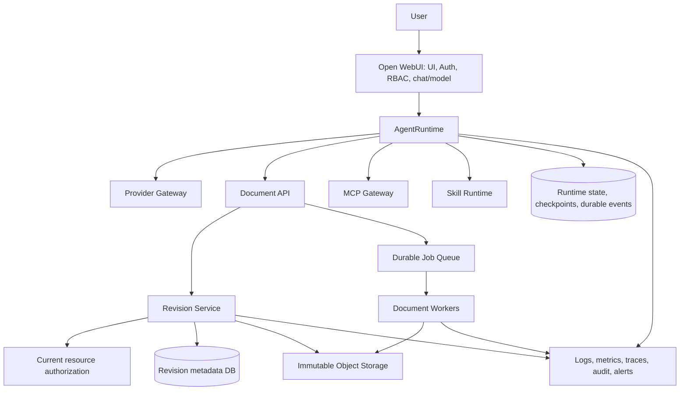

# Mini-Hermes production AgentRuntime implementation plan

**Status:** Approved architecture; implementation and staging gates remain to be demonstrated.

**Decisions:** [ADR-001](../adr/ADR-001-agent-runtime-production-path.md) · [ADR-002](../adr/ADR-002-agent-runtime-contract-domain-boundaries.md)

## Architecture decisions

- Keep current AgentRuntime as the production execution path. DeerFlow is evaluated only after baseline and hard gates; it is not the default migration.
- Keep Open WebUI as UI, Auth, RBAC, chat, and model-management layer. Serve 10–20 users in a rolling 30-day window. Preserve current notices and track the rolling count. The internal 99.9% availability goal is not an SLA.
- Keep separate 95,000-character internal preparation and 100,000-character serialized JSON request caps. Reject oversized final provider JSON before the provider call; count tokens and bytes separately.
- Document API owns read/inspect/search/propose_edit/export. A commit endpoint delegates to Revision Service. AgentRuntime never writes the document DB or object store directly.
- Revision Service is the sole authority for approvals, validation, atomic visibility, and rollback. Agent approval pause/resume remains separate from document approval.
- Publish revisions by verified immutable staged objects plus one DB visibility transaction, not distributed ACID. Use durable outbox retry, stable event IDs, delayed orphan cleanup, and compensating revisions for rollback.
- Pin one immutable engine to each conversation and one execution owner to each run. Canary or rollback changes selection only for new conversations.

## Current refinement

The [use-case, design, test and audit specification](../design/mini-hermes-use-cases-design-and-tests.md) defines the approved all-product scope. Replace persistence for both Mini-Hermes and Open WebUI with PostgreSQL/SQLAlchemy async; keep product features, current AgentRuntime and ADR ownership. No legacy data compatibility/backfill is required. The user authorized reset of the verified local development DB during the separate implementation, not production deletion. Ollama and its UI/probes/discovery/embedding paths are excluded. The current documentation work does not execute resets or change source code. Historical test ledgers remain historical evidence.

## Service contracts and ownership

| Owner | Contract and authoritative state |
|---|---|
| Auth Service / Open WebUI | Authenticated principal, UI, RBAC, chat, and model management. |
| AgentRuntime | `start`, `stream(after_sequence)`, `cancel`, `resume`, `get_status`; conversation/run binding, event log, checkpoint, cancellation, and recovery. No direct document DB/object-store writes. |
| Document API | `read`, `inspect`, `search`, `propose_edit`, `export`; commit endpoint delegates to Revision Service. |
| Revision Service | Patch validation and hash, diff, current resource authorization, document approval, revision preconditions, atomic commit and rollback. |
| MCP Gateway | Tool discovery, connection lifecycle, per-user/admin credentials, invocation, isolation, timeout, rate limit and audit. |
| Skill Runtime | Skill registry, immutable version, loading, permission and sandboxed execution. |
| Document workers / storage | Durable processing, immutable staged objects/artifacts, checksums, recovery, backup and cleanup. |

Document approval binds `user_id`, `resource_id`, `base_revision`, `patch_hash`, approver identity and expiration. Commit revalidates current authorization, approval, base revision and exact patch hash; approval consumption and publication share the DB transaction. The principal comes from Auth Service. Never trust LLM/AgentRuntime approval state.

`ConversationEngineBinding = (engine_type, engine_version)`. `RunBinding = (engine_type, engine_version, engine_run_id, engine_thread_id, tool_contract_version, skill_snapshot_version)`. A run binding must match its conversation. Retries use idempotency keys; unknown side effects are quarantined until reconciled. Append events durably before publish; replay by sequence, deduplicate `(run_id, sequence)`, and use status/snapshot plus log replay to repair reconnect gaps.

## Dependency graph

## Implementation phases

Implement each component’s target PostgreSQL tables, SQLAlchemy repositories, FK/transaction boundaries and constraints within its owning phase, before that component executes. Phases 2–6 must not build on old ORM models and postpone their replacement to phase 7. Phase 7 assembles and validates the complete fresh baseline/bootstrap across all domains, including remaining Open WebUI persistence, local reset guards and removal of legacy-only paths. This dependency clarification preserves the phase order and avoids temporary data-compatibility execution paths.

1. **Characterize and verify architecture.** Map the existing execution path and ownership. Characterize request serialization/limits, approvals, revisions, worker lifecycle and recovery. Capture performance baseline before setting absolute thresholds.
2. **Canonical AgentRuntime and runtime contract.** Implement the versioned start/stream/cancel/resume/status contract, immutable `ConversationEngineBinding`, matching `RunBinding`, one execution owner per run, pinned engine, and idempotent command handling.
3. **Durable sessions, events and recovery.** Persist lifecycle events and checkpoints; implement sequence replay, reconnect/dedup/gap recovery, restart/crash recovery, cancellation, resume, and lease fencing. Keep unknown side effects blocked from blind retry.
4. **Unified context management and request budgeting.** Enforce 95,000 preparation and 100,000 final serialized JSON characters separately from token/byte budgets. Compact/reconstruct context and reject oversize requests before provider invocation.
5. **Provider gateway and tool execution.** Use one provider/tool path, durable invocation ledger, cancellation, bounded output, retry policy, idempotency keys and unknown-outcome handling. Keep MCP Gateway and Skill Runtime within their assigned domains.
6. **Large-file retrieval, artifacts and revision publication.** Add bounded large-file retrieval and durable artifacts; stage immutable checksum-addressed objects; atomically publish metadata/pointer/approval/outbox; recover crashes and orphans; implement approval checks and compensating rollback.
7. **Fresh versioned persistence baseline.** Design and implement new PostgreSQL/SQLAlchemy async persistence across Mini-Hermes and Open WebUI. Remove ORM/schema/backfill/history-import adapters used only by legacy data; validate fresh bootstrap, parent/child FK ordering, public UI/API contracts, local-target reset guards and backup/restore in disposable PostgreSQL/staging. Local DB reset is authorized for the separate implementation. No production reset/migration or live traffic cutover is authorized.
8. **Integration and production validation.** Run security, integrity, reliability, recovery, load, resource-exhaustion, backup/restore, and regression suites. Fix all hard-gate failures before rollout.
9. **Conditional DeerFlow evaluation.** Only after AgentRuntime baseline and hard gates pass. Lock benchmark protocol and use identical model/profile, tools/versions, documents, prompts, workloads, resource limits, scoring rubric and environment. Randomize order. Include malformed Office files, large documents, prompt injection, slow/unavailable MCP servers and concurrent document edits. Start at 50 paired tasks per workload group, 3 repeated trials per task per runtime; calculate paired 95% CIs for task success, p95 end-to-end latency and cost/run. Increase to 100 and then at most 200 paired tasks per group only when intervals cross the preregistered decision boundary or exceed its registered width; analyze only at fixed sample checkpoints. Inconclusive at 200 is no-go. DeerFlow qualifies only if all hard gates and locked absolute performance thresholds pass, and either task success improves ≥10 percentage points with the CI lower bound ≥10 points, or p95 latency improves ≥20% with CI confirmation while task-success CI lower bound is no worse than −2 points. In either case, cost/run regression CI upper bound must be ≤10%. A passing benchmark permits a canary for new conversations only. Production approval is still required. Rollback affects new conversations only; keep existing conversations pinned. Remove the old path only after approved cutover and successful drain.

No phase is an MVP. No production cutover or irreversible production migration is part of this plan without explicit production approval.

## Production acceptance criteria and gates

| Gate | Measurable pass condition |
|---|---|
| Security | Zero unauthorized document reads or commits in the security suite, including stale/revoked permission, expired approval, cross-user/resource, and credential-isolation cases. |
| Data integrity | Zero lost committed revisions in recovery tests. No revision visible until staged object checksum is verified. Concurrent edits from the same base cannot overwrite one another. Rollback retains full history. |
| Reliability | Zero duplicate external tool side effects in fault-injection tests. Inject crashes before/after object stage, DB commit, outbox publication, and acknowledgement. Retries do not duplicate revision or side effect. |
| Runtime recovery | Restart, crash recovery, stream reconnect/replay, duplicate-event deduplication, sequence-gap snapshot/replay, cancel/resume, stale checkpoint rejection, and cross-runtime resume rejection all pass. |
| Request bounds | Boundary tests pass at 95,000 preparation and 100,000 serialized JSON characters. A request beyond either applicable limit is rejected before provider invocation. |
| Operations | Permission isolation, graceful shutdown, worker recovery, rate/resource exhaustion, audit, alerts, backup/restore and workload load tests pass for 10–20 daily users. Record 99.9% as internal target, not SLA. |
| Performance | Capture current-runtime baseline first. Register absolute p95 latency, throughput, error-rate and resource thresholds before head-to-head comparison. |
| License | Preserve Open WebUI notices; report rolling 30-day user count. Do not seek an enterprise license or revert to an older Open WebUI release absent a real usage/licensing need. |

### Go/no-go

- **Production rollout of the current runtime:** go only when all hard gates above pass in staging, restore is verified, runbooks/alerts are ready, and a production release is explicitly approved.
- **DeerFlow benchmark:** no-go until current runtime baseline and security/data-integrity/reliability gates pass, protocol and decision margins are registered, and the workload fixture is fixed.
- **DeerFlow canary:** go only if all DeerFlow hard gates, absolute thresholds and statistical improvement criteria pass. Canary selects DeerFlow only for new conversations; every existing conversation remains pinned.
- **Production cutover/removal:** requires separate explicit production approval, successful canary, rollback rehearsal, and draining of existing conversations. No-go or inconclusive results retain current AgentRuntime as the single production execution path.

## Verified facts, assumptions, and test obligations

- **Verified in checkout:** current AgentRuntime, Document API/revision code, request budgeting, migration scaffolding, and tests exist. Their presence is not proof of production behavior. The final serialized body must be validated after provider transforms.
- **Assumptions/decisions:** 10–20 users in a rolling 30-day window; Open WebUI ownership and license approach stay as decided; 95,000/100,000 character caps; current AgentRuntime remains production path; 99.9% is an internal target.
- **Must be proven in automated tests and staging:** atomic publication and crash recovery against the actual object store, immutable conditional writes, current authorization at commit, event outbox/replay/gap recovery, idempotent external side effects, concurrency and isolation gates, backup/restore, measured performance, and fresh-bootstrap/restore behavior. Production migration, if needed, requires a separate approved plan; old local data compatibility is not a gate.
