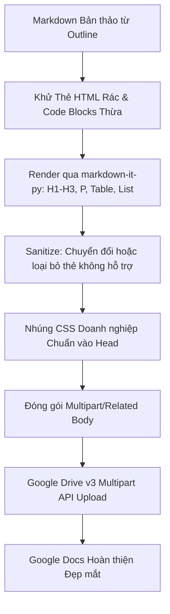

# ĐẶC TẢ KỸ THUẬT: EGRESS XUẤT BẢN GOOGLE DOCS & GOOGLE SHEETS

**Mã tài liệu:** SPEC-EGRESS-04  
**Phạm vi:** Chuyển đổi Clean Markdown sang Google Docs (Drive v3 Multipart HTML) và Google Sheets, xử lý triệt để lỗi rác HTML và định dạng xấu.  

---

## 1. PHÂN TÍCH NGUYÊN NHÂN LỖI ĐỊNH DẠNG HIỆN TẠI

| Hiện tượng Lỗi | Nguyên nhân Kỹ thuật | Giải pháp Khắc phục Triệt để |
| :--- | :--- | :--- |
| **Lẫn thẻ HTML thô (`<div>`, `<span>`, code blocks)** | LLM sinh lẫn thẻ HTML tùy biến hoặc Markdown renderer giữ nguyên raw HTML tags không hỗ trợ bởi Google Docs. | Xây dựng bộ lọc **HTML Sanitizer & Stripper**: Bóc tách hoặc gỡ bỏ toàn bộ thẻ `<div>`, `<section>`, `<article>`, `<style>` rác; chỉ giữ lại Semantic Elements chuẩn. |
| **Bảng biểu mất viền, dính chữ** | Thiếu thuộc tính `border-collapse: collapse;` và `padding` trong CSS nội tuyến của thẻ `<table>`, `<th>`, `<td>`. | Đóng gói bộ CSS chuẩn doanh nghiệp tự động nhúng vào `<head>` của payload HTML multipart. |
| **Font chữ lộn xộn, giãn cách xấu** | Không định nghĩa `font-family` đồng nhất; Google Docs tự fallback sang Times New Roman 12pt. | Khóa cứng font chuẩn văn phòng: `Arial` hoặc `Times New Roman`, cỡ chữ 11pt, `line-height: 1.5`, tiêu đề màu xanh navy `#0d47a1`. |
| **Rate limit hoặc chậm chạp** | Gọi Google Docs API v1 (chèn từng batchUpdate text) rất chậm và dễ chạm hạn mức 300 req/phút. | Dùng **Google Drive API v3 Multipart HTML Upload**: Đẩy 1 request duy nhất toàn bộ file HTML, thời gian xử lý $< 1$ giây. |

---

## 2. QUY TRÌNH CHUẨN HÓA HTML CHO GOOGLE DOCS (CLEAN HTML NORMALIZER)



### 2.1. Bộ lọc Khử Rác HTML (Sanitizer Rules)
1. **Loại bỏ thẻ vô nghĩa:** Xóa bỏ toàn bộ `<div.*?>`, `</div>`, `<section>`, `</section>`, `<main>`, `</main>`. Nếu có text bên trong, giữ lại text và bọc bằng `<p>`.
2. **Xử lý ngắt dòng:** Thay thế `\n\n` thành ngắt đoạn `<p>...</p>`, tránh việc chèn hàng loạt `<br><br>` gây giãn cách không đều.
3. **Chuẩn hóa Bảng biểu:**
   - Mọi thẻ `<table>` bắt buộc có: `<table border="1" cellpadding="6" cellspacing="0">`.
   - Mọi dòng tiêu đề bảng bắt buộc nằm trong `<thead><tr><th>...</th></tr></thead>`.
   - Mọi ô dữ liệu bắt buộc nằm trong `<tbody><tr><td>...</td></tr></tbody>`.

### 2.2. Bộ Template HTML & CSS Chuẩn Doanh nghiệp cho Google Docs
Toàn bộ nội dung khi chuyển sang Google Docs phải được đặt trong khung template sau:

```html
<!DOCTYPE html>
<html lang="vi">
<head>
  <meta charset="utf-8">
  <title>{DOCUMENT_TITLE}</title>
  <style>
    @page {
      margin: 1in;
      size: A4 portrait;
    }
    body {
      font-family: Arial, Helvetica, sans-serif;
      font-size: 11pt;
      line-height: 1.5;
      color: #202124;
      background-color: #ffffff;
      margin: 0;
      padding: 0;
    }
    h1 {
      font-family: Arial, Helvetica, sans-serif;
      font-size: 18pt;
      font-weight: bold;
      color: #0b57d0;
      margin-top: 18pt;
      margin-bottom: 8pt;
      text-align: left;
    }
    h2 {
      font-family: Arial, Helvetica, sans-serif;
      font-size: 14pt;
      font-weight: bold;
      color: #1a73e8;
      margin-top: 14pt;
      margin-bottom: 6pt;
      border-bottom: 1px solid #dadce0;
      padding-bottom: 3pt;
    }
    h3 {
      font-family: Arial, Helvetica, sans-serif;
      font-size: 12pt;
      font-weight: bold;
      color: #3c4043;
      margin-top: 10pt;
      margin-bottom: 4pt;
    }
    p {
      margin-top: 0;
      margin-bottom: 6pt;
      text-align: justify;
    }
    ul, ol {
      margin-top: 0;
      margin-bottom: 8pt;
      padding-left: 20pt;
    }
    li {
      margin-bottom: 3pt;
    }
    table {
      border-collapse: collapse;
      width: 100%;
      margin-top: 8pt;
      margin-bottom: 14pt;
      font-size: 10pt;
    }
    th {
      background-color: #f1f3f4;
      color: #202124;
      font-weight: bold;
      border: 1px solid #c0c0c0;
      padding: 6pt 8pt;
      text-align: left;
    }
    td {
      border: 1px solid #dadce0;
      padding: 5pt 8pt;
      vertical-align: top;
      color: #3c4043;
    }
    tr:nth-child(even) td {
      background-color: #fafafa;
    }
    blockquote {
      border-left: 3px solid #1a73e8;
      background-color: #f8f9fa;
      margin: 8pt 0;
      padding: 6pt 12pt;
      color: #5f6368;
      font-style: italic;
    }
    hr {
      border: 0;
      border-top: 1px solid #dadce0;
      margin: 14pt 0;
    }
  </style>
</head>
<body>
  {CLEAN_SEMANTIC_BODY_HTML}
</body>
</html>
```

---

## 3. ĐẶC TẢ REQUEST GOOGLE DRIVE API V3 MULTIPART UPLOAD

### 3.1. Tạo mới Google Docs (`POST /upload/drive/v3/files?uploadType=multipart`)
- **Headers:**
  ```http
  Authorization: Bearer {USER_GOOGLE_ACCESS_TOKEN}
  Content-Type: multipart/related; boundary=mini_hermes_boundary_part
  ```
- **Body:**
  ```http
  --mini_hermes_boundary_part
  Content-Type: application/json; charset=UTF-8

  {
    "name": "Hop_Dong_Dich_Vu_Weamis",
    "mimeType": "application/vnd.google-apps.document",
    "parents": ["{GOOGLE_DRIVE_FOLDER_ID}"]
  }
  --mini_hermes_boundary_part
  Content-Type: text/html; charset=UTF-8

  <!DOCTYPE html>
  <html>
  ... nội dung clean html ...
  </html>
  --mini_hermes_boundary_part--
  ```

### 3.2. Cập nhật Google Docs đã có (`PATCH /upload/drive/v3/files/{file_id}?uploadType=multipart`)
- Giữ nguyên `file_id` để đường link chia sẻ cho khách hàng không bị đổi.
- Nội dung mới sẽ ghi đè toàn bộ tài liệu cũ một cách nguyên tử (atomic update).

---

## 4. ĐẶC TẢ XUẤT DỮ LIỆU SANG GOOGLE SHEETS

### 4.1. Quy trình Chuyển đổi Markdown Table $\to$ Google Sheets Matrix
1. **Phân tích Cú pháp:** Trích xuất các khối bảng `| ... | ... |` trong Markdown.
2. **Xây dựng Mảng 2 Chiều (`List[List[Any]]`):**
   - Loại bỏ dòng phân cách `| --- | --- |`.
   - Parse từng ô: Tự động cast kiểu dữ liệu:
     - Số nguyên / số thực: Chuyển sang `int` / `float` (ví dụ `15000000` thay vì `"15000000"`).
     - Ngày tháng: Chuẩn hóa theo định dạng ngày.
     - Chuỗi văn bản: Giữ nguyên.
3. **Tạo Bảng tính qua Google Sheets API v4:**
   - Bước 1: Tạo Spreadsheet mới qua `POST https://sheets.googleapis.com/v4/spreadsheets`.
   - Bước 2: Điền dữ liệu bằng `PUT https://sheets.googleapis.com/v4/spreadsheets/{spreadsheetId}/values/Sheet1!A1?valueInputOption=USER_ENTERED`.
   - Bước 3: Định dạng dòng tiêu đề: Gọi `spreadsheets.batchUpdate` để in đậm hàng 1 và đặt màu nền xám nhạt `#F1F3F4`.
4. **Trả về Link:** `https://docs.google.com/spreadsheets/d/{spreadsheetId}/edit`.

