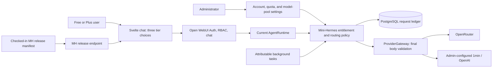

# Mini-Hermes tiered model routing and release notes

**Status:** Written specification approved 2026-11-18; implementation plans prepared separately.

## Purpose and constraints

Mini-Hermes serves 10–20 users in a rolling 30-day window. An administrator provisions accounts. Free users choose only **Free Small**, **Free Medium**, or **Free Large** and use approved OpenRouter free models. Plus users choose only **Plus Small**, **Plus Medium**, or **Plus Large** and may use the OpenRouter, 1min, and OpenAI connections configured by an administrator. Users see a Mini-Hermes model group, never the selected provider or concrete model. An administrator grants each Plus user a monthly number of LLM requests. One unit is one outbound backend request to a chat or Responses LLM API, including agent tool loops and user-attributable background tasks.

This design extends Open WebUI's UI, authentication, RBAC, chat, and model management. It keeps the current AgentRuntime as the production execution engine, with immutable conversation engine bindings and one run owner. It preserves the 95,000-character preparation and 100,000-character final JSON limits, document approval authority, Open WebUI license notices, and existing public API contracts. No new product dependency, Ollama path, production database reset, or production cutover is part of this work. The [production AgentRuntime plan](../../plans/production-agent-implementation-plan.md) and [ADR-001](../../adr/ADR-001-agent-runtime-production-path.md) and [ADR-002](../../adr/ADR-002-agent-runtime-contract-domain-boundaries.md) remain controlling.

## Current and target flow

Today `/api/models` enumerates configured provider models and filters access; `/api/chat/completions` resolves a concrete model and starts the current AgentRuntime; the OpenAI-compatible router prepares a request and `ProviderGateway.send` dispatches it. A document worker can also call the gateway directly. Chat-message usage statistics do not count every physical provider request. The backend's `/api/version/updates` checks Open WebUI releases, while `/api/changelog` serves the upstream changelog.

The tier policy controls admission and model choice; `ProviderGateway` remains the sole validated transport for LLM JSON. AgentRuntime remains responsible for runs, events, checkpoints, and tool recovery. The policy does not gain document revision or tool-approval authority.

## Identity, catalog, and model choice

- Keep Open WebUI roles (`admin`, `user`, `pending`) independent from a Mini-Hermes entitlement (`free`, `plus`). Existing non-admin users start Free; pending users cannot infer. First-admin bootstrap remains available. After bootstrap, local signup and OAuth auto-provisioning are disabled for this product; Google OAuth login remains available for accounts already provisioned by an administrator. Admins use the existing account workflow, and a separate admin-only plan action upgrades, downgrades, or changes a quota. Admins retain provider/model management access and are outside end-user quotas.
- Publish six stable logical model IDs: `mh-free-small`, `mh-free-medium`, `mh-free-large`, `mh-plus-small`, `mh-plus-medium`, `mh-plus-large`. The three IDs for the user's tier are the only chat models returned to that user. Keep the concrete provider connection and model ID in private routing/audit records; user-facing model lists, streams, saved chat metadata, and errors use the logical ID and name. Administrative connection screens may show concrete models.
- Each logical group has an administrator-approved, versioned candidate pool. A candidate records a stable connection ID, provider model ID, priority, enabled state, and capabilities (text, image input, tools, structured output, minimum context). Connection list indexes are not durable identifiers; a removed or changed connection makes its candidates unavailable until reapproved. Small favors low latency, Medium balances latency and capability, and Large favors difficult or long-context work. The administrator assigns these tiers based on MH workload checks rather than provider marketing names.
- At each new run or standalone user-attributable task, select an eligible model within the requested group using the request's declared capabilities, estimated context, admin priority, and recent health. A user-triggered background task inherits the originating run's group, or uses that user's Small group when no run exists. Do not call another LLM to classify the task. Keep the concrete model stable for the run. A fallback can choose another candidate only before user-visible output or external tool side effects; after that, report and recover the failed run through the runtime contract. Never cross from a Free group to a paid model.
- Free candidates must use the OpenRouter connection, have a `:free` ID, and have zero published prompt, completion, and request price when approved and on refresh. Apply a provider price ceiling of zero where supported. Refresh OpenRouter model metadata at least hourly; if eligibility cannot be verified from a current cached catalog, make that candidate unavailable. Admin approval also records the allowed data-handling policy; do not auto-add a newly discovered free model. A group with no eligible candidate returns a specific availability error, not an arbitrary provider fallback.
- Provider credentials remain server-side. Disable direct browser-to-provider connections and generic provider passthrough for non-admin tier accounts at the backend boundary. Enforce the same entitlement for chat completions, Responses, task generation, API-key authentication, saved chats, and any remaining alternate inference path. A raw model ID supplied by a non-admin client is rejected even if it is cached or referenced by an old chat. Existing chat history remains readable, but non-admin history displays a generic legacy-model label where a prior concrete model ID would reveal a provider; its next turn uses a logical group allowed by the user's current tier.

## Quotas and failure semantics

- Plus grants have a positive integer `monthly_request_limit`. The accounting period is the UTC calendar month; the UI shows the exact next reset timestamp. A Free grant has no Plus monthly limit. Admin changes apply immediately: reducing a limit below current usage blocks further dispatches without rewriting history; downgrade blocks Plus dispatches immediately. Existing in-flight calls may finish.
- Before an attributable outbound Chat Completions or Responses request, create an idempotent ledger reservation under a PostgreSQL row lock on the user's entitlement. Count reservations plus dispatched and unknown outcomes against the current monthly limit, so concurrent requests cannot overbook. The unique dispatch key identifies one physical HTTP attempt and binds user, logical group, request fingerprint, and run/task identity. Replaying the same key and fingerprint returns its existing outcome; a conflicting reuse is rejected.
- Validation, policy, or serialization failures before dispatch release the reservation and use no unit. Mark the request as dispatched immediately before invoking transport. Once dispatch begins, it consumes one unit whether the provider succeeds, returns 4xx/5xx, or the network outcome is unknown. An intentional new physical retry gets a new key and consumes another unit. An unknown outcome stays recorded for reconciliation and is never silently refunded. This definition implements the requested measure: backend requests sent to an LLM API, not user messages or generated tokens.
- Attribute title/follow-up generation, agent tool-loop calls, document analysis, and other user-triggered background inference to the initiating user, passing that identity durably with the job. A genuinely system-owned task uses a separate auditable system budget and cannot borrow an end-user grant. Model discovery, health checks, embeddings, and non-LLM transport calls are outside this request count.
- Track OpenRouter free capacity separately from Plus grants: start with conservative account-wide caps of 20 requests/minute and 50 requests/day, plus 2 free requests/user/day, all configurable by an administrator after verifying the account's actual limits. These are UTC admission windows and may reject earlier than OpenRouter's own reset. If the account has a documented higher free-model cap, an administrator may raise the configured daily caps. A provider-level 429 cools the affected candidate; exhaustion of the shared account cap stops all Free routing until reset. Rotation does not bypass that cap. Show remaining Free daily allowance and a clear retry time when known.
- Record logical group, concrete provider/model, connection, user, run/task, dispatch state, provider status, latency, and correlation ID without storing API keys or prompt bodies in the quota ledger. Keep the existing provider request character/byte/token budgets unchanged and validate the final provider-specific body before dispatch.

## Product interfaces and MH releases

- Add an admin-only plan update endpoint under `/api/v1/mini-hermes/admin/users/{user_id}/plan` accepting `{tier, monthly_request_limit}`. Free requires a null limit; Plus requires a positive integer. Add `/api/v1/mini-hermes/me/plan` with tier, limit, used count, remaining count, and reset time. Return stable error codes for no entitlement, quota exhausted, no eligible model, and shared Free capacity exhausted. Extend existing admin user screens to assign and inspect plans without changing Open WebUI roles or exposing provider credentials.
- Add an admin-only model-pool read/update endpoint under `/api/v1/mini-hermes/admin/model-routing`. It validates connection IDs and candidate capabilities; Free pools additionally validate `:free` and zero price. Keep `GET /api/models` and the existing chat request shape compatible, returning logical models to end users and resolving them server-side. The frontend model selector displays only the three groups for the current tier and the account/usage view displays the current allowance.
- Store a checked-in, versioned MH release manifest with text-only sections and a current `MH_RELEASE_VERSION` supplied by each release build (`dev` locally). Expose `/api/v1/mini-hermes/release` with `{version, released_at, sections}`. A production build must have a matching manifest entry; CI checks this. Show MH's “What's New” once per version using the user's last-seen MH version. No remote version lookup is required.
- Remove the Open WebUI update toast, automatic upstream changelog popup, update-check controls, and outbound GitHub release check from the MH user flow; keep the old endpoints returning compatible local data where callers require them. Preserve Open WebUI copyright/license notices and visible attribution surfaces, including its About identifier. Do not edit the preserved `references/open-webui` tree or overwrite the upstream changelog.

## Acceptance and rollout

- Backend tests cover admin-only provisioning and plan edits, OAuth signup denial for unprovisioned users, cross-tier and raw-model denial through all inference endpoints, Free price/capability checks, no paid fallback, pool exhaustion, provider 429, quota boundaries, concurrent reservations, duplicate starts, physical retries, unknown outcomes, month rollover, downgrades, and user attribution for tool loops and background jobs.
- Tests retain the 95,000-character preparation and 100,000-character final serialized JSON rejection before HTTP, AgentRuntime restart/replay/cancel/resume behavior, and document authorization/revision isolation. Use a disposable PostgreSQL database for quota locking and migration tests. Frontend tests cover the three visible choices per tier, remaining allowance, quota errors, and MH release display without upstream update links.
- Release validation checks the MH manifest/version match, preserved license notices, no upstream release request, audit metrics, OpenRouter account capacity, provider data policy, and the existing staging security, integrity, reliability, recovery, backup/restore, and load gates. An additive schema migration preserves existing production data; applying it to production or enabling the new routing for live users requires a separately approved release action. The existing AgentRuntime remains the production path throughout.

## Assumptions for review

- Plus users see the three Plus groups rather than all six groups; admin-only provider screens still expose the configured models.
- A Plus request is counted once per physical backend LLM API dispatch, including a provider error after dispatch. No token or currency allowance is exposed as the Plus quota.
- Free daily admission defaults to 2 requests per user and 50 for the shared OpenRouter account until an administrator verifies and changes the provider limit.
- `MH_RELEASE_VERSION` is a release-build value, independent of the Open WebUI package version; local `dev` builds do not show release notes automatically.
