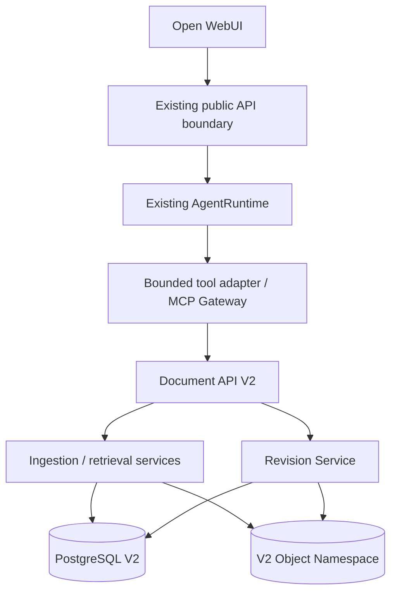

# V2-R1 Architecture Specification

**Status:** Locked / Accepted. **Source of policy:** Master Roadmap + AGENTS.md + ADR-001/002.

## Service owners and prohibited cross-writes

| Component | Sole authority | Forbidden dependencies/actions |
|---|---|---|
| Open WebUI/Auth | UI, principals, sessions, RBAC, chat, models | Deciding document revision commits |
| AgentRuntime (existing) | Run lifecycle, orchestration, event ledger, checkpoint, agent approval | Direct document DB/object writes, document approval |
| Provider Gateway | Pre-send request budget enforcement (95k prep / 100k wire JSON limits, UTF-8 byte bounds), serialized JSON measurement, provider payload transformations, outbound timeout/retry control | Raising character/byte ceilings, bypassing pre-send budget checks, directly querying document DB, mutating conversation state |
| Document API | Upload, inspect, read, search, export, propose edit, user-facing validation | Publishing committed revisions directly |
| Revision Service | Preview, approve, canonical patch, permission recheck, publication, rollback | LLM planning, relying on LLM approval |
| MCP Gateway | Connection/credential ownership, discovery, invocation, rate/timeout/audit | Skill registry, revision metadata authority |
| Skill Runtime | Immutable skill revisions, policy, sandbox execution | MCP credential ownership |
| Document Worker | Idempotent ingestion, source parse, index build, integrity proof, large artifacts | Exposing uncommitted revisions |

## Dependencies and vertical slice

**Early mandatory slice:** one upload -> authenticated conversation -> existing AgentRuntime -> V2 inspect/read tool -> provenance-bearing response -> UI; assert authorization, output boundedness, and no implicit indexing in read.

## Read flows

1. Document API validates principal, file type, size and structural safety; storage stages and verifies immutable bytes. Revision Service publishes the initial revision/current pointer under the [D03d ingestion contract](03d-ingestion-contract.md), then the durable ingestion job proceeds. A returned Open WebUI file ID is only an upload acknowledgement.
2. Worker parses canonical model, builds anchors/chunks, validates counts/proofs, transactionally activates verified build. Read/search is separate from scheduling ingestion.
3. AgentRuntime invokes Document API via controlled tool path; Document API performs current authorization and pins source revision and active index build.
4. Tool returns bounded page + cursor + coverage evidence, or `INDEX_NOT_READY` with existing job ID. Large results stored as artifacts with bounded references.

## Write flow

- Propose exact typed patch -> generate preview + canonical patch hash -> user explicit approval (15m absolute expiry) -> Revision Service checks current principal permission and all preconditions -> stage/verify object -> one DB transaction commits revision, approval consumption, pointer update and outbox. Retries with same idempotency key retrieve same committed result. Rollback is compensating revision.

## Async and failure semantics

- Upload and analysis jobs have explicit durable states; workers can be restarted with job leases and idempotency. Failed builds cannot be active. Retired builds remain readable to pinned cursors during the [D03c retention window](03c-cursor-contract.md#ttl-rotation-and-build-lifecycle); early retirement returns `CURSOR_BUILD_RETIRED`, while an elapsed cursor TTL returns `CURSOR_EXPIRED`.
- DB transaction never pretends atomicity with object storage. Corrupt/missing committed objects fail closed, alert and require operator remediation.
- Provider network disconnection cannot imply completion; owner-scoped status/snapshot and event replay reconcile it.

## Nonfunctional boundaries

- Separate V1/V2 config identities and startup fail-closed guards.
- Tool output JSON budget is applied **after** final serialization including escaping, metadata and cursor; account for UTF-8 bytes and tokens separately.
- No unbounded LLM workbook dumps or repository serialization.
- Logs contain correlation IDs (run, document, revision, build, tool invocation), never credentials or hidden content by default.

## Required review before implementation

Finalize exact service code directories, auth transfer mechanism, object-store naming, transaction isolation level, worker lease policy, retention period, and error-shape normalization through the live checkout. Do not infer these from diagram names.
