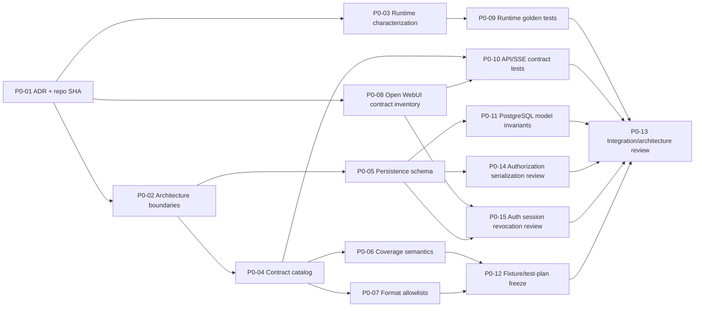
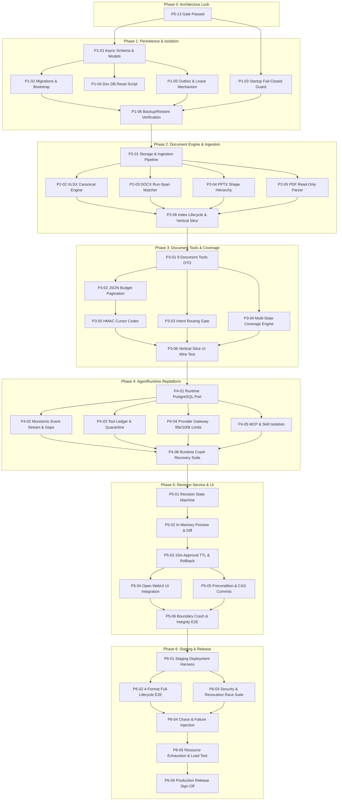

# Phase 0–6 — Agent Task Breakdown & Execution DAG

**Status:** Locked / Accepted. Formal task breakdown and dependency graph for Phase 0 through Phase 6 execution.

---

## 1. Phase 0 Task Breakdown & Dependency Graph

### Phase 0 Work Packages

| ID | Owner role | Dependencies | Target Artifacts | Output | Acceptance check |
|---|---|---|---|---|---|
| P0-01 | Architect | Roadmap | `docs/v2/phase0/01-adr-v2.md` | ADR draft + commit SHA inventory | ADR-001/002 continuity and zero production impact approved |
| P0-02 | Architect | 01 | `docs/v2/phase0/02-architecture-spec.md` | Ownership table / 8 boundary decisions | No conflicting write authorities, Provider Gateway 8th component |
| P0-03 | Runtime owner | 01 | `tests/test_agent_runtime_contract.py` | Current behavior inventory | start/stream/cancel/resume/status sources characterized |
| P0-04 | API owner | 02 | `docs/v2/phase0/03-contract-catalog.md` | Concrete tool/errors/cursor schemas | Typed signatures, error envelopes, idempotency profile |
| P0-05 | DB owner | 02 | `docs/v2/phase0/04-data-model-spec.md` | ERD, 49 `mh_*` tables, FK invariants | Complete table catalog, composite resource FKs, publication state |
| P0-06 | Document owner | 04 | `docs/v2/phase0/05-coverage-semantics.md` | Coverage proof schema | PARSER_COMPLETE ≠ INDEX_COMPLETE ≠ ANALYSIS ≠ LLM_CONTEXT |
| P0-07 | Format owners | 04 | `docs/v2/phase0/06-format-capability-matrix.md` | Per-format capability/allowlist | XLSX/DOCX/PPTX allowlists; PDF strictly read-only |
| P0-08 | Open WebUI owner | 01 | `docs/v2/phase0/07-open-webui-compatibility-manifest.md` | Frontend API/SSE manifest + Ollama elimination | 16 Ollama calls eliminated; route pairs inventoried |
| P0-09 | Runtime test owner | 03 | `tests/test_agent_runtime_runner.py` | Characterization tests executed | 28 runner tests pass with zero failures |
| P0-10 | Integration test owner | 04,08 | `tests/test_v2_phase0_*.py` | Contract tests for public surfaces | Reconnect/auth/error shapes preserved (118 tests pass) |
| P0-11 | DB test owner | 05 | `tests/test_agent_runtime_postgres.py` | Disposable PG integrity test specs | FKs, CAS, crash, idempotency covered |
| P0-12 | QA/Document owner | 06,07 | `packages/backend/tests/fixtures/v2/` | Fixtures/checksums/coverage gates | SHA256SUMS exact match across all fixtures |
| P0-13 | Integration owner | 09..12,14,15 | `docs/v2/phase0/phase0-status.json` | Signed Phase-0 gate report | All 9 deliverables locked; characterization suite 100% pass |
| P0-14 | Authorization owner | 05 | `docs/v2/phase0/04b-authorization-publication-race.md` | Reviewed cross-service authorization | Advisory-lock ordering and READ COMMITTED isolation verified |
| P0-15 | Auth owner | 05,08 | `docs/v2/phase0/03e-auth-session-revocation-contract.md` | Durable session revocation specification | JTI ledger schema and fail-closed session invalidation |

---

## 2. Phase 1 through Phase 6 Execution Task DAG (P1-01 to P6-06)

---

## 3. Concrete Execution Work Breakdown (P1-01 to P6-06)

### Phase 1: Persistence & Environment Isolation (M1)

| Task ID | Owner Role | Dependencies | Target Modules / Files | Deliverable Output | Acceptance Criteria & Verification |
|---|---|---|---|---|---|
| **P1-01** | DB Engineer | P0-13 | `packages/backend/open_webui/models/v2/schema.py` | Greenfield async SQLAlchemy models for 49 `mh_*` tables | Models compile cleanly; composite FKs and unique constraints defined; zero references to legacy V1 models. |
| **P1-02** | DB Engineer | P1-01 | `packages/backend/open_webui/migrations/v2/` | Alembic baseline migration & fresh bootstrap script | Fresh schema bootstrap executes against blank PostgreSQL; all 49 tables created; idempotency verified. |
| **P1-03** | Infra Engineer | P0-13 | `packages/backend/open_webui/env_guard.py` | Fail-closed startup guard checking instance ID & safety token | App aborts boot immediately if configured with V1 database URL or legacy storage namespace. |
| **P1-04** | DevTools Engineer | P1-01 | `packages/backend/scripts/reset_dev_db.py` | Safe reset utility for local dev PostgreSQL instance | Cleans and re-bootstraps dev DB; safety check refuses execution if pointed at non-dev URL or prod markers. |
| **P1-05** | Backend Engineer | P1-01 | `packages/backend/open_webui/outbox/` | Transactional outbox publisher & background worker lease runner | Outbox events written atomically with entities; worker lease prevents duplicate background claims. |
| **P1-06** | QA/Infra Engineer | P1-02, P1-03, P1-05 | `packages/backend/tests/test_v2_phase1_persistence.py` | Automated backup, snapshot, and restore validation suite | DB snapshot restore successfully verified on disposable container; zero data corruption or dangling FKs. |

### Phase 2: Document Engine & Ingestion Pipeline (M2)

| Task ID | Owner Role | Dependencies | Target Modules / Files | Deliverable Output | Acceptance Criteria & Verification |
|---|---|---|---|---|---|
| **P2-01** | Document Engineer | P1-06 | `packages/backend/open_webui/document_engine/ingestion.py` | Checksummed immutable byte storage & ingestion state machine | Upload stores raw bytes with SHA-256; idempotent retry returns same receipt; initial revision created. |
| **P2-02** | XLSX Specialist | P2-01 | `packages/backend/open_webui/document_engine/xlsx/` | Canonical XLSX model (sheets, order, visibility, formula, cache) | Formula Protection Guardrail enforced; cached vs uncached formulas distinguished; merged cells bound. |
| **P2-03** | DOCX Specialist | P2-01 | `packages/backend/open_webui/document_engine/docx/` | DOCX Run-Span Boundary Matcher & section/header/footer parser | Extracts paragraphs, tables, links, headers/footers; style properties preserved across run boundaries. |
| **P2-04** | PPTX Specialist | P2-01 | `packages/backend/open_webui/document_engine/pptx/` | PPTX shape hierarchy, slide order & text frame parser | Recursively traverses grouped shapes; extracts titles and slide notes with structural anchors. |
| **P2-05** | PDF Specialist | P2-01 | `packages/backend/open_webui/document_engine/pdf/` | Read-only PDF parser with image/text coverage classification | Strict read-only invariant; image-only pages detected with explicit metadata; all edits rejected. |
| **P2-06** | Integration Engineer | P2-02..P2-05 | `packages/backend/open_webui/document_engine/slice.py` | Index lifecycle manager & initial Vertical Slice test harness | Open WebUI -> AgentRuntime -> Document API V2 -> XLSX Engine -> UI vertical slice succeeds with test fixture. |

### Phase 3: Document Tools, Intent Routing & Coverage Semantics (M3)

| Task ID | Owner Role | Dependencies | Target Modules / Files | Deliverable Output | Acceptance Criteria & Verification |
|---|---|---|---|---|---|
| **P3-01** | Tool Engineer | P2-06 | `packages/backend/open_webui/document_tools/` | Implementation of 9 canonical document tools | `inspect`, `read_range`, `read_spreadsheet`, `search`, `analyze`, `summary`, `task`, `export`, `propose`. |
| **P3-02** | Protocol Engineer | P3-01 | `packages/backend/open_webui/document_tools/pagination.py` | Serialized JSON-budget pagination engine (5,952 chars ceiling) | Page size measured on complete wire JSON including escaping and metadata; minimal envelope error handled. |
| **P3-03** | AI/Agent Engineer | P3-01 | `packages/backend/open_webui/document_tools/router.py` | Deterministic zero-LLM token intent router & context gate | Routes requests to inspect/sample/full-read; prevents unverified claims of reading entire workbooks. |
| **P3-04** | Verification Engineer | P3-01 | `packages/backend/open_webui/document_tools/coverage.py` | Multi-state coverage accounting engine (`PARSER ≠ INDEX ≠ ANALYSIS ≠ LLM`) | Validates half-open intervals `[start, end)`; credits zero units for fragmented units until complete. |
| **P3-05** | Security Engineer | P3-02 | `packages/backend/open_webui/document_tools/cursor.py` | Authenticated HMAC-SHA256 cursor codec with 15m TTL | Cursors bind user, query, range, revision; expired or tampered cursors rejected with HTTP 401/409. |
| **P3-06** | QA Engineer | P3-02..P3-05 | `packages/backend/tests/test_v2_phase3_tools.py` | Vertical slice extension test with provenance & coverage in UI | Tool responses render correct provenance, coverage indicators, and pagination in frontend. |

### Phase 4: AgentRuntime Replatform & Boundaries (M3)

| Task ID | Owner Role | Dependencies | Target Modules / Files | Deliverable Output | Acceptance Criteria & Verification |
|---|---|---|---|---|---|
| **P4-01** | Runtime Architect | P3-06 | `packages/backend/open_webui/agent_runtime/v2_runtime.py` | Replatformed AgentRuntime using `mh_*` PostgreSQL persistence | Engine version set to `v2`; conversation engine binding enforced; V1 checkpoints rejected. |
| **P4-02** | Runtime Engineer | P4-01 | `packages/backend/open_webui/agent_runtime/v2_events.py` | Monotonic durable event stream with gap recovery engine | Events committed before emission; stream client gap triggers authoritative status snapshot and replay. |
| **P4-03** | Runtime Engineer | P4-01 | `packages/backend/open_webui/agent_runtime/v2_ledger.py` | Tool invocation ledger & ambiguous side-effect quarantine | Retried and failed tool calls tracked; unknown outcomes quarantined, blocking turn resume. |
| **P4-04** | Gateway Engineer | P4-01 | `packages/backend/open_webui/agent_runtime/gateway.py` | Provider Gateway request budget enforcer (95k prep / 100k wire JSON) | Rejects oversized requests before network call; UTF-8 bytes and token budgets tracked separately. |
| **P4-05** | Security Engineer | P4-01 | `packages/backend/open_webui/agent_runtime/sandbox.py` | Sandboxed Skill Runtime & MCP Gateway isolation adapter | Sandboxed execution prevents file system or credential leaks; MCP timeouts and rate limits audited. |
| **P4-06** | QA Engineer | P4-02..P4-05 | `packages/backend/tests/test_v2_phase4_runtime.py` | Concurrency, crash recovery, and runtime characterization suite | All 267+ characterization assertions pass against V2 persistence baseline. |

### Phase 5: Revision Service & Open WebUI Integration (M4)

| Task ID | Owner Role | Dependencies | Target Modules / Files | Deliverable Output | Acceptance Criteria & Verification |
|---|---|---|---|---|---|
| **P5-01** | Revision Owner | P4-06 | `packages/backend/open_webui/mini_hermes/revision_v2.py` | Revision publication state machine (`STAGED -> VERIFIED -> COMMITTED -> AVAILABLE`) | Public visibility bounded by atomic DB transaction; staged bytes verified before commit. |
| **P5-02** | Revision Owner | P5-01 | `packages/backend/open_webui/mini_hermes/preview_v2.py` | In-memory diff preview & canonical patch hashing engine | Generates deterministic diff and SHA-256 patch hash without mutating base revision. |
| **P5-03** | Security Engineer | P5-02 | `packages/backend/open_webui/mini_hermes/approvals.py` | 15-minute approval TTL enforcement & compensating rollback engine | Approvals expire after 15m; expired commit rejected; rollback creates compensating revision. |
| **P5-04** | Frontend Engineer | P5-03 | `packages/frontend/src/lib/components/chat/DocumentChangeReview.svelte` | Open WebUI review UI, approval modal, and expiry countdown | Displays exact diff, approver identity, expiration timer; commits via Revision Service API. |
| **P5-05** | Backend Engineer | P5-03 | `packages/backend/open_webui/mini_hermes/preconditions.py` | Revision CAS preconditions & concurrent edit conflict resolver | Detects base revision mismatch; rejects concurrent colliding commits with HTTP 409 Conflict. |
| **P5-06** | QA Engineer | P5-04, P5-05 | `packages/backend/tests/test_v2_phase5_revision.py` | Revision boundary crash and publication integrity test suite | Tests crash-before-commit, crash-after-commit, orphan sweeper, and tamper detection. |

### Phase 6: Staging Environment Release & Acceptance Gate (M4)

| Task ID | Owner Role | Dependencies | Target Modules / Files | Deliverable Output | Acceptance Criteria & Verification |
|---|---|---|---|---|---|
| **P6-01** | DevOps Engineer | P5-06 | `compose.yaml`, `Dockerfile`, staging configs | Isolated multi-service staging environment deployment harness | Multi-service stack (backend, frontend, postgresql, minio) starts cleanly with V2 namespaces. |
| **P6-02** | E2E Test Engineer | P6-01 | `tests/e2e/test_v2_all_formats.py` | 4-Format full-lifecycle E2E automated test suite (Tiers 1–4) | XLSX, DOCX, PPTX, PDF read-only pass end-to-end (upload, inspect, read, edit/refusal, export). |
| **P6-03** | Security Auditor | P6-01 | `tests/e2e/test_v2_security_isolation.py` | Security isolation, revoked session, and race verification suite | Zero unauthorized document access; revoked JTI rejects requests; permission race gate passes. |
| **P6-04** | Chaos Engineer | P6-02, P6-03 | `tests/e2e/test_v2_chaos_resilience.py` | Failure injection, worker crash, and stream reconnect suite (Tier 5) | Simulated network drop, worker kill, and storage disconnect recover cleanly without data loss. |
| **P6-05** | Perf Engineer | P6-04 | `tests/e2e/test_v2_performance_load.py` | Resource exhaustion, performance baseline & load test report | Establishes fixed performance baselines (p95 latency, throughput, memory bounds) under load. |
| **P6-06** | Principal Architect | P6-05 | `docs/v2/phase6/release-gate-signoff.md` | Formal production release gate review and sign-off artifact | Zero lost revisions, zero duplicate side effects, zero unauthorized commits; gate certified. |
