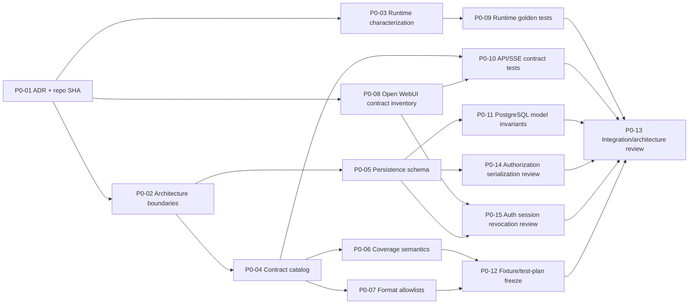

# Phase 0 — Agent Task Breakdown & Dependency Graph

**Status:** Proposed. Work has begun on several tasks, but none is accepted at the Phase 0 gate; owners are *roles*, not assigned people.

## DAG

## Work packages

| ID | Owner role (one writer) | Dependencies | Output | Acceptance check |
|---|---|---|---|---|
| P0-01 | Architect | Roadmap | ADR draft + commit SHA inventory | ADR-001/002 continuity and no-production-change approved |
| P0-02 | Architect | 01 | Ownership table / boundary decisions | No conflicting write authorities |
| P0-03 | Runtime owner | 01 | Current behavior inventory | start/stream/cancel/resume/status sources and limitations documented |
| P0-04 | API owner | 02 | Concrete tool/errors/cursor schemas; review proposed [D03c cursor profile](03c-cursor-contract.md) and [D03d ingestion contract](03d-ingestion-contract.md) | Typed signatures, operation-specific scope/order, key management, upload/status mapping and invalid/error examples reviewed; codec and ingestion contract tests required before freeze |
| P0-05 | DB owner | 02 | ERD, FK, transactions, lease decisions; see proposed [integrity contract](04a-persistence-integrity-contract.md) | Composite resource FKs, transaction/GC invariants and worker fencing reviewed |
| P0-06 | Document owner | 04 | Coverage proof schema | No parser/index/LLM conflation |
| P0-07 | Format owners | 04 | Per-format capability/allowlist | Unsupported operations rejected by design |
| P0-08 | Open WebUI owner | 01 | Actual frontend consumer API/SSE manifest | Every consumer paired to backend and golden fixture |
| P0-09 | Runtime test owner | 03 | Characterization tests executed | Result records include current failing behavior |
| P0-10 | Integration test owner | 04,08 | Contract tests for public surfaces | Reconnect/auth/error shapes preserved |
| P0-11 | DB test owner | 05 | Disposable PG integrity test specs | FKs, CAS, crash, idempotency covered |
| P0-12 | QA/Document owner | 06,07 | Fixtures/checksums/coverage gates | Actual or labeled synthetic XLSX tested |
| P0-13 | Integration owner | 09,10,11,12,14,15 | Signed Phase-0 gate report | No unresolved P0 blocking decisions |
| P0-14 | Authorization owner | 05 | Reviewed cross-service publication authorization protocol and [writer inventory](04c-effective-authorization-writer-inventory.md); see also [race finding](04b-authorization-publication-race.md) | Account for grants, folder topology/ownership, inherited groups, admin/status, external identity, transaction ownership and advisory-lock ordering; specify isolation and fail-closed conditions. Current-checkout mitigations are not V2 production proof. |
| P0-15 | Auth owner (DB reviewer) | 05,08 | Review [D03e session revocation candidate](03e-auth-session-revocation-contract.md) against [D07f current behavior](07f-auth-session-boundary-inventory.md) | Freeze durable per-token logout, failure/unknown-outcome response, JTI retention, browser/Socket.IO reauthorization and migration/re-login rule; require disposable PostgreSQL and consumer contract tests. |

## Work division rules for coding agents

- One writer/owner per shared module or document section. Other agents propose PR comments or separate files only; no simultaneous uncoordinated edits.
- Before each task: verify pinned commit, read `AGENTS.md` and ADR-001/002, define exact files-in-scope, dependencies and acceptance assertions.
- Small PR per task; any API change needs schema diff and consumer-driven test changes in same review cycle.
- Do not modify `references/open-webui`, credentials, `.env` or production storage.
- No Phase 1 infrastructure implementation until P0-13 gate passes. Fixture generation/test infrastructure may proceed independently if it does not redefine contracts.

## Handoff protocol

Every agent reports: task ID, branch/commit, modified files, contract changes, tests/commands and outputs, unresolved risks, dependencies unblocked. Integration owner validates no drift and runs `git diff --check`. Evidence must be traceable; planning documents never count as passing tests.

## Sequencing

Wave A: 01/02/03/08; Wave B: 04/05/09; Wave C: 06/07/10/11; Wave D: 12/13. Format owners may draft fixture structure early while contract owner finalizes source-anchor rules. The vertical slice starts in Phase 2 once Phase 0 is accepted.

## Checkout characterization — partial P0-03 / P0-09

At commit `3d1eeedfeed8124706bf666d4da5b0380e7ff9c1`, `packages/backend/open_webui/agent_runtime/runtime.py` exposes `start(**kwargs)`, `stream(turn_id, owner_id, after_sequence, limit)`, `cancel(turn_id, owner_id)`, `resume(turn_id, owner_id, handler, request_payload, metadata)` and `get_status(turn_id, owner_id)`. The catalog's signatures are semantic illustrations, not the current Python signatures.

| Area | Existing characterization evidence | Remaining acceptance work |
|---|---|---|
| Start and binding | `test_agent_runtime_contract.py`: same-key start and mismatched payload, pinned engine and versioned run binding; `test_agent_runtime_runner.py`: completed, concurrent and waiting-approval retries | Prove full contract across supported public entry points and PostgreSQL concurrency |
| Event replay | Contract suite detects deleted sequence gaps; runner suite verifies a snapshot on a gap and event persistence before emission | Verify live client reconnect, retention, transport wire contract and production database crash recovery |
| Cancel and resume | Runner exercises cancellation, approval resume and claim after restart; repository suite covers idempotent owned cancel | PostgreSQL tests cover re-instantiated runtime approval/resume and killed child recovery with injected lease expiry; expand state matrix, concurrent races, stale/foreign checkpoints and real server restart |
| Tool ledger | Repository suite tests acquired/completed tool calls and unknown side effects; runner verifies quarantine and explicit retry-safe registry | Prove provider idempotency/reconciliation cases and complete retry classification; current document read/search may create index jobs |
| Request budgets | Gateway suite checks escaped JSON, exact 100,000/100,001 serialized boundary and validated send; `test_v2_phase0_characterization.py` checks 95,000/95,001 preparation and gateway hard-limit rejection before session invocation | Prove provider-specific transformations and pre-send rejection across all adapters and actual outbound call paths |

These are observations about selected existing tests, not a comprehensive completion claim. Ten runtime characterization cases and resource cases have run on disposable PostgreSQL; see [D08](08-test-plan.md) for exact scope and commands. P0-03 and P0-09 remain open; P0-08 is a partial source inventory and P0-13 is not signed.

P0-10 has initial SSE consumer and mocked Socket.IO envelope characterization; see [D07](07-open-webui-compatibility-manifest.md) and [D08](08-test-plan.md). Full consumer-driven request/response, real transport, session, authorization and reconnect coverage remains open.
